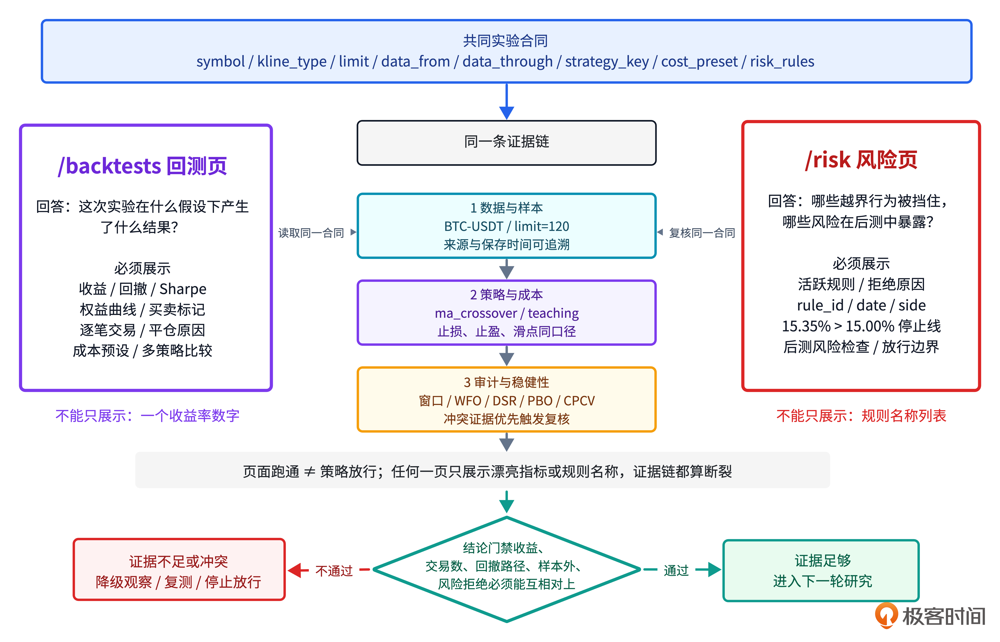
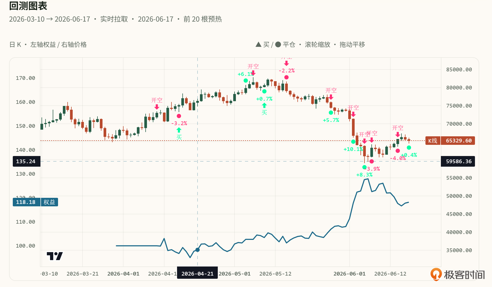
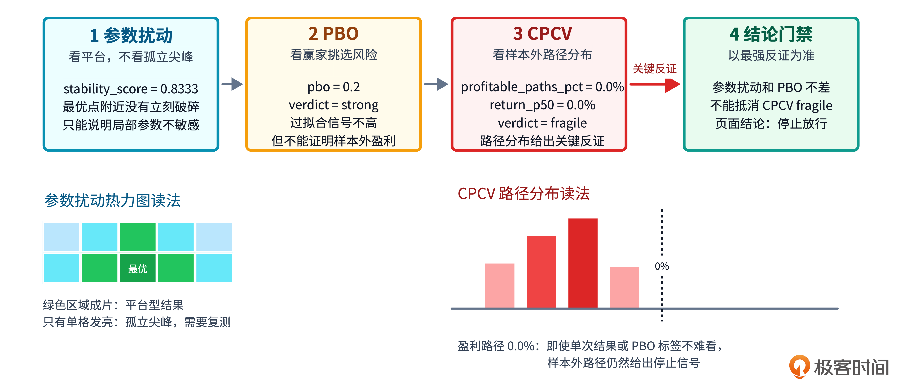

# 26 | 构建策略回测与风险中心

你好，我是袁从德。

第 25 讲我们把 K 线信号页做成了可复核的证据面板。到了第 26 讲，研究会进入一个更容易让人误判的阶段：信号终于跑出了收益曲线，页面也能显示交易和指标，看起来离“策略”只差一步。

但这一步最危险。单次回测的曲线越清楚，越容易让人忘记追问它的前提：样本窗口有多短，交易次数够不够，成本有没有算进去，回撤是不是集中在少数几笔，样本外是否还能站住，风险中心有没有挡下本不该发生的动作。这节课不教你从图上挑一个最好看的策略，而是训练一套把回测结果降温的阅读方法。

```
本讲的交付物是一份回测与风控证据包。它要把 /backtests 页面、/risk 页面、后端回测
```

服务、稳健性审计和成本预设放到同一条证据链里。只有当收益、成本、交易数、回撤路径、样本外表现、过拟合检查、风险阻断和停止条件能够互相对上，回测结果才有资格进入下一轮研究；否则，无论页面多完整，都只能写成降级观察或停止放行。

```
贯穿案例使用仓库当前样本中的 BTC-USDT 与 ma_crossover。这条线索会故意从一次朴素
```

回测开始，再逐步加入多策略比较、窗口稳定性、滚动向前验证、过拟合概率、组合交叉验证、成本预设和风险中心拒单。学完本讲，你应能回答的不是“这个策略赚钱吗”，而是“这份证据是否足够支持继续推进”。

## 1. 回测与风控证据的最小契约

开始跑策略前，先把页面职责和实验合同讲清楚。没有这一步，收益率只是一个孤立数字，既不能解释路径风险，也不能说明成本、样本窗口和风控规则是否一致。

图 26-1 先给出本讲的证据链。回测页负责呈现实验结果，风险页负责暴露阻断和停止线；两页共享同一组样本、成本、审计和结论边界，不能各说各话。



- 图 26-1　回测页与风险页共享同一条证据链

### 1.1 页面职责

```
/backtests 负责回答“这次实验在什么假设下产生了什么结果”，/risk 负责回答“哪些越界
```

行为被系统挡住，哪些风险在后测中暴露”。两者不能互相替代。

```
图 26-2 展示 /backtests 页面里的回测图表。读图时不要只看权益曲线终点，而要同时看
```

样本窗口、K 线价格、买卖标记、平仓点、权益曲线和拖动游标是否处在同一条时间轴上。



- 图 26-2　回测详情页

页面

- 必须展示不能只展示

- 策略、交易对、参数、成本、权益曲线、交易明细、基

```
/backtests
```

- 一个收益率数字准对照、审计结论

- 活跃规则、运行期拒单、拒绝原因、后测风险检查、停

```
/risk
```

- 规则名称列表止线

- “页面加载成功”

两页共同

- 数据来源、样本窗口、能否继续、是否需要复测

- 表 26-1　策略回测页与风险中心的分工

```
在这个仓库里，BacktestsPage.tsx 会调用滚动回测服务，并提供 teaching、
realistic、perp 成本预设；RiskPage.tsx 从研究报告中读取 risk_checks、
risk_rejections 和 risk_rules。页面跑通不等于策略放行，页面只是帮助你把证据看
```

完整。

### 1.2 真实代码入口与实验合同

一次回测实验必须记录清楚输入、样本、成本和风控口径。没有这张合同，后续表格再漂亮也无法解释结果。更重要的是，合同里的每个字段都要能回到真实代码：前端入口主要是

```
src/web/src/pages/trading/BacktestsPage.tsx、
src/web/src/pages/trading/RiskPage.tsx 和 src/web/src/api.ts；后端入口
主要是 src/backtest/rolling/service.py、src/backtest/cost_presets.py、
src/backtest/audit/、src/risk/manager.py 和 src/risk/simulation.py。
```

你不需要一次读完这些文件，但要形成一个习惯：凡是文中出现收益、回撤、拒单、成本预设、PBO 或 CPCV，都应能追到对应函数或字段。

一次回测实验必须记录清楚输入、样本、成本和风控口径。没有这张合同，后续表格再漂亮也无法解释结果。

合同项

- 对应字段或文件为什么必须记录

```
symbol、kline_type
```

标的与周期

- 确定价格样本

```
limit、data_from、data_through、
```

样本窗口

- 确定历史范围和预热区

- 表 26-2　一次回测实验的最小合同

## 2. 从单次回测到多策略比较

```
这里我们用 BTC-USDT 的 ma_crossover 建立最小实验口径，再把它放入同一样本、同一
```

成本预设下做多策略比较。重点不是挑出收益最高者，而是训练一套不会被单次结果诱导的阅读方法。

### 2.1 单次回测实战

```
先用一个最小实验建立口径：BTC-USDT、ma_crossover、limit=120、止损 3%、止盈
5%、成本预设 teaching。如果在仓库根目录直接抽跑片段，先让 Python 找到 src/：
$env:PYTHONPATH='src'
代码 26-1 直接调用 /backtests 页面背后的服务函数。它不是为了“证明策略好坏”，而是为
```

了让每个数字都能追到一笔交易、一段权益曲线和一个成本口径。

```
from backtest.rolling.service import execute_backtest
payload = execute_backtest(
   strategy_name="ma_crossover",
   symbol="BTC-USDT",
   limit=120,
   stop_loss_pct=3,
   take_profit_pct=5,
   cost_preset="teaching",
)
print(payload["total_return_pct"])
print(payload["max_drawdown_pct"])
print(payload["sharpe_ratio"])
print(payload["total_trades"])
print(payload["trades"][0])
```

- 代码 26-1　运行一次可复核的滚动回测

```
当前代码抽跑结果显示：总收益 -5.21%，最大回撤 5.21%，Sharpe 0.0，交易 1 笔。这笔
交易在 entryPrice=64300.6 做多，exitPrice=61079.1 止损退出，持有 4 根 K 线，
单笔收益 -5.21%。
这一段真正有复核价值的是字段之间的关系：total_trades=1 说明统计厚度不足，
exitReason=止损 说明亏损来自退出规则，cost_preset=teaching 说明成本口径仍偏
```

教学。可执行结论不是改参数追回收益，而是降级观察，补样本并进入窗口复核。

### 2.2 多策略比较

单个策略跑出来亏损或盈利，都不代表它已经被充分解释。下一步要把它放进同一交易对、同一样本、同一成本预设下横向比较。

```
from backtest.rolling.service import compare_strategies
payload = compare_strategies(
   symbol="BTC-USDT",
   limit=120,
   cost_preset="teaching",
)
for row in payload["strategies"]:
   print(
       row["strategy_key"],
       row["total_return_pct"],
       row["max_drawdown_pct"],
       row["sharpe_ratio"],
       row["total_trades"],
   )
```

- 代码 26-2　用统一口径比较多条策略

```
表 26-3 给出同一样本下的多策略压力测试。当前结果中，macd 收益最高，但也只有
-0.33%，并没有真正跑赢到可放行的程度；boll_mean_reversion 表现最差，为
-24.85%；buy_and_hold 也有 -22.88% 的样本内收益压力和 27.94% 的最大回撤。这里
```

的重点不是“选择最高的”，而是看每条策略是否用同样假设接受了同样复核。

- Sharpe

策略

- 收益最大回撤交易数判读

```
ma_crossover
-5.21%
5.21%
0.0
1
```

- 交易太少，不能判断策

```
boll_mean_reversion
-24.85%
24.85%
-79.46
6
```

- 明显弱于其他策略

```
rsi_mean_reversion
-4.04%
8.93%
-4.17
3
```

- 样本厚度不足

```
macd
-0.33%
15.68%
0.28
15
```

- 相对不差，但不能放行

```
buy_and_hold
-22.88%
27.94%
-8.39
13
```

- 说明市场窗口本身不利

- 表 26-3　同一 BTC-USDT 样本下的多策略压力测试

这张表给出三个实际判断。

```
ma_crossover 的交易数太少，不能把一次止损解释成策略全貌。
macd 虽然排名领先，但收益仍为负，最大回撤达到 15.68%，所以只能写成“相对不差”，
```

- 不能写成“优胜策略”。

- 同一窗口里连买入持有基准也大幅回撤，说明市场窗口本身不友好。这时最危险的做法是反复调参，把一个不利窗口硬拟合成好结果。多策略比较的正确用法不是选冠军，而是识别“全体同向亏损”“排名随成本变化”“交易数不足”这些会改变下一步动作的信号。

## 3. 窗口稳定性与稳健性审计

策略比较只能说明“同一段样本里谁表现更好”，还不能说明结果是否稳定。这里我们把时间窗口、滚动向前验证、DSR、参数扰动、PBO 和 CPCV 连起来，形成回测页进入风险中心前的硬检查。这里的 Walk-forward 指滚动训练与样本外测试，中文可理解为“滚动向前验证”；DSR（Deflated Sharpe Ratio，去偏夏普比率）用来提醒多次试验后的 Sharpe 可能被偶然性抬高；PBO（Probability of Backtest Overfitting，回测过拟合概率）和 CPCV（CombinatorialPurged Cross-Validation，带净化间隔的组合交叉验证）用来观察参数选择和样本外路径是否脆弱。

### 3.1 窗口与滚动向前验证

```
如果策略只在某一个时间段有效，它很可能是在吃样本运气。compare_windows 会把样本
切成多个窗口，run_walk_forward 会在滚动训练和测试中检查样本外表现。
from backtest.rolling.service import compare_windows, run_walk_forward
windows = compare_windows(
   strategy_name="ma_crossover",
   symbol="BTC-USDT",
   limit=120,
   cost_preset="teaching",
)
wfo = run_walk_forward(
   strategy_name="ma_crossover",
   symbol="BTC-USDT",
   limit=120,
   cost_preset="teaching",
)
print(windows["positive_windows"], windows["num_windows"], windows["stable"])
print(wfo["out_of_sample_return_pct"], wfo["dsr"], wfo["overfit_warning"], wfo["n
```

- 代码 26-3　窗口稳定性与滚动向前验证

```
当前窗口结果很直白：3 个窗口里没有窗口为正，stable=False。滚动向前验证的样本外收
益为 -2.6%，DSR 为 0.4481，num_trials=2，并且 overfit_warning=True。
这几个字段各有分工：positive_windows 看同一参数是否跨窗口工作，
out_of_sample_return_pct 看训练期选择到样本外是否还能站住，dsr 和
num_trials 提醒 Sharpe 可能被多次试验抬高，overfit_warning 则要求页面降级解
```

释。真正要训练的是，你看到这些谨慎信号同时出现时，能直接把结论写成停止放行，而不是继续调参寻找好看的局部窗口。

本案例的处理动作是停止放行，保留为教学反例：没有正窗口、样本外为负、还出现过拟合警告，已经不是“调两个参数再看”的程度。

### 3.2 参数扰动、PBO 与 CPCV

```
优化参数最容易把研究带偏。仓库里的 run_robustness_audit 会做参数扰动和 PBO，
run_cpcv_service 会给出组合交叉验证路径分布。Bailey、Borwein、Lopez de Prado 与
```

Zhu 在 PBO 研究中强调，多次试验后挑出的“最佳”策略可能只是选择偏差；CPCV 的价值不在于制造一个新分数，而在于把样本外路径拆成分布，让你看到结果是不是只靠少数路径撑住。

```
from backtest.rolling.service import run_cpcv_service, run_robustness_audit
audit = run_robustness_audit(
   strategy_name="ma_crossover",
   symbol="BTC-USDT",
   limit=120,
   cost_preset="teaching",
)
cpcv = run_cpcv_service(
   strategy_name="ma_crossover",
   symbol="BTC-USDT",
   limit=120,
   cost_preset="teaching",
)
print(audit["parameter_sensitivity"]["stability_score"])
print(audit["pbo"]["pbo"], audit["pbo"]["verdict"])
print(cpcv["cpcv"]["profitable_paths_pct"], cpcv["cpcv"]["return_p50"], cpcv["cpc
```

- 代码 26-4　运行稳健性审计与 CPCV

```
当前结果仍然不适合放行：参数扰动稳定性分数为 0.8333，PBO 为 0.2 且结论为
strong，但 CPCV 的盈利路径比例为 0.0%，中位数路径收益为 0.0%，结论是
fragile。这类证据冲突很常见，页面不能只挑一个好看的标签展示。
```

这里有三个容易混淆的判断。

1. 参数扰动看的是结果是不是“平台型”：如果最优参数附近的小网格也能维持相近表现，可信

```
度高于孤立尖峰；stability_score=0.8333 只能说明本次小幅扰动没有立刻打碎结
```

- 果。

```
PBO 看的是“赢家挑选风险”：多次试验后挑出的最好策略可能只是选择偏差；pbo=0.2 说
```

- 明当前搜索中的过拟合信号不高，但它不等于样本外可盈利。

```
CPCV 看的是样本外路径分布：profitable_paths_pct=0.0% 说明组合路径里没有盈
利路径，verdict=fragile 直接把结论压回“停止放行”。
```

稳健性审计不是少数服从多数，而是寻找足以改变决策的反证。

证据组合

- 应写成不应

参数扰动稳定、PBO 低、CPCV 多数盈利

- 初步稳健，仍需成本和风控复核已经

参数扰动不稳、PBO 低

- 参数敏感，需要复测过拟

PBO 高、CPCV 中位数为正

- 选择偏差风险高，需要减少搜索或重做验证样本

CPCV 盈利路径少或为零

- 路径脆弱停止放行单次

- 表 26-4　稳健性证据冲突的判读规则

图 26-3 可以读出四件事：参数扰动是在找平台，不是在找孤立最优点；PBO 是在问这是不是试验后挑出来的赢家；CPCV 是在看样本外路径是否成片失效；结论门禁以最强反证为准。只

```
要 CPCV 给出 fragile，页面就不能写成“策略通过”，即使参数扰动和 PBO 看起来不差。
```



- 图 26-3　稳健性审计要同时看参数扰动和样本外路径分布

## 4. 风险中心与成本预设

回测结果进入产品页面后，还要接受两类复核：风险中心解释阻断，成本预设解释执行假设。这里我们把两者放在一起，是为了强调绩效不是策略单独生成的，而是策略、执行假设和风控规则共同生成的。

### 4.1 风险中心数据读取

风险中心的重点不是“有几个规则”，而是“规则有没有在关键时刻挡住越界动作”。本仓库的

```
research.report.build_report(short=3, long=7) 会生成一份事件驱动样本报
```

告，里面包含运行期风控拒绝和后测风险检查。它和滚动回测页不是同一个实验样本，但共同服务于同一个页面职责：风险证据必须可解释。

```
from research.report import build_report
report = build_report(short=3, long=7)
print(report["backtest"]["risk_rules"])
print(len(report["backtest"]["risk_rejections"]))
print(report["backtest"]["risk_rejections"][0])
print(report["risk_checks"])
```

- 代码 26-5　读取风险中心的规则、拒单和后测检查

```
这份报告中活跃规则包括 EMERGENCY_HALT、MAX_POSITION_PCT、
MAX_DAILY_LOSS_PCT、MAX_SLIPPAGE_PCT、ABNORMAL_ORDERBOOK。运行期一共有
176 次 MAX_DAILY_LOSS_PCT 拒绝；第一笔拒绝发生在 2025-03-31 的 BUY 意图上，原
因是权益 8464.93 已经比峰值 10000 低 15.35%，超过允许的 15.00% 停止线。
```

这里的常见误区是，把风险中心写成“规则栈已启用”。启用规则不等于产生约束，真正改变结

```
论的是拒单明细：看 rule_id 确认哪条规则拦截，看 side 和 date 确认拦截发生在哪个订
单意图上，看 reason 确认阈值和当前值是否可复核。若页面只显示 5 条规则，却不显示
15.35% > 15.00% 这样的停止线证据，你无法判断系统是在保护资金，还是只是在展示风
```

控名词。（见表 26-5）

字段

- 本次样本值页面应解释什么

```
rule_id
MAX_DAILY_LOSS_PCT
```

- 哪条规则真正拦截了订单，而不是只列出启用

```
date
2025-03-31
```

- 拦截发生在哪个回测时间点

```
side
BUY
```

- 被拦截的是买入、卖出还是减仓意图

```
equity
8464.93
```

- 触发风控时账户权益已经降到哪里

- 回撤计算使用的峰值基准表 26-5　风险中心拒单明细要能复核阈值和当前值

风险中心页面还要把“运行期阻断”和“回测后复核”拆开呈现。前者发生在订单意图进入成交模

```
拟前，例如 MAX_DAILY_LOSS_PCT 拒绝 BUY；后者发生在回测完成后，例如最大回撤过
```

高、交易数过少或胜率异常。

```
页面的合格标准很朴素：规则栈要来自当前数据，拒单要有 rule_id、方向、时间和原因，
```

停止线要同时展示阈值和当前值，决策语言要落在“继续、复测、修改、停止”这些动作上，而不是只写成功或失败。

图 26-4 是当前风控中心页面的截图。读这张图时，重点不是看页面是否“信息很多”，而是看它是否把规则、拒单、阈值、当前值和动作分流放在同一个证据面板里。

- 图 26-4　风控中心页面

### 4.2 成本预设比较

```
成本预设会直接改变回测结论。teaching 适合教学演示，realistic 加入滑点，perp 进
```

一步加入资金费率。QuantConnect 的 Reality Modeling 文档，把手续费、滑点、成交、保证金和风险模型都放在回测现实性里讨论，原因也是同一个：策略信号本身不产生可交易收益，执行假设会吞掉或改变收益。代码 26-6 用同一个策略、同一个样本，比较三组成本。

```
from backtest.rolling.service import execute_backtest
for preset in ["teaching", "realistic", "perp"]:
   payload = execute_backtest(
       strategy_name="ma_crossover",
       symbol="BTC-USDT",
       limit=120,
       stop_loss_pct=3,
       take_profit_pct=5,
       cost_preset=preset,
   )
   print(
       preset,
       payload["total_return_pct"],
       payload["max_drawdown_pct"],
       payload["commission_pct"],
       payload["slippage_pct"],
       payload["funding_rate_pct"],
   )
```

- 代码 26-6　同一策略下比较成本预设

```
当前输出显示，成本假设越接近交易现实，收益越低、回撤越高：teaching 收益
-5.21%、最大回撤 5.21%；realistic 收益 -5.48%、最大回撤 5.48%；perp 收益
-5.60%、最大回撤 5.60%。这组三个数字差异很小，但结论很明确，直接并入表 26-6，更
```

利于复核。

预设

- 本讲输出当前代码含义

```
teaching
收益 -5.21%，回撤 5.21%
commission 0.1%，slippage 关闭，funding 0
realistic
收益 -5.48%，回撤 5.48%
commission 0.1%，基础滑点 0.05%，动态滑点
perp
收益 -5.60%，回撤 5.60%
```

- 在 realistic 基础上加入 funding

- 表 26-6　成本预设的教学边界

```
如果策略只在 teaching 下盈利，换到 realistic 或 perp 后变弱，页面应该把结论降级
```

为“成本敏感，需要复测”。本讲样本更直接：三组成本下都为负，且成本越重结果越弱，因此它适合用来教学“成本口径必须随结果一起展示”。

```
一个小型反例更能说明问题：假设某策略在 teaching 下只有 0.2% 的正收益，但交易频率
很高。若 realistic 的 slippage_pct=0.05 和动态滑点打开后收益转负，它不是“略微
```

变差”，而是交易优势被执行成本吞噬。可执行处理不是继续宣称策略领先，而是把状态改为“成本敏感”，要求减少交易频率、换成本模型或停止研究。

## 总结

这节课我们把策略回测页和风险中心连成一条可复核路径。回测页负责呈现收益、回撤、交易明细、成本预设、窗口稳定性和稳健性审计；风险中心负责解释规则、拒单、阈值和停止线。两者不能互相替代，也不能各自给出互相矛盾的结论。

因此，本讲样本的正确交付不是“发现一个好策略”，而是“建立一套能阻止误判的回测与风控证据链”。这条证据链也给第 27 讲留下明确入口：浏览器验收不能只看页面是否加载成功，还要确认页面是否完整呈现回测、风险和错误状态。

## 思考与练习

1. 边界判断：如果 PBO 不高，但 CPCV 路径中位数收益为负，你会如何给出页面结论？

```
实践复核：修改 cost_preset，重新运行代码 26-6，并记录表 26-6 中收益、回撤和
```

- Sharpe 的变化。

期待你的分享。如果今天的课程让你有所收获，也欢迎转发给有需要的朋友，邀请他来一起学习，我们下节课再见！
