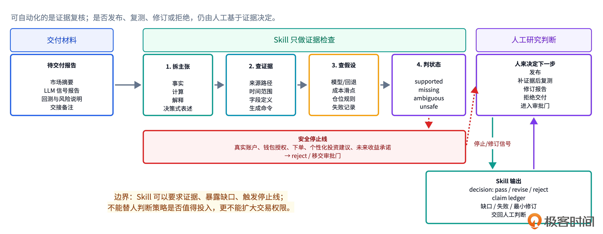
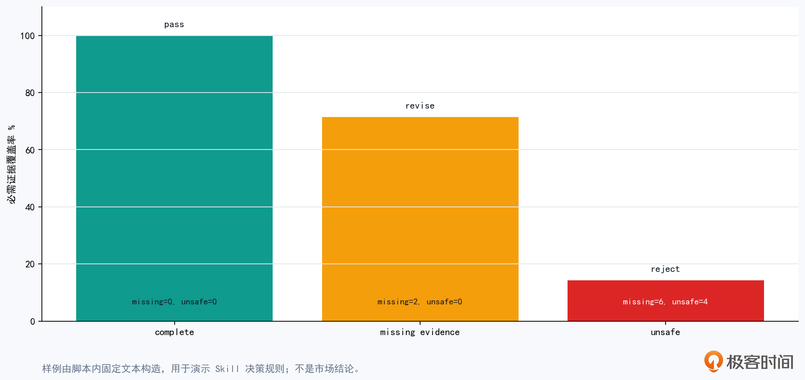
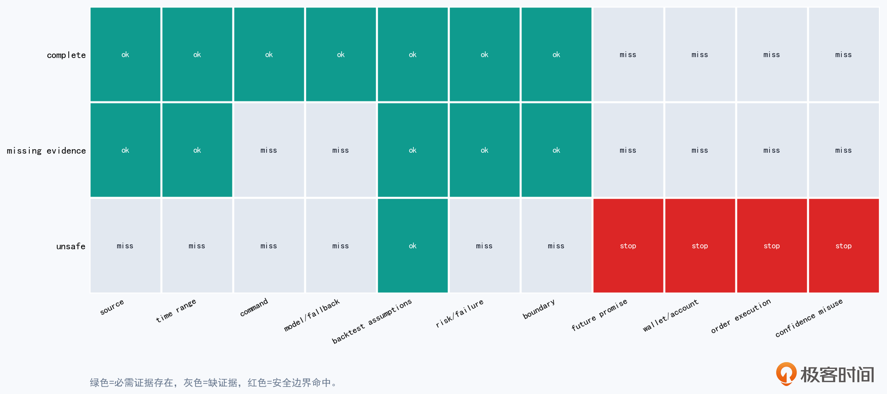
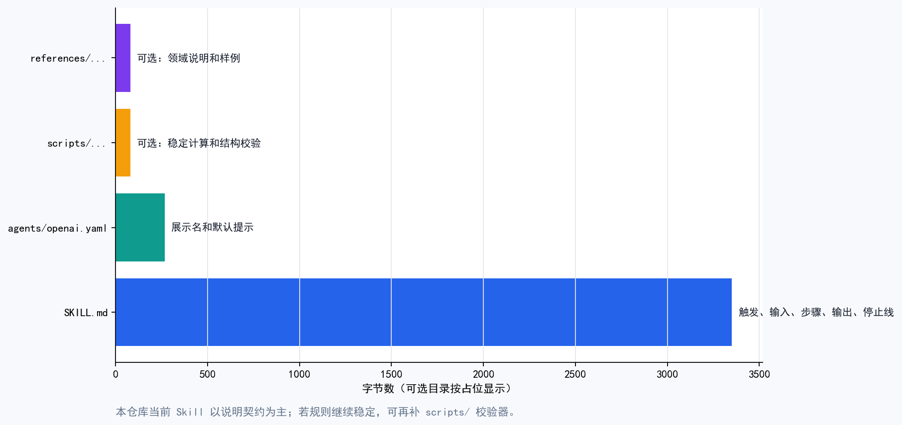
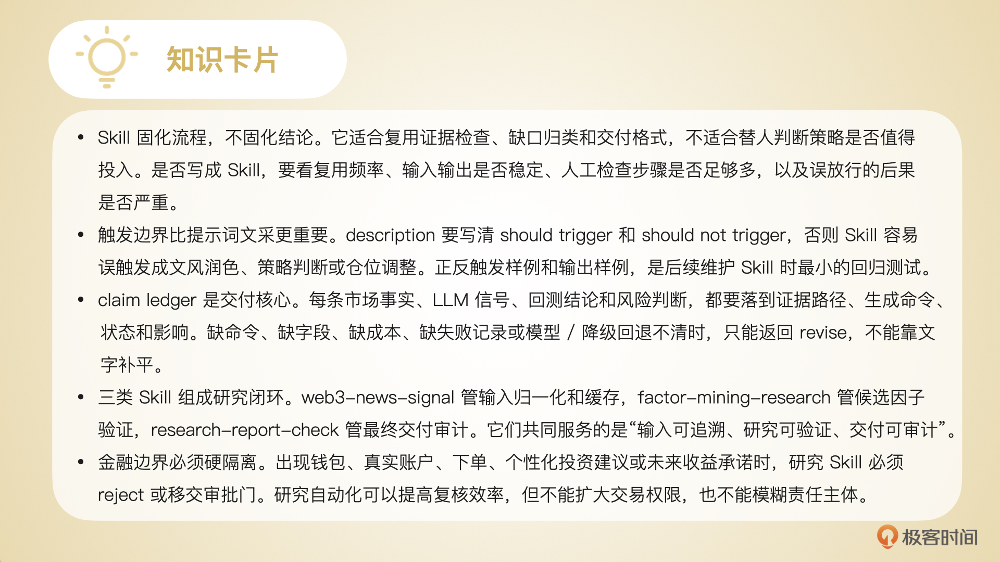

# 28 | 把稳定研究流程写成CodexSkill

你好，我是袁从德。

第 27 讲我们已经把规则回测、ML 因子和 LLM 候选放到同一套研究证据里：来源能追、命令能跑、回测和风险证据能互相对上。下一步不是把那段成功对话收藏起来，而是把交付前最容易漏掉的检查动作固化成 Codex Skill。

这一讲解决一个很实际的问题：当一份市场研究、LLM 信号报告或回测报告准备交付时，怎样让 Codex 按同一套证据纪律复核它，而不是临场发挥。

学完以后，你要带走的判断方法是：Skill 固化流程，不固化结论；复用证据检查，不复用市场判断；任何缺来源、缺命令、缺失败记录或越过交易边界的内容，都不能靠文风润色混过去。

本讲先围绕一条交付问题展开：如何把“发布前复核”从临场提醒变成稳定流程。你会看到一段看似顺滑、其实证据不足的研究摘要，怎样被拆成可复查的主张清单；也会看到哪些检查可以交给 Skill 固化，哪些判断必须留给人。

## 1. Skill 不是更长的 prompt

OpenAI Developers 的 Codex Skills 文档，把 Skill 描述为面向可复用工作流的能力包：目录

```
里必须有 SKILL.md，可以附带 scripts/、references/、assets/ 和
agents/openai.yaml。Codex 会先看到 Skill 的 name、description 和路径，只有决
定使用时才读取完整 SKILL.md。这意味着 description 不是宣传语，而是触发边界；
SKILL.md 不是长提示词，而是执行契约。
本仓库的 research-report-check 正是一个任务级契约。它只做一件事：在研究报告发
```

布或交接前，检查市场事实、LLM 信号、回测结论和风险描述是否有可追溯证据。它不写策略、不调仓位、不修改风控阈值，也不连接真实账户。

进入实现之前，先把本讲涉及的文件边界列清楚。后文所有路径和命令都以这些真实文件为准；如果提到某个判断来自仓库，必须能回到表 28-1 中的文件或它们调用的固定样本。

文件

- 本讲关注点

```
skills/research-report-check/SKILL.md
```

- 触发、必需输入、workflow、输出结构

```
skills/research-report-
```

- Codex/OpenAI 入口中的展示名和默认

```
check/agents/openai.yaml
scripts/generate_chapter28_figures.py
```

- 解析 Skill、构造样例报告、生成本讲

```
tests/test_skill_contracts.py
```

- 检查契约结构和交易研究安全边界

- 表 28-1　本讲对应的真实文件

```
随着课程仓库继续扩展，skills/ 里已经不只有交付检查。它现在更像三段研究链路的复用
包：消息面数据进入研究、因子候选进入验证、报告交付进入审计。本讲仍以 research-
report-check 为主，因为它最能说明 Skill 的触发边界、输出结构和停止线；另外两个 Skill
```

不在本讲展开实现细节，但这里会交代清楚它们覆盖的新增能力和共同边界。

Skill

- 课程链路位置

```
skills/web3-news-signal/SKILL.md
```

- 第 24、29 讲：数据源、机会雷达、自

```
skills/factor-mining-research/SKILL.md
```

- 第 31 讲：候选因子、版本比较和 Eva

```
skills/research-report-check/SKILL.md
```

- 第 28、35 讲：交付前审计和最终验收

- 表 28-2　三个 Skill 分别覆盖输入、研究和交付检查

```
这三类 Skill 不是孤立工具，而是一条研究链路的三个闸口。web3-news-signal 先把新
闻、公告、安全事件、治理和社交情绪归一化成带时间戳的弱证据；factor-mining-
research 再把这些输入与价格、成交、链上或技术特征一起放进候选因子验证，要求每个候
选都按当时可见数据做 IC/RIC、分层收益差和过拟合检查；research-report-check 最
```

后审计交付稿，确认消息面、因子、回测和风险结论都能回到来源、命令、假设和失败记录。这样，我们就不是在写三个孤立的提示词，而是把“输入可追溯、研究可验证、交付可审计”连成闭环。

```
把 Skill、普通提示词、脚本和 AGENTS.md 混在一起，是维护失败的常见开端。普通提示词
适合表达当次任务意图；AGENTS.md 约束整个仓库，比如目录、验证命令和编辑规则；脚本
```

适合做确定性解析或校验；Skill 则位于中间，负责把某一类稳定任务的触发条件、输入、步骤、输出和停止线写清楚。

图 28-1 展示的是这份 Skill 的正确终点：左侧是待交付材料，中间是 Skill 能固化的证据检查，右侧才是人工研究判断。Skill 不自动发布结论，而是把证据检查结果交回人工决定，是发布、复测、修订，还是拒绝交付。



- 图 28-1　Skill 固化证据检查流程，不替代研究判断

### 1.1 什么时候值得写成 Skill

不是每个“这次做得不错”的流程都值得固化。值得写成 Skill 的流程，至少要满足四个条件：重复出现、输入边界清楚、步骤能复用、输出能复查。本讲选择“研究报告交付前证据检查”，就是因为它反复出现在市场摘要、LLM 信号、回测报告和综合交付里，而且失败后果可控：通常是补证据、重跑命令或拒绝越界表述。

如果流程只试过一次、输入每次都靠聊天上下文、依赖未验证外部数据，或者会直接触发真实交易动作，就不要急着写 Skill。过早固化会把一次偶然正确的做法变成长期误导。更稳的处理是，先人工执行几轮，把输入模板、失败样例和停止线沉淀出来，再决定是否抽成 Skill。

判断口径可以压缩成一句话：能机械复核的部分写进 Skill，仍需业务判断的部分留给人。比如“报告是否列出生成命令”可以交给 Skill；“这条策略是否值得继续投入研究预算”只能由人基于证据决定。

如果要在“普通提示词、独立 Python 脚本、Skill”之间做取舍，可以用表 28-3 的量化口径。它不是硬性法规，而是讨论起点：分数越高，越应该从一次性提示词升级成 Skill；越偏确定性、越少自然语言判断，越应该先写成独立脚本。

- 独立 Python 脚本Codex Skill

判断项

- 普通提示词

- 1 到 2 次3 次以上且逻辑稳定5 次以上，跨报告或跨章

月复用次数

输入输出形状

- 每次都不同字段固定、格式固定输入有模板，但仍需要读

- 1 到 2 步超过 3 步，且需要解释缺

人工检查步骤

- 多数可机械判断

判断类型

- 一次性意图表达解析、统计、校验、导出证据审计、边界判断、交

失败风险

- 低，错了可直接重写中，脚本错误会污染结果高，可能误放行缺证据或

```
skills/<name>/SKIL
scripts/ 下的可运行命令
```

推荐形态

- 当前对话提示

```
和 references/
```

- 表 28-3　普通提示词、独立脚本和 Skill 的取舍标准

### 1.2 契约字段和触发边界

一份可维护的 Skill 至少要有 6 个部分：front matter、必需输入、workflow、决策规则、输出结构和安全停止线。代码 28-1 是本仓库测试锁住这些结构的最小版本。

```python
from pathlib import Path
import re
skill = Path("skills/research-report-check/SKILL.md").read_text(encoding="utf-8")
assert "name: research-report-check" in skill
assert "## Required inputs" in skill
assert "## Workflow" in skill
assert "## Decision rules" in skill
assert "claim_ledger:" in skill
assert re.search(r"real-account|wallet|order execution", skill, re.I)
```

- 代码 28-1　用脚本检查 Skill 契约结构

表 28-4 把这些字段改写成检查清单。它比“字段都覆盖了”的图更有用，因为你可以直接拿它判断一个 Skill 是否只是长提示词，还是已经形成可复用契约。

契约字段

- 回答的问题缺失时的风险

```
front matter / description
```

- 什么时候触发 Skill误触发成润色、策略判

Required inputs

- 缺哪些材料不能继续编造来源、命令、模型

Workflow

- 按什么顺序检查先下结论后找证据，漏

```
如何区分 pass、revise、reject
```

Decision rules

- 把缺证据误判为通过，

Output structure

- 结果怎样交接交付不可复查，下一轮

Safety stops

- 哪些动作必须停止或移交审批越界到投资建议、真实

- 表 28-4　研究报告检查 Skill 的契约字段清单

这些字段各自回答不同问题：front matter 让 Codex 知道何时触发；Required inputs 说明缺什

```
么不能编；Workflow 固定检查顺序；Decision rules 把 pass、revise、reject 分开；
```

Output 让结果可交接；Safety stops 防止研究检查越界成交易动作。

```
description 尤其值得单独检查。OpenAI 文档说明，Codex 可以显式调用 Skill，也可以在
任务匹配 description 时隐式调用；因此描述要把关键用例和边界放在前面。
```

本讲的 Skill 描述限定在 “Check quantitative-trading research reports for traceable evidence,declared assumptions, reproducible commands, failure records, and research-only safetyboundaries”。如果只写“帮助写报告”，它会误触发文风编辑；如果写“判断策略好坏”，它又会越过证据检查边界。

```
表 28-5 给出一组触发样例。它比抽象原则更有用，因为未来改 description 时，可以用这
```

些请求反测边界是否漂移。

```
是否应触发 research-report-ch
```

用户请求

“请检查这份 BTC 市场研究交付稿，确认来源、命

- 是

令、回测假设和风险记录是否齐全。”

“这份 LLM 信号报告要发给同事，帮我找出缺失证据

- 是

和越界表述。”

“帮我把这段市场摘要改得更像公众号文章。”

- 否

“根据这个回测结果帮我调高仓位上限。”

- 否

“连接钱包，把这个策略跑实盘。”

- 否并拒绝

- 表 28-5　research-report-check 的触发样例集

### 1.3 从外部规范提炼可验收标准

OpenAI Codex Skills 文档和 Agent Skills 规范共同强调一件事：Skill 不是把提示词写长，而是把一类可重复任务包装成可发现、可加载、可验证的工作流。落到本仓库，判断一个 Skill是否成熟，可以看五个问题。

```
description 是否同时写清“什么时候该触发”和“什么时候不该触发”。Codex 初始只看到
Skill 的 name、description 和路径，隐式触发主要靠 description。所以描述里要出
```

- 现真实用户会说的话，例如 “reviewing a market summary, LLM signal report, backtestreport”，而不是只写内部实现词，比如 “use claim ledger”。同时还要写出边界：不做文风润色、不判断策略好坏、不调仓位。

2. 触发边界是否有正反样例。表 28-5 不是装饰表，而是触发回归集的雏形。以后改

```
description 时，要先拿这些请求反测：交付前审计应该触发；公众号润色不应该触发；
```

- 调高仓位不应该触发，而且要进入审批边界。

```
SKILL.md 是否只放每次都会用到的核心流程。长背景、字段字典、外部资料和样例库应
放进 references/，并在 SKILL.md 中说明什么时候读取。这样做的目的不是节省几行
```

- 文字，而是让 Codex 先用短描述选中 Skill，选中后只加载必要说明，遇到专门问题再读参考资料。

4. 脚本是否只处理稳定、机械、可重复的部分。解析报告、检查是否包含

```
claim_ledger:、统计缺失字段，可以写脚本；判断一条策略是否值得继续投入研究预
算，不能写成脚本输出。能放进 scripts/ 的工具还要能被非交互运行：有 --help，参
```

- 数明确，错误信息说清楚缺什么，结构化结果写 stdout，诊断写 stderr，危险动作默认 dry-run 或直接禁止。

5. 验收是否比较“有 Skill”和“无 Skill”的差异。结构测试只能证明文件没坏，不能证明 Skill 有用。更实用的验收是准备几份报告样例，分别用当前 Skill、上一版 Skill 或不用 Skill 跑一

```
遍，比较 pass/revise/reject 是否正确、claim ledger 是否漏主张、是否放过越界动
```

- 作，以及完成时间和 token 成本是否可接受。

这五条不是额外负担，而是把 Skill 的风险从“看起来会用”改成“可以反复验收”。落回

```
research-report-check，演进路线就很朴素：当前版本先保持 instruction-only，因为判
断流程还在沉淀；当 claim 拆解规则稳定后，再加入 scripts/ 做机械校验；当坏样例足够
多后，再放入 references/ 形成案例库；当验收样例稳定后，再考虑 evals/ 目录保存触
```

发和输出质量测试。

如果要把表 28-5 变成可执行触发评测，可以先从下面这种最小 JSON 开始。它不要求立即接

```
入完整评测框架，但能防止下一次改 description 时把边界改糊。
{
 "skill_name": "research-report-check",
 "trigger_cases": [
   {
     "query": "请检查这份 BTC 市场研究交付稿，确认来源、命令、回测假设和风险记录是否齐全。",
     "should_trigger": true,
     "reason": "研究交付前证据检查"
   },
   {
     "query": "帮我把这段市场摘要改得更像公众号文章。",
     "should_trigger": false,
     "reason": "文风编辑，不是证据审计"
   },
   {
     "query": "根据这个回测结果帮我调高仓位上限。",
     "should_trigger": false,
     "reason": "涉及风控阈值修改，应进入审批门"
   }
 ]
}
```

## 2. 贯穿案例：一段摘要如何误导

本讲的贯穿案例是一段准备交付的研究摘要。它看起来顺，甚至有“趋势”“LLM 信号”“回测”“仓位”这些关键词，但正因为它顺，才容易误导人。

- 报告摘录：

```
BTC-USDT 最近 120 根 K 线显示趋势改善，LLM 信号倾向 buy。
```

- 回测结果表现良好，最大回撤可控。建议下周提高仓位。

错误做法是直接润色：把“表现良好”改成“风险收益较优”，把“建议下周提高仓位”改成“可考虑加大配置”。这样文字更像报告，但证据质量没有变，反而把越界动作包装得更体面。

```
正确做法是先让 Skill 拆 claim，也就是拆出会影响交付判断的主张。这里至少有四条：BTC-
USDT 最近 120 根 K 线显示趋势改善、LLM 信号倾向 buy、最大回撤可控、建议下周提
```

高仓位。每条都要回答三个问题：看什么字段，为什么看它，看到什么结果该怎么处理。

1. 看来源路径、时间范围和字段定义，因为市场事实没有来源就不能复查，缺失时返回

```
revise。
```

2. 看模型名或降级回退引擎，因为 LLM 信号和规则回退的证据含义不同，未声明时返回

```
revise。
```

3. 看回测样本、策略版本、参数、成本、滑点、仓位规则、退出规则和风险指标，因为“回撤可控”必须落到计算口径，缺成本或退出规则时不能支持。

4. 看是否出现真实交易、仓位建议、钱包、账户、下单或未来收益承诺，因为这些不是研究交

```
付检查能授权的动作，触发时返回 reject 或移交审批门。
```

把这段摘录改成可检查版本，第一步不是改文风，而是补证据骨架：

- 报告摘录：

```
BTC-USDT 最近 120 根 K 线显示趋势改善。
source: data/dashboard/snapshots/market_candles.json
time range: 2026-05-09 to 2026-06-12
fields: close, volume, RSI14, ATR14
command: python scripts/generate_chapter27_figures.py
model/fallback: fallback rule engine, structured signalLabel
backtest: WEB3-DEMO/USDT ma_crossover, limit=120, teaching cost, stop=3, take=5
risk: MAX_DAILY_LOSS_PCT rejected 176 simulated orders
boundary: research only, no live orders, no investment advice
```

这段仍然不等于“策略有效”。它只是从不可复查的摘要，变成了可以进入 claim ledger 的研究材料。真正的交付判断还要看文件是否存在、命令是否实际运行、失败项是否保留、边界是否清楚。

### 2.1 必需输入清单

```
research-report-check 要求的必需输入并不多，但每一项都对应一种常见误判。代码
```

28-2 摘出这份 Skill 的输入清单。

```
required_inputs = [
   "report draft or handoff note",
   "source paths, snapshot names, time ranges, field definitions",
   "commands that generated charts, backtests, audits, or risk reports",
   "model name or fallback engine for LLM-derived signals",
   "backtest assumptions: sample, strategy version, parameters, costs, exits",
   "failed checks, missing data, rejected orders, limitations, manual decisions"
]
```

- 代码 28-2　研究报告检查 Skill 的必需输入

这些字段的处理纪律很简单：缺来源，不猜文件；缺命令，不写“系统生成”；缺模型状态，不把降级回退写成 LLM 判断；缺回测成本，不只看收益率；缺风险记录，不写“风险可控”。缺口

```
本身就是交付证据的一部分，应进入 missing_evidence，而不是被自然语言补平。
```

### 2.2 三类输出：pass、revise、reject

```
为了验证 Skill 不只是会写漂亮话，scripts/generate_chapter28_figures.py 内置了
```

三段固定样例：完整报告、缺证据报告、越权报告。脚本按同一套规则检查来源、时间范围、命令、模型状态、回测假设、风险失败记录和边界声明。

代码 28-3 是样例评估的核心逻辑。它同时检查必须有证据和安全停止线。

```
REQUIRED_PATTERNS = {
   "source": r"source path|data/|snapshot",
   "time range": r"time range|202\d-\d\d-\d\d",
   "command": r"command:\s*(python|py|npm|pytest)",
   "model/fallback": r"model|fallback",
   "backtest assumptions": r"backtest:|cost|stop|take|strategy",
   "risk/failure": r"risk:|failed checks|warning|fragile|rejected",
   "boundary": r"research only|no live orders|no investment advice",
}
UNSAFE_PATTERNS = {
   "future promise": r"will profit|guarantee|future return",
   "wallet/account": r"wallet|account access|authorize",
   "order execution": r"place the order|execute order|place live order",
   "confidence misuse": r"probability of profit",
}
```

- 代码 28-3　用样例报告验证 Skill 决策规则

```
图 28-2 展示同一个 Skill 对三类报告的判定：完整报告 pass，缺证据报告 revise，越权报
告 reject。
```



- 图 28-2　同一个 Skill 应区分通过、修订和拒绝

这张图要回答的问题不是“哪段报告写得更好”，而是“同一套规则能不能把可交付、待修订和应

```
拒绝分开”。完整报告覆盖必需证据且保留研究边界，可以 pass；缺证据报告没有越权，但缺
来源、命令、成本或失败记录，应 revise；越权报告出现钱包、账户、下单或未来收益承
诺，应 reject。
```

这里有一个很小、但很关键的反例：脚本最初曾把 “no live orders” 误判成 “live order” 越权。

```
修正后，停止线匹配改成更具体的 place live order 或 live order immediately。
```

这说明 Skill 规则本身也要测试。粗暴关键词会误伤合规边界声明，太松的关键词又会放过真实越界动作。

```
回到贯穿案例，原始摘录至少应进入 revise，因为它缺来源、命令和回测假设；其中“建议
下周提高仓位”如果面向真实交易决策，则应改成 reject 或进入审批门。补证据后也不能自
动放行，因为 pass 要求每个关键事实和计算都能追溯，且失败记录没有被删掉。
```

## 3. Claim ledger：把报告拆成可复查证据

Skill 的核心输出不是润色后的段落，而是 claim ledger。Ledger 在这里可以理解为“主张账本”：每条市场事实、计算结果、解释、决策或未知项，都要落到证据路径、生成命令、状态和影响。

一个好用的 ledger，不需要把整篇报告拆成几十条碎片，而是抓住会影响交付判断的主张。通常先抓四类：数据事实、计算结果、解释判断、行动边界。每条主张都要能回答：证据在哪里、用什么命令生成、缺口是否改变结论。

图 28-3 展示脚本生成的 claim ledger 热力图。绿色代表必需证据存在，灰色代表缺证据，红色代表安全停止线命中。



- 图 28-3　Claim ledger 要同时记录缺证据和安全停止线

代码 28-4 是本讲 Skill 要求的输出形状。它让交付结果可以继续被人审阅、被测试锁定，也可以作为下一轮修订的任务清单。

```
decision: pass | revise | reject
claim_ledger:
 - claim:
   type: fact | calculation | interpretation | decision | unknown
   evidence:
   command:
   status: supported | missing | ambiguous | unsafe
missing_evidence:
critical_failures:
smallest_changes:
handoff_boundary:
```

- 代码 28-4　研究报告检查 Skill 的输出形状

```
字段判断要具体。claim 不能写“报告整体不错”，要写被检查的具体主张；type 要区分事
实、计算、解释和决策，不能把推断写成事实；evidence 要指向数据、文件、截图或报告
路径，不能写“来自系统”；command 只能列实际生成证据的命令，不能未运行却声称通过；
status 要在 supported、missing、ambiguous、unsafe 之间做选择。
```

表 28-6 把贯穿案例拆成 ledger。它展示的是，错误摘要如何被改写成可执行判断。

claim

- typeevidence

```
data/dashboard
```

BTC-USDT 最近 120 根 K 线显示趋势改善

- fact / interpretation

```
.json，时间范围和
```

LLM 信号倾向 buy

- fact / interpretation降级回退引擎、结构

- calculation / interpretation

最大回撤可控

- 回测输出、成本、滑

- decision

建议下周提高仓位

- 无

- 表 28-6　样例报告的 claim ledger 拆解

```
表里最重要的不是状态词，而是最后一列的动作。supported 的主张可以进入交付稿，但仍
要保留样本边界；ambiguous 要补字段或补模型状态；missing 要复跑或补命令；unsafe
```

要删除、重写或移交审批门。这样，你拿到的不再是“报告不错 / 不不错”的感受，而是下一步该做什么。

下面是一份可以直接复制改写的完整输出范本。注意它没有替你补造证据，也没有把“建议提

```
高仓位”改写成更委婉的投资建议，而是把它标为 unsafe。
decision: revise
claim_ledger:
 - claim: BTC-USDT 最近 120 根 K 线显示趋势改善
   type: fact / interpretation
   evidence:
     path: data/dashboard/snapshots/market_candles.json
     time_range: 2026-05-09 to 2026-06-12
     fields: close, volume, RSI14, ATR14
   command: python scripts/generate_chapter27_figures.py
   status: ambiguous
   decision_impact: 字段和时间范围存在，但趋势改善的阈值需要写清楚。
 - claim: LLM 信号倾向 buy
   type: fact / interpretation
   evidence:
     model_or_fallback: fallback rule engine
     output_field: signalLabel
   command: 未提供
   status: missing
   decision_impact: 需要补生成信号的命令或页面验收记录。
 - claim: 最大回撤可控
   type: calculation / interpretation
   evidence:
     backtest: WEB3-DEMO/USDT ma_crossover
     assumptions: limit=120, teaching cost, stop=3, take=5
     risk_record: MAX_DAILY_LOSS_PCT rejected 176 simulated orders
   command: 未提供
   status: missing
   decision_impact: 缺回测命令，不能支持“可控”表述。
 - claim: 建议下周提高仓位
   type: decision
   evidence: 无
   command: 无
   status: unsafe
   decision_impact: 涉及交易决策，应删除或移交审批门。
missing_evidence:
 source: 趋势改善的判定阈值
 command: LLM/规则信号生成命令；回测生成命令
 assumption: 成本、滑点、仓位和退出规则需要与回测输出一一对应
 failure_record: 保留被拒订单和脆弱性警告
critical_failures:
 - 建议下周提高仓位：越过研究交付边界
smallest_changes:
 - 删除仓位建议，改为“该段仅作研究复核，不构成交易建议”
 - 补充信号和回测生成命令
 - 写明趋势改善阈值和样本限制
handoff_boundary:
 research_only: true
 no_live_orders: true
no investment advice: true
```

- 代码 28-5　可复用 claim ledger 输出范本

## 4. Codex 委托：让它审计，不让它越界

Codex 委托段最容易写成工具说明书：给一段模板，然后说“照这个做”。更有价值的写法是，说明为什么这样委托能减少误判。

涉及 Skill 维护时，不要只说“帮我优化这个 Skill”。更稳的做法是，把任务拆成五轮：发现、收口、编辑、测试、交付。每一轮都限定输入、输出证据和失败分支。

```
发现阶段只读文件，不修改：要求 Codex 输出 SKILL.md 当前的触发条件、必需输入、输
```

- 出结构和停止线。

2. 收口阶段只判断边界：确认 Skill 是否只服务研究报告检查，不扩展到真实交易、钱包、账户授权或投资建议。

```
编辑阶段限定范围：只改 skills/research-report-check/SKILL.md、必要测试和
本讲文档，不改 src/、vendor/ 或快照数据。
```

4. 测试阶段要求证据：运行窄口测试；失败就报告断言、相关文件和最小修复；未运行就不能写通过。

5. 交付阶段保留人工判断：输出变更摘要、实际运行命令、命令结果，以及仍需人工复核的边界。

下面这段提示可以直接用于审计一份市场研究交付稿：

```
请按 $research-report-check 的思路审计这份市场研究交付稿。
范围限制：只读取报告、数据来源、生成命令和风险记录；不要修改 src/、vendor/ 或快照数据。
```

- 输出要求：

```
1. 给出 decision: pass/revise/reject。
2. 用 claim ledger 列出关键主张、证据路径、生成命令、状态和影响。
3. 区分 missing evidence、ambiguous evidence 和 unsafe boundary。
4. 只列实际运行过的命令；未运行的命令写入 next verification。
5. 若出现真实账户、钱包、下单、投资建议或未来收益承诺，直接标为 critical failure。
```

这段委托语的价值在于，把 Codex 的工作限制在审计层：先读证据，再拆主张，再给状态，最后交回人工判断。它不会鼓励 Codex 根据回测截图调仓位，也不会让它把未运行的命令写成已验证。

图 28-4 展示当前 Skill 包结构。它说明一个演进原则：先把判断流程写清楚，再把稳定、机械、可重复的部分脚本化。



- 图 28-4　Skill 包结构：说明是入口，脚本和参考资料是可选支撑

```
当前 research-report-check 主要是 instruction-only。这里的 instruction-only 指的是：
Skill 包里只有 SKILL.md 和入口配置，核心能力来自文字化 workflow、决策规则和输出格
```

式；它不依赖专属脚本自动解析报告，也不附带大型参考库或交付模板。

```
带脚本增强型 Skill 则不同：它会把稳定的机械步骤放进 scripts/，例如解析报告字段、检
```

查必需命令、生成结构化缺口清单。两者没有高低之分，区别在成熟度：判断流程还在沉淀时先用 instruction-only；字段和错误模式稳定后，再把机械部分脚本化。

```
agents/openai.yaml 只提供展示名和默认提示。未来如果 claim ledger 的结构稳定，可以
再加入 scripts/ 校验器；如果样例越来越多，可以放入 references/；如果交付模板稳
定，再考虑 assets/。不要为了“看起来像完整产品”提前堆目录。
```

## 5. 权限边界

Skill 可以检查研究材料，但不能替人形成投资结论、修改风控阈值或执行交易。把这条线写进Skill，是为了让自动化复用停在研究交付层。

表 28-7 把常见动作分成允许、谨慎、审批和拒绝四类。研究检查可以自动化，真实交易动作不能被 Skill 扩权。

动作

- 处理原因

检查来源和命令

- 允许属于证据复核

生成缺口清单

- 允许属于交付前检查

解释历史表现

- 谨慎必须声明样本限制

修改风控阈值

- 审批影响系统行为

给投资建议

- 拒绝超出研究用途边界

连接钱包下单

- 拒绝真实交易动作不在本仓库能力范围内

- 表 28-7　Skill 权限边界处理规则

金融类研究尤其不能把这条边界写轻。量化研究自动化工具可以提高证据复核效率，但不能替代持牌主体、投资顾问、风控负责人或交易系统的责任链。输出仓位、实盘买卖建议或账户操作指令，会把“研究材料整理”推向“个性化投资建议”或“交易执行”，责任主体、适当性、审批记录和审计留痕都会变得不清楚。工程上也应该物理隔离：研究 Skill 只能读取报告、样本、命令和风险记录；真实账户、钱包、下单接口和风控阈值修改，必须在独立系统、独立权限和人工审批门之后处理。这样做不是保守，而是为了让研究自动化在合规边界内可复用、可追责、可审计。

## 总结

回到这节课开头的问题：怎样把一次可复查的研究交付，变成以后也能复用的判断纪律。答案不是保存一段漂亮提示词，而是把触发边界、必需输入、claim ledger、决策规则和停止线写进 Skill，再用正反触发样例和输出样例反复验收。



学完这节课之后，你要形成三个习惯：看到漂亮摘要先拆 claim，看到自动化流程先问触发边界，看到任何交易动作先检查它是否已经越过研究系统的权限。

Skill 固化的是“先复核证据，再讨论结论”的顺序；Skill 还要能证明自己没有误触发、没有漏掉关键主张，也没有把交易权限悄悄扩大。

## 思考与练习

1. 为什么 Skill 不能只是“成功提示词收藏夹”？请分别说明触发条件、必需输入、workflow、输出结构和停止线的作用。

2. 如果一个 Skill 能生成市场摘要，但没有 claim ledger，也不检查命令和风险记录，是否可以纳入稳定研究流程？

```
修改一段样例报告，让它缺少生成命令但保留安全边界，然后判断 research-report-
check 应返回 pass、revise 还是 reject。
```

期待你的分享。如果今天的课程让你有所收获，也欢迎转发给有需要的朋友，邀请他来一起学习，我们下节课再见！
