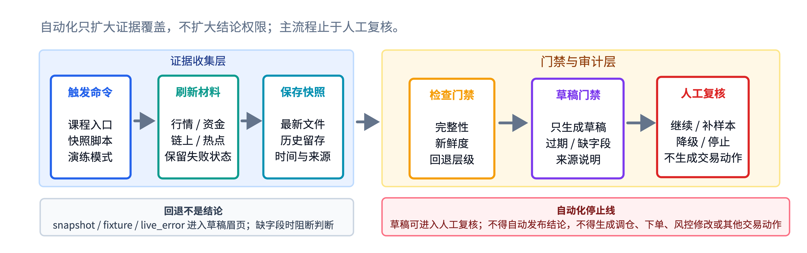
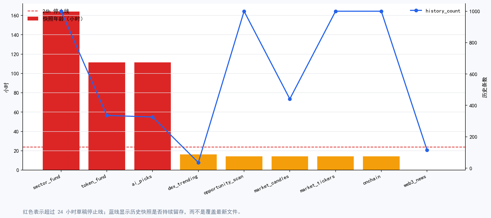
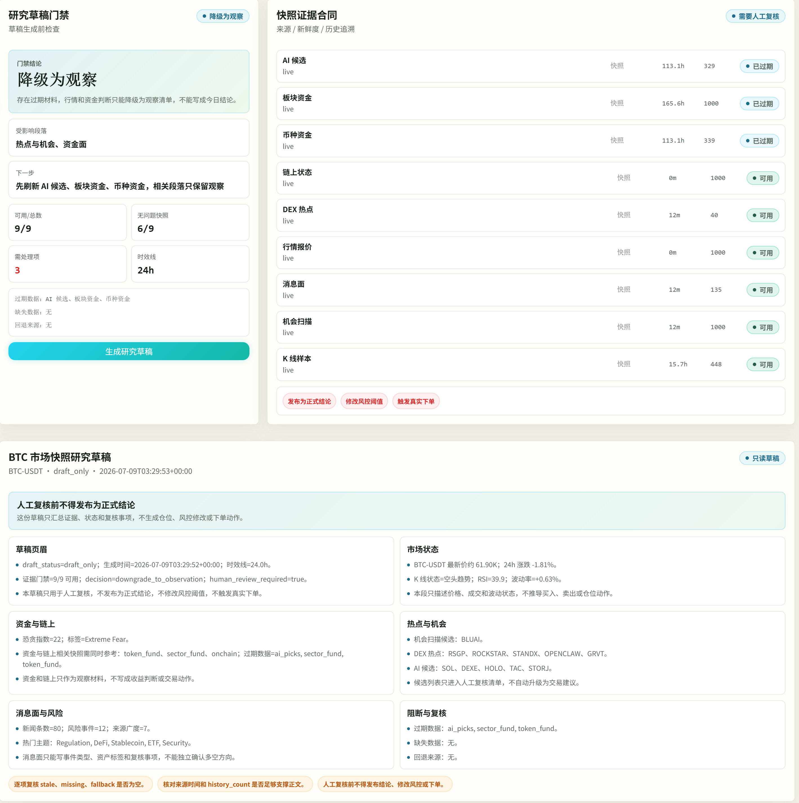
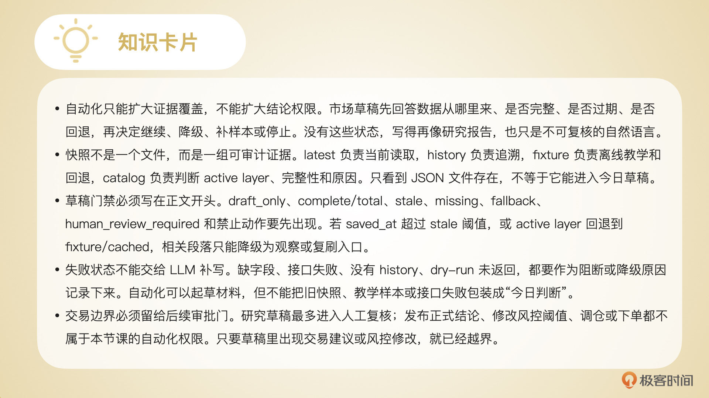

# 29 | LLM量化自动化证据门：市场快照与研究草稿

你好，我是袁从德。

每天早上自动生成一份 Web3 市场草稿，听起来像效率提升；真正危险的是，它也可能把旧快照、缺字段和接口失败写成“今日判断”。本讲讨论的不是怎样让 AI 写出更顺滑的报告，而是怎样让自动化只负责收集证据、暴露状态、起草材料，不越过研究结论和交易动作的边界。

要带走的判断纪律很简单：自动化可以扩大证据覆盖面，不能扩大结论权限。任何市场草稿都要先回答数据从哪里来、是否完整、是否过期、是否回退，再决定能继续推进、降级观察、补样本，还是停止研究。

进入自动化之前，我们会先把市场草稿拆成四层：证据从哪里来，状态是否可信，草稿能写到哪一步，结论必须由谁确认。只要这四层没有分清，越流畅的文字越危险；它可能让人忘了自己看到的只是待复核材料，而不是已经成立的市场判断。接下来先看一个市场草稿的误判案例，再把这个案例落成证据合同、运行入口、草稿门禁和交付验证。

## 1. 贯穿案例：一份早晨市场草稿怎样误判

市场草稿最容易出错的地方，不是模型不会写，而是它太会把残缺材料写得像结论。先从一条看似合理的自动化委托开始：每天早上 8:30 生成一份 Web3 市场快照草稿，重点看行情、资金、链上、DEX 热点和机会扫描。如果直接进入写作，最常见的坏结果如下所示：

```
今日市场情绪转强，DEX 热点延续，机会扫描显示若干标的值得关注。
```

- 建议继续关注高分机会，并根据资金流变化调整仓位。

- 没有门禁的市场草稿会把观察误写成结论

这段话的问题是证据不可复核。它没有说明行情来自实时接口还是快照（snapshot），没有说

```
明 dex_trending 是否过期，没有说明 opportunity_scan 是否完整，也没有解释“调整
```

仓位”是否已经越过研究边界。一旦其中一份材料来自固定样本（fixture）或旧快照，这份草稿就会把“离线教学样本”伪装成“今日市场事实”。

```
正确做法是先生成门禁，再生成正文。本仓库的 offline_status() 能返回核心数据的完
整性状态；list_snapshots() 能读到每个当前快照（latest） 的 saved_at、origin 和
history_count。这些字段先进入页眉，再决定正文能写到哪一步。代码 29-1 展示的是同
```

一份材料在门禁约束下应该先写出的页眉。

```
draft_status: draft_only
snapshot_gate: complete=9/9, stale_threshold=24h, stale=[]
source_note: 本次草稿使用 snapshot 层；发布前仍需人工复核实时接口错误、成本和风控边界。
decision: 可进入人工复核；不得直接发布为正式结论，不得生成仓位调整动作。
```

- 代码 29-1　先写门禁再写正文的草稿页眉

两段文本的差别，就是自动化研究的生死线。第一段把自然语言当结论，第二段先把证据状态

```
写出来。前者会诱导交易判断，后者只允许“继续进入人工复核”。如果 dex_trending 超过
24 小时，或 opportunity_scan 缺少 score、confidence、rank 等字段，结论就要降
```

级为“需复刷 / 补字段后再看”，而不是换一种委婉语气继续写市场判断。

- 外部方法背景也支持这条边界。Gebru 等人在 Datasheets for Datasets 中强调，数据材料应说明来源、组成、用途和限制；Great Expectations 的 freshness 文档 把“数据是否在预期时间内可用”作为使用前检查；OpenAI Help Center 对 scheduled tasks 与 Codexautomations 的区分也提醒我们，自动任务需要清晰范围和可观察结果。放到市场草稿里，就是先带来源卡和门禁卡，再谈正文。

## 2. 自动化证据合同：从资料源到来源卡

案例说明了为什么要设门禁，下一步是把门禁变成可执行的证据合同。市场快照自动化不是一条“写报告”的流水线，而是一份约定：看什么字段，为什么看它，看到异常后怎么处理。表29-1 把这份合同拆成入口、覆盖范围、持久化、来源、完整性、新鲜度和草稿边界七个检查项。

### 2.1 先把自动化写成证据合同

证据合同的作用，是在任何自然语言草稿出现之前，先固定系统能检查的事实。合同项越清楚，后面的草稿越不容易把“材料存在”误写成“判断成立”。

合同项

- 看什么为什么看

```
dashboard_snapshot.py、
scripts/course.py snapshot、--mode、--
```

入口

- 确认草稿来自真实命令，而

```
d
```

- 表 29-1　市场快照自动化证据合同

图 29-1 展示最小路径：触发命令、刷新材料、保存 latest 和 history、检查完整性与新鲜度，最后只生成草稿门禁。箭头没有通向“交易”，这是有意的。



- 图 29-1　LLM 量化自动化证据门路径

本讲使用 24 小时作为教学 stale 阈值，不是说所有市场研究都该用同一阈值。高频行情可能按分钟级过期，周度资金面可以更宽；关键是阈值要写在草稿门禁里，不能藏在提示词里。自动化等级也要分清：拉取公开数据、保存快照、检查完整性可以自动；生成研究草稿可以自

```
动，但必须标记 draft_only；形成研究结论、修改风控阈值、执行交易，都要留给人工审
```

批或后续停止线。

证据合同解决的是内部快照边界，外部资料还需要再收一层。不能直接委托“上网看看市场”：这个委托太宽，容易混进网页摘要、旧新闻、营销稿和无法复核的判断。更稳的做法是，先列资料源，再为每个来源定义快照字段、更新时间、失败处理和草稿边界。也就是说，网上资料不是直接进入正文，而是先进入来源卡。

### 2.2 外部资料先进入来源卡

来源卡是外部资料进入草稿前的缓冲层。它不负责证明某个交易判断成立，只负责说明材料来自哪里、什么时候取得、缺什么字段、失败时应该怎样降级。

早晨采集可以按四层来做，每一层都只产出可复核字段，不直接产出市场结论。

1. 行情和成交。Binance Spot REST API 提供 24 小时 ticker、K 线和盘口 best bid/ask 等市

```
场端点，适合生成 market_tickers、market_candles 和简化流动性字段；
```

- CoinGecko 的 coins markets 端点能按币种返回价格、市值、成交量、24 小时涨跌、供应

```
量和 last_updated。这里的草稿动作只允许描述“价格、成交量、波动、流动性状态”，
```

- 不能写“买入 / 卖出”。

2. DeFi 和链上。DefiLlama 的公开 API 覆盖协议 TVL、稳定币、收益池、DEX volume、

```
fees/revenue 等数据，适合补 sector_fund、token_fund、dex_trending 的外部参
考；Etherscan 的 gas oracle、account、logs、stats 等 API 适合补 onchain 的 gas、交
```

- 易活跃度和事件线索。TVL、volume、gas 都是状态材料，不是收益承诺。

3. 消息面和安全事件。GDELT DOC 2.0 API 可以按关键词和时间窗，抓取全球新闻文章列表或趋势；GitHub releases API 可以跟踪关键协议、钱包、SDK、交易所连接器的版本发布；安全事件可以从官方公告、项目 postmortem、CISA KEV 等公开目录进入候选清单。

```
消息面只生成 news_heat_24h、risk_event_count_24h、release_count_7d 这
```

- 类弱证据字段，不能独立触发交易判断。

```
来源健康。每个来源卡至少记录 source_name、url_or_endpoint、fetched_at、
payload_time、required_fields、missing_fields、
rate_limit_or_error、active_layer、stale_threshold 和
allowed_draft_use。如果没有 payload_time，就只能用 fetched_at 做较弱的新
```

- 鲜度判断；如果没有来源 URL，材料不能进入草稿。

表 29-2 把这些外部资料源落成可执行的采集清单。

资料层

- 一手来源建议快照字段

```
symbol、price、vo
```

- Binance ticker/K 线 / 盘口、CoinGecko coins

```
price_change_24h、
```

行情成交

- markets

```
last_updated
protocol、chain、
```

- DefiLlama protocols、stablecoins、DEX volume、

DeFi 资金

```
volume_24h、fee_2
```

- fees/revenue

```
chain、gas_price、
```

- Etherscan gas oracle、account、logs、stats

链上状态

```
event_count、bloc
title
url
publi
```

- GDELT DOC 2 0官方postmortem项目公告

- 表 29-2　外部资料进入快照前必须先变成来源卡

这张表不是一次性接入所有来源的清单，而是每次迭代的拆包依据。比如本周只新增

```
news_heat_24h，就先接 GDELT 或固定 RSS，写入
data/dashboard/web3_news.json，登记 source_domain、published_at、
dedupe_key 和 fetch_error，再补一个只读测试确认缺发布时间会被阻断。等这个字段
```

能稳定进入草稿页眉，再考虑把它纳入机会扫描。

### 2.3 把合同落成流程

这样，证据合同就从原则落到了动作。一次早晨自动化的最小流程可以压成五步：

1. 拉取行情、DeFi、链上、新闻四类公开资料，每个来源最多取固定白名单字段。

```
对每条材料写来源卡，补 fetched_at、payload_time、origin 和失败状态。
```

3. 保存 latest 和 history；如果只是 dry-run，只能记录“演练输出”，不能说已保存。

```
用 offline_status() 和草稿门禁检查 stale、missing、fallback。
生成 draft_only 草稿页眉和观察材料，不生成结论、仓位或下单建议。
```

## 3. 运行入口与快照包：先 dry-run，再看 latest、history、fixture

证据合同定好以后，才轮到命令和文件。仓库提供两层入口：课程统一入口和底层快照脚本。课程入口适合交付前刷新，底层入口适合调试模式与 dry-run。相关代码入口包括

```
dashboard_snapshot.py、src/dashboard/refresh.py、
src/dashboard/snapshot.py、src/dashboard/catalog.py 和
tests/test_snapshot_automation_contract.py，下面所有字段、路径和命令都来
```

自这些文件。先从代码 29-2 的最小入口开始，确认自动化确实有可运行的边界。

### 3.1 先验证真实运行入口

运行入口不是装饰性命令，而是草稿证据链的起点。只有确认任务来自仓库里的真实脚本，后续才能讨论 dry-run、保存快照和自动化结果。

```
python scripts/course.py snapshot
python dashboard_snapshot.py --mode offline --dry-run
python dashboard_snapshot.py --mode auto
```

- 代码 29-2　市场快照自动化的最小运行入口

```
dashboard_snapshot.py 支持三种模式。offline 使用离线材料验证流程，适合教学和
CI 前检查；live 强制实时接口，适合调试上游；auto 优先尝试上游，并在必要时使用缓存
或样本。--dry-run 是演练模式：它会执行刷新流程，但不写入 snapshot，所以演练成功也
```

不能写成“快照已更新”。

命令只是入口，返回结果才决定草稿能走多远。不能只看是否报错，还要把结果翻译成草稿动作。表 29-3 给出本讲使用的判读规则。

结果

- 含义草稿动作

```
ok=True 且 errors=[]
```

- job 层面成功继续查完整性和新鲜度

```
k F l
```

- h t/fi t但完整上游失败有回退材料可生成草稿但标记降级回退

- 表 29-3　快照运行结果判读

### 3.2 用只读代码复核快照状态

```
运行命令之后，还需要用只读代码复核快照状态。代码 29-3 会读取 SNAPSHOT_NAMES、
```

active layer、保存时间和历史条数，这些数字可以写进当次案例，但不能写成永久结论，因为快照会随运行时间改变。

```python
from datetime import datetime, timezone
from dashboard.catalog import SNAPSHOT_NAMES, offline_status
from dashboard.snapshot import list_snapshots
status = offline_status()
snapshots = {row["name"]: row for row in list_snapshots()}
now = datetime.now(timezone.utc)
print(status["complete_count"], "/", status["total_count"])
for name in SNAPSHOT_NAMES:
   item = status["datasets"][name]
   row = snapshots.get(name, {})
   saved_at = row.get("saved_at")
   age_hours = None
   if saved_at:
       ts = datetime.fromisoformat(saved_at.replace("Z", "+00:00"))
       age_hours = round((now - ts).total_seconds() / 3600, 1)
   print(name, item["active_layer"], saved_at, age_hours, row.get("history_count
```

- 代码 29-3　读取快照活跃层、保存时间和历史条数

```
注意一个反例：如果 python dashboard_snapshot.py --mode offline --dry-
run 因超时或上游等待没有返回，它不是“失败后可忽略”的小插曲。自动化任务应该记录为“本
轮未取得 dry-run 证据”，然后改走 offline_status() 的只读检查，或排查为什么离线模
```

式仍然阻塞。不能在没有输出的情况下写 “dry-run 通过”。

### 3.3 分清 latest、history、fixture 和 catalog

“有一个 JSON 文件”不等于“有一份可用证据”。本仓库把快照拆成四层，表 29-4 说明 latest、history、fixture 和 catalog 各自负责什么，以及看错以后会怎样误导草稿。

层

- 路径或函数作用

```
data/dashboard/snapshots/{name}.json
```

latest（当期快照）

- Web 页面和离

```
data/dashboard/snapshots/history/{name}
```

history（历史快照）

- 追溯每次保存

```
/...json
data/dashboard/{name}.json
```

fixture（固定样本）

- 教学和离线回

```
offline_status()
```

catalog（数据目录）

- 判断 active la

- 表 29-4　latest、history、fixture 和 catalog 的分工

```
图 29-2 使用 scripts/generate_chapter29_figures.py 读取当前 snapshot 目录生
```

成。柱形图看快照年龄，折线看历史留存条数。它回答的问题不是“图好不好看”，而是：哪些数据足够新，哪些数据有追溯记录。



- 图 29-2　快照年龄和历史留存要同时检查

```
快照可用性可以压成一条复核顺序：先看 offline_status() 里的 snapshot/fixture 是否完
整，再看 active_layer 和 origin 是否说清楚，接着看 saved_at 是否超过 stale 阈
值，最后看 history_count 是否能追溯。任一项失败，都不能让 LLM 补写结论；只能标注
```

回退、补样本、刷新后复核，或停止相关段落。

```
load_offline() 的关键设计，是优先保护完整证据，而不是机械追求“最新”。默认顺序是
```

完整 snapshot、完整 fixture、不完整 snapshot、fixture。如果设置代码 29-4 中的环境变量，则优先使用完整 fixture，方便教学、调试和 CI。

```
DASHBOARD_OFFLINE_SOURCE=fixture
```

- 代码 29-4　让离线读取优先使用完整 fixture

这个环境变量很容易被误解。它不是让系统“忽略真实数据”，而是让复核者在教学和测试场景里获得稳定输入。正式草稿如果使用了 fixture-first，就必须在页眉写明，不能把它伪装成实时

```
接口或 snapshot。实时接口失败、但缓存完整时，也必须写明 live_error、
cached=true 或 fallback 来源，不能隐藏失败后继续给结论。
```

## 4. 草稿门禁：让失败成为正文的一部分

有了运行入口和快照包，研究草稿才可以开始生成。但草稿最先出现的，不应该是观点，而应

```
该是门禁。门禁至少包含 draft_only、完整材料数量、stale 列表、missing 列表、降级回
退来源和 human_review_required。这些字段把“能写什么”和“必须停在哪里”同时说清
```

楚。代码 29-6 展示了生成这类门禁摘要的最小逻辑。

### 4.1 生成草稿前先生成门禁摘要

门禁摘要的教学价值，在于让失败状态拥有固定位置。只要 stale、missing、fallback 不被藏进正文，你就能先判断材料边界，再阅读观察内容。

```python
from datetime import datetime, timezone
from dashboard.catalog import SNAPSHOT_NAMES, offline_status
from dashboard.snapshot import list_snapshots
def build_draft_gate(max_age_hours: float = 24.0) -> dict[str, object]:
   status = offline_status()
   snapshots = {row["name"]: row for row in list_snapshots()}
   now = datetime.now(timezone.utc)
   stale: list[str] = []
   missing: list[str] = []
   fallback: list[str] = []
   for name in SNAPSHOT_NAMES:
       item = status["datasets"][name]
       if not item["snapshot"]["complete"] and not item["fixture"]["complete"]:
           missing.append(name)
       if item["active_layer"] != "snapshot":
           fallback.append(name)
       saved_at = snapshots.get(name, {}).get("saved_at")
       if not saved_at:
           stale.append(name)
           continue
       ts = datetime.fromisoformat(saved_at.replace("Z", "+00:00"))
       if (now - ts).total_seconds() > max_age_hours * 3600:
           stale.append(name)
   return {
       "draft_only": True,
       "complete": status["complete_count"],
       "total": status["total_count"],
       "stale": stale,
       "missing": missing,
       "fallback": fallback,
       "human_review_required": True,
   }
```

- 代码 29-5　生成研究草稿前的门禁摘要

### 4.2 把门禁暴露在界面和字段里

在前端里，草稿门禁不应该只是一个隐藏的接口字段，而应该变成复核者第一眼能看到的状态面板。图 29-3 展示的是当前研究页的门禁视图：左侧给出结论级别、受影响段落、下一步和可用数量，右侧逐项列出快照来源、新鲜度、历史条数和可用状态；底部的发布结论、修改风控阈值、触发真实下单，被直接放进禁止动作区。



- 图 29-3　研究草稿门禁必须先暴露复核状态和禁止动作

草稿门禁卡适合写成固定表格，放在研究草稿开头，而不是藏在附录或最终回复末尾。表 29-5 规定了这些字段怎么填，以及触发后草稿应该采取什么动作。

门禁字段

- 必须填写什么触发条件

```
draft_status
固定为 draft_only
```

- 所有自动生

```
complete / total
```

- 完整数据集数量和总数每次生成草

```
stale
saved_at
```

- 超过阈值的数据集名称和年龄

```
missing
```

- 缺完整 snapshot 和 fixture 的数据集核心字段或

- 表 29-5　研究草稿必须携带 stale、missing 和降级回退标记

### 4.3 按证据强度组织草稿正文

门禁之后，正文再按证据强度分层。这个顺序很重要：先确定材料能否进入草稿，再决定每一类材料能写成观察、候选，还是只能写成阻断说明。

```
市场状态：只引用 market_tickers、market_candles 中完整且未过期的字段，描述
```

- 价格、波动和成交量状态，不推导未来收益。

```
资金与链上：只在 token_fund、sector_fund、onchain 完整时描述资金线索；若
```

- stale，只写“需复刷后复核”。

```
热点与机会：dex_trending、ai_picks、opportunity_scan 只能生成候选观察清
```

- 单，不能生成交易建议。

4. 阻断说明：所有 stale、missing、降级回退、实时接口错误集中列出，作为人工复核入口。

常见误区是把失败状态写成委婉修辞。例如“数据略有延迟，但整体趋势仍可参考”。这句话没

```
有说明延迟多久、影响哪个数据集、是否超过阈值。更好的写法是：“dex_trending 的
saved_at 超过 24 小时，本段只保留为热点观察清单，不进入今日市场结论。”
```

为了让这种分层稳定执行，草稿页眉可以用固定结构，降低 LLM 把状态揉进自然语言的概率。代码 29-6 给出一份可直接复用的页眉模板。

```
draft_status: draft_only
snapshot_run:
 command: python scripts/course.py snapshot
 mode: auto
 generated_at:
datasets:
 - name:
   active_layer: snapshot | fixture | none
   saved_at:
   origin:
   complete: true | false
   stale: true | false
   history_count:
blocking_notes:
human_review_required: true
prohibited_actions:
 - publish as final conclusion
 - modify risk thresholds
 - place live orders
```

- 代码 29-6　研究草稿页眉结构

### 4.4 交付前的委托与验证边界

草稿门禁不仅要写进正文，也要写进交付动作。自动化助手的价值，不是替你写一句更圆滑的市场判断，而是把运行证据和失败分支保留下来。一次合格的委托要给出四个边界：范围、输入、输出证据、禁止动作。代码 29-7 是一段可以直接使用的委托提示。

```
请只围绕第 29 讲快照自动化工作。先读取 dashboard_snapshot.py、
scripts/course.py、src/dashboard/refresh.py、src/dashboard/snapshot.py、
src/dashboard/catalog.py 和 tests/test_snapshot_automation_contract.py。
不要修改 vendor/，不要改数据快照，不要生成交易建议。
```

- 然后执行或尝试执行：

```
1. python dashboard_snapshot.py --mode offline --dry-run
2. 一个只读 Python 片段，打印 SNAPSHOT_NAMES、active_layer、saved_at、
  history_count、stale、missing、降级回退。
```

- 最终只输出：

```
- 本次命令是否实际返回；
- 是否写入 snapshot；
- 每个数据集来自 snapshot、fixture 还是 none；
- 草稿最多能推进到 draft、降级观察、需补样本还是停止研究；
- 人工复核前禁止发布结论、修改风控阈值或下单。
```

- 代码 29-7　限制范围并要求失败分支的 Codex 委托提示

这个委托减少误判的原因很具体：它要求先证明自己读了真实入口，再证明命令有没有返回，最后把 stale、missing、降级回退作为输出字段，而不是直接进入“写报告”状态。若演练模式超时，必须把“未取得演练通过证据”写出来；若 fixture-first 被启用，必须标明草稿使用教学样本；若某个 dataset 不完整，要把相关段落降级或删除。

委托边界写清楚以后，还要用窄口命令验证。编辑图表脚本或快照字段后，先跑本讲局部命令；交付前再跑课程统一验证。代码 29-8 汇总了应该执行或说明失败原因的命令。

```
python scripts/generate_chapter29_figures.py
python -m pytest tests/test_dashboard_offline.py tests/test_dashboard_persist.py
python scripts/course.py verify
```

- 代码 29-8　再生成图表并验证快照自动化契约

不要把“应该运行”写成“已经通过”。如果本地没有跑完，就在交付记录里写清楚未运行或失败原因。

## 总结

回到这节课开头的问题：每天自动生成市场草稿，真正要自动化的不是“观点”，而是证据收集、状态暴露和失败分支。脚本可以拉取数据、保存最近快照与历史快照、检查快照 / 离线固

```
定样本的完整性、生成 draft_only 门禁；但脚本不能自动形成研究结论、修改风控阈值或
```

触发交易。



学完这节课后，你要养成三个习惯：看到自动报告先查门禁，看到快照数据先查来源和年龄，看到顺滑结论先问它有没有 stale、missing 和 fallback 证据。

下节课我们会讨论高风险动作的审批门与停止线，这节课留下的门禁表，就是后续审批系统判断“能不能继续”的输入。

## 思考与练习

1. 为什么快照文件存在，不等于它可以直接进入研究草稿？请结合完整性、来源、保存时间和历史快照说明。

```
如果 dex_trending 超过 24 小时，但离线固定样本完整，草稿是否可以继续生成？它必
```

- 须怎样标记，哪些段落要降级？

期待你的分享。如果今天的课程让你有所收获，也欢迎转发给有需要的朋友，邀请他来一起学习，我们下节课再见！
