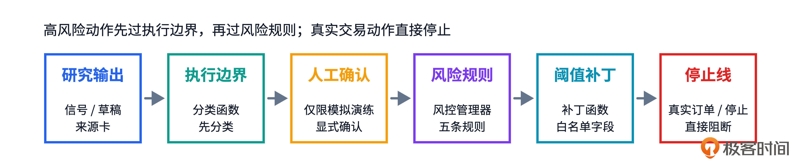
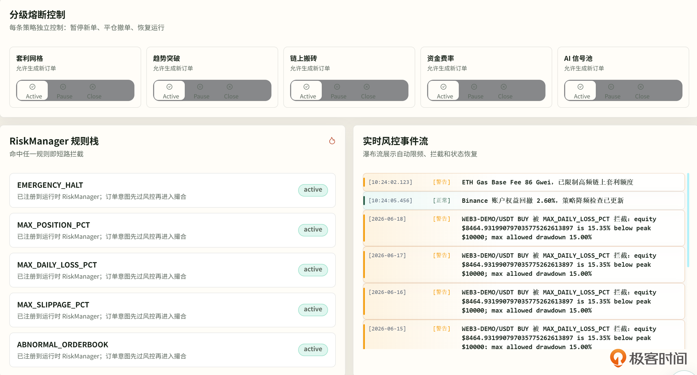
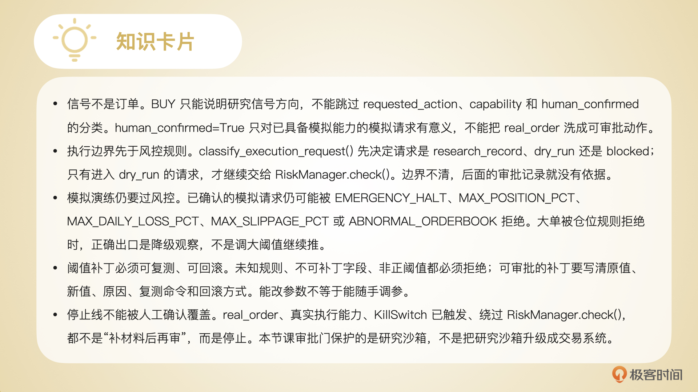

# 30 | LLM量化自动化安全门：审批门与停止线

你好，我是袁从德。

上一讲我们把市场快照和研究草稿自动化了。自动化一旦稳定，真正危险的地方就不再是“它会不会跑”，而是“它会不会把研究输出误当成执行指令”。

```
本讲只解决一个问题：当系统读到 BUY、模拟演练（dry-run）、阈值调整甚至真实订单请求
```

时，怎样判断它该自动记录、进入人工审批，还是直接停止。要带走的纪律很简单：先分清动作边界，再看风控证据，最后才谈审批；人工确认不能把越界动作洗成安全动作。

本仓库是研究沙箱，不讨论真实下单系统，也不应该出现真实账户、钱包授权或订单 API。本讲交付的不是“可以交易”的证明，而是一份可复核的高风险动作控制合同：哪些动作会降级，哪些动作会阻断，哪些阈值能改，哪些证据必须写进审批记录。

## 1. 贯穿案例：一条 BUY 信号的三种命运

先从一个混合了研究、模拟、改参数和真实执行的委托开始。它看起来像一句自然语言需求，实际包含多种风险等级；如果不先拆开，后面的审批和测试都会失去意义。

- “BTC/USDT 动量转强，建议 BUY。请自动做一笔模拟演练（dry-run）大单；如果回撤阈值太紧，可以放宽；我已经确认，必要时也可以接真实订单。”

```
这句话混在一起的东西太多：BUY 是研究信号，dry_run_order 是模拟请求，大单数量会
```

触发风控，阈值调整是高风险配置变更，真实订单请求则越过了研究沙箱边界。错误做法是把“用户确认”当成万能通行证；正确做法是把它拆成字段，让每一层只回答自己该回答的问题。

本讲围绕表 30-1 中的真实文件展开。后面出现的结论、命令和输出样例，都能回到这些文件复核。

文件

- 本讲关注点

```
把请求动作分成 research_record、
src/risk/execution_boundary.py
blocked
src/risk/manager.py
```

- 运行时风险规则、KillSwitch、阈值补丁

```
src/risk/config.py
```

- 默认五条最小风控规则和规则顺序

```
tests/test_execution_boundary.py
```

- 验证真实订单请求必须被阻断

```
tests/test_risk_manager.py
```

- 验证风险规则、短路、阈值补丁和回测拒

```
tests/test_approval_gate_contract.py
```

- 锁住本讲依赖的停止线契约

```
scripts/generate_chapter30_figures.py
```

- 生成本讲教学图

- 表 30-1　本讲围绕的真实文件与职责

```
接下来进入执行边界。它不评价策略好坏，只判断请求有没有资格进入下一层。signal 不等
于订单，requested_action 才表示用户或流程请求做什么；capability 表示系统实际
能力；human_confirmed 只在模拟演练场景有意义。表 30-2 把同一个 BUY 信号放进不同
```

请求动作里，展示它为什么会走向三种不同出口。

请求动作

- 能力状态人工确认边界结果判断出口

```
record_signal
none
research_record
```

- 不需要自动记录，不能

```
dry_run_order
none
research_record
```

- 任意降级观察，补模

```
dry_run_order
simulation_only
research_record
```

- 否降级观察，补人

```
dry_run_order
simulation_only
dry_run
```

- 是进入风险规则

```
real_order
blocked
```

- 任意任意停止研究请求

- 表 30-2　同一个 BUY 信号在不同请求动作下的分类

```
表 30-2 要防的误判是：看到 BUY 就以为系统应该下单，看到 human_confirmed=True 就
以为可以升级动作。仓库里的 classify_execution_request() 不是这样设计的。下面
```

这段窄口复核命令只检查执行边界，不碰真实交易能力。

```python
$env:PYTHONPATH='src'
@'
from risk import ExecutionBoundaryRequest, classify_execution_request
scenarios = [
   ("signal_only", ExecutionBoundaryRequest("BTC/USDT", "BUY", "record_signal",
   ("dry_run_no_capability", ExecutionBoundaryRequest("BTC/USDT", "BUY", "dry_ru
   ("dry_run_no_confirmation", ExecutionBoundaryRequest("BTC/USDT", "BUY", "dry_
   ("dry_run_confirmed", ExecutionBoundaryRequest("BTC/USDT", "BUY", "dry_run_or
   ("real_order_confirmed", ExecutionBoundaryRequest("BTC/USDT", "BUY", "real_or
]
for name, req in scenarios:
   res = classify_execution_request(req)
   print(f"{name}: allowed={res.allowed} outcome={res.outcome} downgraded_from={
'@ | python -
```

- 代码 30-1　复核执行边界分类

```
本地运行时，关键输出应类似下面这样。这里不需要背完整 reason，只要抓住三个出口：记
```

录、模拟演练、阻断。

```
signal_only: allowed=True outcome=research_record downgraded_from=None
dry_run_no_capability: allowed=True outcome=research_record downgraded_from=dry_r
dry_run_no_confirmation: allowed=True outcome=research_record downgraded_from=dry
dry_run_confirmed: allowed=True outcome=dry_run downgraded_from=None
real_order_confirmed: allowed=False outcome=blocked downgraded_from=real_order
```

- 代码 30-2　执行边界的可复核输出样例

图 30-1 是这一步的视觉摘要：执行边界先把研究输出、人工确认、风险规则和停止线分开。它回答的问题不是“策略好不好”，而是“这个请求有没有资格进入下一层”。



- 图 30-1　LLM 量化自动化安全门：审批门与停止线

## 2. 风控门：模拟演练通过边界，不等于通过风控

执行边界只判断动作等级，不能替代风险规则。一个已确认的模拟演练，仍然可能因为仓位、回撤、滑点、异常 K 线或紧急停止被拒绝。本节把“可以进入模拟层”和“可以模拟成交”分开，避免把模拟演练当成低风险通道。

### 2.1 默认风险规则与短路顺序

本仓库默认注册五条最小可用版本（MVP）风险规则。这里的 MVP 指研究沙箱第一版必须具备的最小风控集合，不代表真实交易系统已经完整。表 30-3 把这五条规则拆成字段、目的和触发后的处理方式。

规则 ID

- 看什么字段为什么看

```
EMERGENCY_HALT
KillSwitch.tripped
```

- 系统级停止要先于普通风控

```
MAX_POSITION_PCT
```

- 成交后名义仓位防止单笔或累积仓位吞掉资金

```
MAX_DAILY_LOSS_PCT
```

- 当前权益相对峰值回撤防止回撤触线后继续加仓

```
MAX_SLIPPAGE_PCT
```

- 单根 K 线高低价相对收盘价价差防止在宽价差、低质量行情里

```
ABNORMAL_ORDERBOOK
```

- 成交量、价格区间、相邻 K 线跳变捕捉停牌、脏数据或异常行情

- 表 30-3　默认风险规则的判断字段和处理方式

```
规则顺序很重要。RiskManager.check() 遇到第一条拒绝规则就短路返回，所以
EMERGENCY_HALT 必须排在第一位。否则系统已经进入紧急停止，却还在讨论普通仓位限
```

制，优先级就错了。代码 30-3 用一条只读命令打印默认规则顺序，帮助确认当前实现没有把紧急停止放到后面。

```python
$env:PYTHONPATH='src'
@'
from decimal import Decimal
from risk import default_risk_manager
manager = default_risk_manager(initial_capital=Decimal("10000"))
print([rule.rule_id for rule in manager.rules])
'@ | python -
```

- 代码 30-3　复核默认风险规则顺序

代码 30-4 给出规则顺序的输出样例。这里保留这个样例，是为了让人一眼确认

```
EMERGENCY_HALT 是否仍然排在第一位。
['EMERGENCY_HALT', 'MAX_POSITION_PCT', 'MAX_DAILY_LOSS_PCT', 'MAX_SLIPPAGE_PCT',
```

- 代码 30-4　默认风险规则顺序输出样例

### 2.2 用大单验证拒绝路径

```
现在把贯穿案例里的“大单”交给 RiskManager。初始资金是 10000，请求买入 200 个单
位，当前价格 100，成交后名义仓位是 20000，超过 MAX_POSITION_PCT 的上限。代码
```

30-5 把这个场景落成可运行的最小样例，用来展示一个关键分工：边界允许模拟演练，只说明它可以进入模拟层，风险规则仍然可以拒绝。

```python
$env:PYTHONPATH='src'
@'
from datetime import datetime, timezone
from decimal import Decimal
from risk import default_risk_manager
from strategy_engine.backtest.candles import Candle
from strategy_engine.backtest.engine import StrategyContext
from strategy_engine.backtest.portfolio import Portfolio
from strategy_engine.backtest.protocol import OrderIntent, OrderSide, OrderType
manager = default_risk_manager(initial_capital=Decimal("10000"))
portfolio = Portfolio(initial_cash=Decimal("1000"))
ctx = StrategyContext(symbol="BTC/USDT", timeframe="1m", portfolio=portfolio)
candle = Candle(
   exchange="test", symbol="BTC/USDT", timeframe="1m",
   ts=datetime(2026, 5, 16, tzinfo=timezone.utc),
   open=Decimal("100"), high=Decimal("100.1"),
   low=Decimal("99.9"), close=Decimal("100"), volume=Decimal("1"),
)
intent = OrderIntent(symbol="BTC/USDT", side=OrderSide.BUY, type=OrderType.MARKET
result = manager.check(intent, ctx=ctx, portfolio=portfolio, candle=candle)
print(result.allowed, result.rule_id, result.reason)
'@ | python -
```

- 代码 30-5　已确认的模拟演练仍可能被仓位规则拒绝

代码 30-6 展示大单被拒绝时最重要的三个字段：是否允许、拒绝规则和拒绝原因。

```
False MAX_POSITION_PCT post-fill notional $20000 would exceed max $10000 (0 + 200
代码 30-6　大单被 MAX_POSITION_PCT 拒绝的输出样例
```

这里的判断出口不是“策略失败”，而是“降级观察”：继续研究信号本身可以，但不能把这个订单意图推进到模拟成交。若要继续研究，应缩小数量、解释仓位口径，再重新跑代码 30-5；

```
不能通过改审批措辞绕过 RiskManager.check()。
```

## 3. 阈值补丁与停止线：能审批的才进入审批

贯穿案例里还有一句，“如果回撤阈值太紧，可以放宽”。这比普通参数修改更危险，因为它会改变系统拦住什么、放行什么。本节把两类动作分开：阈值补丁可以在白名单和复测约束下进入审批；真实订单、真实执行能力、KillSwitch 已触发等越界项，直接进入停止线。

### 3.1 阈值补丁必须有白名单、正值和复测

```
RiskManager.patch_threshold() 已经做了三层门禁：规则 ID 必须存在于白名单，字
```

段必须可补丁，值必须为正。未知规则、未知字段和非正值都会抛出

```
RiskThresholdPatchError。表 30-4 把规则、字段、值和审批记录放在同一张表里，比
```

单独画流程图更便于复核。

门禁层

- 通过条件拒绝示例

```
已登记在 _PATCHABLE_FIELDS
UNKNOWN_RULE
```

规则 ID

```
MAX_DAILY_LOSS_PCT.b
```

字段名

- 属于该规则的可补丁字段

```
max_drawdown_pct=0 或
```

阈值

- 新值为正数且保留风险含义

```
修改 KillSwitch.trippe
```

KillSwitch 状态

- 不走普通 patch

- 只写“已确认”

审批记录

- 写清原值、新值、原因、复测命令和回滚方式

- 表 30-4　风险阈值补丁门禁检查表

下面的复核命令，只验证非正阈值会被拒绝。它不是完整审批，只是证明“坏补丁不能沉默通过”。

```python
$env:PYTHONPATH='src'
@'
from decimal import Decimal
from risk import RiskThresholdPatchError, default_risk_manager
manager = default_risk_manager(initial_capital=Decimal("10000"))
try:
   manager.patch_threshold("MAX_DAILY_LOSS_PCT", "max_drawdown_pct", Decimal("0"
except RiskThresholdPatchError as exc:
   print(exc)
'@ | python -
```

- 代码 30-7　非正阈值补丁必须被拒绝

代码 30-8 展示非正阈值被拒绝时的输出样例。这里要看的不是报错文字是否一字不差，而是系统有没有沉默接受坏补丁。

```
threshold 'max_drawdown_pct' must be positive, got 0
```

- 代码 30-8　阈值补丁拒绝输出样例

```
一个可审批的阈值补丁记录，至少要包含这些字段：rule_id、字段名、原值、新值、修改
```

原因、复测命令、回滚方式、人工决定。缺少这些字段时，出口应该是“修改后复测”，不是“先通过再说”。如果一个系统里的风险阈值可以被任意字段名修改，就不叫审批门。

### 3.2 停止线不能被人工确认覆盖

审批门处理的是“可以被人类判断的高风险项”。停止线处理的是“本仓库根本不应该继续的越界项”。真实订单请求、真实执行能力、KillSwitch 已触发、未知规则补丁、绕过

```
RiskManager.check()，都不是补材料后通过，而是停止。表 30-5 列出本讲的硬停止线。
```

停止线

- 触发条件系统动作人工判断

```
requested_action="real_order"
blocked
```

真实订单请求

- 停止，不进入审批

```
capability="real_order"
blocked
```

真实执行能力

- 移出研究沙箱

- 表 30-5　高风险停止线

这套边界不是凭空发明的。NIST《人工智能风险管理框架》把 AI 风险管理拆成治理、识别、测量、处置四类活动，提醒我们高风险系统要有治理、识别、测量和处置闭环；SEC Rule15c3-5 要求市场准入系统建立、记录并维护风险管理控制，用预设信用、资本等阈值限制风险暴露；FIA 的自动化交易风险控制资料把紧急停止开关描述为触发后立即停止交易活动的后备控制。这些资料不替本仓库下结论，但给了本讲一个方法边界：越靠近执行，越需要预设阈值、停止能力和可审计记录。

```
回到研究沙箱，结论更窄也更硬：real_order 不是“需要更多确认”，而是越界请求。
human_confirmed=True 只能帮助已确认的模拟演练进入模拟风控，不能扩大系统能力，
```

也不能关闭停止线。

```
这条停止线在前端对应 /risk 的风控中心。图 30-2 展示的是风控中心里的三个关键区域：
上方的分级熔断控制，用于暂停新单、平仓撤单或恢复运行；左下的 RiskManager 规则
```

栈，展示当前注册的风控规则；右下的实时风控事件流，记录自动限频、拦截和状态恢复。它不是实盘交易界面，而是把本节课的“先过规则、命中即阻断、全程留痕”做成可观察的教学面板。



- 图 30-2　风控中心里的分级熔断、规则栈与实时事件流

## 4. 审批记录：证明允许路径，也证明拒绝路径

前面三节已经把请求拆成执行边界、风控规则、阈值补丁和停止线。真正交付时，还需要把这些判断写成可审计记录；否则审批只剩一句“已确认”，无法证明系统为什么通过、为什么拒绝、怎样回滚。

### 4.1 Codex 委托要限制范围

Codex 在这一讲里的价值，不是把 BUY 信号接到更大的执行能力，而是把含糊请求拆成可验证的小步。委托语要包含范围、输入、输出证据、失败分支和禁止越界项，否则它很容易变成“帮我改到能跑”的工具说明。

可以分三轮委托：

1. 只审执行边界

```
请只检查 src/risk/execution_boundary.py 和
tests/test_execution_boundary.py。列出 record_signal、dry_run_order、
real_order 的分类结果；构造 real_order + human_confirmed=True 的反例；不要
```

新增真实订单能力；输出实际运行的测试命令和结果。

2. 只审风险栈

```
请只检查 src/risk/config.py、src/risk/manager.py 和
tests/test_risk_manager.py。确认 EMERGENCY_HALT 是否第一位，
RiskManager.check() 是否第一条拒绝规则短路返回；输出规则顺序和拒绝样例。
```

3. 只审阈值补丁

```
请只验证 RiskManager.patch_threshold()。尝试未知规则、不可补丁字段和非正值，
确认都会抛出 RiskThresholdPatchError；不要新增可补丁字段；若建议阈值变更，必
```

须给出原值、新值、原因、复测命令和回滚方式。

这样委托能减少误判，因为它要求 Codex 同时证明允许路径和拒绝路径。高风险场景里，“它被拦住了”与“它通过了”一样重要；没有拒绝证据的审批记录，只能说明流程看起来完整，不能说明边界真的有效。

### 4.2 审批记录要能复核

一份可交付的审批记录，至少要写清楚表 30-6 中的字段。它不是为了增加文档负担，而是为了让“允许、修改后复测、拒绝”三个出口都有证据可查。

字段

- 示例

```
request_id
risk-xxxx
requested_action
dry_run_order / patch_threshold
capability
simulation_only
boundary_outcome
dry_run / blocked
human_confirmed_by
```

- 人工确认人或本专栏角色

```
i k
h
k
EMERGENCY HALT 第
```

- 全部通过/ 被某条规则拒绝位

- 表 30-6　审批记录模板

审批出口也要有判断力：

1. 动作未触发停止线、复测通过、影响范围清楚，才是通过。

2. 说明不完整、测试缺失、影响范围不清，是修改后复测。

3. 触发真实执行、绕过风控或破坏边界，就是拒绝。

## 总结

```
回到这节课开头的问题：自动化读到一个 BUY 信号后，怎样避免它一路滑向真实执行。答案
```

不是多写一句免责声明，而是把动作拆成三层证据：执行边界先判断研究记录、模拟演练还是阻断；风险规则再判断仓位、回撤、滑点、异常行情和紧急停止；阈值补丁最后用白名单、正值、复测和回滚约束高风险配置变更。



```
贯穿案例的最终判断是：BUY 信号可以继续作为研究证据；已确认的模拟演练可以进入风险
规则，但大单会被 MAX_POSITION_PCT 降级观察；非正阈值补丁必须拒绝；real_order
```

即使人工确认也停止。

下一讲进入评测版本比较，这节课形成的审批门，会约束模型、提示词、策略版本和风险阈值怎样晋级。

## 思考与练习

```
为什么 BUY 信号不能直接进入模拟演练？请用 requested_action、capability 和
human_confirmed 三个字段解释。
如果有人确认了 real_order 请求，系统是否可以继续？说明它和 dry_run_order 的
```

- 区别。

期待你的分享。如果今天的课程让你有所收获，也欢迎转发给有需要的朋友，邀请他来一起学习，我们下节课再见！
