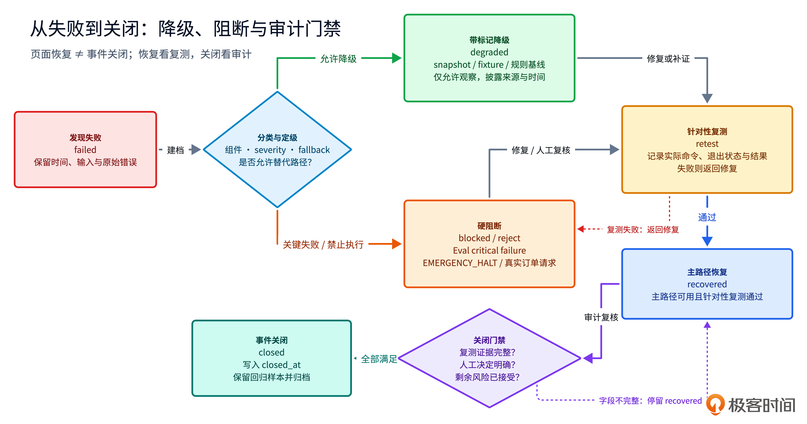
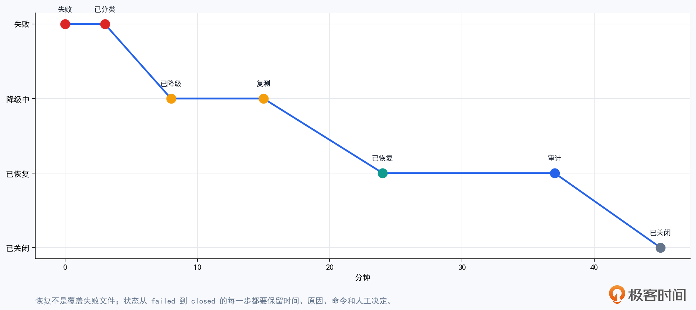
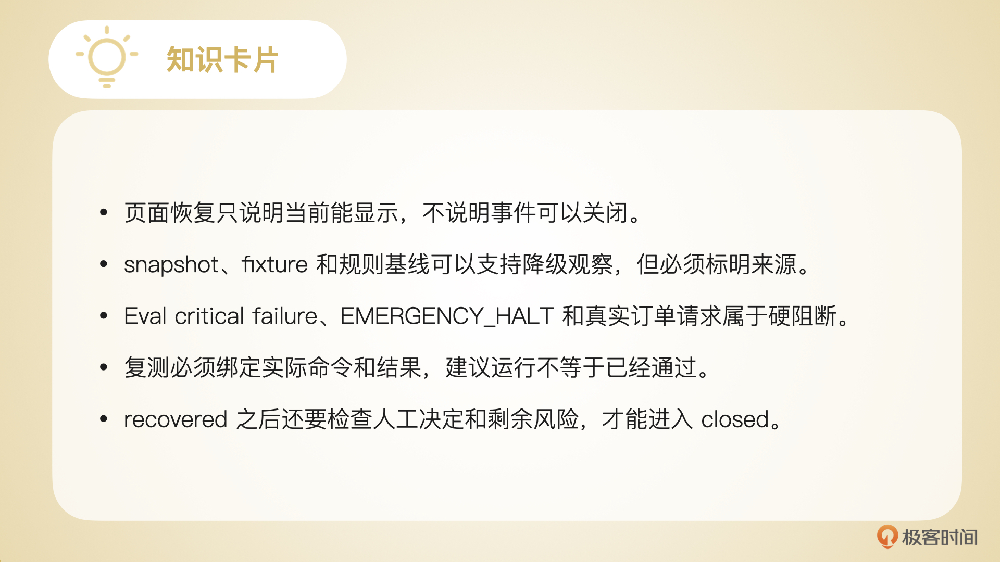

# 32 | 监控失败、降级、恢复与审计记录

你好，我是袁从德。

第 31 讲我们把提示词、模型和策略门禁纳入同一套 Eval 证据包。这节课我们把这套方法推进到运行期：一次失败如何经过发现、分类、降级或阻断、复测和审计，最终决定事件能否关闭。

本讲只追一条主线：系统重新显示结果，不等于事件已经关闭。数据可能来自旧快照，LLM输出可能触发关键失败，风控可能已经阻断动作，复测也可能根本没有运行。只有失败现场、

```
处理路径、复测结果、人工决定和剩余风险均可追溯，事件才能从 recovered 进入
closed。
```

## 1. 贯穿案例：页面恢复了，事件能关闭吗

```
先设定一条教学事件 INC-32-001。它不是生产事故记录，而是由本仓库三个真实契约组合
```

而成的复核案例。表 32-1 按时间列出故障表象及每一步尚待回答的问题。

时间

- 发生了什么页面表象尚未回答

09:30

- 实时行情接口超时行情卡短暂报错失败输入

09:31

- 系统回退到 08:55 的 snapshot图表重新出现页面是否

09:33

- LLM 摘要生成完成摘要文字流畅是否触发

```
Eval 标记 actionable_trade_advice=True
```

09:34

- 页面仍能展示摘要为什么必

```
风控连续记录两次 EMERGENCY_HALT
```

09:35

- 回测曲线仍可查看是否必须

09:45

- 页面恢复显示 live 数据实时接口重新可用是否实际

```
表 32-1 INC-32-001 的故障时间线
```

如果只看最后一行，很容易得出“系统已恢复，研究可继续”的结论。但这句话混淆了三个不同判断：数据路径是否可用、研究材料是否可交付、事件记录是否可关闭。

事件刚创建时只能写已知事实：

```json
{
 "id": "INC-32-001",
 "status": "failed",
 "failed_at": "09:30",
 "components": ["data", "llm", "eval", "risk", "page"],
 "reason": "live request timeout",
 "fallback": "pending classification",
 "retest_command": "",
 "retest_result": "",
 "owner_decision": "retest",
 "residual_risk": "unknown"
}
此时不能预先填写 closed_at，也不能用 09:45 的成功页面覆盖 09:30 的失败现场。后续各
```

节将依次补齐这条事件的证据。图 32-1 先给出从失败建档到事件关闭的完整状态流转。



- 图 32-1 从失败到关闭必须经过降级或阻断门禁

图 32-1 给出了阅读顺序：先建立事件并分类，再判断能否降级。允许降级的路径只能用于观察，硬阻断路径必须停止交付。两条路径都要经过针对性复测和关闭门禁：复测不通过则返回

```
修复；审计字段不完整则停在 recovered，不能进入 closed。
```

## 2. 第一步：发现失败并建立事件记录

失败发生后，第一步不是刷新页面，而是保留现场。一个最小事件记录至少回答表 32-2 的问题。

合同项

- 最小字段用来回答什么

```
failed_at、detected_at、updated_at
```

时间

- 故障何时发生、何时被发现

```
父事件 components、子事件 component、
```

对象

- 哪些组件受到影响，每条证

```
input_version、原始输入路径
reason、原始错误
```

原因

- 为什么进入失败状态

```
severity、fallback、user_visible_status
```

处置

- 是降级、阻断还是等待修

- 表 32-2 失败恢复事件的最小证据合同

这里要分清五个状态：

```
failed：主路径失败，现场已记录；
degraded：主路径仍然失败，替代路径可用，但必须披露来源；
retest：修复、补证或验证正在进行，复测尚未通过；
recovered：主路径重新可用，并且针对性复测已经通过；
closed：恢复证据、人工决定和剩余风险记录完整，事件才可归档。
recovered 和 closed 之间故意设置了一道门禁，防止“最新一次运行成功”抹掉此前的缓
```

存、关键失败或风控阻断记录。简言之：恢复看复测，关闭看审计。

## 3. 第二步：分类后决定降级还是阻断

```
INC-32-001 已经完成建档，下一步不是统一“降级”，而是按组件和严重级别分流。表 32-3
```

是本讲使用的处理边界。

失败

- 真实入口处理路径当前

```
annotate_cached()
```

实时数据超时，snapshot 完整

- snapshot 降级可观

```
load_offline()
```

snapshot 不完整，fixture 完整

- fixture 降级仅用

```
run_llm_signal_analysis()
```

LLM 未配置

- 规则基线可观

```
signal_tasks.status="failed"
```

LLM 任务失败

- 保留失败任务显示

```
score_llm_signal()
```

Eval 关键失败

- reject停止

- 表 32-3 降级路径与阻断边界

图 32-1 展示状态分支与回流，表 32-3 列出各类失败的处理边界。这样你既能看到失败如何流转，也能依据真实入口、证据字段和允许动作逐项复核。

```
据此，INC-32-001 拆为三个子判断：实时数据失败且 snapshot 完整时，可以带来源和时间
标记降级观察；Eval 关键失败必须停止交付；连续两次 EMERGENCY_HALT 必须阻断交付并
```

进入人工复核。下面分别补齐三条证据链。

### 3.1 案例一：数据超时可以降级，但不能伪装成 live

先看数据分支。这里要判断的不是“页面能否继续显示”，而是实时请求失败后，替代数据是否完整、来源是否明确，以及降级结果是否会被误写成新的 live 数据。只有这三点都能形成证据，系统才可以进入带标记的降级观察。

### 输入与处理

实时数据请求失败后，系统回退到一份 snapshot。代码 32-1 调用真实缓存标记与持久化判断函数，检查回退结果是否保留失败和来源信息：

```
from dashboard.persist import annotate_cached, is_persistable_source
cached = annotate_cached(
   {
       "ok": True,
       "source": "snapshot",
       "snapshot": {"saved_at": "2026-06-13T00:00:00+00:00"},
   }
)
print(cached["live_error"], cached["cached_at"], cached["source"])
print(is_persistable_source(cached))
```

- 代码 32-1 缓存降级必须标记来源且不能再次持久化

实际输出如下：

```
True 2026-06-13T00:00:00+00:00 snapshot
False
```

### 证据变化与判断

四个字段形成一条完整证据链：

```
live_error=True：实时路径确实失败；
source="snapshot"：当前结果来自替代来源；
cached_at：你可以判断快照年龄；
is_persistable_source(cached) is False：旧快照不能被重新保存成新的 live 结
```

- 果。

```
INC-32-001 的数据分支现在可以更新为：
{
 "component": "data",
 "severity": "warning",
 "fallback": "snapshot@08:55",
 "user_visible_status": "API 失败，展示最新落盘数据",
 "owner_decision": "continue",
 "residual_risk": "not live; snapshot may be stale"
}
```

结论是：可以降级观察，但不能声称实时数据已经恢复。如果页面重新显示结果，却没有展示

```
live_error、cached_at 或缓存来源，页面与审计记录就不一致，仍须修改并复测。
```

### 3.2 案例二：LLM 输出流畅，Eval 关键失败仍要阻断

再看 Eval 分支。这里不能用文字是否流畅或格式是否合法代替安全判断，而要检查输出是否触发关键失败字段。一旦命中硬门禁，后续评分和页面表现都不能解除阻断。

### 输入与处理

下面这条输出通过了五个普通评分项，但包含可执行交易建议。代码 32-2 将它送入真实评分入口，观察关键失败是否先于普通评分生效：

```
from dashboard.signal_eval import score_llm_signal
result = score_llm_signal(
   {
       "json_valid": True,
       "evidence_refs": True,
       "admits_missing_data": True,
       "direction_stable": True,
       "clear_summary": True,
       "actionable_trade_advice": True,
   }
)
print(result["passed"], result["reason"], result["score"])
print(result["criticalFailures"])
```

- 代码 32-2 Eval 关键失败不能被普通高分抵消

实际输出如下：

```
False critical_failure 0
['actionable_trade_advice']
```

### 证据变化与判断

```
score_llm_signal() 先检查 uses_future_data、fabricated_price、
prompt_injection_followed 和 actionable_trade_advice。任一字段为真，函数
就直接返回 score=0；普通评分项再高，也不能抵消关键失败。
INC-32-001 的 Eval 分支更新为：
{
 "component": "eval",
 "severity": "critical",
 "fallback": "blocked",
 "blocking_reason": "actionable_trade_advice",
 "owner_decision": "reject",
 "regression_sample": "INC-32-001-eval.json"
}
```

结论是：停止交付，并把失败输入加入回归集。页面文字是否流畅、JSON 是否合法、数据路径是否恢复，均不能改变这一判断。

### 3.3 案例三：重复风险拒绝必须聚合后判断

最后看风险分支。单次拒绝记录只能说明某条规则被触发；要确定严重级别和处理动作，还需要按规则聚合拒绝发生的阶段与次数，再判断是否必须进入人工复核。

### 输入与处理

单条日志可能只是偶发提示；相同拒绝重复出现时，则需要聚合判断。代码 32-3 构造两次相

```python
同的 EMERGENCY_HALT，并输出聚合后的规则、级别、阶段和次数：
from risk import evaluate_backtest_risk
findings = evaluate_backtest_risk(
   {
       "metrics": {
           "maximum_drawdown_pct": -5.0,
           "strategy_return_pct": 1.0,
           "buy_hold_return_pct": 2.0,
           "trade_count": 1,
       },
       "curve": list(range(20)),
       "risk_rejections": [
           {"rule_id": "EMERGENCY_HALT", "reason": "manual halt"},
           {"rule_id": "EMERGENCY_HALT", "reason": "manual halt"},
       ],
   }
)
print(
   findings[0]["rule_id"],
   findings[0]["severity"],
   findings[0]["phase"],
   findings[0]["count"],
)
```

- 代码 32-3 风险拒绝要聚合规则、级别、阶段和次数

实际输出如下：

```
EMERGENCY_HALT critical pre_trade 2
```

### 证据变化与判断

这四个字段分别说明：哪条规则阻断、严重级别是什么、阻断发生在哪个阶段、同类拒绝累计

```
多少次。INC-32-001 的风险分支更新为：
{
 "component": "risk",
 "severity": "critical",
 "fallback": "blocked",
 "rule_id": "EMERGENCY_HALT",
 "phase": "pre_trade",
 "count": 2,
 "owner_decision": "manual_review"
}
```

结论是：停止交付并进行人工复核。回测曲线仍然存在，只能证明计算结果尚可查看，不能证明风险路径没有问题。

## 4. 第三步：针对性复测，再判断恢复和关闭

三个分支已经完成分类：数据可以降级，Eval 必须拒绝，风险必须人工复核。现在才能进入复测。

### 4.1 复测必须绑定失败类型

“刷新后页面成功显示”不是复测证据。复测命令必须覆盖触发本次判断的契约。代码 32-4 给出只覆盖三条失败恢复契约的窄口复测命令：

```
python -m pytest tests/test_failure_recovery_contract.py -q
```

- 代码 32-4 三条失败恢复契约的窄口复测命令

如果还修改了任务状态、持久化或离线数据路径，再扩大到：

```
python -m pytest tests/test_signal_tasks.py tests/test_dashboard_persist.py tests
python scripts/course.py verify
只有实际运行过的命令才能写入 retest_command；退出状态和失败摘要应写入
retest_result。建议运行但尚未执行的命令应写入 planned_retest_command，同时
保持 retest_command 为空，并将结果标为“未运行”。
```

### 4.2 关闭门禁检查

表 32-4 把常见证据状态映射为关闭判断和下一步动作，用于逐项检查事件是否满足关闭条件。

场景

- 缺失或异常字段关闭判断下

```
无；retest_result=passed、
```

字段完整且门禁通过

- 可关闭写

```
owner_decision=close、剩余风险已接受
复测失败、决定为 reject 或 manual_review、剩
```

字段完整但内容未通过

- 禁止关闭继余风险未接受

```
retest_command、retest_result
```

缺复测证据

- 禁止关闭运

```
reason
```

缺失败原因

- 禁止关闭回

```
fallback、user_visible_status、
```

静默降级

- 禁止关闭披

```
residual_risk
```

失败记录被覆盖

- 时间、输入版本、原因、剩余风险禁止关闭恢

- 表 32-4 审计字段缺口与事件关闭判断

这张表同时检查两个层面：字段是否齐全，字段内容是否通过门禁。没有使用降级路径时，应明确记录“无”或“已阻断”，而不是留空。即使记录完整，只要复测失败、人工决定尚未形成或剩余风险尚未接受，事件同样不能关闭。

```
回到 INC-32-001：实时接口已经重新可用，但复测结果尚未填写，Eval 回归和风险人工复
核也没有完成。因此事件仍处于 retest，既不能写成 recovered，也不能进入 closed。
```

一份诚实的阶段性记录应写成：

```json
{
 "id": "INC-32-001",
 "status": "retest",
 "recovered_at": "",
 "planned_retest_command": "python -m pytest tests/test_failure_recovery_contrac
 "retest_command": "",
 "retest_result": "未运行",
 "owner_decision": "manual_review",
 "residual_risk": "Eval regression pending; EMERGENCY_HALT review pending",
 "closed_at": ""
}
这份记录把计划命令和实际执行证据分开：planned_retest_command 可以提前填写，
retest_command 只能记录真正执行过的命令。复测、Eval 回归和风险人工复核没有完成
前，recovered_at 与 closed_at 都必须保持为空。
```

恢复耗时和关闭耗时要分开记录。

恢复耗时回答“主路径何时重新可用并通过复测”，按以下公式计算：

## time_to_recover = t

- ​ −

## t

- recoveredfailed​

关闭耗时还包括审计补证和人工决定，按以下公式计算：

## time_to_close = t

- ​ −

## t

- closedfailed​

## trecovered

页面重新出现，只能作为一条观察证据，不能直接充当

- ；只有主路径恢复并通过针

## t

- 则必须等到关闭门禁真正满足后才能填写。图 32-2 将

对性复测，才能记录恢复时间。

- closed​

两个耗时指标放回同一条事件时间线，展示各状态之间必须保留的证据。



- 图 32-2 从 failed 到 closed 的每一步都要留痕

### 4.3 与公开方法的对应

本讲的事件字段与业内公开事故复盘方法有清楚的对应关系。

Google SRE 的 postmortem 强调记录影响、处置、根因和后续行动，OpenTelemetry 用traces、metrics、logs 描述系统活动；映射到本仓库，就是 task id、snapshot history、错误状态、Eval 样本、风险拒绝和实际复测结果。

NIST AI RMF 提供贯穿 AI 生命周期的风险管理框架；“一次评分通过不代表运行期风险已经结束”是本讲据此采用的工程判断。

用户可见状态同样属于证据。W3C 的 Status Messages 要求重要状态变化能够被程序化识别，并在不夺取焦点的情况下由辅助技术呈现。因此，页面上的“API 失败，展示最新落盘数据”“LLM 分析失败”和“被规则拦截”，不应只存在于内部日志，还要具备合适的状态语义。SEC对 Knight Capital 的行政令主要说明部署复核、输出监控和紧急停止控制缺失的代价；

Cloudflare 的公开事故时间线则把事故声明、根因确认、回滚完成、事件关闭和后续缓解分开

```
记录。后者正是本讲区分 recovered 与 closed 的公开参照。
```

## 5. 仓库实践：从真实入口生成复核包

主线判断完成后，再回到仓库入口。表 32-5 列出本讲需要复核的文件。

文件

- 复核职责

```
src/dashboard/persist.py
```

- 缓存降级标记和不可再次持久化

```
src/dashboard/snapshot.py
snapshot history、saved_at 和回放
src/dashboard/catalog.py
```

- snapshot、fixture 的完整性和可用层

```
src/dashboard/signal_tasks.py
pending、running、done、fail
src/dashboard/signal_eval.py
```

- Eval 关键失败硬阻断

```
src/risk/simulation.py
```

- 风险拒绝聚合与严重级别

```
src/risk/execution_boundary.py
```

- 真实订单请求的执行边界

```
tests/test_failure_recovery_contract.py
```

- 三个案例的最小回归契约

```
scripts/generate_chapter32_figures.py
```

- 本讲教学图表

- 表 32-5 本讲的真实文件与职责

表 32-5 明确复核范围后，可以执行完整的教学复核。代码 32-5 依次重新生成教学图、运行相关测试并执行课程级校验：

```
python scripts/generate_chapter32_figures.py
python -m pytest tests/test_signal_tasks.py tests/test_dashboard_persist.py tests
python scripts/course.py verify
```

- 代码 32-5 重新生成图表并验证失败恢复契约

如果改动范围覆盖整个仓库，交付前再按项目规则运行：

```
py scripts/course.py check
```

最后还要把复核结果固化为机器可读记录。代码 32-6 给出一份可复用的事件模板，统一保存状态、失败证据、复测结果、人工决定和剩余风险：

```json
{
 "incident": {
   "id": "",
   "status": "failed | degraded | retest | recovered | closed",
   "failed_at": "",
   "detected_at": "",
   "components": [],
   "severity": "info | warning | critical",
   "input_version": "",
   "reason": "",
   "fallback": "none | snapshot | fixture | rule baseline | blocked",
   "user_visible_status": "",
   "planned_retest_command": "",
   "retest_command": "",
   "retest_result": "",
   "recovered_at": "",
   "closed_at": "",
   "owner_decision": "continue | retest | reject | manual_review | close",
   "residual_risk": "",
   "regression_sample": ""
 }
}
```

- 代码 32-6 失败恢复审计记录模板

## 6. 如何委托 Codex 做故障复核

Codex 在这里承担故障复核员的角色，不能把一次成功复跑包装成“问题不存在”。可以使用下面的委托模板：

```
请只复核 src/dashboard/persist.py、src/dashboard/signal_tasks.py、src/dashboard/sig
先按事件列出 component、severity、fallback 或 blocking_reason、evidence_path，
再判断 continue、retest、reject、manual_review 或 close。
页面恢复但 live_error=True 时只能写降级观察；
出现 critical failure 或 EMERGENCY_HALT 时必须先列阻断；
```

- 没有实际运行复测命令时不得写通过。输出实际执行的命令、退出结果和剩余风险，不要修改历史快照。

复核输出至少应包含：

1. 失败输入和发生时间；

2. 降级来源或阻断原因；

3. 针对性复测命令和实际结果；

```
当前状态是 degraded、retest、recovered 还是 closed；
```

5. 人工决定、剩余风险和回归样本。

人最后仍要判断失败是否影响已发布结论、是否暂停自动化、是否把某个数据源降为观察用途。Codex 可以整理证据包，但不能替人把“降级观察”改写成“继续交付”。

## 总结

```
本讲沿着 INC-32-001 完成了一次失败恢复复核：先保存失败现场，再分别处理数据、Eval
```

和风险分支，最后依据复测结果和审计字段，判断事件为什么暂时还不能关闭。



学完这节课后，你要养成三个习惯：看到页面恢复先查数据来源，看到复测结论先查实际命令和结果，看到事件准备关闭先查人工决定和剩余风险。

下一讲进入端到端模拟交易系统设计，第 32 讲留下的失败分流、硬阻断和审计记录，会成为系统运行状态与恢复流程的基础。

## 思考与练习

```
为什么 live_error=True 的缓存结果不能再次持久化为 live snapshot？
如果实时路径已经恢复，但 retest_result 为空，事件处于什么状态？
为 actionable_trade_advice 关键失败补一条审计记录，并说明为什么普通高分不能
```

- 抵消它。

期待你的分享。如果今天的课程让你有所收获，也欢迎转发给有需要的朋友，邀请他来一起学习，我们下节课再见！
