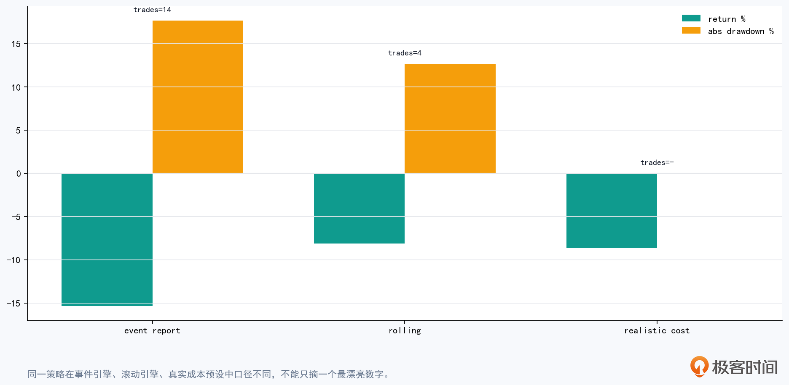
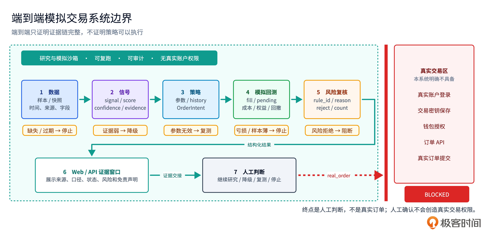
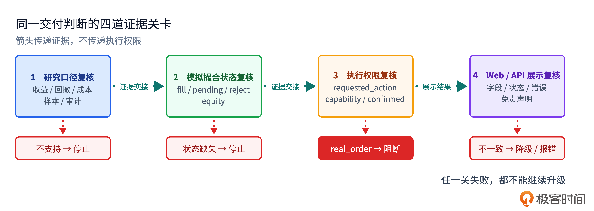
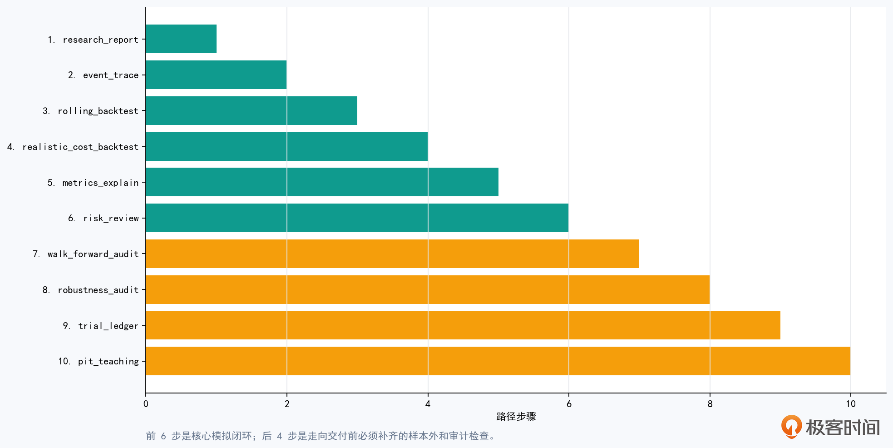
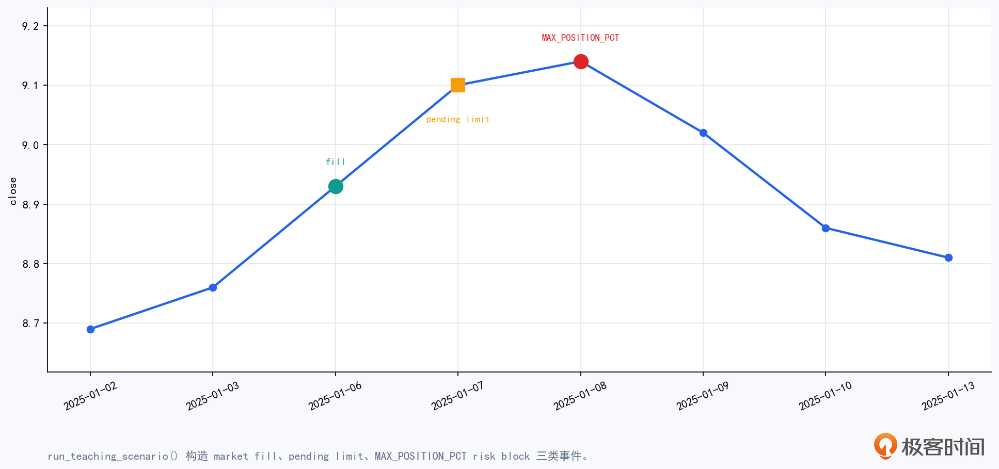
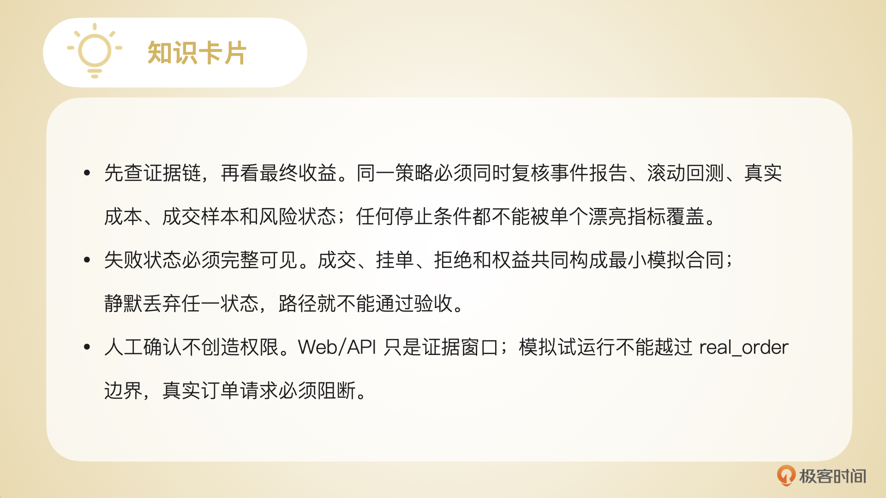

# 33 | 设计并验收端到端模拟交易系统

你好，我是袁从德。

很多量化系统最危险的时刻，不是回测失败，而是“看起来已经能从信号走到下单”。页面一旦出现收益曲线、订单状态和运行按钮，你就可能把研究沙箱误读成实盘能力，把一次样本结果误读成可执行结论。

本讲解决一个具体问题：怎样把数据、信号、策略、回测、风控和 Web 展示串成一条可追溯的模拟交易路径，同时不越过真实订单边界。重点不是从零编写交易平台，而是为仓库中已有模块定义合同、串联证据并完成验收。你要带走的判断纪律是：端到端只证明证据链完整，不证明策略可以执行。

第 32 讲补齐了失败、降级和审计记录，这节课我们把这些能力合成一份模拟系统合同。整讲沿着同一个研究对象逐关推进：先识别误判，再定义合同、运行研究路径、暴露撮合状态、检查执行门禁，最后核对 Web/API 是否如实展示证据。

## 1. 贯穿案例：一条“已经跑通”的策略怎样被误读

先看误判，而不是先看架构。假设页面已经展示均线策略、收益曲线和订单记录，最容易出现的结论是：“信号、回测和下单都跑通了，可以进入交易。”这句话连续跨越了三道尚未验证的边界：回测数字是否经得住不同口径，订单状态是否完整保留，模拟按钮是否被误当成真实授权。

贯穿案例是一条均线策略。仓库已经准备好固定样本和运行入口，我们从根目录执行代码 33-1，即可复现本讲结果，不需要配置环境变量。

```
python scripts/chapter33.py
```

- 代码 33-1　运行贯穿全讲的端到端研究路径

```
结果并不支持“可以交易”。事件回测亏损 15.35%，滚动回测亏损 8.09%；计入费用和滑点
后，亏损扩大到 8.61%。滚动窗口中只有 4 笔成交，样本太薄；运行期间还有 176 次风险拒
```

绝。换句话说，不同观察角度虽然给出不同数字，却指向同一个判断：这条策略只能继续研究，不能放行。

表 33-1 保留具体读数及其含义。需要特别注意，两个引擎采用不同的回撤符号：事件报告用负值表示从峰值向下变化，滚动回测用正数表示回撤幅度，因此不能直接比较二者的符号。审计指标也只能补充解释，不能推翻负收益、样本不足和风险警报。

证据

- 当前读数判断动作

```
-15.35%
```

事件报告收益

- 不进入放行

```
-17.67%
```

事件报告最大回撤

- 触发风险复核

```
-8.09%
```

滚动回测收益

- 只能保留观察

- 表 33-1　三种回测口径与审计口径下的当前案例判断

图 33-1 把事件报告、滚动回测和真实成本版本放在同一张指标卡中。它要阻止的不是亏损本身，而是“挑一个最漂亮的数字代替完整判断”。



- 图 33-1　贯穿案例必须同时比较收益、回撤、成交和成本口径

由此得到一个结论：策略暂时只能保留为研究样本。接下来要设计的不是一条把它送往实盘的流水线，而是一套能够解释“为什么在这里停下”的模拟系统。

## 2. 模拟系统合同：先定义边界，再串联模块

上一节已经说明，页面“跑通”不等于研究结论可以放行。要消除这种误读，不能只靠免责声明，而要先把系统能做什么、不能做什么写成合同。本节先用五步方法确定设计边界，再把输入、输出和停止条件落实到仓库文件，最后说明贯穿案例与合同探针怎样共同支撑后续验收。

### 2.1 把“设计系统”写成五步方法

这里的“设计”不是增加模块或下单按钮，而是回答五个问题：系统能做什么，证据怎样流动，失败是否可见，动作在哪里停止，结果能否复核。

模拟交易在这里是研究流程验收沙箱，不是“离实盘只差一步”。它不连接真实账户，不保存交易密钥，不提交真实订单，也不提供个性化投资建议。只要需求涉及真实账户、钱包授权、订单 API 或实盘损失控制，就已经超出本讲合同。

图 33-2 把合同画成一条单向证据链。数据进入信号和策略，策略进入回测与风控，结果进入Web 证据窗口，链路终点是人工判断，不是真实订单。



- 图 33-2　端到端模拟交易系统边界

### 2.2 为每个模块声明输入、输出和停止条件

端到端不是一路放行，而是每一段都有合同。数据层检查 candle 数量、时间、来源和字段完

```
整性；信号层保留 signal、score、confidence 和证据字段；策略层记录参数、history
长度和信号时点；回测层暴露成交、挂单、成本、权益和回撤；风控层记录 rule_id、
reason 和 count；Web 层只负责展示这些证据，不能创造更高的执行权限。
```

模块与文件

- 输入与输出

```
src/backtest/research_path.py
```

- 研究参数 → 路径、指标、风险和审计

```
src/backtest/trace.py
```

- 固定样本 → 成交轨迹、挂单和拒绝

```
src/strategy_engine/backtest/engine.py
```

- K 线与订单意图 → fill、pending、rej

```
src/risk/execution_boundary.py
```

- 请求动作与能力 → research、dry-ru

```
app.py、src/web/src/api.ts
```

- HTTP 请求 → 结构化回测结果

```
src/web/src/pages/trading/BacktestsPage
```

- API 结果 → 指标、状态和免责声明

```
.tsx
tests/test_simulation_system_contract.p
```

- 系统合同 → 可复跑断言

```
y、tests/test_app_server.py
```

- 表 33-2　端到端合同在真实文件中的输入、输出与停止条件

### 2.3 区分“同一案例”和“合同探针”

```
后文会调用三个入口，但它们不是三个互不相干的案例。run_research_path() 负责判断
研究证据是否站得住；run_teaching_scenario() 是同一模拟引擎的合同探针，专门证
```

明成交（fill）、挂单（pending）和拒绝（reject）不会丢失；

```
classify_execution_request() 再检查研究结果能否越过执行边界。图 33-3 把三个入
```

口和 Web/API 展示组织成四道证据关卡：绿色箭头只表示证据交接，下方动作表示各关失败后的停止、阻断或降级结果。



- 图 33-3　四道关卡传递研究证据，但不传递执行权限

贯穿的不是同一个函数，而是同一个交付判断：这份研究结果最多可以走到哪一步。这里的教学场景，你可以理解为是合同探针。

## 3. 运行路径与失败状态：先复跑，再决定能走多远

合同回答“各模块应当提供什么”，运行结果才能回答“它们实际上提供了什么”。本节先复跑十步研究路径，检查数据、收益、成本和审计证据；再用教学探针验证成交、挂单和拒绝没有丢失；最后把页面字段追溯到引擎状态，确认失败证据不是只写在文案里。

### 3.1 用十步路径复核研究证据

```
代码 33-1 返回的 path 有 10 个步骤。前 6 步依次覆盖研究报告、事件轨迹、滚动回测、真
```

实成本回测、指标解释和风险复核；后 4 步覆盖滚动向前验证、稳健性审计、试验账本和 PIT教学检查。PIT 是 point-in-time 的缩写，在这里指只使用当时可见的数据，避免把后来的信息塞回过去。

```
回测不是这条路径的真正起点。load_prices() 先从 data/prices.csv 读取必需的
date 和 close 字段，并把日期和价格转换为可计算类型；字段缺失、日期格式错误或价格
```

无法解析时，路径会在进入策略前失败。随后，均线策略只读取截至当前 K 线的

```
ctx.history：历史长度不足时不产生信号，条件满足时才把判断转换为 OrderIntent。
```

第 10 步的 PIT 检查继续验证“只使用当时可见数据”这一约束。这样，数据、信号和订单意图不是架构图上的装饰，而是进入模拟撮合前必须通过的前置关卡。

图 33-4 展示这 10 个步骤。箭头表示证据交接，不表示自动授权；第 3、4、6 步出现的负收益、样本不足和风险拒绝，已经要求策略停止升级，后续审计只能解释结果，不能替它翻案。



- 图 33-4　十步研究路径用于传递证据而不是传递执行权限

错误做法是从审计摘要中挑一个数字当作“稳健”证明。PBO，即 Probability of BacktestOverfitting，只提示当前参数搜索的过拟合风险；stability score 只描述参数扰动下的稳定程度。二者都不能覆盖负收益、交易样本不足、成本吞噬和运行期风险警报。

成本口径也必须可复跑。若费用和滑点没有建模，应写“成本未建模”，不能写“成本为零且可忽略”。滑点是预期价格和模拟成交价格之间的偏差。Zipline 官方教程把滑点、交易成本、订单延迟和逐事件处理列为模拟的重要特征，这里只借用这些检查项，结论仍以仓库固定样本为准。代码 33-2 是概念示意，用来说明成本字段为什么必须进入端到端结果；仓库的实际收益，以代码 33-1 的真实成本预设输出为准。

```python
def net_return(position_weight: float, raw_return: float, fee: float, slippage: f
   return position_weight * raw_return - fee - slippage
gross = net_return(1.0, 0.02, 0.0, 0.0)
realistic = net_return(1.0, 0.02, 0.001, 0.002)
print(gross, realistic)
```

- 代码 33-2　费用和滑点口径的概念示意

### 3.2 用合同探针暴露成交、挂单和拒绝

研究路径已经得出“停止放行”，但系统本身仍需证明失败状态没有被隐藏。

```
run_teaching_scenario() 因此构造三个确定事件：市价买单成交、低价限价单保持挂
起、超大买单被 MAX_POSITION_PCT 拒绝。Backtrader 的订单文档进一步区分
```

Submitted、Accepted、Partial、Completed、Canceled、Expired、Margin 和 Rejected 等状态。本讲不复制完整交易所语义，只用成交、挂单和拒绝建立最小教学合同。代码 33-3 通过

```
正式入口运行合同探针，不需要手动配置 PYTHONPATH。
python scripts/chapter33.py --section scenario
```

- 代码 33-3　用教学探针复核 fill、pending 和 reject

```
当前输出为 scenario="market_fill + pending_limit + risk_rejection"、
final_equity=9999.88。其中有 1 笔成交：2025-01-06 买入 1.0，成交价 8.93；1
笔期末仍挂起的限价买单，价格为 4.55；1 条 MAX_POSITION_PCT 风险拒绝。
```

图 33-5 把三个状态放回事件时间线。绿色点表示成交，红色点表示风险拒绝，未成交限价单

```
则保留在 pending_at_end，而不是从结果中静默消失。
```



- 图 33-5　教学场景必须同时看见成交、挂单和风险拒绝

```
如果页面只显示最终权益 9999.88，你可能把它理解成一次轻微亏损；当成交、挂单和拒绝
```

同时可见时，正确结论是：引擎合同可以继续验收，但这组状态不构成策略放行证据。失败路径不是附录，而是判断系统是否诚实的核心材料。

### 3.3 把页面状态追溯回引擎状态

```
失败状态不能只存在于文案。BacktestEngine._submit() 决定订单立即成交还是进入
_pending；_settle_pending() 在后续 K 线上尝试成交；_risk_allows() 写入
_risk_rejections；_fill_at_price() 更新组合与成交；
portfolio.record_equity() 写入权益曲线。你检查实现时，应确认这些状态真的进入
```

payload。

因此，最小验收字段也很明确：成交包含 side、qty、price、date 和 fee；挂单包含 type、

```
price 和 pending 状态；拒绝包含 rule_id、reason、symbol 和 side；权益包含 date、
```

equity 和 position。只更新最终权益、静默丢弃未成交订单，或把风险拒绝笼统写成“交易失败”，都不满足端到端合同。

## 4. 执行门禁与 Web 验收：确认不等于授权

状态完整只说明研究过程可以复核，不表示请求已经获得执行权限。本节先区分研究记录、模拟试运行和真实订单，再检查 Web/API 是否如实展示同一份判断。

### 4.1 研究记录、dry-run 和真实订单必须分级

系统把动作分成三个等级。第一档只记录“出现了买入信号”，不模拟成交；第二档允许在虚拟资金中试运行，但必须经过人工确认；第三档是真实下单，本系统始终禁止。这样的分级遵循一个朴素原则：系统只能执行它明确拥有的能力，操作者点击“确认”并不会凭空增加权限。

代码 33-4 故意提交一条“已经人工确认”的真实订单请求。系统仍然拒绝它，从而证明确认按钮只能推进既有流程，不能把模拟系统变成真实交易系统。

```
python scripts/chapter33.py --section boundary
```

- 代码 33-4　验证人工确认不能把模拟能力升级为真实订单能力

```
当前结果为 allowed=False、outcome="blocked"。表 33-3 展开请求动作、系统能力、
人工确认和最终结果之间的精确映射。record_signal 停留在 research_record；dry-
run 根据能力和确认状态进入 research_record 或 dry_run；只要请求或能力涉及
real_order，结果就是 blocked。
```

```
allowed
```

请求动作

- 系统能力人工确认最终结果解释

- 表 33-3　模拟交易入口必须先过执行边界

### 4.2 让 Web/API 接住同一份判断

```
Web 不能只在架构图里出现。真实调用链是：src/web/src/api.ts 中的
runRollingBacktest() 请求 /api/dashboard/backtest，app.py 将请求交给
execute_backtest()，BacktestsPage.tsx 再显示策略、样本范围、成本预设、总收
```

益、最大回撤、Sharpe、交易数和研究判读。页面免责声明，明确写着“历史模拟，不连接真实账户”，并把风险证据指向风控中心。

```
这条链路证明 Web 已承接滚动回测结果，但 BacktestsPage.tsx 并不直接消费
run_research_path() 的十步 payload。因此，准确表述是“核心回测口径进入
```

Web/API”；路径摘要、运行期拒绝和审计字段仍是后续整合项。

```
当前完整证据以 python scripts/chapter33.py 输出的 JSON 为验收载体，Web 页面
```

只是其中核心回测口径的展示子集，二者不能被描述为同等覆盖范围。人工判断也必须留下最

```
小记录：decision 取 stop、observe 或 retest，reason 写明触发的停止条件，
evidence 指向对应指标、风险或状态，next_action 记录补样本、调整参数、复测或关
```

闭。没有这四项，证据虽然到达人工环节，但还没有形成可审计的交付结论。

交付判断由此收束为四条：负收益、样本不足或风险警报会停止升级；撮合状态不完整会停止验收；API 返回失败时页面必须如实报错；真实订单请求直接阻断。只有证据、展示和边界三者一致，模拟系统才算完成闭环。

## 总结

端到端模拟系统证明的是证据可以连续复核，而不是研究结果自动获得执行权限。



这节课的案例只能保留为研究观察。看到“端到端”时，应先问每一关在哪里停止，以及系统究竟具备什么执行能力。

## 思考与练习

1. 为什么端到端模拟系统不能只看最终收益？请从来源、成本、失败状态和执行权限四个角度说明。

```
如果 dry-run 已经人工确认，系统是否可以把 real_order 请求放行？说明理由。
```

期待你的分享。如果今天的课程让你有所收获，也欢迎转发给有需要的朋友，邀请他来一起学习，我们下节课再见！
