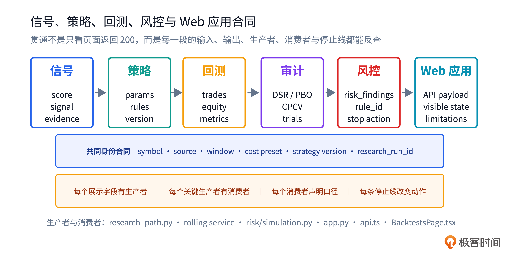
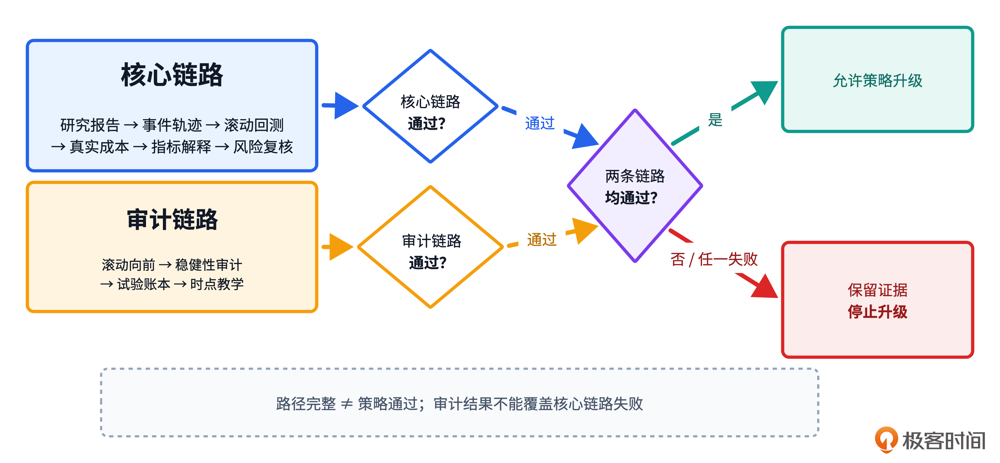
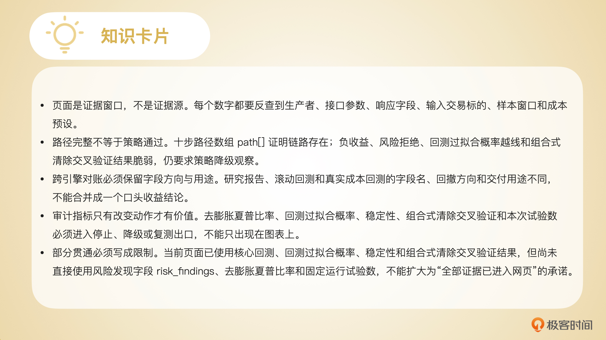

# 34 | 贯通信号、策略、回测、风控与网页应用

你好，我是袁从德。

一个研究应用最容易骗人的地方，不是完全跑不起来，而是报告、接口和页面各自“看起来正常”。页面有收益曲线，接口返回 200，回测也产生了成交，但这些结果可能来自不同样本、不同成本口径或不同审计范围。只要字段不能逐段反查，“已经打通”就只是界面印象。

本讲解决一个具体问题：怎样证明同一条研究结果确实经过信号、策略、回测、审计、风控和网页展示，而且每个页面字段都能追溯到生产者、参数和停止条件。

你要带走的判断纪律是：网页不是证据源，而是证据链的窗口。第 33 讲定义了模拟系统的边界，本讲继续使用同一份固定教学样本，检查研究证据能否从回测和风控传递到接口与网页。

本讲先分析一个“页面正常但结论不能交付”的案例，再定义字段生产、传递和消费必须遵守的贯通合同；随后复核十步研究路径与审计停止线，最后检查应用程序接口（ApplicationProgramming Interface，API）和网页是否真正使用了这些证据。路径完整只能证明链路存在且可以继续验收，不能证明策略已经通过。只要证据偏弱、字段断链、风险被隐藏或停止线没有改变交付动作，策略结论就必须降级、停止或重新测试。

## 1. 贯穿案例：页面正常，为什么仍然不能交付

假设回测页已经显示均线策略、负收益、成交明细和审计卡，最容易出现的判断是：“虽然策略表现一般，但信号、回测、风控和页面已经贯通。”然而，页面正常并不能证明证据链完整。至少还要回答四个问题：页面是否使用与报告相同的教学交易对，成本预设是否一致，风险发现是否进入页面，审计数字来自本次运行还是全局历史账本。

要回答这些问题，需要先固定输入和验收范围，避免不同数据、参数或历史记录混入同一次判

```
断。本讲使用一组可重复的教学案例：交易对为 WEB3-DEMO/USDT，价格样本为
data/prices.csv，试验统计只包含本次运行，不读取累计的全局试验账本。
```

这组案例会依次产生研究报告、滚动回测、真实成本回测、风险发现和审计结果。表 34-1 汇总了本节判断所需的关键结果。即使暂时没有下载配套代码，也可以直接根据这些结果理解后续的对账和停止线。

检查项

- 本案例结果对交付的影响

```
15 35%
```

事件报告收益率

- 不支持策略有效

- 表 34-1　固定教学案例的关键结果与交付动作

这些结果证明，固定输入下的研究链路可以继续对账，但不支持“策略可交付”。三种收益均为负，成交样本很少，运行期拒绝和审计指标又触发了复测或停止条件，因此策略只能保留为教学观察。

已下载配套仓库的话，可以在仓库根目录运行代码 34-1，复现十步研究路径、审计摘要和风险发现：

```
python scripts/chapter34.py --section path
```

- 代码 34-1　复现固定输入下的研究路径与审计结果

这条命令不会读取或写入全局试验账本。没有配套仓库时，可以跳过这一步，不影响后续内容。

因此，本案例只能得出有限结论：研究路径、接口和页面可以继续验收，策略仍应保留为教学观察。后续检查的重点不是页面“有没有数据”，而是每个数字是否来自同一输入合同、停止线是否得到保留，以及哪些关键证据尚未进入页面。

## 2. 贯通合同：让每个字段都能逐段反查

上一节给出了不能放行的结果，本节把“为什么不能放行”写成系统合同。贯通不是把模块用箭头连起来，而是让每一段都声明生产者、消费者、输入、输出和失败出口。先确定真实文件与职责，再把字段血缘压成可执行规则。

### 2.1 把真实文件放回同一份合同

本讲的反查入口可以按链路记忆，而不需要再列一张文件表：

```
src/backtest/research_path.py 与 src/backtest/rolling/service.py 生
```

- 成研究和审计结果。

```
src/backtest/bridge.py 对齐指标口径。
src/risk/simulation.py 合并风险发现。
仓库根目录的 app.py 暴露接口。
src/web/src/api.ts 获取响应。
src/web/src/pages/trading/BacktestsPage.tsx 使用并展示字段。
scripts/chapter34.py 提供固定运行入口。
tests/test_integration_path_contract.py 与 tests/test_app_server.py
```

- 分别检查研究路径合同和应用接口。出现差异时，沿这个顺序定位即可。

图 34-1 展示从固定输入到页面消费的字段交接，并列出四类常见断链。箭头表示证据传递，不是表示字段出现后结论就会自动升级。



- 图 34-1　从固定输入到页面消费的字段交接与断链位置

### 2.2 用四条规则检查字段血缘

只核对字段名称和数值还不够。两个接口即使使用了相同参数，也可能读取了不同时间的数据快照，或者来自不同的一次程序运行。要证明报告、回测、审计和页面属于同一次研究过程，

```
需要为每次研究生成唯一的运行标识，例如 research_run_id。
```

这个标识应从研究入口开始，随输入合同传入回测、稳健性检查和风险审计，再进入接口响应、日志和网页验收记录。验收时不仅要核对交易标的、样本窗口、策略参数和成本预设，还

```
要确认各环节的 research_run_id 相同。
当前固定入口使用 input_contract 证明同一案例可以复跑，但仓库还没有把
research_run_id 传播到独立的回测、稳健性、组合式清除交叉验证接口和浏览器请求。
```

因此，本讲只能证明相同输入合同下的字段口径可以对齐，不能证明多个独立请求一定来自同一次研究运行。补齐这项能力前，验收记录必须同时保存输入合同、请求参数、数据时间范围和请求时间。

贯通验收可以压成四条硬规则：

1. 每个展示字段都要有生产者。页面上的收益、回撤、成交数、回测过拟合概率、组合式清除交叉验证和风险状态必须能指回函数或接口响应。

```
每个关键生产者都要有消费者。后端返回 risk_findings 或 audit_summary，页面、
```

- 报告或验收记录至少要有一处使用；没人消费的字段不能支撑交付结论。

```
每个消费者都要声明口径。页面读取总收益率字段 total_return_pct 时，还要保留交
```

- 易标的（symbol）、窗口、成本预设和策略版本，不能只使用一个数字。

4. 每个停止线都要改变动作。风险阻断、回测过拟合概率越线、组合式清除交叉验证结果脆弱、时点一致性（PIT）错误或字段缺失，必须进入停止、降级或复测出口。

这四条规则把“系统好像打通了”改写成可验证的问题：字段由谁产生、谁消费、使用什么口径、是否属于同一次运行、失败后在哪里停止。

## 3. 研究路径与审计停止线：先对账，再谈展示

贯通合同建立后，下一步是用固定入口逐段复跑。这里分三层检查：先确认十步路径身份完整，再对齐报告、滚动回测和成本口径，最后让去膨胀夏普比率、回测过拟合概率、参数稳定性与组合式清除交叉验证真正改变交付结论。

### 3.1 十步路径证明链路存在

```
研究路径函数 run_research_path(include_audit=True) 返回 10 个步骤。前 6 步覆
```

盖研究报告、事件轨迹、滚动回测、真实成本、指标解释和风险复核；后 4 步覆盖滚动向前验证、稳健性、当前运行试验数和时点一致性教学检查。

```
表 34-2 将十步路径映射到真实生产者和验收重点。第 9 步现在使用 current_run_only，
```

不再把持续增长的全局试验账本写进案例。

步骤

- 名称生产者验收

```
research_report
build_report()
```

1

- 报告

```
event_trace
run_ma_crossover_trace()
```

2

- 事件

```
rolling_backtest
execute_backtest()
```

3

- 收益

```
realistic_cost_backtest
```

4

- 真实成本回测成本

```
metrics_explain
explain_metrics()
```

5

- 多策

```
risk_review
evaluate_backtest_risk()
```

6

- 风险

```
walk_forward_audit
滚动向前审计函数 run_walk_forward()
```

7

- 去膨

```
robustness_audit
稳健性审计函数 run_robustness_audit()
```

8

- 回测

- 试验

```
trial_ledger
```

9

- 本次滚动搜索

```
sc
pit_teaching
pit_teaching_summary()
```

10

- 时点

- 表 34-2　十步研究路径的生产者与验收重点

图 34-2 把十步路径收束为两个独立验收门。核心链路和审计链路必须分别通过；任一链路失败，都只能保留证据并停止策略升级。



- 图 34-2　核心链路与审计链路分别验收，任一失败都阻止策略升级

路径完整只说明字段可以继续反查。当前风险发现，仍包含每日最大亏损比例警告

```
MAX_DAILY_LOSS_PCT 和策略表现不足提示 STRATEGY_UNDERPERFORM，因此动作是“链
```

路继续验收，策略停止升级”，而不是“十步齐全所以通过”。

### 3.2 三种指标口径必须对账

报告、滚动回测和真实成本回测可以产生不同结果，但必须说明生产者、字段名和用途。代码34-2 输出固定输入合同和三种口径，适合直接保存为验收记录。

```
python scripts/chapter34.py --section reconciliation
```

- 代码 34-2　输出报告、滚动回测与真实成本对账记录

表 34-3 将三个口径的生产者、字段、数值、回撤表达和用途放在同一处。它不是为了选一个最漂亮的数字，而是防止页面把不同引擎或成本预设混写成同一个“策略收益”。

口径 / 生产者

- 收益字段与数值回撤字

```
事件报告 research_report
strategy_return_pct=-15.35%
maxi
滚动回测 rolling_backtest
total_return_pct=-8.09%
max_
真实成本回测 realistic_cost_backtest
total_return_pct=-8.61%
```

- 本次输

- 表 34-3　同一策略跨报告、滚动回测和真实成本的指标口径对账

允许对账，不允许混写。必须同时核对交易标的、样本窗口、策略参数、成本预设、字段语义和回撤符号方向。

对账时必须整组保存字段：事件报告使用策略收益率字段

```
strategy_return_pct=-15.35% 和带方向的最大回撤字段
maximum_drawdown_pct=-17.67%；滚动回测使用总收益率字段
total_return_pct=-8.09% 和正值回撤幅度字段 max_drawdown_pct=12.68%；真实
成本回测的 total_return_pct=-8.61% 用于成本敏感性复核。不能只摘取其中一个收益
```

值。

```
指标桥接文件 src/backtest/bridge.py 会把旧版报告（legacy report）的字段映射成滚
```

动回测格式，并统一回撤方向。这个映射提醒我们：字段改名不代表口径自动相同；交易标的、样本窗口、成本和参数仍要一并保存。

### 3.3 审计指标必须改变交付动作

回测表现好，不等于策略真的可靠。研究过程中可能尝试了很多参数，最后只保留表现最好的一组；策略也可能只适合当前样本，换一个时间区间就迅速失效。因此，策略进入下一阶段前，还要检查结果是否依赖反复试验、特定样本或特定参数。

去膨胀夏普比率（DSR）用于判断较高的夏普比率是否可能被反复试验和择优选择放大。研究者尝试的方案越多，最终选出的最好结果越需要谨慎。DSR 还会考虑收益分布及候选方案之间的相关性；未达到本讲门槛时，策略应进入复测，不能直接升级。

回测过拟合概率（PBO）用于判断样本内选出的优胜方案，在未参与选择的数据上是否容易退化。PBO 越高，说明样本内优胜方案在样本外落入较差表现区间的风险越大。超过本讲门槛时，应停止策略升级。

参数稳定性检查会在默认参数附近做小幅调整，观察收益和风险是否发生明显变化。如果参数稍微改变，结果就迅速恶化，说明策略过度依赖某一个参数点，结论应降级并补充测试。

组合式清除交叉验证（CPCV）会构造多组训练区间和验证区间，观察策略在不同数据划分下是否保持一致。清除和隔离步骤，用于降低训练数据与验证数据之间的信息重叠。如果大多数验证路径表现较差，一次成功的回测就可能依赖某次有利的数据划分，策略应进入复测。当前仓库采用教学规模实现，不能据此声称已经消除了所有时间重叠和信息泄漏。

本讲不要求推导这些指标的完整公式，只要求理解它们检查什么，并把结果转成明确动作：满足当前门槛，可以继续下一项验收；证据不足，需要降级；超过风险门槛，应停止升级；结果不稳定，则重新测试。任何单项检查通过，都不能单独证明策略已经达到交付条件。这些指标的价值不在于让报告显得专业，而在于约束下一步动作。

代码 34-3 输出固定教学交易对下的审计包。运行后重点查看去膨胀夏普比率、回测过拟合概率、参数稳定性、组合路径结果和本次试验数，并把每项结果对应到复测、降级或停止升级动作。

```
python scripts/chapter34.py --section audit
```

- 代码 34-3　输出去膨胀夏普比率、回测过拟合概率、稳定性和组合式清除交叉验证审计包

这些指标量纲不同，不适合放在同一坐标系，也不需要再复制成一张大表。判断时应把数字翻译成动作：

```
dsr=0.00 表示表现未显著，进入复测。
pbo.pbo=0.55 越过本课程的 0.50 教学门禁，停止升级。
stability_score=0.6667 不能抵消前一项失败。
组合式清除交叉验证的 sharpe_p50=-4.52、盈利路径占比 33.33%，只允许写成“脆
```

- 弱”。

```
num_trials=36 还必须与 scope=current_run_only 成对保存，不能换成全局账本
```

- 累计值。

这里最重要的不是记住五个数字，而是理解门禁的合取关系：一项较好的稳定性得分不能覆盖

```
回测过拟合概率越线，路径完整也不能覆盖负收益和风险拒绝。PBO > 0.50 只是本课程预
```

先采用的教学阈值，不是统一行业标准；真实项目应版本化阈值及其依据。本仓库的组合式清除交叉验证也是教学规模实现，不声称完成所有标签重叠净化，但当前负的中位路径已经足以阻止“稳健策略”或“可推进”的表述。

## 4. 接口与网页验收：页面只能使用证据

研究路径已经给出固定输入和停止线，本节继续检查这些字段能否穿过接口到达页面。验收顺序是：先反查后端函数、路由和前端调用，再核对页面实际展示与缺口。接口返回状态码 200只证明请求得到响应，不证明字段完整或结论可交付。

### 4.1 接口合同要从使用者反推

接口返回状态码 200，只能说明请求得到了响应，不能证明返回的数据正确，也不能证明页面真正使用了这些数据。接口验收还要回答三个问题：字段由哪个函数产生，计算时使用了什么输入，页面是否消费了这个字段。

定位断链时，可以沿“页面字段 → 接口响应 → 生产函数 → 输入合同 → 交付动作”逐层反查。先确认页面上的数字来自哪个响应字段，再找到生成该字段的函数；随后核对交易标的、样本窗口、策略参数和成本预设；最后检查风险与审计结果是否进入页面，以及停止线是否真的改变页面状态或交付结论。

实际排查可以从出现异常的位置开始，但交付前必须补齐整条证据链。只修改页面文案不能修复后端输入错误，也不能解决字段计算口径不一致。后端返回了字段而页面没有读取，同样属于消费者断链。

```
例如，页面显示 total_return_pct=-8.09%，报告显示
strategy_return_pct=-15.35%。两个数值不同，不代表其中一个一定错误。应先确认
```

它们分别由哪个计算过程产生，再核对交易标的、样本窗口、策略参数和成本预设是否相同，

```
最后检查 src/backtest/bridge.py 是否对字段名和回撤方向进行了转换。
```

字段桥接只能统一字段名称和响应结构，不能让不同的计算引擎、样本范围或成本假设自动产生相同结果。如果差异能够追溯到明确的生产函数、输入条件和字段含义，它就是可以解释的口径差异；如果字段找不到生产者、输入条件没有保存，或者页面混用了不同口径的结果，才构成证据断链。

```
由于 2.2 节所述的 research_run_id 尚未贯通，此处只能核对输入合同和字段口径，不能
```

确认多个独立请求属于同一次研究运行。

### 4.2 网页验收既要记录已展示内容，也要记录缺口

```
回测页面 src/web/src/pages/trading/BacktestsPage.tsx 已经展示策略、交易标
```

的、样本数量、成本预设、收益、回撤、成交、回测过拟合概率、稳定性和组合式清除交叉验证结果；它也明确提示历史模拟不连接真实账户。但页面目前没有直接使用研究路径函数

```
run_research_path() 返回的风险发现字段 risk_findings，也没有展示固定路径中的
去膨胀夏普比率和仅限本次运行的 current_run_only 试验数。
API 返回字段不等于证据已经贯通。risk_findings 出现在响应中，只能证明后端生成了风
```

险结果；如果回测页面没有读取它，风险就没有进入页面决策。表 34-4 因此把生产者、接口、页面消费和缺口合并检查。阅读时先沿第一列找到生产函数和接口，再看第二列是否存在页面消费者，最后用后两列判断证据已经贯通到哪里、还应在哪个环节停止或补证据。

证据链

- 接口与页面消费

```
execute_backtest() →
runRollingBacktest() → 结果总
/api/dashboard/backtest
```

- 线

```
run_robustness_audit() →
fetchBacktestRobustness() →
/api/dashboard/backtest/robustness
run_cpcv_service() →
fetchBacktestCpcv() → 组合路径
/api/dashboard/backtest/cpcv
get_trial_audit() →
fetchBacktestAudit()，页面未
/api/dashboard/backtest/audit
run_research_path() /
```

- 当前回测页无完整消费者

```
pit_teaching_summary()
```

- 表 34-4　接口、页面消费、字段证据与断链结论

网页验收不能只保存一张最终截图，因为截图无法说明页面使用了哪个接口、请求携带了什么参数，也无法保留加载失败和控制台错误。一次完整的网页验收至少要保存三类证据：

- 接口证据要包含请求地址、请求参数、交易标的、成本预设、核心响应字段和错误信息；

- 页面证据要包含页面路由、策略名称、主要指标、审计状态、风险提示和免责声明；

- 失败证据要包含未使用字段、空结果、错误提示、异常网络请求和控制台错误。

缺少其中任一类，都不能把静态截图当成完整的网页验收证据。

如果项目使用浏览器自动化测试，还可以保存测试运行轨迹，用于回放页面操作、网络请求和错误现场。但运行轨迹是辅助材料，不是本讲的必修工具。无论使用什么工具，只有截图而没有接口参数和响应摘要，都不能证明网页证据链完整。

针对本讲的接口合同测试、相关回归测试和前端构建，可以验证局部链路，但这些结果不能代替完整的端到端验收。正式交付还要保存运行日期、接口响应摘要、页面状态、失败记录和未使用字段；若要声明具有可回放证据，还要归档浏览器测试产生的运行轨迹。

合格记录应明确写出：核心回测和部分审计字段已经进入页面；风险发现字段

```
risk_findings、去膨胀夏普比率和本次试验数尚未完整进入同一页面。因此当前可以声称
```

“核心回测与稳健性接口已贯通”，不能声称“十步研究证据已全部贯通到网页”。

## 总结

回到这节课开头的问题：报告、接口和页面都能运行，是否就说明信号、策略、回测、风控和网页已经贯通？答案是否定的。真正的贯通要求同一次固定输入能够穿过研究路径、审计和接口，并让页面既展示已使用字段，也暴露尚未使用的停止线。



贯穿案例的最终判断是：核心研究、审计接口和网页展示，可以继续用于课程验收，策略不能升级为交易结论。完成本讲后，应养成三个习惯：看到页面先查响应，看到响应先查输入合同，看到审计卡先问它是否真的改变交付动作。

## 思考与练习

1. 为什么网页不是证据源？一个收益字段至少要反查哪些身份和口径字段？

2. 十步路径完整，但回测过拟合概率为 0.55、组合式清除交叉验证的夏普比率中位数为-4.52，是否可以写成稳健策略？

期待你的分享。如果今天的课程让你有所收获，也欢迎转发给有需要的朋友，邀请他来一起学习，我们下节课再见！
