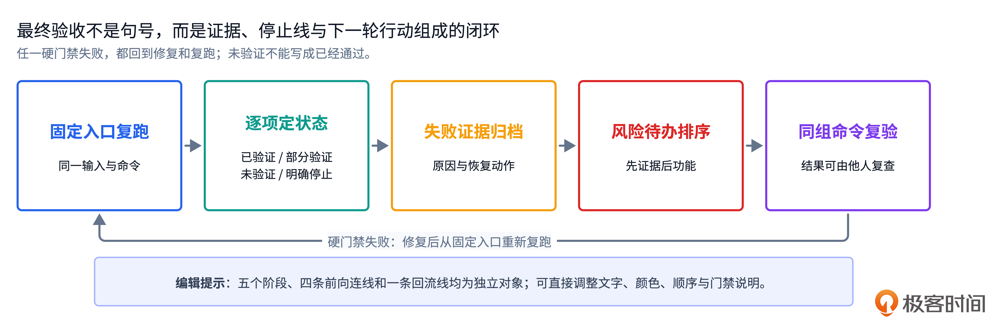
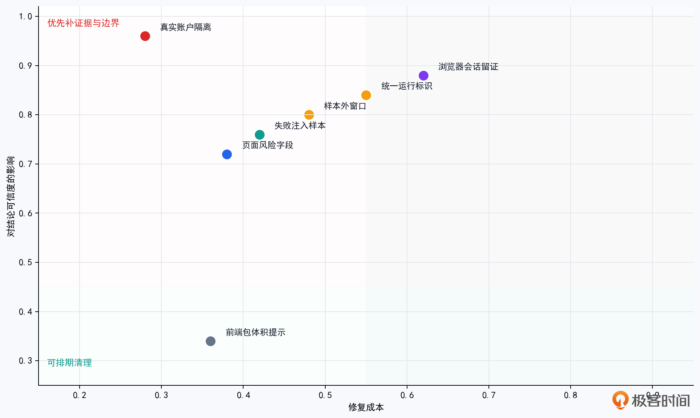
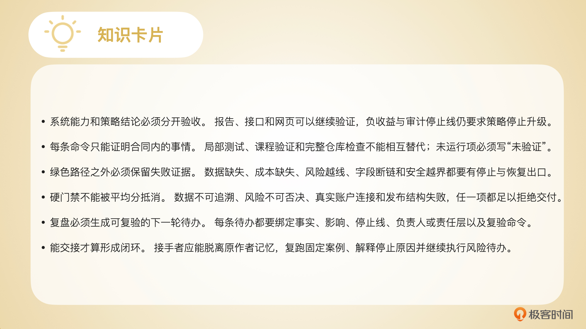

# 35 | 完成系统验收、复盘与下一轮迭代

你好，我是袁从德。

上一讲我们把信号、策略、回测、风控、审计和网页应用放回同一条证据链。本讲不再增加功能，而是回答最后一个交付问题：这套 Web3 量化研究沙盒已经验证了什么，必须停止什么，下一轮应该先补哪一份证据。

最终验收最容易出现的误判，不是命令没有输出，而是把不同层级的“通过”合并成一句“系统完成”。报告可以生成，不等于策略有效；接口返回状态码 200，不等于网页证据完整；自动化测试通过，也不等于失败分支、接手材料和发布边界都已验证。

本讲只使用同一个固定案例，沿“固定事实 → 判定状态 → 验证停止 → 形成决定 → 生成待办→ 交给他人复验”逐步推进。完成不是一句笼统的“通过”，而是有证据、有停止线、能被他人复查，并且知道下一步做什么。

## 1. 贯穿案例：命令都成功，为什么仍然不能写“最终通过”

```
本讲继续使用固定教学交易对 WEB3-DEMO/USDT 和价格样本 data/prices.csv。基础报
```

告与第 34 讲贯通包使用同一教学样本，但承担不同职责：前者给出策略的基础表现，后者补充成本、风险、审计和页面证据。

表 35-1 先把案例拆成证据、状态和动作，这样我们不运行命令也能完成判断。阅读时应特别区分“研究路径可以复跑”和“策略可以升级”：前者是系统能力，后者还要通过表现、风险和审计门禁。

验收对象

- 当前证据当前状态交付动作

- 教学交易对、价格样本、仅限本次运行的试验范围均

固定输入

- 已验证允许复跑和对已记录

报告路径

- 基础报告与贯通包均可生成已验证保留为课程验

策略表现

- 三种收益均为负，且明显跑输买入持有明确停止不升级为交易

```
176 次风险拒绝、PBO 0.55、CPCV 夏普比率中位
```

风险与审计

- 明确停止进入复测，不数为负

- 核心回测和部分审计字段已展示，风险发现与去膨胀

接口与网页

- 部分验证保留缺口，不夏普比率尚未完整进入同一页面

浏览器证据

- 尚未保存真实浏览器跟踪记录未验证不声称浏览器

失败分支

- 已定义最小失败注入集，尚无逐项执行记录未验证执行注入、恢

- 表 35-1　贯穿案例的证据、状态与交付动作

```
表中的关键数值来自同一固定案例：事件报告收益率为 -15.35%，买入持有收益率为
56.27%，最大回撤为 -17.67%，共有 14 笔成交；滚动回测收益率为 -8.09%，真实成本收
益率为 -8.61%，另有 176 次运行期风险拒绝。回测过拟合概率（PBO）为 0.55，组合式清
除交叉验证（CPCV）的夏普比率中位数为 -4.52。这些结果共同指向“策略停止升级”，而不
```

是“系统最终通过”。

已下载配套仓库的话，就可以使用代码 35-1 复现基础报告和贯通包。两个命令的输出应分别保存，不能因为使用同一教学样本就混成一份结果。

```
python report_cli.py --format summary --short 3 --long 7
python scripts/chapter34.py --section all
```

- 代码 35-1　复跑固定报告与第 34 讲贯通包

没有配套仓库时，可以跳过代码 35-1。后续验收以表 35-1 已列出的证据、状态和动作为基础，不要求你从命令输出中自行寻找结论。

图 35-1 展示本讲真正要完成的闭环：固定入口复跑之后，先逐项定状态，再归档失败证据、排列风险待办，最后用同一组命令复验。任何硬门禁失败，都必须回到修复和复跑。



- 图 35-1　最终验收、复盘与下一轮迭代闭环

贯穿案例的初始结论因此很清楚：研究与课程路径可以继续验收，策略结论必须停止升级，网页链路只能写“部分验证”。这里的产出是一份固定事实清单；后面不再争论数值本身，而是为清单中的每个对象确定唯一状态。

## 2. 验收合同：先定状态，再解释命令

上一节已经证明“有输出”不足以代表“已完成”。本节先统一状态口径，再规定每条命令能够证明什么。只有状态、证据和命令边界同时写清，最终验收才不会退化成一张全部打勾的清单。

### 2.1 四类状态必须互斥

表 35-2 定义本讲统一使用的四类状态。同一个验收对象在同一轮记录中只能选择一种状态；证据变化后，可以在下一轮重新判定，但不能同时写“已验证”和“未验证”。

状态

- 判定条件允许写出的结论禁

已验证

- 命令已运行、退出状态已记录、关键输出可复查当前合同内通过推

部分验证

- 正常路径成立，但字段、失败分支或人工复核不完整已验证部分与缺口并列省

未验证

- 命令未运行，或没有可复查记录待复核用

明确停止

- 触及风险、安全、研究或发布边界停止原因与恢复条件用

- 表 35-2　最终验收的四类互斥状态

### 2.2 每条命令都有证明边界

仓库中的报告入口、课程验证和完整检查不是同一个层级。表 35-3 把真实命令与证明边界放

```
在同一行，避免用较窄的测试替代较宽的交付门禁。评分量规 eval-rubric.md 和操作手册
playbook.md 是接手材料，不是命令，但会被最终验收测试和课程检查反查。
```

命令

- 能证明什么

```
python report_cli.py --format summary -
```

- 固定样本报告可生成，基础指标可复核

```
-short 3 --long 7
python scripts/chapter34.py --section
```

- 固定研究路径、成本口径与审计结果可

```
all
python -m pytest
```

- 表 35-3　最终验收命令的证明边界

代码 35-2 给出定稿前的完整复跑顺序。验收记录只能引用本轮实际运行过的结果；任一命令未运行，就必须标为“未验证”。

```
python scripts/generate_chapter35_figures.py
python -m pytest tests/test_final_acceptance_contract.py -q
python scripts/verify_courseware.py
python scripts/course.py verify
python scripts/course.py check
```

- 代码 35-2　生成图稿并运行第 35 讲完整验收栈

代码 35-2 只适用于已经下载仓库并配置好环境的同学。如果某条命令失败，应保留失败阶段和错误摘要；后续较宽的门禁没有运行，就标为“未验证”，不能根据前一条命令推断通过。

命令全部成功也只是“对应门禁已验证”。贯穿案例中的负收益、风险拒绝和审计停止线不会因此消失，它们仍然决定策略不能升级。这里的产出是一份状态记录：每个对象只有一个状态，每个状态都指向具体证据和命令边界。下面我们将用失败场景检查这些状态是否真的会改变系统动作。

## 3. 证据包与失败注入：绿色路径之外还要证明会停止

命令边界确定后，下一步不是继续增加测试数量，而是检查交付证据是否覆盖数据、回测、风控、审计、网页、安全和接手。每一层都必须同时回答四个问题：输入来自哪里，正常输出是什么，失败时在哪里停止，恢复后用什么命令复验。

表 35-4 把证据包与硬门禁合并，避免再用两张表重复描述同一件事。当前结果一栏只记录本讲案例能够直接支持的判断。

门禁

- 最小证据当前结果

数据可追溯

- 交易标的、样本文件、窗口、缺失处理已验证为固定虚构样本

回测可复算

- 参数、成交、权益、成本、回撤基础报告与三种口径可复跑

- 176 次拒绝已进入报告

风险可否决

- 规则、原因、拒绝次数、恢复条件

- 去膨胀夏普比率、PBO、稳定性、CPCV

审计能改动作

- 已触发停止升级

网页可反查

- 页面字段、接口响应、输入合同、运行身份核心字段已展示，停止线只部分

安全边界

- 不连接真实账户，不生成买卖建议研究边界已声明

课程可出版

- 章节结构、图表、代码、链接和习题由课程检查判定

接手可复跑

- 操作手册、评分量规、命令与失败记录由陌生接手者复验

- 表 35-4　最终验收证据包与硬门禁

只跑正常路径仍然不够。表 35-5 给出下一轮必须执行的最小失败注入集，所有样本都应使用临时副本或测试夹具，不能修改固定数据快照。失败注入的目标不是制造错误，而是证明系统能够停止、说明原因并恢复。在保存逐项执行结果前，这张表只是验收计划，不能作为失败分支已经通过的证据。

失败样本

- 注入方式期望反应

```
在临时副本中删除收盘价字段 close
```

数据字段缺失

- 停止生成收益

- 构造缺少键或类型错误的 JavaScript 对象表示法

大语言模型输出不合法

- 进入修复或人（JSON）

成本口径缺失

- 去掉手续费或滑点假设禁止比较策略

风险阈值触发

- 构造回撤或集中度越线报告、接口和

- 表 35-5　最终验收的最小失败注入集

代码 35-3 使用 JSON 给出轻量验收记录模板。它把失败项、恢复动作和停止项放到与通过项同等的位置，防止报告只保留绿色结果。字段中的空值必须在本轮验收后填写，不能把模板本身当作证据。

```json
{
 "验收日期": "",
 "仓库版本": "",
 "实际运行命令": [],
 "退出状态": {},
 "已验证项": [],
 "部分验证项": [],
 "失败注入与实际反应": [],
 "明确停止项": [],
 "恢复动作与复验命令": [],
 "剩余风险": [],
 "下一轮优先级": []
}
```

- 代码 35-3　同时记录通过、失败与恢复动作的验收模板

完成本节后，证据包中既要有正常输出，也要有失败反应、恢复动作和未执行项。它的产出不是“全部绿色”的测试截图，而是一份能够说明系统在哪里停止、怎样恢复的验收记录。下面只根据这份记录形成交付决定。

## 4. 决策门禁：停止线先于成熟度评分

证据包解决“看什么”，决策门禁解决“如何下结论”。风险已经被测量出来，却没有改变交付状态，就不算完成风险管理。例如，页面显示了回撤警告，但策略仍被标记为“可推进”，说明停止线只是展示字段，并没有进入决策。

最终验收可以计算成熟度评分，但数据不可追溯、风险不可否决、连接真实账户或课程结构失

```
败，不能被其他高分平均掉。代码 35-4 先计算硬门禁 G，只有全部门禁通过后，成熟度评分
S 才能参与放行判断。
# 六项门禁分别代表数据、回测、风险、网页、安全和接手。
G = min(g_data, g_backtest, g_risk, g_web, g_safety, g_handoff)
if G == 0:
   decision = "拒绝交付"
elif S >= threshold:
   decision = "当前合同内通过"
else:
   decision = "补证后复测"
```

- 代码 35-4　硬门禁先于成熟度评分的判定逻辑

套回贯穿案例：数据、报告和课程路径能够复跑，但策略风险门禁已经触发，网页停止线又只部分展示。因此最终状态不是“全部失败”，也不是“系统通过”，而是“研究与课程路径在当前合同内可验收；策略停止升级；网页证据部分验证”。这就是这部分的决策产出。下面不再重新评分，而是把未验证项和停止项转成下一轮任务。

## 5. 复盘与下一轮：先修高影响证据，再增加功能

门禁给出当前状态后，复盘必须把失败转成可执行行动。复盘不是寻找某个人承担错误，而是记录发生了什么、造成什么影响、如何处置、怎样防止再次发生。每一项改进都应绑定责任层、完成条件和复验方法。

复盘还要同时记录推进速度和变更带来的不稳定性：既记录完成了哪些复跑，也记录失败、恢复动作和仍未覆盖的边界。只增加功能数量，不能证明交付能力提高。

图 35-2 按“对结论可信度的影响”和“修复成本”排列当前待办。真实账户隔离属于必须长期保持的高影响边界；浏览器会话留证、统一运行标识、样本外窗口、页面风险字段和失败注入，应先于新功能进入下一轮。



- 图 35-2　下一轮迭代的风险待办优先级

图中的坐标，是本讲依据当前证据缺口给出的相对排序，不是统计测量值，也不是通用行业基准。真实项目应由责任人、影响范围和复验成本共同校准优先级。

代码 35-5 给出一条可执行待办。字段使用中文，避免把“优化体验”这样的模糊表述带入复盘；其中 PBO 指回测过拟合概率。

```json
{
 "事项": "补充样本外窗口验证",
 "事实": "当前结论主要来自固定教学样本",
 "影响": "高",
 "修复成本": "中",
 "停止线": "样本外回撤或 PBO 越线时不升级策略",
 "复验命令": [
   "python scripts/course.py verify",
   "python scripts/course.py check"
 ]
}
```

- 代码 35-5　绑定事实、停止线和复验命令的下一轮待办

复盘条目统一采用“事实 → 影响 → 判断 → 行动”。例如：事实是核心接口字段已有合同测试，但真实浏览器跟踪记录尚未生成；影响是不能证明浏览器会话已经留证；判断是网页验收仍为部分验证；行动是固定网址和参数运行浏览器测试，并保存网络响应、页面状态与失败记录。

这部分的产出是一份按影响和修复成本排序的风险待办，而不是新的功能愿望清单。每条待办都要说明完成后如何复验。下一节用接手者能否独立执行这些复验，检查整条主线是否真正闭环。

## 6. Codex 委托与接手边界

在最终验收中，Codex 适合核对文件、运行命令、收集输出和定位断链，不替代人类决定交易风险、安全边界或是否发布。它可以整理证据，但不能把未运行的命令写成通过，也不能用自动评分覆盖明确停止项。

一份可交接的委托必须写清范围、输入、证据、失败分支和禁止事项。下面的委托语可以直接复用：

```
只检查第 35 讲及其真实依赖。
先核对正文提到的文件、命令、图片和测试是否存在，再运行代码 35-1 与代码 35-2。
把每项结果标为“已验证、部分验证、未验证或明确停止”，保留失败输出和恢复动作；
```

- 不得修改上游基线目录、固定数据快照或真实交易边界。任何未运行命令不得写成通过。

```
接手者还应能够仅依赖 README.md、playbook.md、eval-rubric.md 和验收记录完成
```

三件事：复跑固定案例、解释策略为何停止升级、指出网页证据仍缺什么。如果答案依赖原作者记忆或当前聊天记录，交接仍然是“部分验证”。

至此，六个动作完成闭环：固定事实提供输入，状态合同限制措辞，失败注入验证停止，硬门禁形成决定，复盘生成下一轮待办，独立接手证明结果可复验。任何一步缺失，都只能说明项目完成了部分工作，不能写成“最终通过”。

## 总结

本讲从一个“命令都成功”的误判出发，沿同一固定案例完成了六个动作：固定事实、判定状态、验证停止、形成决定、生成待办和交给他人复验。



当前固定样本的结论没有歧义：研究与课程路径可以用于教学验收，策略不能升级为交易结论；核心接口字段已经贯通，网页停止线和真实浏览器证据仍需补齐。最终验收的价值，不是宣布项目结束，而是让下一位接手者知道哪里已经有证据、哪里必须停止、下一步如何复验。

## 思考与练习

1. 为什么报告命令成功不能证明策略通过？

2. 按“事实 → 影响 → 判断 → 行动”写一条浏览器证据待办。

3. 假设你是第一次接触仓库的接手者，请列出一份最小材料，用于证明本讲验收结果可以独立复现。

期待你的分享。如果今天的课程让你有所收获，也欢迎转发给有需要的朋友，邀请他来一起学习，我们下节课再见！
