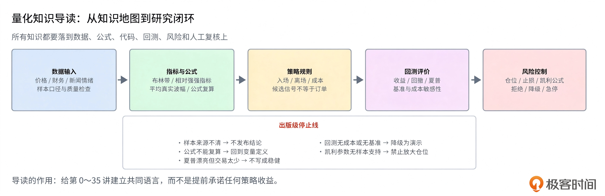

# 导读 | 量化知识背景与研究能力地图

你好，我是袁从德。

本讲补充全专栏所需的量化知识背景。它不是新的交易建议，也不要求你在开始阅读第 0～35讲正文前读完所有经典书，而是说明：本专栏每一部分训练哪类量化能力，哪些知识适合边学边查，哪些主题必须先建立风险边界再深入。

需要先说明覆盖边界：本专栏完整覆盖的是“从数据、信号、策略、回测、风控到网页验收”的Web3（去中心化网络生态）量化研究主线，不是量化金融或加密资产知识百科。概率统计、组合优化、衍生品定价、生产级执行、区块链协议、去中心化金融和监管合规，只在与研究主线直接相关时展开；其余内容明确标为进阶扩展或未覆盖。后文出现某个术语或推荐书目，不代表课程已经完成该主题的数学推导和代码实践。

本专栏的主线仍然是可运行的 Web3 市场研究沙箱：用固定离线样本、仓库代码、回测输出和网页完成可复现研究。下面的知识地图服务这条主线，重点不是“读得多”，而是把阅读转化成可复算的变量、可执行的代码、可拒绝的风险规则和可审计的研究记录。

## 1. 本讲目标

完成本讲后，你能完成四件事：

- 把量化交易知识拆成数据、指标、策略、回测、风控、执行和复核几个层次。

- 说清布林带、凯利公式和夏普比率分别解决什么问题，以及它们不能证明什么。

- 为第 0～35 讲（共 36 讲）建立阅读顺序：先掌握最小量化语言，再进入策略、机器学习、风控和自动化。

- 区分“正文已经实现”“只在导读中介绍”和“当前课程未覆盖”，避免把扩展书单误当成已学能力。

图 D-1 给出本讲的核心知识地图。它不是策略流程图，也不表示全部量化和币圈知识都已进入正文，而是一张研究停止线地图：每一层都要能回到输入、公式、代码、样本和人工复核，不能只留下流畅结论。制图逻辑是：以本专栏可复现 Web3 量化沙箱为核心，把数据、指标、策略、回测和风控依次排列，并为每层设置复核边界与停止线；进阶量化缺口见表 D-11，币圈原生机制见第 9 节。图中不使用实时行情或外部交易数据，制图依据来自本讲对全专栏结构的整理。



- 图 D-1 导读量化知识分层与研究停止线地图

## 2. 量化交易先是一套证据纪律

量化交易常被概括为“用数据代替直觉”。这句话方向正确，但容易让初学者误会：只要把数据放进公式，直觉就自动变成科学。更准确的说法是：量化研究把直觉拆成可以被检查的对象，包括数据来源、变量定义、公式口径、策略规则、回测路径、风险约束和人工复核。

例如“价格跌到布林带下轨，可以买入”不是一个完整策略。它至少还缺少五个问题：数据是否清洗过，布林带窗口和标准差倍数是多少，买入后什么时候离场，单笔仓位多大，手续费和滑点如何处理。如果这些问题没有答案，公式只是把直觉换了一种写法，并没有真正降低风险。

### 2.1 通用流程与覆盖边界

表 D-1 先把通用量化交易流程与本专栏覆盖范围对齐。传统量化教材常从股票、期货或券商接口讲起，本专栏则以固定 Web3 离线样本和模拟研究系统为主，因此会说明策略研究链路，但不会连接真实账户自动下单。

通用量化流程

- 典型内容本专栏覆盖

- 第 2、9、

策略构思 / 超额收益来源

- 趋势追踪、均值回归、多因子选股、事件驱动信号标、大语言

- 第 6、7、

数据获取与处理

- 历史价格、成交量、财务数据、新闻情绪、链上数据间序列清洗

- 用 Python 将规则转成代码，并在历史数据上模拟交第 16、17

策略编写与回测

- 易驱动回测、

- 第 22 讲覆止损、止盈、单笔交易风险预算、账户总风险上限、

风控与仓位管理

- 分数凯利折扣系数记录

- 第 33、34

实盘执行

- 连接券商或交易所系统，自动下单和监控

```
Python、Pandas、NumPy、Backtrader、
```

- 第 3、17、

工程工具

```
PyAlgoTrade、网页应用和测试
```

- 代码、回测

- 表 D-1　通用量化流程与本专栏覆盖范围

为了避免用“覆盖全了”掩盖范围差异，表 D-2 按教学深度重新标记知识状态。“核心覆盖”表示正文有固定样本、公式或代码，以及复验入口；“部分覆盖”表示已有字段或风险边界，但缺少完整机制；“扩展阅读”表示只提供概念或书目；“当前未覆盖”表示需要新增专题才能形成教学闭环。

知识域

- 当前状态已有证据

- 第 4～35 讲有固定样本、代码、测

数据、信号、策略、回测、风控和网页验收

- 核心覆盖

- 收益、回撤、夏普、卡玛、概率夏

描述统计、绩效指标和过拟合审计

- 核心覆盖普比率、回测过拟合概率、组合式

- 第 27 讲有训练 / 测试信息系数（I

因子研究和机器学习

- 部分覆盖比率（ICIR）、候选因子和回测

- 第 22 讲有风险预算、仓位、相关

组合管理与尾部风险

- 部分覆盖

时间序列、期权和强化学习

- 扩展阅读导读提供时间序列模型、期权和强

- 第 6～8、18、24、26 讲有数据和

加密行情、资金费率和链上快照

- 核心覆盖

永续合约、杠杆、保证金和强平

- 部分覆盖正文出现资金费率、杠杆和风险边

- 仅零散出现总锁仓价值、网络手续

去中心化金融、代币经济和链上估值

- 当前未覆盖值和预言机字段

- 表 D-2　量化与加密知识的实际覆盖深度

### 2.2 七层证据纪律

表 D-3 把量化研究拆成后续各讲会反复使用的七个层次。以后看到任何策略、论文、博客或大语言模型输出，都可以用这张表反向检查它缺了哪一层。Web3 场景还要额外注意：加密市场没有统一交易所数据源，蜡烛图（K 线）插针、永续合约资金费率、交易所间价差和链上数据延迟都可能污染样本；因此回测必须固定单一交易所离线样本，并记录数据保存时间。

层次

- 核心问题本专栏对应训练常见越界

- 第 6～8 讲把“当前行情”写成已验证事实

数据

- 样本从哪里来，是否可复现

- 第 9 讲

指标

- 公式怎样压缩市场状态把指标读数写成买卖建议

- 把大语言模型判断直接写成订第 13～16 讲

信号

- 哪些条件触发候选方向感词风控偏差和行情插针污染

- 第 16～18 讲

策略

- 入场、离场、成本和参数如何定义只写买点，不写退出和成本

- 第 18～21 讲

回测

- 历史路径是否按同一规则复算把单次样本收益写成稳定能力

- 第 22 讲

风控

- 仓位、止损、组合暴露如何拒绝风险用收益解释替代风险否决

- 第 23～35 讲

交付

- 页面、报告和自动化如何保留证据用漂亮界面替代可审计记录

- 表 D-3　量化研究的七层证据纪律

这张表也是本专栏的阅读钥匙。前几讲先建立语言和边界，中段讲数据、指标和大语言模型信号，后段讲回测、风控、网页应用和自动化。本专栏不要求一开始就掌握所有高级理论，但要求每一步都知道自己能证明什么、不能证明什么。

### 2.3 核心术语速查

表 D-4 给出本讲后续会反复使用的核心术语。导读讲只给最小解释，详细计算和代码实现放在对应正文各讲。

术语

- 最小解释正文重点

阿尔法（Alpha）

- 策略相对基准的超额收益来源是否来

贝塔（Beta）

- 资产或组合相对市场的系统性暴露是否把市

信息系数（IC）

- 因子值与未来收益的相关性是否跨窗

- 主动收益除以跟踪误差，衡量单位主动风险对应的超是否说明

主动信息比率（IR）

- 额收益数比率混

- 信息系数均值除以信息系数标准差，衡量因子相关性是否说明

因子信息系数比率（ICIR）

- 的稳定程度验证

最大回撤

- 权益曲线从历史高点到低点的最大跌幅是否与收

换手

- 组合调仓频率或交易频率是否扣除

- Web3 场

滑点

- 理论成交价与实际成交价之间的差异

- 表 D-4　导读讲核心术语速查

## 3. 入门必读：先建立市场语言

量化交易入门阶段，最重要的是分清价格、收益、信号、仓位、权益曲线和风险边界。第 4 讲

```
会用 data/prices.csv、src/backtest/runner.py 和
src/backtest/metrics.py 固定这些基础对象。
```

表 D-5 给出入门阶段的推荐材料。它们的价值不在于提供“可复制收益”，而在于帮助建立市场随机性、策略验证和投资边界的基本语言。表中中文译名采用国内常见译法；不同版本译名可能略有差异，正式引用时应以所用版本版权页为准。

方向

- 推荐材料难度正文用途

- Quantitative Trading: How to Build Your Own从零理解Algorithmic Trading Business（《量化交易》），Ernest

量化交易入门

- 入门链P. Chan（欧内斯特・陈）

- Algorithmic Trading: Winning Strategies and TheirRationale（《算法交易》），Ernest P. Chan（欧内斯

量化交易进阶

- 入门到中级理解策略特・陈）

- A Random Walk Down Wall Street（《漫步华尔

金融市场基础

- 入门理解市

- 表 D-5　量化入门阶段推荐材料

阅读这些材料时，不应急着寻找“可直接赚钱的策略”。更好的读法是把每个概念落到研究对象上：数据从哪里来，收益怎样计算，信号什么时候产生，仓位怎样进入权益曲线，风险由谁承担。

## 4. 核心进阶：统计、机器学习与金融数据陷阱

第 14、15、20、21 讲会反复讨论幻觉、提示泄漏、未来信息污染、过拟合和数据窥探。机器学习材料应该服务这些问题，而不是把模型复杂度当成研究能力。

表 D-6 汇总统计和金融机器学习材料。读这些书时，要特别关注样本切分、标签设计、交叉验证和特征重要性，而不是只记住模型名称。

方向

- 推荐材料难度正

- 理Advances in Financial Machine Learning（《金融机器

金融机器学习

- 高级标学习进阶》），Marcos López de Prado性

- Machine Learning for Asset Managers（《资产管理中理

资产管理中的机器学习

- 中到高级的机器学习》），Marcos López de Prado预

- （《因子投资中对表 D-6　统计与金融机器学习推荐材料

本专栏的默认立场是：模型越复杂，越需要更严格的样本切分、特征记录、参数记录和失败样本。大语言模型可以帮助整理上下文和生成结构化候选信号，但不能替代交叉验证、滚动回测和人工复核。

## 5. 策略专题：把想法变成可验证规则

第 16～21 讲会把研究信号写成明确策略规则，再用事件驱动回测、指标评价和多策略比较检验。策略书适合和代码一起读：每看到一个规则，就问它在仓库里对应哪一个输入字段、哪一个信号函数、哪一条交易记录和哪一个风险约束。

表 D-7 汇总策略专题材料。这里的阅读重点不是收集更多策略名字，而是学习如何把一个想法拆成可验证规则。

主题

- 推荐材料难度正文连接

- Following the Trend（《趋势跟踪》），Andreas对接均线、

趋势跟随

- 中级Clenow永续合约时

- Stocks on the Move（《股票动量策略》），Andreas

股票动量

- 中级对接股票动Clenow

- 表 D-7　策略专题推荐材料

本专栏不要求一次覆盖所有策略类型。第一轮学习应优先掌握一个最小闭环：信号定义、参数来源、入场离场、成本假设、权益曲线、最大回撤和拒绝条件。

## 6. 量化投资与多因子模型

量化投资中的多因子模型把“为什么一个资产可能跑赢另一个资产”拆成多个可检验的解释变量，例如动量、价值、质量、规模、波动率、流动性和情绪。它与本专栏第 27 讲的因子挖掘专题直接相关：先定义因子，再检验信息系数、分组收益、换手、成本、滚动稳定性和风险暴露。第 21 讲负责滚动验证、多策略比较和过拟合审计，不承担完整因子教学。

在 Web3 场景中，多因子模型不能简单照搬股票市场。加密资产缺少统一财务报表，交易所数据口径不同，永续合约资金费率、链上活跃度、代币解锁、流动性池变化和交易所插针都可能成为因子或噪声。因此，本专栏只把多因子模型作为研究框架，不把单个因子排名直接写成买卖建议。

表 D-8 汇总量化投资与多因子模型的核心参考书。导读只说明每本参考书在本专栏中的位置，因子候选与回测实践放在第 27 讲；组合风险模型和完整数学推导仍属于后续扩展。

方向

- 推荐材料作者

- Active Portfolio Management（《主动投资组合管理》）Richard C. G

理论与体系基石

- Quantitative Equity Portfolio Management: ModernEdward E. Qi

组合构建与风险模型

- Techniques and Applications（《量化股票投资组合管Sorensen理》）

- 表 D-8　量化投资与多因子模型推荐材料

多因子模型进入正文实践时，至少要保留四条停止线：第一，因子必须说明数据来源和计算窗口；第二，因子表现必须跨时间窗口验证，不能只展示单次信息系数；第三，组合收益必须扣除换手和成本；第四，Web3 因子必须说明交易所口径、资金费率和链上数据延迟。

## 7. 三个公式构成的示例：布林带、凯利与夏普

为了把“数学公式与交易规则”落到可理解的例子，本讲使用一个均值回归研究示例。它由三类公式组成：布林带识别价格相对波动区间的位置，凯利公式讨论仓位比例，夏普比率评估单位波动下的收益表现。

### 7.1 布林带：识别候选状态

公式 D-1（布林带基础公式口径）给出常见计算方法：20 日均线加减 2 倍标准差。它可以描述价格是否接近近期波动区间边缘。

## = SMA

- ​(P​),

## M

- 20​tt

## = M

- ​ + 2σ​,

## U

- 20,t​tt​​

## = M

- ​ −2σ​.

## L

- 20,t​tt

## D −1

## P

## t

## M

## U

## L

## σ

## t

公式 D-1 中，

- 为第 期价格，分别为中轨、上轨和下轨，为截至第、、20,t​t​t​t​t​

期的 20 期价格标准差。窗口长度和标准差倍数必须与代码实现保持一致。

公式 D-2（布林带均值回归候选规则）把上下轨状态写成候选规则：

- ​ ≤L

## ⇒s

- ​ = 多头候选,

## P

- ttt​​ ≥U

## ⇒s

- ​ = 退出或空头候选.

## P

- ​ttt​

## D −2

## s

## t

公式 D-2 中，

- 表示第 期的候选状态，而不是订单或成交结果。“退出或空头候选”必须由后​t

续策略规则进一步拆分，不能由触及上轨直接决定。

这里必须强调“候选”二字。第 9 讲只把“价格接近下轨或上轨”定义为市场状态；第 16 讲才把它编译成策略规则；第 18、19 讲再检查权益路径、回撤和夏普。只用技术分析库的布林带函数

```
talib.BBANDS，或本仓库的 bollinger_bands 生成 signal，还不能说明策略有效。
```

### 7.2 凯利公式：优化仓位不等于放大仓位

公式 D-3（凯利公式的二元收益形式）回答的问题是：如果一项重复下注有正期望，并且胜率和盈亏比都稳定，长期最大化账户对数增长的理论最优资金比例是多少。本导读只保留凯利公式的最小研究口径，完整参数敏感性分析留到第 22 讲。

## bp −q

## f ∗

## =

- ​,

## b

## = 1 −p,

## q

- ​​

## 平均盈利

## =

- ​.

## b

## ∣平均亏损∣

## D −3

## b =

## /∣∣

## G L

## p

这里的“平均亏损”必须使用亏损金额的绝对值，因此更严格的写法是

- 。公式中，

## f ∗

## q = 1 −p

## b

- ， 为平均盈利与平均亏损绝对值之比，为理论最优资金比例。这只是

为胜率，数学模型下的长期增长最优比例，不是本专栏里的默认仓位。现实研究里，胜率、盈亏比、交易成本、滑点和市场状态都会漂移；若估计误差偏乐观，凯利公式会迅速把仓位推得过大。

所以本专栏只把凯利公式作为“风险预算上限的参考”，不把它直接写成下单规则。公式 D-4（本专栏中的分数凯利约束）将风险比例、分数凯利和账户暴露统一为仓位比例：

## (d

- account)

## ρ

- ∗

## = min

## ,

- ​, λf , w

## w

- max​​stop​​​

## = E

- ​.

## V

- ​ wpositionmaxt​

## D −4

## ρ

## d

## λ

## w

公式 D-4 中， 为单笔风险比例，

- 为止损距离比例， 为分数凯利折扣系数，stopaccount​​

## w

## E

## V

- 为最终仓位比例上限，为当前权益，为名义仓位。

为账户暴露比例上限，

- maxposition​t​​

## min(⋅)

参与

- 比较的三项都是无量纲比例，避免把金额形式的风险预算与仓位比例直接比较。

第 22 讲会进一步讨论分数凯利折扣系数、单笔交易风险预算和账户总风险上限的关系。导读讲只要求记住：凯利公式不是自动放大仓位的理由。

### 7.3 夏普比率：衡量风险调整收益

夏普比率用来衡量每承担一单位波动，策略获得多少超额收益。第 19 讲会正式展开绩效评价，公式 D-5（夏普比率最小口径）先给出每期计算方法：

## E(R

- ​ −R​)f,tt​ =​.

## S

- period

## Std(R

- ​ −R​)f,tt

## D −5

## R

## R

- 是每期策略收益，是与其频率一致的每期无风险收益。年化时再乘一年观测期数的平f,t​t​

## N

方根

- ，具体写在公式 D-9；日频、小时频和分钟频结果不能直接混在一起。交易次数过​

少、收益主要来自单笔极端交易等细节，留到第 19 讲展开。

常见文章会写“夏普比率大于 1.5 才值得实盘”。本专栏不采用这种硬阈值。夏普可以帮助比较同一口径下的策略，但它不能单独决定是否进入真实交易；频率、样本长度、交易次数、最大回撤、成本、滑点和样本外表现都必须一起检查。

表 D-9 把三个公式放回研究边界。可用它判断一个“数学策略”是否已经具备研究资格。

公式

- 解决的问题对应正文位置必须保留的边

- 第 9、16、18 讲

布林带

- 用均线和标准差描述价格是否接近波动区间边缘触及上下轨只

- 胜率和盈亏比第 22 讲

凯利公式

- 根据胜率和盈亏比估算理论资金比例凯利或风险预

- 高夏普不能证第 19 讲

夏普比率

- 衡量每承担一单位波动所获得的超额收益交易次数和成

- 表 D-9　三个公式示例的研究边界

这个由三个公式构成的案例还需要期望值、风险倍数（R 倍数）和风险预算，才能形成完整的仓位语言。公式 D-6（期望值、风险倍数与风险预算公式）中的平均亏损使用正的损失幅度；所示仓位数量公式适用于线性现货或单位合约乘数，其他合约必须先把乘数和盈亏函数折算为单位资产止损损失。

## EV

## = p

## −(1 −p)∣∣,

## G

## L

## 实际盈亏

## =

- ​,

## R

- multiple

## 初始风险

- ​​​

## B

## E

- ​ρriskt

## =

- ​ =​.

## Q

- ​

## ℓ

## ∣P

- ​ −P​∣unitentrystop​

## D −6

## ℓ

## ∣∣

## G

## L

## B

公式 D-6 中，

- 和分别为平均盈利与平均亏损幅度，为单笔风险预算，为单riskunit​​

## Q

- 为仓位数量。

位资产止损损失，

把布林带、凯利公式和夏普比率放入同一研究案例时，本专栏采用流程 D-1。它是研究步骤，不是数学公式，因此不再占用公式编号。

- 数据获取 → 指标与策略规则 → 回测验证 → 风险评估 → 模拟系统展示流程 D-1　三个公式构成的策略研究流程

最后一步只到“模拟系统展示”，不进入真实账户自动交易。即使一个示例在历史数据上显示“布林带 + 分数凯利”的收益高于买入持有，也只能写成“在该样本、该成本、该参数下表现更好”，不能写成“证明策略有效”。进入后续研究前，还要做滚动回测、参数敏感性、成本敏感性、样本外验证和人工复核。

### 7.4 全课程核心公式索引

导读前六个公式只是一个研究示例，不能代表全课程公式已经覆盖完整。当前第 0～35 讲正文共有 51 个独立数学公式块，分布在收益、数据质量、技术指标、模型评测、回测、绩效、过拟合审计、仓位和恢复指标等主题中。表 D-10 先给出公式族索引；你后期可以到对应讲次查看变量、代码和失败边界。

公式族

- 核心内容主要讲次

- 第 1、4、18 讲

收益与账户

- 简单收益、对数收益、仓位收益、权益和净收益

- 第 7、8 讲

数据质量

- 新鲜度、覆盖率、缺失率、快照时间窗

- 简单移动平均线（SMA）、相对强弱指标（RSI）、布林带、带宽、百分比位置、真实波幅（TR）、平均真第 9 讲

技术指标

- 实波幅（ATR）

- 可追溯率字段归因率失败率命中率结构通过

- 表 D-10　0～35 讲核心公式族与讲次索引

公式 D-7（简单收益、对数收益与累计收益）统一三种收益口径。价格必须使用同一复权、计价币种和时间边界。

## P

- ​t​ −1,

## =

## r

- ​t

## P

- t−1​​t )

## (P

## P

## = ln

## ,

## ℓ

- ​t​t−1​​​T

## P

## ∏

- T​ −1.

## =

- ​(1 + r​) −1 =

## R

- ​0:Tt

## P

- ​​0t=1

## D −7

## ℓ

## P

## t

## r

## R

## T

- 为第 期价格，为简单收益率，为对数收益率，为从第 0 期到第期的累计收0:T

​t

- ​t​t​

益率。最后一个等式仅在同一计价币种、相同复权口径且期间没有外部现金流时成立。

公式 D-8（仓位收益、账户权益与成本后净收益）把信号落到上一期仓位、账户权益和成本后

## t −1

收益。仓位使用

- 是为了避免用当期收盘后才知道的信号交易当期收益。

## = w

- ​,

## R

- ​rp,tt−1 t​

## = C

- ​ + Q​,

## E

- ​P​tttt​​

## = r

## −c

## −c

## −c

## r

- t tflifditttt

## D −8

## w

## C

## Q

- 为上一期已经确定的仓位比例，为现金，为持仓数量；手续费、滑点和资金费率t−1​t​t​

成本均应换算为与收益率一致的每期比例。公式 D-8 是单资产教学口径，多资产组合还需对各资产仓位收益求和。

## T

公式 D-9（收益、波动率与夏普的年化口径）给出三项指标的统一频率处理方法。

- 是样本内

## N

- 是一年对应的观测期数。

观测期数，

- N/TT

## [

- t ]

## ∏

- ​(1 + r​)

## =

## −1,

## R

- annual​t=1

## = Std(r

- ​)​,

## σ

## N

- annual​​t​

## E(r

- ​ −r​)f,tt

## =

- ​.

## S

## N

- annual

## Std(r

- ​ −r​)​​f,tt

## D −9

公式 D-10（回撤、最大回撤与正值幅度）固定符号约定。正文有的接口返回负值回撤，有的接口返回正值幅度；报告必须声明使用哪一种。

## E

- ​t​ −1,

## =

## DD

- ​t

## max

- ​ E0≤u≤tu​

## =

- ​,

## min

## MDD

- ​DDt​​0≤t≤T

## = ∣MDD∣.

## MDD

- abs​

## D −10

## DD

## t

## MDD

## MDD

- 为第 期相对历史权益峰值的回撤，为样本期内最小的负值回撤，abs​t​

为其正值幅度。报告引用最大回撤时必须明确使用负值还是正值幅度。

公式 D-11（卡玛比率、下行偏差与索提诺比率）补充两项风险调整指标。下行偏差只惩罚低于最低可接受收益（Minimum Acceptable Return，MAR）的部分；本仓库当前实现以夏普和卡玛为主，索提诺属于扩展指标。

## R

- annual

## =

- ​,

## Calmar

- ​

## MDD

- abs​​ −MAR, 0)

## =

- ​,2]

## E min(r

## [

## σ

- downt​​​​ −MAR)

## E(r

- t

## =

- ​.

## Sortino

## N

- ​

## σ

- down​

## D −11

## σ

## MAR

## r

公式 D-11 中，

- 为下行偏差，最低可接受收益必须与使用相同频率；若down​t​

## MAR

- 是年化目标，应先换算为每期口径。

公式 D-12（因子信息系数、秩信息系数与因子信息系数比率）给出因子研究的最小口径。行业多资产研究通常在同一时点计算因子值与未来收益的横截面信息系数（IC），其中秩信息系数（RankIC）使用秩相关衡量关系；本仓库只有单一教学序列，因此

```
src/factor_mining/evaluate.py 使用信号与未来收益在时间维度上的斯皮尔曼秩相关
```

作为教学代理，并用滚动信息系数的标准差衡量稳定性。这两种口径不能混写。因子信息系数比率不应与“主动收益除以跟踪误差”的主动信息比率混淆。

## RankIC

## = ρ

- ​(F​, R​),Spearmani,ti,t+h​t

## = ρ

- ​(s​, r​),

## IC

- singleSpearmant+ht​​​

## IC

## =

- ​.

## IR

- IC

## Std(IC

- ​)​window

## D −12

## F

## i

## t

## R

## h

## s

公式 D-12 中，

- 为资产 在第 期的因子值，为未来 期收益，为单序列信i,ti,t+h​t​​

## IC

## IR

- 为滚动窗口内的信息系数序列。这里的是因子信息系数比率（ICIR），

号，

- windowIC​​

不是表 D-4 中“主动收益除以跟踪误差”的主动信息比率。

公式 D-13（组合收益、组合方差、贝塔与阿尔法）是组合数学的最小扩展。资本资产定价模型（Capital Asset Pricing Model，CAPM）用贝塔描述市场系统性暴露，并把阿尔法解释为基准模型未解释的收益。正文第 22 讲只做教学组合与相关性审计，尚未实现完整均值—方差优化或有效前沿。

## = w r,

- T

## R

- ​p2T

## = w Σw,

## σ

- ​p

## Cov(R

- ​, R​)pm

## =

- ​,

## β

- ​​​p

## Var(R )

- m​ −R​ E(R​ −R

## = E(R

- ​) −β​).

## α

- ​ppfpmf

## D −13

## w

## r

## Σ

## R

## R

- 为组合权重向量， 为资产收益向量，为协方差矩阵，为市场收益，为无风险m​f​

收益。公式 D-13 只给出无约束组合数学的最小口径，不代表仓库已经实现有效前沿或生产级风险模型。

## L = −R

## α

公式 D-14（风险价值与预期损失）给出损失变量口径。令

- 表示损失，置信水平

通常取 95% 或 99%；历史法、参数法和蒙特卡洛法会得到不同估计。

- −1

## VaR

- ​(L)

## = F

- ​(α),αL

## ES

- ​(L)

## = E L ∣L ≥VaR

- ​(L) .

## [

## ]

- ​​αα

## D −14

- −1​(α)

## F

## α

公式 D-14 中，

- 为损失分布在置信水平 下的分位数。条件期望形式适用于连续分布L

或相应的历史样本近似；离散分布、插值方法和小样本会影响预期损失估计，报告必须说明估计方法。

公式 D-15（概率夏普比率与去膨胀夏普比率）中的概率夏普比率采用相关论文的标准口

## SR

## T

## γ

## γ

- 表示夏普比率，表示样本期数，是偏度，

径，去膨胀夏普比率则保留教学摘要。

- ​3​4

## Φ

- 是标准正态累积分布函数；去膨胀夏普比率（Deflated Sharpe Ratio，DSR）把基

是峰度，准夏普替换成多次试验后可能自然出现的最高夏普。仓库实现是教学尺度近似，出版数字以代码和测试为准。

## ⎛

## ⎞

- ∗

## −SR )

## T −1

## (

## SR

- ∗

## PSR(SR )

- ​ ,

## = Φ

## ⎝

## ⎠

- ​2​​​−1γ

## 1 −γ

## +

- 43SR

## SR

- ​​4​​​∗

## DSR

## = PSR(SR

## ).

- multiple trials

## D −15

## SR∗

- ∗

## SR

## SR

- 为观测夏普比率，为待比较的基准夏普比率，表示考虑多次试验后multiple trials​

的基准。公式第二行表达的是去膨胀处理的研究思想，不是完整复现论文全部估计步骤。

公式 D-16（教学尺度回测过拟合概率与组合式清除交叉验证汇总口径）固定本仓库教学实现中的回测过拟合概率（Probability of Backtest Overfitting，PBO）与组合式清除交叉验证（Combinatorial Purged Cross-Validation，CPCV）摘要。原始统计方法比这个摘要更复杂，不能把教学实现当成完整行业实现。

## n

- OOS fail

## =

- ​,

## PBO

- ​teaching

## n

- ​evaluated​

## n

- profitable paths

## =

- ​,

## q

- ​profitable​​

## n

- ​all paths​

## = Median(z

- ​, z​, … , z​).

## m

- CPCV12K​

## D −16

## n

## n

## q

- 和分别为样本外失败切分数和已评估切分数，为盈利路径占

OOS fail

- evaluatedprofitable​​​​, … , z

## z

## m

- 为组合式清除交叉验证得到的样本外路径指标，为这些指标的中位

比，

- 1CPCVK​​

数。本摘要只能解释仓库教学输出，不能替代原始统计方法。

### 7.5 进阶量化主题的覆盖边界

导读列出公式，不等于课程已经完整实现相关研究能力。特许金融分析师协会（CFAInstitute）候选人知识体系将概率统计、回归、时间序列、回测、模拟和组合管理列为量化研究的重要组成部分。表 D-11 区分现有课程已经覆盖的内容与仍需补充的专题，避免你因为导读出现了相关公式，就误以为仓库已经形成完整实现。

主题

- 当前状态若要形成完整教学闭环，至少还需

- 表 D-11 进阶量化主题的覆盖边界

## 8. 执行与市场微观结构：理解成交不是一句“买入”

第 18、22、26、33、34 讲会逐步把策略放进执行和风险路径。即使本专栏不连接真实账户，也必须明确：信号不是订单，订单不是成交，成交不是无成本发生。Web3 市场还要额外记录交易所来源、资金费率、滑点假设和插针样本处理。

表 D-12 只保留执行主题的导读定位。详细理论和数学模型应放到后续执行、风控和模拟系统讲次。

主题

- 推荐材料导读定位

- Trading and Exchanges: Market Microstructure for理解订单簿、流动性和价差

交易机制

- Practitioners（《交易与交易所》），Larry Harris假设

- Algorithmic and High-Frequency Trading（《算法与高

执行算法

- 作为后续扩展，不在导读讲频交易》），Cartea、Jaimungal、Penalva

- 表 D-12　执行与市场微观结构推荐材料

这些材料提醒我们：回测中一条漂亮的买卖记录，只是研究假设，不是现实成交证明。本专栏中的滑点、成本、异常 K 线、急停和人工审批，就是为了阻止“看起来能交易”的结论越过研究边界。

## 9. 加密市场原生机制：数据字段不等于协议能力

本专栏以 Web3 数据和模拟交易为主要场景，但现有正文定位是“加密市场研究系统”，不是完整的区块链、去中心化金融（Decentralized Finance，DeFi）或加密衍生品课程。资金费率、总锁仓价值（TVL）、网络手续费（Gas）、最大可提取价值（MEV）和预言机等字段出现在页面或数据合同中，只能说明系统能够采集、保存或展示相关数据，不能证明课程已经解释其数据生成、定价和风险机制。

以太坊技术导读和以太坊虚拟机说明将区块链描述为由签名交易推动状态变化的系统，智能合约由以太坊虚拟机执行，网络手续费反映链上计算资源消耗。量化采集链上数据时，至少要保留区块号、区块哈希、交易哈希、日志序号、链上时间、代币精度和确认状态；链重组可能撤销尚未最终确认的事件。由于当前课程尚未实现链重组与最终性处理，相关工程实践仍属于扩展范围。

表 D-13 区分正文已经覆盖、部分覆盖、仅提供风险边界，以及由本导读补充但正文尚未形成闭环的内容。后续 9.1～9.5 将对其中部分概念给出最小公式和研究边界，但这些说明不能替代完整案例、代码和失败注入。

主题

- 当前状态已有内容表 D-13　加密市场原生机制的覆盖边界

### 9.1 永续合约、基差与资金费率

芝加哥商品交易所（CME）的加密期货教育资料区分现货、期货基差、名义价值和保证金。加密交易所的永续合约还使用资金费率把合约价格拉回指数价格附近。公式 D-17（基差、资金费率现金流与杠杆倍数）只给出适用于跨平台比较的通用研究口径；实际收付方向、结算时间和强平规则必须以具体交易所合同为准。

- ​ −S

## F

- tt

## =

- ​,

## b

- ​​t

## S

- ​t

## 365

## ≈b

- ​,

## b

- t dannual​​maturity​​​

## = V

- ​,​ s

## C

- ​ffundingnotional tside​

## V

- notional

## =

- ​.

## L

- ​leverage

## E

- ​​t

## D −17

## F

## S

## b

## b

- 和分别为合约价格与现货价格，和分别为基差比例与近似年化基差，annual

​t

- ​t​t​

## d

## V

## f

## s

- 为距到期天数，为名义仓位，为单次资金费率，为多空方向符号，

maturity

- notionalside​t​​​

## E

## L

- 为账户权益，为杠杆倍数。方向符号和资金费率正负约定必须以具体交易所合同leverage​t​

为准。

永续合约没有到期天数，因此不能直接套用到期期货的年化基差；应按资金费率结算周期比较持有成本。强平价格也没有统一公式，它取决于标记价格、维持保证金率、合约乘数、逐仓或全仓模式、追加保证金和交易所清算阶梯。导读不得给出一个看似通用的强平公式。

### 9.2 市值、完全稀释估值、总锁仓价值与供应稀释

公式 D-18（流通市值、完全稀释估值、总锁仓价值与供应增长率）给出常见加密估值字段。完全稀释估值（Fully Diluted Valuation，FDV）假设全部供应按当前价格计价，不等于未来真实市值；总锁仓价值（Total Value Locked，TVL）还会受重复抵押、预言机价格和跨协议重复统计影响。

## = P

- ​,

## M

- ​Qcirculatingcirculatingt​

## = P

- ​,

## FDV

- ​Qfully dilutedtn

## ∑

## =

- ​,

## TV L

- ​Q​Pii​​i=1​ −Q

## Q

- endbegin

## =

- ​.

## g

- ​supply

## Q

- ​begin​

## D −18

## P

## Q

## Q

## Q

- ​P为代币价格，和分别为流通供应量与完全稀释供应量，为circulatingfully diluted

​t

- ii​​​

## i

协议内第 种锁定资产的统一计价价值。总锁仓价值必须避免重复抵押和跨协议重复统计。

### 9.3 自动做市商、价格冲击与无常损失

Uniswap v2 白皮书使用常数乘积公式描述自动做市商（Automated Market Maker，

## x

## y

AMM）。公式 D-19（常数乘积自动做市商的价格与输出数量）以储备 、 和扣费后有效输入

## γΔx

## γ = 1 −手续费率

- 表示最小交换关系，其中；真实协议还可能使用不同费率、曲线和

集中流动性。

## = k,

## xy

## y

- (Y )

## =

- ​,

## P

- X

## x

- ​​​

## y γΔx

## =

- ​,

## γ = 1 −手续费率.

## Δy

- out

## x + γΔx

- ​

## D −19

- (Y )

## x

## y

## k

## P

## X

## Y

和 为交易前两种资产的池内储备， 为常数乘积，

- 为资产以资产计价的边际X​

## Δx

## Δy

## y

- 为输入数量，为输出数量。输出数量不是储备 的正向变化；交易后池内

价格，

- out​

## y

储备会相应减少。

公式 D-20（价格冲击与基础无常损失）给出成交价格冲击和 50/50 常数乘积池的无常损失。

## r

买入和卖出的冲击方向不同，报告比较冲击大小时应取绝对值。 是池外相对价格的新旧比

## IL

- 表示无常损失（Impermanent Loss）；无常损失公式忽略手续费、流动性变化和集中

值，流动性，只适合基础教学。

## P

- execution​ −1,

## =

## I

- ​price​

## P

- mid,pre​

## 2

- ​r​​

## IL(r)

- ​ −1.

## =

## 1 + r

## D −20

## P

## P

## I

- 为成交均价，为交易前中间价。是带方向的价格冲击；跨买卖方向

execution

- mid,preprice​​​

比较时应使用其绝对值，并同时说明交易方向。

### 9.4 质押收益、网络手续费与链上估值

以太坊质押奖惩说明表明，验证者收益不仅有奖励，还可能受到离线惩罚和罚没影响。公式D-21（质押年化单利、年化复合收益、净收益与网络手续费）中，年化单利收益率（AnnualPercentage Rate，APR）不考虑复投，年化复合收益率（Annual Percentage Yield，APY）考虑按期复投；Gas 是链上执行消耗对应的网络手续费。该公式只提供通用收益口径，不替代具体链的协议规则。

## 365

## R

- staking,net

## =

- ​,

## APR

- ​

## B

## d

- ​avgobserved​​m

## = (1 + r

- ​)

## −1,

## APY

- period​​

## = R

- ​ −C​ −C​ −C​ −C​,

## R

- staking,netprotocolservicegasofflineslashing​

## = u

- ​.

## C

- ​pgasgas gas,effective​

## D −21

## R

## B

## d

## r

- 为观察期质押净收益，为平均质押本金，为观察天数，为staking,netavgobservedperiod​​​​

## m

## u

## p

- 为每年复投期数。和分别为实际网络手续费用量与有效

每期净收益率，

- gasgas,effective​​

单价。

公式 D-22（网络价值与交易量比率、市场价值与已实现价值比率）给出两项常见链上估值指标。分子和分母必须使用同一计价币种与明确时间窗口。网络价值与交易量比率（NetworkValue to Transactions，NVT）和市场价值与已实现价值比率（Market Value to RealizedValue，MVRV）高度依赖实体调整、交易量去重、跨链供应和已实现价格口径，不能机械套用阈值。

## M

- network

## =

- ​,

## NV T

- ​

## V

- onchain,adjusted​

## M

- ​network

## =

- ​.

## MV RV

- ​

## M

- realized​

## D −22

## M

## V

- 为网络流通市值，为指定窗口内经实体调整和去重后的链上交易networkonchain,adjusted​​

## M

- 为已实现市值。三个量必须使用一致的计价币种和时间边界。

量，

- realized​

### 9.5 没有统一公式的加密风险

有些重要风险不能被压成一个通用公式。以太坊预言机文档强调正确性、可用性和激励相容；以太坊最大可提取价值（Maximal Extractable Value，MEV）文档说明区块生产者可以通过交易包含、排除和排序提取价值；国际证券委员会组织（IOSCO）加密资产市场建议还覆盖订单处理、市场操纵、托管和客户资产隔离。表 D-14 将这些主题转成研究检查项。

风险主题

- 最小检查项当前课程动作

预言机

- 来源、更新频率、偏差、停更和操纵场景标为进阶扩展

最大可提取价值（MEV）

- 抢跑、尾随、三明治攻击、私有交易池和排序权成本和成交假

跨链桥

- 验证模型、签名门槛、消息重放、资产映射和停机不把桥接资产

稳定币

- 储备、赎回、流动性、脱锚和交易所价差压力测试中加

链重组与最终性

- 确认数、重组深度、快照时间和回滚处理链上数据必须

智能合约

- 权限、升级、重入、价格操纵和审计范围未审计协议不

- 表 D-14　没有统一公式的加密原生风险检查表

## 10. 强化学习：先学基础，再谈交易智能体

强化学习很容易让交易研究看起来更先进，但它也最容易放大奖励设计错误、样本不足和回测幻觉。本导读只提示学习入口，不展开强化学习算法。

表 D-15 给出强化学习材料。正文只保留可检索的书名和用途；具体版本应以读者实际使用版本的版权页或出版社页面为准。

推荐材料

- 难度导读定位

Reinforcement Learning: An Introduction（《强化学习

- 中到高级建立状态、动作、奖励和策

导论》），Sutton & Barto

Deep Reinforcement Learning Hands-On（《深度强

- 中级作为工程实践扩展，不作为

化学习实战》），Maxim Lapan

- 表 D-15　强化学习推荐材料

在没有清晰状态定义、奖励函数、交易成本和风险约束前，不应把强化学习（ReinforcementLearning，RL）输出写成可执行交易系统。免费在线教材、商业付费书籍和论文平台的使用权限不同，应通过正规渠道检索和阅读。

## 11. 编程与工程：让研究可复现

本专栏强调 Codex 进入真实仓库工作，所以工程能力不是附属技能。至少要能看懂 Python 数据处理、测试命令、脚本入口和报告输出。

表 D-16 给出编程和工程材料。它们的作用是帮助把公式变成可运行、可测试、可审计的代码。

推荐材料

- 难度正文用途

Python for Finance: Mastering Data-Driven Finance

- 对接 Python 金融数据处理、向中级

（《Python 金融大数据分析》 ），Yves Hilpisch

Hands-On Machine Learning with Scikit-Learn,Keras, and TensorFlow（《机器学习实战》），Aurélien

- 对接 scikit-learn、特征工程、模中级

Géron

- 表 D-16　编程与工程推荐材料

```
读工程书时，要把示例迁移到本仓库的约束里：代码放在 src/，固定样本放在 data/，讲
次验证入口是 py scripts/course.py verify，仓库级检查是 py
scripts/course.py check。任何文档中声称通过的命令，都必须实际运行过。
```

## 12. 风险管理与资金管理：先控制损失，再讨论策略

风险管理是本专栏最重要的知识补充。部分初学者直接跳到策略和模型，却没有回答“每次最多亏多少”“连续亏损怎么办”“仓位如何随风险变化”。第 22 讲会把这些问题落实到单笔交易风险预算、账户总风险上限、止损、组合暴露和风险拒绝记录。

资金管理会直接影响账户的长期生存能力，但不存在适用于所有市场和策略的固定“影响权重”。策略再好，仓位管理不当也可能让账户失控；策略胜率不高，但盈亏比和仓位控制合理，仍可能形成正期望。

表 D-17 给出风险管理材料。它们比单纯策略书更适合作为中期必读内容。

推荐材料

- 难度正文用途

Trade Your Way to Financial Freedom（《通向财务自

- 理解完整交易系统、头寸中级

由之路》），Van K. Tharp

- 统开发流程

The Definitive Guide to Position Sizing: How toEvaluate Your System and Use Position Sizing to

- 深入理解固定比例、固中到高级

Meet Your Objectives（《头寸规模确定权威指南》），

- 和仓位模型

Van K. Tharp

Active Portfolio Management（《主动投资组合管

- 高级理解主动信息比率、阿尔

理》），Grinold & Kahn

Quantitative Risk Management: Concepts,Techniques and Tools（《量化风险管理》），

- 理解尾部风险、风险价高级

Alexander J. McNeil、Rüdiger Frey、Paul

- 和极端损失

Embrechts

Trading in the Zone（《交易心理分析》），Mark

- 入门到中级建立概率思维和情绪控制

Douglas

Market Wizards（《金融怪杰》）系列，Jack

- 入门理解不同交易风格和真实

Schwager

- 表 D-17　风险管理、组合管理与交易心理推荐材料

公式 D-6 已把期望值、风险倍数和风险预算放进统一口径。它的重点不是机械套用 2% 风险比例，而是让每一次交易都能说明：初始风险是多少，止损距离在哪里，仓位为什么不能更大，亏损达到什么条件必须停止。对于线性合约、反向合约和带合约乘数的产品，必须把单位资产止损损失换成对应合约的盈亏函数。

心理材料也应放进风险管理框架里读。交易心理不是鼓励更有信心，而是帮助研究者接受不确定性、遵守停止线，并在连续亏损或样本失效时愿意拒绝继续。

## 13. 推荐阅读顺序

下面的路径用于安排课外阅读，不替代正文实践。每读完一章书，都应回到仓库里找一个能复算的小例子。表 D-18 给出三条阅读路径。

路径

- 阅读顺序适合对象

- A Random Walk Down Wall Street → QuantitativeTrading → Python for Finance → Trade Your Way toFinancial Freedom → Trading in the Zone →

初学者路径

- 需要从市场语言、代Following the Trend → Stocks on the Move →Algorithmic Trading → Advances in FinancialMachine Learning

- The Elements of Statistical Learning → Hands-OnMachine Learning → Advances in Financial Machine

机器学习路径

- 已有编程基础、希望Learning → Reinforcement Learning: An Introduction

- Trading and Exchanges → Market Microstructure

高频与执行路径

- 希望理解成交、流动Theory → Algorithmic and High-Frequency Trading

- 表 D-18　三条推荐阅读路径

可按自身背景选择一条主线，但不要跳过资金管理。缺少资金管理语言会显著削弱策略研究的可持续性。关键不是“对多少次”，而是“对的时候赚多少，错的时候亏多少，以及错到什么程度必须停”。

## 14. 在线资源与引用纪律

在线资源更新快，也更容易混入未经验证的结论。引用时要保留来源、日期、样本口径和不能证明的部分。

表 D-19 给出在线资源入口。它们适合扩展视野，但不应跳过本仓库的复算和验证。表中带链接的在线资料已于 2026 年 7 月 10 日核验；正式上线时仍应按编辑规范记录访问日期，并在锁版前再次检查链接。

类型

- 代表资源检索与引用方表 D-19　在线资源与引用用途

引用在线材料时，正文应避免两种写法。第一种是直接搬运结论，例如“某策略年化收益19.2%，证明有效”；第二种是省略样本条件，例如不说明市场、时间范围、成本和数据源。更合格的写法是：“在该材料给定样本和假设下，策略表现优于基准；本专栏需要重新用固定样本、统一成本和可审计记录复核。” 协议机制、公式和监管边界优先链接官方规范或原始论文；博客和商业教程只作为实践线索。

## 15. 后续各讲映射

表 D-20 把本讲知识块映射到第 0～35 讲（共 36 讲）。阅读时可以先看导读讲定位，再到对应讲次完成复算、编码或复核。

导读知识块

- 后续各讲进入讲次前应带着的问题

- 想法是否已转成可验证问第 0～3 讲

研究问题、责任边界与工作区

- 否明确

- 第 4 讲

最小量化语言

- 价格、收益、信号、仓位

- 样本来源、时间范围、缺第 6～8 讲

数据获取与处理

- 复核

技术指标与布林带

- 第讲指标状态描述表 D-20　导读知识块与后续各讲映射

好，我们的导读篇就到这里。最后，还是要强调一下：本导读是用于给第 0～35 讲建立共同语言，而不是提前承诺任何策略收益。你也不必在开始课程前，就掌握全部公式和书目，但应始终区分研究证据、策略规则与交易动作，并让每项结论能够回到数据、公式、代码、回测和风险边界。时间序列、组合优化、衍生品、生产级执行、去中心化金融协议和链上估值，这些仍属于扩展或待新增专题，不能因为导读出现了相关术语就理解成课程已经完整覆盖。

下节课我们将正式开启本专栏的学习，敬请期待！
