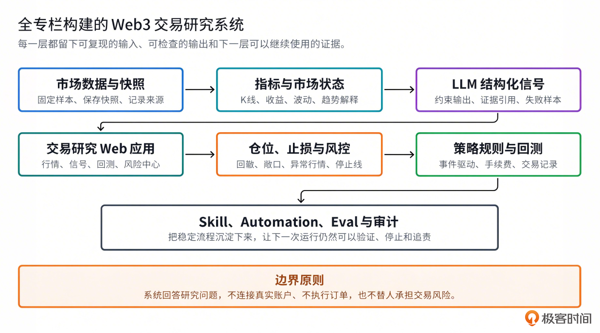
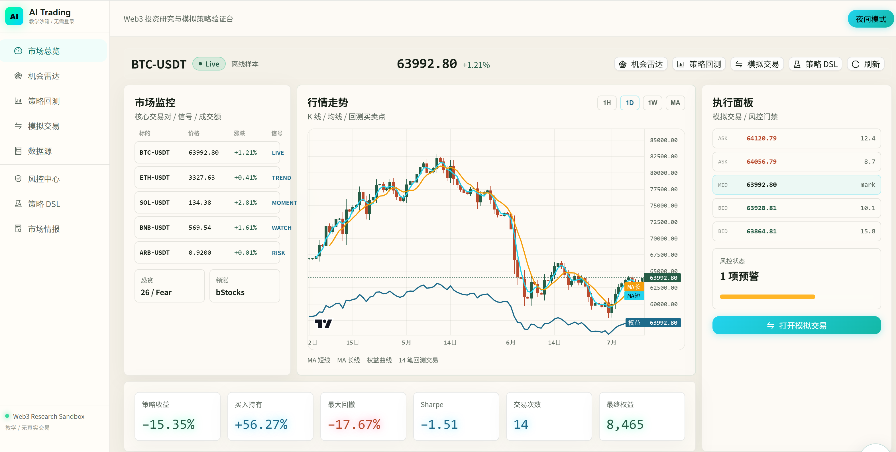
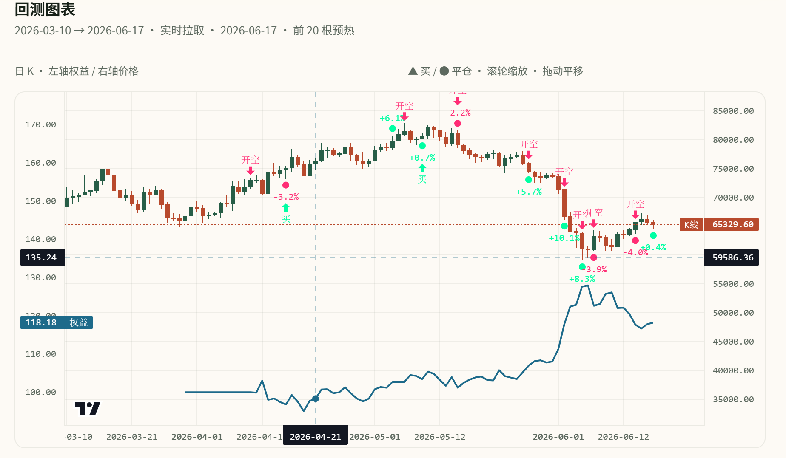
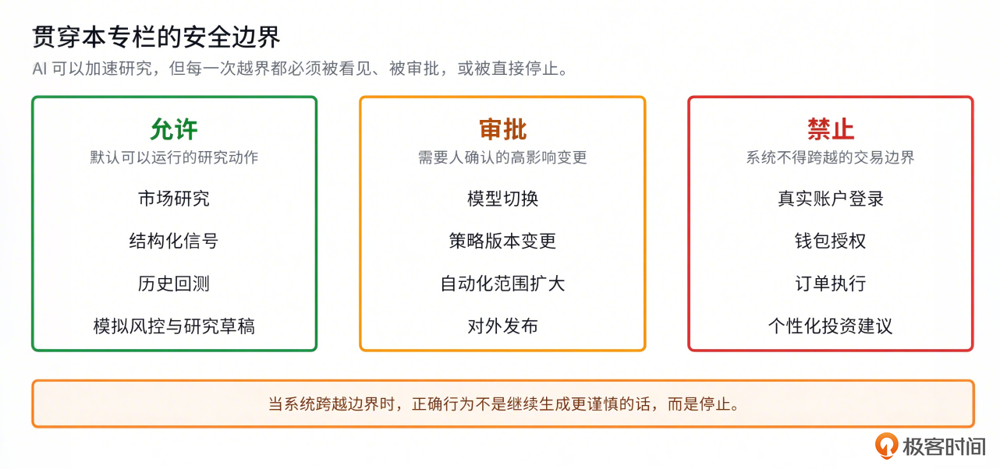

# 开篇词 | AI能写策略，但不能替你承担交易风险

你好，我是袁从德，欢迎来到《Codex 与 LLM 量化交易实战课》。

如果你有想法，但还不知道怎么把它做成证据，那这就是为你准备的开篇。

你不需要一开始就懂完整的量化系统，也不需要先相信 AI 能预测市场。我们要做的，是把一个听起来有道理的交易念头，拆成数据、假设、信号、回测、风险和验收记录。AI 和 Codex会让这个过程变快，但本专栏更在意另一件事：当结果看起来很漂亮时，我们有没有足够的证据知道它还能不能被相信。

所以，这不是一条通往“自动赚钱机器”的捷径，而是一套把好奇心落到可复查研究里的方法。能跑出结果很重要，能在证据不足时停下来，同样重要。

## 1. 你有一个交易想法，但还不是一个研究系统

我们先从最常见的起点说起：一个朴素、模糊、还没有被验证过的交易念头。它不是坏事，很多研究都从这里开始；真正的分水岭在于，你愿不愿意把它交给数据、规则和失败记录来检查。

### 1.1 从一句想法到可验证假设

如果你也有过这样的念头：

- 我有一个交易想法，好像有点道理，但我不知道怎么把它做出来。

那我们大概率可以聊到一起。这个想法可能很简单，比如“双均线上穿以后能不能跟一段趋势”；也可能更时髦一点，比如“让 LLM 读行情、资金、链上和情绪数据，然后输出一个结构化信号”。

以前，想把这类想法做成能验证的东西，门槛不低：数据从哪来，时间序列怎么清洗，指标怎么算，策略怎么写，回测可信吗，风险怎么拦，页面怎么展示，出错时系统会不会老实停下来。

### 1.2 你可能已经开始了，却卡在半路

也许你已经让 AI 写过策略，却不知道代码是否偷看了未来数据；跑出过一条上涨的权益曲线，却说不清手续费、滑点和样本窗口换了以后会怎样；也许你收藏了很多教程，复制了不少代码，但手里仍然没有一条从想法、数据到回测和验收的完整路径。

这些问题不是因为你“不会写几行代码”，而是因为一个研究结果需要的不只是代码。它还需要可追溯的数据、没有歧义的规则、诚实的失败记录和别人能复跑的验收过程。本专栏要帮你补上的，正是这条从“做出来”到“证明它值不值得相信”的路。

### 1.3 AI 让搭建变快，也让误信变容易

现在有了 LLM 和 Codex，事情突然变得顺手很多。LLM 可以帮你整理上下文、解释市场状态、把一堆信息压成结构化结论；Codex 可以进入代码仓库，读文件、改代码、跑测试、修失败、生成图表和页面。一个过去需要几个人配合的小型研究系统，现在一个人也能搭出雏形。

这当然让人兴奋，但也正因为太顺手，才更容易踩坑。

AI 给你一段“看起来很专业”的交易解释，不代表它真的知道市场会怎么走；Codex 帮你跑出一条漂亮的回测曲线，也不代表这条策略可以拿真钱试。量化研究里最要命的误会，往往不是程序报错，而是程序没报错、图也很好看、解释也很流畅，然后你就信了。

### 1.4 从想法到证据链

所以本专栏想陪你练的，不是“怎样让 AI 说得更像交易员”，而是：

- 一个想法怎样写成可以被验证的假设；

- 一份数据怎样留下来源、时间、缺失和回退记录；

- 一个 LLM 信号怎样被结构化、评分、拒绝和复查；

- 一条策略怎样进入回测，而不是直接变成订单；

- 一次回测怎样同时看收益、回撤、成本、窗口稳定性和过拟合风险；

- 一个研究系统怎样在自动化之前先学会停下来；

- 最后，别人能不能接手你的材料，复跑同样的命令，看见同样的证据。

## 2. 先说清楚：这不是交易秘籍

在进入工具和系统之前，边界要先摆在前面。交易研究最怕把“能解释”“能回测”“能展示”误读成“能赚钱”，所以这一节先说明本专栏做什么，也说明它坚决不做什么。

### 2.1 研究、教学和模拟验证的边界

本专栏用一套可运行的 Web3（以区块链和链上数据为核心的互联网形态）市场研究与模拟策略验证系统贯穿 35 讲。选择 Web3，不是因为它更容易赚钱，而是因为它很适合暴露问题：市场全天运行，数据噪声大，行情、资金、链上、情绪数据各说各话，热点切换很快，LLM又特别擅长把不完整的信息讲成一个完整故事。

这套系统只做研究、教学和模拟验证。它会用固定离线样本和可保存快照，展示行情总览、机会雷达、K 线（蜡烛图）分析、LLM 信号、策略回测、风险中心和模拟交易页面；但它不连接真实交易所账户，不连接钱包，不提交真实订单，也不提供个性化投资建议。

更正式地说：本专栏内容仅用于技术研究、工程教学和模拟验证，不构成任何形式的投资建议、交易建议、收益承诺或资产配置建议。你如果基于自己的判断做真实投资或交易，需要自行承担全部风险；专栏里的样本、代码、图表和回测结果，都不能作为真实下单依据。

### 2.2 允许、审批、禁止三类动作

后面所有设计都会守住三层边界：

- 允许：市场研究、结构化信号、历史回测、模拟风控、研究草稿审批：模型切换、策略版本变更、自动化范围扩大、对外发布禁止：真实账户登录、钱包授权、订单执行、个性化投资建议

你可以把它理解成朋友之间提前说好的规矩：我们可以一起研究、一起验证、一起拆穿幻觉，但不把方向盘交给模型。

## 3. AI、Codex、量化方法和人各做什么

接下来要拆清楚工具之间的分工。AI 可以生成解释，Codex 可以改代码，量化方法可以检验假设，但它们都不能替人承担判断和责任；只有边界清楚，协作才不会变成互相背书。

### 3.1 从好案例学可复查

优秀的量化和 AI 工程案例，真正值得学的通常不是“它用了什么神奇策略”，而是“它怎样把流程做得可复查”。

例如：

- QuantConnect LEAN（开源量化交易引擎）把研究、回测、组合建模和多资产支持放进同一套开源引擎里，提醒我们：策略不是一句买卖建议，而是数据、组合、交易规则和运行环境共同作用的结果。

- Backtrader（基于 Python 编程语言的回测框架）这类框架强调可复用策略、指标和分析器，也提醒我们不要每次都临时写一个只服务当前结论的小脚本。

- MlFinLab（金融机器学习工具库）反复提醒回测很容易过拟合、制造“虚假的投资发现”；OpenAI Evals（模型评测框架）的思路则告诉我们：面对不稳定的 LLM 输出，不能只凭感觉说“这版更好”，而要用固定样本、评分规程和失败样本去比较。

这些案例给我们的共同启发很朴素：别急着相信结果，先把结果变成别人也能检查的东西。

### 3.2 四个角色，别互相冒充

本专栏会反复出现四个角色：Codex、LLM、量化方法和人。它们可以配合，但不能互相冒充。

表 0-1 先把四个角色的边界放在桌面上。

角色

- 擅长什么要留下什么证据

Codex

- 读仓库、改代码、跑命令、修失败、检查页面文件差异、命令输出、测试结果、

LLM

- 整理上下文、解释市场状态、生成结构化信号输入来源、结构化输出、拒绝理由

量化方法

- 把假设写成规则，用样本、指标和回测检验数据窗口、参数、收益、回撤、稳

人

- 定义问题、选择证据、批准或停止流程决策记录、审批记录、发布边界

- 表 0-1 Codex、LLM、量化方法和人的责任边界

这张表看起来有点严肃，但它其实是在帮我们省麻烦。LLM 可以说“趋势偏多”，但它必须说清楚自己读了哪些数据、哪些字段缺失、哪些推断不能成立。Codex 可以帮你实现策略并跑测试，但测试通过只说明程序按约定运行，不说明策略能拿去实盘。回测可以给出收益曲线和风险指标，但历史表现最多支持“继续研究”，不能直接推出“未来可盈利”。

人类的位置也很明确：工具可以帮忙，但最后要不要继续、要不要发布、要不要停止，仍然由人承担责任。

### 3.3 一条漂亮信号，为什么还不够

假设系统根据 BTC（比特币）的多周期 K 线、资金情绪和链上指标，生成下面的结果：

```json
{
 "signal": "BUY",
 "confidence": 78,
 "summary": "趋势偏多，等待回踩后关注",
 "tradePlan": {
   "entryLow": 64120,
   "entryHigh": 64800,
   "stopLoss": 63200
 }
}
```

这段 JSON（结构化数据格式）很像专业建议：有方向、有置信度、有入场区间，也有止损位。如果再配一段“多周期趋势共振，资金面转暖”的解释，就更像那么回事了。

但在本专栏里，它还只是一个待检查对象。我们至少要继续问：

```
BUY 来自硬规则、统计关系、LLM 解释，还是几者混合？
confidence=78 是历史胜率、评分规程、规则得分缩放，还是模型自己说的？
```

3. 入场区间和止损位来自输入数据，还是 LLM 编出来的数字？

4. 如果链上数据缺失，系统会标记缺失，还是继续讲完整故事？

5. 这条信号怎样转换成没有歧义的策略规则？

6. 回测是否包含手续费、滑点、仓位、止损和异常行情？

7. 换一个市场阶段、提示词、模型或参数窗口，结论还稳不稳？

8. 如果结果失败，系统有没有留下足够证据说明失败发生在哪里？

这些问题会一路带到后面的数据验证、上下文构造、结构化输出、幻觉拦截、信号 Eval（评测）、策略实现、事件驱动回测、风险控制、Web（网页应用）验证、自动化、监控恢复和最终验收。一个研究结果只有走完这条证据链，才有资格写进研究报告；即便如此，它仍然不是投资建议。

### 3.4 这不是又一套零散教程

你能在网上找到很多指标公式、回测代码和提示词，但零散的答案很难自动变成一套研究能力。本专栏的不同，在于 35 讲始终围绕同一个可运行项目推进：每一讲都把新的数据、规则、代码或验收记录接到上一讲的成果上。

你学到的不只是“这个例子怎么做”，而是下一次换一个市场、策略或模型时，仍然知道应该先问什么、留下什么证据、在哪里停下来。这也是本专栏与“让 AI 直接给一段策略代码”最大的区别。

## 4. 35 讲会一起搭出什么

有了边界和分工，后面的学习就不再是一堆孤立技巧。35 讲会沿着同一条研究路径推进：先让输入可信，再让信号可查，最后把策略、页面、自动化和验收记录串起来。

### 4.1 从数据快照到模拟系统

本专栏不是先讲一堆 LLM 概念，再讲一堆量化术语，最后随便拼几个 Codex 示例。我们会把完整系统拆成几个可复跑的层次慢慢搭：

- 市场数据

```
 → 快照、来源卡与质量验证
 → 技术指标与市场状态
 → LLM 上下文和结构化信号
 → 策略规则、回测与风险检查
 → Web 研究应用
 → Skill（技能）、Automation（自动化）、Eval 与审计记录
 → 端到端模拟系统验收
```

图 0-1 概括全专栏要搭的交易研究系统。每一层都不是为了显得功能多，而是为了让下一层有可复查输入；只要上一层证据不足，下一层就不应该扩大结论。



- 图 0-1 全专栏构建的交易研究系统，从数据快照逐层走向可审计的自动化流程

配套仓库提供可复跑的代码、固定教学样本、图表脚本和各讲素材。文字负责把方法讲明白，仓库负责承接样本、命令和验收记录。以后你看到专栏里写“这条命令通过”“这张图来自某个脚本”“这个页面显示某个字段”，都应该能回到配套资源里复查。

这个系统最后会落到一个研究型 Web 应用里。它不是交易终端，而是把行情、信号、回测和风险记录放在同一个可检查界面中，让读者看到每个结论背后的数据和假设。



- 图 0-2 市场总览页中的回测与风险概览：系统展示策略跑输基准的结果，但不为策略背书

### 4.2 七段路，慢慢来

表 0-2 把 35 讲分成七段。你不用一口气啃完，按顺序走就好。

章节及讲次

- 这一段解决什么走完

第一章：基础（第 1-5 讲）

- Codex、LLM、量化方法和人怎样分工研究

第二章：数据（第 6-10 讲）

- 怎样获得可信、可复查的市场输入数据快

第三章：LLM 信号（第 11-15 讲）

- 怎样让 LLM 输出可检查、可拒绝的交易信号结构化

第四章：策略与风控（第 16-22 讲）

- 怎样把信号转换成可检验策略策略

第五章：Web 应用（第 23-27 讲）

- 怎样把研究路径交付给用户行情

第六章：自动化与评测（第 28-32 讲）

- Skill、怎样可靠重复流程并控制升级风险

第七章：综合实战（第 33-35 讲）

- 怎样贯通并验收端到端系统模拟

- 表 0-2 全专栏七章节的推进关系

### 4.3 走完以后，你带走的不只是代码

学完 35 讲，你应该能够独立完成一条最小但完整的研究闭环：把模糊想法写成可检验假设，准备并验证数据，生成可拒绝的结构化信号，把信号转换为无歧义的策略规则，完成包含成本和风险约束的回测，最后用页面、报告和验收记录把结果交给别人复查。

更重要的是，你会得到一套可以迁移到新问题上的判断方法。你未必会得到一条值得交易的策略，但你会更清楚地知道，一个结果为什么可以继续研究，又为什么应该被否定。

### 4.4 谁更适合跟着学

如果你有交易想法却不知道如何落地，会一点 Python 却没有搭过完整研究流程，正在用 AI 写策略却担心结果不可信，或者想交付一个真正能运行、能展示、能复查的量化项目，本专栏就是为你准备的。你不需要先成为量化研究员，但需要愿意动手、记录失败，并接受自己最初的想法可能不成立。

不会符合你的预期。这个筛选不是为了把人拒之门外，而是为了让每位读者在开始之前，就知道自己将为什么付出时间。

顺序很重要。数据进入 LLM 之前，要先说明来源、时间、缺失和质量边界。LLM 信号进入策略之前，要先通过结构校验、拒绝机制和失败样本检查。策略进入 Web 页面之前，要经过回测、指标解释和风险约束。流程进入 Automation 之前，要先证明稳定、可审计、可停止。

自动化不是魔法。一个错误流程被自动化以后，只会错得更快。

### 4.5 会补哪些量化知识

你不需要先成为专业量化研究员再开始。专栏会把必要知识拆开放在合适的位置：

- 第 2 到 5 讲，先学会把想法写成假设，分清价格、收益、信号、仓位和权益曲线；

- 第 6 到 10 讲，补数据来源、时间序列清洗、技术指标和研究报告追溯；

- 第 11 到 15 讲，理解 LLM 在交易研究中的边界，练习上下文构造、结构化输出、幻觉防护和信号评测；

- 第 16 到 22 讲，进入策略规则、事件驱动回测、收益回撤、Sharpe（夏普比率）、Calmar（卡玛比率）、过拟合、滚动回测、仓位和止损；

- 第 23 到 27 讲，把这些东西放进 Web 应用，让用户能沿着页面复查；

- 第 28 到 32 讲，再谈 Skill、Automation、Eval、审批门、监控恢复和审计记录；

- 第 33 到 35 讲，贯通端到端模拟系统，完成验收、复盘和下一轮迭代。

有些公式会出现，比如收益率、最大回撤、Sharpe、Calmar、布林带、Kelly（凯利公式）、IC（信息系数）、IR（信息比率）、PBO（过拟合概率）、DSR（去偏夏普比率）、CPCV（组合交叉验证）。放心，它们不会突然从天而降。每个公式都会尽量回答三个问题：它算什么，能证明什么，不能证明什么。

如果只记住一句量化纪律，就记这句：收益数字一定要和样本、成本、风险、基准和失败条件一起读。

```
图 0-3 展示 /backtests 页面中的组合图表局部：同一时间轴上叠加 K 线、权益曲线和买卖
```

标记。左轴是以初始值标准化的权益，右轴是资产价格，两者共用时间轴，但不能直接比较绝对数值。页面负责展示结果，数据区间、回测假设、风险指标和失败记录决定结果能不能被相信。



- 图 0-3 回测组合图表局部：日 K、权益曲线与买卖标记共用时间轴（非投资建议）

图 0-4 再把前面说过的安全边界收束成三类动作。允许研究，不等于允许系统越过真实交易线；需要审批的变更，也不能在“自动化很方便”的名义下悄悄放行。



- 图 0-4 贯穿本专栏的安全边界：允许研究、审批变更、禁止真实交易动作

专栏配套代码：https://github.com/congde/web3-quant-sandbox.git

## 5. 开始之前：带着一个愿意被否定的想法

最后回到你自己。本专栏不需要你已经拥有成熟策略，更不需要带着确定答案；你只需要准备一个可以被写成规则、也允许被数据否定的问题。

### 5.1 Codex 在这里怎么用

Codex 在本专栏里不是“替你做判断的人”，而是“帮你把判断落到证据上的搭档”。它会帮你读真实仓库、理解已有结构、修改代码、运行测试、生成图表、启动 Web 应用、检查页面和整理验收记录。

但它的价值不是让我们更快相信结果，而是让结果更难糊弄人。当正文说一个命令通过时，它应该真的运行过。当某一讲引用一个文件时，这个文件应该存在。当页面展示某个状态时，数据来源和 API（应用程序接口）字段应该能追溯。当测试失败时，失败本身也要进入记录。

专栏会反复使用两类项目检查动作：

```
python scripts/course.py verify
py scripts/course.py check
```

前者用于编辑过程中的项目检查，后者用于仓库级收束检查。不同系统上的命令入口可能略有差异；原则不变：没运行过的命令，不能写成已通过；没复核过的结果，不能写成已验证。

### 5.2 从下一讲开始

进入下一讲之前，先准备一个愿意被数据否定的想法，比如：

- 短期均线上穿长期均线后，未来一段时间收益是否更高？

- 多周期趋势一致时，信号是否比单周期更稳定？

- LLM 能否根据同一份结构化数据，持续输出符合约束的市场状态解释？

- 增加止损和仓位限制后，策略回撤是否得到改善？

- 自动生成的研究草稿能否追溯到真实数据、命令和输出？

这些都不是结论，而是研究假设。它们必须能够写成规则、接受数据检验、被他人复跑，也允许最终答案是“不成立”。 如果你手里正好有一个不知道如何落地的交易想法，就带着它进入下一讲。走完 35 讲，你未必能得到一条赚钱策略，但会掌握一套独立验证策略想法的方法，并拥有一个真正能够运行、复查和继续扩展的研究系统。

本专栏不承诺替你找到答案，但承诺陪你把问题问对、把证据留下，并在结果进入真实风险之前，拦住那些不值得相信的结论。准备好我们就开启本次学习旅行啦！
