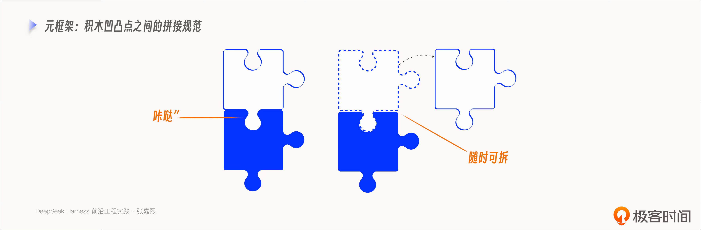

# 01 | 时之可逆：Context、插件与可撤销的Effect

你好，我是张嘉熙。欢迎来到《DeepSeek Harness 前沿工程实践》的第一讲。这一讲我们来聊聊 Cordis。

Cordis 的定位是「时空可组合性的元框架」。乍一听不好理解，不过你别被这些词吓住，你可以把普通框架想象成一份乐高积木的拼装说明书，而元框架就是积木凹凸点之间的拼接规范：它不关心你能拼成什么，只管任何积木块之间都能“咔哒”扣上、也能随时拆开。



「时空可组合性」则来自一篇论文《A Programming Paradigm for SpatiotemporalComposability》，它把“组件拆装”这件事，抽象成两个正交的维度：

- 时间维度：一个组件被移除时，它对环境所做的修改，能不能被干净地逆转？

- 空间维度：多个组件存在依赖关系时，被依赖的一方一旦发生变化，依赖方能不能自动地跟着激活或停用？

课程前两讲会分别沿着这两个维度展开。这一讲，我们先重点关注时间维度，也就是标题里的「时之可逆」。其实它的精髓可以浓缩成一句话：

- 每一个产生副作用（Effect）的行为，在 Cordis 中都能成对地定义好“副作用”和“怎么撤销它”；框架保证，只要你返回了正确的清理函数，当这个行为被取消时，“怎么撤销它”一定会被兑现。

Cordis 当然不能真的让时间倒流，却可以提供一套机制，让副作用能彻底、可靠地撤销，回到副作用发生之前的状态。

## Context 和插件

```
我们先来了解 Cordis 的一些基本概念，这是官方教程里的 hello.ts，我给代码补上了中
```

文注释：

```bash
// 来自官方 cordis-tutorial 第一章的 hello.ts
import type { Context } from '@deepseek-ai/cordis'
// 插件的显示名，用于诊断信息（可选）
export const name = 'hello'
// apply 是插件的入口，框架会调用它
export function apply(ctx: Context) {
 console.log('hello from my first plugin')
}
```

这个例子极简，但它已经暴露了 Cordis 世界里最核心的两个词：

```
Context（上下文，简称 ctx）：就是传给 apply 的那个参数。它是“共享环境”的化身——
```

- 插件要往环境里装东西、从环境里拿东西，全都通过它。

```
插件（Plugin）：就是一个可独立装卸的功能单元。它对外只有一个入口 apply(ctx)——
框架在加载时调用它一次，把 ctx 递进来，插件可以在这个 ctx 上声明自己要什么、提供
```

- 什么。

在 Cordis 中，插件可以有三种形态：

```bash
import { Service, type Context } from '@deepseek-ai/cordis'
// 1. 函数形态（最常用）：直接导出 apply 函数
export function apply(ctx: Context) {}
// 2. 对象形态：一个带 apply 方法的对象
export const objectPlugin = {
 name: 'object-plugin',
 apply(ctx: Context) {},
}
// 3. 类形态：Service 子类（第二章的主角，这里先混个脸熟）
export class MyService extends Service {
 constructor(ctx: Context) {
   super(ctx, 'myTutorialService')
 }
}
```

现在我们只需要知道有这样三种写法，如果你不需要公开服务，直接使用第一种函数形态即可。

## 可撤销的 Effect

刚刚我们已经了解了一些基本概念，现在来看看这个例子：

```bash
// 来自官方 cordis-tutorial 第二章的 lifecycle.ts
import type { Context } from '@deepseek-ai/cordis'
export const name = 'lifecycle-demo'
// 一个子插件：启动心跳定时器，并返回关闭它的清理函数
function heartbeat(ctx: Context) {
 console.log('heartbeat plugin loading')
 ctx.effect(() => {
   const timer = setInterval(() => console.log('tick'), 200)
   return () => {
     clearInterval(timer)
     console.log('heartbeat cleaned up')
   }
 })
}
export function apply(ctx: Context) {
 // 挂载子插件，并保留它的 fiber（之后好单独卸载它）
 const fiber = ctx.plugin(heartbeat)
 // 0.7 秒后卸载 heartbeat，演示 effect 的清理
 ctx.effect(() => {
   const timer = setTimeout(async () => {
     await fiber.dispose()
     console.log('disposed')
     process.exit(0)
   }, 700)
   return () => clearTimeout(timer)
 })
}
```

它的输出是这样的：

```
heartbeat plugin loading
tick
tick
tick
heartbeat cleaned up
disposed
这仍然是一段很简单的代码，从 heartbeat plugin loading 到 heartbeat cleaned
up，代码里没有任何手动调用 clearInterval 的地方，它只是作为 ctx.effect 的返回
值被“提供”给了框架，框架就在 fiber.dispose() 那一刻替你执行了。你写“定时器”
（setInterval），同时写“清理定时器”（clearInterval），框架保证“清理定时器”一定会
```

在卸载时被执行。

## 内置 Effect

```
看到这里，你已经会用 ctx.effect() 了。但其实，大多数时候，我们都不需要亲自编写
ctx.effect()，因为所有 Cordis 内置的注册 API 本身已经是 effect。只有那些 Cordis 不管
理的资源，我们才应在 ctx.effect() 内获取它，并返回用来释放资源的 disposer。此后
```

Cordis 会确保在卸载期间调用该释放逻辑。

- Registrations made through Cordis APIs are effects, and are undone when their owningplugin unloads.（通过 Cordis API 做的注册都是副作用，会在所属插件卸载时被撤销）。

- 它背后的 effect 语义

内置操作

ctx.on(event, listener)

- 监听器会在插件卸载时自动移除

ctx.plugin(child)

- 子插件会随父插件一同被卸载

服务注册（如 ctx.provide(...)）

- 返回的 disposer 附着到调用插件上，自动撤销

## 撤销链路的完整路径

- 以下源码基于 @deepseek-ai/cordis 4.0.1 撰写，所有代码均针对该版本验证。该包是 dsh从 Cordis fork 并 re-scope 的版本，版本号独立推进至 4.0.1，与上游 npm 的cordis@4.0.0-rc.8 对应（核心 API 语义一致）。选择该版本是为了与后续 dsh 章节保持运行时一致。

```
上面我们已经用到了 ctx.effect()，现在钻进它的真身 Fiber.effect() 里看一看（顺
```

便说一句，Context 并没有看上去那么简单——它常常只是一个代理或入口，真正的逻辑往往藏在别处）。从这里，我们可以看到“撤销”这件事的起点。

第一环：启动撤销或卸载

```
// fiber.ts 里 Fiber 构造器中 dispose 的定义（节选）
this.dispose = parent.fiber.effect(() => {
 return async () => {                 // ← 这个清理函数，就是 fiber.dispose
   this._setEpoch(INACTIVE)           // （这里先跳过）
   if (!this.inertia) {
     this._updateState(() => {
       this.inertia = this._unload()  // ① 触发真正的卸载
       return FiberState.UNLOADING    // ② 把 fiber 的状态切成「卸载中」
     })
   }
 }
}, 'ctx.plugin()')
真正的撤销逻辑在 _unload 方法中，这里我们不急着往下走，先介绍两个新概念：Fiber
和 FiberState。插件是我们写的代码，而 Fiber 是这段代码被 ctx.plugin(...) 挂载
```

后、框架为它创建的那个运行时实例，你每挂载一次插件，框架就创建出一个 Fiber 来管它的运行。

```
FiberState 就是这个 Fiber 的状态机：从生到死是 PENDING（等待依赖）→ LOADING
（加载中）→ ACTIVE（运行中）→ UNLOADING（卸载中）→ DISPOSED（已销毁）（中途可
能 FAILED 失败），dispose 触发的就是“进入 UNLOADING（卸载中）”这一步。
```

第二环：逆序并发执行 Fiber 名下所有 disposer

```javascript
走到 _unload() 里：
// fiber.ts 里 _unload() 的核心（节选）
private async _unload() {
// 并发执行
 await Promise.all(this._disposables.clear().map(async (dispose) => {
   // ……
 }))
}
这里我们看到 Promise.all(...)，这代表并发执行所有 disposer。如果我们深入
clear() 方法就会发现，并发执行前还有一个逆序的逻辑。
// utils.ts 里 DisposableList.clear() 的完整实现
clear() {
 const values = [...this.map.values()]   // 取出所有，按注册顺序
 this.map.clear()                        // 清空
 return values.reverse()                 // 反转成「后注册的先返回」→ 逆序在这里
}
```

第三环：单个 disposer 逆序执行自己的清理函数。

```javascript
// fiber.ts 里 effect() 内部的 dispose()（节选）
for (const disposable of disposables.splice(0).reverse()) { / 逐个执行 / }
//                     ↑ splice(0) 清空数组并返回原顺序，reverse() 再反转成逆序
当我们深入单个 disposer 内部，又看到另一个 reverse()，这里我们要搞清楚，这里的
reverse() 是针对单个 disposer 内的不同步骤。把这两个 reverse() 的逻辑结合起来
```

看，就能得出一个结论：多个 disposer 按注册顺序逆序启动，如果这些 disposer 本身全部都是同步函数，它们会按逆序依次执行，但如果某些 disposer 内部有异步逻辑，那么它们虽然会逆序启动，但并发完成的顺序不能确定。

所以如果你的一组拆除步骤有先后依赖，比如必须先停止轮询，才能关闭连接，正确做法是把

```
它们写进同一个 disposer 里，作为一条清理链依次 await，靠 disposer 内部的“排队”来保证
```

顺序。

三环走完，把刚才的细节连成一条线——你再看这张图，每个名字应该都已经眼熟了：

```
fiber.dispose()                 ← 触发卸载
       │
       ▼
 _unload()                     ← 插件卸载的真正执行者
       │
       ▼
 _disposables.clear()          ← 其内部 values.reverse()：逆序取出所有 disposer
       │
       ▼
 Promise.all 并发启动 wrapper   ← 每个 wrapper 触发它那个 disposer 的清理逻辑
       │
       ▼
 disposables.splice(0).reverse()  ← 单个 disposer 内部，逆序执行自己的清理函数
```

## 本讲小结

今天这一讲，我们完成了迈向 Cordis 世界的第一步，也是从“传统的手动资源管理方式”到“动态可组合应用”的重要起点。

```
我们通过 heartbeat 插件体会到了可撤销副作用的魅力：把 setInterval 和
clearInterval 这对“前进与后退”，写进同一个 ctx.effect，框架便会在插件卸载时替
```

你执行清理函数。沿着这个例子深入源码，我们看到了框架如何在卸载时组织并逆序执行这些清理逻辑。

这背后真正的变化是：你不再手动维护零散的清理代码，而是把“如何建立”与“如何撤销”写在一起，交给框架在卸载时兑现；框架负责调用你提供的清理函数，并按照逆序执行，让环境尽可能回到副作用发生之前的状态。

这，就是“时之可逆”的本质——不是真的逆转时间，而是让每一次副作用都携带一条可靠的“倒带”路径，使环境能够被干净地回收。

这节课我们解决了“时间”维度的问题，单个组件能否安全地来、安全地走。但前面还有一个更现实的问题等着我们：当多个组件同时存在时，它们之间的依赖关系怎么处理？一个服务下线了，依赖它的插件该怎么办？这，就是“空间”维度的问题。下一节课，我们就来正面回答它。

注：本讲 GitHub 链接

## 思考题

```
你来写一个插件，ctx.effect 里只做“前进”（比如 setInterval），不 return 清理函
```

- 数，然后挂载它、再卸载。Cordis 会不会报错，那个定时器最后谁来清理？

2. 用一个 effect 依次登记三个资源：先打开文件，再建立连接，最后启动轮询。每个资源都提供自己的清理函数（关闭文件、断开连接、停止轮询）。那么卸载时，这些清理函数按什么顺序执行？为什么？

欢迎你把运行结果分享出来。如果你觉得这节课对你有帮助，也欢迎分享给其他朋友，我们下节课再见！
