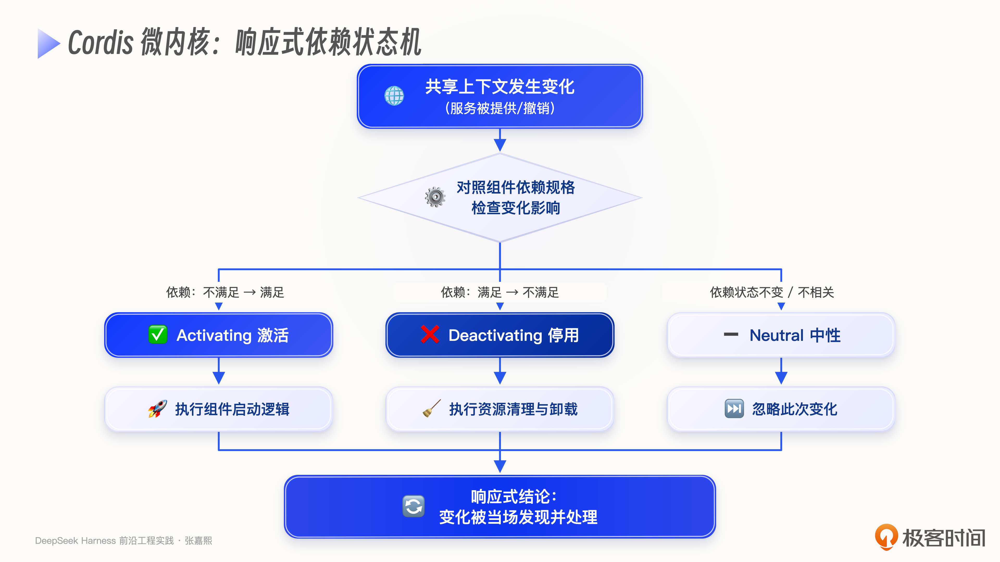

# 02 | 空之协同：Service、inject与响应式依赖

你好，我是张嘉熙。

上一讲我们解决了“时间”维度的问题——单个插件能否安全地来、安全地走。但现实中的应用，比如 Agent 应用，往往并不只有一个插件。当几十上百个插件同时挤在一个环境里，而每个插件又有它所依赖的多个服务，一个更尖锐的问题就浮出水面了：多个插件（A、B、C）都依赖服务 Z 提供的能力，Z 突然被卸载了，这些插件应该怎么办？

Z 可能在运行中途被热替换、被动态卸载、被配置开关关掉。每一次变化，每个依赖 Z 的插件都要重新判断“我还能不能用”。纯靠手动编排，这套逻辑很容易变成一团乱麻，这正是典型的框架层应该做的事情。

今天，我想带你看 Cordis 给出的答案：你只需要声明“我依赖谁”，框架会自动决定什么时候激活你、什么时候停用你。 这就是“空之协同”——这里的“空”指的是空间维度，即组件之间的依赖与协同。

最终我们可以实现这样的效果：一个依赖网络连接服务的文件上传插件，当网络断开时它自动停用，当网络重新连接时它又自动激活，全程你一行调度代码都没写。

### 提供能力的 Service

我们先了解一些基本概念，在 Cordis 里，“能力”是通过 Service（服务） 提供的。所谓服

```bash
务，其实就是一个具名能力——你把它注册到 ctx 上，同时提供一个服务的名字，其他插件
就能通过 ctx.<服务名> 访问它。
// 来自官方 cordis-tutorial 第三章的 greeter.ts
import { Service, type Context } from '@deepseek-ai/cordis'
declare module '@deepseek-ai/cordis' {
 interface Context {
   greeter: GreeterService        // 声明合并：把 greeter 挂到 Context 类型上
 }
}
export class GreeterService extends Service {
 constructor(ctx: Context) {
   super(ctx, 'greeter')          // 以名字 'greeter' 注册这个服务
 }
 greet(who: string) {
   return `Hello, ${who}!`
 }
}
export function apply(ctx: Context) {
 ctx.plugin(GreeterService)       // Service 子类本身就是一个插件（类形态）
}
这里我们可以看到：GreeterService 通过 super(ctx, 'greeter') 把自己注册成名为
greeter 的能力，之后任何插件都能通过 ctx.greeter 拿到它。
```

代码里有两处值得注意：

```
super(ctx, 'greeter') 是运行时真正生效的一步——它把这个实例注册进上下文。正
```

- 如我们在上一讲提到的，这个注册本身就是一个 effect，提供方插件被卸载时，服务会自动从上下文移除，不用你手动清理。

```
declare module '@deepseek-ai/cordis' 是 TypeScript 的声明合并，把 greeter
这个字段“焊”进 Context 接口，让 ctx.greeter 处处能通过类型检查。注意：它不产生
```

- 任何运行时代码——删掉它，服务在运行时照样工作，但消费方会失去类型安全，类型化事件体系也会随之退化为脆弱的字符串约定。

### 声明依赖的 inject

有服务了，还得有人用它。下面我们看看本讲的第二个关键概念：inject（注入）。

```bash
// 来自官方 cordis-tutorial 第三章的 consumer.ts
import type { Context } from '@deepseek-ai/cordis'
export const name = 'consumer'
export const inject = ['greeter']  // 声明依赖：我需要 greeter 服务
export function apply(ctx: Context) {
 console.log(ctx.greeter.greet('world'))   // 依赖已就绪，放心使用
}
看最关键的一行——inject = ['greeter']。这就是《A Programming Paradigm for
```

Spatiotemporal Composability》论文里说的“依赖规格”（specification）：它只声明“我需要哪些服务”，仅此而已，你没有写任何“加载顺序”、“启动检查”、“重试逻辑”。

```
而 Cordis 保证了一件至关重要的事：当 apply 被调用时，inject 里列出的服务一定已经就
```

绪。如果 greeter 还没上线，consumer 插件就会一直停在 PENDING（挂起）状态，不执行任何代码；等 greeter 一上线，它才被激活。

```
inject is not a one-shot boot check——它不是启动时检查一次就完事，而是持续跟踪。
```

在 Cordis 里，依赖关系本身就是编排——你不写顺序，只写依赖。

### 响应式依赖

我们再来看看传统 IoC（控制反转）容器是怎么做依赖注入的。

我们熟悉的 Spring、NestJS、Angular 等框架，处理依赖的方式基本一致：在启动时，按依赖图一次性把对象都创建好、注入进去。如果某个 bean 依赖另一个 bean，容器就保证先创建被依赖的那个。本质上，这是“组件启动时拉取依赖”——组件被创建的那一刻，向容器要它需要的服务。

它们也并非完全不能动态调整，不少框架提供了运行时重配置的 API。但关键在于：这些动态能力通常是附加的、手动的。当你改变一个依赖时，依赖方的状态一致性、资源清理、启动 /停止顺序，仍然需要你自己编写代码来维护。框架不会主动告诉你“某个服务没了，依赖它的组件现在该怎么办”。

这在传统服务里通常可以接受，因为服务一旦启动，组件就基本稳定了，动态调整的需求并不频繁。然而 Cordis 的设计场景和目标恰恰相反：它要支持的是插件在运行中被热替换、被动态装卸。依赖图不再是一张静态的图，而是一个随时可能变化的动态图。如果继续沿用“手动维护依赖变化”的思路，复杂度会迅速失控。

论文把这个差异讲得很透彻。它把传统 IoC 的“键值对注入”升级成了一个叫 reactive coeffects（响应式协效应）的模型。核心思想就一句话：把依赖关系从“启动时的一次性解析”，变成“每次上下文变化都要重新评估”。

论文里用了一个很精炼的定义来刻画这件事。组件声明一个“依赖规格”（specification）——也就是“我需要哪些服务”。每当共享上下文发生变化（比如某个服务被提供、被撤销），框架就会对照着这个规格把这次变化归类：

- activating（激活）：依赖从“不满足”变成了“满足” → 组件该启动了

- deactivating（停用）：依赖从“满足”变成了“不满足” → 组件该被卸载了

- neutral（无关）：这次变化跟我没关系 → 我不用动



正是“对照规格给每一次变化分类”这个动作，让“依赖满足与否的变化”总能被当场发现，而不是等到某个插件崩溃了才发现。这就是“响应式”的含义。

### 响应式依赖是怎么实现的？

```
前面我们用 greeter/consumer 看清了 Service/inject 的静态用法。下面我们让 greeter 中
```

途消失、再回来，亲眼看看「服务消失 → 插件自动停，服务恢复 → 插件自动起」的动态用法：

```python
import { Context } from '@deepseek-ai/cordis'
// 一个"服务"：提供 greet 能力。为了看清"换服务"，让每次提供的返回内容不同
function provideGreeter(ctx: Context, tag: string) {
 ctx.provide('greeter', {
   greet: (who: string) => `[${tag}] Hello, ${who}!`,
 })
}
// 一个"依赖者"：声明我需要 greeter，框架保证 greeter 就绪后我才被调用
const consumer = {
 inject: ['greeter'],                    // 声明依赖：我需要 greeter 服务
 apply(ctx: Context) {
   console.log('[consumer]', ctx.greeter.greet('world'))
 },
}
async function main() {
 const root = new Context()
 // 1. 先提供 greeter，再挂载 consumer —— consumer 直接启动
 const greeterFiber = await root.plugin((ctx) => provideGreeter(ctx, 'v1'))
 console.log('[greeter:v1] 已上线')
 await root.plugin(consumer)
 // 2. 撤销 greeter —— consumer 检测到依赖消失，自动停止
 console.log('--- 撤销 greeter ---')
 await greeterFiber.dispose()
 console.log('[greeter:v1] 已下线')
 // 3. 换一个新的 greeter 上线 —— consumer 自动重启
 console.log('--- 新 greeter 上线 ---')
 await root.plugin((ctx) => provideGreeter(ctx, 'v2'))
}
main()
运行 npx tsx src/hello-inject.ts，你会看到：
[greeter:v1] 已上线
[consumer] [v1] Hello, world!
--- 撤销 greeter ---
[greeter:v1] 已下线
--- 新 greeter 上线 ---
[consumer] [v2] Hello, world!
注意：第一次 consumer 收到的是 [v1]，第二次收到的是 [v2]。你没有写任何启动或停止
consumer 的调度代码，它只是因为 inject: ['greeter'] 这一行声明，就在 greeter 消
```

失时自动闭嘴、在 greeter 回来时自动开口。

那么，框架到底是怎么跟踪依赖、并在依赖变化时做出反应的？让我们顺着「提供 → 通知」这条链路，钻一次源码。

```
先深入我们上面讲过的super(ctx, 'greeter')，打开 node_modules/@deepseek-
ai/cordis/src/service.ts，Service 构造函数里最后一行是：
// service.ts 里 Service 构造函数的关键一行（节选）
self.ctx.reflect.provide(name, self, this[symbols.check])
它把 this（这个服务实例）注册进上下文——你平时写的 ctx.provide(...) 本质上就是
转发给 reflect.provide(...) 的。而且，reflect.provide 在注册之后、以及撤销
（返回的清理函数）时，都会调用 notify() 去通知所有依赖方。
```

前三步是“停”和“起”共用，我们先看这三步：

```sql
① notify 找到受影响的插件：
// reflect.ts 里 notify() 的核心（节选，去掉了 filter 过滤与返回值收集）
notify(names) {
 for (const runtime of this.ctx.registry.values()) {
   for (const fiber of runtime.fibers) {
     let hasUpdate = false
     for (const name of names) {
       if (!(name in fiber.inject)) continue   // 没声明这个依赖 → 跳过
       hasUpdate = true
       fiber._checkImpl(name)                   // 重新检查：服务还在吗？
     }
     if (!hasUpdate) continue                   // 一个依赖都没变 → 这个 fiber 不用动
     fiber._refresh()                           // 重新计算依赖指纹
   }
 }
}
它遍历所有插件，只挑出「inject 里声明了 greeter 的那些 fiber：对每个声明了 greeter 的
fiber 做 _checkImpl，最后只要确实有依赖变化被查到，就做一次 _refresh。
② _checkImpl 重新查一遍，服务没了就删记录，还在就更新
（node_modules/@deepseek-ai/cordis/src/fiber.ts）：
// fiber.ts 里 _checkImpl 的核心（节选）
_checkImpl(name) {
 const impl = this.ctx.reflect._getImpl(name, true)  // 去 store 重新查：greeter 还
 if (!impl) return delete this._store[name]          // 查不到了 → 把 fiber 自己记的
 this._store[name] = impl                            // 还查得到 → 更新记录
}
每个 fiber 都维护着一份 _store，记着“我依赖的那些服务的当前实例”。_checkImpl 做的
```

就是把这份记录刷新一遍：服务没了就删掉，还在就更新成最新实例。

```javascript
③ _refresh 重算“依赖指纹”（node_modules/@deepseek-
ai/cordis/src/fiber.ts）：
// fiber.ts 里 _refresh 的核心（节选）
_refresh() {
 let epoch = ''
 for (const name of Object.keys(this.inject)) {
   const impl = this._store[name]
   if (!impl) { epoch = INACTIVE; break }     // 有依赖缺失了 → 标记为「不活跃」
   epoch += ':' + impl.fiber.uid              // 依赖齐全 → 拼出它们的 uid 指纹
 }
 this._setEpoch(epoch)
}
它把“当前依赖的那些服务的 uid”拼成一个字符串指纹（epoch）。依赖齐全，指纹是一串
uid；缺了哪个，指纹直接变成 INACTIVE。
④ 是分叉点——_setEpoch 拿新指纹和旧指纹一比，决定走哪条路
（node_modules/@deepseek-ai/cordis/src/fiber.ts）：
// fiber.ts 里 _setEpoch 的核心（节选，省略了 inertia 防重入与状态机包装）
_setEpoch(epoch) {
 const oldEpoch = this._runner.epoch
 if (epoch === oldEpoch) return               // 指纹没变 → 什么都不做（论文说的「无关
 this._runner.epoch = epoch
 if (epoch !== INACTIVE && oldEpoch === INACTIVE) {
   this._reload()                             // 指纹从「无」变「有」→ 插件起
 } else {
   this._unload()                             // 指纹从「有」变「无」→ 插件停
 }
}
```

这就是“响应式”最核心的决策点：用依赖指纹有没有变、往哪个方向变，决定插件是停、是起、还是不动。它正好对应论文里说的三种情况——激活（activating，从无到有）、停用（deactivating，从有到无）、无关（neutral，没变）。

下面我们来看两个分支各自的实现：

```
分支 A：_unload —— 插件停。_unload() 内部就是第一讲见过的那句
Promise.all(this._disposables.clear()...)，把 fiber 上注册的所有 effect 一次
```

性清空。所以“停”的实现，就是复用第一讲的注册即副作用 + 倒序回收，consumer 当初注册的所有东西，在这一刻被逆序清掉。

```
分支 B：_reload —— 插件起。
// fiber.ts 里 _reload 的核心（节选）
private async _reload() {
 this.store = { ...this._store }         // ① 用最新检查到的依赖，重建 store
 ...
 this.config = this._resolveConfig(this._config)  // ② 重新解析配置
 await this._execute(this._runner)       // ③ ★ 重新执行插件的 apply！
}
```

```
“起”的本质不是唤醒一个沉睡的插件，而是重新执行一遍它的 apply。
_execute(this._runner) 会再次调用 consumer 的 apply(ctx)，而这次 apply 里
ctx.greeter 读到的已经是新的服务实例（v2），所以输出从 [v1] 变成了 [v2]。“起”是
```

带着新依赖重新跑一遍初始化逻辑，不是恢复旧状态。

- 注意：论文里的 activating / deactivating / neutral（激活 / 停用 / 无关）是抽象概念，不是

```
源码里的变量名。源码里对应的，就是这条 notify → _checkImpl → _refresh →
_setEpoch 链，以及 _setEpoch 分叉出的 _unload（停）和 _reload（起）。把"论文
```

- 怎么说"和"源码怎么做"分开看，你会清楚得多。

最后，我们看看完整的链路图。

```
服务被 provide / 撤销
       │
       ▼
 ① notify —— 找到声明了这个依赖的插件
       │
       ▼
 ② _checkImpl —— 重新查：这个服务还在吗？（没了就删记录，还有就更新记录）
       │
       ▼
 ③ _refresh —— 重算"依赖指纹"（缺了就标 INACTIVE）
       │
       ▼
 ④ _setEpoch —— 指纹变了吗？
       ├─ 指纹从「有」变「无」→ _unload()  → 插件停
       └─ 指纹从「无」变「有」→ _reload()  → 插件起
```

### 可选依赖

```javascript
inject 用于硬性依赖。有些场景下，如果某项依赖的服务缺失时插件仍能运行，有它没它都
能跑，这个时候就不应该使用 inject，而是手动在使用的地方进行判断处理：
// 可选依赖：不声明 inject，用 ctx.get 探测
const greeter = ctx.get('greeter')
if (greeter) {
 greeter.greet('hi')   // 有 greeter 就用
} else {
 console.log('没有 greeter，跳过这一步')  // 没有也能跑
}
```

### 本讲小结

今天这一讲，我们完成了从时间到空间的跨越，这是 Cordis 世界观拼图的第二块。

```
我们体会到了响应式依赖的魅力：用 Service 提供能力，用 inject 声明依赖，框架便替你
```

接管了“启动编排、停用、重启”的全部时序。我们见证了 consumer 插件在 greeter 下线时自动停止、在 greeter 恢复时自动重启，全程零调度代码。

这背后真正的变化是：你不再手动编排启动顺序，而是声明“我依赖谁”；让框架根据依赖的满足状态，自动决定激活与停用。

这，就是空之协同的本质——组件之间依赖的编排，从"手动流程"变成了"自动响应"。

至此，时间（可逆 Effect）和空间（响应式依赖）两个维度我们都打通了。但还有一个问题悬而未决：插件之间除了“依赖”（A 需要 B 的能力），还常常需要“通信”（A 要通知 B 发生了某件事）。依赖是“要”，通信是“说”。下一讲，我们就来聊聊 Cordis 的事件系统——五种分发模式，以及它们各自适合什么场景。

注：课程中说的论文指的是《A Programming Paradigm for SpatiotemporalComposability》，本讲 GitHub 链接

### 思考题

```javascript
你来实操一下，照着正文里的 hello-inject.ts 例子，把 consumer 的 inject:
['greeter'] 这一行删掉，重新运行，看看会发生什么。
小改动：在 hello-inject.ts 最后（greeter v2 上线之后），再 dispose 掉这个新的
greeter（不提供新的替代服务），观察 consumer 是否再次自动停止。然后，在 consumer 的
apply 里，把 ctx.greeter.greet('world') 这一行套一层探测：改成 const g =
ctx.get('greeter'); if (g) console.log(g.greet('world'))，重新运行，观
察当 greeter 缺失时它是静默跳过还是报错——这就是硬依赖（inject）与软依赖
（ctx.get）的区别。
```

欢迎把你的运行结果分享出来。如果你觉得这节课对你有帮助，也欢迎分享给其他朋友，我们下节课再见！
