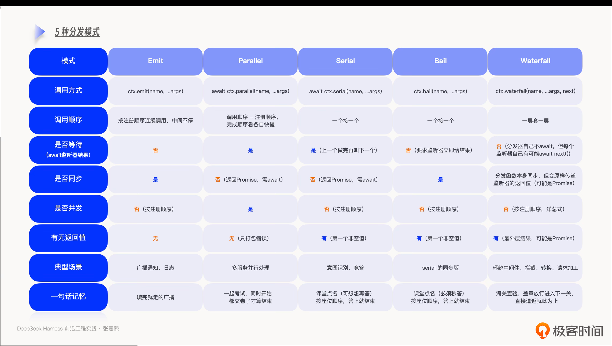

# 03 | 事件系统：五种分发模式及其适用场景

你好，我是张嘉熙。

前两讲我们打通了时间（可撤销 Effect）和空间（响应式依赖）两个维度。这一讲补上第三块拼图——通信。前面讲的依赖解决的是“要”（A 需要 B 的能力）的问题，但插件之间还有一种关系是“说”（A 要通知 B 发生了某件事）。比如用户发出一个事件，日志插件要记录、统计插件要计数——事件发出方和事件接收方没有直接依赖关系，只是这些插件都想“听到”这件事。

Cordis 中通信的核心在于它的事件系统，它把事件分发这件事，拆成了五种模式。

我们先看看 Cordis 中事件系统的基本使用方式：

```bash
// 来自官方 cordis-tutorial 第四章的 stats.ts（节选）
declare module '@deepseek-ai/cordis' {
 interface Events {
   'stats/report'(name: string, count: number): void   // 声明一个事件：名字 + 监听器
 }
}
export class StatsService extends Service {
 bump(name: string) {
   // ...*
   this.ctx.emit('stats/report', name, next)   // 发出事件，此处的next为当前count自增
 }
}
// 来自官方 cordis-tutorial 第四章的 reporter.ts（节选）
export function apply(ctx: Context) {
 ctx.on('stats/report', (name, count) => {     // 监听事件
   console.log(`[stats] ${name} -> ${count}`)
 })
}
```

这里我们已经能看到事件系统的两个核心动作，以及一种似曾相识的声明方式：

```
emit（发出）和 on（监听）：一方 emit('stats/report', ...) 发出，另一方
on('stats/report', ...) 监听。事件名用 namespace/action 的斜杠形式，因为
所有事件共享一个扁平命名空间，斜杠前缀（stats/）能把相关事件分组。
declare module { interface Events } 这和上一讲的声明合并很类似——它把
「事件名 + 监听器签名」写进声明，让 emit/on 都获得类型检查（写错编译期就报错）。
```

下面我们直接跑起来，逐个拆解这五种分发模式。

### emit 与 parallel——通知与通知并等待

这两个模式都用于广播，你不想从监听器那里拿回什么，只是想告诉它们事情发生了。区别在于要不要等它们做完。

emit：同步广播，说完就走

```
ctx.on('chat/message', (text) => {
 console.log('  [日志插件] 记录消息：', text)
})
ctx.on('chat/message', (text) => {
 console.log('  [统计插件] 消息字数：', text.length)
})
ctx.emit('chat/message', '你好，Cordis')
emit 是同步的：它按注册顺序逐个调用监听器，不等待（即使监听器返回 Promise 也不
```

管），不收集返回值。所以，`emit` 适合“发通知”这类 fire-and-forget 的场景。

```
顺便提一下：除了 ctx.on，Cordis 还有 ctx.once——监听器在首次被触发后自动注
```

- 销，适合只关心下一次事件的场景，比如等连接建立就执行一次初始化。两者都返回一个disposer，且都随插件卸载自动移除。

parallel：并发执行，一起等待

```
ctx.on('task/run', async (name) => {
 await new Promise(r => setTimeout(r, 100))  // 模拟耗时任务 A*console.log('  [任务
})
ctx.on('task/run', async (name) => {
 await new Promise(r => setTimeout(r, 100))  // 模拟耗时任务 B*console.log('  [任务
})
await ctx.parallel('task/run', '并行任务')
parallel 会 await 所有监听器，而且它们是并发跑的。当你有多个互不依赖的耗时任务
（比如同时调用多个外部 API），用 parallel 能省下大量时间。注意：如果任何一个监听器
抛错，parallel 会抛出一个 AggregateError 汇总所有错误。
```

一句话区分：emit 是我通知你们，但我没空等；parallel 是我通知你们，并且等你们都做完。

### serial 与 bail——谁能处理，谁先接单

这两个模式解决的是竞争问题：多个监听器都能处理一件事，但只需要一个来接手，先表态的胜出。比如“帮我查天气”这句话，天气插件说“我来”，时间插件说“不关我事”，最终由天气插件接手。

serial：异步地逐个询问

```javascript
ctx.on('chat/intent', (text) => {
 if (text.includes('天气')) {
   return 'weather'   // 我负责天气，返回非空值 = 我接单了
 }
 // 返回 undefined = 我不处理，继续问下一个*
})
ctx.on('chat/intent', (text) => {
 if (text.includes('时间')) {
   return 'time'      // 我负责时间，返回非空值 = 我接单了
 }
})
const res = await ctx.serial('chat/intent', '帮我查一下天气')
console.log('返回的结果：', res)  // 'weather'
serial 按注册顺序逐个 await 监听器，一旦某个监听器返回了非 null/false/undefined
```

的值，就立刻停止，把这个值作为结果返回，后面的监听器不再执行。这就是“短路竞争”。

bail：serial 的同步版本

```javascript
const syncRes = ctx.bail('chat/intent', '现在的时间是几点')
console.log('返回的结果：', syncRes)  *// 'time'*
bail 和 serial 的竞争语义完全一样，唯一的区别是：bail 同步执行，不 await。当你
的监听器都是同步函数时，用 bail 更简洁，省掉一个 await。
这里强调一下：“短路”的依据是返回值是否为 null/false/undefined，其他任何返回值都
```

不行，一定要记住这一点。

### waterfall——洋葱模型，层层加工

```
waterfall 是五种模式里最强大、也最需要理解的一个。waterfall 模式下的监听器像洋葱一
```

样层层包裹，可以加工下游的返回值，也可以短路。

```javascript
// 监听器一（外层）：给下游返回的回复加上署名（加工下游返回值）
ctx.on('chat/reply', (text, next) => {
 const downstream = next()               // 先拿到下游的结果
 return `【bot】${downstream}`           // 再加工：加上署名
})
// 监听器二（内层）：遇到敏感词就短路（不调用 next）
ctx.on('chat/reply', (text, next) => {
 if (text.includes('脏话')) {
   return '（内容已拦截）'               // 直接返回，不调用 next，短路！
 }
 return next()                          // 正常情况，继续往下走
})
// 最内层的默认行为：真正的回复生成（占位）
const reply1 = ctx.waterfall('chat/reply', '你好啊', () => '你好，很高兴见到你')
console.log('  正常回复：', reply1)
const reply2 = ctx.waterfall('chat/reply', '这句包含脏话', () => '不应该出现')
console.log('  被拦截的回复：', reply2)
请仔细读这段代码，waterfall 的监听器签名比别的模式多了一个 next 参数，next() 就是
```

“调用下游”的开关：

```
调用 next()：把控制权交给下一个监听器（最终到最内层的函数），拿到下游返回值后，
```

- 你可以加工它再返回。

```
不调用 next()，直接返回：短路。下游全部跳过，你返回的值就是最终结果。
```

很明显，从上面的逻辑我们能看出，waterfall 特别适合做“拦截器 + 转换器”。这里我们要注意两点：

```
只负责观察 / 记录的 waterfall 监听器，必须调用 next()，否则会无意中短路，吞掉所有
```

- 下游行为。短路应该是一个有意为之的动作，而不是“忘了调 next”的副作用。

```
serial/bail 的短路和 waterfall 的短路是两种完全不同的机制。前者靠返回值，返回
非 null/false/undefined 的值就返回并停止后续监听器；后者靠是否调用 next()，
```

- 不调用就否决下游，与返回值无关。别把这两个短路混为一谈。

### 监听器的执行顺序，能控制吗？

```
能。刚刚我们多次提到按注册顺序，但 ctx.on 还接受一个 prepend 选项，让监听器插到队
```

首：

```
// 普通注册：排到队尾
ctx.on('chat/message', normalListener)
// prepend：插到队首，最先执行
ctx.on('chat/message', priorityListener, { prepend: true })
```

这个选项在“别的插件已经注册了监听器，而你的监听器必须抢在它们之前运行”时很有用。不

```
过要克制使用，大部分时候，依赖注册顺序本身，比用 prepend 硬插队更清晰。
```

### 分发原理

看到这里，你可能觉得这五种模式是五套独立的机制。其实不是，它们的源码实现极简，而且藏着同一个原理：五种模式共享同一个监听器列表，区别只是怎么遍历这个列表。

```javascript
先看所有模式的共同起点——dispatch()（node_modules/@deepseek-
ai/cordis/src/events.ts）：
// events.ts 里 dispatch 的核心（节选）
dispatch(type, args) {
 const name = args.shift()                       // 取出事件名
 return (this._hooks[name] || [])                // 找到这个事件的监听器列表
   .filter(hook => ...)                          // 过滤掉不该接收的
   .map(hook => hook.callback.bind(thisArg))     // 转成可调用的回调数组
}
dispatch() 只做一件事：根据事件名，从 _hooks 里取出监听器列表，过滤后返回。五种
```

模式的第一步都是调用它，拿到同一个列表。

真正的差异，全在「拿到列表之后怎么遍历」。看五种模式的实现，它们各自只有一行核心

```javascript
（node_modules/@deepseek-ai/cordis/src/events.ts）：
// ① emit：同步 map，逐个调用，不管返回值
emit(...args) { this.dispatch('emit', args).map(cb => cb(...args)) }
// ② parallel：并发 map，等所有结果（有错就汇总成 AggregateError）
async parallel(...args) {*
 const results = await Promise.allSettled(this.dispatch('emit', args).map(async
 ...
}
// ③ serial：顺序 for，逐个 await，一旦 isBailed 就停下并返回
async serial(...args) {
 for (const cb of this.dispatch('serial', args)) {
   const result = await cb(...args)
   if (isBailed(result)) return result
 }
}
// ④ bail：serial 的同步版，同样的 for + isBailed，只是不 await
bail(...args) {
 for (const cb of this.dispatch('bail', args)) {
   const result = cb(...args)
   if (isBailed(result)) return result
 }
}
// ⑤ waterfall：shift 递归，每层拿 next 往下钻，形成洋葱
waterfall(...args) {
 const cbs = this.dispatch('waterfall', args)
 const inner = args.pop()
 const next = () => { const cb = cbs.shift() ?? inner; return cb(...args) }
 ...
 return next()
}
```

把五种实现摆在一起，一个深刻的统一就浮现了：

```
「拿到监听器列表」这件事，五种模式完全一样——都是 dispatch()；
```

- 「遍历列表」的策略不同，才造就了五种语义：

```
emit = 同步 map（不管结果）
parallel = Promise.allSettled（并发等待）
serial / bail = for + isBailed 短路（一个 await、一个不 await）
waterfall = shift 递归（类似多层的洋葱）
顺便提一句：serial/bail 里的 isBailed(result)，就是之前说的那个判定——
value !== null && value !== false && value !== undefined。返回非空值
```

- 就「返回」，正是靠这一行。

### 模式回顾

五种模式都讲完了，我们回头用一张表 + 一张图，把它们整体收拢一下：



下次写事件时，你沿着这张快速决策图逐层问自己三个问题，答案自然就出来了：

- 要不要拿返回值？

```
├── 不要 → 要不要等它们做完？
│          ├── 不要 → emit（同步广播）
│          └── 要   → parallel（并发等待）
└── 要 → 什么语义？
        ├── "谁能处理谁接单"（竞争）→ 同步用 bail / 异步用 serial
        └── "层层加工/可短路"（环绕中间件）→ waterfall
```

### 本讲小结

今天这一讲，我们补齐了 Cordis 世界观的第三块通信拼图。

```
我们学会了五种分发模式：emit 同步广播、parallel 并发等待、serial 异步竞争、
bail 同步竞争、waterfall 洋葱式中间件。它们按“是否等待、是否并发、有无返回值”等
```

多个维度各司其职。

这背后真正的变化是：你不再用一个 emit 打天下，而是根据场景选对模式。

这，就是事件系统的本质——用五种模式，把插件间通信这件事讲清楚。

到这里，Context、插件、Effect、Service、事件，这些 Cordis 的“核心概念”你都认识了。但还差最后一步：一堆插件到底怎么拼成一个完整的真实可用的应用？一个真实的 Agent 有几十上百个插件，它们的配置、隔离、热更新，谁来管？下一讲，我们就来聊聊 Cordis 的插件树——声明式配置、isolate 隔离与 HMR 热更新。

注：本讲 GitHub 链接

### 思考题

```
动手实操：在 waterfall 部分再添加一个监听器（比如给回复末尾加上一个表情符号 :)），观
```

察它加在了哪一层，输出会变成什么样。

```
小改动：把 serial 的第二个监听器（时间意图）改成第一个（即把它的注册顺序提前），重
```

新运行，看“帮我查一下天气”和“现在的时间是几点”的输出分别是什么，思考监听器的调用顺序是否有变化。

欢迎把你的运行结果分享出来。如果你觉得这节课对你有帮助，也欢迎分享给其他朋友，我们下节课再见！
