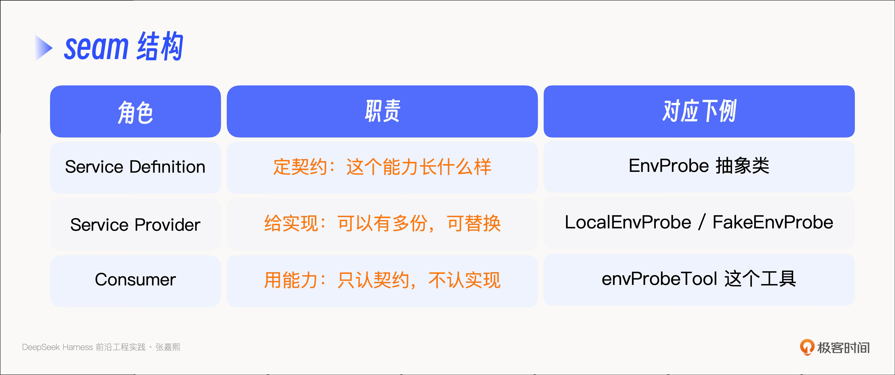
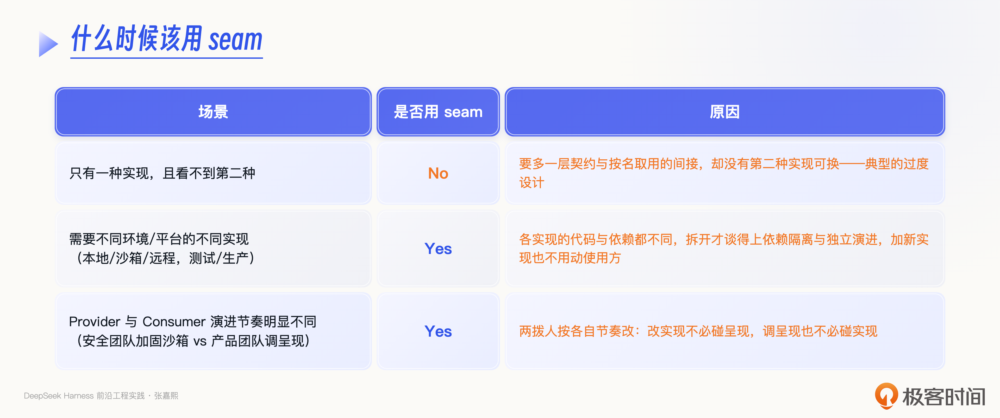

# 05 | 能力接入：CapabilitySeam与Tools

你好，我是张嘉熙。

```
前四讲我们把 Cordis 这台机器拆开又装回去了：注册即可撤销的副作用、靠 inject 自动编
```

排的依赖、五种事件分发、由一份 YAML 生成的插件树。机制齐了，从这一讲起我们进入核心篇，看看前面学到的这些知识到底能做什么。

第一个要回答的是，在 dsh 里，一个 Agent“动手做事”的能力，是从哪儿来的？

本讲围绕两件事展开：

- Tool：模型唯一看得见、能调用的东西，能力的入口。

- seam：当一项能力的实现需要可替换时（比如 Bash 要在本地、沙箱、远程都能跑），dsh用的组织方式。

一句话理清两者的关系：Tool 把能力封装成模型能调用的工具，seam 把能力组织成可替换的结构。一个回答模型怎么用，一个回答实现怎么换。

我们先从 Tool 说起，用真实的 dsh 写一个工具并跑通它。

```
关于环境：从本讲起要用 dsh 的包。它们已列在本项目的 package.json 里，装一次即可
——注意要带 --legacy-peer-deps：
npm install --legacy-peer-deps
为什么需要这个参数？这些包把 peer 依赖写成 caret 区间（比如 ^0.1.0-rc.7），并不锁
```

死；一旦 registry 上出现更高的版本，npm 就会选它，而它又回头要求别的包也升到同一版本

```
——和 package.json 里写死的那套对不上，于是报 ERESOLVE。带上 --legacy-
peer-deps，就是让 npm 跳过 peer 的自动解析，按我们锁好的这套装。
关于源码对照：这一讲里所有 packages/... 路径均指 deepseek-harness 仓库（这一讲
基于 0.1.0-rc.7），不在本项目里。本讲示例则是真实可跑的：npm run start:ch05 跑
工具，npm run start:ch05:seam 跑可替换能力。
```

### 用 Tool 接入能力

```
官方文档「开发一个工具」的最小示例长这样，注册一个 greet 工具，模型调它就回一句
```

问候：

```bash
// src/ch05/greet-tool.ts
import type { Context } from '@deepseek-ai/cordis'
import { defineTool } from '@deepseek-ai/dsh-tools'
export const name = 'greet-tool'
export const inject = ['tools']   // 等工具注册表就绪；少了它 Cordis 会抛错
export function apply(ctx: Context) {
 ctx.tools.register(
   defineTool({
     // ── 模型唯一看得见的三样 ──
     name: 'greet',
     description: 'Greet someone by name.',
     parameters: {
       name: { type: 'string', required: true, description: 'The name to greet'
     },
     // ── 模型看不见，给框架用的 ──
     output: {
       schema: { type: 'string' },
       render: (_args, value) => [{ type: 'text', text: value as string }],
     },
     async execute(args) {
       return `Hello, ${args.name}!`
     },
   }),
 )
}
跑起来需要三步，注意顺序（完整代码见 src/ch05/tool-main.ts）：
// src/ch05/tool-main.ts（节选）
import { Context } from '@deepseek-ai/cordis'
import { ToolRuntime } from '@deepseek-ai/dsh-tools'
import SystemPrompt from '@deepseek-ai/dsh-system-prompt'
import * as greetTool from './greet-tool.ts'
const root = new Context()
await root.plugin(SystemPrompt)   // ① ToolRuntime 依赖 systemPrompt，先提供它
await root.plugin(ToolRuntime)    // ② 挂上工具注册表本身
const fiber = await root.plugin(greetTool)  // ③ 挂消费方插件，工具随之注册
第 1 步容易漏：ToolRuntime.inject = ['systemPrompt']，不先挂
SystemPrompt，工具注册表压根不会启动，ctx.tools 直接是 undefined（第二讲讲过
```

的：依赖没就绪，插件代码一行都不执行）。

```
跑 npm run start:ch05，输出：
--- 模型看得见的工具清单 ---
[
 {
   "name": "greet",
   "description": "Greet someone by name.",
   "parameters": {
     "type": "object",
     "properties": {
       "name": { "type": "string", "description": "The name to greet" }
     },
     "required": ["name"]
   }
 }
]
--- 调用 greet ---
{ isError: false, content: [ { type: 'text', text: 'Hello, World!' } ], value: 'H
--- 卸载后再看清单 ---
[]
调用用 root.tools.execute()，参数是一个对象而不是 (name, args)：
await root.tools.execute({
 callId: CallId('call-1'),              // 调用标识，用于追踪
 name: 'greet',
 arguments: { name: 'World' },
 signal: new AbortController().signal,  // 取消信号，生产环境由 agent loop 传入
})
callId 和 signal 都是必填。真实项目里它们由 Agent Loop 提供，这里我手动构造只是为
```

了跑通。

```
顺带提一句，execute 还有第二个参数 exec，携带 signal（取消信号）、token（身份标
识）、agent（当前 Agent 句柄）等运行时上下文——greet 用不到，但写真实工具时你会
```

靠它拿到取消信号。

```
最后注意输出的那行 []，插件卸载后工具自动消失，代码里没有任何一行手动注销。还是和
```

我们之前讲过的那样，你注册的是一个 effect，框架会替你管好它的生灭。

### 模型眼中的工具

```
清单里只有三个字段：name、description、parameters。这就是模型能看到的全部。
description 值得我们多花点心思，它是模型判断“该不该用、什么时候用”的唯一依据。这
```

里有几条实用经验，分享给你：

- 说清干什么，也说清不干什么。"Read a file from the filesystem" 不如 "Read a file from thefilesystem. Use for reading, not writing; use grep to search across files."

```
参数描述同样重要。description: 'The name to greet' 能防止模型往里塞 JSON
```

- 字符串。

- 别把实现细节写进去。模型只需要知道“能读文件”，不需要知道你底层用的是本地磁盘还是云存储。

```
你在工具里写的其他一切，模型都看不见：output、execute、timeoutMs、
isConcurrencySafe……注册表用显式白名单把它们挡在外面。这不是疏漏，而是设计：
```

只给模型“能干什么、怎么调用”，不给它“怎么实现”，它就不会被实现细节带偏。

```
register 只是把工具登记进注册表，真正让模型“看见”的，是系统提示词组装。还记得我们
刚刚讲要先挂 SystemPrompt 吗？ToolRuntime 依赖的 systemPrompt 服务，会在每一
轮开场时调用 schemas()，把每个工具的 name/description/parameters 拼进发给模
```

型的那段话里。也就是说，你对模型认知边界的控制权，就藏在这三个字段里。

### 工具的返回值

```
output 是必填的，不写注册时就抛 TypeError。它由两部分组成：
output: {
 schema: { type: 'string' },                                      // 返回值长什么样
 render: (_args, value) => [{ type: 'text', text: value as string }],  // 怎么呈现
}
```

顺便说一句，上面的例子用的是字符串，简单。但如果返回值是一个对象（本讲后面的

```
env_probe 就返回 { platform, node }），schema 就得写成 type: 'object'，这
时有个容易踩的坑：每个显式 object 节点都必须声明 additionalProperties: true
| false，缺了注册时就抛 JsonSchemaError（错误码 UNSUPPORTED_SCHEMA）。
schema: {
 type: 'object',
 additionalProperties: false,     // 少这一行会注册失败
 properties: { platform: { type: 'string' }, node: { type: 'string' } },
}
为什么要同时声明 schema 和 render？下一讲我们会提到，模型写的程序要 await
tools.<name>(args)</name>，然后用代码处理返回值——程序要的是结构化字段
（value），模型要的是一段排版好的文本（content）。schema 声明前者，render 产出
```

后者，各取所需。如果只返回一个字符串，程序就没法按字段取用。

```
顺带记住一条硬规矩：execute 返回的是规范 JSON 值，不是内容块，把它翻成模型能看的
文本，是 render 的活。注意，调用到这里还没结束：这个值之后还要被校验、可能被改
```

写、最终才呈现（这条完整流水线，下一讲展开）。所以你的工具只负责执行，执行完给谁看、要不要改，都交给框架。

```
最后看清 render 的返回类型：它是一个内容块数组，[{ type: 'text', text }] 里的
text 只是其中一种，还可以是图片、工具调用块等。所以 render 返回数组而不是单个字符
```

串，是因为模型收到的消息本来就是一堆块的序列，文本只是最朴素的一种。

### seam：让能力可替换

现在麻烦来了：假设你要提供一个“读环境变量”的能力，但生产、测试要不同的实现。也就是说，一个能力往往有多套实现（本地、沙箱、远程），它们代码不同、依赖不同、维护的人也不同。你需要把它们解耦：互不干扰、各自演进、加新实现不用动使用方。

解耦的手法不止一种（拆函数、拆包、手写装配都行），dsh 的选择是：借 Cordis 现成的

```
Service/inject 机制，把可替换能力规范化成三个角色，让框架自动搞定切换、暂停、重
```

启。这套结构叫 seam。注意：seam 指的是这三个角色的整体，不是其中某一个角色。



```python
// src/ch05/seam-demo.ts（节选，完整代码见该文件）
import { Context, Service } from '@deepseek-ai/cordis'
import { defineTool } from '@deepseek-ai/dsh-tools'
// ── 角色一：Definition（契约）──
abstract class EnvProbe extends Service {
 constructor(ctx: Context) {
   super(ctx, 'envProbe')
 }
 abstract probe(): Promise<{ platform: string; node: string }>
}
// ── 角色二：Provider（实现，可替换）──
class LocalEnvProbe extends EnvProbe {
 async probe() { return { platform: process.platform, node: process.version } }
}
class FakeEnvProbe extends EnvProbe {
 async probe() { return { platform: '<fake:platform>', node: '<fake:node>' } }
}
// ── 角色三：Consumer（只认契约）──
const envProbeTool = {
 name: 'env-probe-tool',
 inject: ['tools', 'envProbe'] as const,
 apply(ctx: Context) {
   ctx.tools.register(defineTool({
     name: 'env_probe',
     // ... output 与 parameters 写法同上一节，此处略
     async execute() {
       return ctx.envProbe.probe()   // 只依赖契约，不关心具体实现
     },
   }))
 },
}</fake:node></fake:platform>
```

为什么非要切三个角色？

```
关键在于中间那层契约：Consumer 的 inject 写的是契约名（envProbe），不是某个具体
```

类，它压根不知道、也不关心背后是 local 还是 fake。于是 Provider 可以放心换成任意实现，Consumer 一行都不用改。换的过程中，框架先把失去依赖的 Consumer 自动暂停，等新的Provider 就位再自动重启，绝不会出现“调用到一个不存在的东西”的中间态。

```
跑 npm run start:ch05:seam 看这个魔术（execute 返回 { isError, content,
value }，下面只展示 value 的变化）：
--- 提供方 = local ---
{ value: { platform: 'darwin', node: 'v24.4.1' } }
--- 卸载 Provider 后，剩余工具 ---
[]                          ← 只卸了 Provider，工具一行没动，它自己消失了
--- 换上 fake 后，剩余工具 ---
["env_probe"]               ← 工具自动回来
{ value: { platform: '<fake:platform>', node: '<fake:node>' } }</fake:node></fake
这套三角色不是玩具，dsh 的 shell seam 真实存在，写进声明式配置（cordis.yml）就是
```

三行，换实现只改 Provider 那一行：

```
- name: '@deepseek-ai/dsh-shell'           # Definition（契约：ctx.shell）
- name: '@deepseek-ai/dsh-bash-local'      # Provider：本地实现 ← 换成 dsh-bash-san
- name: '@deepseek-ai/dsh-tool-bash'
# Consumer：模型用的bash 工具，永远不用动
回到 EnvProbe 那几行：三角色其实完全落在基础篇讲过的 Cordis Service 机制上——
EnvProbe 通过 super(ctx, 'envProbe') 注册一个名为 envProbe 的服务；
LocalEnvProbe / FakeEnvProbe 继承它，实例化时就把各自实现挂到这个名字下；
Consumer 用 inject: ['envProbe'] 只按名字取用，压根不认识具体类。也正因如此，
Definition 必须是 Service 子类（抽象类），不能是 interface，因为 interface 没有
super，注册不了服务。
```

最后需要注意：不是所有场景都适合用 seam，我们可以参考下面的表格来判断：



### 本讲小结

今天这一讲，我们跨进了 dsh，回答了“dsh 里 Agent 动手做事的能力从哪来”这个问题。

```
我们用真实 dsh 写了一个 greet 工具并跑通全链路，看清了三件事：
模型只看得见 name/description/parameters 三样；
```

2. 返回值要拆成“给程序的值 + 给模型的呈现”；

3. 当能力需要可替换时，dsh 用 seam 三角色把它组织起来——换实现只换 Provider，消费方一行不改。

这背后真正的变化是你不再把能力写成“模型摸不着的内部函数”，而是先用 Tool 给它一个模型可见的入口；需要可替换时，再用 seam 拆成“契约、实现、使用方”，让“换实现”变成换一行配置，使用方毫不知情。

这，就是能力接入的本质——用 Tool 把能力递到模型手里，用 seam 把可替换的实现藏在契约后面。

```
到这里，你已经知道 Agent 的能力是怎么接进来的了，Tool 给模型一个入口，seam 让实现
```

可替换。但接进来只是起点：一次调用真正跑起来，会经过我们今天简单提到的那条流水线。下一讲，我们就沿着这条流水线，把 Code Mode、守卫与执行边界一件件讲透。

注：本讲 GitHub 链接

### 思考题

```
动手实操：把 seam-demo.ts 里 env_probe 的 render 改一下——从
JSON.stringify(value) 改成一段更友好的文本（比如把 platform 和 node 拼成一
句，value 是 unknown，拼之前先 as 断言一下）。重新跑 npm run
start:ch05:seam。代码现在只打印了 value，请先补一行打印 content，再观察：
value 变了吗？content 变了吗？为什么？
小改动：把 seam-demo.ts 里的 LocalEnvProbe 和 FakeEnvProbe 同时挂上（两个
Provider 提供同一个 envProbe），重新跑，看看会报什么错。再想一想：这个错误说明“可替
```

换”的正确做法是什么——同时挂多个，还是先卸旧的、再挂新的？

欢迎把你的运行结果分享出来。如果你觉得这节课对你有帮助，也欢迎分享给其他朋友，我们下节课再见！
