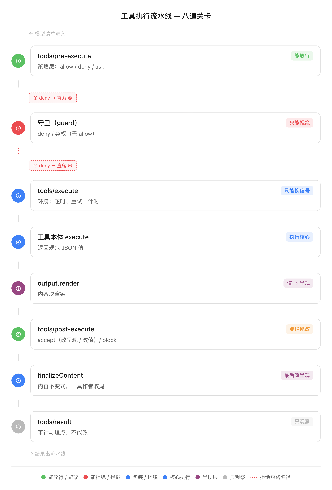
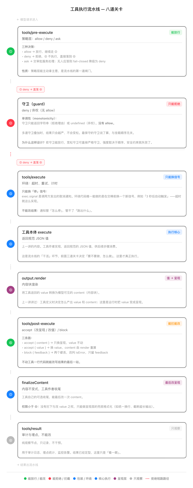

# 06 | 工具流水线：CodeMode、守卫与执行边界

你好，我是张嘉熙。

```
上一讲我们把能力接了进来：Tool 给模型入口，seam 让实现可替换。但也留了个尾巴——
execute 返回的那个值，之后还要被校验、可能被改写、最终才呈现。这个“之后”指的就是
```

一条藏在调用背后的流水线。这一讲我们就把它拉开：先看全貌，再从往里、入口、边界三个方向剖开。

```
关于环境：本讲新增一个包 @deepseek-ai/dsh-code-runtime-worker-thread
（Code Mode 执行后端），装依赖请 npm install --legacy-peer-deps。npm run
start:ch06 跑流水线，npm run start:ch06:code 跑 Code Mode。本讲引用的官方
```

- 源码与文档来自 deepseek-harness（0.1.0-rc.7）。

### 流水线全貌

```
把上一讲那行 root.tools.execute({...}) 拆开，一次调用顺利走完全程要依次穿过这
```

些关卡（这是实际流水线的简化版，略去了 UI 呈现等节点。完整版点这里）：



```
模型请求 ──┬── ① tools/pre-execute   allow / deny / ask      ← 能放行
          ├── ② 守卫（guard）       deny / 不反对           ← 不能主动放行
          ├── ③ tools/execute       环绕：超时、重试、计时  ← 包装
          ├── ④ 工具本体 execute    返回规范 JSON 值        ← 上一讲讲过
          ├── ⑤ output.render       值 → 呈现（内容块）     ← 上一讲讲过
          ├── ⑥ tools/post-execute  accept（可改写）/ block ← 能拦，能改结果
          ├── ⑦ finalizeContent     最后的内容不变式        ← 最后一次改呈现
          └── ⑧ tools/result        只观察，不能改          ← 审计与埋点
```

前四关决定“要不要做、怎么做”，后四关决定“结果以什么面目呈现、出口交给谁记录”。

这套结构是固定的，不因你注不注册监听器或守卫而变。一个都不注册，也不过是没有守卫来

```
拒绝、没有监听器去改写，这次调用按默认路径顺利走完。pipeline-demo.ts 第一段输出
```

就是它，后面每段都只加一个监听器或守卫，看结果怎么变：

```
--- 基线：什么关卡都没有 ---
{ isError: false, content: [ { type: 'text', text: 'Hello, World!' } ], value: 'H
但上面画的是顺路走完的路。最要紧的岔路是被拒：① 或 ② 一旦 deny，④ 工具本体根本不
跑，结果直接落到 ⑥（ask 会拐去审批、异常逃不过 ⑦）。
```

八道关里，真正留给部署方的插槽是 ①②③⑥⑧ 这五关。另外三关 ④⑤⑦ 归写工具的人，④

```
execute、⑤ output.render 上一讲讲过；⑦ finalizeContent 的说明见 post-
```

execute 一节结尾：

关

- 注册方式你能做什么

① tools/pre-execute

- waterfall放行 / 拒绝 / 转审批

② 守卫

- root.tools.guard()只拒绝或弃权

一句话记住：①②⑥ 能改结果，③ 只能换信号，⑧ 只观察。插槽是流水线的、不属于某个工具：换工具，规则照常生效；增删规则，不用改工具源码。

```
③ 的“只能换信号”单独说一句：exec.signal 是工具收到的“停”通知——调用方想取消就
```

- 触发它，工具自己监听、尽快停手（框架不能强杀代码）。环绕代码唯一能做的，是在交棒前换一个新通知，比如“3 秒后自动触发”——超时就这么实现；但通知管“怎么停”、管不了“跑出什么”。

```
八关里值得停下来细看的是①②⑥：① pre-execute（策略层，能主动放行）、② 守卫（约
束层，最反直觉）、⑥ post-execute（结果出口，能拦能改），下面我们一个个来看。
```

### pre-execute：放行、拒绝，还是问人

```
进流水线先碰到的是第 ① 关 tools/pre-execute，它是策略层，返回官方类型
PreToolDecision：
type PreToolDecision =
 | { kind: 'allow' }                 *// 放行*
 | { kind: 'deny'; reason: string }  *// 拒绝*
 | { kind: 'ask'; reason?: string }  *// 去问人*
allow：放行，调用继续走 ②。
deny：拒绝，④ 不跑、结果落到 ⑥。
ask：去问人，把决定权交给审批服务 ctx.approval（独立 seam，在下一站守卫之前
```

- 处理询问）。

审批没人应答怎么办？官方的约定是失败关闭（fail closed），没有审批服务或没人应答，

```
ask 一律降级为拒绝，效果和 deny 一样：isError: true 收场，理由沿用 ask 的
reason：
--- pre-execute 决定 ask（本进程没有审批服务）---
{ isError: true, error: { message: '危险操作，需要人工确认' }, ... }
deny 则是策略层自己拿主意、主动拒绝：
--- pre-execute 决定 deny ---
{ isError: true, error: { message: '该工具已对当前会话下线' }, ... }
```

### 守卫：拒绝或弃权

① 放行后，进的是第 ② 关——守卫。② 与① 不同，守卫只能拒绝或弃权。注册只用一个函

```javascript
数 ctx.tools.guard：
const offGuard = root.tools.guard((exec) => {
 const args = exec.arguments as { name?: string }
 return args?.name === 'World' ? '不允许问候 "World"' : undefined
})
返回的 offGuard 是注销函数，示例每段用完立刻调。
守卫的返回值只有两种：字符串 = 拒绝（字符串就是理由）；undefined = 弃权。
```

注意：这里没有“允许”这个返回值。不是漏了，是刻意设计。它带来一条性质，叫单调性（monotonicity）：

- 任何一道守卫都能拒绝；但没有任何一道守卫能主动放行——它最多只能弃权，保持原决定。

为什么叫“单调”？因为守卫越挂越多，结果只会越严、不会变松，一旦有人拒绝，加再多弃权也翻不了案。因为守卫是安全约束：如果守卫能“放行”，多道守卫谁说了算就得定条规则（比如“后挂的说了算”），宽松守卫就能盖掉严格守卫，强度取决于挂载顺序，太脆弱。单调性把这个漏洞钉死：最保守的守卫说了算，与顺序无关。

```
我们跑一下 npm run start:ch06，看下面两段输出：
--- 挂一个守卫，拒绝问候 "World" ---
{ isError: true, error: { message: '不允许问候 "World"' }, content: [ { type: 'text
--- 再挂一个"想放行"的守卫（验证单调性）---
{ isError: true, error: { message: '不允许问候 "World"' }, content: [ { type: 'text
后一段额外挂了一个对所有调用都返回 undefined的守卫，结果照样被拒。这就是单调性：
```

弃权不等于允许。

再往前不必停：③ 只会换“停”信号（上面说过）；④⑤ 上一讲讲过，我们直接跳到 ⑥tools/post-execute。

### post-execute：能拦也能改

结果一旦产生，先流到这里，不动工具一行代码就能改写结果的最后一关。三条路（官方类型

```
PostToolDecision）：
type PostToolDecision =
 | { kind: 'accept'; content?: ContentBlock[]; value?: never }  *// 改呈现*
 | { kind: 'accept'; value: JsonValue; content?: never }        *// 改值*
 | { kind: 'block'; feedback: ContentBlock[] }                  *// 拦下*
⑥ 到手的是两个东西：value（给程序的值）和 content（给模型看的呈现，⑤ render
```

算出来的）。

三条路各自动谁：

```
⑥ post-execute 三选一：
改呈现  accept { content }   换 content；value 不动
改值    accept { value }     换 value；content 由 render 重算
拦下    block                两个都丢：改判 isError，只留 feedback
上一讲讲的是工具定义时怎么产出 value 和 content；到了这一站，是你在运行时动手改
```

它们。

```
改呈现：只换模型看到的文本（← 后是我加的标注）：
--- post-execute 放行但改写呈现（注意：只改呈现，值没动）---
{
 isError: false,
 content: [ { type: 'text', text: '[长输出]' } ],          ← 给模型看的换了：模拟长输
 value: 'Hello, World!'                                   ← 给程序用的没动
}
改值：连 value 一起换，render 会把呈现重算一遍。这也是两种 accept 互斥的原因：
--- post-execute 改写值（呈现会被 render 重算）---
{
 isError: false,
 content: [ { type: 'text', text: '新的长输出' } ],   ← 呈现也跟着重算，即给模型看的也变
 value: 'REPLACED'                                  ← 给程序用的换了
}
```

拦下：结果不该给模型看？两个都丢，把成功改判成失败，只留一句 feedback：

```
--- post-execute 把成功结果改判为失败 ---
{ isError: true, error: { message: '结果含受限称呼 "World"，已拦截' }, ... }
出了 ⑥ 还有两关：⑦ finalizeContent 是工具自己的可选收尾，也能最后改一次
content，但没有 ⑥ 的拦下与改 value 之权；⑧ tools/result 只观察。至此，八关全
```

部走完。

### Code Mode：调用工具的另一种方式

上一节的流水线，跑在“模型逐个点名工具”的循环里：每调用一次，一份结果文本进上下文，等模型决定下一步——工具一多，逐次往返就很贵。

Code Mode 换的不是流水线，是模型用工具的方式：native 给一堆工具名、逐个点名；code

```
只给一个 run_code，工具写进程序里调，跑完只带回最终结果。
```

这个思路业界常称 programmatic tool calling（PTC）；dsh 同名的 PTC 预设就是把它打包

```
好，选它就能得到 Code Mode。这里我们直接讲最底层配置——mode：native（默认）、
code、both（两种并存），不写即 native。
await root.plugin(ToolRuntime, { mode: 'code' })  *// 工具入口切成 code：模型从此只见到
本节换两个新工具：add 两数相加、env_probe 报运行环境。
```

模型视角立刻变窄：

```
--- native 模式：模型看见的工具 ---
["add","env_probe"]
--- code 模式：模型看见的工具 ---
["run_code"]
```

那两个工具没删，模型怎么知道如何用？

清单换了形式：框架用 schema 现场生成 TypeScript SDK 塞进提示词。读清单抓三样（中文注释是我加的，其余照录运行输出）：

```javascript
// 这份 SDK 由框架从工具 schema 现场生成，照录自 `npm run start:ch06:code` 的输出
type JsonValue = null | boolean | number | string | JsonValue[] | { [key: string]
interface ToolArgsMap {                 // 能调什么
 /** Add two numbers. */
 add: {
   /** First addend */
   a: number;
   /** Second addend */
   b: number;
 } & Record<string, jsonvalue>;
 /** Report the runtime environment. */
 env_probe: Record<string, jsonvalue>;
}
interface ToolOutputMap {               // 返回什么
 add: number;
 env_probe: {
   platform?: string;
   node?: string;
 };
}
type ToolName = keyof ToolOutputMap
declare class ToolCallError extends Error {   // 失败抛什么
 readonly name: "ToolCallError";
 readonly toolName: ToolName;
}
declare const tools: {                  // 模型就这么调
 [K in ToolName]: (args: ToolArgsMap[K]) => Promise<tooloutputmap[k]>;
}</tooloutputmap[k]></string, jsonvalue></string, jsonvalue>
SDK 是 schema 的忠实翻译；env_probe 字段带 ?，因为 schema 没写 required，少写
一个 required，模型看到的就是这个字段可能不存在（code mode 下模型看到的与 native
```

mode 不同）。

程序在哪跑、怎么调到工具？

```
run_code 本身就是个工具，调用参数就是下面这段源码。执行它的是第 5 讲那个 seam：
ctx.codeRuntime 是契约，开篇装的 dsh-code-runtime-worker-thread 是
Provider，程序就在独立 worker 线程里跑。tools.add、tools.env_probe 是运行时注
```

入的绑定，每次调用都桥接回注册表、走完整流水线。

整串步骤在 worker 线程里跑完：中间结果留在变量里——逐次往返没了，只剩“发一次程序、收一份结果”：

```javascript
// （此处代码仅用于演示，未接真实模型）
const sum = await tools.add({ a: 1, b: 2 })
const env = await tools.env_probe({})
console.log('platform =', env.platform)
return { sum, platform: env.platform }
```

跑出来：

```json
{"isError": false,"content": [{"type": "text","text": "platform = darwin\n{\n  \"
其中 content 的 text 渲染出来，就是模型看到的样子：
platform = darwin
{
 "sum": 3,
 "platform": "darwin"
}
四个动作：add 求和、env_probe 探环境、console.log 进 logs、return 进 result
——两次调用只把渲染出的这份 content 送回模型上下文；中间值只活在程序变量里。
```

### 执行边界

Code Mode 之下，模型能自己写程序了，可“执行”不是撒手不管，入口、子调用，两处边界都有人管。这一节我们把这两条边界划出来。

```
入口：code 模式下，模型绕过程序直接点名 env_probe？不行，UNKNOWN_TOOL：对模型
```

而言它根本不存在，不是“存在但不许调”：

```
--- 模型绕过 run_code，直接点名调 env_probe ---
{ "isError": true,
 "error": { "message": "unknown tool \"env_probe\": only `run_code` is callable
 "content": [ ... ] }
子调用：那程序里面的调用呢？照样管得住。先挂一道守卫禁掉 env_probe，再让程序
try/catch 去调它——await tools.env_probe({}) 抛 ToolCallError，接住后照
常往下跑（后面的 add({ a: 3, b: 4 }) 照算，得 sum: 7），外层 run_code 仍成功：
```

守卫对子调用一视同仁，拒绝在这里变成可捕获的异常。

```
--- 守卫能否管住程序里的子调用 ---
{ "isError": false,
 "value": { "logs": [], "result": { "probe": "caught: env_probe 已被禁用", "sum":
```

这里我们验证完毕，对于 Code Mode 来说，执行边界依旧存在，无论是入口还是子调用，都必须经过刚刚讲过的工具流水线，不能肆意越界。

### 本讲小结

这一讲，我们把上一讲提到的工具执行展开成一条流水线，一次调用要依次穿过八站，结构固定，不因挂不挂钩子而变。



```
往里看：pre-execute 放行 / 拒绝 / 去问人（ask 没人应答即拒），守卫只拒或弃权（所以
单调），post-execute 能拦能改。
换个入口也跑不掉：Code Mode 只给一个 run_code，子调用照过完整流水线——入口有
UNKNOWN_TOOL 拦，子调用有守卫管。
```

这背后真正的变化是：你不再把“调用一个工具”理解成简单调一个函数，而是看成穿过一条关卡固定的流水线，每关能做什么、不能做什么，都是结构说了算。谁能拒绝、谁能改写、谁能只观察，都在流水线中定义好了。

这，就是工具流水线的本质——一次调用是一串职责固定的关卡，每关权限由结构定死，与调用者无关。

流水线管住了工具调用，程序执行本身的隔离却是另一道题——下一讲，我们讲跨平台进程沙箱。

注：本讲 GitHub 链接

### 思考题

```
动手实操：守卫那一节只验证了一种挂法顺序。打开 pipeline-demo.ts，另写一个函数做
两组对照：第一组先挂返回 undefined 的弃权守卫、再挂拒绝 "World" 的守卫，各跑一次
```

调用；第二组把挂载顺序倒过来（先拒绝、后弃权），再跑一次。对比两组输出：挂载顺序变了，结果会跟着变吗？这印证了守卫的哪一条性质？

动手前两个提醒：

```javascript
两组对照请放进一个独立的函数（比如 compareGuardOrder(root)），再在 main() 的
offBlock() 之后调用它——独立函数里守卫变量想起什么名字都行，不会与 demo 已声
明的 offGuard / offPermissive 撞名；
这个函数用 async function 声明（函数声明会提升，写在文件末尾也能被 main() 调
用）；若写成 const 箭头函数，要放在 main() 定义之前。
小改动：在 code-mode-demo.ts 的 codeView() 里、“让模型写一段程序，一次跑完”那
段 run_code 调用之前，注册一个监听器：
const offLog = root.on('tools/post-execute', async (exec, _result, next) => {
 console.log('  [post-execute]', exec.name)
 return next()
})
重跑 npm run start:ch06:code，看那段输出里多出来的打印，回答两个问题：打印里
一共出现了哪几个工具名？顺序上，外层的 run_code 排在子调用的前面还是后面？为什么
```

会这样？

```
一个提醒：看完那段输出后调用 offLog() 注销监听器——不注销的话，后面“守卫管子调用”
```

那一段也会被打上同样的打印。

欢迎把你的运行结果分享出来。如果你觉得这节课对你有帮助，也欢迎分享给其他朋友，我们下节课再见！
