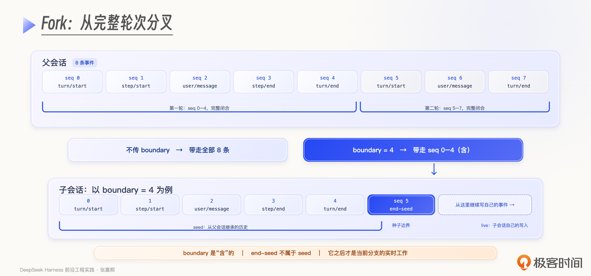
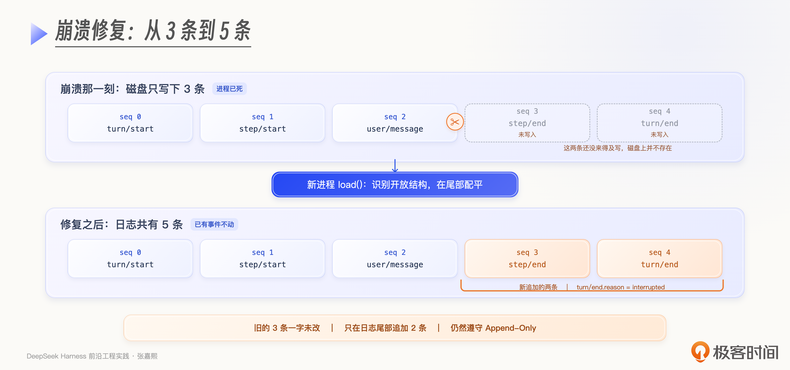

# 09 | 会话续接：Fork、Resume与崩溃修复

你好，我是张嘉熙。

上一讲把会话日志本身讲透了：只追加、进日志即冻结、消息历史是从它算出来的投影。但它留了两个口子，这本账记在什么纸上（怎么落盘），以及会话怎么续接。这一讲把两件一起接上：先把纸铺好，再看能用它做些什么。

但要把这本账真正用起来，问题就一个接一个冒出来：

- 这本账自己的信息，又放哪儿？

- 进程退出后再起来，这本账还在吗？

- 能不能从历史中间岔出去另开一个会话，原来那个不受影响？

- 跑到一半进程死了，已经写进日志的那些还算吗？

- 既然这本账还算数，能不能接着往下干？

这一讲就顺着这五个问题往下走——一个问题一节，正好五节。

```
关于环境：本讲新增两个包——@deepseek-ai/dsh-session-persistence（持久化
seam 的抽象定义）与 @deepseek-ai/dsh-session-persistence-jsonl（JSONL
后端实现），已加入本项目的 package.json，npm install --legacy-peer-deps
```

- 装上即可。

```
关于示例：npm run start:ch09:fork 跑 fork，npm run start:ch09:crash 跑崩
```

- 溃与恢复。

### SessionHeader：日志旁的元数据

第一个问题：这本账自己的信息，放哪儿？

一本账要能存下来、过后再打开，光有一串事件还不够：这本账自己还有一批信息要交代。

```
格式版本、工作目录（cwd）、从哪个会话分出来的、前多少条是继承来的，这些不是事件，
所以不进上一讲那张事件类型表（SessionEventMap），也永远算不进消息历史
（deriveMessages()）。它们跟事件流分开存，挂在 session.header 上：
interface SessionHeader {
 readonly version: number            // 落盘格式版本；本构建不认识就拒绝打开
 readonly id: SessionId
 readonly createdAt: number
 readonly cwd?: string               // 工作目录
 readonly parentSession?: SessionId  // Fork：从哪个会话分出来的
 readonly seedLength?: number        // Fork、Resume：前多少条是继承来的
 readonly origin?: 'subagent'        // 子 agent 会话：仅供导航隐藏重复 child 行，不证
 readonly delegationDepth?: number   // 委托深度：顶层 0，子 agent 为父 +1（重启后递归
 readonly agentPreset?: string       // Resume：恢复时必须装回同一套组装
}
```

这些字段什么时候定下来？

```
建会话的那一刻，也就是下一节要讲到的“创建”（create(meta)），它的 meta 参数正是这
```

份 header。所以是先后两步：建会话时先把“这本账是什么、从哪来、按什么格式记”写定；此

```
后 append 只管往事件流里加事件，一次都不会碰它。
“打不开”其实分两种：读不懂（SessionFormatUnsupportedError，数据好好的、只是
本构建读不了）跟数据坏了（SessionPersistenceCorruptionError）。官方不做迁
```

移，也绝不瞎猜。

### 持久化：先把日志交到纸上

第二个问题：进程退出后再起来，这本账还在吗？

```
上一讲说过，dsh-session 只认那一串事件，落在哪里是另一层的事。这另一层是一个能力
```

seam：框架定义抽象服务，具体实现可换。整个契约只有六个动作——建、写、读、看、续、起，本讲会挨个遇上：

```
abstract class SessionPersistence {
 // 建：登记一个会话，但还不建文件——要等第一次写*abstract create(meta: SessionHeader):
 // 写：返回成功，就代表事件已经真的写到磁盘了*abstract append(id: SessionId, events: r
 // 读：读回来，顺带把没闭合的轮次配平——配平结果会写回磁盘*abstract load(id: SessionId):
 // 看：同样配平，但只在内存里做，一个字节都不写*abstract inspect(id: SessionId): Promi
 // 续：给投影续算用的——只读 fromSeq 之后那一段，不必翻整本*abstract readFrom(id: Sessio
 // 起：resume 的正规入口，直接给你一个 Session 对象*abstract prepare(id: SessionId):
 // ...
}</sessionpreparation></sessioninspection></sessioninspection></void></void>
```

抽象得有人实现。官方给了两个，它们的名字上一讲在“介质可换”那里已经露过面，但只说了名字；这里我们补的是它们各自的磁盘布局：

后端

- 磁盘布局

JSONL 默认是压缩的，这一点你先在这里记一下：它决定了崩溃时磁盘上留下的是什么，一个写到一半的压缩块（frame），而不只是半行文字。崩溃修复那一节会讲后端怎么认出它、截掉它。

```
SQLite 那行的“1:1 映射”也值得停一下：事件有什么，表里就有什么，seq、type、data 一
```

一对应，一个不多一个不少。于是磁盘上不存在另一份需要跟日志对账的东西（官方管这叫“没有需要保持同步的并行持久化 schema”）。

```
纸选好了，接着看怎么往上写。这一步分前后两下：先是接口里的“建”（create），它只登记
这个会话的元数据，一个字节都不写；真正把事件写到磁盘的，是后面的“写”（append）。所
```

以“建了但一次都没用过”的会话，磁盘上什么都不会留下。

```
“写”的规矩很硬：后端 append 返回成功，就意味着数据真的写到磁盘了，不是“收到”，而是
“写完”（append resolves only after durability）。这条规矩直接决定崩溃时能找
```

回多少：返回之后进程才死，那条事件一定还在；返回之前就死，就当它没发生过。注意这是

```
持久化层的 append，不是往会话里追加事件那个，后者攒够一批才会调用到它。
```

不过规矩归规矩，什么时候真的往磁盘写，由持久化插件说了算，每来一条就写一次太慢，所以真实的写路径是批处理的：

- 第一个待处理事件开一个固定窗口（默认 200ms），后续事件加入，但不重置窗口；

- 窗口到期，把这一批写下去；这一批写入期间新来的事件，自己另起一个窗口；

```
session/flush 取消等待、立刻排空。
这么看，flush 就不只是“催一下”了，它是持久化检查点：排空之后，磁盘上的日志才是完整
```

的、能接得上的。少了它，最后那一批还压在窗口里，进程一死就什么都没留下。

```
循环在领下一轮之前会 flush 一次，既保证顺序，也在这一个点上观察写入错误。写失败时
事件被保留、自动重试暂停，通过 agent/error（框架统一的报错通道）报出来，绝不会把
```

失败记成一条会话事件（那等于在账上写假话）。

```
等下 npm run start:ch09:crash 跑出来的第一段，磁盘 3 条，turn 没闭合，就是 flush
```

之后留下的。少了那句 flush，磁盘上什么都不会有。

```
flush 划定了磁盘上停在哪一条；等到崩溃修复那一节，后端就是从这一条往后，把断掉的
```

账补上。

### Fork：从历史的稳定点分叉出去

第三个问题：能不能从历史中间岔出去另开一个会话，原来那个不受影响？

分不分、从哪儿分，都是你说了算，这三件里，它是你主动去做的那一种。

为什么需要它？一个长任务跑到第十轮，你想试试“如果第六轮换个问法会怎样”；或者要派一个子 agent 去干一件事，又不想让它看见主线的全部历史，这些都需要从历史的某个点另开一个会话，原来那个不受影响。

```
底层原语还是造会话的那个 create，只是多带两个参数：ctx.sessions.create(id, {
seed, meta })，seed 是一串事件，造出来的会话一出生就带着这些历史。
```

日常用的是包在上面的一层策略 API：

```
fork(source: SessionForkSource, boundary?: number, childSessionId?: SessionId): S
```

三个参数：从哪儿分（可以是会话对象，也可以是它的 id）、分到第几条（含）、新会话叫什么。分叉是这样一件事：



```
跑 npm run start:ch09:fork：
--- ① 父会话：两轮对话，8 条事件 ---
 seq 0  turn/start
 seq 1  step/start
 seq 2  user/message
 seq 3  step/end
 seq 4  turn/end
 seq 5  turn/start
 seq 6  user/message
 seq 7  turn/end
--- ② fork 一份出去（不指定 boundary）---
 子会话 9 条，seedLength = 8，parent = parent
 最后一条：seq 8  session/end-seed   ← 种子边界
 消息历史 2 条（全是继承来的）
--- ③ 只要第一轮（boundary = 4）---
 子会话 6 条，seedLength = 5
 消息历史 1 条
--- ④ boundary 落在开放轮次内（seq 2 正卡在第一轮中间）---
 被拒：fork boundary 2 in session "parent" ends inside open turn 1
```

```
② 里有个多出来的一条。父会话 8 条，子会话却是 9 条，多的是 seq 8 那条 session/end-
seed。
```

它的载荷是空的，不产生消息，位置本身就是它的全部意义：它之前的事件来自 seed，从它

```
往后才是这个会话自己的写入。官方管它叫 firstLiveSeq 的持久投影，firstLiveSeq
```

是给拿着对象的消费方看的，这条事件是给只拿到磁盘字节的消费方看的，两者回答同一个问题：本次生命周期的写入从哪儿开始。

为什么要专门留这么一条？因为继承来的历史和本会话的实时工作，在日志里是逐字节相同的。

举个具体的例子：日志里有一个“开了没关”的标记（下一讲要讲的上下文压缩，用的就是一对这样的标记）。光看字节，你分不清这两种情况，上一段生命周期干到一半崩了，留下个没闭合的；还是当前会话正在进行中。

有了这条边界，答案就很干脆：

- 出现在它之前的未闭合标记 → 属于一个已经结束的生命周期（不管是崩溃、被接续，还是从仍在运行的父会话 fork 出来的）→ 当它是死的；

- 出现在它之后的 → 本会话正在进行 → 是活的。

```
只有 Session 的构造函数能写它；已经以它结尾的 seed 不会再标记第二次，所以反复打开
一个没动过的会话，日志不会一遍遍变长。配合 header 里的 seedLength = 8，日后的
```

resume 和重放就能分清哪段是父辈的历史、哪段是这条分支自己的工作。

③ 说明 boundary 是“含”的。 传 4，就把 seq 0 到 4 都带走——正好是第一轮完整闭合的五条，加上边界标记共 6 条。你可以从任意稳定的轮次间位置分叉，哪怕源会话此刻正在跑新一轮。

```
④ 是被拒的情形，也是本讲最值得记住的一条。 seq 2 卡在第一轮中间（turn/start 已
经写下，turn/end 还没有）。官方的做法是直接拒绝，而不是静默截断：
fork boundary 2 in session "parent" ends inside open turn 1
```

为什么不替你切一刀了事？因为切出来的前缀是一轮没做完的对话，模型可能已经说了“我去查一下”，却没有工具结果；也可能用户的问题还悬着没有回答。把这样一份历史交给模型，它看到的是一个断在半空的回合，接下来的行为没法预期。

这跟上一讲那三条硬约束是同一个取向：拿不准就拒绝，绝不猜。上一讲叫它 fail closed，这里换了个说法——拒绝结束于开放轮次内的前缀，而不是静默截断，形状一模一样。源码里一共四种拒绝：除了落在开放轮次内，还有 boundary 不存在（传了一个超过最后一条的 seq）、boundary 不是非负安全整数、以及子会话 id 已被占用。

还有一点：子会话拿到的是深克隆的种子事件，不是跟父会话共享引用。所以从分叉那一刻起，父子就各走各的路，谁也改不了谁。

### 崩溃修复：把没闭合的那一半补上

第四个问题：跑到一半进程死了，已经写进日志的那些还算吗？

上一节是主动的那一种，这一节换被动的，没人希望它发生，但它就是发生了。

```
能修多少，取决于写下去多少：持久化那一节的 flush 划定了那条线，没写进磁盘的，谁也
```

找不回来。

上一讲聊“为什么不允许涂改”时，第一个理由就是这个：崩溃之后得能接着跑。当时只说了“必须能”，这一节看它到底怎么做到的。

把日志从磁盘读回内存，这个动作上一讲给它起过名字，重建（官方叫 load）。这一节讲的就是重建时发生的一件事。

```
一个轮次开始时会先写 turn/start，结束时才写 turn/end。如果进程在中间死了，日志
里就留下一个没有配对的 turn/start。这时候怎么办？
```

最省事的做法是截断，把这一轮没写完的部分扔掉。但不行：长周期任务里，一轮可能非常庞大（几十个步骤、大量工具输出），那些事件在崩溃前已经被真实地追加进日志了，是实打实做过的工作。扔掉等于假装没干过。

官方的做法是配平：把开着的结构一层层补上（工具、step、turn），前后任何一条独立事件都不改动。

这不违背上一讲的“只追加”，补的这些是追加在尾巴上的新事件，崩溃前已经写下的那几条，一条都没被动过。所谓"改不动"指的是已有的，不是“不能再往后面写”。

```
示例用两个独立的 Context 来模拟：写日志的那个用完就再也不碰，读的那个是全新的，它
```

不认识任何会话，对它来说磁盘上那份日志就是冷的。效果等同于进程重启后重新打开。跑

```
npm run start:ch09:crash，先看第一种情形：
--- ① 场景一：问到一半崩了（磁盘 3 条，turn 没闭合）---
--- ② 新进程 load 场景一：5 条 ---
 seq 0  turn/start
 seq 1  step/start
 seq 2  user/message
 seq 3  step/end
 seq 4  turn/end  {"turn":1,"reason":{"kind":"interrupted"}}
3 条进去，5 条出来。多的是 seq 3 的 step/end 和 seq 4 的 turn/end，一层层把开着的
```

结构补闭合：



```
注意，turn/end 的结束原因：interrupted。官方的注脚很有意思——它是唯一一个不由
循环发出的 TurnEndReason。其余原因（completed、aborted、blocked……）都是
```

程序自己跑完时写的，只有这个“被中断”是后端在恢复时替你补的。看到它，你就知道这一轮不是正常结束的。

更棘手的是另一种情形：崩溃时还有一个没返回的工具调用。模型已经说了“我要调天气工

```
具”，tool/call 也写进日志了，工具还没回来进程就没了。这时光补 step/end 是不够
```

的，模型还在等一个结果。

我们看场景二：

```
--- ③ 场景二：工具调用已发出，崩了（磁盘 5 条）---
--- ④ 新进程 load 场景二：8 条 ---
 seq 0  turn/start
 seq 1  step/start
 seq 2  user/message
 seq 3  assistant/message
 seq 4  tool/call
 seq 5  tool/result  error.code = TOOL_OUTCOME_UNKNOWN
     「The tool call was interrupted after it was rec…」
 seq 6  step/end
 seq 7  turn/end  {"turn":1,"reason":{"kind":"interrupted"}}
多出来的第一条是 tool/result，但它装的不是编造的结果，而是一个诚实的交代，而且分
```

两种：

```
tool/call 已经写进日志（调用被记录为已开始）→ 补 TOOL_OUTCOME_UNKNOWN：这
```

- 次调用已被记录为开始，但没有持久化的结果，结果未知。请根据工具语义决定：只读或幂等的才重试；可能有副作用的，先核实外部状态或问用户，不要盲目重试。

```
连 tool/call 都还没来得及写（只有模型消息里的调用意图）→ 补
TOOL_NOT_STARTED：这次调用在记录为开始之前就被中断了，需要的话重试即可。
```

这两句话不是随便写的。它明确区分了“可能已经发生了副作用”和“肯定没发生”：前者要谨慎，后者可以放心重试。修一份崩溃的日志，还要替模型把能不能重试想清楚，这才是配平真正的分量：不只是把结构补闭合，还要把后果交代明白。

```
load 有两个规矩，都是讲什么时候不该用它。
```

规矩一：只修冷会话。这一点很容易想当然：如果那个会话还在内存里活着、轮次还开着，

```
load(id) 会直接拒绝：
cannot load session "sess-probe" while its live turn is open; use the live Sessio
```

理由很实在：一个还活着的会话，它的权威状态在内存里，磁盘上的可能只是还没 flush 完的

```
片段。这时候补一条合成的 turn/end 进去，反而是在给一个还在跑的轮次盖棺定论。所以
```

规则是活着的会话请用内存里那个对象；只有冷会话（进程已经没了）才谈得上崩溃修复。

```
规矩二：只是想看看，就用接口里那个“看”inspect。 它跟“读”（load）返回的内容一样
```

（都是配平后的 header + 事件），区别只在动不动磁盘。这点可以用日志的修订号

```
（listSnapshots() 返回的那个不透明 token）量出来：
```

操作

- 返回修订号变了吗

inspect(id)

- 5 条否——只在内存里配平，一个字节都不写

load(id)

- 5 条是——它把合成的收尾真正写了回去

```
所以想看看这份日志现在什么样用 inspect，真的要恢复才用 load。
```

至于撕裂的部分：最后一条记录只写了一半（压缩 frame 不完整、或最后一行残缺）时，后端会从 frame 开头截断，丢掉那一截，再重新编码前面完整的记录。只丢最后那一截，不丢前面做过的。

```
还有一条边界值得知道：修复只闭合它认识的括号，turn、step、工具调用。插件自己声明
的开闭对（下一讲要讲的上下文压缩就用 compaction/start / compaction/end）core
一概不碰，留给插件自己判断；而它判断的依据，正是上面那条 session/end-seed：出现
```

在边界之前的未匹配标记，属于一个已经结束的生命周期。

不过这条判断还有个容易被漏掉的前提，它只覆盖本会话自己继承的那些括号。另一个并发存活的会话，完全可能在同一段历史上持有开放括号，而它自己的边界却在别处。所以要容忍并发写入方，光看日志字节是不够的，还得依赖日志之外的存活信号：日志能告诉你"这份历史里有没闭合的标记"，却告诉不了你对面那个会话还活着没有。

### Resume：读回来接着干

最后一个问题：既然这本账还算数，能不能接着往下干？

- 先说清楚：Resume 不是崩溃之后才有的动作——任何一份落了盘的日志都能读回来接着干。崩过的那份只是要多一道修补，所以才排在上一节后面讲。

我们先把这两节分清楚，它们名字像，其实是两件事：

- 崩溃修复管的是日志：它断在哪儿就补到哪儿，让这份历史重新变得可读；

- Resume 管的是会话：拿这份（已经完整的）历史当起点，开一个会话继续往下干。

一个修过去，一个开未来。它们不是两件各管各的事，而是同一条流水线的上下两道，下面第

```
一步那个 load，既是上一节讲的修复动作，也是把修复成果交出来的那一步。所以 Resume
```

不是修完之后另起炉灶，而是直接接过修好的日志往下走。

日志已经读回来了，接下来是把它变回一个能继续干活的会话。三步：

```javascript
// ① 从持久化读回（冷会话，顺带做崩溃修复）
const tool = await ctx.sessionPersistence.load(toolId)  // 场景二那份日志
// ② 拿它当 seed，造一个新的活跃会话
const resumed = ctx.sessions.create(SessionId('sess-resumed'), {
 seed: tool.events,
 meta: {
   parentSession: toolId,           // 记下父会话
   seedLength: tool.events.length,  // 记下哪一段是继承的
   cwd: process.cwd(),
 },
})
// ③ 接着干
resumed.append('turn/start', { turn: 2 })
resumed.append('user/message', ask('那算了，换个问题'), { surfaceOp: 'append' })
resumed.append('turn/end', { turn: 2, reason: { kind: 'completed' } })
```

跑出来是这样：

```
--- ⑤ 续接：seedLength = 8，事件 12 条 ---
 消息历史 4 条：
   user | 查一下天气
   assistant | <tool-call>
   user | <tool-result>
   user | 那算了，换个问题</tool-result></tool-call>
事件 12 条 = 继承的 8 条 + 一条 session/end-seed + 新写的 3 条。
```

消息历史是完整的：继承来的提问、助手的工具调用、那条“结果未知”的交代，再加上新问的这一轮。对模型而言这是一段连续的对话，而且它清清楚楚知道上一次调用没拿到结果，不会傻乎乎地以为天气已经查到了。

```
其中第三条 <tool-result></tool-result> 正是上一节修复补出来的，修复的成果直接
```

流进了新会话的消息历史，这就是两节之间真正的接口。

```
seedLength = 8 是关键。有了它，任何读这份日志的人都能分清：前 8 条是从 sess-
tool 继承的，后面才是这个新会话自己的工作：
磁盘上那一份（header.seedLength = 8）
 seq  0 ─────── 7 ┆ 8 ─────── 11
      └── seed ───┘└── live ───┘
                   ┆
                   └─ end-seed
 seed = 从 sess-tool 继承来的 8 条；live = 这个会话自己写下的
 seedLength 存在 header 里；firstLiveSeq 只活在内存，落盘靠上面那条 end-seed
上一讲说过，投影是从日志算出来的各种视图；seedLength 就是给这些视图用的一条界
```

线，比如“这一轮跑了多少步”这种统计，就不该把继承来的步骤算进去。

```
header 里还有个字段值得留意：agentPreset，记录这个会话的 agent 是按哪套预设组装
```

的。它必须持久化，因为预设决定了这个会话有哪些工具、提示词长什么样。要是恢复时装上另一套组装，就等于给模型重放一段它已经没法据以行动的历史：日志里记着某个工具的调用，而新的组装里压根没有这个工具。

```
最后交代一下：上面走的是底层原语。我们拿 load 的结果当 seed、再 create 一个新会
```

话，这两步很直白，适合看清发生了什么。官方给 resume 准备的正规入口，就是接口里那个

```javascript
“起”——prepare：
const preparation = await ctx.sessionPersistence.prepare(toolId)  // 同一个 id，场景
const session = preparation.session  // 一个还没发布的 Session
// ... 用完归还
preparation[Symbol.dispose]()
它直接给你一个 Session 对象，而不是一串事件。有意思的是这个对象的事件数比 load 多
一条：因为它把存储日志当作 seed 来构造会话，于是照例多了一条 session/end-seed
（前面 fork 那节见过它）。ctx.agents.resume({ resumeSessionId }) 内部走的就是
```

这一步。

到这里，五个问题都有了着落：

```
还在吗？ 在。日志写在磁盘上，append 返回成功就代表真的写完了。
元数据放哪儿？ session.header。跟事件流分开存，永远不进 deriveMessages()。
能岔出去吗？ 能。fork 从任意稳定的轮次间位置分叉，父子此后互不相干。
```

- 死过一次还算数吗？ 算。后端把没闭合的轮次配平，不截断、不丢弃做过的工作。

- 能接着干吗？ 能。拿修好的日志当 seed 造新会话，消息历史 = 继承 + 新增。

### 本讲小结

上一讲我们看清了日志的“形”——只追加、改不动、各种视图都从它算出来；这一讲看清了它怎么活下去：

```
持久化是一个能力 seam：SessionPersistence 定义约定，JSONL 与 SQLite 两个后
```

- 端可互换，换的是摆法不是账。

```
日志旁的元数据（格式版本、cwd、parentSession、seedLength）挂在
SessionHeader 上，跟事件流分开存，永远到不了 deriveMessages()。
写盘是批处理的，session/flush 是领下一轮之前的检查点；写失败绝不记成事件。
Fork 从历史的稳定点分叉：种子事件深克隆，session/end-seed 标出继承边界，
seedLength 和 parentSession 记进 header；落在开放轮次内的 boundary 一律拒绝。
崩溃修复只配平、不截断：补 step/end、turn/end { reason: 'interrupted'
}；没结果的工具调用还会补一条 tool/result（TOOL_OUTCOME_UNKNOWN /
TOOL_NOT_STARTED），把"能不能重试"交代给模型。而且只对冷会话生效。
Resume 是读回来当 seed：消息历史 = 继承 + 新增，seedLength 划清界线。
```

整套机制里最值得带走的一条是它的取向：遇到不完整的状态，先想能不能配平，实在不行就拒绝——绝不静默截断，也绝不假装没发生过。上一讲的 fail closed 在这里换了三种样子：拒绝非法的 fork 边界、拒绝读不认识的格式、拒绝修复还活着的会话。

注：本讲 GitHub 链接

### 思考题

```
动手实操：在 fork-demo.ts 里，往 ② 分出来的子会话再追加一轮（照开头那两轮的写
法，turn 编号用 3），然后分别打印父子会话的事件数与消息数。想一下：为什么子会话变
```

了，父会话一条都没多？提示：seed 是深克隆的。

```
小改动：把 crash-resume-demo.ts 场景一里那行 await
ctx.serial('session/flush', session) 注释掉，重新跑。观察 ② 还能 load 出几条
```

——连会话本身还在不在列表里都想一想。那 3 条事件去哪儿了？

```
提示：写盘是批处理的，窗口默认 200ms；而 create 是延迟实体化的。
```

```
有余力可以再走一步：把场景一那处 load 换成 inspect，输出不会有任何变化，两者返回
的内容一样。但用 listSnapshots() 比较前后的修订号，你会发现 inspect 一个字节都
```

没写。

欢迎把你的运行结果分享出来。如果你觉得这节课对你有帮助，也欢迎分享给其他朋友，我们下节课再见！
