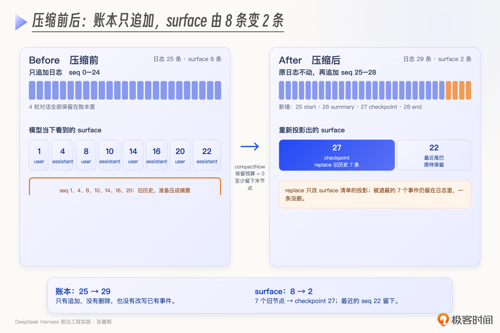

# 10 | 上下文压缩：Compaction与裁剪

你好，我是张嘉熙。

上一讲我们把会话续接讲透了：日志怎么落盘、怎么分叉、崩了怎么修复、怎么读回来接着干。但那些讲的都是日志本身，有一个口子始终没碰——上下文本身会越滚越长。

一次请求能塞进去的量是有上限的（上下文窗口，连系统提示、工具定义都算在里面）。而会话每跑一轮，历史就长一截；工具返回一大段输出，上下文又涨一块。当上下文逼近上限但还没超限时，就进入了“压力”状态，这个时候还来得及从容处理；真越过了界，模型会报“超出上下文窗口”的错误，直接拒绝这次请求，框架把这类失败归一成错误码

```
CONTEXT_WINDOW_EXCEEDED；没装压缩的话，这一次请求就是终点，整轮随之失败。这一
```

讲我们就来讲讲“装不下了怎么办”，一节解决一个问题：

- 什么情况算装不下？先弄清问题

- 旧历史怎么压短？压缩（compaction）

- 上下文里那些超长的工具结果，怎么裁？裁剪（pruner）

压缩与裁剪的关系不是并列的：压缩后端在框架的事件上注册了监听器，每一步开始前、请求失败后，它自己就会动手；裁剪服务不注册任何监听器，只会等人来调，而框架里会调它的，只有自动压缩这一条路：判定“该管了”之后、挑范围之前，先调用裁剪服务，把超长的工具结果裁剪一下，再重新量一遍；量完如果够低了，就到此为止（裁了，但不压）。下面从最核心的压缩讲起。

```
关于环境：本讲新增几个包，@deepseek-ai/dsh-compaction（压缩 seam 定义）、
@deepseek-ai/dsh-compaction-basic（压缩后端）、@deepseek-ai/dsh-
compaction-tool-result-pruner（工具结果裁剪）、@deepseek-ai/dsh-token-
meter（token 计量），已加入本项目的 package.json，npm install --legacy-
peer-deps 装上即可。
关于示例：npm run start:ch10:compact 跑压缩，npm run start:ch10:prune
```

- 跑裁剪。

### 压力与溢出

第一个问题：什么情况算装不下？

上一讲讲过的会话，历史是只追加的，每一轮对话、每一次工具调用，都会在日志里留下记录；其中浮到模型眼前的那一层，就叫 surface（surface 就是哪些事件浮在模型眼前的那份清单）。上一讲那条消息历史，正是把 surface 投影成消息算出来的。轮次越多，surface 越厚；工具输出越大，surface 越重。

而模型是有上下文窗口的：一次请求能塞进去的量是有限的。这个量的单位叫 token，是模型读文本时切出来的最小计数单位，你可以粗略理解成词块（英文里一个长词可能被切成好几块，中文里一个字也不一定正好是一块）。窗口有多大，由当前路由到的那个模型决定。这两者一碰，就有两种“装不下”：

- 压力（pressure）：历史自然累积，正在逼近窗口上限，但还没超。

- 溢出（overflow）：已经越过去了：请求当场被拒（就是上面那个错误码），没有预警。

```
压力得提前判，靠的是计量：压缩后端借助一个专门的计量服务（dsh-token-meter），估
```

出“下一次请求这一整套要占多少 token”，不只是 surface 上那段对话，还包括系统提示、工具定义这些固定开销，再拿去跟目标模型的窗口比，占到窗口的一定比例就算有压力（这个比

```
例归压缩后端自己配，thresholdRatio，默认 0.8，即八成）。溢出不用量，它不是预测，
```

而是请求被拒之后才确认的事实。


压缩和裁剪这两样都是“可选能力”，不在 Agent Loop 的主干上，Agent Loop 那边一行代码都没提它们；不装的话，Agent 照跑，只是上下文一满就报错停下。装上之后，才有人处理“装不下”这件事（压缩得在场，裁剪自己不会动，它只等人来调）。

### 压缩：把旧历史压成一段摘要

第二个问题：旧历史怎么压短？

装不下最直接的解法，是把已经聊过的旧历史压成一小段摘要：那一大片 surface 节点被一个“摘要节点”取代，token 占用骤降，而摘要要做的，就是把这些关键信息浓缩下来。对摘要本身，后端还有几道关（得是非空纯文本，也不许夹图片），其中最硬的一条是算下来必须真的更小：把它连同外面那圈固定文字一起估一遍 token，只要不比被遮蔽的那段小，就直接报错、这次不压，宁可不动，也不做无用功。

这件事由压缩后端完成，它在日志里落下三个事件，都是只写日志、不进 surface 的：

事件

- 作用

compaction/start

- 先落下，当锁用——表示"这次压缩开始了"

- 记下摘要内容、被遮蔽的范围与 seq、估算 token 数，以及这

compaction/summary

- 次摘要由哪个 provider/model 生成、花掉多少 token

compaction/end

- 释放锁，结束这一次

```
这把锁括住的是整个操作：先写 compaction/start，再做摘要、写
compaction/summary、把摘要替换进 surface，最后才写 compaction/end。end 放在
最后，所以日志里一旦出现它，就说明这次压缩收尾了（正常收尾那条不带 error，失败收
```

尾的会带上）；中途崩了只会留下“有 start 没 end”的遗留锁，一眼可辨。

严格说，这两个标记是时间点、不是排他的容器，摘要跑着的时候，注入的上下文可以落在这一对标记之间；也正因如此，手动压缩收尾时只复核“我挑的那段”没被改写，自动压缩才要求整张 surface 原封不动。

那这种“没闭合的锁”会不会把后来的压缩一直挡住？会，只要还有一把“当代的”未配对的锁，

```
所有压缩入口都会直接报 busy（the session compaction lock is already active）。怎么算“当
代”？看有没有更晚的 session/end-seed：比最新一条 session/end-seed 更早的未配
对 compaction/start，是上一代生命周期留下的陈旧证据，会被忽略掉；比它更晚的才算
```

数，正好借上一讲那条边界标记，把“这一代”和“上一代遗留”分开。

摘要怎么进 surface？靠“追加一条、替换一段”：压缩不改动任何已有的 surface 事件，它只

```
追加一条新的 user/message，摘要就装在这条消息里，同时带上 surfaceOp: { op:
'replace', start, end }，把清单上从 start 到 end 的那段，替换成这一个节点。这
条消息还顺手用 sourceEventSeqs 记下自己替代了谁（那次压缩的 start、summary，
```

加上被遮蔽的那串 seq），事后可查。

```
跑 npm run start:ch10:compact：它先铺一份 4 轮对话的会话，再手动压缩一次，示例
把 auto 关掉、直接调 compactNow，所以你这里看到的是手动入口，不是后面要讲的自动
```

触发。

```xml
--- 压缩前 ---
 surface 消息数：8（4 轮，每轮一问一答）
 第 1 条（前 20 字）：第 1 轮的问题，内容比较长。第 1 轮…
--- 压缩后 ---
 被遮蔽的事件 seq：1, 4, 8, 10, 14, 16, 20
 估算遮蔽 token 数：362
 surface 消息数：8 → 2
 第 1 条（替换进去的 checkpoint 节点）全文：
   This is an automatically generated checkpoint condensing an earlier span of t
   <compacted-summary>前面几轮在讨论：日志怎么落盘、会话怎么续接、崩溃怎么修复。</compacte
 第 2 条（保留的最近尾部）：第 4 轮的回答，同样不短。第 4 轮的…
--- 压缩新落的几条事件 ---
 seq 25  compaction/start
 seq 26  compaction/summary
 seq 27  user/message
 seq 28  compaction/end
```

输出里有两件事要一起看：

1. 压缩后，日志和 surface 各发生了什么？

- surface 清单（浮着的 seq）日志（事件）

- 25 条（seq 0–24）1、4、8、10、14、16、20

压缩前

```
先说清表格里那两个数字是怎么来的：示例每一轮记 6 条事件（turn/start、
user/message、step/start、assistant/message、step/end、turn/end），第 1
轮还多一条 request/header，4 轮正好 25 条（seq 0–24）；其中浮到 surface 上的只有
user/message 和 assistant/message 两种（这份示例里没有工具结果，
tool/result 同样是 surface 事件，下一节就用到了），所以清单是 8 条，seq 1、4、8、
10、14、16、20、22。
```

日志只有“加”，清单的 8 条压缩到 2 条，是照这份日志算出来的。留下的为什么是 22？因为压缩的规矩是压掉旧的、留住最近的尾巴，22 正是清单上的最后一条（第 4 轮的回答）。那 7个事件在日志里一条没删，只是不再出现在清单上。



```
尾巴留多大，规矩只有一句：按窗口的一个比例留。自动压缩用默认的 retainRatio =
0.16，也就是窗口的 16%；另外两条，手动按需压的那条，和已经溢出时走的那条，传的都
```

是 0。

保留预算为 0 又会怎样？挑范围说到底是在清单上找一刀：刀左边拿去压成摘要，刀右边原样留着。这一刀有一头是钉死的，左边那段的起点永远是清单的头一个节点（最老的那一端；清单按位置排，不按 seq），会动的只有右边的刀口。

刀口划在哪由保留预算定：做法是从清单末尾往回累加 token，够预算就停，而且它至少留一个节点，再挤也会剩下最后一个。预算为 0 时，刀口就贴着清单最后那个节点，右边只剩它一个。

刀口还可能被逼着往左挪：若正好落在一次“工具调用”和它的“结果”之间，这两条必须同进同出，于是再往左挪，直到不劈开为止（挑范围时一直守着这条线）。

```
示例走的正是 compactNow（保留预算 0），所以那一刀切下去，刀右边只剩 22 一个；而替
换进去的 27 也落在清单上，replace 把切走的 7 个节点换成它一个，于是压缩后的清单
```

是“27 + 22”两条（27 里装的什么，正是下面第二点要讲的）。

2. 替换进去的不是“裸摘要”，是一个 checkpoint 节点。

它由两段拼成：一段固定的英文“这是自动生成的检查点，把更早的一段对话压缩以腾出上下

```
文……”，再加一段 <compacted-summary></compacted-summary> 包起来的摘要正
```

文。固定的框架是压缩后端写死的，摘要正文才是模型生成的（示例里用假模型回了句中文）。这样一个节点对模型来说就是“已确立的背景”，它知道这是压缩产物，会把它当既定事实往下接，而不是当成一句新对话。

三个入口对应三种用它的方式：

```
compactIfNeeded(agent, trigger, signal)——自动：给一个触发（pressure
或 context-overflow），后端自己判断该不该压。
compactNow(agent, signal)——手动：/compact 这条命令走的就是它，不等有压
力，趁会话空闲先压一次；没找到可压的范围会返回 null，真出问题（比如正压着、摘要
不够小、历史被改、落盘失败）则是抛错，不会悄悄给个 null。
compactRegion(start, end, agent, signal)——指定范围：两端传的都是节点
的事件 seq（必须能在当前清单里找到），两端都含；谁前谁后看的是在清单里的先后，不
```

- 是谁大谁小；边界还得是配平过的，否则直接报错。它自己不判断该不该压，自动压缩正是

```
先挑好范围、最后交给它执行，所以 compact-basic 里这条要求会话当前有开着的轮次
```

- （自动压缩的标记得落在某一轮里）。

```
日常跑起来，自动那条（compactIfNeeded）挂在两个触发点上（auto 默认就开着；另外
```

两个监听器只做记账，空闲时、模型答复后各重置一次溢出重试计数）：

```
压力：每一步开始之前量一次（agent/pre-step）。够上阈值就先按前面说的裁一刀、
```

- 再量，够低就到此为止，不必压（这一刀怎么裁是下一节的正题）；还超才压，压完再量，

```
仍超就把范围重挑一段再压（compactionRetries 默认 1，最多压两轮），仍不达标就报
```

- 错。

```
溢出：请求失败之后才动（agent/request-error），而且失败必须带上
CONTEXT_WINDOW_EXCEEDED：先裁一刀、再挑范围压，压完重试这一次请求，只要
surface 真被换过（裁那一刀也算）就重试，次数由 maxOverflowRetries 封顶。所以
```

- 它不是每步都查，是撞上了才救。

```
手动那条（compactNow）是给“现在就想腾点地方”的场景；它和 compactRegion 这两条
```

都只压不裁。

### 裁剪：先把超长的工具结果裁短

第三个问题：上下文里那些超长的工具结果，怎么裁？

摘要压缩是“兜底”，但它有个不划算的地方：它要花一次模型调用，换来的还是一段改写过的文字。而单个工具输出偏偏可能长得离谱，一个工具返回几万字符（再大些的巨型纯文本压根不进上下文，走的是另一条通道，那是第 12 讲的事）；对这样一条输出，原样留住头尾往往比写段摘要更管用，要逐字看的东西（命令、路径、报错）多半就落在开头那几行（裁剪默认给头留 4096 个字符、尾只留 1024，差着四倍，正是这个道理）。

更划算的做法是先裁一刀，不花模型、纯规则：把它裁成“头 + 标记 + 尾”，中间那截换成一段

```
写死的字面量 [... tool result middle pruned ...]。这就是裁剪（pruning），官
```

方对它的定位是“可安全回放、不依赖模型的剪枝服务”（官方叫剪枝，本讲一律叫裁剪，同一个东西）：不依赖模型，就是前面说的纯规则；可安全回放，指它完全由输入决定，同样的surface 和配置必得同样的结果，事后重放这段日志也不会出现第二个版本。

```
所以自动压缩（compactIfNeeded）在动手之前，会先叫上裁剪服务：把那些超长的工具结
```

果，在 surface 上替换成“头一段 + 一句标记 + 尾一段”（旧事件仍留在日志里）。

```
裁剪由一个独立的服务承担。它只看当前 surface、不翻日志，把上面每条 tool/result 的
```

文本长度量一遍（有几个文本块就加起来算；长度按 Unicode 码点数，切片也按码点，不会把一个字符劈成两半，哪怕它在内存里占两个码元；但由多个码点拼成的组合 emoji 仍可能被

```
切开）：超过阈值的，保留开头的 headChars、结尾的 tailChars，中间换成那一行固定标
```

记（它前后各空一行，这四个换行符也一起算进长度；结果里若夹着非文本块，原地不动）。一旦裁，裁完的文本长度是定死的：正好是“保留的头 + 那行标记 + 保留的尾”三者相加，跟原文是几万字还是几十万字无关，只由这三个配置值决定。

```
裁出来的新结果，和压缩那条一样，也是一条追加进日志的新 tool/result 事件：用
surfaceOp: { op: 'replace', start: seq, end: seq } 精准替换掉原来那一条
（只换这一个节点），并带上 sourceEventSeqs: [原 seq] 留下“谁替换了谁”的凭据。新
事件把旧数据的其余字段（turn、step、callId、错误等）原样带过来，只换掉内容；它
前面还紧挨着一条只写日志的 compaction/prune，记下遮掉的是哪个节点、它值多少
```

token。旧的完整事件还在日志里，一条不丢。这也是为什么“裁剪”和上一讲的“配平”是同一个精神：只追加、不改写，已有的字节一个都不动。

裁剪还是幂等的，同一份 surface 再扫一遍，不会再发出替换。这不是碰运气：配置在构造时

```
就卡死一条硬约束，headChars + 标记 + tailChars 必须不大于 thresholdChars，
否则直接报错；于是每一刀的结果都被钉死，文本长度不超过 thresholdChars，且严格短
```

于原输入（运行期还有一条断言复核这两点，源码注释标明按配置校验它不可能触发）。

判断要不要裁用的正是同一把尺子（只数文本块），所以下一次扫描看到它已经达标，就跳过了；严格变小这一条保证每一刀都会真的省地方，不会越裁越长或原地打转。

```
跑 npm run start:ch10:prune，看一个超长工具结果被裁前后的账：
--- 裁剪前 ---
 tool/result 文本长度：240 字
 开头：这是一段超长的工具输出，这是一段超长的工具输出，这是一段超长…
--- 裁剪后 ---
 裁掉几条：1
 总共裁掉：111 字
 原 seq 3（240 字）→ 新 seq 5（129 字）
 裁后的 tool/result 全文：
   这是一段超长的工具输出，这是一段超长的工具输出，这是一段超长的工具输出，这是一段超长的工具输
   [... tool result middle pruned ...]
   的工具输出，这是一段超长的工具输出，这是一段超长的工具输出，
--- 裁剪后的日志 ---
 seq 0  turn/start
 seq 1  user/message
 seq 2  tool/call
 seq 3  tool/result          ← 原事件，一条没动
 seq 4  compaction/prune     ← 裁剪记的那笔账
 seq 5  tool/result          ← 替换件
 seq 6  turn/end             ← 这一轮最后才闭合
```

240 个字裁成 129 个字：中间的 150 个字被换成那行 39 个码点的标记，净省 111 个字（150− 39）。给模型看的，从一大段全文变成了“开头 + 标记 + 结尾”，那行标记的作用就在这儿：让它不至于把剩下的头尾当成全文。

日志那一段是这件事的另一半：原 seq 3 一条没动，裁剪只往账上追加了两笔，seq 4 记下遮

```
掉了谁、它值多少 token，seq 5 才是替换件。seq 6 的 turn/end 压在最后，是因为自动压
```

缩的标记必须落在开着的轮次里（压缩那节讲过这条要求），所以这一轮最后才闭合。

```
阈值（thresholdChars，默认 8192）、头部保留（headChars，默认 4096）、尾部保留
（tailChars，默认 1024）都是可配的。示例的文本只有 240 个字，所以把阈值调到
```

200、头尾调成 60 / 30，得到的正是“240 → 129”（60 + 39 + 30：中间的 39 就是那行标记，35 个可见字符加上前后各两个换行）。

### 本讲小结

今天这一讲，我们回答了“上下文装不下了怎么办”：先弄清什么情况算装不下，再看压缩与裁剪各自怎么动手。

其中装不下分两种情况，压力是慢慢逼近窗口上限，得靠计量提前判出来；溢出是已经越线，不用量，请求被拒那一刻就已经确认。

两道手段则各管一段：裁剪是自动压缩的前置步骤，动手前先把超长的单个工具结果在surface 上裁成“头 + 标记 + 尾”，旧的完整事件一条不丢；压缩最后兜底，把旧历史压成一个

```
checkpoint 节点，全程由 compaction/start、summary、end 三个只写日志的事件锁
住，surface 上唯一的变更是一条 replace 进摘要的 user/message。这两个动作和上一讲
```

的“配平”落在同一个原则上：账本只往后写，不往回改。

这背后真正的变化是，你不再把“上下文太长”当成一次需要就地改写的清理，而是把它拆成两道、只做追加：超长的工具结果先收一次，旧的整体再压成一个 checkpoint 节点；让“变短”只发生在 surface 清单上，账本一页不撕。

这，就是上下文压缩的本质，压的从来不是记在账上的事实，而是模型当下要看的那份surface 清单。

到这里，日志这条线上的“长度”问题也就落地了：裁剪收一收，压缩压一压。但这只是单个会话的账；磁盘上还攒着几十上百个会话。账本一多，就得能翻、能找，还能顺着父子关系一路摸下去。下一讲，我们讲跨会话查询：这些会话记录怎么被读、怎么被搜、怎么被追溯。

注：本讲 GitHub 链接

### 思考题

```
动手实操：在 compact-demo.ts 里，把 TURNS 从 4 改成 8，再跑一次 npm run
start:ch10:compact。你会看到压缩前的 surface 消息数从 8 变成 16、压缩后仍是 2，而
```

“被遮蔽的事件 seq”从 7 条变成 15 条（估算遮蔽 token 从 362 涨到 774），新落的事件也从seq 25–28 挪到 seq 49–52。想一下：为什么遮蔽的那串 seq 变长了？

```
提示：遮蔽的是旧的历史，保留的是最近尾部；示例走的是 compactNow，尾部预算为 0，
```

所以它只留清单最后一个节点（末尾若是一组“工具调用 / 结果”，刀口才会被往左再推一格；这份示例没有工具结果，碰不到这种情况），历史越长，被遮蔽的那串就越长。

```
小改动：把 prune-demo.ts 里的 THRESHOLD 从 200 改成 400，重新跑。这次“裁掉几条”
```

会是 0，全文原样打出来，为什么？提示：那段工具输出一共 240 字，而裁剪是超过阈值才动

```
手，日志那一段也会跟着少两笔，只剩 turn/end 收尾。
```

欢迎把你的运行结果分享出来。如果你觉得这节课对你有帮助，也欢迎分享给其他朋友，我们下节课再见！
