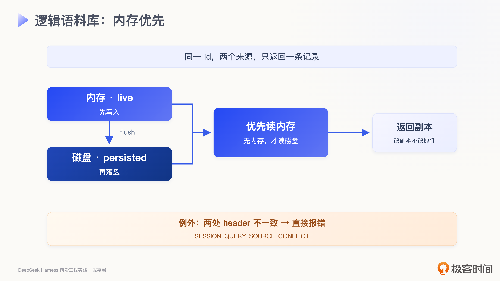
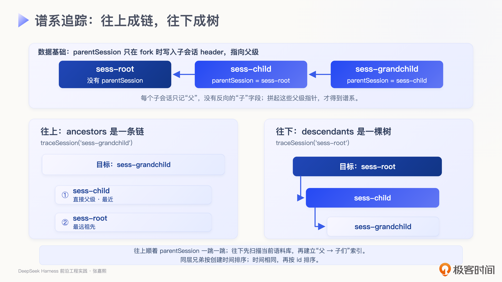
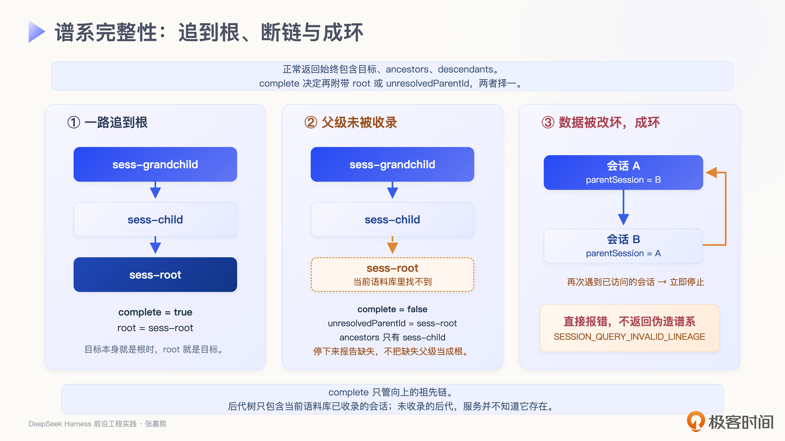

# 11 | 跨会话查询：读取、搜索与谱系追踪

你好，我是张嘉熙。

前面三讲，我们一直在跟一个会话打交道：它怎么落盘、断了怎么接上、装不下了怎么压短。但真实的 Agent 用起来，会话从来不是一个，而是几十上百个会话散在各处，这时候新问题就冒出来了：

- 这些会话有的还在内存里、有的早就躺在磁盘上，要怎么读？

- 怎么搜出“聊过 X”的那个会话？

- fork 出去的会话，怎么追它的父子关系？

三个问题，一个问“怎么读”，一个问“怎么搜”，一个问“怎么追”，答案都来自同一个服务：

```
ctx.sessionQuery（会话查询）。本讲前四节就是这三问的展开：读归一个逻辑语料库上
```

的四个读方法，搜归全文搜索加精确过滤，追归谱系追踪。四节之后，末尾还有一件收尾的事：这一套怎么被模型用。

```
关于环境：本讲新增三个包——@deepseek-ai/dsh-session-query（查询 seam 定
义）、@deepseek-ai/dsh-session-query-sqlite（SQLite 全文索引后端）、
@deepseek-ai/dsh-session-title（标题折叠，是 session-query 的 peer 依
赖，本讲不展开），已加入本项目的 package.json，npm install --legacy-peer-
deps 装上即可。
关于示例：本讲四个示例各对应一节——npm run start:ch11:corpus（四个读方
法）、start:ch11:search（全文搜索）、start:ch11:filter（精确过滤）、
start:ch11:lineage（谱系追踪）。四个示例都把索引放在内存数据库里，跑完即弃，
不写磁盘。其中 search、filter 会跑全文搜索，Node 在第一次搜索时会往 stderr 打两
行 SQLite 实验性警告（一行 ExperimentalWarning、一行 --trace-warnings 提
示）；corpus、lineage 不碰搜索，不会出现。不影响结果。
```

### 逻辑语料库：内存优先，四个读方法

第一个问题：同一个会话，按 id 去读，该读内存里那份还是磁盘上那份？

一个会话可能同时在两处存在：内存里一份活的（live），由进程持有、随时能往里追加（此刻也可能正空闲）；磁盘上一份存档的（persisted），进程重启后能读回来。

这两处是同一串事件的两个存放处，不是缓存关系。

乍一看很像缓存：读的时候先查内存、查不到再去磁盘，行为上跟“先查缓存、再查源”一模一样。但缓存是源的只读副本，永远不会比源更新。这里恰恰相反：写操作先落内存，再 flush到磁盘，所以内存里可能存着磁盘上还没有的新事件（第 09 讲：轮次开着时权威状态在内存里）。

```
后面我们直接叫这两处“内存”和“磁盘”；代码里对应的名字是 live 和 persisted（字段
```

名、过滤器取值都用这两个词）。

你只需要按 id 查询，不用关心这个会话当前在内存里还是已经落到磁盘。查询服务会把两处的所有会话合并成一份逻辑语料库，物理上数据还散在两处，但逻辑上只有一份，位置差异对你完全透明。

于是同一个 id 只出一份记录。

```
interface SessionRecord {
 header: SessionHeader  // 会话元数据：id、cwd、parentSession……（第 09 讲讲过的那个）
 live: boolean          // 现在在内存里活着吗
 persisted: boolean     // 能从磁盘读回来吗
}
live 和 persisted 这两个字段可以同时为真：一个会话能既活着、又落过盘。但读的时候
```

只取一处，内存有就读内存，没有才读磁盘，这就是内存优先。不过“优先”只管事件内容：两处那份不可变的 header 若对不上，不会取谁优先，而是直接以

```
SESSION_QUERY_SOURCE_CONFLICT 失败。
```

所以只要有一个来源在，查询就能工作：没装持久化，内存里的活会话照样能查；一个会话都没在跑，磁盘上的存档也能直接读出来。两个都没有，才真的查不到。

而且读出来的都是副本：改你手里的这份，内存里、磁盘上的原件一个字节都不会动。



```
语料库讲完了。接下来看怎么读：四个读方法都挂在 ctx.sessionQuery 上，各管一个问
```

题，先看总览：

方法

- 输入用途返回

- 一串 Ses

listSessions()

- 列出所有会话（只看 header，不读事件）不用传live/pers

readSession(id)

- 一个会话 id读出这个会话的整份日志：header + 全部事件克隆 hea

- 轻量事件

listEvents(id)

- 一个会话 id列出这个会话的每条事件，并标注它现在算哪一类shadowe

- 克隆 hea

readSurface(id)

- 一个会话 id读出这个会话当前的表层（模型眼前那部分）几条（每

```
跑 npm run start:ch11:corpus，把这四个读方法依次走一遍：
```

```
--- listSessions：列 header 清单 ---
 共 2 个会话（本例没装持久化，都在内存里）
 · sess-a  live=true  persisted=false
 · sess-b  live=true  persisted=false
--- readSession：读完整日志 ---
 sess-a：共 8 条事件
 类型序列：turn/start → user/message → assistant/message → turn/end → turn/start →
--- listEvents：列带归属的事件 ---
 seq 0  turn/start  surface=log-only
 seq 1  user/message  surface=current
 seq 2  assistant/message  surface=current
 seq 3  turn/end  surface=log-only
 seq 4  turn/start  surface=log-only
 seq 5  user/message  surface=current
 seq 6  assistant/message  surface=current
 seq 7  turn/end  surface=log-only
--- readSurface：当前 surface 快照 ---
 截到 seq：7
surface 上还剩4 条（只剩还在模型眼前的，结构事件不在内）
四个读方法里只有 listSessions 是跨会话的（一次列出所有，不用给 id）；对应的带过滤
条件的方法是 filterSessions，那个属于“过滤”一类、不在上面四个之列，到第三节讲。
readSession 交出完整的 8 条，连 turn/start 这类结构事件都在内。
listEvents 返回的 surface 归属有三个取值：current（还在模型眼前）、shadowed
（被替换掉了，比如第 10 讲压缩换掉的旧消息）、log-only（从没浮上来，比如上面示例里
的 turn/start、turn/end）。下面“搜”的两节会反复用到。
readSurface 只剩 4 条：比 readSession 少的，正是那些从没浮上 surface 的结构事
```

件。同一份日志，问法不同，拿到的东西就不同。

### 全文搜索：搜什么、怎么搜、拿到什么

第二个问题：怎么搜出“聊过 X”的那个会话？

先弄清搜什么：不是每条事件都能搜。查询服务只给带语义文本（从一条事件里提取出来、能拿去搜的那段文字）的事件建搜索文档，消息正文、工具调用的名字和参数、工具结果、待办事项，以及 turn 的结束原因。

其中两项要多说一句：工具结果除了内容本身，还会把报错的 error 名和 code 一起收进去，

```
因此按错误码也能搜到它；turn 的结束原因也算文本（error、aborted、max-tokens、
interrupted 都能搜），唯独正常结束（completed）不带任何文字。
反过来，这几类东西搜不到：结构事件（turn/start、step/start、step/end）、流式
分片（assistant/chunk）、请求头、消息里的推理（reasoning）块，以及尚未定义语义
```

的新事件、新块。一句话：它搜的是“内容”，不是“骨架”；内容里只有推理（reasoning）块例外，它虽是内容，却不进索引。

搜哪些会话？

```
能搜什么说完了，接着看范围。搜索的两个入口同样挂在 ctx.sessionQuery 上，区别是
搜哪些会话。本讲的主角是跨会话的 searchSessions()：一次搜遍所有会话，返回的是会
话（命中的事件按会话归拢，一个会话一条）；作为对照的 searchEvents() 只在指定的那
```

一个会话里搜，返回的是事件（一条命中一条）。

- 这里顺便聊一聊搜多深。上面那维决定的是“搜多宽”，这一维则是“深度”：第一节列

```
listEvents 时讲过的三种归属，全文搜索默认三种都搜，所以你搜得到已经被压缩掉的
历史（shadowed 的那些）。这是“搜”比只读 surface 看得更全的地方。只想搜当前上下
文，就加一个 surface 过滤器收窄到 current。
```

怎么匹配？

```
searchSessions() 和 searchEvents() 用的都是全文检索（full-text search，下称
```

FTS），靠 SQLite 自带的 FTS5 模块建索引。

注意，它匹配的是 token，不是任意子串。下面我们马上用例子拆开看。

```javascript
要搜出聊过 crash 的会话，就这么调：
const page = await ctx.sessionQuery.searchSessions({
 query: 'crash',   // 要搜的关键词
 limit: 20,        // 每页最多几条
})
跑 npm run start:ch11:search 看一个对比：脚本前后跑了三次调用，其中两段是
searchSessions()，中间那段「会话内」用的是 searchEvents()。
--- 跨会话全文搜索：搜「crash」 ---
 命中 1 个会话
 · sess-b：靠崩溃修复，把 crash 留下的半截 turn 配平。
--- 会话内全文搜索：在 sess-a 里搜「flush」 ---
 命中 1 条
 · seq 2 assistant/message：先写进内存的 events，再 flush 到磁盘。
 每条命中 = 一条事件 + 它自己的 snippet；跨会话搜索的 bestMatch 就是从这里挑的最强一条。
--- 跨会话全文搜索：搜「落盘」（中文子串） ---
 命中 0 个会话（搜子串要用过滤器）
同一个“落盘”，FTS 就是搜不到。它不是坏了，而是只认整个 token。FTS5 的 unicode61
```

分词器把连续的字母或数字当作一个 token（汉字在 Unicode 里也算字母，空格和标点则是分

```
隔符）：英文里 crash 被空格切开，是独立 token，好搜；中文里“日志怎么落盘”整句连在一
```

起就是一个 token，搜“落盘”这个子串自然对不上。

能不能搜到，只看它是不是恰好一个完整 token：原文如果写成“日志 落盘”（中间有空格），

```
“落盘”自己就是 token，反倒能搜；英文搜半个词（cras）同理，都卡在 token 中间。
```

原因在索引结构：全文索引按 token 建倒排索引（一个“哪个 token 出现在哪些事件里”的对照表），查一个词就是翻表直接定位，所以快；代价是“落盘”这种半个 token 在表上没有位置，搜不到。这类搜不到的情况怎么补，我们下一小节讲。

搜了之后，拿到什么？

```
跨会话搜索返回一串会话（SessionSearchHit），已按相关性排好序，你要找的通常就是
items[0]；每条还带命中处的那段摘录（snippet），模型可直接拿它做下一步判断。会话
内搜索（searchEvents()）返回的是事件命中项：每条就是“一条事件 + 它自己的摘录”。
结果太多？分页。请求带 limit，返回里的 nextCursor 就是下一页的凭证，拿它再发一次
```

同样的请求即可。

### 精确过滤：元数据圈定，text 子串兜底

全文搜索按内容找，靠 token 匹配。但很多时候，你要的是按元数据圈定，比如只看某个工作

```
目录（cwd）下的会话、只看 fork 自某个父会话的后代、只看 surface 上还活着的
（current）事件。
这就是过滤器（filter）的活。绝大多数过滤器既能单独用（filterSessions /
filterEvents），也能先作为条件传给搜索、圈好范围再搜；唯一的例外是 text 子句，它
```

只能单独用，不能塞给搜索。上一节留下的那个“搜不到子串”的坑，也在这节填上。

```
过滤器分两组，差别在作用范围：filterSessions 在整个语料库里筛，返回一串会话记
录；filterEvents 得先给一个 sessionId，只在那一个会话里筛，返回一串事件文档。
不管哪一组，一个过滤器的形态都是 { kind, values }：kind 是“按什么维度筛”，
values 是候选值列表（几处例外都标在表里）。会话级 filterSessions(filters)，可
用的 kind 与对应 values：
```

kind

- values

```
事件级 filterEvents(sessionId, filters)，可用的 kind 与对应 values：
```

kind

- values

seq / time

- 例外：用 from / to（含两端）

type

- 按事件类型，如 ['user/message']

surface

- ['current'] / ['shadowed'] / ['log-only']

text

- 例外：用 text 装搜索词，不是 values

组合规则要记牢，只有两条：一个过滤器数组里的各项是 AND（同时满足），单个子句里的

```
values 是 OR（命中任一即可）。所以下面这个数组读出来是"是 sess-a 或 sess-b，而且现
```

在还在内存里"——两条规则各用上一次：

```
[
 { kind: 'id', values: [SessionId('sess-a'), SessionId('sess-b')] },  *// sess-a
 { kind: 'availability', values: ['live'] },                         *// 且还在内存
]
跑 npm run start:ch11:filter，把这两组过滤器和 text 兜底依次过一遍：
--- filterSessions：按 parent 找根会话（parent 为 null）---
 根会话：1 个 → sess-root
--- filterSessions：按 parent 找 sess-root 的孩子 ---
 sess-root 的孩子：1 个 → sess-child
--- 数组内是 AND：根会话 + 还在内存里 ---
 两者都满足：1 个 → sess-root
--- values 内是 OR：sess-root 或 sess-child 的孩子 ---
 命中任一：2 个 → sess-child, sess-grandchild
--- filterEvents：只看 surface 上还活着的（current）---
 命中 6 条 → seq 1 user/message, seq 2 assistant/message, seq 6 user/message, seq
--- filterEvents：结构事件（turn/*）不在语义文档里 ---
 命中 0 条（turn/start 不产生搜索文档，所以是 0）
--- filterEvents：text 过滤兜底 FTS 搜不到的中文子串 ---
 FTS 搜「落盘」：命中 0 个会话
 text 过滤搜「落盘」：命中 1 条（返回文档数组：没有 snippet，也不分页）
   · seq 11 user/message：日志怎么落盘？
--- filterEvents：text 匹配时按空白切段 ---
 · seq 12 assistant/message：顺序是：先写内存的⏎events，再 flush 到磁盘。
 搜索词按空白切成两段、段间用 \s+ 连，所以原文里两段之间隔着换行也能命中；
 而 *、?、( 这些正则特殊字符会被转义，在你手里永远是字面量。
text 子句：FTS 搜不到时的兜底。前面几个都按元数据圈定，只有它按内容找——所以它也
用不了 values（那是候选值列表），改用 text 装要匹配的那段内容。上一节那个搜不到的
```

“落盘”，用它就捞得出来：

```
await ctx.sessionQuery.searchSessions({ query: '落盘' })  // 命中 0 个会话
await ctx.sessionQuery.filterEvents(SessionId('sess-grandchild'), [
 { kind: 'text', text: '落盘' },
])
```

它做的是逐条扫描：搜索词按空白切成几段，每段都按字面文本处理（源码里

```
compileSessionTextFilter 把它编译成正则，但元字符会被转义——你输 .* 搜到的就
```

是这两个字符），段之间允许任意空白，不区分大小写。所以它搜的是字面子串：中文子串、英文半个词都能搜到。代价是没有索引，一次要扫一份日志，慢。

```
返回的是文档数组，不分页、按 seq 升序，和全文搜索“按相关性 + 游标翻页”正好相反。
```

到这里，“怎么搜”这一问就齐了：按内容搜（全文搜索），按条件筛（精确过滤）。下一节换第三问：怎么追。

### 谱系追踪：祖先链、后代树与断链

第三个问题：fork 出去的会话，怎么追它的父子关系？

```
谱系的数据基础是 header 里的 parentSession：第 9 讲聊 fork 时提过，它记的是“从哪个
```

会话分出来的”，只在 fork 时写下。每个子会话各记一条，把这些散在各处的 parent 拼起来，就是一张谱系。追的时候分两个方向：

- 往上：搜到有用的记录后，想知道它是从哪次会话分出来的（典型流程就是先搜、再追）

```
往下：精确过滤的 parent 过滤器能“只看 fork 自这个会话的那些”，靠的就是谱系数据。
追这类关系的同样是 ctx.sessionQuery 上的 traceSession(id)。跑 npm run
start:ch11:lineage，先造一条 root → child → grandchild 的谱系，再查：
--- 追踪 sess-grandchild 的谱系 ---
 目标：sess-grandchild
 完整：true
 祖先（由近及远）：
   · sess-child
   · sess-root
--- 追踪 sess-root 的后代 ---
 目标：sess-root
 后代树：
   · sess-child
     · sess-grandchild
traceSession() 一次读出目标往上、往下两个方向：
往上：ancestors，一条线，从直接父级往外排（追 sess-grandchild 得到 sess-
child → sess-root），第一个是最亲的父级，最后一个是最远的祖先。
往下：descendants，一棵树，每一项是一个从直接子级开始的节点，节点里又带一层自
己的 descendants，一层套一层（追 sess-root 得到 sess-child，它下面又套着
sess-grandchild）。同一层的兄弟按创建时间排，时间相同再按 id 排。
```



```
形状不同，是因为 parentSession 是单向的：它只写在子会话的 header 里、指向父级，没
```

有反过来的“子”字段。往上是顺着它一跳一跳（成链）；往下得先把整个语料库扫一遍、按它归成“父 → 子们”再展开（成树）。

```
不过祖先这条链不一定追得到顶。返回结果里还带一个 complete：目标、ancestors、
descendants 每次都在，此外只再带两个字段里的一个，带 root 还是
unresolvedParentId，由 complete 决定。
```

complete

- 附带字段含义

- 祖先链一路追到了顶；root 是链顶那条记录（目标自己

TRUE

- root就是根时，root 就是目标）

- 链断了——某个父级不在当前语料库里（比如父会话是

FALSE

- unresolvedParentId从另一个工作区 fork 来的，这个查询引擎没看见它），unresolvedParentId 是第一个追不到的那个

```
断链时它是停下来报告，而不是把剩下的当“没有父级”。所以 ancestors 里只有断链之前那
```

一段，它记的是看得见的祖先，不是全部祖先。

```
还要留意 complete 只管往上这半截：后代是把现有语料库扫一遍、按 parentSession 归
```

出来的。没被收录的后代，服务压根不知道它存在，所以往下没有断链这回事。

还有更坏的一种：成环。正常世界里谱系是一棵树，但数据被改坏时（A 的父是 B、B 的父又是 A），顺着 parent 追会回到已经见过的会话。它不装作没看见，也不陷进死循环，而是直接

```
报错：错误码是 SESSION_QUERY_INVALID_LINEAGE。宁可喊停，也不给你编一条链。
```



```
顺带一提（不是本讲重点）： 事件之间的关系不在这套谱系里——listEvents 只报得出
某条消息 surface: shadowed，报不出谁顶掉了它；补这个缺口的是 traceEvent()
（拿关系）和 readEvent()（拿内容）。lineage-demo.ts 跑起来，谱系这两段之后还
```

- 会多出压缩、traceEvent、readEvent 三段输出，跳过即可。

### 模型工具：五个工具与工作区边界

查询服务本身不面向模型，它只是一套可信的 API。要让模型能用，得再挂一个可选的包

```
（@deepseek-ai/dsh-tool-session-query；本讲的示例没装它，想试就先自己加
```

上），把它包装成五个工具：

```
session_search——跨会话搜索（searchSessions()）；
session_event_search——会话内搜索（searchEvents()）；
session_trace——会话谱系（traceSession()）；
session_event_trace——事件关系（traceEvent()）；
session_event_read——读一条事件加前后窗口（readEvent()）。
```

后两个是事件级的，本讲不展开——上一节末尾已经顺带提过。

```
先定“查哪个会话”。工具都在某个会话里被调用：四个用 session_id，省略即“我自己”，也
可填别人的 id；session_search 用 session_ids（复数，可选），不填就是整个工作
区，但结果里排除你自己——session_event_search 还再排除当前 step 写下的内容。
再过工作区这一关。要查别人，两边的 cwd 必须一模一样。过不了就是看不见：泛搜进不了
结果，点名查直接抛 SESSION_QUERY_TOOL_UNAUTHORIZED；即便在谱系里撞见，也只留
一行占位（如 [outside workspace]）。自己没有 cwd 时，就只剩查自己这条路。
```

### 本讲小结

今天这一讲，我们把目光从一个会话转向一批会话：看它们怎么被读、被搜、被追。

读是四个入口：同一个 id 可能同时在内存里跑着、在磁盘上躺着，服务把两处合成一份逻辑语料库，内存优先，两边都没有才真查不到。四个方法各管一个问题：header、完整日志、事件归属、当前表层，拿到的都是副本。

搜是两条腿。全文搜索按 token 匹配，快，但卡在 token 中间的子串搜不到；精确过滤补上这

```
一块：元数据圈定范围，text 子句逐条扫字面子串兜底。
追谱系全靠 header 上那一个 parentSession：往上是链、往下是树，一次
traceSession() 两个方向都拿到，追的正是跨会话的父子关系。追不到顶会报断链，成环
```

则直接报错。

末尾那件收尾的事：这套能力被包成五个模型工具，访问别的会话只认“同一个工作目录”这一条边界。

这背后真正的变化是：你不再只把日志当成会话自己继续跑要用的东西，而是把它看成能跨会话按问题去查的数据：能读、能搜、能追；让查询返回副本，另有一份可随时扔掉的派生索引，日志一个字节不动。

这，就是会话查询的核心——查法可以很多，历史只有一份：同一份日志，谁都能按自己的问题反复去查，而它本身从不变动。

跨会话查询到这里就讲完了，但核心篇里还有最后一个我们尚未触及的重要问题。下一讲，我们来看上下文边界。

注：本讲 GitHub 链接

### 思考题

```
动手实操：打开 search-demo.ts，把第 50 行 searchSessions({ query: 'crash'
}) 里的 'crash' 改成半截的 'cras' 重跑，FTS 预期命中 0 个（那行标签是写死的，仍会
```

印「crash」，忽略即可）。

```
在 search-demo.ts 里补一句 filterEvents(SessionId('sess-b'), [{ kind:
'text', text: 'cras' }])，对 sess-b 搜同一个词，预期拿到 1 条（seq 2，就是那
```

句带 crash 的回答）。同样是半个词，一个 0、一个 1——差在哪？分界线不在中英文，而在是否恰好是一个完整 token。

```
小改动：在 lineage-demo.ts 造完 sess-grandchild 那行（第 82 行）后补一句
ctx.sessions.fork(child, undefined, SessionId('sess-sibling'))，从
sess-child 再分出一个兄弟。别的代码都不用改，重跑 npm run
start:ch11:lineage 即可。
它的后代树会变成什么样？sess-sibling 和 sess-grandchild 谁排在前面？
预期：sess-child 下挂两个子节点，sess-grandchild 在前，因为它建得早；同一毫秒
```

里建成的才轮到比 id。

欢迎把你的运行结果分享出来。如果你觉得这节课对你有帮助，也欢迎分享给其他朋友，我们下节课再见！
