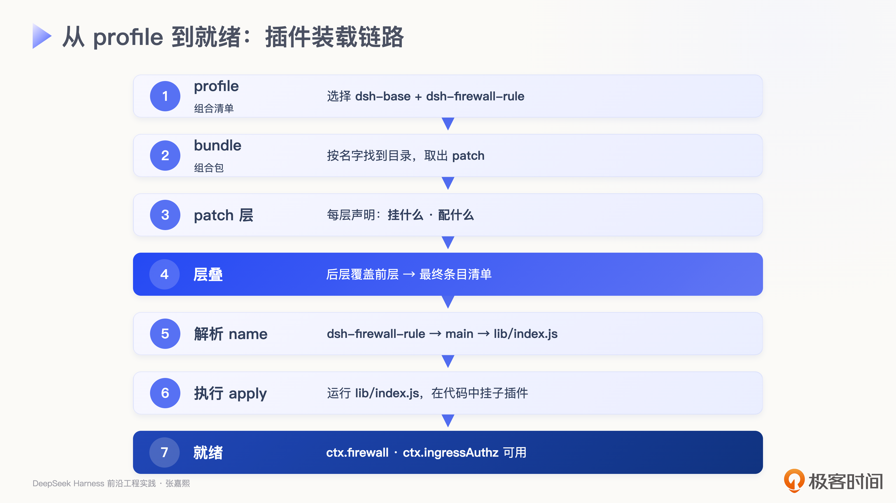

# 18 | 规则系统：基于dsh扩展点搭建引擎

你好，我是张嘉熙。

编排篇你已经会驱动、协调 Agent 完成一件件任务了，但这都还停在“单点演示”，现在还缺一步：做一个能部署上线，甚至还能自进化的完整系统。

从这一讲开始的实战篇，就用四讲补上这一步，做一个规则自进化防火墙。

这一讲我们先把“规则引擎”这块地基搭起来，用 dsh 的扩展点，把它做成一个可部署上线的dsh 应用。

要看清这一讲，需要先回答四个问题：

- 一条规则怎样表达“哪些请求放行、哪些拦截”？

- 引擎怎样把规则变成可靠、快速、可解释的判定？

- 引擎怎样接入 dsh？

- 引擎怎样从本地启动到生产部署？

```
关于环境：本讲示例在配套 cookbook 的 src/firewall/ch18/，不接模型、不需要 API
key；npm install --legacy-peer-deps 后执行 npm run start:ch18 即可看到
真实运行输出。目录约定适用于 18–21 讲：chXX/ 根目录是引擎本体，即库代码加测试；
demo/ 子目录是可运行示例，示例 import 根目录的库代码、不复制实现，给你一个能直
```

- 接跑起来看效果的入口。

```
关于示例：文档里的运行输出块，比如规则库、逐条判定、白名单段，都来自 npm run
start:ch18 的真实运行，无时序波动；其余机制由 npm test 钉住，既有判定语义的单
```

- 测，比如 deny 优先与顺序无关、allow 不参与判定、candidate 不参与等，也有真实 HTTP

```
流量（http-ingress.test.ts）与 nginx auth_request 旁路（nginx-
auth.test.ts，需本机 nginx 或 Docker，两者都没有才跳过）的端到端测试。
```

### 一条规则怎样表达“哪些请求放行、哪些拦截”：条件树 + 动作 + 例外

```
先抛一个具体需求：你想拦住所有对 /admin 的访问，后台不该被随便扫；但
/admin/health 是监控探针，得留着放行。一条规则要同时说清这两件事：拦什么、给谁
留口子。它是一段 JSON，来自 rules.json：
```

```json
{
 "name": "block admin scan",
 "when": {
   "field": "path",
   "op": "starts_with",
   "value": "/admin"
 },
 "unless": {
   "field": "path",
   "op": "eq",
   "value": "/admin/health"
 },
 "action": "deny"
}
下面我们把它拆开看。一条规则就写四个字段：name 是名字，when 是命中条件，unless
是例外，action 是动作，引擎侧会再补上 id 和 state，本讲规则都是 active。unless 就
```

是“留口子”用的。

```
命中条件 when 是一棵条件树：叶子由三部分构成，field 看哪部分，op 是算子，value
是比较的值；组合节点比如 and / or / not，把叶子或其他组合节点任意嵌套起来：
```

维度

- 取值说明

- method / path / body / ip / ua / header.<name> /

field（看哪部分）

- 取请求的一个字段query.<name>

- 依次为：等于 / 不eq / ne / contains / starts_with / ends_with /列表内 / 字段存在

op（算子）

- matches(RE2) / in / exists是刻意的：若大小"/admin" 就会被

- 随 op 变：match

value（比的值）

- 字符串 / 正则 / 数组 / 无此字段

- { and: [...] } / { or: [...] } / { not: {...} }

组合

- 可任意嵌套

```
action 只有两种：deny 代表拦截，allow 代表放行，所谓“放行还是拦截”就由它决定；
when 只回答“请求是否命中这条规则的条件”。
引擎有黑名单和白名单两种模式，通过 setMode 切换。黑名单模式默认放行，白名单模式默
认拒绝。在两种模式之上，deny 和 allow 怎么合成最终结论，有三条规则：
deny 优先于 allow。无论黑名单还是白名单模式，一条请求同时命中 deny 和 allow
时，结果都是拒绝。为什么 deny 必须压过 allow？因为 deny 通常是“窄而强”的拦截，
allow 通常是“宽而弱”的放行：白名单常配一条 allow path starts_with /api 放行
全部接口，再配一条 deny path contains /api/admin 拦掉敏感子路径，若 allow
优先，/api/admin 会被放行，那条 deny 失效。
allow 只在白名单模式生效。黑名单模式下 allow 被忽略；白名单模式下，命中 allow
且没命中 deny 才放行。
顺序决定的是 first hit，也就是第一条命中的规则。多条 deny 命中时取第一条命中的
deny，白名单模式下多条 allow 命中时取第一条命中的 allow，first hit 的 ruleName
```

- 就是返回的规则名。调换顺序，first hit 变了，返回的规则名跟着变。

```
unless 也需要说清楚，它的语义是：命中 when 且命中 unless 时，这条规则不触发，把
“例外”直接写进那条 deny 规则本身，而不是另写 allow 去抵消，因为 deny 优先。上面那
条 block admin scan 就带了 unless: { path eq /admin/health }，所以
/admin/users 被拦、/admin/health 放行。
```

### 引擎怎样把规则变成可靠、快速、可解释的判定

下面我们来看解决这个问题的关键机制。超长请求在入口就拦，不进引擎。即使匹配本身很

```
快，一个几 MB 的请求体仍要“看一遍”，这个代价本身就不划算。所以 isOverlong 在交给
```

引擎前，先拒绝 path / body / ua 三处长度超过 8192 的字段。

注意：这道边界只挡超大载荷，挡不住正常长度的攻击，短小但恶意的请求照样进匹配路径，靠规则来拦。

```
匹配前先清洗请求。攻击者经常把同一个路径写成不同样子绕过规则，/admin 写成
/%61dmin 是百分号编码，//admin 则是多斜杠形式。sanitizeRequest 在匹配前把这
些统一还原，包括解码百分号、规整 // 和 ..、统一 Unicode 写法，让“看起来不同，其实是
```

同一个”的请求现出原形。

```
正则用 RE2，匹配不会被卡死。规则里唯一走正则的是 matches 算子。普通正则有个致命问
```

题：精心构造的输入能让它“回溯爆炸”，把 CPU 卡死，也就是 ReDoS 攻击。这一讲我们用

```
re2-matcher，RE2 是 Google 出的正则引擎，用线性时间算法、不做回溯，所以再恶意的
```

输入也卡不死它。

```
规则先编译好，请求时直接执行。compileRule 在加载阶段就把整条规则，连同 matches
```

用的正则一起，编译成可直接执行的形式，并按规则 id 缓存。比如这条叶子条件，来自

```
rules.json 里的 when：
{ "field": "path", "op": "starts_with", "value": "/admin" }
编译后得到这样一个闭包，来自 rules.ts 的 compileCondition 叶子分支。真实代码用
```

的是变量，这里代入了具体值：

```
{ test: (r) => evalLeaf('path', 'starts_with', '/admin', r) }
其中 evalLeaf 对 starts_with 的求值就是
r.path.toLowerCase().startsWith(/admin)，value 已在编译期小写化，
matches 的正则也已在编译期预编译。请求到来时，evaluate 直接匹配，不再重新编译，
```

既省下每次请求重新编译的开销，也把坏规则挡在加载期，编不过去就直接拒绝，不会留到请求时才出错。

```
判定结果带规则名。每次判定都返回命中的规则名，即 ruleName，结合前面讲的黑白名单
模式、when 命中条件、unless 例外，就能知道是哪条规则、规则内容是什么、为什么被拦
```

截或放行，这让每次判定都可解释，而不是一个黑盒。

### 引擎怎样接入 dsh：seam 拆能力，插件装配

```
规则引擎接入 dsh，就是把它做成 dsh 里的能力，本讲主角是 firewall。分两步：先按第 5
讲介绍的能力 seam 方法，把 firewall 能力拆成 Definition / Provider / Consumer 三角
色；再用 ctx.plugin() 把角色对应的插件挂上树。
第一步：seam 拆能力。把 firewall 拆成三角色：
```

角色

- 职责本讲对应

Service Definition

- Firewall（firewall.ts 里的抽象类）定契约：这个能力长什么样

Service Provider

- FirewallEngine（firewall.ts 里的实现类）给实现：真正干活，可替换

- ingress-authz（拦请求的入口）、rules-file

Consumer

- 用能力：只认契约，不认实现源）、tool-firewall（只读工具）

上面表格里的三角色，落到 cookbook 代码里是这样，这里略去 import 和实现细节：

```bash
// Service Definition（firewall.ts）——契约
export abstract class Firewall extends Service {
 constructor(ctx: Context) {
   super(ctx, 'firewall')
 }
 abstract evaluate(request: HttpRequest): Decision | null
 abstract listRules(): Rule[]
 abstract addRule(input: RuleInput, state?: RuleState): string
 // ……还有 removeRule / setMode / getMode / loadRules
}
// Service Provider（firewall.ts）——实现
export class FirewallEngine extends Firewall {
 static inject = ['re2'] as const
 constructor(ctx: Context) {
   super(ctx)
   assertRealRe2(ctx.re2)     // 守卫：匹配器必须是真 RE2
   this.matcher = ctx.re2     // 它自己还消费 re2（正则匹配器）
 }
}
// Consumer（ingress-authz.ts）——只认契约
export class IngressAuthz extends Service {
 static inject = ['firewall'] as const
 constructor(ctx: Context) {
   super(ctx, 'ingressAuthz')
 }
 // authorize(request)：先查超长，再交给 this.ctx.firewall.evaluate(request)
}
第二步：插件装配。下面这个插件在自己的 apply 里挂了两个子插件，SafeRe2Matcher
和 FirewallEngine，分别提供 re2 和 firewall 两个能力：
// firewall-plugin.ts —— dsh 插件
export const name = 'firewall'
export function apply(ctx: Context): void {
 ctx.plugin(SafeRe2Matcher)
 ctx.plugin(FirewallEngine)
}
```

### 引擎怎样从本地启动到生产部署：profile、bundle、patch

dsh 启动一次，就是按“组合清单 → 组合包 → patch 层”的顺序依次用到这三样。先读清单知道装什么，再按名字找到组合包，取它的 patch。下面照这个顺序认识它们，每个都配上真实的配置文件。

```
组合清单（profile）：$DSH_HOME/profiles/<name>/</name> 下的目录，回答“这次启动
由哪些组合包、按什么顺序组成”。它有两个文件，一个是 package.json，另一个是用户自
己的 cordis.patch.yml。后者就是下面要讲的 patch，属于用户改配置的那一层，语法和
```

bundle 自带的 patch 完全一样。

```
先看 package.json：
{
 "name": "dsh-profile-demo",
 "dsh": {
   "profile": {
     "bundles": ["@deepseek-ai/dsh-base", "dsh-firewall-rule"]
   }
 }
}
```

组合包（bundle）：一个打包好的 npm 包，里面装着两样东西：插件代码本身，和一份 patch文件。

为什么这两样要打包在一起？因为 patch 只写了“挂哪些插件、覆盖哪些配置”，它指向的代码

```
得由这个包提供，两者合成一个 npm 包，这份能力才能被发布、被别人 dsh plugin add
装走。下面这份 package.json 里，name 是包的名字，安装、引用都用这个，main 指向
代码入口，dsh.bundle.patch 指向那份 patch 文件：
{
 "name": "dsh-firewall-rule",
 "main": "lib/index.js",
 "dsh": {
   "bundle": {
     "patch": "./cordis.patch.yml"
   }
 }
}
```

```
这一讲的 dsh-firewall-rule 正是这样，lib/index.js 是 esbuild 把引擎代码内联打
```

包后的自包含产物，它就是插件的实现：dsh 的 Loader，即按配置清单加载插件的那一层，

```sql
调它的 apply，把 re2 匹配器、防火墙引擎、拦请求的入口、只读工具依次挂上树；
cordis.patch.yml 则是启动这次挂载的那份配置。
patch 层：按 id 定位某条目、整行替换它的 config，或用 insert 添加新条目。同一个
patch 机制有三个来源：bundle 自带的、profile 里用户自己的、命令行 --patch 给的，这第
```

三种叫 overlay，下面“开发调试”用的就是它。语法完全一样，区别只在叠放的先后，你可以看下面讲的层叠规则。

组合包自带的 patch 长这样：

```sql
# packages/dsh-firewall-rule/cordis.patch.yml
- insert:
   - id: firewall               # 条目 id，后面的 patch 就按它定位
     name: 'dsh-firewall-rule'   # 从哪加载这个插件：这里写包名（与上面 package.json 的
这一讲里这份用的是 insert，新增一行；没写 config，因为这个插件不需要配置项。
这份 patch 里两个字段容易混：id 与 name。
id 回答“改哪一行”：改已有条目的配置只给 id + config，也就是按 id 定位、整行替
换，此时不写 name，写了就表示连插件模块一起换掉。
patch 里的 name 回答“这一行加载谁”，可写包名或相对路径。它和 package.json 的
name，即“这个包叫什么”，通常相同，但那只是“这个包只装自己这一个插件”的结果，
name 也可以写别人的包名。
```

profile、bundle、patch 这三样都是“声明”，真正执行它们的是 dsh，合起来就是一次启动的完整过程：



图里的第 4 步“层叠”，就是三者真实的装配先后，dsh 把各层依次叠到空条目列表上：

```
各 bundle 自带的 patch，按 dsh.profile.bundles 的顺序，dsh-base 最先
profile 的 cordis.patch.yml
```

3. home 级 patch

```
每个 --patch overlay
```

后层按 id 覆盖前层，并且是整行替换，不是增量合并，覆盖时要重述所有想保留的字段，只写改动的那一个会让其余字段消失。

这三样在实际里怎么用，本讲主要关注两种：开发调试用 patch overlay 往跑着的宿主里塞能力，生产部署把插件打包成组合包装进 profile。

开发调试：dsh 已经在跑，怎么往里加东西，又怎么验证加对了。这一讲我们备了

```sql
firewall-plugin.ts，这个插件只挂引擎的两个 Provider，还配了一份 patch。它不需要
配置，所以条目里没写 config 字段，要给插件传配置时才写：
# cordis.patch.yml
- insert:
   - id: firewall                 # 新增条目的 id，后面的 patch 按它定位这一行
     name: "./firewall-plugin.ts" # 从哪加载：本地文件写相对路径
dsh --profile demo --patch ./src/firewall/ch18/cordis.patch.yml --dump-config
--dump-config 只打印组合后的配置树，不真正启动，因此不需要 key，跑一下就能看到
overlay 那段叠在最后，按 id 命中同一条 firewall，把 name 从包名换成本地文件。
```

生产部署：打包成组合包装进 profile，启动即上线。装的就是前面那个组合包

```
packages/dsh-firewall-rule/，装到本机不需要发布，add 直接指向本地目录即可：
# ① 构建（在 cookbook 根；子包没有自己的 node_modules，prepare 跑不了）
npm run build:ch18-bundle
# ② 发布（只发给别人时需要；本机自用跳过）
npm pack      # 打包成 tgz；或 npm publish 发到 registry
# ③ 装进 profile
dsh plugin --profile demo add -w ./packages/dsh-firewall-rule
# ④ 启动
dsh --profile demo
第 ③ 步只是把包追加进上文 profile 里的 dsh.profile.bundles 列表。add 的参数就是
“从哪装”：本机自用写本地目录，即 -w；② 打包或发布后，换成 tgz 路径，比如 add
./dsh-firewall-rule-0.1.0.tgz，或 npm 包名，比如 add dsh-firewall-rule。
```

### 本讲小结

这一讲把“规则引擎”从表达、判定、接入到生产部署串成一条线。

```
规则语言：一条规则 = 条件树（when 命中 + unless 例外）+ 动作（deny 优先、与顺序
```

- 无关）。

- 引擎判定：编译一次、求值多次；匹配前先清洗请求；只走 RE2 子集，测试替身不加载就拒绝；超大字段在入口先拒，不进引擎。

- 插件化：引擎借 dsh 的能力 seam 切成 Definition / Provider / Consumer 三角色，再用插件装配挂上树。

- 组装与部署：profile 决定装哪些 bundle、按什么顺序，bundle 与 patch 叠成插件树；开发调试用 overlay 塞能力，生产部署打包装进 profile、启动生效。

这背后真正的变化是判定从“写死的 if”变成数据：规则是 JSON、能增删、每条结果可解释。扩展从改宿主变成加插件：引擎只不过是插件，装进 dsh 只靠声明、不改宿主源码。

下一讲我们看规则怎么可生成、可修改、可持久化。

注：本讲 GitHub 链接

### 思考题

```
动手实操：示例在 src/firewall/ch18/，直接改代码、重跑验证。
把 rules.json 里 block admin scan 的 unless 删掉，重跑 npm run
start:ch18，/admin/health 从放行变成拦截。再想：若改成“在 deny 规则后面再加
一条放行规则、靠顺序盖住它”，行得通吗？为什么例外必须写进规则本身，即 unless，
```

- 而不能靠排队？

```
把 re2-matcher.ts 里 SafeRe2Matcher.compile 换成用 RegExp 实现，重跑，引
```

- 擎起不来了。为什么一个能正常匹配的 RegExp，反而让引擎拒绝启动？

欢迎把你的运行结果分享出来。如果你觉得这节课对你有帮助，也欢迎分享给其他朋友，我们下节课再见！
