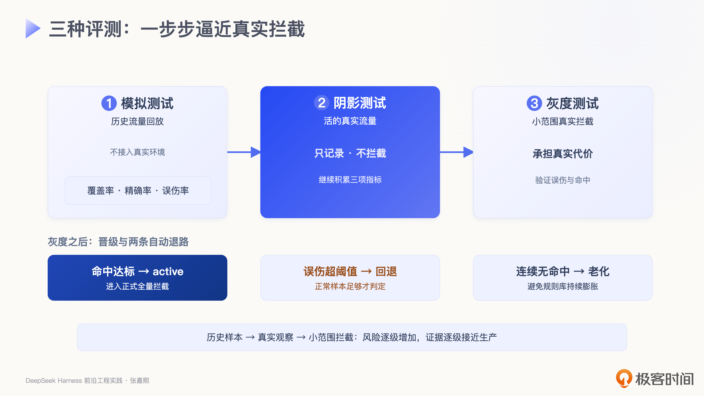
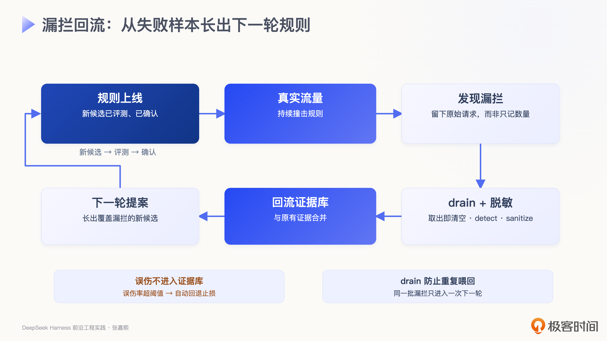

# 21 | Agent的规则进化：评测与闭环

你好，我是张嘉熙。

上一讲，候选规则已经能靠模型从异常请求里长出来了，但长出来还不等于能上线：得先评测它拦得准不准、会不会误伤；上了线，撞上不断变化的真实流量，它还得能持续修正自己。这一讲补的，就是长出来之后的这后半程。

要看清这一讲，回答两个问题：

- 候选规则怎样被评测？

- 规则怎样持续进化、形成闭环？

```
关于环境：本讲示例在配套 cookbook 的 src/firewall/ch21/，需要
DEEPSEEK_API_KEY：候选由 ch20 的真实模型提案生成（见第 20 讲），下一轮提案也走
```

- 这条模型链路；评测三件事、候选确认（命名 / 意图 / 风险三道检查）、生命周期（shadow→灰度→active / 老化 / 自动回退）、漏拦喂回证据库

```
（feedMissedToEvidence）都是确定性代码，均已写进工具代码。npm run
start:ch21 即可运行（示例只演示纯领域逻辑 + 真实模型，不挂后台任务、不落盘）。本
讲新用到一个 dsh 机制：ctx.setInterval（timer 插件的 effect 版定时器，即第 01 讲
手动 ctx.effect 包 setInterval 的插件版），生命周期状态落盘复用第 19 讲账本那
套机制（shared/fact-log.ts），这两处都在组合包里（loop-task.ts / loop-
log.ts）；评测、确认、状态机是纯领域逻辑。
关于示例：npm run start:ch21 一次跑通完整收尾流程，真实运行输出见正文末尾。
```

### 候选规则怎样被评测：模拟、阴影、灰度

评测不是一次性的，而是三种测试一步步逼近真实拦截，模拟测试（拿历史样本回放）、阴影测试（不影响真实环境）、灰度测试（小范围真实拦截）。



### 模拟测试：历史流量回放

候选长出来了，先得过评测这一关。评测要回答的是一些很具体的问题：这条规则在历史流量上，该拦的拦住了多少、拦下的里面有多少是真异常、不该拦的又误伤了多少，也就是把“拦得好不好”这个含糊的说法，换成三个能算、能对比的数：覆盖率、精确率、误伤率。

```
先看一条具体的候选规则：第 20 讲长出的 block admin probe，它的 when 条件是 path
starts_with /admin，也就是路径以 /admin 开头就算命中。模拟测试的做法，是把历史
流量文件 traffic.sample.log 里的 19 条请求（10 条正常、9 条异常）逐条交给这条规
则判定：用第 18 讲的纯函数引擎对每条请求求值 when，看它命中哪些。结果它命中 2 条
/admin 请求，两条都是异常请求。评测先看这三个数：
覆盖率（coverage）：拦住了多少异常？9 条异常请求里它拦到 2 条 /admin，覆盖率 = 拦
住的异常 2 / 异常总数 9 ≈ 22.2%。
```

- 精确率（precision）：拦下的总数里，多少是异常？它拦下的 2 条全是异常、误伤 0 条，

```
精确率 = 拦住的异常 2 / 拦下的总数（2 拦对的 + 0 误伤的）= 100%。
```

- 误伤率（false positive rate）：误伤的正常请求占正常总数的多大比例？10 条正常请求它

```
一条没碰，误伤率 = 误伤的正常 0 / 正常总数 10 = 0%。
```

这三个数怎么用？覆盖率高且误伤率低才算拦得好：覆盖率高但误伤率也高，等于“宁可错杀”：拦了真用户比漏掉攻击更易被发现，也更伤信任；覆盖率低但误伤率为零，等于“没拦住任何请求”，也没用。

用覆盖率和误伤率这两个数看候选规则，最先暴露的是“长得像规则、实际不拦任何请求”的那些，它们的覆盖率都是 0。

```
block sqli：注入特征藏在查询参数的值里；回放时 ? 之后的内容被拆进 query 字
段、path 只剩主干，所以它写死的 path contains "'--" 一次都匹配不到，细节见输
```

- 出块里的 ⚠（代码在小结前）。

```
block ua scanner：when 是按脱敏后的归类值生成的（第 20 讲脱敏把 UA 归成
scanner / browser 这类），而引擎匹配的是原始 ua 字符串（如 python-
requests/2.28），两者对不上，覆盖率同样是 0。
这三个数是怎么算出来的？我们来看 evaluate.ts 的核心（精简自源码）。四个计数器分成
两组：bad 是异常、good 是正常（说的是这条请求本身是什么），caught 说的是这条候选
```

有没有命中它：

```javascript
// 对每条历史流量回放（复用 ch18 引擎），统计覆盖率 / 精确率 / 误伤率*
*let totalBad = 0     // 样本里该拦（异常）的总数*
*let totalGood = 0    // 样本里正常的总数*
*let caughtBad = 0    // 异常、且被候选命中 → 拦对的*
*let caughtGood = 0   // 正常、却被候选命中 → 误伤的*
*for (const { req, isBad } of traffic) {*
*  // isBad：这条请求是不是异常；matched：这条候选命没命中它*
*  const matched = ruleMatches(compiled, sanitizeRequest(req))   // compiled：com
*  if (isBad) {*
*    totalBad++*
*    if (matched) caughtBad++*
*  } else {*
*    totalGood++*
*    if (matched) caughtGood++*
*  }*
*}*
*const coverage = totalBad === 0 ? 0 : caughtBad / totalBad  // 覆盖率 = 拦住的异常
*const precision = caughtBad + caughtGood === 0 ? 0 : caughtBad / (caughtBad + ca
*const fpr = totalGood === 0 ? 0 : caughtGood / totalGood  // 误伤率 = 误伤的正常 /
例子中这四个计数器的值是 totalBad=9、totalGood=10、caughtBad=2、
caughtGood=0，上面三个式子的分子分母，就是它们两两相除的结果。
```

### 阴影测试：不影响真实环境

从历史回放直接跳到真实拦截，仍然有些冒险：历史样本是固定的，可能没覆盖真实流量的分

```
布，直接上线就要当场承担误伤代价。有一种经典的过渡式阴影测试（shadow），把规则挂
```

上真实流量跑，但结果不影响真实环境：我们这一讲是“只记录、不拦截”，也有的做法是复制一份镜像环境来真正拦截。

因为不碰真实环境，所以不会误伤真实请求。它要回答的问题和模拟测试是同一个：拦得好不好（覆盖 / 精确 / 误伤），只是把“历史样本”换成“活的真实流量”，看这三个数在真实流量上还成不成立。

```
不拦，不等于不记。阴影测试期间，每个真实请求到来时仍走 observe 那套统计，只是结果
```

只进信号、不触发拦截：命中数、误伤数（假设真拦、会误伤谁）、漏拦数（它会放过什么）、正常样本数（误伤率分母）都照常积累。阴影测试结束时，手里已经有一套“这条规则在真实流量上会怎么表现”的信号，作为下一步进灰度的依据。

### 灰度测试：小范围真实拦截

```
阴影测试确认“它会拦什么”之后，才进入灰度测试（canary），小范围真实拦截，验证误伤
```

率。灰度期有两条自动退路：

```
自动回退：误伤率超阈值，规则就回退、退出拦截；正常样本不足（minGoodTotal，默
```

- 认 20）时暂不回退，防止仅凭一条噪声样本就把规则误判为回退。回退不可自动恢复，想

```
重新启用只能由人复核后解除（reinstate）。
```

- 老化：连续无命中达到阈值就退场，避免规则库膨胀，看的是连续无命中，不是累计命中，否则命中过一次就永远不会老化。

```
命中达标（本讲配置为命中 3 次）就转 active（正式全量拦截）；自主级别 2（第 19 讲）且
```

确认通过的候选，直接从这里起步。

```
这两条退路写在 transition 里，每次请求到来就自动判一次（精简自源码，observe 先
```

更新命中 / 误伤 / 漏拦 / 正常样本这些信号）：

```javascript
private transition(): void {
 if (isTerminal(this._stage)) return                                // 终态不再转移
 // 回退与转正式只在真实拦截的灰度/全量期判定；阴影测试只观察，不因模拟误伤就回退
 if (this._stage === 'canary' || this._stage === 'active') {
   const rate = this._signal.goodTotal === 0 ? 0 : this._signal.falsePositives /
   const sufficient = this._stage === 'active' || this._signal.goodTotal >= (thi
   if (rate > this.cfg.fpThreshold && sufficient) {                 // 误伤率超阈值
     this.setStage('rolled_back', '误伤率超阈值')
     return
   }
   if (this._stage === 'canary' && this._signal.hits >= (this.cfg.promoteHits ??
     this.setStage('active', '灰度达标')
   }
 }
 if (this.missesSinceHit >= this.cfg.staleHits) {                   // 连续无命中
   this.setStage('aged_out', '连续无命中')
 }
}
阶段变更一律走转移表（loop.ts 的 TRANSITIONS）：能从哪走到哪是显式写出来的，非法
```

转移直接抛错，而不是静默生效：

```javascript
const TRANSITIONS: Record<stage, readonly stage[]> = {
 proposed:    ['shadow', 'canary', 'aged_out'],
 shadow:      ['canary', 'aged_out'],
 canary:      ['active', 'rolled_back', 'aged_out'],
 active:      ['rolled_back', 'aged_out'],
 rolled_back: [],   // 终态：不可复活
 aged_out:    [],   // 终态
}</stage, readonly stage[]>
```

### 规则怎样持续进化：闭环

自动回退兜住了“误伤”（拦了正常请求）这一头，误伤率超阈值就当场回退止损；而“漏拦”（该拦的没拦住）这一头却只被记下，还没接回进化循环，那些漏掉的异常请求不会自动进入下一轮提案。闭环就是把这两头都接上，这一节从漏拦这头切入：

- 长出候选 → 评测 → 确认 → 上线，上线后撞上真实流量、漏掉新的异常请求；漏掉的喂回证据库 → 下一轮提案，长出覆盖它的候选，再评测、再确认、再上线，又出现新的漏拦……回到起点，一轮轮转下去。



环的前半段（长出候选 → 评测、确认 → 上线）前面已经讲过，本节从“漏拦”接着走：漏掉的请求怎么被记下来、怎么喂回证据库、下一轮提案怎么长出新候选；环之外，再说状态怎么落盘、重启后不失效。

① 漏掉的请求怎么被记下来。先看漏拦到底漏了什么。为了演示，这里我们故意造一条比评

```
测那节更窄的候选 block admin only，它用 eq /admin（精确相等）而不是评测节的
starts_with /admin，于是只命中 /admin 这个路径。
拿它回放：9 条异常里只拦到 2 条 /admin，剩下 7 条（/wp-
admin、/etc/passwd、/phpmyadmin 这些）一条没拦住，这 7 条就是漏拦。
漏拦不是只记个数就完了。observe 在“放过”时，把漏掉的原始日志行本身留存下来，而不
```

只是计数。为什么非留住原始行不可？计数只够回答“漏了几次”，要让下一轮知道“漏的是什么”，才能长出补它的规则，必须留住请求本身。

② 漏掉的请求怎么喂回证据库。① 记下来的那些原始行不能白记：把它们脱敏后喂回第 20

```
讲装证据的那个池子，下一轮提案生成时才能用到。这一步由 feedMissedToEvidence 完
成，对每条漏拦依次做三件事：重新 detect 并带上类别、sanitize 脱敏、
injectEvidence 喂回。它返回喂回的证据本身而不是条数，因为下一轮要把“喂回了哪些”
```

和原有证据合并后一起喂给模型，只给条数，模型拿不到证据。

有两处要留意一下：

- 只喂漏拦、不喂误伤。 误伤（拦了正常请求）已由自动回退当场止损；若把误拦的正常请求当异常证据塞回去，模型反而会照着它长出朝正常请求开火的规则。

```
喂回是 drain（取出并清空）式的。observe 漏拦时收下原始行，drainMissed() 取出
```

- 后立刻清空，防的是同一批漏拦每轮都被重复喂回，证据库里这一条越积越多，把别的信号全挤掉，那正是第 20 讲抗挤占采样要防的事。

整件事的实现很短：

```javascript
// feedback.ts（注释为讲解所加）：漏掉的异常请求脱敏后喂回证据库，返回喂回的证据本身*
*export function feedMissedToEvidence(sink: EvidenceSink, lc: RuleLifecycle): San
*  const lines: NginxLine[] = lc.drainMissed()   // drain：取出并清空*
*  const fed: SanitizedEvidence[] = []*
*  for (const line of lines) {*
*    const kind = detect(line)                     // 重新 detect，带上类别*
*    if (!kind) continue                           // 判不出类别：宁可少一条，也不要 k
*    const ev = sanitize({ kind, line })           // 脱敏复用 ch20 的 sanitize，口径
*    sink.injectEvidence(ev)*
*    fed.push(ev)                                  // 返回喂回的证据本身，供下一轮合并
*  }*
*  return fed*
*}
```

③ 下一轮提案怎么长出新候选。② 喂回的证据不是终点，下一轮把它和原有证据合并，再跑

```
一次 proposeFromEvidence。模型这次看见了上一轮漏掉的 /wp-
admin、/etc/passwd，下一轮就长出覆盖它们的候选（输出里的 cand-8 ~ cand-e）。
```

这些新候选再过一遍评测、候选确认、生命周期，上一轮漏掉的就被补上了，接着它们上线，又出现新的漏拦，于是再喂回、再提案，环就这样一圈圈转起来。

```
环要持续转，状态还得落盘。上面这套循环是全自动的：转 active、回退都由 observe 在请
求到来时触发，老化由后台任务 loop-task.ts 定时推进（老化只看“多久没命中”，不会因
心跳把误伤率冲淡，noteIdle 不碰误伤率分母），都不需要模型判断，也不需要人审批，这
```

是和第 19、20 讲“人审批”最大的不同。

正因为它全自动、没人盯着，状态不能只活在内存：进入终态（回退 / 老化）的规则，会写成

```
lifecycle.rollback / lifecycle.aged_out 事实并落盘，复用第 19 讲账本那套机制
```

（同一套 user/message 载体 + JSONL 持久化）。

```
重启后 replayRetired 把“已判死”的规则重放出来，同一条规则想再走一遍灰度会被直接拒
```

绝；否则，一旦“已回退的规则”被忘掉，自动回退这张安全网就会在重启后失效。示例 demo

```
直接调 observe / noteIdle 两个入口演示、不挂 loop-task 也不落盘；真实运行才由
loop-task.ts 定时驱动、loop-log.ts 落盘。
以下是 npm run start:ch21 的真实运行输出。其中每次一致的部分：历史流量样本固
```

定，漏拦喂回演示用的窄候选只拦 /admin，也写死在示例里。每次不同的部分：评测、候选确认、生命周期本身是确定性代码，不受运行时机影响；但输入是模型生成的候选，候选一

```
变，相关数字就变；证据里的 ipHash 用进程内随机盐，每次不同；候选由 ch20 真实模型生
```

成，名称、条件、条数每次都可能不同。

以下为一次代表性运行：

```
=== 历史流量（回放样本）===
请求数=19  该拦(bad)=9  正常(good)=10
[firewall-observe] 未设置 FIREWALL_IP_HASH_SECRET：改用进程内随机密钥。假名化仍不可反推，
（ch20 真实模型提案回复节选: [
 { "name": "block admin probe", "when": { "field": "path", "op": "starts_with",
 { "name": "b…；token in=453 out=265）
=== 评测三件事（覆盖率 / 精确率 / 误伤率）+ 事实校验 ===
 cand-1 [block admin probe] 覆盖率=22.2% 精确率=100.0% 误伤率=0.0% 逆推=[path-probe]
 ...（cand-2 ~ cand-5 是 /wp-login、/wp-admin、/phpmyadmin、/etc/passwd 四条路径候选
 cand-6 [block sqli] 覆盖率=0.0% 精确率=0.0% 误伤率=0.0% 逆推=[sqli] 事实校验=ok  ⚠ 未
 cand-7 [block ua scanner] 覆盖率=0.0% 精确率=0.0% 误伤率=0.0% 逆推=[bad-ua] 事实校验
 trap-1 [block ua browser] 覆盖率=33.3% 精确率=23.1% 误伤率=100.0% 逆推=[bad-ua] 事实
 ...（候选确认：cand-6、cand-7、trap-1 未通过，其余通过，进入下面的闭环）
=== 闭环：shadow → 灰度 → active（自主级别 2，候选确认通过）===
 初始: canary
 observe(拦,true) → stage=canary hits=1 误伤=0 放过=0
 observe(拦,true) → stage=canary hits=2 误伤=0 放过=0
 observe(拦,true) → stage=active hits=3 误伤=0 放过=0
=== 闭环：老化（长期无命中）===
 tick（无命中）→ stage=canary hits=0 误伤=0 放过=0
 tick（无命中）→ stage=canary hits=0 误伤=0 放过=0
 tick（无命中）→ stage=aged_out hits=0 误伤=0 放过=0
=== 闭环：自动回退（过宽候选灰度期误伤超阈值）===
 误拦正常请求后: stage=rolled_back hits=1 误伤=1 放过=0
=== 漏拦 → 喂回证据库 ===
 窄候选（只拦 /admin）回放后: stage=canary hits=2 误伤=0 放过=7
 漏拦 7 条 → 脱敏后喂回证据库 7 条
 证据库: 9 条 → 16 条
   user: 异常证据[path-probe] method=GET path=/wp-admin status=403 uaClass=browse
   user: 异常证据[path-probe] method=GET path=/etc/passwd status=404 uaClass=brow
 再喂一次: 0 条（drain 后不再重复）
=== 喂回 → 下一轮提案（漏掉的异常请求变成候选）===
 下一轮提案输入 16 条证据（原 9 条 + 喂回 7 条）；token in=687 out=266
 cand-8 [block admin probe] 覆盖率=22.2% 精确率=100.0% 误伤率=0.0%
 cand-9 [block wp admin probe] 覆盖率=11.1% 精确率=100.0% 误伤率=0.0%
 ...（cand-a ~ cand-e 是 /wp-login、/phpmyadmin、/etc/passwd、sqli、ua 候选，与上一轮
```

### 本讲小结

这一讲收尾，实战篇也就此收口：候选规则长出来之后，怎么评测它拦得准不准、上线后怎么靠闭环持续进化？三步走：

1. 评测：三种测试一步步逼近真实拦截。模拟测试回放历史流量，看覆盖率 / 精确率 / 误伤率；阴影测试不影响真实环境；灰度测试小范围真实拦截。后两者共用同一套误伤率度量，沿 shadow → 灰度 → active 逐步推进。拦得好 = 覆盖率高且误伤率低，误伤超阈值回退、长期无命中老化是两条退路。

2. 闭环：漏掉的异常请求脱敏后喂回证据库，和原有证据合并后进入下一轮提案，长成覆盖漏拦的候选。

```
状态落盘：老化由后台任务定时推进，回退由 observe 即时触发，进入终态的规则都会落
```

- 盘，重启后不失效。

这背后真正的变化是，规则能被系统化地自动评测了：“拦得好不好”不再靠人的直觉，而是锚在可复现、可对比的计数上。

规则被纳入了完整的自进化闭环：误伤自动回退，漏拦喂回证据库并进入下一轮提案，规则从“一次写死”变成持续进化的活系统。

注：本讲 GitHub 链接

### 思考题

```
动手实操：示例在 src/firewall/ch21/，直接改代码、重跑验证。
把 confirm.ts 的 checkRisk 阈值（0.02）调高，重跑，看 trap-1 会不会从“不通过”
变成“通过”。注意：trap-1 的误伤率是 100%，阈值要调到 ≥1.0 才会翻转；只改
confirm.ts 里 checkRisk 那一处 0.02，别动 demo/rule-eval-demo.ts 里的
fpThreshold。
```

欢迎把你的运行结果分享出来。如果你觉得这节课对你有帮助，也欢迎分享给其他朋友，我们下节课再见！
