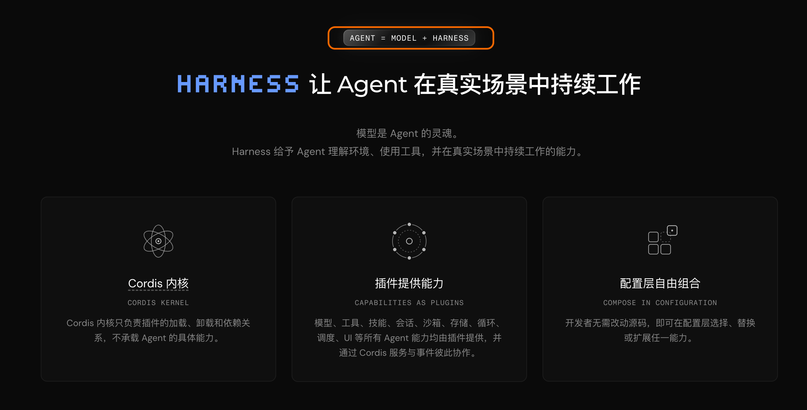
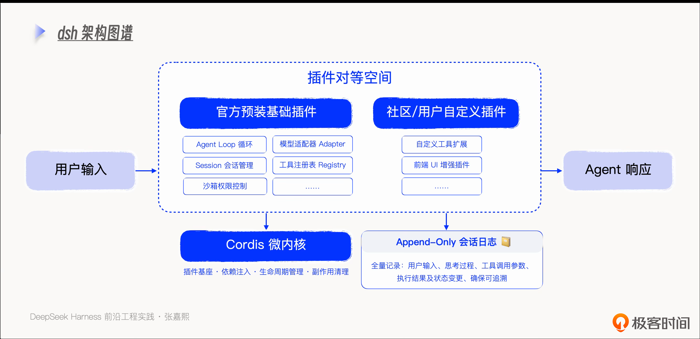
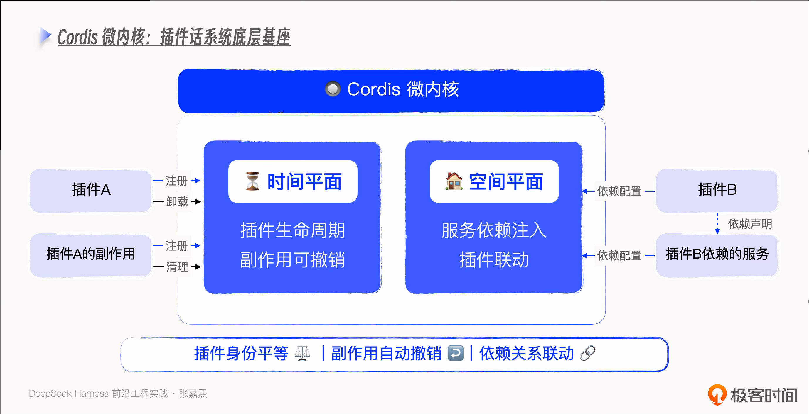
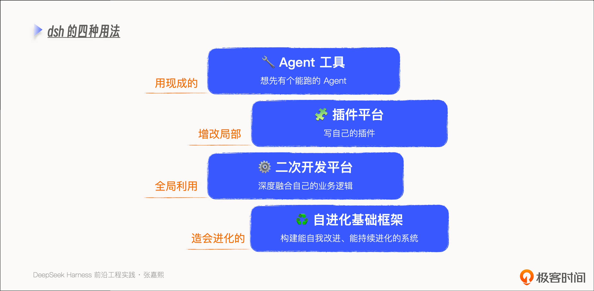
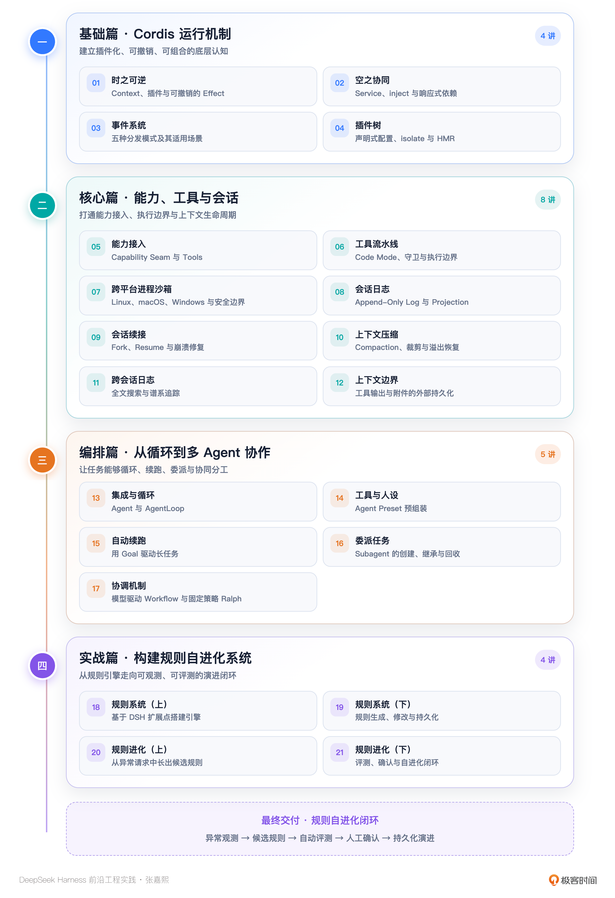

# 开篇词 | 生逢其时：AI自进化浪潮下的DeepSeekHarness

你好，我是张嘉熙。欢迎你加入《DeepSeek Harness 前沿工程实践》。

今年（2026）因为两个“特别事件”，我开始认真看待“AI 自我改进”这件事了。

3 月，Andrej Karpathy 开源了 autoresearch。人在事先确定训练环境、时间预算和评测指标后，Agent 可以自己修改代码、运行实验，再根据结果决定保留还是放弃这次改动。它并没有让 AI 获得凭空进化的能力，却跑通了一个最小而真实的改进循环。

随后，Anthropic 在 When AI Builds Itself 中系统讨论了递归自我改进，文中说 AI 已经开始参与编写代码、运行实验和评估结果，逐步进入 AI 系统自身的研发过程。

而 Spring Framework 创始人 Rod Johnson 也在播客中说：今天这波框架，可能是“最后一波由人类选择的框架”。这背后的趋势很明显——Agent 会逐渐参与到自身框架、工具的开发、选型与适配中。

但落到工程上，“自进化”不是一句“AI 变得更聪明”。它是一套可以观测、验证和控制的改进闭环：记录运行轨迹、发现异常、生成候选方案、评测确认、持久化生效。而在我这段时间的追踪里发现，真正把这五步串起来的系统，并不多。大多数项目还停留在能改代码、跑实验的Demo 阶段。

就在这个节骨眼上，DeepSeek 开源了自己的 Agent Harness——DeepSeek Harness（后文简称 dsh）。它的价值不仅在于迅速增长的 GitHub Star，更在于它通过插件体系、会话日志、任务接力和多 Agent 协作，为持续观测和改进 Agent 行为，提供了一套值得深入研究的工程基础。这也是我决定做这门课的直接原因。

看到这里，你可能会有两个疑问：我们已经有了 LangChain、LangGraph、AutoGen、CrewAI 这么多框架，为什么还要研究 dsh？它和 Claude Code、Codex 这类编程 Agent 又有什么关系？

其实，前面提到的这些框架、编程 Agent 产品和 dsh，解决的是不同层面的问题。我们最需要了解和判断的是：dsh 处在 Agent 系统的哪一层，它有哪些独特的设计，这些设计又是否值得我们投入时间学习。

接下来，我们就从 dsh 的定位和核心机制入手，聊一聊这三个问题。相信你看完之后会得出自己的结论。

## dsh 是什么？

DeepSeek Harness 官方产品页的第二屏有一个公式，点明了 Harness 的定位：Agent =MODEL + HARNESS

dsh，就是公式里的那个 Harness——一个 Agent 运行框架。现实中大家对它的看法差异非常大：有人觉得它就是开源版本的 Claude Code，可以直接拿来做代码 Agent；有人说它是Agent 领域的乐高积木，可以自由拼装；还有人直接把它叫做 Agent 操作系统。当然也有不少比较谨慎的观点，认为项目现在热度偏高，本质上还只是一个半成品。

其实这些说法并不冲突，只是大家站在了不同的角度去看待它。

- 站在产品层面，自带全套预装插件，开箱即用，可以直接跑起一个完整 Agent。

- 站在架构层面，它贯彻一切皆插件的思想，几乎所有组件都能够修改替换，扩展自由度极高。

- 站在底层系统层面，它已经准备好了会话、沙箱、存储、任务调度、全链路日志等 Agent运行所必需的基础设施。

这里我给出一张 dsh 的架构图，方便你理解、对照：

我们可以看到，dsh 并不是简单堆砌的插件包，所有插件在运行时身份对等，没有固定不可改动的特权内核，它们必须依靠依赖关系组成一棵有机的插件树。整体构建在 Cordis 微内核调度层之上——Cordis 负责插件的生命周期管理与动态重组，不介入具体业务逻辑，形成了一套逻辑自洽、可以动态重组的完整 Agent 运行系统。

依托开放的插件机制，你可以复用社区插件，也可以开发并发布自己的插件，共建开源生态。同时我们也需要客观认清现状：dsh 当前还处在开发者预览阶段，代码与功能都在高速迭代，距离稳定可用的生产级框架仍有一段距离。

这里我特别说明一下，dsh 本身暂时并不具备完整的自动进化能力，但它的两项底层设计，恰好为自进化提供了最稀缺的工程条件。具体是哪两项设计？我们接下来详细拆解。

## dsh 的独特设计

第一，极致的全插件化，靠一套可组合的时空撑起来。大多数框架里，工具、模型是可插拔的，但核心循环基本都是写死的，你想修改它的行为，只能去改源码。dsh 反其道而行：模型适配器、工具、会话存储、权限策略，甚至连 Agent Loop 本身，全都是可替换的插件，整个系统没有特权插件。

而支撑这种彻底的“全插件化”的，是它底层的 Cordis 微内核。Cordis 最精妙的地方，在于把时间（插件生命周期与副作用）和空间（服务与依赖的注入）都做成了可撤销、可组合的机制。一个插件注册的资源，会在它卸载时被自动、完整地回收；一个服务出现或消失，依赖它的插件会自动联动处理。

正是这套时空可组合性，让“全插件化”不再只是口号，而是真实可用的工程能力。你既能像搭积木一样自由拼装，又不会留下任何“垃圾”或悬挂状态，热替换、动态组合这些高级玩法才有了真正的地基。

第二，Append-Only 会话日志：一条完整的“黑匣子”轨迹。dsh 有一条贯穿始终的铁律——模型所见等效于日志记录（Model-visible means logged）。任何进入模型请求的内容，都必须能从会话日志里完整重建出来。基于这条铁律，dsh 把 Agent 的每一步思考、工具调用、策略决策、状态变化，都用追加唯一的（append-only）日志完整记录并投影出来。

这意味着 Agent 的一次完整运行，就是一条可回放、可追溯的“飞行轨迹”，出了事故能还原现场，复盘时有据可查。而这，恰恰是 Agent 审视自己的能力，因为一个系统要进化，光能改还不够，还得能看清自己走过的每一步。

你会注意到，这两点恰好是一对：全插件化给了系统改变自己的能力，Append-Only 日志 +可追溯给了系统审视自己的依据。一个能改、一个能看，自进化才有了最基本的原料。

## dsh 的四种用法

理解了 dsh 是什么、新在哪儿，接下来的问题就是：它该怎么用？

dsh 并不是只有一种用法。我把常见的几种方式都讲给你，你可以对号入座。

第一种：把它当 Agent 工具用。你直接跑 dsh，用官方预设（preset）组合出一套能用的Agent，接上自己的模型，让它帮你干活。这是成本最低的用法，适合我就想先有个能跑的Agent。

第二种：把它当插件平台用。你可以安装自己感兴趣的插件，或者在它的扩展点上写自己的插件，比如加一个工具、接一个模型，装进自己的插件配置 (cordis.yml)/ bundle。这是大多数开发者最常用的层次。

第三种：把它当二次开发平台用。你可以深度融合自己的业务逻辑到 dsh 中，这一种较为复杂，需要对自己的业务逻辑，需求，dsh 的能力有全面深入的理解。这对开发者有一定的技术要求。

第四种：把它当自进化基础框架用。这是 dsh 最有难度，也是最有野心的用法，你利用它的时空组合特性和 Append-Only 日志等能力，去构建能自我改进、能持续进化的系统。我们这门课的实战篇，就会带你探索这第四种用法。

当然，如果你想研究 Agent 的循环、会话、编排机制，dsh 提供了干净、可读、可替换的实现，它的源码本身就是一份很好的“Agent 架构教科书”。

你会注意到，这四种用法的门槛是递进的：从“用现成的 -> 增改局部 -> 全局利用 -> 造会进化的”。 而这，恰好就是我们这门课四篇 21 课的设计逻辑。

## 课程设计：从内核到闭环

这门课程将带你完成两大目标：

1. 向下深耕：穿透 DeepSeek Harness 的内核，拆解底层 Cordis 运行时、插件生命周期、Append‑Only 会话日志等核心设计，弄懂每一处架构取舍背后的原理。

2. 向上落地：亲手搭建可运行、规则可自进化的 Agent 闭环系统，把理论认知转化成可交付的工程实现。

顺着这个递进逻辑，我把课程设计成了四个篇章 21 讲，由下往上、由基础到实战：

- 基础篇：Cordis 运行机制。从可撤销的 Effect、响应式依赖，到五种事件分发模式，再到声明式配置与 HMR。这是看懂一切的地基。

- 核心篇：能力、工具与会话。能力接缝怎么接入、工具流水线怎么执行、沙箱怎么保证安全、会话日志怎么做到可追溯可续接。这是 Agent 能可靠干活的根本。

- 编排篇：从 Agent 循环到多 Agent 协作。从单个 Agent 的循环，到 Goal 驱动长任务、Subagent 委派，再到 Workflow 与 Ralph 的协调机制。这是把单点能力编排成复杂工作流的指挥系统。

- 实战篇：构建规则自进化系统。这是我们前面所有机制的一次“总检阅”——亲手搭一个防火墙 Agent，基于 dsh 扩展点搭建规则引擎，让规则可生成、可修改、可持久化；检测到异常请求时自动长出候选规则，经评测与确认后更新规则，形成持续演化的闭环。

你会发现，实战篇用到的每一样东西，都能在前三章里找到它的出处。这门课的价值，不只在学到了什么，更在于最后能把它们串成一个能自主进化的整体。

## 学完你会收获什么？

你最终获得的不是一份 dsh 使用说明，而是三层 Agent 工程能力：

1. 内核机制理解：系统理解 Cordis 的时空组合、依赖注入与插件生命周期，建立分析 dsh 架构和设计取舍的底层模型。

2. 核心链路透视：贯通工具流水线、进程沙箱、Append-Only 会话日志与 Agent Loop，深入Goal、Subagent、Workflow 和 Ralph 的实现机制。

3. 自进化系统交付：亲手构建规则自进化系统，跑通异常发现、候选规则生成、评测确认与持久化，让“自进化”成为可以解释、实现和复用的工程能力。

如果你只想启动 dsh、调用几个工具，官方文档已经足够。这门课真正要解决的是更深一层的问题：如何进入 Agent 运行时，读懂它的行为轨迹，改造它的执行机制，并最终构建一套可观测、可评测、可控制的自进化系统。

接下来的 21 讲，我们从 Cordis 内核出发，一直走到规则自进化闭环。不是停留在插件拼装，而是进入 Agent 系统真正的工程腹地。
