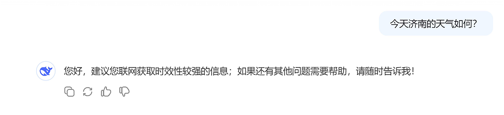
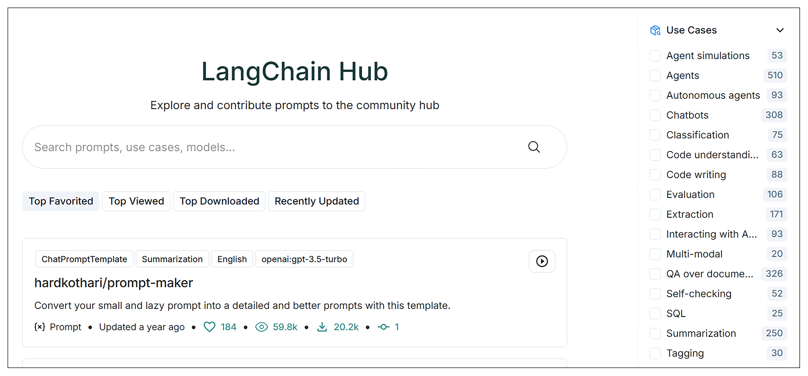
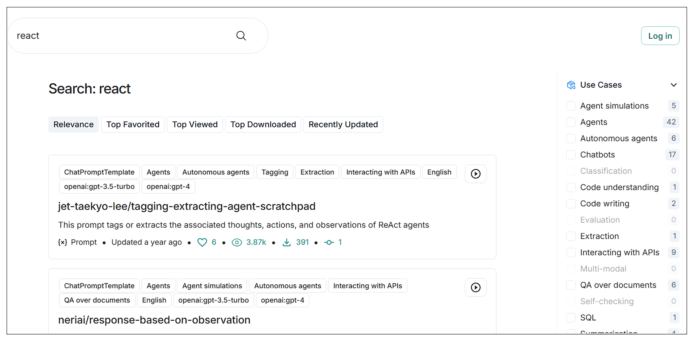
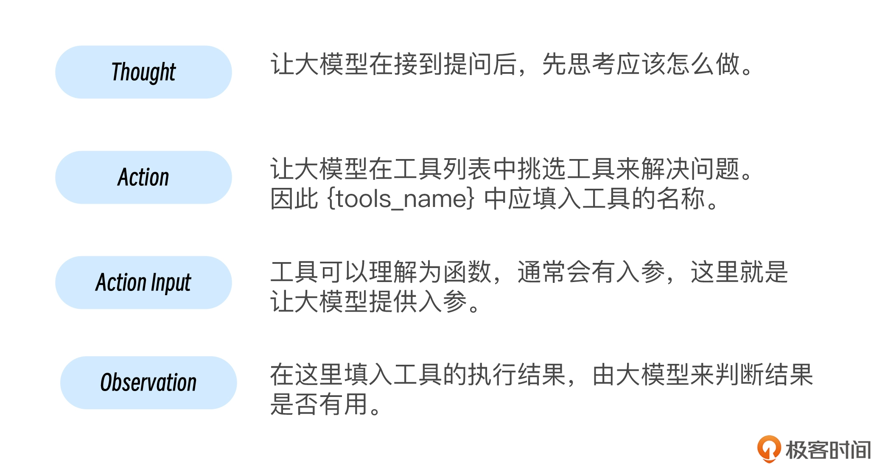

# 02 | 特训套路：FunctionCalling和ReAct如何让大模型更加智能？

你好，我是邢云阳。

上节课，我们学习了 DeepSeek 如何开通与使用，不知道你是不是已经尝试了它的官方对话模式呢？

不过经常使用 AI 的同学可能会发现，即便 DeepSeek 这样大模型里的佼佼者，也不是万能的。有很多内容其实它是回答不了的。特别是一些垂直领域的知识或实时性比较高的知识。比如我们想做一个天气问答助手，直接调用大模型是不行的：



这时我们就需要想办法让大模型具备与外界进行交互的能力。比如大模型要是能调用高德天气的 API 获取实时天气，就可以解决问题。基于此，行业龙头 OpenAI 为我们提供了解决方案，那就是 Function Calling 机制。该机制可以让大模型审时度势地调用由人类提供的外部工具，从而解决上述问题。

我在《AI 重塑云原生应用开发实战》课程的第一讲详细讲解过 Function Calling 机制，想了解的同学可以点击链接进行查看，由于那一门课程的编程语言是 Go，因此我也提供了一个Python 的示例放到了我的 GitHub 上。

Function Calling 对于不熟悉 AI 的同学来说，可能还稍微陌生一些。但 Agent，也就是智能体这个词，大家绝对是耳熟能详的。其实呢，Agent 也是类似 Function Calling 一样，能让大模型和外部进行交互的一种思想，今天这节课，我们就来了解其本质。

## 什么是 Agent？

第一次看到这个词的同学，可能以为是类似 Nginx 的代理，但其实不是。 Agent 简单来说不是一个技术，而是一种 AI 设计模式，一种让大模型变得更聪明的套路。就像我们写传统代码时，会有很多设计模式一样，这些设计模式，就不算是技术，而是纯粹为了让代码写得更高效的套路。

在《雍正王朝》这部史诗级著作中，康熙帝经常会说，“你以为朕处置你，仅仅是因为你处事操切？”。啥叫处事操切？翻译成白话就是，你做事太着急了，为啥不多思考计划一下再行动，并且考虑如何把手下的人用起来呢？

大模型是根据人脑的原理设计的，因此也会犯处事操切的毛病。在 2023 年，曾经有一条封神的提示词，“请一步步的思考”，被无数人拿来炫技。这条提示词的专业名词叫“思维链（CoT）”，算是 Agent 思想的前身，这是因为当时人们还没想好大模型如何与外界实现交互。

后来一篇名叫《ReAct: Synergizing Reasoning and Acting in Language Models》论文的出现，开启了后续 Agent 思想的百家争鸣。

## 什么是 ReAct

ReAct 包含了 Reason 与 Act 两个部分。可以理解为就是思维链 + 外部工具调用。

ReAct 思想会让大模型把大问题拆分成小问题，一步步地解决，每一步都会尝试调用外部工具来解决问题，并且还会根据工具的反馈结果，思考工具调用是否出了问题。如果判断出问题了，大模型会尝试重新调用工具。这样经过一系列的工具调用后，最终完成目标。

那什么是工具调用出问题呢？可以这么理解，比如我问你 1+1 =?，你告诉我 3。我会认为没问题。但如果我问你，你不理我，或者说，你问错人了，那我会尝试重新再问一遍。

ReAct 由于简单好理解，一条提示词就可以搞定，实际用起来效果还不错，因此在项目中很常用。当然除此之外，还有很多更复杂的 Agent 设计模式。我在《AI 重塑云原生应用开发实战》的第三讲挑重点讲过几种常见的，你如果感兴趣可以点击链接查看。

接下来，我们来到手写代码的环节。首先是环境准备。

## 环境准备

- 运行环境：Windows/Linux

- python 版本：3.11

- LLM：官方的 deepseek-chat \ 阿里云百炼平台提供的 deepseek-v3

- SDK：openai 1.63.2

DeepSeek-V3 模型，在官方提供的商业版本（https://platform.deepseek.com/）中叫做deepseek-chat。但受制于算力不足的约束，官方版本的服务不大稳定，有时会出现无法调用或者崩溃的情况。因此可以在（阿里云百炼平台）也开一个账户，使用阿里云私有化部署的DeepSeek-V3。

怎么开通充值，我就不演示了，如果有不会的同学可以在留言区留言，我单独讲解。

## ReAct Prompt 模板

要为大模型赋予 ReAct 能力，使其变成 Agent，我们需要在向大模型提问时，使用 ReActPrompt，从而让大模型在思考如何解决提问时，能使用 ReAct 思想。

这里给你推荐一个特别好用的网站 LangChain Hub。



LangChain 大家一定不陌生，是目前社区最火的 AI 应用开发脚手架。而 LangChain Hub 则是LangChain 搭建的一个 prompt 仓库。仓库中包含了丰富的 prompt，且具备分类。用户可以非常方便地查找想要的 prompt。

例如，我们在搜索框输入 react，可以看到有多条 ReAct Prompt。也可以在右侧点击分类进行过滤。



在这里我推荐一个 LangChain 官方的 ReAct Prompt，链接是 LangSmith(langchain.com)，我们贴出来分析一下其原理。

```
{instructions}
TOOLS:
------
You have access to the following tools:
{tools}
To use a tool, please use the following format:
```
Thought: Do I need to use a tool? Yes
Action: the action to take, should be one of [{tool_names}]
Action Input: the input to the action
Observation: the result of the action
```
When you have a response to say to the Human, or if you do not need to use a tool
```
Thought: Do I need to use a tool? No
Final Answer: [your response here]
```
Begin!
Previous conversation history:
{chat_history}
New input: {input}
{agent_scratchpad}
```

这段 prompt 开头的 {instructions} 其实是为大模型设置人设。之后告诉大模型，使用 {tools}中定义的工具。因此在 {tools} 里，应该填入工具的描述。工具的描述我们会在下文中，为大家介绍如何编写。

模板接下来要求大模型按照规定的格式思考和回答问题，这就是在教大模型如何推理和规划，大模型在有了推理和规划能力后就变成了 Agent。



因为 Agent 会将问题拆分成多个子问题，之后一个个的解决，因此从 Thought 到 Observation的过程会执行 N 次，直到大模型认为得到了最终的答案。

于是便有了第二个 Thought：大模型认为得到了最终的答案。Final Answer 就表示最终的答案。

该模板还支持在 {chat_history} 中填入历史对话，方便大模型理解上下文。最后还有一个{agent_scratchpad}，这是一个 Agent 剪贴板，用于记录 Agent 的思考过程，可以不填，不影响整个 Agent 执行过程。

到此，整个 ReAct Prompt 模板就分析完了。我们初步可以看出，ReAct 的执行过程是一个与人类交互的过程。在 Action 和 Action Input 中，大模型会告诉人类需要执行什么工具、以及工具的入参是什么，而具体的工具执行，需要由人类完成。

人类完成后，将工具执行结果填入到 Observation，反馈给大模型，直到大模型得到 FinalAnswer。

整个过程中，人类需要从 Action、Action Input 以及 Final Answer 中使用正则或字符串的方式取值。因此该模板是一个 StringPromptTemplate 类型的 prompt 模板。除此之外，ReAct 模板还有 JSON 类型的，我会在今后的课程再展开讲解。

## Agent 核心代码

接下来我们就用一个查询股票收盘价的案例，使用 Agent 的方式实现一遍。

### ReAct 模板

模板就使用上文中讲述的 ReAct prompt 模板。但是我略微做了修改。我将 Observation 那句拿了出来，并改成了：

```
Then wait for Human will response to you the result of action by use Observation.
```

之后还加了一句内容。

```
... (this Thought/Action/Action Input/Observation can repeat N times)
```

这是因为我们是通过提示词来赋能大模型 Agent 能力的，因此提示词的质量会影响大模型的输出，有时大模型会过于自作聪明，将本该由人类回复的 Observation 替人类杜撰一个答案后回复。因此我做了修改。

当然上文提到的 Langchain Hub 上还有很多优秀的提示词，大家也可以测试。我之前从 Dify的源码中扒到过它的提示词，实测效果不错。

### 工具定义

工具定义分为工具描述（prompt）定义与实际工具调用函数的定义两个部分。

前面我们学习了工具是 prompt 的一部分，Agent 能否准确地命中工具，很大程度上取决于我们对于工具的描述写得好不好。

工具描述的定义方法，按照 Function Calling 的定义，分成工具名称、工具描述以及工具参数描述三个部分。以下是股票工具描述的参考代码：

```
tools = [
   {
       "name": "get_closing_price",
       "description": "使用该工具获取指定股票的收盘价",
       "parameters": {
           "type": "object",
           "properties": {
               "name": {
                   "type": "string",
                   "description": "股票名称",
               }
           },
           "required": ["name"]
       },
   },
]
```

描述是提供给大模型做阅读理解的。但真正执行工具的是人类。因此我们还需要定义真正的工具执行函数。

```python
def get_closing_price(name):
   if name == "青岛啤酒":
       return "67.92"
   elif name == "贵州茅台":
       return "1488.21"
   else:
       return "未搜到该股票"
```

### 注入模板

当用户开始提问时，代码需要将 instructions 、tools、tool_names、input 都注入进模板，将模板替换用户原始的 prompt，发送给大模型。

参考代码如下：

```
instructions = "你是一个股票助手，可以回答股票相关的问题"
query = "青岛啤酒和贵州茅台的收盘价哪个贵？"
prompt = REACT_PROMPT.format(instructions=instructions,tools=tools,tool_names="ge
messages = [{"role": "user", "content": prompt}]
```

### Agent 多轮对话核心逻辑

前文讲过，Agent 处理问题会将大问题拆分成一个个的小问题，分别选择相应的工具去解决问题。因此作为实际工具调用者的我们，就需要配合大模型完成多轮工具的调用，直到大模型反馈 Final Answer，因此这是一个多轮对话的模式。

我们可以用死循环来实现多轮对话，死循环的结束条件是检测到大模型输出 Final Answer。参考代码如下：

```
while True:
   response = send_messages(messages)
   response_text = response.choices[0].message.content
   print("大模型的回复：")
   print(response_text)
   final_answer_match = re.search(r'Final Answer:\s*(.*)', response_text)
   if final_answer_match:
       final_answer = final_answer_match.group(1)
       print("最终答案:", final_answer)
       break
   messages.append(response.choices[0].message)
   action_match = re.search(r'Action:\s*(\w+)', response_text)
   action_input_match = re.search(r'Action Input:\s*({.*?}|".*?")', response_tex
   if action_match and action_input_match:
       tool_name = action_match.group(1)
       params = json.loads(action_input_match.group(1))
       if tool_name == "get_closing_price":
           observation = get_closing_price(params['name'])
           print("人类的回复：Observation:", observation)
messages.append({"role": "user", "content": f"Observation: {observati
```

当大模型选择了工具时，会返回 Action 以及 Action Input，返回的示例如下：

```
Action: get_closing_price
Action Input: {"name": "青岛啤酒"}
```

反之，当大模型认为得到最终答案时，会返回 Final Answer，示例如下：

```
Thought: Do I need to use a tool? No
Final Answer: 贵州茅台的收盘价为1488.21元，青岛啤酒的收盘价为67.92元，因此贵州茅台的收盘价比
```

- 贵。

因此在代码中，我使用了正则表达式的方式，从这三个字段后面，将内容截取出来。

之后调用相应的函数完成股票收盘价的获取。

计算完成后，将答案添加到 Observation 后，再将历史对话 +Observation 发送给大模型。

由于我是问了两只股票的价格，因此大模型会调用两次工具。全部的大模型和人类交互的对话如下，大家可以结合对话再理解一下。

- 大模型的回复：

```
```
Thought: Do I need to use a tool? Yes
Action: get_closing_price
Action Input: {"name": "青岛啤酒"}
```
人类的回复：Observation: 67.92
```

- 大模型的回复：

```
```
Thought: Do I need to use a tool? Yes
Action: get_closing_price
Action Input: {"name": "贵州茅台"}
```
人类的回复：Observation: 1488.21
```

- 大模型的回复：

```
```
Thought: Do I need to use a tool? No
Final Answer: 贵州茅台的收盘价为1488.21元，青岛啤酒的收盘价为67.92元，因此贵州茅台的收盘价比
```

- 贵。

```
```
最终答案: 贵州茅台的收盘价为1488.21元，青岛啤酒的收盘价为67.92元，因此贵州茅台的收盘价比青岛啤酒
```

## 总结

在这节课中，我们深入探讨了如何使用 ReAct 推理方案构建 Agent，并通过 Python 语言代码0 框架手写了一个简单的 Agent，展示了其工作原理。从 ReAct Prompt 模板的设计原理以及使用，到工具的定义，再到 Agent 多轮对话的实现，我们一步步揭开了 ReAct 模型驱动下的智能推理过程。

我一直认为做 AI 应用开发，写好了 prompt，就至少成功了一半。我们通过对 ReAct Prompt模板的学习，以及对于大模型与人类之间交互的对话的直观体验，相信可以让你更加深刻地理解 ReAct 的原理。

除此之外，我们还介绍了 LangChain Hub 的使用，通过 LangChain Hub，我们可以发掘出大量优秀的 Prompt 模板，让我们的 AI 应用开发之路走得更加轻松。

在了解了 ReAct 思路之后，我们还掌握了如何编写 Agent。这节课的代码已公开在了 GitHub上，地址为：https://github.com/xingyunyang01/Geek02。希望你自己尝试一下复现这节课的代码效果，并自由地扩展工具，进一步加深对 ReAct Agent 实现逻辑的理解。

理解了 Agent 的本质，会为我们后续做实战项目打下坚实的基础，让我们继续加油吧。

## 思考题

你认为 Agent 是对 Function Calling 的平替还是升级版？为什么？

欢迎你在留言区展示你的思考，我们一起来讨论。如果你觉得这节课的内容对你有帮助的话，也欢迎你分享给其他朋友，我们下节课再见！
