# 05 | 进阶部署（一）：Kubernetes资源创建与部署

你好，我是邢云阳。

前面的两节课，我使用 Docker 的方式，在服务器上为你演示了基于 Ollama 的量化版DeepSeek 的部署。虽然 Docker 容器的方式运行简单，一条 docker 命令便可以拉起，但通常只能够运用在测试环境，供研发人员快速地验证方案。

当我们真正要将 AI 服务模型投入到生产时，必须直面以下挑战：

1. 服务高可用性：单容器部署存在单点故障风险

2. 弹性伸缩需求：LLM 推理的算力消耗具有明显波峰波谷特征

3. 资源配置优化：GPU 资源的精细化调度与管理

4. 服务发现难题：多模型实例的动态流量分配

为了应对这些挑战，我们需要使用 Kubernetes 来进行容器编排、资源分配、服务发现等等。鉴于很多同学对于 Kubernetes 不是很了解，因此我会花一节课的时间，利用青云公司开源的KubeSphere 软件，带你快速入门。等到后面做非量化版模型的分布式部署时，我们就会基于Kubernetes 来做。

## 新手如何快速理解什么是 K8s？

首先，我们来认识一下 Kubernetes。Kubernetes 是谷歌的一套开源系统，支持在任何地方部署、编排、扩容缩容和管理容器化应用。由于 Kubernetes 这个单词，在 K 和 s 之间有 8 个字母，因此简称 K8s。我们前两节课使用的将 Ollama、Higress 等等应用封装到 docker 中的做法，就叫做容器化应用。

接下来，我们讲一下编排和扩容缩容。假设现在我的手头上有三台服务器，每台服务器上都有一个容器化应用。

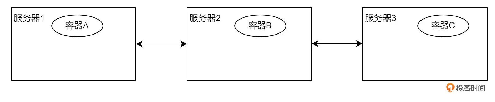

假设有一天，我想运行一个特别消耗 CPU、内存资源的容器 D。但三台服务器上都有应用占用资源，导致容器 D 无法运行。此时的解决方案就是，把容器 A 迁移到服务器 2 上去，给容器 D 腾地方。

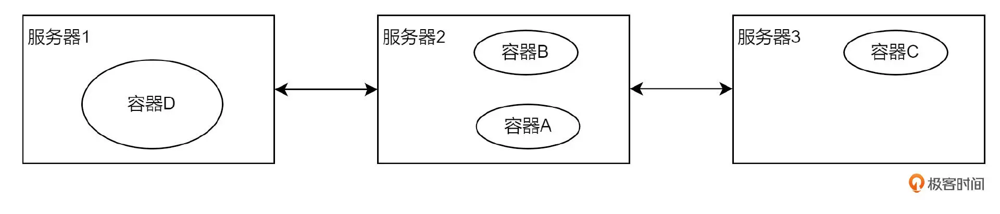

这个过程可以通过设置策略，让 K8s 自动完成容器在服务器之间的调度，这个过程就叫做容器编排。

假设又有一天，容器 A 的服务压力过载了，我需要再搞一个容器 A 的副本，然后建立一个负载均衡来进行分流。此时我就可以将容器 A 的副本数调成 2，K8s 就会自动创建一个副本，并自动调度到资源合适的服务器上去。这个过程就叫扩容。

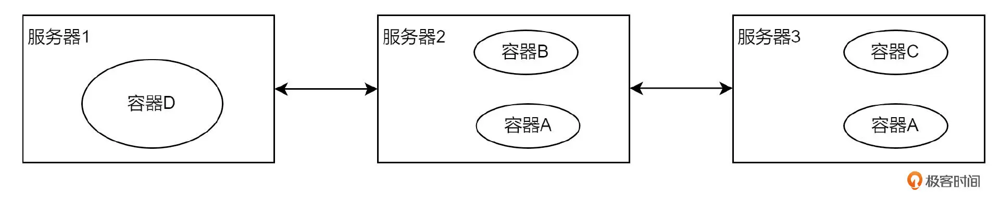

反之，如果压力降下来，容器 A 可以再将副本数调成 1，此时服务器 3 上的容器 A 就会自动销毁，这个过程叫缩容。

那这些服务器之间是如何关联的呢？这会有一个主程序进行统一的管理。通常主程序是单独部署到一台服务器上的，也就是所谓的 master 节点，剩余的跑容器应用的服务器叫做 worker 节点。在 worker 节点上会安装一个客户端程序，学名叫 kubelet，主程序不能直接和容器应用建立联系，而是通过与 kubelet 建立联系来实现对容器应用的编排等操作。因此图就变成了这样：

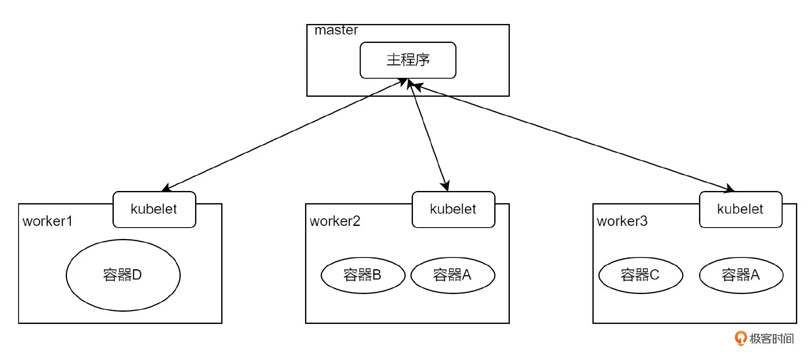

主程序由多个组件组成，有负责将容器应用调度到哪个节点的，学名叫调度器 kube-scheduler；有负责存储各个节点的状态的，学名叫 etcd；还有负责控制容器应用行为的，比如副本扩张等等，学名叫控制器 kube-controller。同时为了方便 Kubernetes 集群外的用户或者程序对集群的访问，主程序还做了一个 HTTP Server，暴露出了很多 API 接口，这个Server 叫做 API Server。

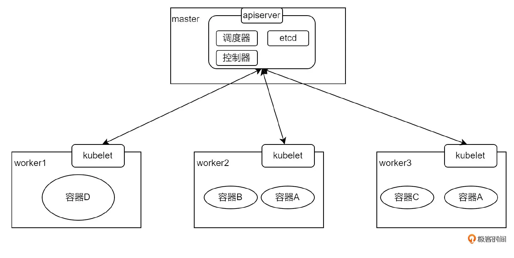

最后，K8s 对容器应用又做了一层封装，名字叫做 Pod，Pod 是 K8s 中业务容器最基本的单元。一个 Pod 内可以有多个容器。

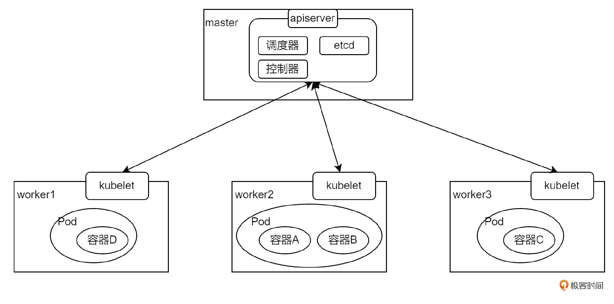

以上就是对于 K8s 最简单架构的一个基本认识。实际上，K8s 还有非常多的用法和细节，需要你多多动手实践。如果你是新手的话，我建议你先搭建起自己的集群，然后将应用部署到K8s 上，这样可以快速熟悉一些基本操作。之后的进阶学习，就是需要去了解如何通过写代码的方式去访问和控制 K8s 资源，包括使用 client-go 客户端 SDK，以及更深入的 operator 机制等。这就需要你在日常工作学习中慢慢掌握了。

## 快速搞定 K8s 安装

接下来，我们来安装 K8s 。可能你看到刚刚的讲解中用到了这么多台服务器，就望而生畏了。实际上，如果仅仅是想日常测试和学习 K8s，只需一台服务器，就是把 master 和 worker组件装在一起也是可以的。

K8s 的安装方法有很多种，最原始的是使用二进制的方法进行安装，也就是一个一个地安装调度器、控制器等组件。这种方法对新手非常不友好，会出现很多兼容性的报错等等。另一种方法是业界常用的 kubeadm 工具，该工具可以通过命令行的方式，自动搞定组件的安装，基本上新手在一个小时左右就可以部署好一台 K8s。

除了这两种方法外，开源社区还有一些比较好用的安装工具，这节课我们就使用 KubeSphere社区的 KubeKey 来进行安装。KubeKey 的文档地址如下：在 Linux 上安装 Kubernetes 和KubeSphere。

### 环境准备

根据文档的描述，我准备了一台 4 核 8G 的服务器，操作系统是 Ubuntu 22.04。接下来按照以下步骤安装，将环境准备好。

1. 关闭防火墙

首先使用如下命令查看防火墙状态，如果是 inactive，就证明已经关闭。

```
ufw status
```

如果未关闭，就使用以下命令关闭。

```
ufw disable
```

2. 安装依赖项

```sql
apt update
apt install socat conntrack ebtables ipset -y
```

3. 安装 KubeKey

首先设置下载区域为中国。

```bash
export KKZONE=cn
```

执行以下命令下载 KubeKey 最新版本：

```bash
curl -sfL https://get-kk.kubesphere.io | sh -
```

成功后，当前目录下会生成一个可执行文件，叫 kk。给它附上可执行权限。

```bash
chmod +x kk
```

### 创建 K8s 集群

1. 创建和修改配置文件

环境准备好后，我们就来创建 K8s 集群。首先生成配置文件：

```
./kk create config --with-kubernetes v1.26.4
```

这里我使用的 K8s 版本是 v1.26.4，你可以填入自己喜欢的版本，比如 v1.22.4、v1.28.2 等等。执行完成后会生成 config-sample.yaml。

这个文件打开后，会有很多配置项。我们首先需要修改 hosts 部分。

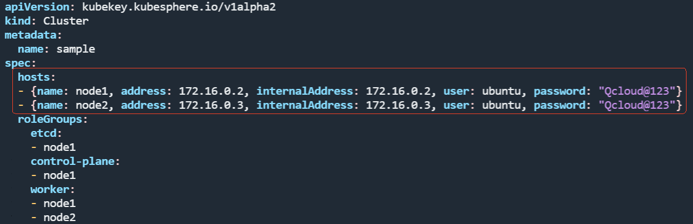

由于我们只有一个节点（一台服务器），因此 hosts 列表中只保留一条就可以，然后将 name改为服务器的 hostname，ip 地址改为内网地址，user 改为 root，密码填成你自己的 root 用户的密码。那么如何查看 hostname 和 ip 呢？如下图所示，执行 ip a。

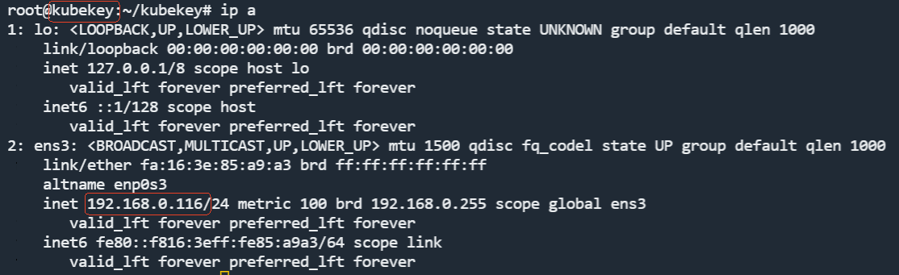

图里画红框的就是。

之后还要修改 roleGroups 下的信息，这表示 etcd、control-plane(master)，以及 worker 装在哪个节点，我们统一改成 hostname。改完后的样式如下：

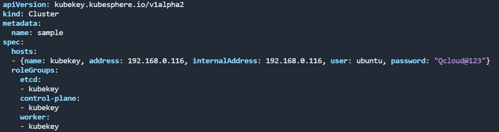

配置文件的其他选项都不需要修改。但是我建议你把最后的镜像下载地址改为阿里云的服务器地址，registry.cn-beijing.aliyuncs.com，否则下载速度会比较慢。

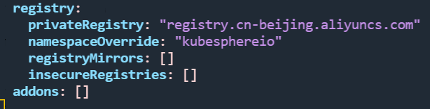

2. 创建 K8s

配置完成后，接下来，就可以用一行命令创建 K8s。

```
./kk create cluster -f config-sample.yaml
```

成功执行后，显示如下界面，然后就开始自动下载和安装 K8s 组件了。

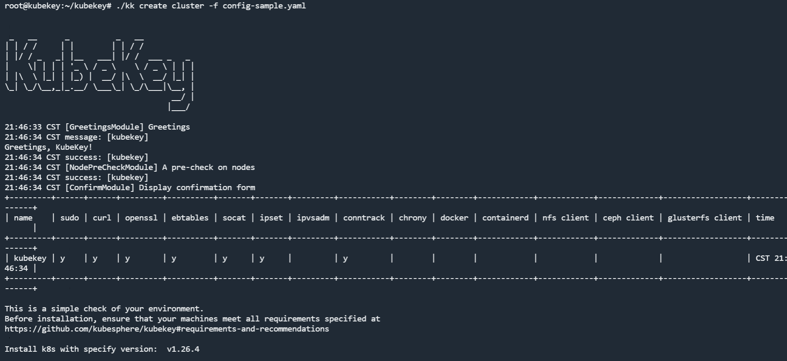

等待一段时间后，便会有如下提示：

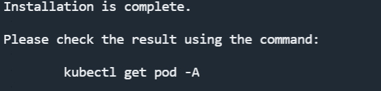

此时就说明安装结束了。

我们执行 kubectl get pod -A 命令，可以看到如下 pod 列表：

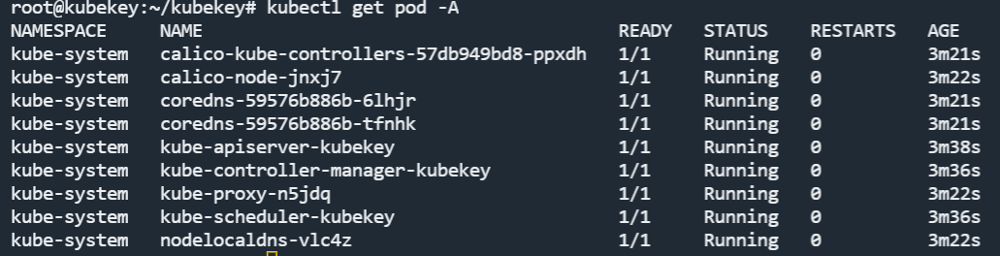

这就表示 K8s 集群安装成功了。

在这里我强调几个问题：

- Linux 系统的版本不要太低，最好和我一样选择 Ubuntu 22.04 或以上，CentOS 就不要用了。

- 一定要关闭防火墙。

- Ubuntu 22.04 及以上版本默认是关闭和禁用 SELinux 的，如果你的版本没有关闭和禁用，需要在安装 kubekey 之前，先关闭和禁用。

如果安装过程中还有什么问题，可以贴在评论区，我们一起探讨一下。

除此之外，kubesphere 社区还提供了可视化的 UI 界面，可以通过可视化的方式操作 K8s。在这里我就不带着你安装了，感兴趣的话你可以参考文档：在 Linux 上安装 Kubernetes 和KubeSphere 自行安装。

## 将容器部署到 K8s，并进行服务暴露

如何使用 docker 将容器运行起来，你在前两节课的实操过程中都已经学会了。但是实际上Docker 由于架构比较众，K8s 从 v1.20 版本开始起就不再支持 Docker 了，而是使用更为轻量化的 containerd。

Docker 和 containerd 的关系，就如同斯太尔卡车整车和车头的关系。两个都能跑，但是光车头更轻便。

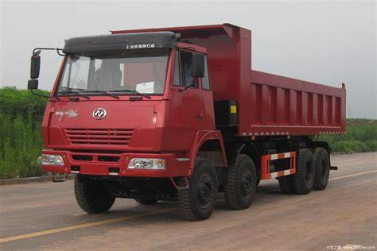

上面的是 Docker。下面的就是 containerd。

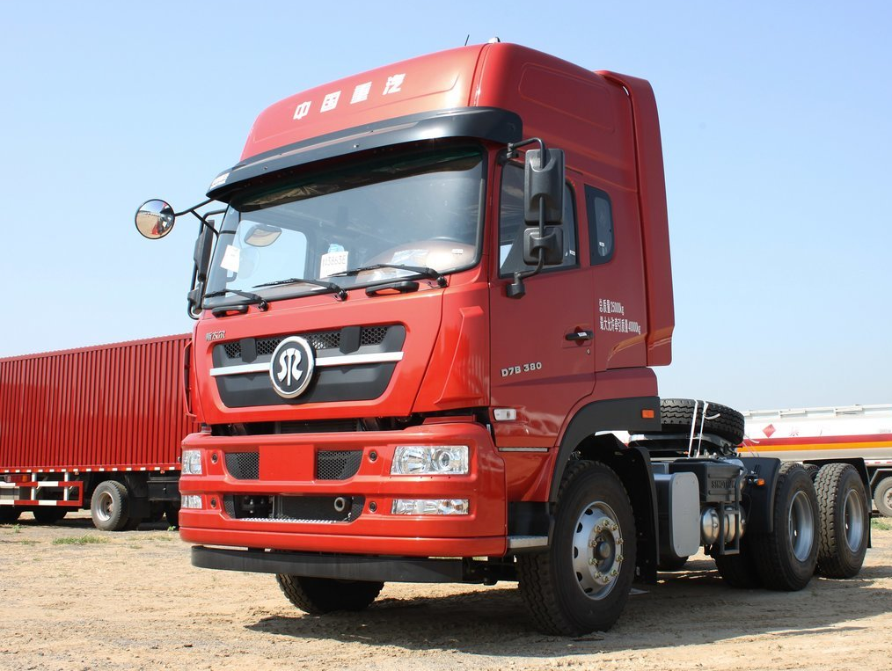

接下来，我们用 containerd 从 dockerhub 上下载一个 Nginx 镜像。

```
crictl pull docker.1ms.run/nginx:latest
```

使用 crictl images 命令可以看到当前服务器上的全部镜像。

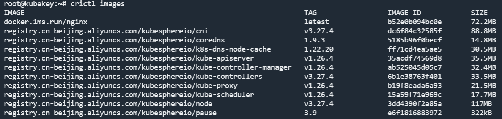

接下来就要将 Nginx 部署到 K8s 上了。

K8s 创建资源（pod 等）的方式是编写一个 YAML 文件，可以理解为一个如何创建资源的描述文件。之后使用 kubectl 命令行进行创建。我们可以让 DeepSeek 帮我生成一个 YAML，然后理解一下每个字段是什么意思即可，没必要去死记硬背。提示词如下：

```
你是一个云原生k8s专家，我现在有一个nginx:latest镜像，请帮我编写一份以deployment方式部署该镜像
```

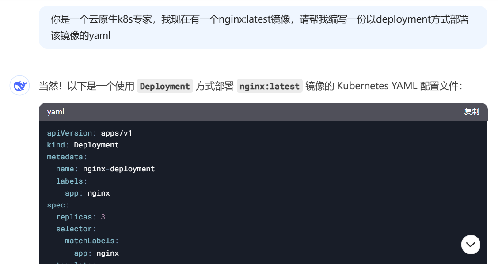

生成之后，我们把它保存成 YAML 文件，放到服务器上，假设文件名字叫 ng.yaml。之后修改

replicas 为 1，表示副本数是 1；修改 image，也就是镜像名称 docker.1ms.run/nginx:latest。

```
apiVersion: apps/v1
kind: Deployment
metadata:
 name: nginx-deployment
 labels:
   app: nginx
spec:
 replicas: 1
 selector:
   matchLabels:
     app: nginx
 template:
   metadata:
     labels:
       app: nginx
   spec:
     containers:
     - name: nginx
       image: docker.1ms.run/nginx:latest
       ports:
       - containerPort: 80
```

这份 YAML 中，第二行的 kind: Deployment，表示资源类型是 Deployment。我们知道 K8s 上管理容器的最小单元是 pod，但是如何控制 pod 的扩缩容等行为呢？此时就会有各种各样的控制器，Deployment 就是最基础的一种。它主要有两个功能，第一是通过设置 replicas 调节pod 的副本数，第二个是当 pod 被意外删除后，Deployment 可以自动将 pod 重新拉起。

我们使用如下命令创建这个 Deployment：

```bash
kubectl apply -f ng.yaml
```

然后执行如下命令，查看 deployment 状态。

```bash
kubectl get deployment
```

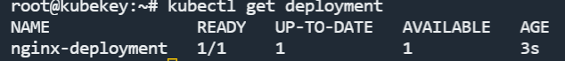

可以看到 READY 下面写着 1/1，这表示期望副本数是 1，实际创建成功的副本数也是 1。之后我们再用如下命令查看一下 pod 状态：

```bash
kubectl get pod
```

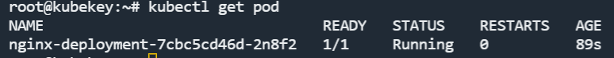

可以看到有一个 pod 处于 Running 状态。这就表示 Nginx 容器被成功创建了。

### 服务暴露

我们知道 Nginx 通过 80 端口暴露了服务。此时我们在外部浏览器使用服务器的公网地址查看一下 Nginx 服务。

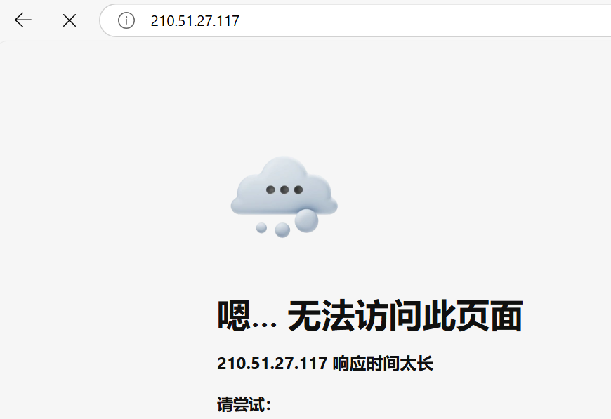

你就会发现是访问不了的。这是因为部署到 K8s 上的服务，默认只能在集群内部访问，如果想要在集群外部访问，需要进行服务暴露。服务在 K8s 中也是一种资源，叫做 Service。Service 的服务暴露方式有两种，第一种是直接通过端口暴露，这种方式叫 NodePort；第二种是通过负载均衡，需要服务器有一个负载均衡器才可以。

我们用 NodePort 进行暴露，还是让 DeepSeek 帮我们完成。提示词：

```
我想使用 NodePort 暴露上面的 nginx deployment
```

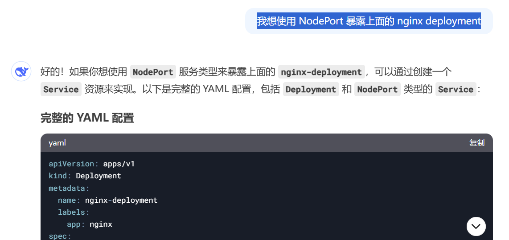

K8s 的 YAML 文件，采用 - - - 来连接两个资源的定义。即可以在 Deployment YAML 内容的后面加上 - - -，再写 service 的 YAML。

```bash
apiVersion: apps/v1
kind: Deployment
...
       ports:
       - containerPort: 80
---
apiVersion: v1
kind: Service
metadata:
 name: nginx-service
 labels:
   app: nginx
spec:
 type: NodePort
 selector:
   app: nginx
 ports:
   - protocol: TCP
     port: 80       # Service 的端口
     targetPort: 80 # Pod 的端口
     nodePort: 30007 # NodePort 的端口范围（默认范围是 30000-32767）
```

该 Service 暴露出的端口是 30007，表示外部用户如果想访问 nginx，需要使用 30007 端口。

此时执行命令：

```bash
kubectl apply -f ng.yaml
```

会将 Service 创建出来，同时保持原有的 Deployment 不变。

使用如下命令查看 Service：

```bash
kubectl get service
```

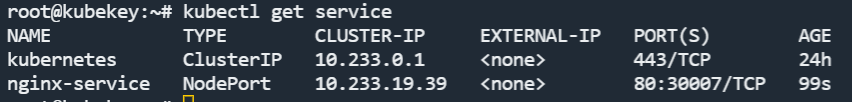

可以看到第二行 nginx 的 Service。

这时在浏览器中使用 < 服务器公网地址 >:30007 进行访问，就可以看到效果了。

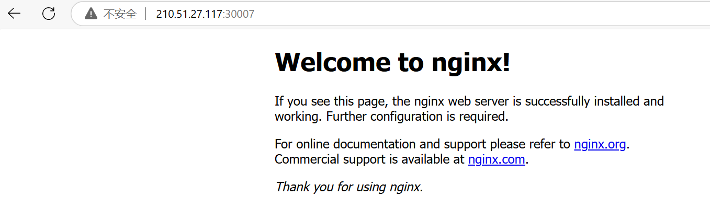

## 总结

今天我用一节课的时间快速地带你了解了 K8s，并上手实践了 K8s。如果这些内容按照传统方式自学，至少要一个星期的时间。所以这就是我们课程的特色，主打的就是快速切入重点，快速上手。

从下节课开始，我们会在 K8s 上分布式部署 DeepSeek 模型。在这个过程中，还会接触到一个概念，叫做 operator，在这里我简单讲一下。

operator 包含两个部分，分别是自定义资源 CRD 和自定义控制器，这句话的重点在于自定义。也就是说，我可以自己编写一个资源，注册到 K8s 中，从而完成一些自定义的功能。比如，我可以做一个 nginx operator，当我 apply nginx operator 的自定义资源时，K8s 就会自动帮我把 nginx Deployment 和 service 都创建出来，这就是自定义的含义。

## 思考题

在 nginx Deployment 中，设置的副本数是 1，如果改成 2，会出现什么现象呢？

欢迎你在留言区展示你的思考，我们一起来讨论。如果你觉得这节课的内容对你有帮助的话，也欢迎你分享给其他朋友，我们下节课再见！
