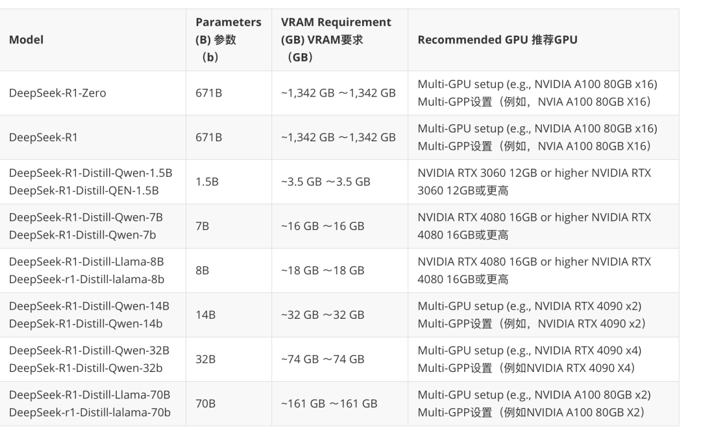
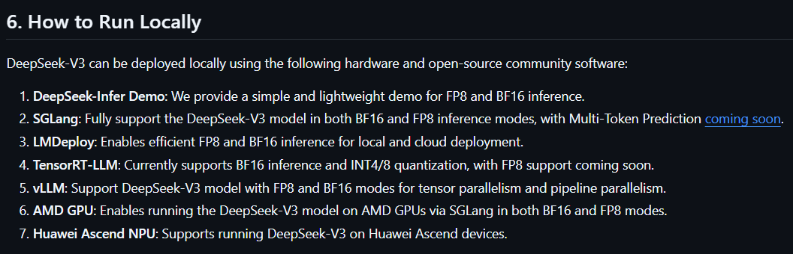
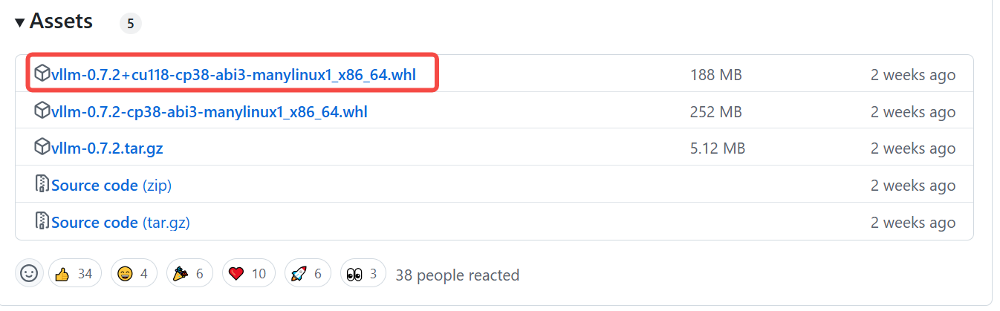
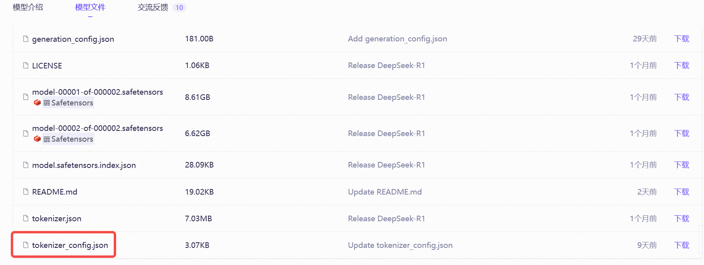
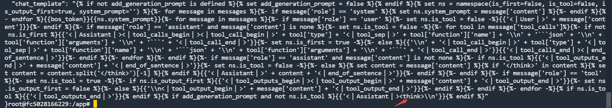
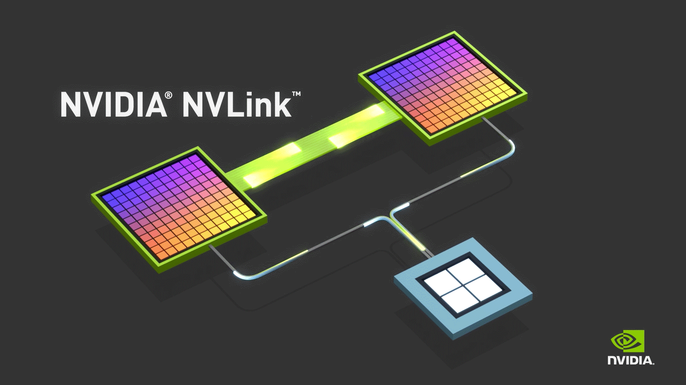

# 06-进阶部署（二）：非量化版DeepSeek分布式部署方案实战

你好，我是邢云阳。

前面两节课，我们完成了私有化部署的入门。我们学到了一种非常简单的易上手的方案，即利用网关 + 多个 Ollama 实现负载均衡的大模型集群的方案。这种方案的本质还是单卡单模型，但通过负载均衡技术，可以将一次对话任务，分配到多个模型来共同完成，算是一种提高性能的曲线救国路线。

但 Ollama 毕竟提供的是量化模型，如果想要体验原版效果还是要部署原版模型。不过，随着LLM 模型越来越大，单 GPU 已经无法加载一个模型。以 DeepSeek-R1-Distill-Llama-70B 为例，模型权重大概 140 GB，但是单个 NVIDIA A100 只有 80GB 显存。如果想要在 A100 上部署 DeepSeek-R1-Distill-Llama-70B 模型，我们至少需要将模型切分后部署到 2 个 A100 机器上，每个 A100 卡加载一半的模型，这种方式称之为分布式推理。

下图整理了 DeepSeek 各模型版本推荐的配置：



关于本地化运行，DeepSeek 官方提供了 7 种方式。



考虑到业界使用习惯和社区热度等因素，这节课，我们将会一起体验第 5 种运行方式——基于vLLM 的模型部署方式，这也是云厂商使用非常多的一种方式，包括阿里、腾讯等公司都在使用。学习完 vLLM 框架后，等到第 8 节课，我们还会加上另一个分布式计算框架 Ray，组成vLLM + Ray 的分布式推理方案。

## 什么是 vLLM

首先我们来了解一下，什么是 vLLM 。vLLM 是一个快速且易于使用的库，专为大型语言模型(LLM) 的推理和部署而设计，可以无缝集成 HuggingFace、Modelscope 上的模型。

在性能优化上，vLLM 通过引入创建的架构和算法，例如 Paged Attention、动态张量并行等，减少计算开销，提高吞吐量，实现推理过程的高效，从而加速大模型在推理阶段的性能。一定程度上解决了传统大模型在硬件资源有限情况下的性能瓶颈。

话不多说，我们从实践中进行学习。

## 使用 vLLM 部署 DeepSeek

### 环境准备

我在联通云上开了一台 T4 卡的服务器，操作系统是 ubuntu 22.04，python 版本是 3.10，CUDA 版本是 12.3。在这里建议 CUDA 版本选用 12.1 以上版本，因为 vLLM 默认是使用CUDA 12.1 版本编译的，如果使用 12.1 以下版本，可能会出现兼容性问题，导致启动失败。

### 安装 vLLM

安装 vLLM 非常简单，官方文档介绍了三种方式。

1. 使用 pip 进行安装

这种方法对于 python 开发者来说最友好。直接一条 pip 命令即可搞定。

```
pip install vllm
```

从官方 Github Release 中，我们也可以找到使用较低 CUDA 版本的编译脚本。例如最新的0.7.2 版本就提供了基于 CUDA 11.8 版本的编译脚本。



我们可以用以下代码进行编译：

```
# Install vLLM with CUDA 11.8.
pip install https://github.com/vllm-project/vllm/releases/download/v0.7.2/vllm-0.
# Re-install PyTorch with CUDA 11.8.
pip uninstall torch -y
pip install torch --upgrade --index-url https://download.pytorch.org/whl/cu118
# Re-install xFormers with CUDA 11.8.
pip uninstall xformers -y
pip install --upgrade xformers --index-url https://download.pytorch.org/whl/cu118
```

2. 从源码安装

适合有经验的开发者做二开或者测试 main 分支的版本等。编译的方法如下：

```bash
git clone https://github.com/vllm-project/vllm.git
cd vllm
pip install -e .
```

3. 使用 Docker 安装（推荐）

在本地搭建一套开发环境太麻烦，一旦更换机器，就需要重新搭建。因此我更推荐你使用Docker 安装，所有的环境官方 Docker 镜像都帮我们搞定了，无需自己适配。可以从DockerHub 选择合适的版本进行下载。下载命令为：

```bash
docker pull vllm/vllm-openai:v0.7.2
```

然后使用 docker run 命令运行：

```bash
docker run --runtime nvidia --gpus all \
   -v ~/.cache/modescope:/root/.cache/modescope\
   -p 8000:8000 \
   --ipc=host \
   vllm/vllm-openai:v0.7.2
```

### 使用 vLLM

使用 vLLM 做模型推理时，主要分为离线批量推理、在线推理两种方式，这节课，我们使用DeepSeek-R1-Distill-Qwen-7B 进行测试。首先来看需要编写 python 代码的离线推理。

### 离线推理

离线推理的意思是一次性给大模型发送多条 prompt，让大模型针对每条 prompt 分别给出回答。

需要注意的是 vLLM 默认是从 HuggingFace 下载模型，对于不能科学上网的同学，可以设置环境变量，让 vLLM 从 ModelScope 下载。

```bash
export VLLM_USE_MODELSCOPE=True
```

环境变量设置好后，我们来编写代码。代码主要涉及到两类，分别是 LLM 和SamplingParams。

```python
from vllm import LLM, SamplingParams
```

LLM 代表模型，SamplingParams 代表采用参数。之后定义输入提示列表和生成的采样参数。例如，我们将采样温度（模型的“脑洞”大小）设置为 0.8，核采样概率（候选词范围大小）设置为 0.95。

```
prompts = [
   "Hello, my name is",
   "The president of the United States is",
   "The capital of France is",
   "The future of AI is",
]
sampling_params = SamplingParams(temperature=0.8, top_p=0.95)
```

使用 LLM 类和 DeepSeek-R1-Distill-Qwen-7B 初始化 vLLM 引擎以进行离线推理。

```
llm = LLM(model="deepseek-ai/DeepSeek-R1-Distill-Qwen-7B")
```

调用 llm.generate 生成输出。它将输入提示添加到 vLLM 引擎的等待队列中，并执行 vLLM 引擎来生成高吞吐量的输出。输出作为 RequestOutput 对象列表返回，其中包括所有输出的tokens。

```
outputs = llm.generate(prompts, sampling_params)
# Print the outputs.
# 打印输出
for output in outputs:
   prompt = output.prompt
   generated_text = output.outputs[0].text
   print(f"Prompt: {prompt!r}, Generated text: {generated_text!r}")
```

### 在线推理

在线推理是我们日常使用大模型时的方式，比如与大模型进行实时对话等，都属于在线推理。在前面讲 Ollama 时，我说过，之所以大家喜欢使用 Ollama，主要是因为它为大模型封装了统一的兼容 OpenAI 数据结果的 API，用户直接修改 base_url 即可使用。那既然这个特性这么好，vLLM 没理由不支持。

vLLM 做了一个兼容 OpenAI 的 server，实现了常用的 API。比如 CompletionsAPI (/v1/completions)，Chat Completions API (/v1/chat/completions)、List Models API（/v1/models）等。可以让用户不写代码，直接通过命令拉起大模型后，便可以使用 OpenAIAPI 访问大模型。默认情况下，它在 http://localhost:8000 启动 server，可以使用 --host和 --port 参数指定地址和端口。

目前，该 server 一次只能拉起一个模型。我们使用以下命令，启动 server，并拉起大模型：

```
vllm serve deepseek-ai/DeepSeek-R1-Distill-Qwen-7B
```

你可按照和 OpenAI API 相同的格式进行查询。例如，列出模型：

```bash
curl http://localhost:8000/v1/models
```

我们还可以传入参数 --api-key 或设置环境变量 VLLM_API_KEY，以便 API 对外暴露后，用户需要传入 apiKey 才能访问，这增加了访问的安全性。

聊天模板

接下来，我们来学习一下如何调整聊天模板。

默认情况下，服务器使用存储在 tokenizer 中的预定义聊天模板。可以使用 --chat-template参数覆盖此模板：

```
vllm serve deepseek-ai/DeepSeek-R1-Distill-Qwen-7B
--chat-template ./examples/template_chatml.jinja
```

还记得我在第 5 节课讲过的强制 think 的方法吗？当时是通过修改 Ollama 的模型的聊天模板解决的。

对于这节课拉起的原版模型，其聊天模板是在 tokenizer_config.json 文件内。



同样可以在 Assistant 后面加入 think 标签来解决，你可以参考后面的截图。



目前最新版本的模型文件，已经替我们加好了，直接使用即可。

OpenAI Completions API

接下来我们测试一下 Completions 对话的效果。

```bash
curl http://localhost:8000/v1/completions \
   -H "Content-Type: application/json" \
   -d '{
       "model": "deepseek-ai/DeepSeek-R1-Distill-Qwen-7B",
       "prompt": "你是什么模型？",
       "max_tokens": 100,
       "temperature": 0
   }'
```

如果是通过 OpenAI SDK 访问，只需修改 base_url, model，代码如下：

```python
from openai import OpenAI
# Modify OpenAI's API key and API base to use vLLM's API server.
# 使用 vLLM 的 API 服务器需要修改 OpenAI 的 API 密钥和 API 库。
openai_api_key = "EMPTY"
openai_api_base = "http://localhost:8000/v1"
client = OpenAI(
   api_key=openai_api_key,
   base_url=openai_api_base,
)
completion = client.completions.create(model="deepseek-ai/DeepSeek-R1-Distill-Qwe
                                     prompt="你是什么模型？")
print("Completion result:", completion)
```

GitHub 上给了一份更详细的示例 examples/openai_completion_client.py，可以进行参考。

OpenAI Chat API

在我们日常与大模型的对话中，上文中的一次性对话的例子其实很少使用，带有上下文的对话才是最常使用的，也就是使用 /v1/chat/completions 路由，我们来测试一下 vLLM 对其支持的效果。

```bash
curl http://localhost:8000/v1/chat/completions \
   -H "Content-Type: application/json" \
   -d '{
       "model": "deepseek-ai/DeepSeek-R1-Distill-Qwen-7B",
       "messages": [
           {"role": "system", "content": "你是一个 python 编程专家"},
           {"role": "user", "content": "请帮我写一段计算加法的程序"}
       ]
   }'
```

在代码中的使用方法与上文 /v1/completions 的代码一样，我就不再赘述了。

## 分布式推理

最后，我想给你稍微讲讲分布式推理中的一些概念，为下一节课做一个引导。

首先，我们需要知道，模型推理有哪几种策略，何时应该使用何种策略。

第一种，是单 GPU （无分布式推理）的情况，只有我们 GPU 卡的显存能够承载模型的运行时，这种策略才适用。例如上文中的例子，我的 T4 卡 显存是 16 G，而 DeepSeek-R1-Distill-Qwen-7B 所需要的显存是 14 G，单卡可以满足，因此就不需要做分布式。

第二种，是单节点多 GPU（张量并行推理）的情况，这种情况适用于一张卡无法承载模型的运行。例如，如果我要运行一个 32 B 的模型，需要显存为 64 G，则我至少需要 5 张 T4 卡（4 张卡是 64 G，考虑到通常要设置显存只能占用 95% 的阈值，防止推理时将显存压爆，造成模型运行崩溃，不能可丁可卯），才能运行。vLLM 提供了一个参数，–tensor-parallel-size，用于设置张量并行数量。例如 5 张卡，就设置 --tensor-parallel-size 为 5。

俗话说，一个和尚挑水喝，三个和尚没水喝。当我们把模型切分到多张卡运行后，并不见得就比一张卡运行要快。此时就需要用到 NVIDIA 的一项技术，那就是 NVLInk 技术。NVlink 相当于用一条高速公路，将多张卡串在了一起，保证了多卡之间数据交换的效率。



但 NVLink 也不是任意 GPU 都支持的，NVIDIA 高端系列的 GPU 卡，才支持。你可以访问后面的链接 NVLink 高速 GPU 互连 | NVIDIA Quadro，了解他们对不同卡的支持情况。

第三种，是多节点单（多） GPU（张量并行加管道并行推理）的情况，当我们的单台节点上没有这么多卡了，就需要多个节点来凑。例如，我要部署一个 DeepSeek-R1 671B，需要 16张 A100，则此时一般会使用两个节点，每个节点上 8 张卡。

我们把多节点的并行推理，叫做管道并行。可以用 --pipeline-parallel-size 设置 管道并行数量，例如 16 张 A100 的场景，就可以设置 --tensor-parallel-size 为 8，–pipeline-parallel-size为 2。

单节点上多卡之间可以用 NVLink 技术保证效率，那么多节点怎么办呢？

此时就需要用到高速网络了，否则速度会非常慢。常用的高速网络方案是 IB 网络，一种专为高性能计算（HPC）和超大规模数据中心设计的网络技术，速度可达 400G/s。远非传统机房的万兆网可比。

下节课，我会为大家演示用第三种方案——使用两张 A100 卡分布式部署一个 DeepSeek-R170B 模型。学会了其中的思路，后面如果各位在公司内有机会部署 671B 模型时，便可以直接上手了。

## 总结

今天这节课，我们正式开启了分布式部署满血版 DeepSeek 模型的实践。相比 Ollama 部署模型的低门槛，vLLM 虽然在使用中略显复杂，但其功能也更加强大。vLLM 凭借 PagedAttention、动态张量并行等创新技术，为分布式推理提供了工业级解决方案。

下面总结一下关键知识点。

首先是环境搭建的实战演示。因为 vLLM 默认是基于 CUDA 12.1 编译，因此建议环境使用CUDA 12.1 以后的版本。除此之外，建议使用 docker 的方式使用 vLLM，免去重复部署环境的麻烦。你可以课后自己动手跑一遍，这样印象更深刻。

之后我们了解了两种推理模式。vLLM 支持离线批量推理和在线推理。其中离线推理需通过编写代码来完成。而在线推理，vLLM 为我们提供了一个兼容 OpenAI 的 server，可以直接通过命令行完成模型的拉起。

最后我们稍微延展了一些分布式推理策略的基本常识。这里的重点是知道不同策略的适用场景。

1. 如果单卡能够承载模型，则不要使用分布式。

2. 如果机房网络不理想，优先使用单节点多卡的张量并行策略。在使用高端卡时，要开启NVLink 互联。

3. 如果单节点承载不了模型，再考虑使用多节点多卡的管道并行策略，但前提是网络要给力。

## 思考题

当使用 2 台 8*A100 的服务器部署 DeepSeek-R1-671B 模型时，若设置 --tensor-parallel-size=16 会出现什么现象？

欢迎你在留言区展示你的思考过程，我们一起探讨。如果你觉得这节课的内容对你有帮助的话，也欢迎你分享给其他朋友，我们下节课再见！
