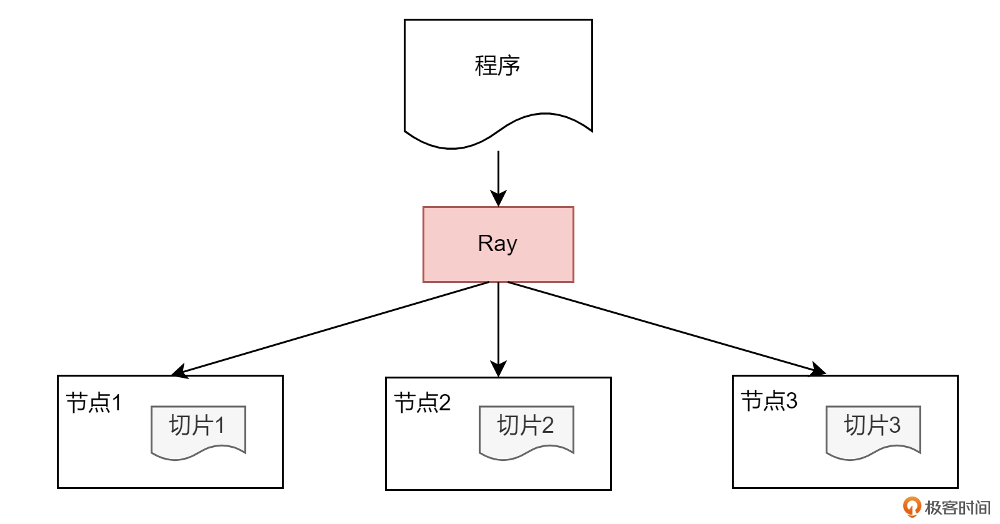
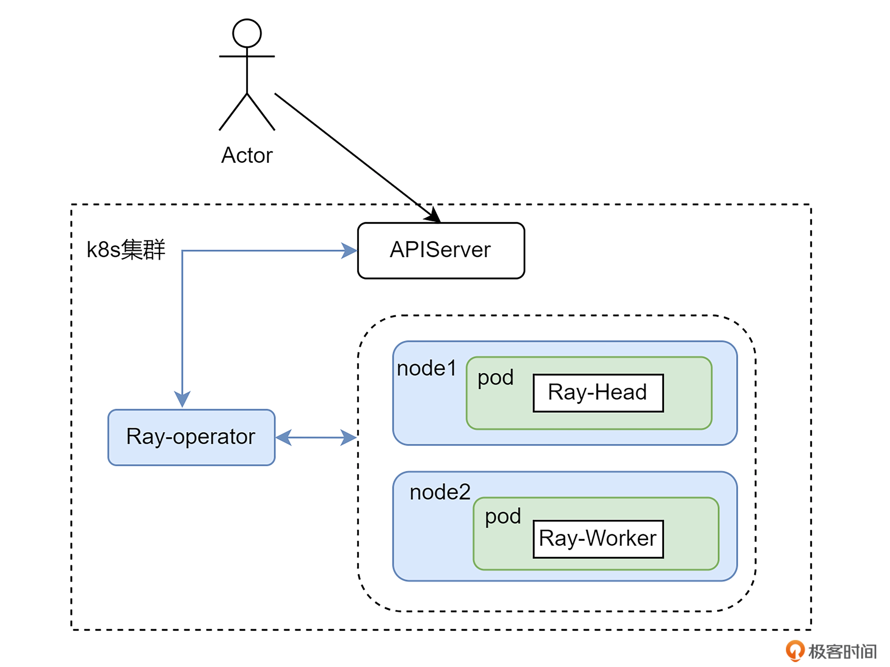
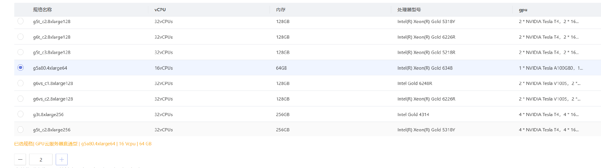
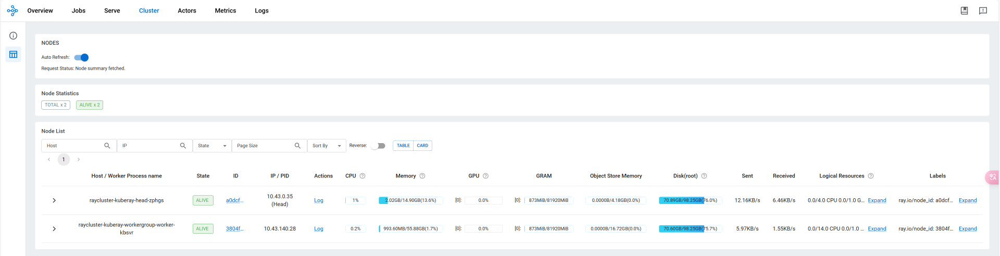
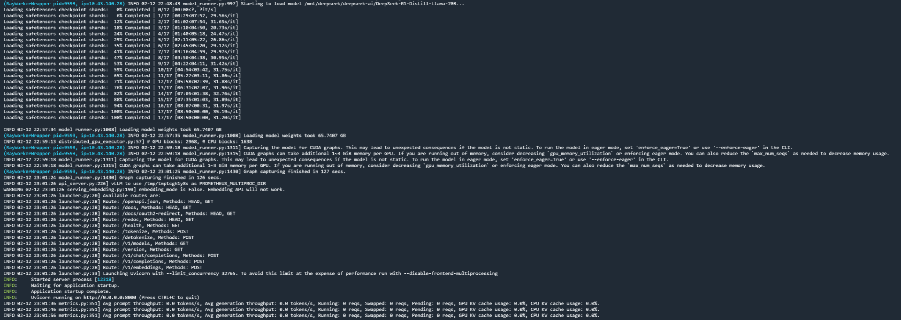
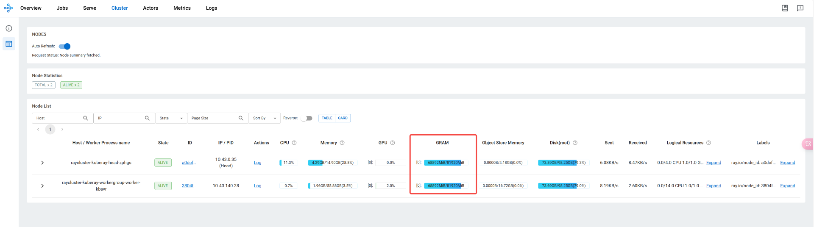
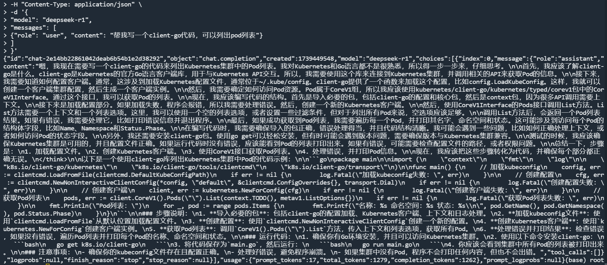
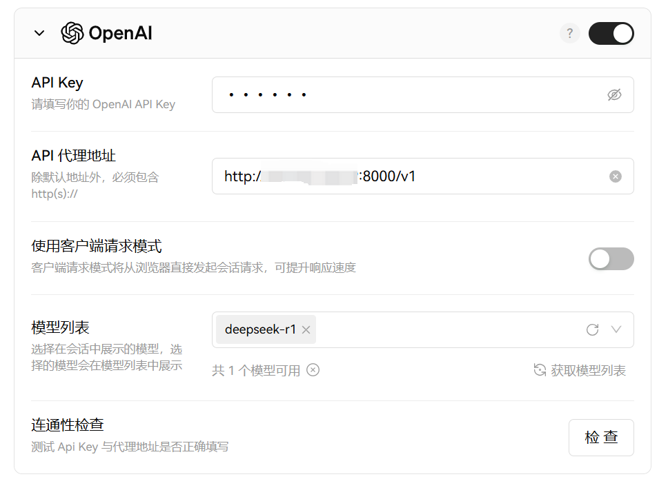
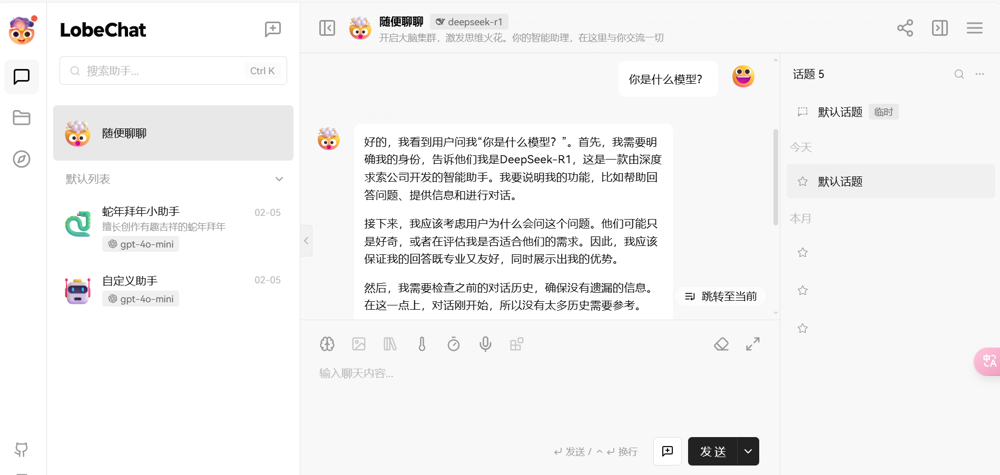

# 07-进阶部署（三）：非量化版DeepSeek分布式部署方案实战

你好，我是邢云阳。

在上节课中，我们学习了 DeepSeek 官方在做私有化部署时，推荐的一个工具，也就是vLLM。通过学习 vLLM，想必你对分布式部署是怎么回事儿，已经有了初步感知。

今天，我们将学习另一个组件——Ray。随后，我们将在一台配备双 GPU（A100）的Kubernetes 集群上，演示如何分布式部署 DeepSeek-R1-Distill-Llama-70B 模型。

## 什么是 Ray

Ray 是一个开源的分布式计算框架，旨在简化大规模机器学习和分布式应用程序的开发。它提供了高效的并行处理能力，支持数据预处理、分布式训练、超参数调优、模型服务和强化学习等任务。Ray 的核心概念包括任务（Tasks）、参与者（Actors）和对象（Objects），使得开发者能够轻松地在分布式环境中编写和执行并行代码。

如下图所示，便是程序通过 Ray 的处理之后，在三个节点上分布式运行的一个简单示意图。Ray 会将程序拆分成多片，分布到多个节点去运行。



在之前的 Kubernetes 入门课中，我们讲过 K8s 作为云原生基础设施标准所具备的优势，比如弹性伸缩、资源调度等等。

因此，由字节跳动技术团队牵头，联合 AnyScale、蚂蚁金服、微软等公司在 Ray 的基础上又开发了适配 Kubernetes 版本的 KubeRay。它采用了经典的 Operator 设计，提供了RayCluster、RayJob 和 RayService 等自定义资源定义（CRD），使得在 Kubernetes 集群上部署和管理 Ray 集群变得更加简便。通过 KubeRay，用户可以高效地管理 Ray 集群的生命周期，实现弹性伸缩、资源调度和作业管理等功能。

Ray-Operator 是 KubeRay 项目中的核心组件，负责在 Kubernetes 集群中创建和管理 Ray 集群。它通过监听 RayCluster、RayJob 和 RayService 等 CRD 的变化，自动化地处理 Ray 集群的部署、扩缩容和故障恢复等任务。Ray-Operator 使得用户能够以声明式的方式管理 Ray集群，简化了集群的运维工作。

下图是在 Kubernetes 上通过 Ray-operator 创建 Ray 集群的示意图。用户通过向 Ray-operator 提交 CR 的方式，来创建 Ray-Cluster。Ray-Cluster 包括一个 Head 和多个Worker，会分别分布在不同的 GPU 节点上。以图中所示为例，含有两个 GPU 节点，则会有一个 Head 和一个 Worker 分别在这两个节点上以 pod 形式创建。



OK，理论部分就讲到这，你只要知道什么是 Ray，以及 Ray-Cluster 的架构即可，我们把重点放在部署和使用上。

## 部署过程

### 环境与模型准备

首先是准备 GPU 机器。上节课讲过，分布式推理有两种方案，一种是一个节点上有多张卡的情况，这种情况是通过使用 NVLink 技术，在卡之间建立高速通道，实现卡卡高速互联。第二种是多节点单（多）卡的情况，这种情况依赖节点间的高速网络。

这节课我们来测试多节点的情况，因此我在联通云上开通了一台 GPU 版本的 K8s，包含三个非 GPU 的 master 节点，以及两个 GPU 节点，每个节点上有一张 A100 卡。



这台 K8s 会通过 NVIDIA 的 GPU-operator 部署好 NVIDIA 相关的驱动等，CUDA 版本选择12.2。

机器准备好后，接下来就是模型文件的准备。对于不能科学上网的同学，模型文件可以在魔搭社区下载，链接：https://www.modelscope.cn/models/deepseek-ai/DeepSeek-R1-Distill-Llama-70B/files。由于文件非常大，整个 repo 大概有 131G 左右，因此推荐你将模型下载到对象存储或者云硬盘，再通过 PV、PVC 的方式挂载。我采用的是对象存储的方式，PV、PVC 的 YAML 如下：

```
apiVersion: v1
kind: PersistentVolume
metadata:
 name: deepseek
spec:
 accessModes:
 - ReadWriteMany
 capacity:
   storage: 200Gi
 csi:
   driver: ossplugin.csi.cucloud.com
   volumeAttributes:
     bucket: deepseek
     url: http://obs-sh-internal.cucloud.cn
   volumeHandle: deepseek
 persistentVolumeReclaimPolicy: Retain
 volumeMode: Filesystem
---
apiVersion: v1
kind: PersistentVolumeClaim
metadata:
 name: deepseek
 namespace: kuberay-operator
spec:
 accessModes:
 - ReadWriteMany
 resources:
   requests:
     storage: 200Gi
 volumeMode: Filesystem
 volumeName: deepseek
```

在 ModelScope 上下载模型有多种方式，推荐使用 ModelScope Python SDK 的方式进行下载。执行以下命令即可下载。

```
pip install modelscope
modelscope download --model deepseek-ai/DeepSeek-R1-Distill-Llama-70B --cache_dir
```

我们可以使通过–cache_dir 指定模型文件存放目录。例如在我的命令中的 /mnt/deepseek，意思是把模型下载到 /mnt/deepseek 目录。下载完成后，上传到对象存储即可。

为了节省一遍上传的时间，我们也可以在 K8s 上创建一个带有 python 环境的 pod，然后将上文中的对象存储 PVC 挂载到 pod 中，这样就可以直接在 pod 内访问到对象存储桶，也就可以直接将模型下载到对象存储桶内了。

当然，我还有种更简便的做法。可以先把 Ray 集群拉起来，Ray 集群内就带了 python 环境，然后把对象存储 PVC 挂载到 Ray 集群的 Head 中即可。因此，你也可以和我一样，先学习后面的 Ray 部署，然后再下载模型。

### Ray 集群部署

接下来看一下 Ray 的部署。我们知道通过 kuberay-operator，可以方便的部署 Ray 集群。kuberay-operator 可以使用官方提供的 Helm Chart 包进行安装。命令如下：

```sql
helm repo add kuberay https://ray-project.github.io/kuberay-helm/helm repo update
helm repo update
helm install kuberay-operator -n kuberay-operator kuberay/kuberay-operator
```

之后看一下 kuberay-operator 的 pod 运行状况：

```bash
kubectl get po -n kuberay-operator
NAME                                          READY   STATUS    RESTARTS   AGE
kuberay-operator-5c5cb548db-2q2br             1/1     Running   0          23h
```

确认它处于 Running 状态就可以了。

然后我们来创建 Ray-Cluster，向 kuberay-operator 提交 CR 即可。官方将 CR 封装成了Helm Chart 包，可以通过如下命令部署。

```
helm install raycluster kuberay/ray-cluster -n kuberay-operator
```

但由于 CUDA 版本原因，我们需要找一个合适版本的 Ray 集群，因此我是将 Helm 包 fetch下来，将 CR yaml 提取出来，手动进行了更改。YAML 如下：

```
apiVersion: ray.io/v1
kind: RayCluster
metadata:
 annotations:
   meta.helm.sh/release-name: raycluster
   meta.helm.sh/release-namespace: kuberay-operator
 generation: 3
 labels:
   app.kubernetes.io/instance: raycluster
   app.kubernetes.io/managed-by: Helm
   helm.sh/chart: ray-cluster-1.2.2
 name: raycluster-kuberay
 namespace: kuberay-operator
spec:
 headGroupSpec:
   rayStartParams:
     dashboard-host: 0.0.0.0
   serviceType: ClusterIP
   template:
     metadata:
       annotations: {}
       labels:
         app.kubernetes.io/instance: raycluster
         app.kubernetes.io/managed-by: Helm
         helm.sh/chart: ray-cluster-1.2.2
     spec:
       affinity: {}
       containers:
       - image: docker.1ms.run/rayproject/ray-ml:2.11.0.a464b6-py310-gpu
         imagePullPolicy: IfNotPresent
         name: ray-head
         resources:
           limits:
             cpu: "4"
             memory: 16G
           requests:
             cpu: "1"
             memory: 2G
         securityContext: {}
         volumeMounts:
         - mountPath: /tmp/ray
           name: log-volume
         - mountPath: /mnt/deepseek
           name: deepseek-r1
       imagePullSecrets: []
       nodeSelector: {}
       tolerations: []
       volumes:
       - emptyDir: {}
         name: log-volume
       - name: deepseek-r1
         persistentVolumeClaim:
           claimName: deepseek
 workerGroupSpecs:
 - groupName: workergroup
   maxReplicas: 3
   minReplicas: 1
   numOfHosts: 1
   rayStartParams:
     num-gpus: "1"
   replicas: 1
   template:
     metadata:
       annotations: {}
       labels:
         app.kubernetes.io/instance: raycluster
         app.kubernetes.io/managed-by: Helm
         helm.sh/chart: ray-cluster-1.2.2
     spec:
       affinity: {}
       containers:
       - image: docker.1ms.run/rayproject/ray-ml:2.11.0.a464b6-py310-gpu
         imagePullPolicy: IfNotPresent
         name: ray-worker
         resources:
           limits:
             cpu: "14"
             memory: 60G
           requests:
             cpu: "1"
             memory: 1G
         securityContext: {}
         volumeMounts:
         - mountPath: /tmp/ray
           name: log-volume
         - mountPath: /mnt/deepseek
           name: deepseek-r1
       imagePullSecrets: []
       nodeSelector: {}
       tolerations: []
       volumes:
       - emptyDir: {}
         name: log-volume
       - name: deepseek-r1
         persistentVolumeClaim:
           claimName: deepseek
```

首先是镜像，使用 rayproject/ray-ml:2.11.0.a464b6-py310-gpu，也就是 2.11.0 版本的 Ray 集群。之后是 Head 节点和 Worker 节点的配置。Head 节点很简单，就是将对象存储 PVC 挂载上即可。Worker 节点除了挂载 PVC 之后，还需要配置两个参数，即：

```
numOfHosts: 1
rayStartParams:
 num-gpus: "1"
```

numOfHosts 代表在一个节点上部署 worker，num-gpus 代表每个节点上有一张卡。这里是个坑，很多网上的教程在只有两个 GPU 节点的情况下会把 numOfHosts 设置成 2，这是没有理解 Ray 集群的组成。实际上，Head 本身会占用一个节点，因此 Worker 创建一个即可。

配好参数后，直接 kubectl apply 拉起：

```bash
kubectl get po -n kuberay-operator -owide
NAME                                          READY   STATUS    RESTARTS   AGE
raycluster-kuberay-head-zphgs                 1/1     Running   0          171m
raycluster-kuberay-workergroup-worker-kbsvr   1/1     Running   0          171m
```

状态如上所示，就说明成功了。你可以直接拿我的 YAML，针对你的集群环境做相应的修改。

此时可以进入 raycluster-kuberay-head-zphgs 内，查看 ray 集群的状态。

```
(base) ray@raycluster-kuberay-head-zphgs:~$ ray status
2025-02-13 00:54:12,571 - INFO - Note: NumExpr detected 16 cores but "NUMEXPR_MAX
2025-02-13 00:54:12,571 - INFO - NumExpr defaulting to 8 threads.
======== Autoscaler status: 2025-02-13 00:54:12.737576 ========
Node status
---------------------------------------------------------------
Active:
1 node_a0dcf7b6cdb9c28191d6db6a44ba774ed04fb0bbda704a498112674f
1 node_3804fd0732e483a2240e9f608d15362f415411fca7c69b58232a1174
Pending:
(no pending nodes)
Recent failures:
(no failures)
Resources
---------------------------------------------------------------
Usage:
0.0/18.0 CPU
0.0/2.0 GPU
0B/70.78GiB memory
0B/20.90GiB object_store_memory
Demands:
(no resource demands)
```

可以看到有两个 Active 的节点，和两个没有使用的 GPU。Ray 集群自带了一个可视化 UI，可以直观地查看 CPU，内存，GPU 等的使用量以及任务执行情况等，因此可以通过loadBalancer 或者 NodePort 将 UI 的端口暴露出去，即可在集群外部访问。我们在浏览器输入 http://xxxx:8265 进入 Web UI 查看。



这样 Ray 集群部分，我们就部署完了。

PS：别忘了这时就可以下载模型文件了。

### 在 Ray 中 部署 Vllm

在 Ray 容器中，默认提供了一个 Conda 环境，有很多基础包，但需要将 pynvml 包卸载掉，因为这会与另一个包 nvidia-ml-py 冲突，命令：

```
pip uninstall pynvml
```

之后就可以安装 vllm 了，为了适配 Ray 集群，我选择的版本是 0.6.1.post2，安装命令为：

```
pip install vllm==0.6.1.post2
```

安装完成后，便可以使用 vllm 拉起大模型。就像上节课讲得那样，此处可以使用 python 代码的方式，也可以直接使用 vllm serve 命令，它会拉起大模型，同时提供一个 OpenAI 兼容的服务器。命令：

```
vllm serve /mnt/deepseek/deepseek-ai/DeepSeek-R1-Distill-Llama-70B \
--port 8000 \
--trust-remote-code \
--served-model-name deepseek-r1 \
--gpu-memory-utilization 0.95 \
--tensor-parallel-size 2 \
--max-model-len 8096
```

等待一段时间后，会有如下显示：



此时就说明，模型加载成功，server 也启动了。

这时我们再看一下 Ray 集群情况：



可以看到模型在两个 GPU 卡上各占了一半的显存，这也就意味着分布式部署成功了。

我们可以用 curl 测试一下，命令如下：

```bash
curl http://<公网IP>:8000/v1/chat/completions \
-H "Content-Type: application/json" \
-d '{
   "model": "deepseek-r1",
   "messages": [
       {"role": "user", "content": "帮我写一个client-go代码，可以列出pod列表"}
   ]
}'
```



## 使用对话前端连接模型

在 Ollama 那节课，我们讲过 LobeChat。通过 docker 一键拉起 LobeChat 后，点击设置，语言模型，在 OpenAI 模型中输入上文命令中的 Server 地址，点击获取模型列表，即可获取到可用模型。



然后便可以开始对话了。



至此，我们就用分布式的方式成功部署了 Deepseek-R1:70B 模型，。如果你机会去部署 671B模型，可以使用这节课的套路来操作，两者之间在部署手法上一模一样，没有任何区别。

## 总结

今天通过分布式部署非量化版 DeepSeek-R1 模型的实战，我们不仅深入了解了 Ray 这一强大的分布式计算框架，还掌握了如何在 Kubernetes 集群上高效部署和管理大规模机器学习模型。

首先我们要理解 Ray 在分布式计算中的核心作用，它通过任务、参与者和对象等概念，简化了并行代码的编写和执行。特别是在 Kubernetes 上通过 KubeRay 部署 Ray 集群，使得集群的弹性伸缩、资源调度和作业管理变得更加便捷。这不仅提高了资源利用率，还为大规模模型的推理提供了坚实的基础。

随后通过实际的部署过程，我们体会到了分布式部署的复杂性。从 GPU 机器的准备、模型文件的下载与存储，到 Ray 集群的配置与启动，每一步都需要细致地规划和调试。特别是在多节点、多 GPU 的场景下，如何合理分配资源、避免瓶颈，成为了成功部署的关键。

最后，通过 vLLM 的集成和模型的成功加载，我们验证了分布式部署的可行性。

总的来说，如果只是对着文档一步步执行命令行，那整个过程并不复杂。但在这个过程中，我们需要多多思考，理解每一步为什么要这么做，意义是什么，这样才能在后续版本更新，部署手法发生变化时，能够读懂官方文档，做到举一反三。

## 思考题

如果一个 Kubernetes 集群，包含 3 个 master 节点，2 个 CPU worker 节点以及 3 个 GPUworker 节点，应如何设置 numOfHosts 和 num-gpus？

欢迎你在留言区展示你的思考结果，我们一起探讨。如果你觉得这节课的内容对你有帮助的话，也欢迎你分享给其他朋友，我们下节课再见！
