# 08-llama.cpp部署：无GPU服务器如何部署DeepSeek？

你好，我是邢云阳。

经过几节课的学习，我们已经掌握了两种行业主流的模型部署方式。但其实对于大多数普通同学来说，前面两种方式很难长期使用，毕竟 GPU 卡实在是太贵了，普通人根本消费不起。

大模型动辄数十上百亿的参数，对运行机器的内存提出了很高的要求，毕竟只有将模型权重塞进 RAM，推理方可进行。而模型加载至内存后，推理顺畅与否，又与 CPU、GPU 等计算单元密切相关，要知道很多大语言模型是在顶级专用 GPU 集群上加速训练的，换到个人电脑上，五秒蹦出一个词，也很难说用了起来。

因此今天呢，我就介绍一种很有意思的、不用 GPU 卡也能部署 DeepSeek 模型的方式，这便是社区大神写的模型推理框架——llama.cpp。

## llama.cpp

llama.cpp 出现的背景是 2023 年 Meta 开源 Llama 系列大语言模型后，技术社区掀起了模型轻量化部署的热潮。Georgi Gerganov 这位来自保加利亚的天才程序员，采用纯 C/C++ 实现Llama 模型的推理引擎，开创了消费级硬件运行大模型的新范式。

与传统基于 Python 的 AI 框架（如 PyTorch/TensorFlow）不同，llama.cpp 选择回归底层语言的实现策略。这种设计使其摆脱了 Python 解释器、CUDA 驱动等重型依赖，通过静态编译生成单一可执行文件，在资源受限环境中展现出独特优势。项目开源仅三个月即收获超过 3 万GitHub 星标，印证了其技术路线的成功。

llama.cpp 最引人注目的特点之一，是它的极简主义设计理念。与传统的 Python 实现不同，它完全基于 C/C++ 编写，无需依赖 PyTorch、TensorFlow 等重型框架，直接编译为可执行文件。这种设计不仅避免了复杂的依赖环境配置，还跳过了不同硬件平台的适配难题，真正实现了“开箱即用”。

在性能优化方面，llama.cpp 充分挖掘了硬件的潜力。对于 Apple Silicon 设备，它利用 ARMNEON 指令集实现高效的并行计算；而在 x86 平台上，则通过 AVX2 指令集加速运算。同时，它还支持 F16 和 F32 混合精度计算，既保证了计算效率，又兼顾了模型精度。更值得一提的是，llama.cpp 引入了 4-bit 量化技术，使得模型体积大幅缩减，甚至可以在没有 GPU 的情况下，仅靠 CPU 就能流畅地运行大模型。

根据开发者提供的数据，在 M1 MacBook Pro 上运行 Llama-7B 模型时，每个 token 的推理时间仅需 60 毫秒，相当于每秒处理十多个 token。这样的速度对于本地化部署的大模型来说，已经相当可观。得益于纯 C/C++ 实现的高效性，llama.cpp 不仅能在 MacBook Pro 上运行，甚至可以在 Android 设备上流畅执行。

那么，它是如何将庞大的模型装进有限的内存中的呢？答案正是量化技术。在第 5 节课的时候，我曾经举了一个图片分辨率的例子，用白话大概讲了一下什么是量化。今天这节课呢，我们就稍微讲得专业一点。

## 何为量化

在深度神经网络模型的开发流程中，结构设计完成后，训练阶段的核心任务是通过大量数据调整模型的权重参数。这些权重通常以浮点数的形式存储，常见的精度包括 16 位（FP16）、32位（FP32）和 64 位（FP64）。

训练过程通常依赖 GPU 的强大算力来加速计算，但这也带来了较高的硬件需求。为了降低这些需求，量化技术应运而生。量化的原理呢，概括来说就是通过降低权重参数的精度，减少模型对计算资源和存储空间的要求，从而使其能够在更多设备上运行。

以 Llama 模型为例，其原始版本采用 16 位浮点精度（FP16）。一个包含 70 亿参数的 7B 模型，完整大小约为 14 GB。这意味着用户至少需要 14 GB 的显存才能加载和使用该模型。而对于更大的 13B 版本，模型大小更是达到 26 GB，这对普通用户来说无疑是巨大的负担。

然而，通过量化技术，例如将权重精度从 16 位降至 4 位，7B 模型的大小可以压缩至约 4GB，13B 模型则压缩至 8 GB 左右。这种显著的体积缩减使得这些大模型能够在消费级硬件上运行，普通用户也能在个人电脑上体验大模型的强大能力。

llama.cpp 的量化实现依赖于作者 Georgi Gerganov 开发的另一个库——ggml。ggml 是一个用 C/C++ 实现的机器学习库，专注于高效处理神经网络中的核心数据结构——张量（tensor）。

张量是多维数组的泛化形式，广泛用于 TensorFlow、PyTorch 等主流深度学习框架中。通过改用 C/C++ 实现，ggml 不仅支持更广泛的硬件平台，还显著提升了计算效率。这种高效的设计为 llama.cpp 的诞生提供了坚实的基础，使其能够在资源受限的环境中实现高性能的模型推理。

量化技术的核心在于权衡精度与效率。通过降低权重参数的精度，模型的计算量和存储需求大幅减少，但同时也可能引入一定的精度损失。因此，量化算法的设计需要在压缩率和模型性能之间找到最佳平衡点。

ggml 库通过创新的量化策略和高效的张量计算实现，在成功保持较高模型性能的同时，也显著降低了硬件门槛。这种技术突破不仅让大模型得以在普通设备上运行，也为边缘计算和移动端 AI 应用开辟了新的可能性。

## 使用 llama.cpp 部署 DeepSeek

Ok，现在理论部分我们有了大致了解，接下来还是照例进入到实操环节。

首先需要准备一台只有 CPU 的服务器，我是在联通云开了一台 4 核 16G 规格的 Ubuntu22.04 服务器，你在自己的笔记本开一个虚拟机也是可以的。

硬件准备好后，就需要准备 llama.cpp 工具了。llama.cpp 的使用可以通过源码进行编译，也可以使用作者编译好的 release 版本。链接如下：https://github.com/ggerganov/llama.cpp/releases

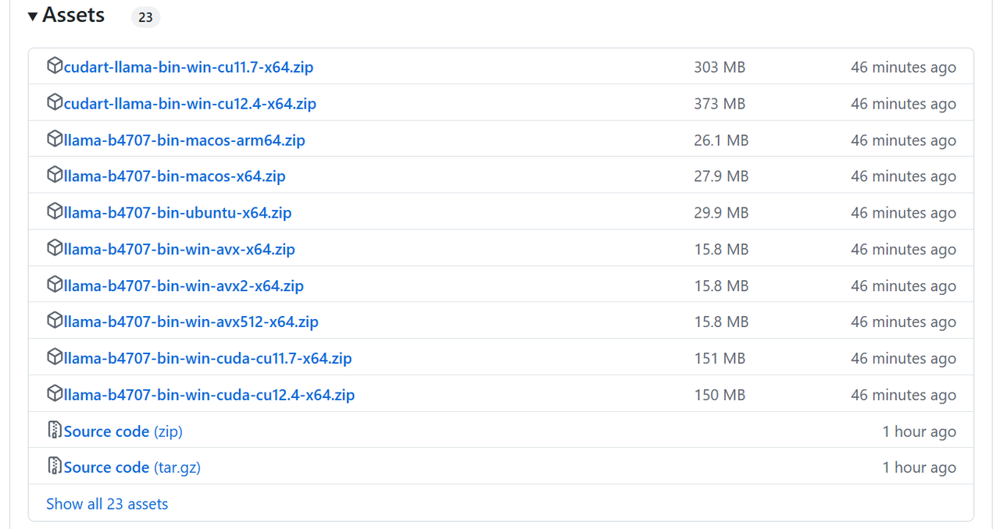

作者更新版本的速度非常快，有时几乎一天就更新好几个版本。可以根据自己的系统选择合适的版本。我的系统是 ubuntu22.04，因此选择的是 llama-b4707-bin-ubuntu-x64.zip。下载后，放到环境变量目录进行解压。ubuntu 系统解压到 /usr/local/llama 即可。之后在/etc/profile 文件配置一下环境变量，确保 llama.cpp 的二进制工具，可以在任意地方执行。

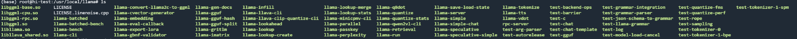

此外，如果你的系统没有装 gcc，需要装一下，否则会报找不到库的错误。最后还需要配置一下 lib 库的环境变量：

```
LD_LIBRARY_PATH=$(pwd):$LD_LIBRARY_PATH
```

这是因为 llama.cpp 自带了一堆 .so，需要能被引用到。

接下来进行模型的下载，为了照顾不能科学上网的同学，我们依然是去魔搭社区下载。注意，需要下载适配好 llama.cpp 的 GGUF 版本，而不是 DeepSeek 的原版本。 GGUF 版本链接如下：https://www.modelscope.cn/models/unsloth/DeepSeek-R1-Distill-Qwen-7B-GGUF/files

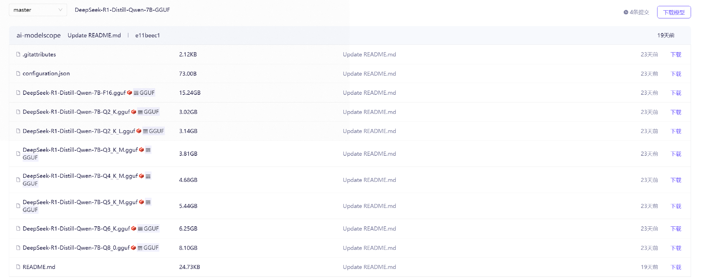

以 DeepSeek 的 7B 模型为例，有多个量化版本可以选择，通常需要使用 Q6、Q8 版本的模型。这节课我们选择 DeepSeek-R1-Distill-Qwen-7B-Q6_K_M.gguf 作为本次实验模型。可以直接点击下载，将模型下载到本地后，传到服务器上。

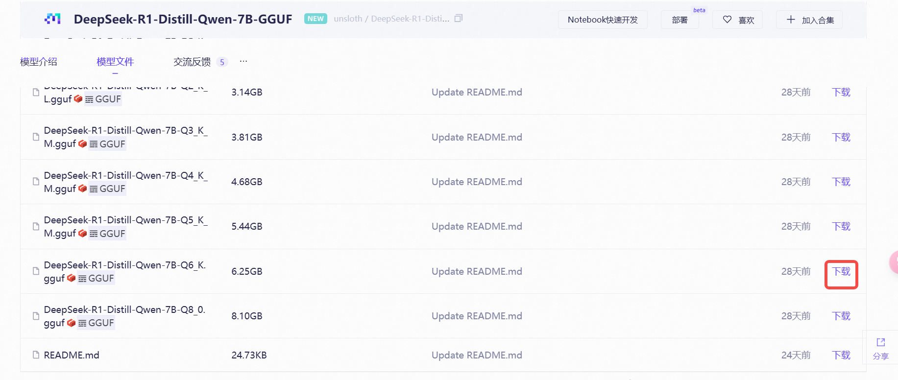

等待下载完成后，便可以启动了。我们先来启动一个可以直接交互的版本。命令如下：

```
llama-cli -m ./DeepSeek-R1-Distill-Qwen-7B-Q6_K_M.gguf -co -cnv -p "你 是 一 个 py
```

启动效果是：

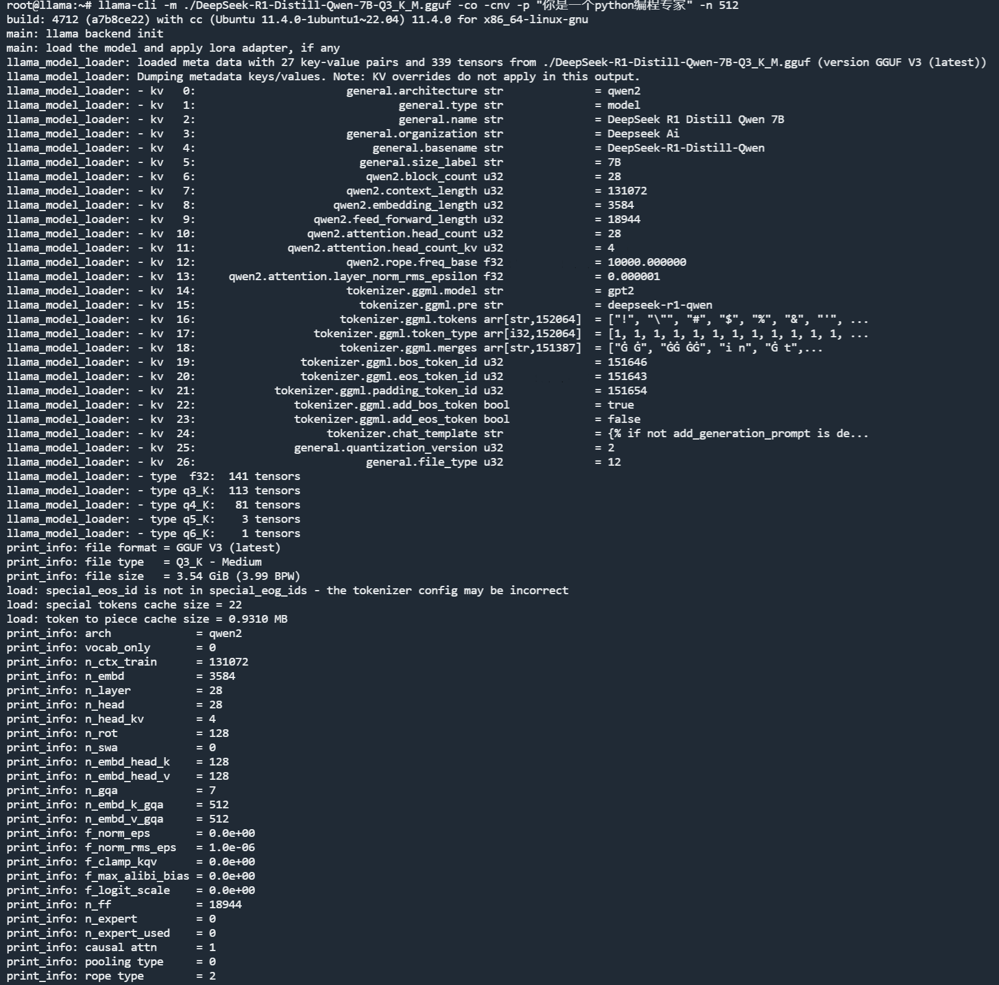

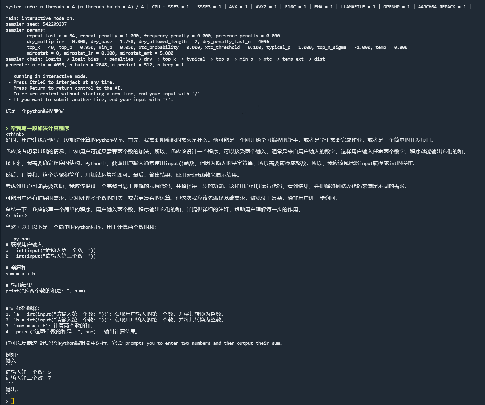

可以如上图所示，直接输入 prompt 测试一下，在我的服务器上，速度还不错。

既然服务器没有显存，那模型就只能占用内存了。我们看一下，这个模型占了多少内存。使用命令：

```
ps aux --sort=%mem
```

输出如下：

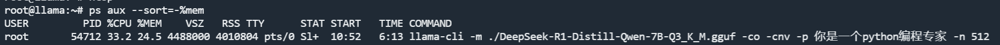

可以看到大约占了不大到 4G 内存左右，还是相当可以的。

## 发布成 HTTP 服务

那么 llama.cpp 是否能像 Ollama 或者 vllm 一样，将模型发布成 HTTP 服务，让用户可以通过API 的方式访问呢？答案是肯定的。这里推荐两种做法。

第一种方法：使用官方的服务启动

我们在终端输入下面的命令。

```
llama-server --model DeepSeek-R1-Distill-Qwen-7B-Q6_K_M.gguf
```

启动后显示如下。

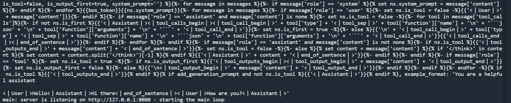

我们测试一下效果：

```bash
curl http://localhost:8080/v1/completions \
   -H "Content-Type: application/json" \
   -d '{
       "model": "deepseek-r1",
       "prompt": "你好",
       "max_tokens": 1024,
       "temperature": 0
   }'
```

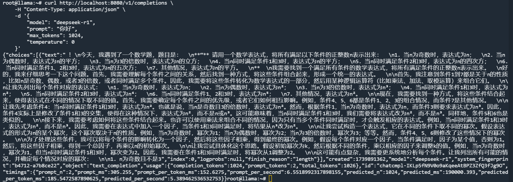

答案一言难尽，不过因为是小模型，不知所云很正常。

server 的输出日志如下：

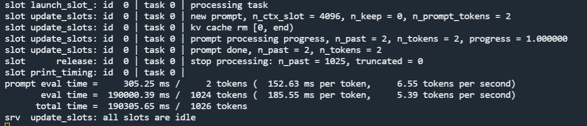

第二种方法：使用第三方库

首先我们需要安装一下，命令如下。

```bash
apt install ninja-build
pip install uvicorn anyio starlette fastapi sse_starlette starlette_context pydan
pip install llama-cpp-python -i https://mirrors.aliyun.com/pypi/simple/
```

安装好后运行模型：

```
python3 -m llama_cpp.server --model ./DeepSeek-R1-Distill-Qwen-7B-Q6_K_M.gguf
```

启动成功的日志如下所示：

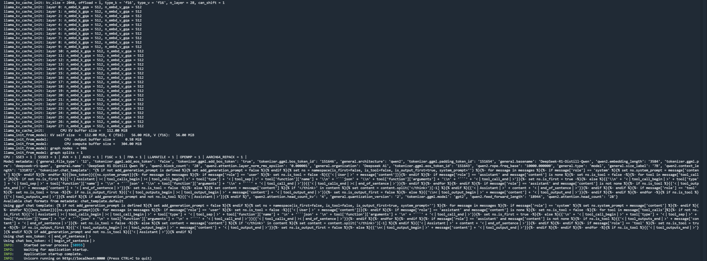

第三方库的好处在于兼容 OpenAI 数据格式，此时可以用 OpenAI 方式访问一下。

```bash
curl http://localhost:8000/v1/chat/completions \
-H "Content-Type: application/json" \
-d '{
       "messages": [
               {"role": "system", "content": "你是一个python专家"},
               {"role": "user", "content": "python的字典数据类型如何定义"}
       ]
}'
```

效果如下：

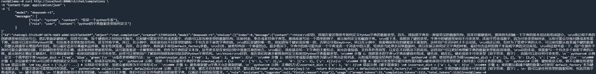

第三方库的输出日志如下：

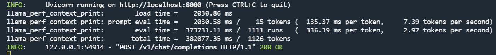

至此，我们就成功在无 GPU 服务器上实现了 DeepSeek 模型的部署和推理。

## 总结

今天这节课，是整个章节我最喜欢的一节，一方面是我本身就是做 C 和 C++ 出身，对于Linux 底层的一些东西相对比较了解，所以对于这位大佬的作品感到由衷的钦佩。

另一方面，目前 GPU 卡资源相对比较稀缺，像 llama.cpp 这样的方案在特定场景下，会有很高的价值，比如原本跑一个满血 671B 的 DeepSeek-R1 需要至少 16 张 A100，但如果我能够使用大量的内存来替换掉显存，实现曲线救国，成本会降低很多倍。

最近清华大学开发的神奇推理引擎 KTransformer，可以用 24G 的 4090 部署满血版DeepSeek-R1 的新闻不知道大家看了没有，虽然他部署的是 Q4 量化版，且用了 300 多 G 内存，但确实也把普通人玩 AI 的门槛又往下砸了一大截。如果后面有空，我可以在我们公司的服务器上测试一下，然后出一期加餐给大家看一下效果。

## 思考题

有兴趣的同学可以下载一个 70B 的 Q3 版本部署一下，看看需要多少内存。

欢迎你在留言区展示你的测试结果，我们一起探讨。如果你觉得这节课的内容对你有帮助的话，也欢迎你分享给其他朋友，我们下节课再见！
