# 11 | 凤雏来了：什么是模型上下文协议MCP？

你好，我是邢云阳。

在前置课程的第二节课，我曾经为你讲解了 Agent 技术。我们抛开思维链不谈，Agent 最牛的是能够通过调用工具实现大模型与外界环境的交互，让大模型不再“闭关锁国”。

Agent 在 24 年得到了人们广泛认可，发展得十分迅速，现在已经成了 AI 应用开发的必备技术了。如果我们这些开发者是刘备的话，那 Agent 就是卧龙先生诸葛亮，我得先生，如鱼得水也。

然而就像《西虹市首富》电影里说的那样，“我没想到一所普通的小学，竟能同时培养出你们二位”，有卧龙的地方必有凤雏。因此在去年下半年，Anthropic（Claude 模型的母公司） 推出了模型上下文协议 MCP，该协议旨在统一大型语言模型（LLM）与外部数据源和工具之间的通信协议。

MCP 主要是为了解决当前 AI 模型因数据孤岛限制，无法充分发挥潜力的难题，MCP 使得 AI应用能够安全地访问和操作本地及远程数据，为 AI 应用提供了连接万物的接口。

这个协议在社区发展得非常好，现在已经有很多 AI 应用或框架，比如 Spring AI 等接入了MCP，也有很多开发者为其贡献了 MCP Server，在我看来，它与 Agent 技术殊途同归，因此我称之为凤雏。

接下来，我们就深度学习一下 MCP，并体验一下它如何使用。

## MCP 架构

首先，我们用一张简化的图回顾一下“卧龙” Agent。

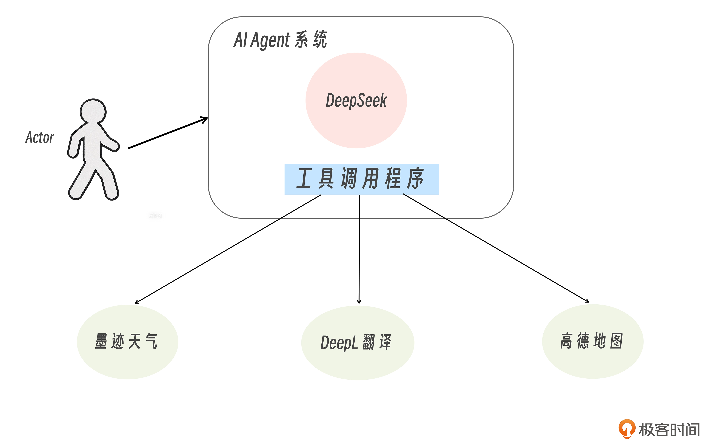

这张图里，我把 AI Agent 看成一个封闭的系统，一个盒子。盒子内部包括大脑 DeepSeek 或其他大模型，以及工具调用程序。当大模型选择了工具之后，需要有一个工具调用程序，去实际的进行工具的调用，例如通过 Rest API 访问墨迹天气获取天气预报等等。

大家可以去 ChatGPT 的 GPTs（需要付费） 创建一个自定义 ChatGPT 应用，或者去扣子、Dify（免费） 等平台创建一个 Agent 来体验一下上图的效果。或者试读一下我的课程《AI 重塑云原生应用开发实战》的第 13 和 14 讲，云体验一下效果。有了这个基础之后，我们再来看 MCP，就相对好理解了。

MCP 采用的是经典的客户端 - 服务器架构，我首先需要介绍几个概念。

- MCP 主机（MCP Hosts）：发起请求的 LLM 应用程序（例如 Claude Desktop、IDE 或 AI工具）。

- MCP 客户端（MCP Clients）：在主机程序内部，与 MCP server 保持 1:1 的连接。

- MCP 服务器（MCP Servers）：为 MCP client 提供上下文、工具和 prompt 信息。

- 本地资源（Local Resources）：本地计算机中可供 MCP server 安全访问的资源（例如文件、数据库）。

- 远程资源（Remote Resources）：MCP server 可以连接到的远程资源（例如通过 API）。

之后我还画了一张图，帮你把前面的概念串起来。

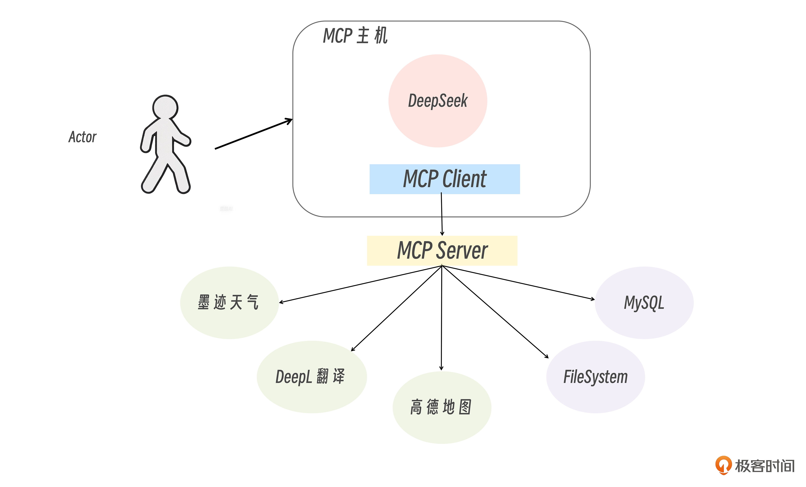

咋样？感觉和 AI Agent 的图像不？简直太像了。

唯一不同的点在于 MCP 把工具调用程序做成了一个 C-S 架构，工具的实际调用由 MCPServer 来完成。

### MCP Server

MCP Server 相对比较独立，可以独立开发，独立部署，可以远程部署，也可以本地部署。它可以提供三种类型的功能：

1. 资源（Resources）：类似文件的数据，可以被客户端读取，如 API 响应或文件内容。

2. 工具（Tools）：可以被 LLM 调用的函数（需要用户批准）。

3. 提示（Prompts）：预先编写的模板，帮助用户完成特定任务。

这些功能为大模型提供了丰富的上下文信息，从而增强了大模型的实用性和灵活性。现在在MCP 官方 GitHub 上，有很多用户贡献了对接各种系统和应用的 MCP Server，比如对接本地文件系统的 MCP Server，对接 MySQL 的 MCP Server 等等，我们后续开发如果要使用MCP，主要的工作量也是在开发 MCP Server 上。

### MCP Client && MCP Hosts

了解了 MCP Server 之后，我们再来看一下 MCP Client 以及 MCP Hosts。

MCP Client 负责与 MCP Server 进行通信。而 MCP Hosts 则可以理解为是一个可对话的主机程序。

当用户发送 prompt（例如：我要查询北京的天气） 到 MCP Hosts 时，MCP Hosts 会调用MCP Client 与 MCP Server 进行通信，获取当前 MCP Server 具备哪些能力，然后连同用户的 prompt 一起发送给大模型，大模型就可以针对用户的提问，决定何时使用这些能力了。这个过程就类似，我们填充 ReAct 模板，发送给大模型。

在 Agent 的学习中，我们知道大模型只管选择工具，并不管调用工具。调用工具要由实际的程序完成，这就像万有引力定律一样，是定理。那么在 MCP 中，当然也不能违背这个定理。

当大模型选择了合适的能力后，MCP Hosts 会调用 MCP Cient 与 MCP Server 进行通信，由MCP Server 调用工具或者读取资源后，反馈给 MCP Client，然后再由 MCP Hosts 反馈给大模型，由大模型判断是否能解决用户的问题。如果解决了，则会生成自然语言响应，最终由MCP Hosts 将响应展示给用户。

以上就是 MCP 的原理，你如果掌握了 Agent 的机制，对比着学习 MCP 就非常简单了。

## 体验 MCP

接下来，我们就来体验一下 MCP。

### 配置 MCP Hosts

由于 MCP 是 Anthropic 推出的，因此最先支持 MCP 的必然是它的自家产品 ClaudeDesktop。但由于 Claude Desktop 在使用时需要科学上网，考虑到受众问题，我就不用它做MCP Hosts 了。我会采用一个开源的编程助手 Cline（Roo Code）作为 MCP Hosts。

Cline 是一个插件化的编程助手，可以在多种 IDE 上安装。这里我就以我最常用的 VSCode 为例，做一下演示。

首先点击左侧侧边栏的扩展商店按钮，之后在输入框输入 “cline”，排名前两名的就是 RooCode（原名 Roo Cline） 以及 Cline。Cline 是原版的，而 Roo Code 是一个哥们觉得 Cline做的不好，然后自己基于 Cline 又加了扩展功能，现在几乎每天都在更新版本。这里我就选择安装 Roo Code。安装完成后，就可以在侧边栏看到一个小火箭的图标。

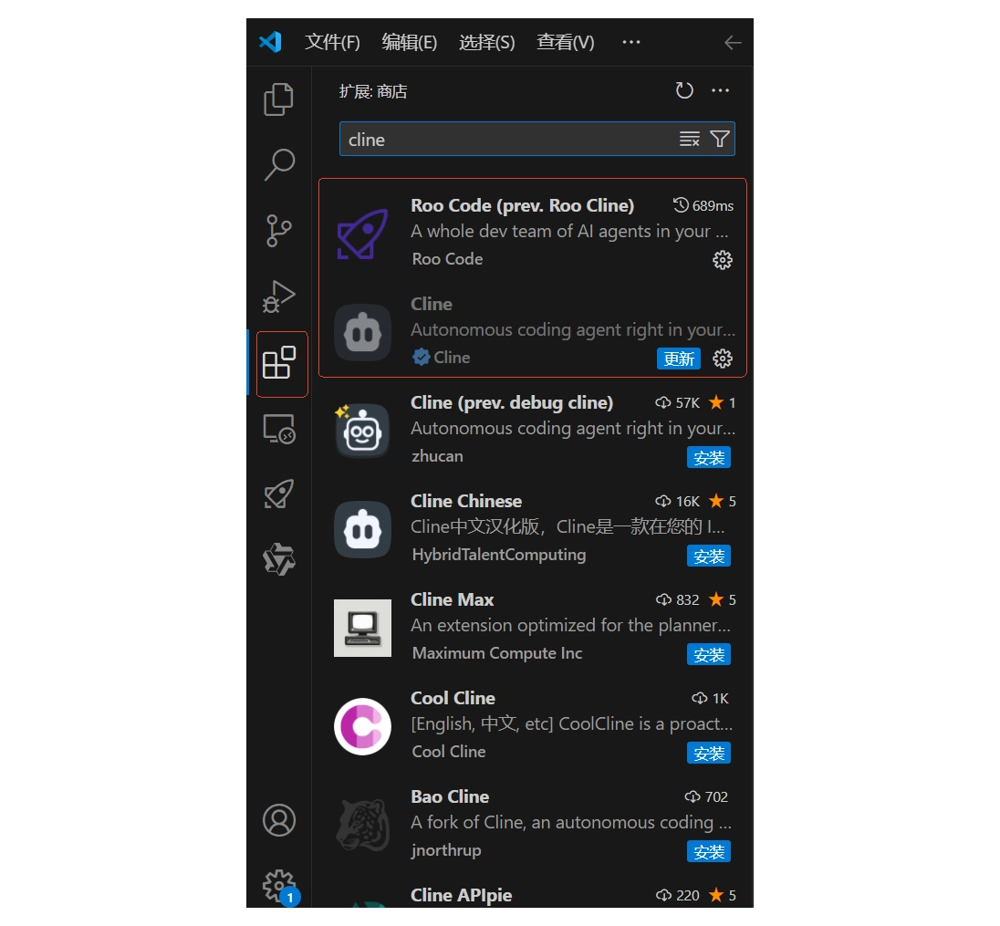

我们点击小火箭，然后点击上方的配置按钮，即可配置让 Roo Code 使用什么大模型，这里我配置的是官方版的 DeepSeek，模型选用的是 deepseek-chat，也就是 DeepSeek-V3。完成配置后点击 Save 保存，然后点击 Done 退出。

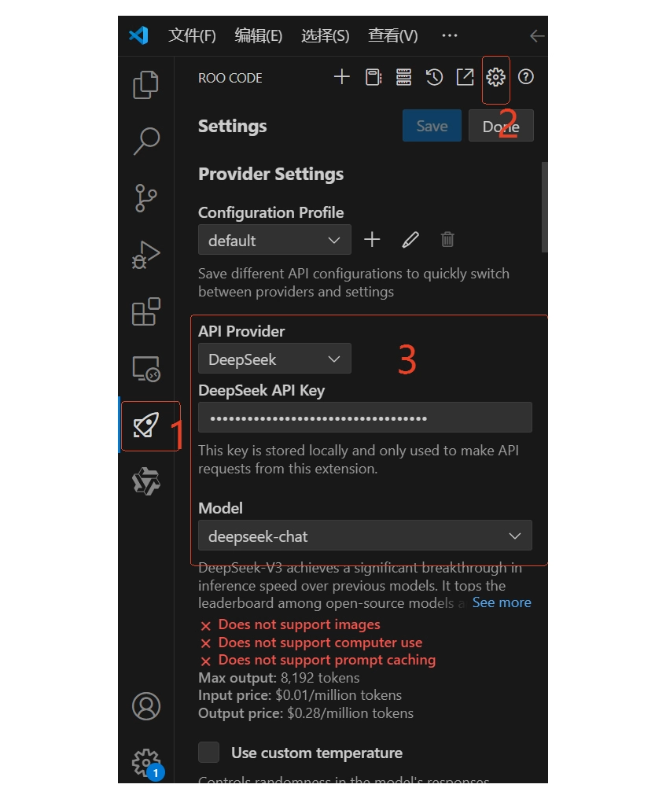

之后可以在对话框输入一个 “hello”，测试是否能和大模型连上。

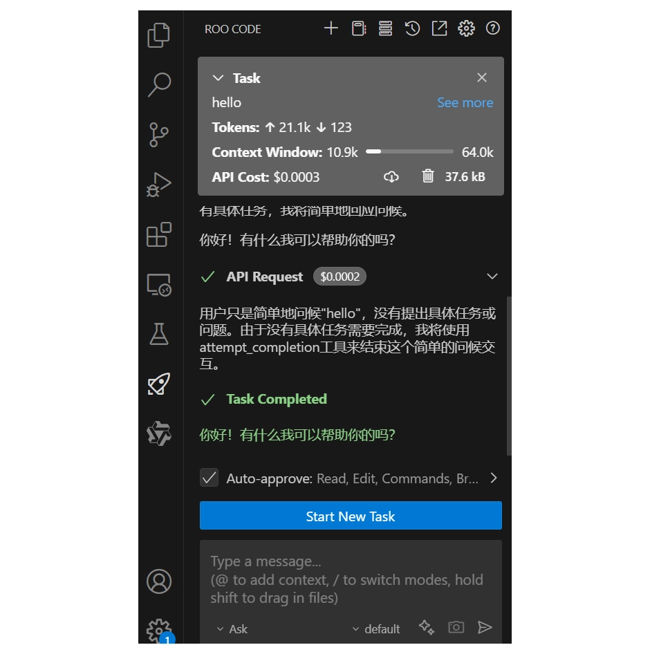

如果能得到回复，就说明配置没问题了。

### 配置 MCP Server

接下来，我就演示一个通过 PostgreSQL MCP Server 使 DeepSeek 能够基于 PostgreSQL中的数据来回答问题。MCP Server 支持 NodeJS 和 python 两种语言开发，本次案例使用的是 MCP 官方提供的 PostgreSQL MCP Server，其开发语言是 NodeJS ，因此大家需要根据自己的操作系统安装好 NodeJS 。Windows 用户可以点击该链接，下载安装。

环境准备好后，我们就正式开始。首先，用 docker 启动 PostgreSQL 服务。

```bash
docker run -d --name postgres \
 -e POSTGRES_PASSWORD=postgres -p 5432:5432 \
 docker.1ms.run/postgres:latest
```

之后使用如下命令进入到容器内并打开 postgres 客户端。

```bash
docker exec -it postgres psql -U postgres
```

创建数据库和表，并插入数据。

```sql
-- 创建数据库
CREATE DATABASE achievement;
-- 连接到新创建的数据库
\c achievement;
-- 创建用户信息 users 表
CREATE TABLE users (
   user_id SERIAL PRIMARY KEY,
   name VARCHAR(50) NOT NULL,
   email VARCHAR(100) UNIQUE NOT NULL
);
-- 创建绩效得分 score 表
CREATE TABLE score (
   score_id SERIAL PRIMARY KEY,
   score DECIMAL(10, 2) NOT NULL,
   user_id INT REFERENCES users(user_id)
);
-- 插入示例数据
INSERT INTO users (name, email) VALUES
('张三', 'zs@example.com'),
('李四', 'ls@example.com'),
('王五', 'ww@example.com');
INSERT INTO score (score, user_id) VALUES
(87.75, 1),
(97.50, 2),
(93.25, 3);
```

接下来，在 Roo Cline 中配置 PostgreSQL MCP Server 的连接信息，点击上方的服务器按钮，会进入到 MCP Server 的配置页面。

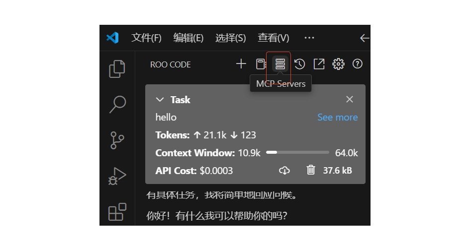

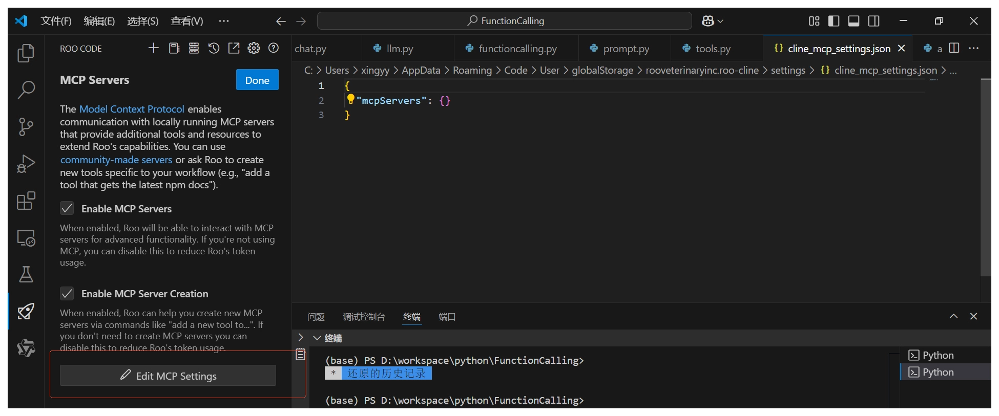

之后点击 Edit MCP Settings，会打开一个配置文件，我们需要在该文件中填写连接信息。

将配置文件的内容替换为如下内容：

```json
{
 "mcpServers": {
   "postgres": {
     "command": "node",
     "args": [
       "D:\\Program Files\\nodejs\\node_modules\\npm\\bin\\npx-cli.js",
       "-y",
       "@modelcontextprotocol/server-postgres",
       "postgresql://postgres:postgres@<你的postgres所在的服务器的IP>:5432/achievem
     ]
   }
 }
}
```

该配置文件的含义就是使用 NodeJS 将远程的 postgres MCP Server 下载下来，然后运行。

注意以上的内容是针对 Windows 用户的，如果你是 MAC 用户，可以使用如下内容：

```json
{
 "mcpServers": {
   "postgres": {
     "command": "npx",
     "args": [
       "-y",
       "@modelcontextprotocol/server-postgres",
       "postgresql://postgres:postgres@<你的postgres所在的服务器的IP>:5432/achievem
     ]
   }
 }
}
```

完成配置后，会在左侧看到已连接的 MCP Server，并且会列出支持的 Tools 和 Resources。

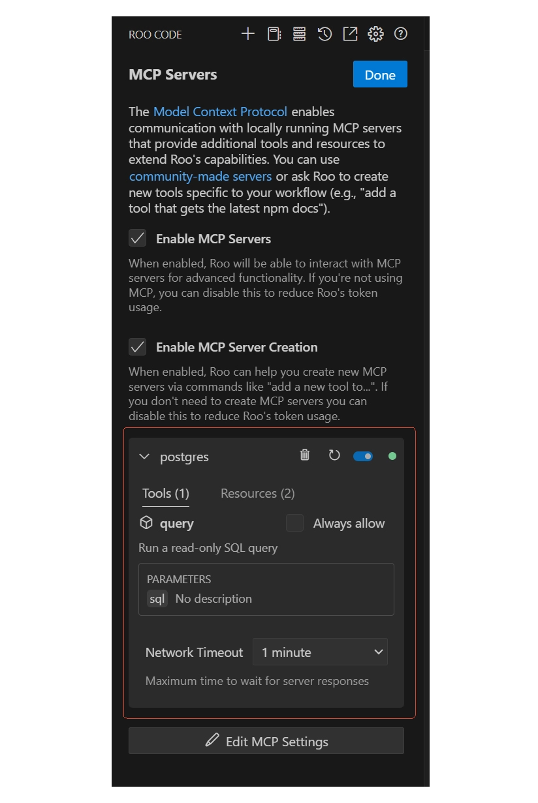

### 测试

接下来，我们进行测试。

首先，我们提问“数据库中有哪些表？”

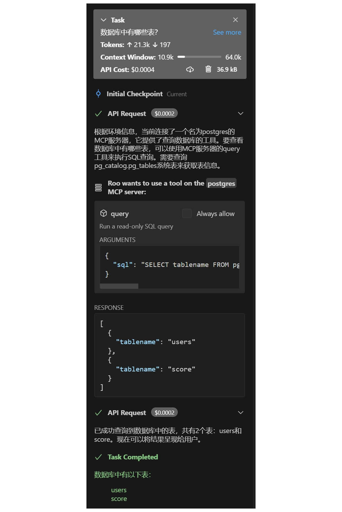

可以看到，大模型请求了 MCP Server，之后使用了 一条 SQL 查询语句查出了数据库中的表。

我们接下来尝试一个难一点的案例，提问“张三，李四，王五的绩效谁高？”在我们的数据库中有 users 和 score 两张表，users 存储了人员姓名和邮箱信息，score 表存储了人员的绩效得分，查询绩效分时需要使用 users 表的主键去查询，因此这是一个两个表联合查询的案例。输出结果如下：

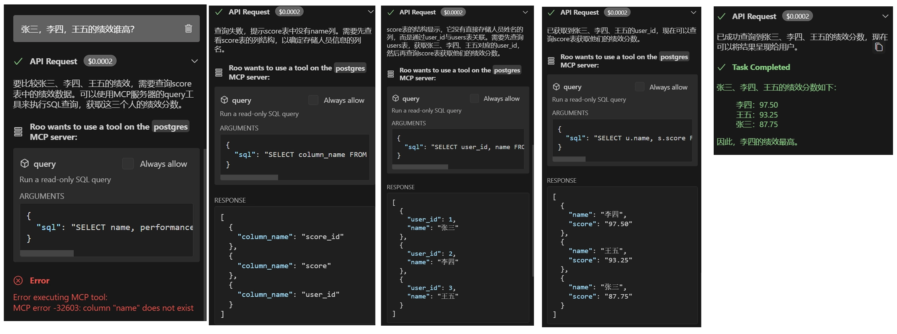

可以看到在最左侧的图中，DeepSeek 一开始直接尝试在 score 表中，用 name 字段去查询绩效，结果发现表中没有 name 字段，因此就开始获取 score 表的表结构。之后又查出了 users表的数据，最后来了一个两个表的联合查询，得到了正确结果。

## 总结

这节课，我们依托前面对于 Agent 知识的理解，学习了另一种“另辟蹊径”的类 Agent 的实现，也就是 MCP。经过比对简化版的 Agent 和 MCP 的架构图，大家会发现，两者真的非常像。只是在具体实现思路上有所区别。

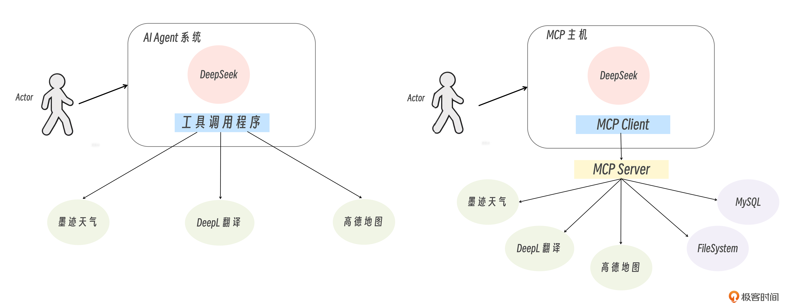

我们在学习这类框架时，尽管需要去看文档，但没必要上来就深究理论，不要把文档当成阅读理解。而是一定要多多实践，通过实践，我们反而更容易去理解功能，然后再类比之前学过的知识，这样就能做到一通百通。

## 思考题

你认为 MCP Server 查询数据库的功能，我们用 Agent Tool 能搞定吗？

欢迎你在留言区展示你的思考结果，我们一起探讨。如果你觉得这节课的内容对你有帮助的话，也欢迎你分享给其他朋友，我们下节课再见！
