# 12 | 动手实现一个简单的MCPServer

你好，我是邢云阳。

上节课，我们采用对比学习的方法，对照 Agent 学习了 MCP。之后又通过了一个大模型查询数据库的例子，让你感受了一下 MCP 的强大能力。这节课我们就继续深入，尝试自己手写一个 MCP Server，为我们后续做应用开发打下基础。

## MCP Server 的三大能力

在写代码之前，我们再来回顾一下上节课提到的 MCP Server 的三大能力。

- Tool（工具）

与我们在 Agent 和 Function Calling 中使用的 Tool 是一样的，就是写程序去调用外部服务。

- Resource（资源）

Resource 表示服务器希望提供给客户端的任何类型的只读数据。这可能包括文件内容、数据库记录、图片、日志等等。

- Prompt（提示模板）

Prompt 是由服务器定义的可重用的模板，用户可以选择这些模板来引导或标准化与 LLM 的交互过程。例如，Git MCP Server 可以提供一个“生成提交信息”的提示模板，用户可以用它来创建标准化的提交消息。

MCP 在经过了差不多半年左右的发展呢，像是 Cursor、Cline 等等比较知名的 IDE 都接入了MCP，却基本只支持这三大能力中的 Tool 能力。

我们今天先写代码，感受一下这三种能力的使用场景，然后最后再思考一下为啥只有 Tool 能火。

## 员工绩效系统 MCP Server 演示

在上节课，我提到过，MCP Server 官方给出了两种语言的 SDK，分别是 NodeJS 以及Python。由于我们这门课的编程语言就是用 Python，因此今天就用 Python SDK，为大家做一下演示。

### 安装 uv && 初始化项目

MCP 官方推荐使用 uv 来进行 Python 工程的管理。可以使用如下命令进行安装：

```
pip install uv==0.5.24
```

我使用的版本是 0.5.24，你可以使用和我一样的版本，也可以使用比我更新的版本。

接下来，我们使用 uv 来初始化项目。

```
uv init <你的项目名>
```

例如：

```
uv init achievement
```

此时会出现如下打印：

```
Initialized project `achievement` at `D:\workspace\python\mcp-test\achievement`
```

表示初始化成功，同时会自动创建出一个如下图所示的 achievement 文件夹，里面主要包含了一个测试文件 hello.py，项目包管理文件 pyproject.toml 以及 README.md。在本小节，不涉及到 pyproject.toml 内容的修改，所以在 achievement 文件夹下只能有一个 .py 文件，需要将 hello.py 删掉。

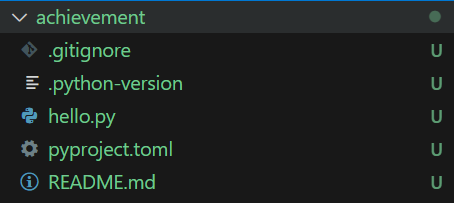

之后进入到 achievement 文件夹，执行如下命令安装 mcp 包。

```
uv add "mcp[cli]"
```

此时，uv 会创建出一个 .venv 虚拟环境，并自动安装一堆依赖。

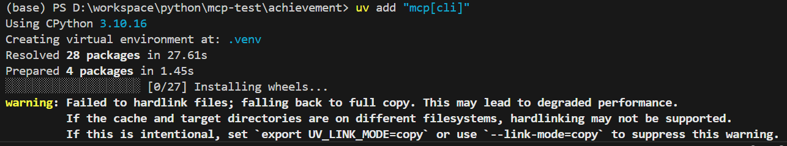

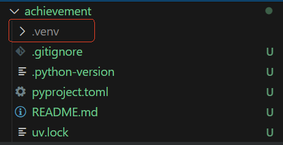

完成安装后，创建一个 server.py 文件，开始编写 MCP Server 代码。

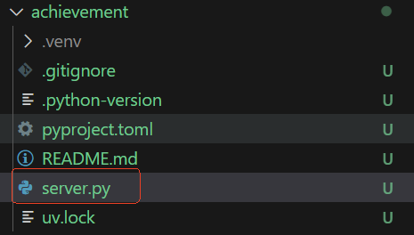

### 使用 Tool 能力

MCP Server 的 Python SDK，分为 FastMCP SDK 和 Low-Lever SDK 两种。FastMCP 是在Low-Level 的基础上又做了一层封装，不论是写代码，还是项目依赖等，操作起来都更加简单，容易上手。因此我建议你使用 FastMCP。

我们先从 Tool 开始写，代码如下：

```python
from mcp.server.fastmcp import FastMCP
# Create an MCP server
mcp = FastMCP("achievement")
# Add an get score tool
@mcp.tool()
def get_score_by_name(name: str) -> str:
   """根据员工的姓名获取该员工的绩效得分"""
   if name == "张三":
       return "name: 张三 绩效评分: 85.9"
   elif name == "李四":
       return "name: 李四 绩效评分: 92.7"
   else:
       return "未搜到该员工的绩效"
```

代码在开头引用了 FastMCP 包，之后在第 4 行创建了一个 MCP Server。

之后通过在第 7 行使用 @mcp.tool() 注解向 MCP Server 注册工具，被修饰的get_score_by_name 函数即为该工具的具体实现。

在之前编写 Function Calling 或者 Agent Tool 的代码时，我们知道工具的描述和实际的工具执行函数是分开的，比如：

```python
tools = [
   {
       "name": "get_score_by_name",
       "description": "使用该工具获取指定员工的绩效评分",
       "parameters": {
           "type": "object",
           "properties": {
               "name": {
                   "type": "string",
                   "description": "员工名字",
               }
           },
           "required": ["name"]
       },
   }
]
def get_score_by_name(name):
   if name == "张三":
       return "name: 张三 绩效评分: 85.9"
   elif name == "李四":
       return "name: 李四 绩效评分: 92.7"
   else:
       return "未搜到该员工的绩效"
```

如果我们使用 Low-Level SDK，写法会与上面的代码类似，也是要分开。但是使用FastMCP，就可以写在一起，把工具的描述以字符串的形式写在函数的开头，也就是前面MCP 代码的第 9 行。MCP Server 会识别出来这是工具的描述。

这样，一个带有 Tool 的 MCP Server，就写完了，是不是很简单呢？

接下来，我们可以修改 Roo Code 的 MCP Server 配置文件，配上这个 Server 来测试一下。我的配置文件内容如下：

```json
{
 "mcpServers": {
   "achievement": {
     "command": "uv",
     "args": [
       "run",
       "--with",
       "mcp[cli]",
       "--with-editable",
       "D:\\workspace\\python\\mcp-test\\achievement",
       "mcp",
       "run",
       "D:\\workspace\\python\\mcp-test\\achievement\\server.py"
     ]
   }
 }
}
```

这里请注意，你要把实际代码路径写成你自己的。然后就会显示出我们的 MCP Server 以及工具。

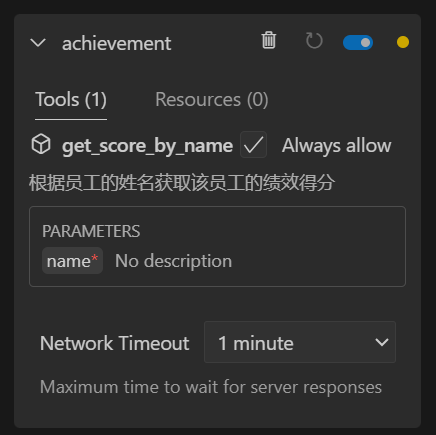

此时有可能会像下图一样有一些红色的 INFO 打印出来。

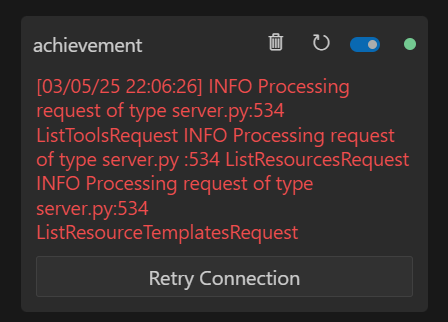

我们无需惊慌，忽略它就可以，只要是右上角的小点是绿色的，就说明连接成功了。

然后我们就可以测试了，提问“张三和李四的绩效谁高？”

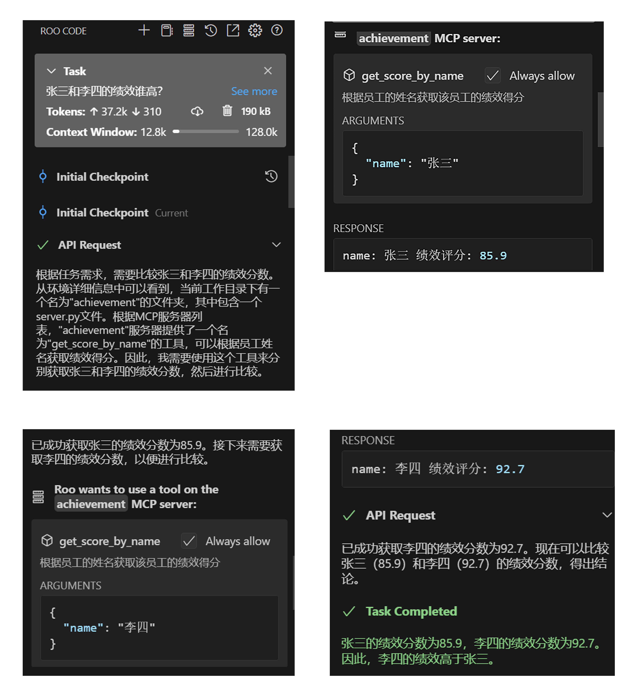

可以看到，大模型给出了正确答案，说明测试通过了。

### 使用 Resource 能力

接下来，我们学习 MCP Server 的第二种能力——Resource。

Resource 定义了大模型可以只读访问的数据源，可以用于为大模型提供上下文。

我在 server.py 的同级目录创建了一个 info.md，内容如下：

```
| 姓名  | 性别  | 年龄  |
| --- | --- | --- |
| 张三  | 男   | 28  |
| 李四  | 女   | 25  |
```

然后编写代码：

```python
@mcp.resource("file://info.md")
def get_file() -> str:
   """读取info.md的内容，从而获取员工的信息，例如性别等"""
   with open("D:\\workspace\\python\\mcp-test\\achievement\\info.md", "r", encod
       return f.read()
```

在上面的代码中，我用注解 @mcp.resource 修饰了 get_file() 函数，并在注解中定义了资源路径为：file://info.md，这是按照官方的文档格式来定义的，格式为：

```
[protocol]://[host]/[path]
```

这三个字段完全可以由我们自定义。

get_file 方法的功能，是读取 info.md 文件，以字符串形式返回。这样，就为大模型提供了读取 info.md 文件的能力。

接下来，我们进行测试。此时 Roo Code 虽然能显示我们的 Resource，但是却没办法直观进行测试。因此我们还是必须用 Claude Desktop 测试，才能看出效果。

Claude Desktop 注册比较麻烦，需要科学上网，美国信用卡以及能用外国的电话卡接收短信验证码。这对之前注册过 OpenAI 账号的同学来说是小意思，但新手可能费点劲。这些内容，我在这没法公开讲，如果谁有需求可以在留言区留下邮箱，我私发你方法。

前置条件准备好后，可以去 Download - Claude 注册和下载一个 Claude Desktop。没有条件的同学，可以以理解为主，IDE 都不支持这种方式，我们后面也基本不会用到。

Claude Desktop 安装完成后，可以我们的代码目录中执行如下命令：

```
mcp install server.py --with-editable ./
```

这样，mcp 命令行就会自动帮我们把 Claude Desktop 的 MCP Server 的配置文件修改好。然后我们启动 Claude Desktop，点击图中红框位置插座的标识，就可以看到 file://info.md 这条资源。

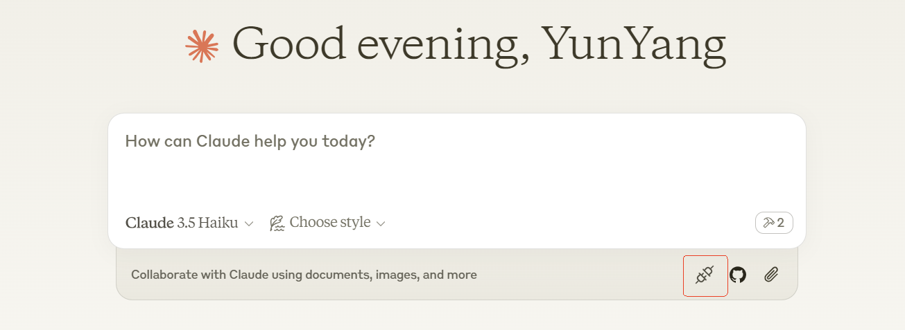

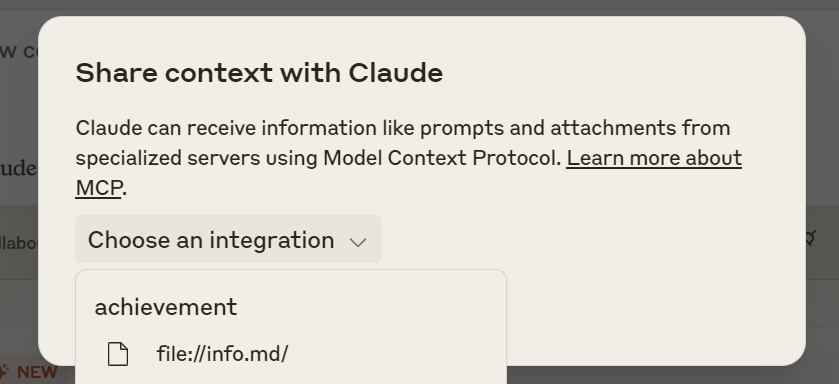

我们点击这条资源后，会自动跳到对话界面。

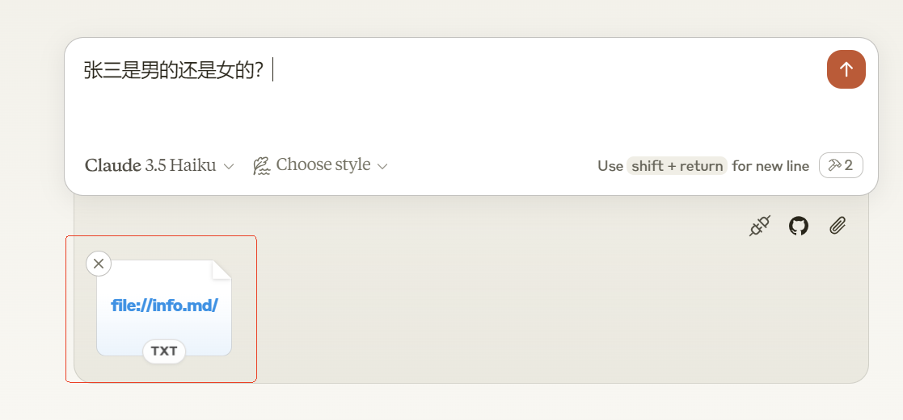

此时可以看到，对话界面就包含了这条资源。然后我们询问“张三是男的还是女的”，就可以得到正确的回答了。

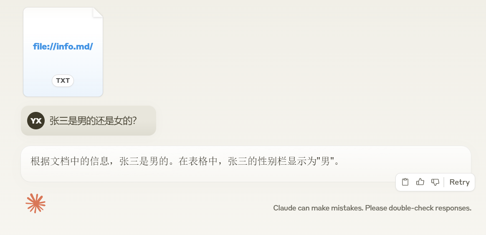

大家如果用过 ChatGPT、Kimi，DeepSeek 的文件对话功能，可能会觉得以上的 Resource 功能非常熟悉。比如，我用 DeepSeek 做演示：


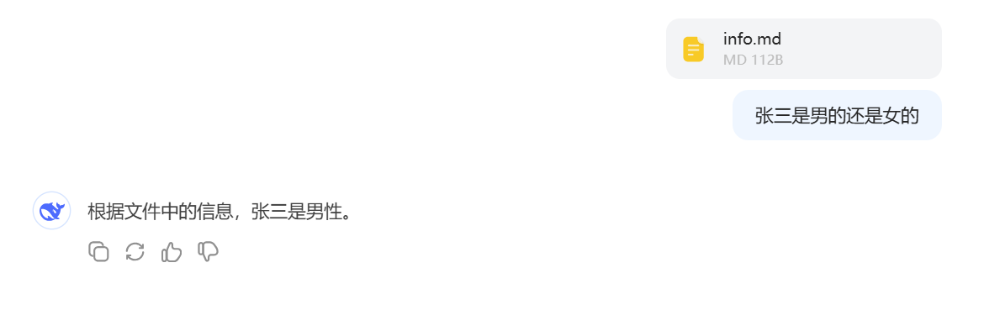

可以看到效果是一样的。

### 使用 Prompt 能力

最后我们看一下 Prompt 能力。这个能力也非常好理解，就是预设了一些 prompt 模板，这样在对话时，可以直接选择模板进行对话，就不用再手敲 prompt 了。示例代码如下：

```python
@mcp.prompt()
def prompt(name: str) -> str:
   """创建一个 prompt，用于对员工进行绩效评价"""
   return f"""绩效满分是100分，请获取{name}的绩效评分，并给出评价"""
```

我们预设了一个对指定姓名的员工进行评价的 prompt 模板，模板中需要注入的参数是姓名。

这个功能，也必须用 Claude Desktop 才能测试。我们重启 Claude Desktop，让其重新加载MCP Server。之后，依然是点击插头按钮，会看到比之前多了一个 prompt。

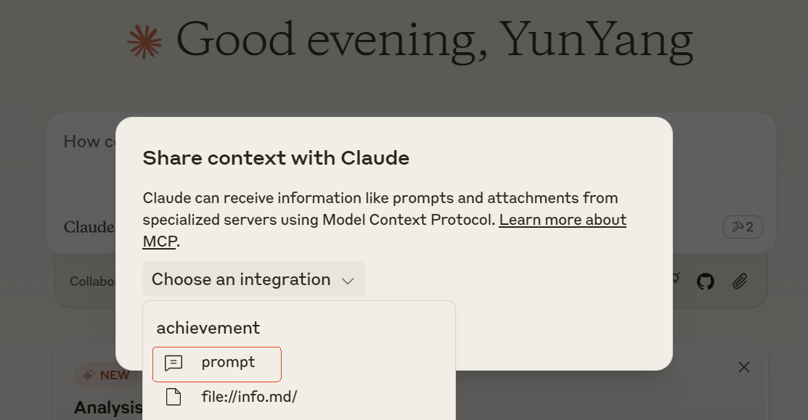

我们点击它，会让我们输入参数。

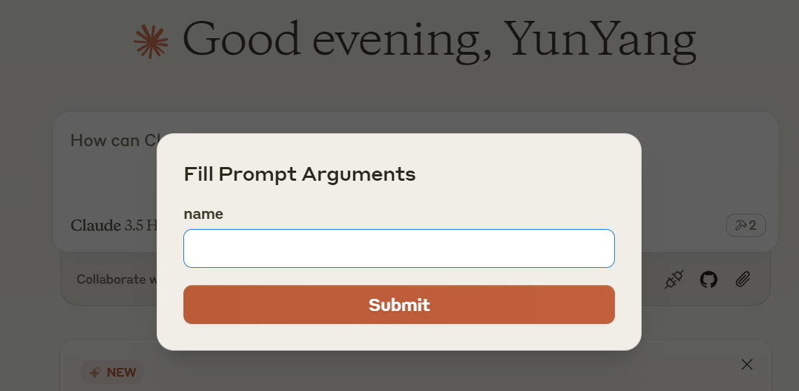

我们输入“张三”，点击 Submit，就会进入到对话页面。

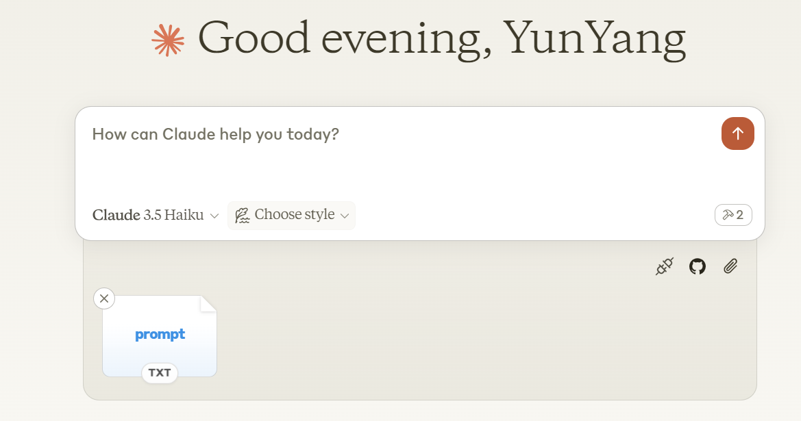

无需输入任何内容，直接点击发送。然后就能看到大模型给出评语了。

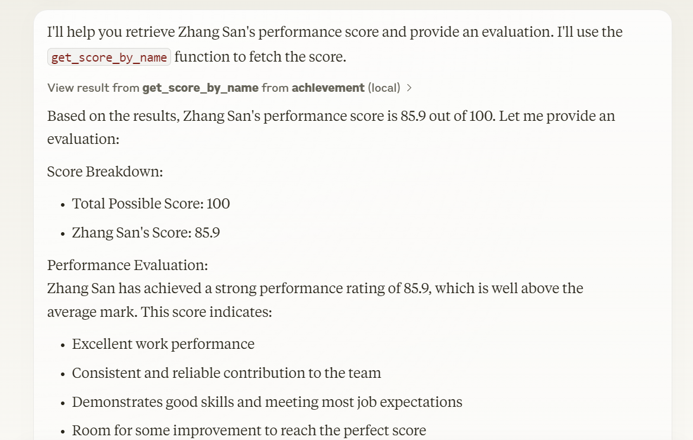

## 总结

通过对员工绩效系统这个简单的小项目，我们掌握了开发 MCP Server 的环境搭建、三大能力的代码编写以及如何编写配置文件，使得其能在 Roo Code 等 MCP Hosts 里运行。本节课的代码已经上传至我的 Github，你可以点击链接下载查看。

我们对这三大能力的接入点进行一下总结。

首先是 Tool，它是直接对接大模型的，可以由大模型自主选择工具，无需人类进行干涉，整个过程是全自动的。

接下来是 Resource，这个功能类似于文件对话功能，Resource 对接的是 MCP Hosts，需要MCP Hosts 额外开发与 Resouce 的交互功能，并且由用户进行选择，才能直接使用。

最后是 Prompt，它与 Resource 类似，也是需要用户的介入才能使用。

因此相对来说，Tool 更偏标准化接入，而且供应和消费分离，别人写了某个提供 Tool 的 MCPServer，其他人也可以直接用。另外，MCP Server Tool 与 Dify、Coze 等 Agent 的实现效果非常类似，所以它也容易在工程中被用户接受。

## 思考题

学完今天的内容，你得到我们文章开头的问题的答案了吗？为什么这三大能力只有 Tool 火起来了呢？

欢迎你在留言区展示你的思考结果，我们一起探讨。如果你觉得这节课的内容对你有帮助的话，也欢迎你分享给其他朋友，我们下节课再见！
