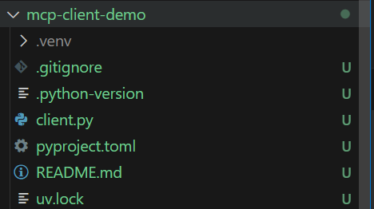
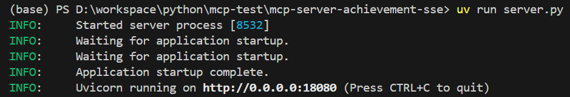
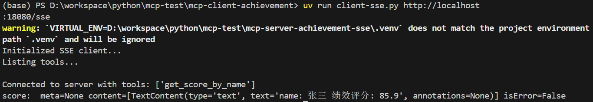
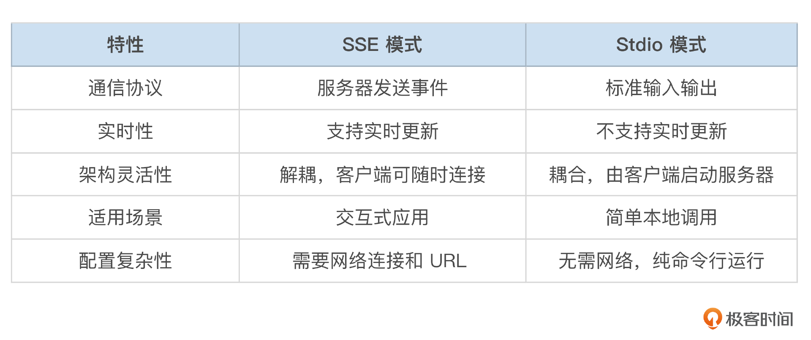

# 13 | 动手实现一个简单的MCPClient

你好，我是邢云阳。

上节课，我带你动手实现了一个 MCP Server，并使用 Roo Code 与 Claude Desktop 作为MCP 客户端测试了功能。这节课，我们将进一步学习如何使用 MCP Python SDK 来编写一个MCP Client，以便更加灵活地与 MCP 服务器进行通信和集成。

## MCP 通信方式

在写代码之前，我们需要先了解一下 MCP 支持的两种通信方式：

- 标准输入输出（Standard Input/Output, stdio）：客户端通过启动服务器子进程并使用标准输入（stdin）和标准输出（stdout）建立双向通信，一个服务器进程只能与启动它的客户端通信（1:1 关系）。stdio 适用于本地快速集成的场景。

- 服务器发送事件（Server-Sent Events, SSE）：服务器作为独立进程运行，客户端和服务器代码完全解耦，支持多个客户端随时连接和断开。

这节课，我们分别了解一下这两种方式。

## Stdio 方式

首先我来实现一个简单的示例，带你体会一下 stdio 方式 MCP Client 与 MCP Server 的通信过程。

### 项目初始化

我们还是使用 uv 工具对项目进行初始化。

```
uv init mcp-client-demo
uv add "mcp[cli]"
pip install mcp
```

初始化完成后，我们将 hello.py 删除，然后创建一个 client.py。



接下来，开始写代码。首先引用一下 MCP Client 的包。

```python
from mcp import ClientSession, StdioServerParameters
from mcp.client.stdio import stdio_client
```

### 设置服务器连接参数

之后需要编写设置服务器连接参数的代码。在使用 stdio 方式进行通信时，MCP 服务器的进程由 MCP 客户端程序负责启动。因此，我们通过 StdioServerParameters 来配置服务器进程的启动参数，包括运行 MCP 服务器的命令及其对应的参数。代码如下：

```
# Create server parameters for stdio connection
server_params = StdioServerParameters(
   command="uv", # Executable
   args=[
       "run",
       "--with",
       "mcp[cli]",
       "--with-editable",
       "D:\\workspace\\python\\mcp-test\\achievement",
       "mcp",
       "run",
       "D:\\workspace\\python\\mcp-test\\achievement\\server.py"
   ],# Optional command line arguments
   env=None # Optional environment variables
)
```

代码非常简单，就是一个 command 加 args。这两部分填的内容，就是上节课我们配置 MCPServer 运行的配置文件时的内容。通过配置这部分内容，可以确保 MCP 客户端能够正确启动并连接到 MCP 服务器。

### 建立服务器连接

接下来，我们写一个 run 方法来建立客户端与服务器的连接。

```
async def run():
   async with stdio_client(server_params) as (read, write):
       async with ClientSession(read, write) as session:
           # Initialize the connection
           await session.initialize()
```

stdio_client 负责启动服务器进程并建立双向通信通道，它返回用于读写数据的流对象。ClientSession 则在这些流的基础上提供高层的会话管理，包括初始化连接、维护会话状态等。代码无需深究其含义，会套路即可。

### 调用工具

接下来就是 MCP Client 的核心部分——工具的调用。工具的调用分为两个步骤，第一个步骤是列出 MCP Server 支持的工具，即 list_tools()。第二个步骤是调用指定工具，即call_tool(name, args)。 代码如下：

```
async def run():
   async with stdio_client(server_params) as (read, write):
       async with ClientSession(read, write) as session:
           # Initialize the connection
           await session.initialize()
           # List available tools
           tools = await session.list_tools()
           print("Tools:", tools)
           # call a tool
           score = await session.call_tool(name="get_score_by_name",arguments={"
           print("score: ", score)
```

由于我们是与上一节课的 MCP Server 建立的连接，因此 call_tool 的 name 参数填写上节课写的 get_score_by_name 工具，工具的参数是一个字典类型，需要写成 {“arg1”: “value”} 的形式，此处写“张三”，表示返回张三的绩效。

最后不要忘了启动 run 函数。

```python
if __name__ == "__main__":
   import asyncio
   asyncio.run(run())
```

### 运行客户端

我们可以使用 uv 命令运行程序。

```
uv run .\client.py
```

打印信息如下：

```
[03/06/25 21:15:35] INFO     Processing request of type ListToolsRequest
Tools: meta=None nextCursor=None tools=[Tool(name='get_score_by_name', descriptio
分', inputSchema={'properties': {'name': {'title': 'Name', 'type': 'string'}}, 'r
                   INFO     Processing request of type CallToolRequest
score:  meta=None content=[TextContent(type='text', text='name: 张三 绩效评分: 85.9
```

可以看到 list_tools 列出了我们定义的 get_score_by_name 工具，而且很神奇的是我们的打印结果还包含了 inputSchema，这说明 MCP Server 自动帮我们写了 JSON 格式的参数描述。

之后我们通过 call_tools 调用了 get_score_by_name 工具，成功返回了张三的绩效。这说明我们这个手动版本的 MCP Client 与 MCP Server 成功建立了通信。

## SSE 方式

接下来我们看一下 SSE 方式，需要首先了解一下什么是 SSE。

### 什么是 SSE？

Server-Sent Events（SSE，服务器发送事件）是一种基于 HTTP 协议的技术，允许服务器向客户端单向、实时地推送数据。在 SSE 模式下，客户端通过创建一个 EventSource 对象与服务器建立持久连接，服务器则通过该连接持续发送数据流，而无需客户端反复发送请求。MCP Python SDK 使用了 Starlette 框架来实现 SSE。

SSE 模式下客户端通过访问 Server 的 /messages 端点发送 JSON-RPC 调用，并通过 /sse端点获取服务器推送的 JSON-RPC 消息。

### 改造 MCP Server 代码

为了能让上节课编写的 MCP Server 代码支持 SSE，我们需要对代码进行改造。改造点主要是需要实现一个 SSE 服务器。先上代码：

```python
def create_starlette_app(mcp_server: Server, *, debug: bool = False) -> Starlette
   """Create a Starlette application that can server the provied mcp server with
   sse = SseServerTransport("/messages/")
   async def handle_sse(request: Request) -> None:
       async with sse.connect_sse(
               request.scope,
               request.receive,
               request._send,
       ) as (read_stream, write_stream):
           await mcp_server.run(
               read_stream,
               write_stream,
               mcp_server.create_initialization_options(),
           )
   return Starlette(
       debug=debug,
       routes=[
           Route("/sse", endpoint=handle_sse),
           Mount("/messages/", app=sse.handle_post_message),
       ],
   )
```

该函数在最开始创建了 SseServerTransport 对象，并指定基础路径 /messages/，用于后续管理 SSE 连接和消息传递。

之后的 handle_sse 是一个异步请求处理函数，当客户端请求建立 SSE 连接时会被调用。在该方法中利用 sse.connect_sse 方法，传入当前请求的 scope、receive 方法和 _send 方法，建立一个异步上下文管理器。管理器会返回两个数据流，分别是 read_stream 用于读取客户端发送的数据以及 write_stream 用于向客户端发送数据。

在成功建立连接后，调用 mcp_server.run 方法，并传入读取、写入流以及由mcp_server.create_initialization_options() 生成的初始化参数。这一过程实现了 MCP 服务器与客户端之间的实时数据交互。

最后 create_starlette_app 方法返回一个新的 Starlette 应用实例，包括调试模式以及路由设置。

路由设置使用 Route(“/sse”, endpoint=handle_sse) 定义 /sse 路径，当客户端访问此路径时将触发 handle_sse 函数处理 SSE 连接。

使用 Mount(“/messages/”, app=sse.handle_post_message) 将 /messages/ 路径挂载到sse.handle_post_message 应用上，用于处理通过 POST 请求发送的消息，实现与 SSE 长连接的消息传递功能。

这样，一个 SSE 服务就实现好了。这部分代码对于 Python 新手来说有点抽象，可以先直接照抄，使用起来，等到后面对于 Python 越来越熟练了，再去理解。

另一个改造点需要创建 MCP 服务器实例，然后通过上面定义的 create_starlette_app 方法创建 Starlette 应用，最后使用 uvicorn 启动 ASGI 服务器，实现实时的 SSE 数据传输。代码如下：

```
if __name__ == "__main__":
   mcp_server = mcp._mcp_server
   parser = argparse.ArgumentParser(description='Run MCP SSE-based server')
   parser.add_argument('--host', default='0.0.0.0', help='Host to bind to')
   parser.add_argument('--port', type=int, default=18080, help='Port to listen o
   args = parser.parse_args()
   # Bind SSE request handling to MCP server
   starlette_app = create_starlette_app(mcp_server, debug=True)
   uvicorn.run(starlette_app, host=args.host, port=args.port)
```

同样是先用起来，我们的重点要放在工具如何编写上，这种套路代码，都不需要研究太深。

代码完成后，可以通过 uv 命令运行起来：

```
uv run server.py
```

效果为：



### 改造 MCP Client 代码

客户端的改造会相对简单，就是使用 sse_client 替换 stdio_client，并在初始化时传入 MCPServer 的 HTTP 访问地址。代码如下：

```
async def connect_to_sse_server(server_url: str):
   """Connect to an MCP server running with SSE transport"""
   # Store the context managers so they stay alive
   async with sse_client(url=server_url) as (read, write):
       async with ClientSession(read, write) as session:
           await session.initialize()
           # List available tools to verify connection
           print("Initialized SSE client...")
           print("Listing tools...")
           response = await session.list_tools()
           tools = response.tools
           print("\nConnected to server with tools:", [tool.name for tool in too
           # call a tool
           score = await session.call_tool(name="get_score_by_name",arguments={"
           print("score: ", score)
```

这段代码是对原来的 run 方法进行了改造，重点在于 1～6 行，其他部分保持不变。

之后在启动时传入 URL 即可。

```
async def main():
   if len(sys.argv) < 2:
       print("Usage: uv run client.py <URL of SSE MCP server (i.e. http://localh
       sys.exit(1)
   await connect_to_sse_server(server_url=sys.argv[1])
if __name__ == "__main__":
   asyncio.run(main())
```

同样是使用 uv 命令运行程序：

```
uv run client-sse.py http://localhost:18080/sse
```

效果为：



至此，SSE 方式就实现了。

## 总结

今天我们学习了 MCP Client 与 Server 之间的两种通讯方法，并使用代码实操的方式，体验了这两种方法的效果。这节课的代码已经放到了我的 GitHub 上。接下来我们通过一张表格，对这两种方式进行对比和总结。



这两种方式各有所长，于是开源社区便研发了一些协议转换工具，比如 mcp-proxy ，允许将 stdio 模式的服务器转换为 SSE 模式运行。例如，用户可以通过 mcp-proxy 在 ClaudeDesktop 中使用 stdio 服务器，而无需重新实现为 SSE 模式。

最后提醒一下，MCP 毕竟是一个刚出现了半年的新东西，虽然在社区引起了一些反响，也有很多 IDE 进行了接入，但还远远没有发展到能和 Agent 二分天下的时候。因此我为你讲解这个技术就是为了追新，让你有一个知识储备，以不变应万变。基本就学到这个程度就可以了，无需太深究，否则一旦后面 MCP 没发展起来，现在过度深究就是走弯路了。

## 思考题

你认为 Roo Code 等 IDE 用的是 Stdio 还是 SSE 方式？

欢迎你在留言区展示你的思考结果，我们一起探讨。如果你觉得这节课的内容对你有帮助的话，也欢迎你分享给其他朋友，我们下节课再见！
