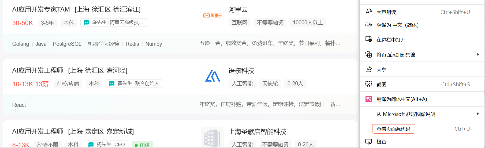
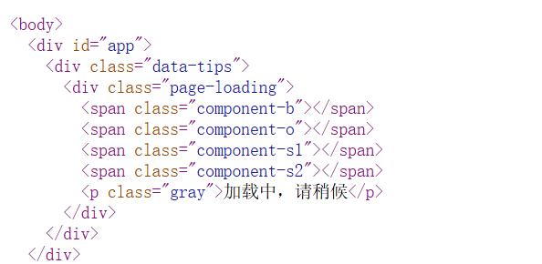
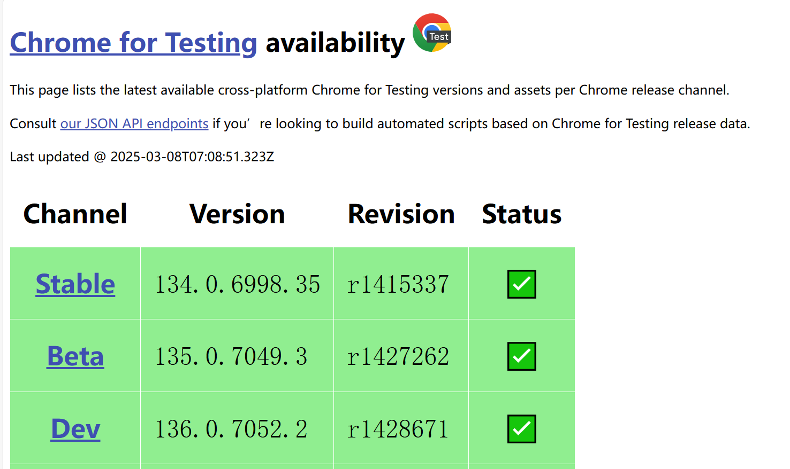
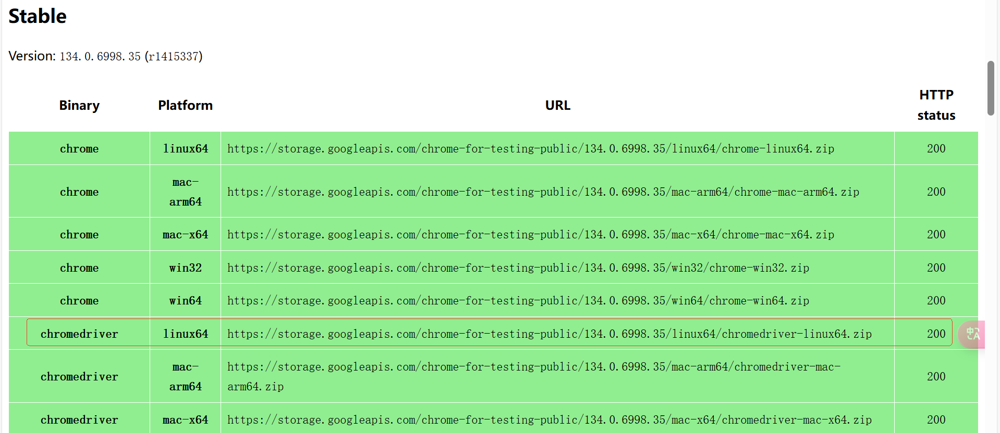
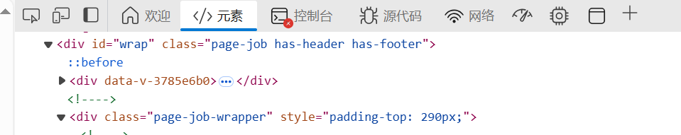
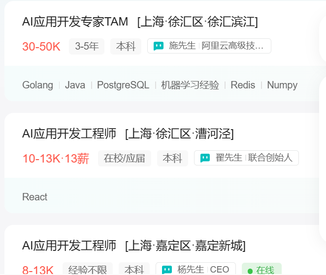
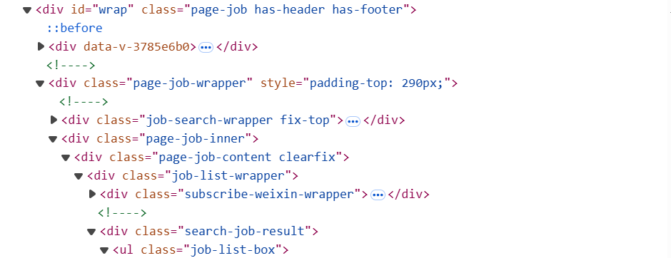
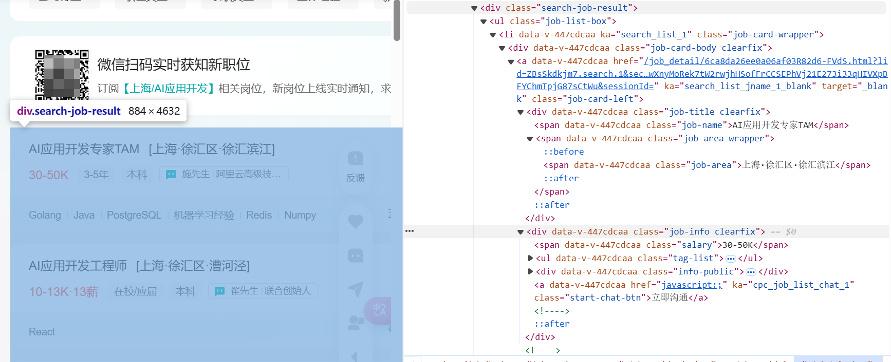
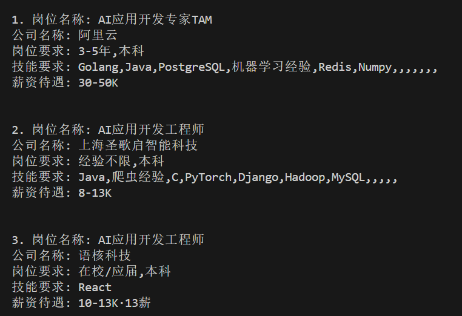

# 14 | 网络爬虫：无头浏览器抓取技术

你好，我是邢云阳。

经过前三节课对模型上下文协议（MCP）技术的系统学习，还有手写 MCP Server 和 Client的实践，相信你深入掌握了模型与外部系统通信的核心机制。值得注意的是，无论是 MCP 协议还是当下流行的 Agent、Function Calling 技术，本质上都在构建大模型与真实世界的交互桥梁——这也正是我们打造求职助手项目所需的关键能力。

从这节课开始，我们将正式开启求职助手项目的实战开发。

## 数据源如何获取

在着手编码之前，让我们先进行关键的需求拆解。

这个项目需要实现两大核心功能：

1. 可以根据招聘网站上的岗位列表，使用自己的简历匹配合适的工作。

2. 可以根据岗位需求自动调整我们的简历。

其中，岗位数据是我们这个项目的重要数据源。那如何获取到岗位数据呢？

后面这几种方法比较常用。

第一种是使用网站提供的 OpenAPI。通常某些网站会对外提供 OpenAPI 的付费调用服务，例如高德地图等等，使用这种方法是最简单直接的。

第二种是利用传统爬虫技术。在传统爬虫开发中，我们通常会使用 requests+BeautifulSoup组合直接抓取网页 HTML 内容。例如通过 Python 发送 HTTP 请求获取页面源码，再用 XPath或 CSS 选择器解析数据。

当然在 MCP 官方提供的 MCP Server 中，也有一个 Fetch MCP Server，可以直接向其提供网站的 URL，该 Server 就可以直接解析网站内容。

不过这种方式看似简单高效，但对于很多不想对外开放数据的网站来说，却是不可行的。这是因为这些网站都是通过后端语言来读取数据库服务器的数据，然后动态加载到前端网页上的，而且很多网站还会带有一些防抓取机制。因此此时如果直接抓取网页内容，是得不到数据的。

比如，以某招聘网站为例，我们搜索到职位列表后，在网站点击鼠标右键，选择查看页面源代码。



可以看到，此时出现的 HTML 静态页中是不包含岗位信息的。



此时，比较好的实现方案是使用无头浏览器技术。需要注意的是，在这里我仅仅是从技术的角度出发来分享这个知识，获取到的任何数据，都不能进行商用。

## 无头浏览器实践

接下来我们就来看看什么是无头浏览器。所谓的无头浏览器，指的是没有界面的浏览器。我们依然可以借助火狐，谷歌等浏览器进行数据的抓取，但不会产生界面。

这项技术有一个比较常用的框架，叫做 Selenium，它是一个自动化测试和浏览器自动化的开源框架。它允许开发人员编写脚本，并借助浏览器和浏览器的驱动，来模拟在浏览器中的行为，自动执行一些列的操作，比如点击按钮、填写表单、导航到不同的页面等。

我们今天就来试试最新的 selenium 4.x 的代码编写方法。

### 环境准备

我会将 Linux 和 Windows 系统的环境准备都讲一下，便于你按需选择。

Linux

先来看 Linux 系统。我使用的是一台 ubuntu 22.04 的服务器。

首先在 python 环境中使用如下命令安装 selenium SDK：

```
pip install selenium==4.23.1
```

搞定之后，还需要装好浏览器以及浏览器驱动。以 Google Chrome 浏览器为例，安装起来也并不复杂。

首先下载 Chrome 浏览器的安装包：

```bash
wget https://dl.google.com/linux/direct/google-chrome-stable_current_amd64.deb
```

接着执行一下后面的命令，防止安装浏览器时找不到依赖。

```bash
apt-get install -f
```

完成后，继续执行后面的命令安装浏览器。

```
dpkg -i google-chrome-stable_current_amd64.deb
```

安装好了之后，我们查看一下浏览器的版本。

```
root@hi-test:~# google-chrome --version
Google Chrome 134.0.6998.35
```

可以看到，我的版本是 134.0.6998.35，由于 Chrome 更新的速度非常快，当你学到这一节时，很有可能版本已经和我不一样了，因此一定要查看自己的版本，以实际为准。

接下来就是安装 Chrome 的驱动了，有了驱动，Selenium 才能调用浏览器去做操作。驱动需要和我们的浏览器使用同一个版本，这也是我上面要求你根据自己实际情况来的原因。

驱动版本可以通过访问这个网址 https://googlechromelabs.github.io/chrome-for-testing/

来获取。打开后，会出现如下的界面：



可以看到，最新的版本就是我刚才安装的浏览器版本。我们将网页往下拉，就可以看到该版本的安装包了。



然后使用 wget 将 linux 版本的下载到服务器，使用 unzip 解压即可。

```bash
wget https://storage.googleapis.com/chrome-for-testing-public/134.0.6998.35/linux
```

Windows

Windows 系统就非常简单了。直接访问前面提到的这个网站Chrome for Testingavailability，将 win64 版本的 chrome 和 chromedriver 都下载下来，解压到本地即可。

解压完成之后，我们就可以开始写代码了。

### 示例代码编写

我以在 Linux 系统上，使用无头浏览器访问魔搭社区首页为例，来为你演示。先上代码：

```python
from selenium import webdriver
from selenium.webdriver.common.by import By
from selenium.webdriver.chrome.options import Options
from selenium.webdriver.chrome.service import Service
def test():
    #定位到 可执行程序
   chromedriver_path="/root/chromedriver-linux64/chromedriver"
   # '--verbose',  log_output=sys.stdout,
   service = Service(executable_path=chromedriver_path,
                     service_args=['--headless=new','--no-sandbox',
                                   '--disable-dev-shm-usage',
                                   '--disable-gpu',
                                   '--ignore-certificate-errors',
                                   '--ignore-ssl-errors',
                                  ])
   options = Options()
   options.add_argument('--headless')
   options.add_argument('--no-sandbox')
   options.add_argument('--disable-dev-shm-usage')
   options.add_argument('--ignore-certificate-errors')
   options.add_argument('--ignore-ssl-errors')
   driver = webdriver.Chrome(options=options,service=service)
   driver.get("https://modelscope.cn/my/overview")
   print(driver.title)
   driver.quit()
if __name__ == "__main__":
   test()
```

代码非常简单，首先是第 9 行，指定了 Chrome 驱动的文件夹路径，这个路径就是刚才解压Chrome 驱动的目标路径。之后从第 11 行到第 24 行是谷歌浏览器的一些默认配置，你可以先暂时忽略，我们后面再讲。第 26 行是创建了一个 Chrome 驱动的执行器。有了这个执行器，就可以完成打开魔搭社区主页（对应第 28 行）和获取 title 的操作了（对应第 29 行）。

代码执行的结果如下：

```
首 页  · 魔 搭 社 区
```

### 从元素中获取数据

有了前面的基础，接下来，我们就以在某直聘网站获取上海市的 AI 应用开发的岗位列表为例，学习一下如何抓取从元素中抓取数据。

首先，我们打开某直聘网站，在键盘上按 F12，进入到浏览器的调试工作台。之后将工作台的页面切换到元素。



然后在网站上将城市切换到上海，在职位搜索的输入框输入“AI 应用开发”，这样会搜索到很多关于 AI 应用开发的岗位。比如 AI 应用开发专家 TAM。



此时控制台的元素页面，也会渲染出内容。类似这样：



我们随便点击一个元素，在键盘上按 Ctrl+F，打开搜索框，输入 TAM（因为上文搜到的职位列表中第一条就是 AI 应用开发专家 TAM），这样就能定位到职位列表所在的 class。



可以看到，职位列表是在 search-job-result 里的 job-list-box 中，该 list 中包含 job-name, job-area 等等多个 span，我们只需要使用无头浏览器抓取这些数据，便可以得到职位列表。

沿着这个思路，我们来看一下关键代码的实现，该代码会在 windows 上执行。

首先是谷歌浏览器的设置问题，代码如下：

```python
def get_UA():
   UA_list = [
       'Mozilla/5.0 (Windows NT 10.0; Win64; x64) AppleWebKit/537.36 (KHTML, lik
       'Mozilla/5.0 (Windows NT 10.0; Win64; x64) AppleWebKit/537.36 (KHTML, lik
       'Mozilla/5.0 (Windows NT 10.0; Win64; x64) AppleWebKit/537.36 (KHTML, lik
       ]
   randnum = random.randint(0, len(UA_list) - 1)
   UA = UA_list[randnum]
   return UA
...
options = Options()
options.add_argument('--disable-gpu') # 禁用GPU渲染
options.add_argument('--incognito')    # 无痕模式
options.add_argument('--ignore-certificate-errors-spki-list')  # 忽略与证书相关的错误
options.add_argument('--disable-notifications')  # 禁用浏览器通知和推送API
options.add_argument(f'user-agent={get_UA()}')   # 修改用户代理信息
options.add_argument('--window-name=huya_test')  # 设置初始窗口用户标题
options.add_argument('--window-workspace=1')  # 指定初始窗口工作区  #
options.add_argument('--disable-extensions')  # 禁用浏览器扩展
options.add_argument('--force-dark-mode')  # 使用暗模式
options.add_argument('--start-fullscreen')  # 指定浏览器是否以全屏模式启，与进入浏览器后
options.add_argument('--start-maximized')
```

代码开始通过一个函数设置了 UserAgent。UserAgent（用户代理）是指在 HTTP 请求中，客户端（通常是浏览器）发送给服务器的头部信息，用于标识客户端的软件、设备、操作系统等相关信息。用户可以通过更改 User Agent，来隐藏真实的浏览器和设备信息。

之后还要为浏览器做一些相应的设置，每一个参数是什么意思，你可以参考我添加的注释看一下，简单了解即可。这样设置之后，当我们运行代码时，会弹出一个被代码自动控制的浏览器，我们便可以直观看到代码是否访问成功了目标网站。

设置浏览器完成后，接下来就是抓取岗位信息的代码。

```
driver.get(url)
WebDriverWait(driver, 1000, 0.8).\
   until(EC.presence_of_element_located((By.CSS_SELECTOR,
     '.job-list-box'))) #等待页面加载到出现job-list-box 为止
li_list=driver.find_elements(By.CSS_SELECTOR,
                         ".job-list-box li.job-card-wrapper")
jobs=[]
for li in li_list:
   job_name_list=li.find_elements(By.CSS_SELECTOR,".job-name")
   if len(job_name_list)==0:
       continue
   job={}
   job["job_name"]=job_name_list[0].text
   job_salary_list=li.find_elements(By.CSS_SELECTOR,".job-info .salary")
   if job_salary_list and len(job_salary_list)>0:
       job["job_salary"]=job_salary_list[0].text
   else:
       job["job_salary"]="暂无"
   job_tags_list=li.find_elements(By.CSS_SELECTOR,".job-info .tag-list li")
   if job_tags_list and len(job_tags_list)>0:
       job["job_tags"]=[tag.text for tag in job_tags_list]
   else:
       job["job_tags"]=[]
   com_name=li.find_element(By.CSS_SELECTOR,".company-name")
   if com_name:
       job["com_name"]=com_name.text
   else:
       continue
   com_tags_list=li.find_elements(By.CSS_SELECTOR,".company-tag-list li")
   if com_tags_list and len(com_tags_list)>0:
       job["com_tags"]=[tag.text for tag in com_tags_list]
   else:
       job["com_tags"]=[]
   job_tags_list_footer=li.find_elements(By.CSS_SELECTOR,".job-card-footer  li")
   if job_tags_list_footer and len(job_tags_list_footer)>0:
       job["job_tags_footer"]=[tag.text for tag in job_tags_list_footer]
   else:
       job["job_tags_footer"]=[]
   jobs.append(job)
driver.close()
job_tpl="""
{}. 岗位名称: {}
公司名称: {}
岗位要求: {}
技能要求: {}
薪资待遇: {}
"""
ret=""
if len(jobs)>0:
   for i, job in enumerate(jobs):
       job_desc = job_tpl.format(str(i + 1), job["job_name"],
                               job["com_name"],
                               ",".join(job["job_tags"]),
                               ",".join(job["job_tags_footer"]),
                               job["job_salary"])
ret += job desc + "\n"
```

代码首先使用 WebDriverWait 等待页面加载出 job-list-box，如果没加载出来，会一直卡在这，直到超时。

接着通过 find_elements，可以获取 job-class-wrapper 的内容，也就是职位列表。find_elements 是可以通过 By.xx 指定元素，来获取到相关的内容，例如 By.ID 等等。

有了职位列表之后，接下来，我们只需要遍历职位列表，按我们在控制台看到的标签的名称，比如 job_name 等，取出相应的内容就可以。

最后，我定义了一个 job_tpl 模板，将取到的内容按模板内容进行格式化，这样就完成了抓取岗位数据的工作。

代码的执行效果为：



这节课的代码，我会放到我的 Github 上，大家可以进行学习测试。但需要强调的一点是，网站的元素名称，有可能过一段时间就会有变化，此时大家就需要按照今天学习的方法，看一下元素的名称改成啥了，然后去调整代码。

## 总结

今天这节课，我们正式开启了求职助手的项目实战开发。因为我们要让大模型帮我们匹配合适的工作，因此准备岗位数据，属于前置工作。

我们首先了解了几种常用的获取数据的方法，比如使用商用的 API，使用传统爬虫或 Fetch 工具，以及使用无头浏览器等。之后我们重点讲解了无头浏览器技术的编程框架 Selenium 的用法。

对于此类框架的学习，大家一定要记住一个核心要素，那就是不要去深究框架的代码原理，只要学会如何使用即可，除非你是想要做一个类似的框架，那才需要去参考源码的实现。

有了这节课的数据做基础，后面我们就能正式借助 MCP ，让它帮我们从众多工作中挑选出合适的选项了。

## 课后题

希望你可以下载并阅读这节课的代码，理解一下其思路，有什么问题我们留言区交流。如果你觉得这节课的内容对你有帮助的话，也欢迎你分享给其他朋友，我们下节课再见！
