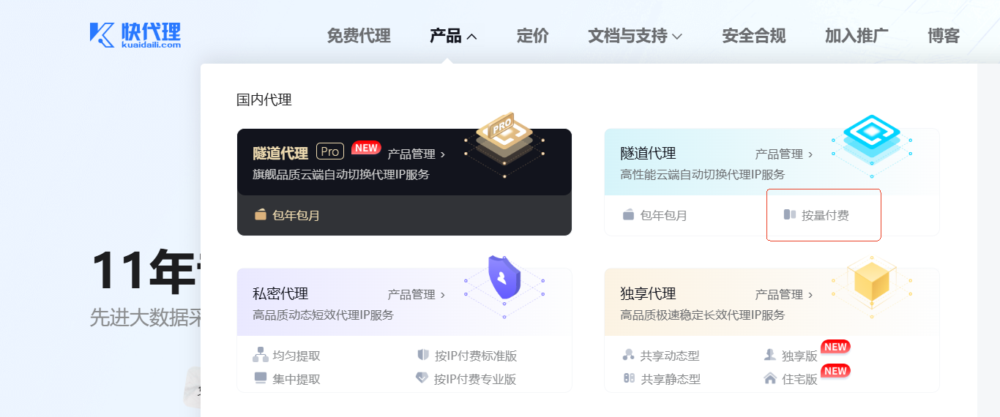
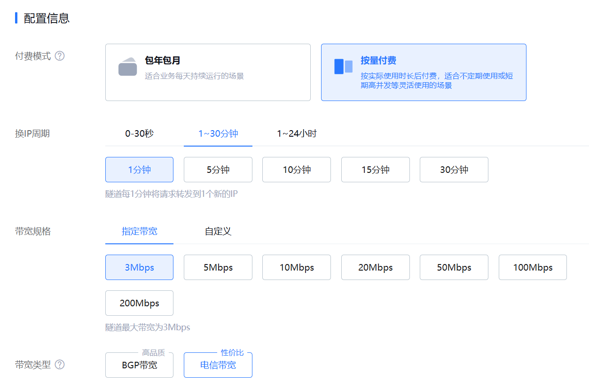
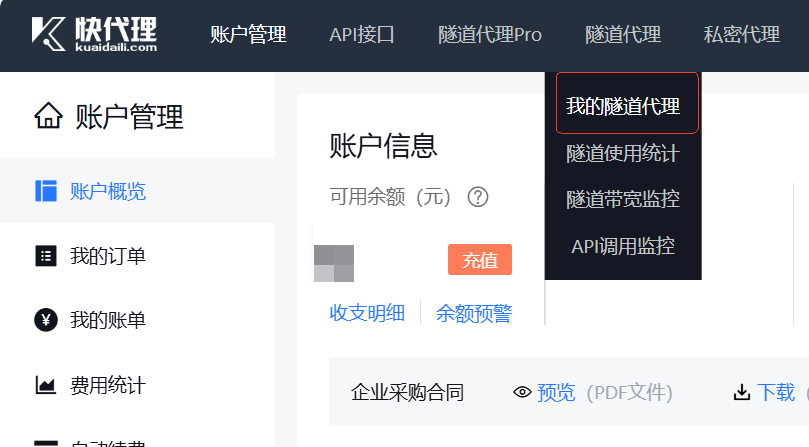
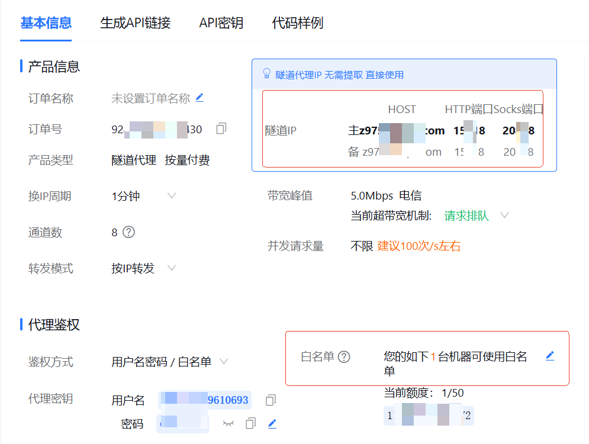
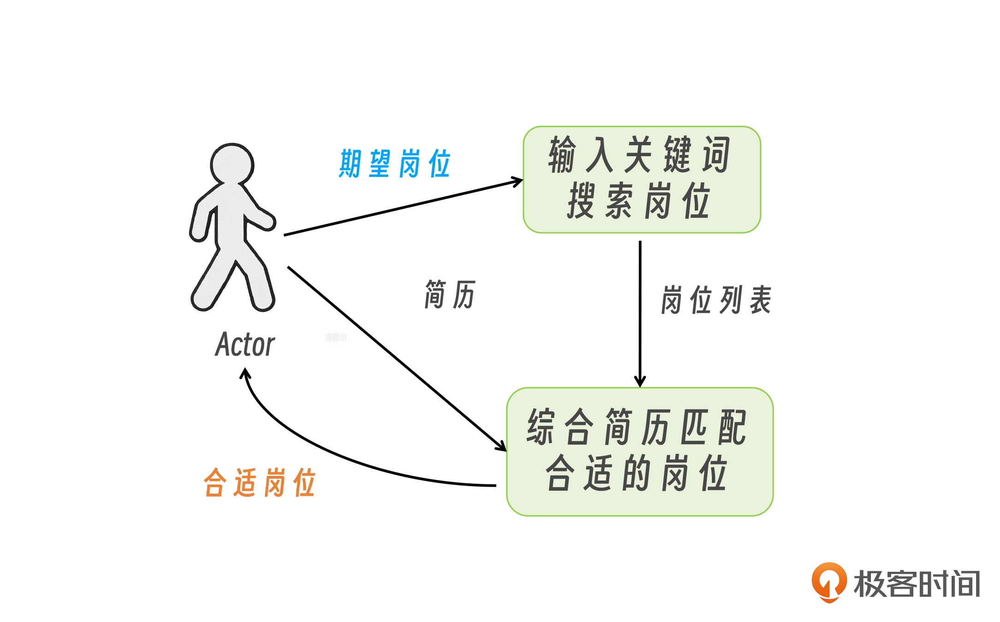
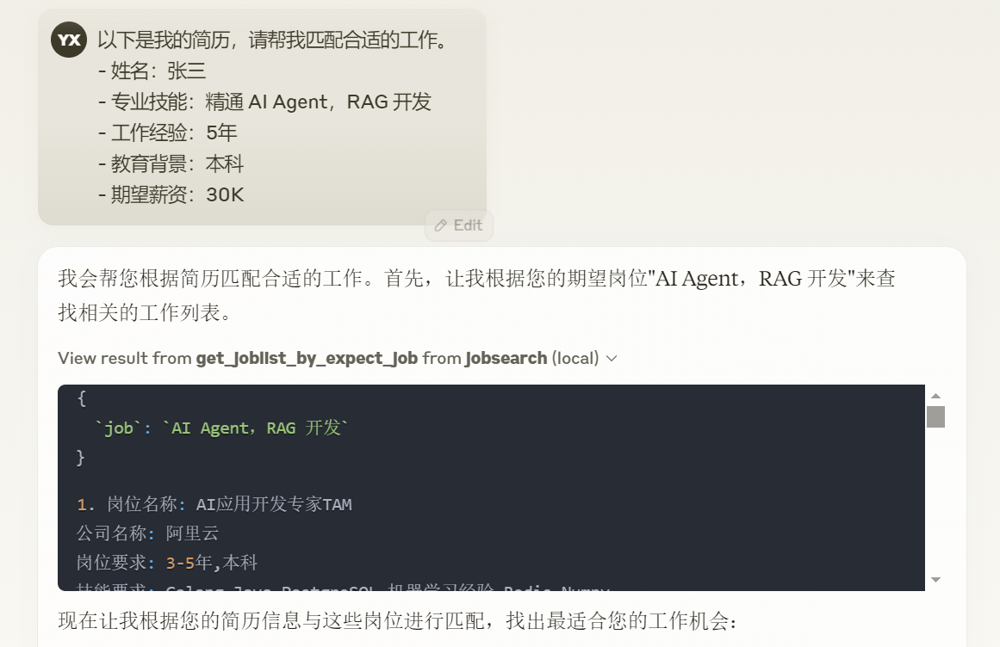
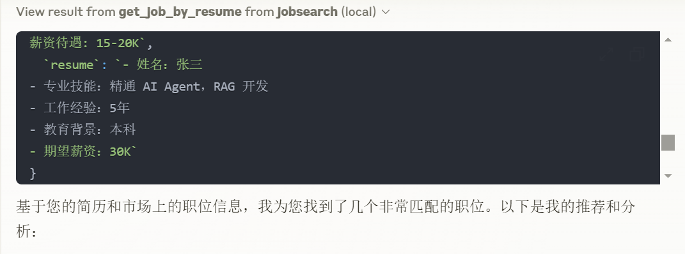
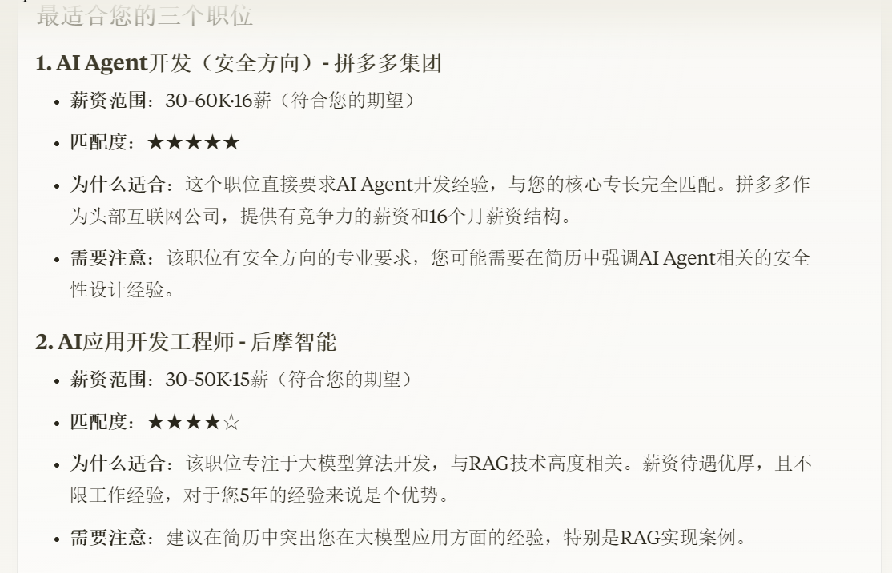
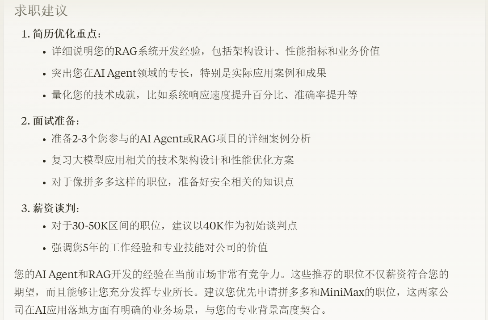

# 15 | 找工作：如何让DeepSeek帮我们找工作？

你好，我是邢云阳。

上节课，我们使用了无头浏览器的技术，准备了项目的岗位数据。有了这个基础，我们后面继续开发求职助手就会更方便。

我们今天就开发一个 MCP Server，然后测试一下，如何结合 DeepSeek-R1 模型来完成岗位信息查找，看看找到的岗位会不会更加适合自己呢？

## 无头浏览器的补充知识点

在开始今天的开发之前，先补充一个知识点。上节课，有同学回去测试，可能将代码跑起来后，某直聘网给出了这样的回复：

```
title: 网站访客身份验证
```

这是因为，网站认为访问网站的不是真人而是机器人、爬虫程序等等，因此将你的 IP 标注为了可疑 IP。这时候，我们就需要花点钱，去网上租用代理 IP。然后在程序中设置使用代理 IP进行访问，由于代理 IP 可以设置每分钟、每 5 分钟、每小时等等频率更换新的 IP，因此可以避免被网站标注后无法访问的情况。

那代理 IP 如何购买呢？在网上搜索代理 IP，会出来很多卖该项服务的网站。这里我就以快代理为例，为大家演示一下如何购买代理 IP，以及在程序中使用。

我们打开网站后，先注册并实名认证一下。然后选择产品–> 隧道代理–> 按量付费。



此时会进入到选择产品规格的页面。在这里建议换 IP 周期选择 1 分钟或 5 分钟，方便多次访问网站的测试。带宽根据自己的财力来，测试的话，3Mbps 和 5Mbps 也足够了。



这样的配置是每小时 5.31 元。然后点击右侧的开通，付费购买即可。

付费后，点击右上角的会员中心，会进入到账户管理界面。



此时，选择隧道代理–> 我的隧道代理。会看到下图所示的基本信息页面。



如果你是像我上节课一样，程序在本机执行的，则可以点击白名单，把本机 IP 加入进去，这样就不用使用代理密钥了。最后，我们在程序的 chrome 浏览器的 options 配置中使用红框中的隧道 IP （HOST:HTTP 端口）就可以代理访问了。代码如下：

```
options.add_argument('--proxy-server=http://z976.xxxxx.com:15818')
```

注意，这里你需要将 z976.xxxxx.com:15818 换成你自己实际的 HOST 和 HTTP 端口。

这样，访问受限的问题就解决了。

## 利用 MCP Server 实现求职助手

前置知识补充完整后，我们正式开始实现求职助手。首先完成方案与工具的设计。

### 方案与工具设计

先来回忆一下人工找工作的过程。

第一步，通常我们会打开招聘网站，去选择目标城市，然后输入期望工作岗位的关键词，比如AI 应用开发，进行搜索。

第二步，我们会根据网站给出的职位列表，一个个的查看。此时，如果我们不是面试“老油条”，对于 HR 列出的一些岗位要求、技能等等，无法做出是否适合自己的判断，可能就不太容易找到适合自己的工作。

第三步，假如查看到感觉适合自己的岗位后，就开始投递简历，或者直接海投简历。

第四步，等待面试。或许由于在第二步和第三步，我们投递的公司的要求不符合我们的技能，就导致面试官提问的问题，我们都不会，从而自信心受挫，认为自己水平不行。但实际上，这很大程度上是源于第二阶段人岗匹配的偏差，而非个人真实专业水平的体现。

因此如果能让大模型来帮助我们完成前两步，以大模型的数据分析能力，大概率会比人类自己肉眼匹配的更加精准。

我们把前两步用一个流程图抽象出来，然后思考一下，如何让大模型来完成呢？


实际上很简单，就是要把大模型想象成人，以前这两步是人来做，现在是要把这两步封装成两个工具，然后把工具交给大模型来调用。

方案框架明确以后，我们再来看输入输出。首先是搜索岗位工具，其入参是用户期望岗位，返回值是岗位列表；而匹配岗位的入参有两个，分别是岗位列表以及用户简历，返回值是合适的岗位。

那入参从哪来呢？也非常简单。用户期望岗位以及简历是由用户输入的，而岗位列表是执行搜索岗位的工具后获取的。

OK，那基于以上的分析呢，我们就可以把上图再完善一下，形成一个带数据流的方案架构图。



至此方案就非常明确了，我们只需要写一个 MCP Server，把图中的小人换成 DeepSeek，就可以搞定。

再来说说工具的设计。搜索岗位工具，其实我们在上一节课已经实现了，就是通过用户输入的期望岗位，使用一些手段去招聘网站获取岗位数据。

匹配岗位工具呢，也非常简单。我们只需要将用户简历与岗位列表，都交给 DeepSeek-R1，让其进行分析和推荐即可。这个过程就完全取决于我们的 prompt 怎么写了，我会在后面代码实现部分再为你详细讲解。

### MCP Server 目录层级与配置管理

接下来，我们就开始写代码了。首先还是按照之前课程讲解的方法，使用 uv 创建出一个 MCP工程来。

之前，我们写代码都比较简单，整个工程下，只有一个 server.py，因此也没给大家讲 uv 的项目管理配置等知识。但今天我们这个项目稍微复杂一点，涉及到工具的调用、大模型的调用等，因此我们就需要分目录分文件进行代码管理。我设计的目录结构如下：

```
.
|-- src
| |-- jobsearch_mcp_server
| | |-- llm
| | | |-- llm.py
| | |-- prompt
| | | |-- prompt.py
| | |-- tools
| | | |-- job.py
| | |-- server.py
| | |-- __init__.py
|-- .env
|-- pyproject.toml
|-- LICENSE
```

相比以前，我不是直接在根目录下创建一个 server.py 就开始写代码了，而是先创建了一个src 文件夹，之后又在 src 文件夹下创建了 jobsearch_mcp_server 文件夹。

注意，这个文件夹的命名必须用下划线，不能用横杠，例如写成 jobsearch-mcp-server 是不行的。这是因为这个文件夹下放置的就是我的主函数（可以理解为以前的 server.py），因此这个文件夹是一个包，而在 python 语法中，包名不能用横杠，因此要写成下划线。

在根目录下还包括 .env 文件，这是用来存放环境变量的。pyproject.toml 文件，这是整个 uv项目的依赖管理、编译管理、运行管理等功能的配置文件，类似于 maven 的 pom 文件。而LICENSE 文件是项目的许可证，许可证的内容一般是一些商业规则，比如代码是否是开源可商用的等等。

我们再回到 jobsearch_mcp_server 包文件夹，文件夹下包含了 llm、prompt、tools 三个文件夹，功能分别是大模型的访问，匹配岗位时的 prompt 以及工具。

除此之外，就是 server.py 以及 init.py 了。以前我们的主函数是放在 server.py 的，但现在，由于工程下不止 server.py 一个文件，因此就需要用一个 init.py 来作为入口文件，将主函数放到这个文件中，之后工程运行时，python 会自动找到该文件，执行主函数。该文件的内容如下：

```python
from . import server
def main():
   """Main entry point for the package."""
   server.main()
# Optionally expose other important items at package level
__all__ = ["main", "server"]
```

最后说说 pyproject.toml 的写法。先看内容：

```
[project]
name = "jobsearch-mcp-server"
version = "1.0.0"
description = "MCP Server for interacting with Jobsearch"
readme = "README.md"
requires-python = ">=3.10"
dependencies = [
   "mcp[cli]>=1.0.0",
   "python-dotenv>=1.0.0",
   "fastmcp>=0.4.0",
]
[project.license]
file = "LICENSE"
[project.scripts]
jobsearch-mcp-server = "jobsearch_mcp_server:main"
[build-system]
requires = [
   "hatchling",
]
build-backend = "hatchling.build"
```

当我们使用 uv 创建好一个工程时，[project] 部分会被自动填入。其中前 6 行是工程描述信息，第 7 行的 dependencies 就是工程运行时依赖的 python 包。[project.license] 制定了LICENSE，照抄即可。[project.scripts] 表示工程运行时，应该去哪找主函数。“jobsearch_mcp_server:main” 就是包名: 主函数名。[build-system] 是编译相关的，我们照抄即可。

建议大家第一次这样管理工程时，一定要和我保持一致，先保证能运行，然后再去理解，否则会在配置上走很多弯路，出现各种奇奇怪怪的、运行不起来的问题。

### 搜索岗位工具

代码工程建立后，我们开始写代码。我们先了解一下搜索岗位工具的写法。核心代码如下：

```python
@mcp.tool(description="根据求职者的期望岗位获取岗位列表数据")
def get_joblist_by_expect_job(job: str) -> str:
   """根据求职者的期望岗位获取岗位列表数据"""
   # 取得岗位信息
   #with open('job.txt', 'r', encoding='utf-8') as f:
   #    jobs = f.read()
   #以下就是无头浏览器获取岗位的代码
   jobs = listjob_by_keyword(job)
   return jobs
```

我们依然采用 FastMCP SDK 编写 MCP Server，因此工具函数的写法与之前完全一致，就不再赘述了。具体到工具的内容，就是上节课我们讲的无头浏览器的代码。

但因为我们使用无头浏览器抓取数据大概率需要用代理（付费），因此如果你在抓取数据方面有问题，我会在我的代码中，为你提供一份岗位列表测试数据，也就是 job.txt。你可以把代码的 5、 6 行的注释放开，再把第 8 行无头浏览器的代码注释掉，改为从本地读取岗位列表，便于进行测试，数据并不重要，我们学习的是做项目的思路。

### 岗位匹配工具

接下来看一下岗位匹配工具，原理在上面的设计小节已经讲过，关键看 prompt 怎么写，内容如下：

```
【AI求职助手】
你是一个AI求职助手, 我正在寻找与我的技能和经验相匹配的工作机会。以下是我的简历摘要和搜集到的岗位
```

- 【个人简历】

```
{resume}
```

- 【岗位需求列表】

```
{job_list}
请帮我匹配最合适的3个岗位, 并根据我的简历提供简要的求职建议。
```

开头给了人设，然后告诉大模型我们想要干什么。之后附上了个人简历和岗位列表。最后告诉大模型匹配 3 个岗位，给出匹配理由和求职建议。整个模板在每一块内容前都用中括号加了小标题，这样会让大模型更容易理解哪里是重点。

代码就非常简单了。

```python
@mcp.tool(description="根据求职者的简历获取适合该求职者的岗位以及求职建议")
def get_job_by_resume(jobs: str, resume: str) -> str:
   """根据求职者的简历获取适合该求职者的岗位以及求职建议"""
   #将简历以及岗位列表注入到 prompt 模板
   prompt = Job_Search_Prompt.format(resume=resume,job_list=jobs)
   messages = [{"role": "user", "content": prompt}]
   self.logger.info(f"prompt: {prompt}")
   #发送给 ds
   response = LLMClient.send_messages(self,messages)
   response_text = response.choices[0].message.content
   return response_text
```

这部分也很好理解，就是按我们前面的设计来实现，将岗位列表和简历注入到 prompt 模板，然后发给大模型。

### 测试

最后，我们还要进行测试。由于我们的代码结构发生了改变，因此在 MCP Hosts（Cline,Cluade Desktop）的配置和之前也不一样了。我把配置贴到下面， 你需要根据自己的实际路径更改。

```json
{
 "mcpServers": {
   "jobsearch": {
     "command": "uv",
     "args": [
       "--directory",
       "D:\\workspace\\python\\mcp-test\\jobsearch-mcp-server\\src\\jobsearch_mc
       "run",
       "jobsearch-mcp-server"
     ]
   }
 }
}
```

这里还要说一个坑。我们的岗位匹配工具使用的是 DeepSeek-R1 模型，因为这个模型需要深度思考，回复会比较慢。所以如果我们用 Cline 进行测试，大概率会报请求 MCP Server 超时的错误，这是因为 Cline 设置的与 MCP Server 的通信超时时间太短，还没等 R1 给出回复，就超时了。

因此建议你使用 Claude Desktop 进行测试。如果没有这个条件，只能用 Cline，就把岗位匹配工具的模型改为 DeepSeek-V3，这样就不会超时了。

接下来，我们来看测试效果。我的请求 prompt 是：

- 以下是我的简历，请帮我匹配合适的工作。

```
- 姓名：张三
- 专业技能：精通 AI Agent，RAG 开发
- 工作经验：5年
- 教育背景：本科
- 期望薪资：30K
```

效果如下。










怎么样，效果比自己手工找工作强吧？

## 总结

今天这节课主要分成了两个部分。第一是解决了抓取直聘网岗位信息时，需要验证身份的问题。第二部分则是基于前面讲过的知识，完成了一个求职助手 MCP Server。通过该 MCPServer，我们只需将简历丢给大模型，大模型就会帮我们匹配到合适的工作，并给出求职建议。

整个过程，我们就像找了一名专业的职业发展顾问一样，不仅完全代替了传统的手工找工作的方式，而且还要比手工找工作的效率更高，准确度也更高。这就是 AI 给人类带来的生活方式的转变。

项目其实做下来后，难度并不大，但思维很重要。我们的核心思想就是把大模型当人看，以前人怎么找工作的，现在就让大模型怎么找工作。就像《少帅》电视剧中，张作霖给张学良说的话一样，“你就把老子走过的路完完全全地再走一遍”。希望你能多多体会，课后多多实践。

这节课的代码，我已经上传到 Github，链接为：Geek02/class15 at main ·xingyunyang01/Geek02，大家可以下载后阅读一下代码，把课程中没讲到的点再看一下，有不理解的地方可以留言区交流。

## 思考题

如果我们要做一个做饭助手，让其根据我们输入的口味、食材等给出合适的菜谱，并给出烹饪建议，应该怎么做呢？

欢迎你在留言区展示你的思考结果，我们一起来讨论。如果你觉得这节课的内容对你有帮助的话，也欢迎你分享给其他朋友，我们下节课再见！
