# 16 | 写简历：如何让AI自动拿到我们的简历，并浓缩成精华

你好，我是邢云阳。

在上节课，我们用把大模型当人看的思想，将找工作过程中最核心的两个步骤，也就是根据关键词搜索岗位以及根据简历和岗位列表匹配出合适岗位封装成了 MCP Tools，供 MCP Server调用，最后配合 Claude Desktop 完成了求职助手的功能。

这节课我们继续做优化，让求职助手变得更加好用。

## 简历内容对求职结果的影响

在之前的测试中，我们使用了一份非常简单的简历做了测试，prompt 如下：

- 以下是我的简历，请帮我匹配合适的工作。

```
- 姓名：张三
- 专业技能：精通 AI Agent，RAG 开发
- 工作经验：5年
- 教育背景：本科
- 期望薪资：30K
```

对于这样的简历，DeepSeek-R1 给出的求职建议中，多次提到需要补充某某项目经验等等。这说明什么呢？说明我们给出的简历太简单了，如果你是一个 HR，看到了这样一份简历，估计直接就 Paas 掉了。所以很有可能，上节课我们匹配到的岗位也是不完全准确的。

接下来，我们就用一份完整的简历，再测试一遍，看看效果。这次我们提供给 DeepSeek-R1的简历内容和格式如下：

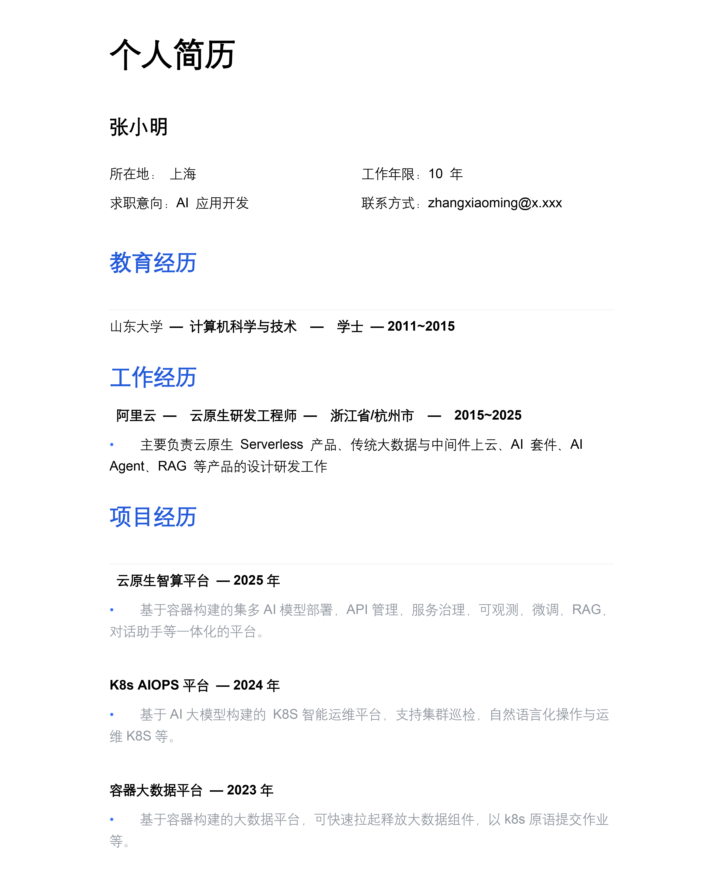

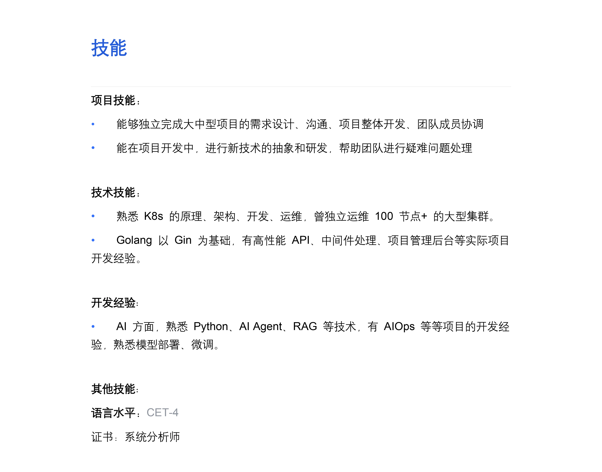

可以看到相比之前的简历，增加了项目经历、技能等信息。

那有了简历后，就需要解决如何让 AI 拿到我们的简历的问题。一般的常见做法是文件对话，也就是我们在对话窗口，将文件进行上传，然后就可以基于该文件与大模型做对话了。比如以DeepSeek 网页版为例：

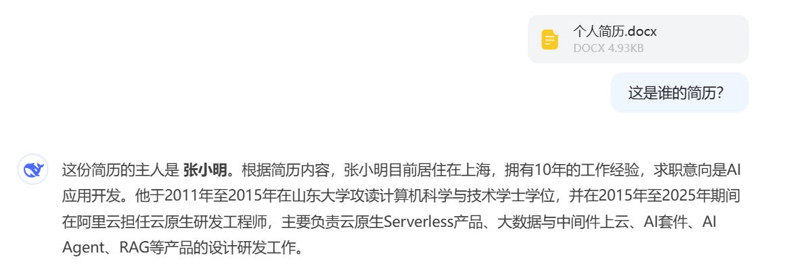

但是这样还不够智能，需要用户手工上传文件才行。

## 让 AI 自动读取本地简历文件

有没有更便捷的方式呢？我们可以借助 MCP Server 实现让大模型自动读取简历内容。

### 编写读取 word 工具

我们还是基于上节课的 jobsearch-mcp-server 代码来继续编写，只需要为其添加读取 word 的工具即可。在 python 语言中，有一个名叫 python-docx 的包，可以实现读取 docx 文件。我们使用如下命令进行安装：

```
uv pip install python-docx
```

之后，我们在 src/jobsearch-mcp-server 下创建一个名叫 word 的文件夹，并在文件夹内创建word.py，用来编写从本地读取 docx 文件的代码。代码如下：

```python
import os
from docx import Document
def read_word_file(file_path):
   """读取Word文档内容"""
   if not os.path.exists(file_path):
       raise FileNotFoundError(f"File not found: {file_path}")
   file_path = os.path.abspath(file_path)
   file_ext = os.path.splitext(file_path)[1].lower()
   if file_ext == '.docx':
       return _read_docx(file_path)
   else:
       raise ValueError(f"Unsupported file format: {file_ext}")
def _read_docx(file_path):
   """读取.docx文件"""
   try:
       doc = Document(file_path)
       full_text = []
       # 获取所有段落
       for para in doc.paragraphs:
           if para.text:
               full_text.append(para.text)
       # 获取所有表格内容
       for table in doc.tables:
           for row in table.rows:
               row_text = []
               for cell in row.cells:
                   if cell.text:
                       row_text.append(cell.text)
               if row_text:
                   full_text.append(" | ".join(row_text))
       return "\n".join(full_text)
   except Exception as e:
       raise
```

read_word_file 函数首先使用 os 包验证了传入的文件路径是否存在，之后取出了文件路径中包含的文件后缀名。例如，文件路径是 E:/AI/ 个人简历.docx，则后缀名就是 .docx。

之后第十三行代码那里会做判断，如果后缀名是 .docx，则调用 python-docx 包进行文件内容的读取。这部分代码不重要，掌握套路即可，用 AI 生成都行。

最后可以加一个 main 测试一下：

```
if __name__ == "__main__":
   file_path = r"E:\\AI\\个人简历.docx"
   content = read_word_file(file_path)
   print(content)
```

效果如下。

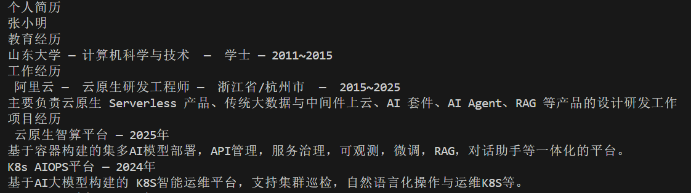

可以看到简历内容都被一行行地读取出来了。这样我们就可以在 tools 下再加一个简历类，完成 MCP Tools 的编写。代码如下：

```python
from typing import Any
from ..word.word import read_word_file
class ResumeTools():
   def register_tools(self, mcp: Any):
       """Register job tools."""
       @mcp.tool(description="读取指定路径的word文件")
       def get_word_by_filepath(filepath: str) -> list:
           """根据文件路径获取word文件内容"""
           content=read_word_file(filepath)
           return content
```

我们重启一下 MCP Hosts，可以看到多了一个工具。

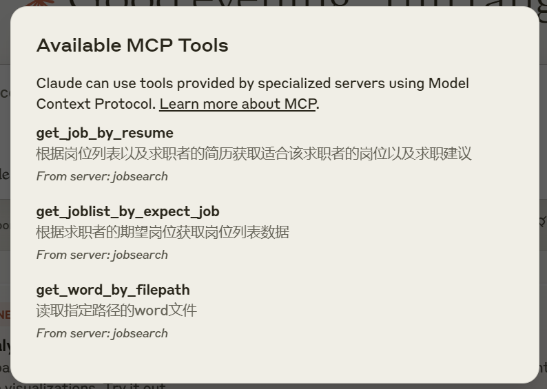

接着测试一下效果，我们可以这样提问：

```
我在E盘AI文件夹下有一个个人简历.docx，这是谁的简历？
```

测试效果如下。

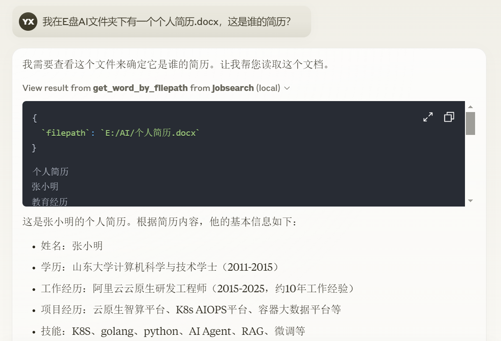

### 测试用完整简历找工作的效果

之后，我们结合上节课的工具测试一下。

```
我的电脑的E盘 AI 文件夹有一份个人简历.docx，请根据简历内容，请帮我匹配合适的工作。
```

效果如下。

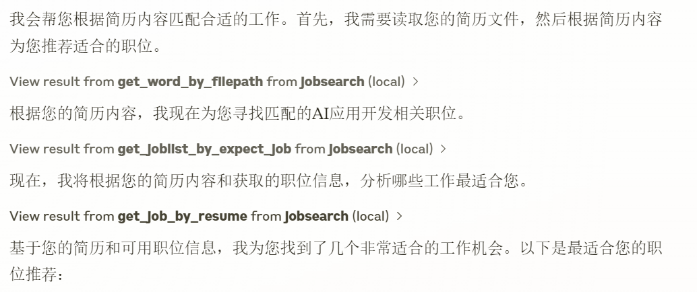

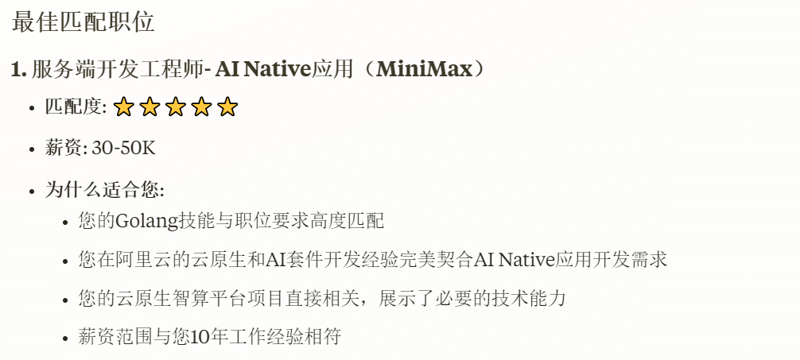

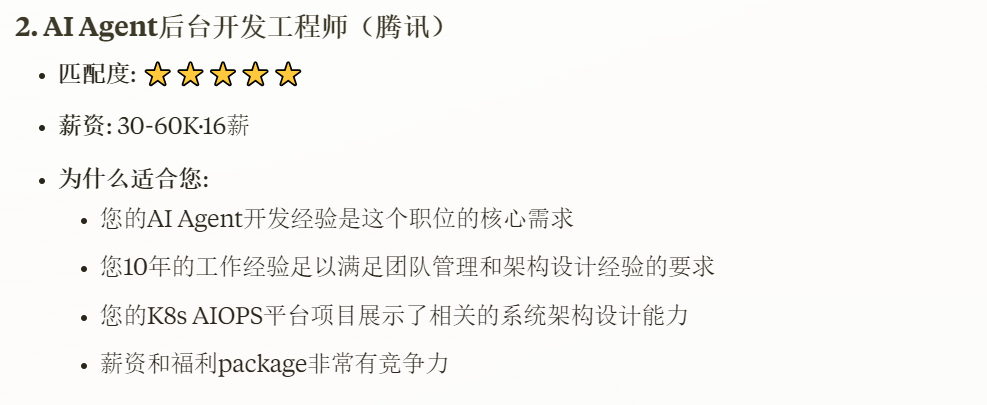

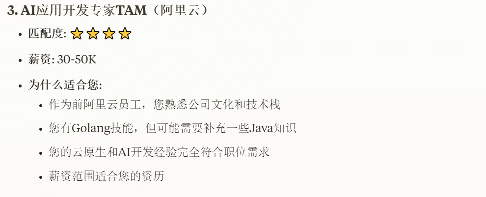

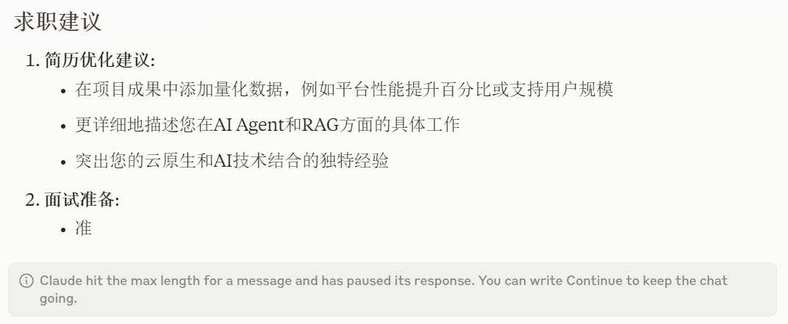

可以看到，由于我在简历中提到了做过云原生的项目，所以这次匹配工作岗位时，也考虑了这一点，匹配到的三个岗位的推荐理由都提到了 golang、云原生等内容。

但最后大家可以看到，大模型输出到面试准备时停止了，原因就是因为输出的内容超过了模型上下文的长度了。这还是我准备的简历相对比较简单，如果是项目经历写得特别详细的复杂简历，会占用更多的上下文，同时也会浪费很多 token。

所以，有时候模型上下文长度会制约我们做很多事情，我们不得不想一些办法来应对这个问题。比如，可以浓缩一下简历，提取其精华到 50 字以内。接下来我们就看看具体手法。

## 浓缩简历

通常简历都是分小标题的，比如分为个人简介、工作经历、项目经历、技能等等。这便为我们匹配工作时，提供了多个维度。

因此我们浓缩简历不是要把一篇简历交给大模型，让其浓缩成 50 字，而是要根据自己的需求，有侧重点地选择不同的小标题的内容进行浓缩。比如有的企业规定必须硕士学历以上，我们浓缩简历时就需要把学历带上，否则即使通过项目经验等匹配到该岗位，可能我们也会因为学历被卡掉，白白浪费时间。

那如何做到分段浓缩呢？这就要用到 AI 应用开发中，除了 Agent 以外，另一个常用技术——RAG。

### RAG 原理简介

RAG，中文叫检索增强生成，你可以理解为是开卷考试。我们在考试时，遇到不会的问题，去翻一下书，找到相关内容，然后根据书上内容答题。这个过程的重点是找到相关内容。

在 RAG 搜索中，最基础的确认相关性的技术就是向量相似度匹配，英文叫 embedding。这块就涉及到了线性代数的相关知识。我简单举一个例子，为你说明一下什么是向量相似度匹配。

比如，商品 A 的售价是 80 元，库存是 300 件，则用一个二维的向量表示商品 A，就是 [80,300]。商品 B 的售价是 90 元，库存是 280 件；商品 C 的售价是 120 元，库存是 200 件。我们知道，二维向量可以用一个二维坐标系表示：

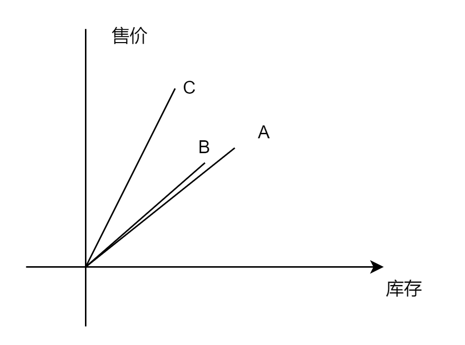

在坐标系上，A、B、C 与横轴之间都会产生一个夹角，我们只需要比较这三个夹角的 cosin值，就可以知道谁和谁更加接近。这个方法叫做余弦相似性，是向量相似性算法中特别常用的一种。

在实际向量处理中，不需要我们自己写代码转向量，是有专门的向量模型帮我们转的，操作方法与操作自然语言大模型很类似。另外对于一个事物的描述，不可能只有二维，比如 OpenAI公司的向量模型 text-embedding-ada-002 的维度就是 1536 维的。维度越高，说明对于某事物采集的特征值就越丰富，那就越能准确地描述事物。

那有了向量，就需要有一个存储向量的地方，供我们去查找匹配。因此这就催生出了一种新的数据库，叫做向量数据库。

此外，当我们使用 RAG 技术时，为了避免文本过长，导致超出大模型的上下文限制，是需要对文本进行切割，然后一段一段地进行向量化，存入到向量数据库当中的。常用的切割方法有按段落长度切割、按标题切割等，我们会在后面的项目中陆续了解。

### 将简历转向量入数据库

RAG 在 GitHub 上有很多开源方案，比如 RAGFow、MaxKB 等等。今天，我们先不用成熟方案，就用代码自己搞一个最简单的示例，带你入门 RAG。

首先安装向量数据库。向量数据库可选的方案有很多，今天我们就以 Qdrant 为例。使用如下docker 命令安装：

```bash
docker run -d -name qdrant -p 6333:6333 -v /root/qdrant_data:/qdrant/storage dock
```

安装完成后，在浏览器输入如下地址：

```
http://<你的公网 IP>:6333/dashboard
```

就可以进入控制台。

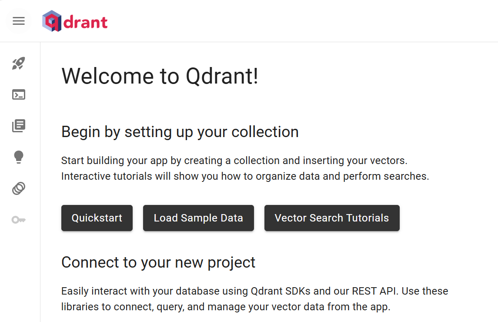

在向量数据库中有一个重要的概念叫 Collections，这个可以理解为是普通数据库中的数据表。点击侧边栏的第三个按钮，就可以跳转到查看 Collections 的页面。

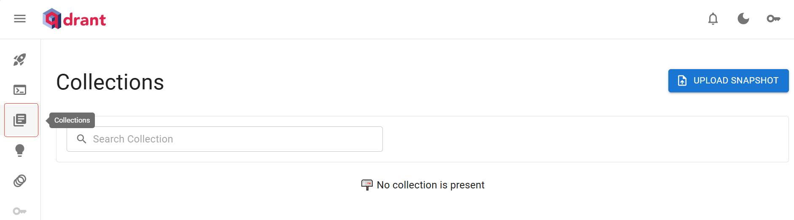

之后我们就可以写代码了。代码的流程是这样的。首先将 word 文档加载、切片，然后转成向量塞入向量数据库。之后，当用户提问问题时，先将用户的问题转成向量，在向量数据库中匹配。匹配到合适的片段后，将片段与用户问题一起喂给大模型，由大模型给出最终的回复。

接下来看核心代码。首先是拆分文档的代码，我们使用 LangChain 封装好的 Word 读取和文档拆分工具：

```python
# pip install python-docx
from langchain_community.document_loaders import UnstructuredWordDocumentLoader
from langchain_text_splitters import RecursiveCharacterTextSplitter
import nltk
def load_doc():
   #nltk.download('punkt_tab')
   #nltk.download('averaged_perceptron_tagger')
   word=UnstructuredWordDocumentLoader('E:\\AI\\个人简历.docx')
   docs=word.load()
   splitter = RecursiveCharacterTextSplitter(chunk_size=50,
                                             chunk_overlap=20, )
   s_docs=splitter.split_documents(docs)
```

代码使用了 UnstructuredWordDocumentLoader 读取了简历，然后使用RecursiveCharacterTextSplitter 设置拆分粒度。这里有两个值，一个是 chunk_size，表示按多大的字符数进行拆分，chunk_overlap 则表示覆盖粒度。比如，有一个文档的内容是123456，如果将 chunk_size 设置为 2，则就按 12 34 56 进行拆分，但如果设置了chunk_overlap 为 1，就会变成 12 23 34 45 56。

这里还需要注意一点的是，由于 UnstructuredWordDocumentLoader 底层使用了一个用来做语义理解的 nltk 库，这个库在代码第一次执行时，需要下载两个文件。因此前面代码里，我注释了第 7、8 两行。如果是首次运行代码，需要打开。

接下来就是将文本转向量以及入向量数据库，依然是使用 LangChain 封装好的工具。这里转向量的大模型，我们使用通义千问的向量模型 text-embedding-v1，代码如下：

```python
def TongyiEmbedding()->DashScopeEmbeddings:
   api_key=os.environ.get("dashscope")
   return DashScopeEmbeddings(dashscope_api_key=api_key,
                          model="text-embedding-v1")
def QdrantVecStoreFromDocs(docs:List[Document]):
   eb=TongyiEmbedding()
   return QdrantVectorStore.from_documents(docs,eb,url="http://<你的公网IP>:6333"
vec_store=QdrantVecStoreFromDocs(s_docs)
```

这样执行完成后，可以在 Collections 页面看到 Collection。

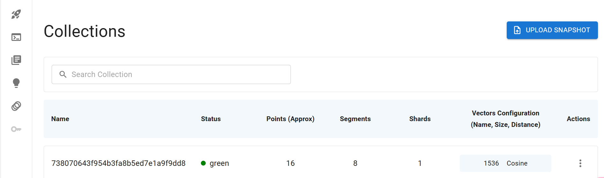

最后就是对话的过程，首先，我们先从 LangChainHub 上搞一个 RAG 对话专用的 prompt 模板，内容如下：

```
RAGPrompt = """
You are an assistant for question-answering tasks. Use the following pieces of re
Question: {question}
Context: {context}
Answer:
"""
```

意思是回答 question 时要根据 context 的内容来。

然后就是用户提问的相关代码了：

```python
def DeepSeek():
   return ChatOpenAI(
       model="deepseek-chat",
       api_key=os.environ.get("deepseek"),
       base_url="https://api.deepseek.com"
   )
llm=DeepSeek()
prompt = hub.pull("rlm/rag-prompt")
chain = {"context": vec_store.as_retriever() | format_docs,
        "question": RunnablePassthrough()} | prompt | llm | StrOutputParser()
ret=chain.invoke("请输出姓名.格式如下\n姓名: ?")
print(ret)
ret = chain.invoke("总结专业技能情况,内容可能包含golang、AI Agent、python、rag等.格式如下
print(ret)
ret=chain.invoke("根据各大公司工作过的年份总结工作经验有多少年.格式如下\n工作经验: ?年")
print(ret)
```

LangChain 之所以叫做 LangChain，就在于它具有一个核心的语法特性，也就是 chain（链式），就像代码的第 10、11 行一样，通过管道操作符 | ，把代码执行的各个步骤连接起来。

最后，我是通过 chain.invoke 连续请求了大模型三次，输出效果如下。

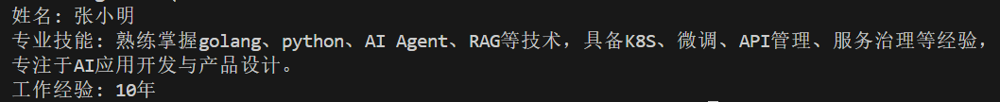

关于 LangChain 的语法，大家不用纠结，可以借助 AI 编程助手，比如 cursor 或者通义灵码等解读一下，或者看一看文档：Introduction | 🦜️ LangChain，看着看着就懂了。因为LangChain 的版本更新速度很快，系统学没必要，可能这个月学习的语法，下个月就换了写法了，重点是要学会看文档。有不明白的也可以在留言区提问，我们一起讨论。

## 总结

这节课，我们学习了两个知识点。

第一是 MCP Tools 的编写，为了优化求职助手的使用体验，我们编写了一个能在本地读取word 文档的 MCP Tools。第二便是学习了 RAG 知识，并利用 RAG 实现了对简历的分段总结。代码我已经上传到了 GitHub，大家可以点击链接自行提取。

到这节课，我们已经连续学些了五个课时的 MCP 了。你应该已经对 MCP 是什么以及如何使用有了很深的体会了。

其实 MCP 这个思路做得很好，那就是所有的 Tool 以及 Tool 的调用，都使用同样的标准来编写，这样我一个 MCP Client 就可以对接任意的 MCP Server，真正做到即插即用。或许当MCP 发展到能被各大厂商都认可，成为业界标准时，各个大厂的产品对外提供的就不是API，而是一个个的 MCP Server 了，比如阿里云的云数据库，对外提供控制云数据库的 MCPServer。

到了那时，对接产品将毫无开发量，直接配置一下就对接上了。期待这样的协议能成为标准的一天。

## 思考题

浓缩简历的代码，我刻意没有写成 MCP Tool，大家可以自己思考一下该如何编写，如何集成。

欢迎你在留言区展示你的思考结果，我们一起来讨论。如果你觉得这节课的内容对你有帮助的话，也欢迎你分享给其他朋友，我们下节课再见！
