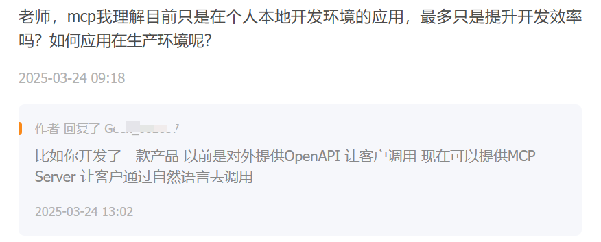
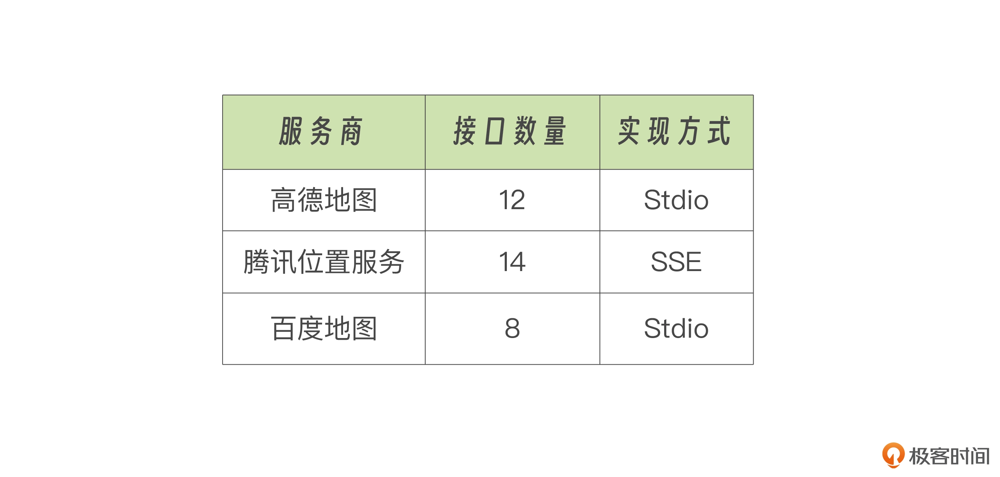
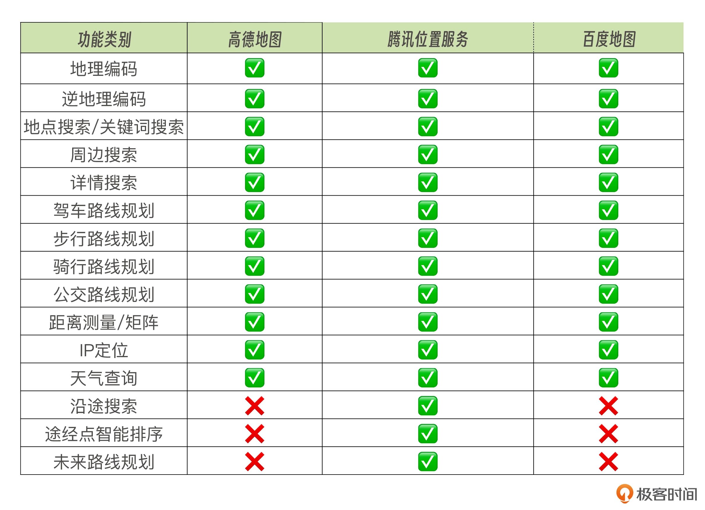
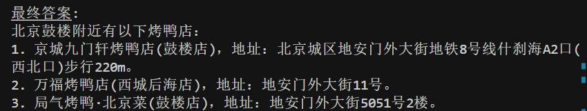
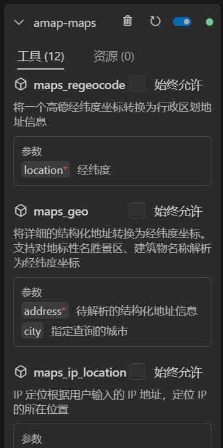
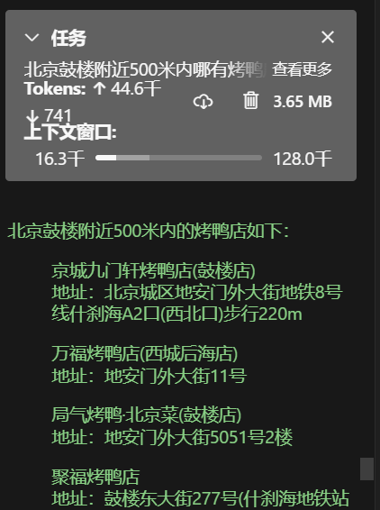
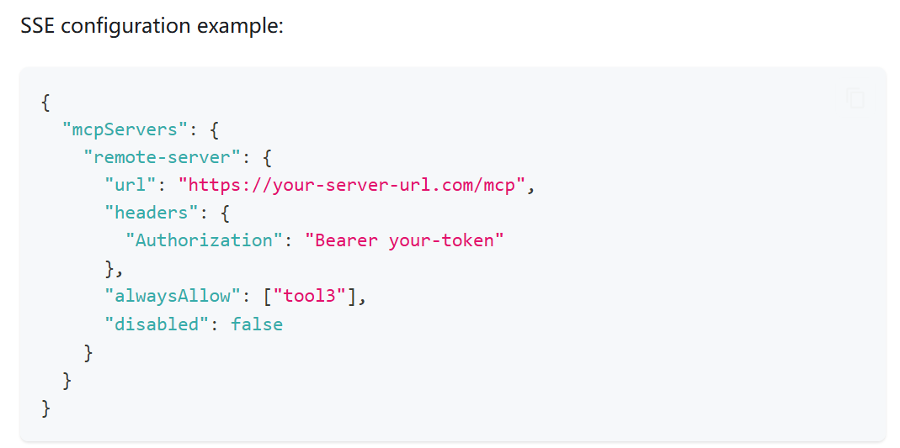
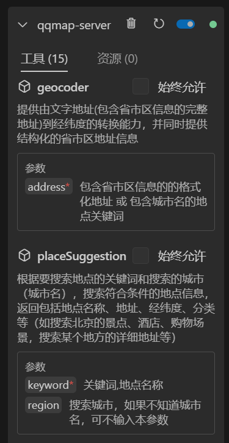
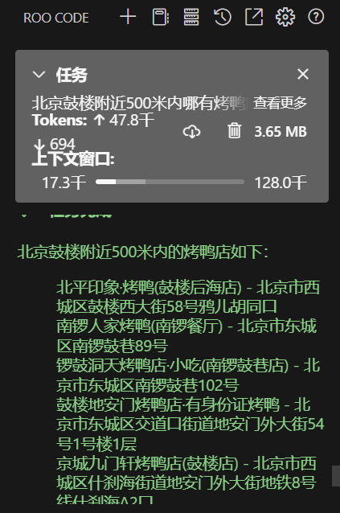
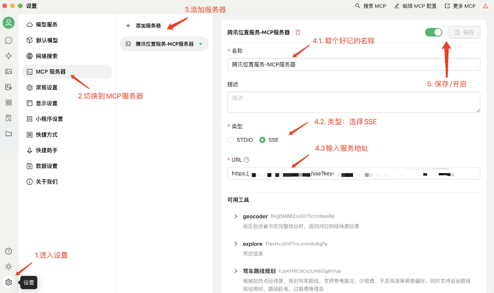

# 18 | 加餐：MCP产品化！高德、百度、腾讯三大地图服务接入MCP

你好，我是邢云阳。

前一段时间有同学在课程里提出了 MCP 是否目前在生产环境上没什么用，也就是在本地自娱自乐一下的问题。当时我是这么回复的，我说以前产品都是对外提供 OpenAPI，未来可以提供 MCP Server，让使用者通过自然语言调用。



有意思的是，这话刚说完没几天，就偶然看到了百度、腾讯、高德三家地图服务商提供了MCP Server 的消息，该消息直接验证了我的想法。因此我就抽空加餐一节，为你演示用Agent 通过 OpenAPI 的方式接入和直接用 MCP 接入，方便你把两种方法做一下对比。

## 三家地图服务商 MCP Server 实现对比

首先，我们先大致了解一下三家地图服务商的 MCP Server 的实现情况。这三家是同行，我们基本都用过他们的服务，其实基本大差不差，这三家对外提供 MCP Server 的时间点稍有先后，但各家覆盖的接口（API）的数量以及 MCP Server 的实现方式却不尽相同，这也一定程度反映了大家对于新事物的不同看法和思路。

后面我准备了两个表格来做总结。

接口数量与实现方式



接口覆盖功能



可以看到，腾讯位置服务相对做得要更好一点。从技术角度看，它采用 SSE 的方式实现，使用起来更加方便。从接口覆盖场景上来讲，也要更加全面一点。

在第 13 讲时，我们自己实现过一个基于 SSE 协议的 MCP Server 和 Client，当时讲过 SSE是一个可以建立长连接的轻量级协议。使用 SSE 而不使用 HTTP 的原因是，大模型调用 Tool的过程不是一轮就结束的，往往是需要多次反复调用。因此，设法保持一个长连接，而不是每一次调用 Tool 的时候就得开个新连接，就显得非常重要了。

接下来，就要接入地图服务了。我以高德地图为例，为你演示 Agent 将 API 当作 Agent Tool的接入方法。至于高德地图 API Key 的创建，就需要你自行搞定了。

## API 接入

我想实现的功能是这样的：当我问大模型“北京鼓楼附近哪有烤鸭店”时，它能调用高德地图服务进行查询。然后总结查询结果后，给我推荐出具体的饭店以及地址。

这个过程用地图官方的专业术语讲叫做搜索 POI，API 文档在这：搜索 POI 2.0- 高级 API文档 - 开发指南 -Web 服务 API | 高德地图 API，一共包含两条 API。

基于文档我编写了两个工具，代码如下：

```python
from llm import client
import requests
tools = [
   {
       "name": "get_location_coordinate",
       "description": "根据POI名称获取其经纬度坐标",
       "parameters": {
           "type": "object",
           "properties": {
               "keywords": {
                   "type": "string",
                   "description": "POI名称（中文）",
               },
               "region": {
                   "type": "string",
                   "description": "POI所在的区域名（中文）",
               }
           },
           "required": ["keywords"]
       },
   },
   {
       "name": "search_nearby_pois",
       "description": "搜索指定坐标附近的POI",
       "parameters": {
           "type": "object",
           "properties": {
               "keywords": {
                   "type": "string",
                   "description": "目标POI的关键字",
               },
               "location": {
                   "type": "string",
                   "description": "中心点坐标（经度,纬度）",
               }
           },
           "required": ["keywords"]
       },
   }
]
def http_get(url, params=None):
   """
   通用的HTTP GET请求处理函数
   Args:
       url (str): 完整的请求URL
       params (dict, optional): URL参数字典
   Returns:
       dict: 包含success和data/message的响应结果
   """
   try:
       response = requests.get(url, params=params)
       response.raise_for_status()
       return {"success": True, "data": response.json()}
   except Exception as e:
       return {"success": False, "message": str(e)}
# API配置
AMAP_BASE_URL = "https://restapi.amap.com/v5/place"
AMAP_KEY = "xxxxxxxxxxxxxxxxx"
def get_location_coordinate(keywords, region=None):
   """根据POI名称获取其经纬度坐标"""
   params = {
       "key": AMAP_KEY,
       "keywords": keywords
   }
   if region:
       params["region"] = region
   result = http_get(f"{AMAP_BASE_URL}/text", params)
   if result["success"] and result["data"].get("pois"):
       poi = result["data"]["pois"][0]
       return f"POI: {keywords}, 坐标: {poi['location']}"
   return "未找到该POI的坐标信息"
def search_nearby_pois(keywords, location=None):
   """搜索指定坐标附近的POI"""
   params = {
       "key": AMAP_KEY,
       "keywords": keywords
   }
   if location:
       params["location"] = location
   result = http_get(f"{AMAP_BASE_URL}/around", params)
   if result["success"] and result["data"].get("pois"):
       results = []
       for poi in result["data"]["pois"][:3]:
           results.append(f"名称: {poi['name']}, 地址: {poi['address']}, 坐标: {po
       return "\n".join(results)
   return "未找到符合条件的POI"
```

代码是我基于前置课程 Agent 的代码，将高德地图的 API 文档交给 Cursor 后，让 Cursor 生成的，非常易懂，就是一段工具描述加两个 API 调用。写完工具代码，其他的诸如 ReAct 等等就很简单了，照搬前置课程的 Agent 代码即可，只需改改 query 以及工具名称就可以。

代码完成后，我用“北京鼓楼附近哪有烤鸭店”进行了测试，效果是后面这样。



答案是对的，功能没问题。

## MCP 方式

对于 MCP Server，我们分别测试一下高德和腾讯的，因为它们分别是 Stdio 和 SSE 的，我们都体验一下。

### 高德地图

先来测试高德地图的， MCP Server 接入文档在这：概述 -MCP Server|高德地图 API，可以看到其 MCP Server 已经实现好了搜索 POI 的相关工具。其 MCP Server 是用 NodeJS 写的，我们需要在本地配好 NodeJS 环境，然后直接在 MCP Hosts（Cluade、Cline 等）中配置好该 MCP Server 就可以使用。

我依然是在 Windows 上使用 Roo Code 进行测试，配置文件内容如下：

```json
{
 "mcpServers": {
   "amap-maps": {
     "command": "node",
     "args": [
       "D:\\Program Files\\nodejs\\node_modules\\npm\\bin\\npx-cli.js",
       "-y",
       "@amap/amap-maps-mcp-server"],
     "env": {
       "AMAP_MAPS_API_KEY": "您在高德官网上申请的key"
     }
   }
 }
}
```

Mac 用户的配置为：

```json
{
 "mcpServers": {
   "amap-maps": {
     "command": "npx",
     "args": ["-y", "@amap/amap-maps-mcp-server"],
     "env": {
       "AMAP_MAPS_API_KEY": "您在高德官网上申请的key"
     }
   }
 }
}
```

之后，就会看到高德的 MCP Server：



有 12 个工具。

我这次将提示词改一下，增加一个范围信息，这是我看 MCP Server 工具的描述看到的，我的提示词为“北京鼓楼附近 500 米内哪有烤鸭店”，效果变成了后面这样。



这样做也可以完成任务。

### 腾讯位置服务

接下来测试腾讯位置服务的，文档在这：MCP Server | 腾讯位置服务，请自行根据文档搞定 API Key 的创建。

那 SSE 的配置文件怎么配呢？以前我以为 Roo Code 只支持 Stdio 的模式，最近经一个同学的提醒，看了下 Roo Code 最新的文档，发现其可以通过配置来搞定 SSE 方式的 MCPServer 的连接。文档在这：Using MCP in Roo Code | Roo Code Docs。

文档给出的示例为：



因此结合腾讯的文档，接入腾讯 MCP Server 的配置是这样。

```json
{
 "mcpServers": {
   "qqmap-server": {
     "url": "https://mcp.map.qq.com/sse?key=<你的密钥>",
     "disabled": false
   }
 }
}
```

配置好后，就可以看到服务了。



我们仍然使用相同的提示词来测试一下效果。



也没什么问题。这样，两家地图服务的 MCP Server 就测试完毕了。

## 总结

当我们测试完毕后，再回看文章开头我对那位同学的回复，是不是更能有所体会了呢？

在互联网时代，开发 API 和调用别人的 API 是许多程序员的日常工作。而现在这些服务巨头都与时俱进开始提供大模型开发工具了，这直接就把原本写调用 API 的程序员的饭碗给抢了。

尤其是腾讯这样提供 SSE 方式的，完全就是 OpenAPI 在 AI 时代的究极进化，我只需要开发一个可视化配置的 MCP Hosts，类似这样的：



甚至我们都可以加大力度融入 AI 元素，让用户通过自然语言的聊天完成整个配置。这样一来，不懂代码的普通人都能接入腾讯地图应用，完成地图助手的开发。

技术的迭代速度，正在以我们无法忽视的方式改变行业规则，如果看到高德地图支持 MCPServer 后才开始探索 MCP，那么可能技术的浪潮已经先卷走了很多机会。除了感慨这很可怕之外，我觉得我们唯一的办法就是持续学习、超前学习，毕竟工程师向来是最热衷新事物、具备强大学习能力的一群人。

欢迎你在留言区展示你的思考结果，我们一起探讨。如果你觉得这节课的内容对你有帮助的话，也期待你把它分享给其他朋友，我们下节课再见！
