# 19 | 平台化开发：零代码Agent+工作流开发

你好，我是邢云阳。

上一章我们完成了求职助手项目，开发手法选用了近半年以来飞速发展和推广的 MCP 协议。

这个协议的功能很强大，但对于 python 新手来说不够友好，仅仅是环境配置就很麻烦。因此有一些公司或部门，可能会希望使用一种低代码或者零代码的方式去做一些 AI 应用，这样会更加方便快捷。基于这样的一个背景，这一章我们借助“作业帮”这个项目，带你熟悉基于 Dify的平台化的开发方法。

## 初识 Dify

Dify 是什么，相信大家已经不陌生了。这其实就是一个低代码 AI 开发平台，用户可以通过少量代码甚至零代码去开发对话、Agent、工作流等应用。

在我做这个课程时，Dify 1.0 已经发布，最大的更新是新增了插件管理的功能。比如可以将我们自己写的 Agent Tool 发布成一个后缀名是 .difypkg 的文件，之后就可以将其安装到任意Dify 平台上被调用。类似于我们在 windows 上写一个软件，打包成 exe 文件，可以在任意Windows 系统上安装。这其实是 Dify 为了丰富社区，让更多的用户去贡献插件。

这节课我使用的 Dify 版本是 1.1.2，如果你想实现和我一样的效果，建议和我使用相同的版本。

接下来我们先从基础讲起，分别学习如何零代码进行 Agent 和工作流开发。首先来看 Agent。

## Agent

在我们安装好 Dify 并登录 WebUI 后，会看到如下所示的界面。点击创建空白应用，既可创建Agent 等应用。

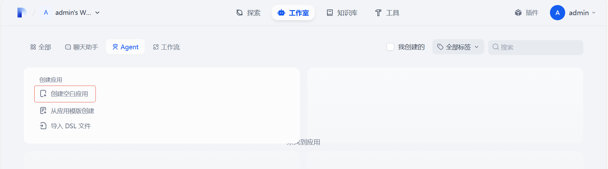

这里我选择 Agent，应用名称填体育助手。

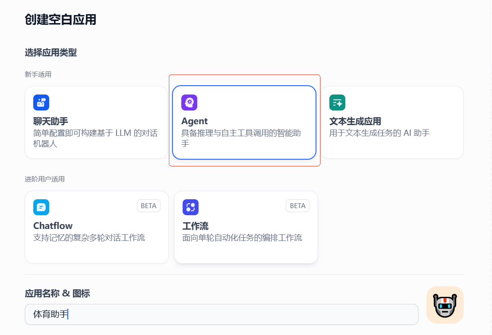

之后就会跳转到编排页面。这里需要你自行添加对话模型（在 Dify 的 设置 > 模型供应商中设置要接入的模型），这里我使用的是 DeepSeek 官方版本的 deepseek-chat。

之后就可以在提示词框内填写系统提示词。

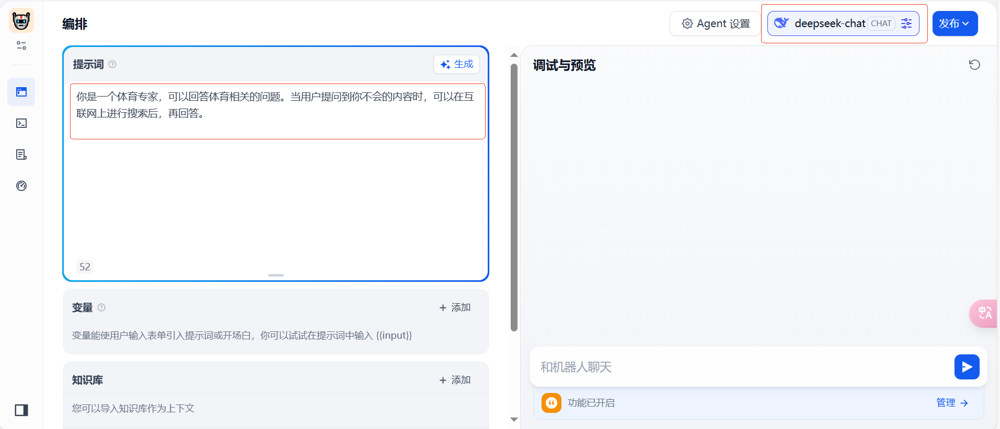

这里我是准备让 Agent 接入联网工具，当遇到不会的问题时，在互联网上搜索一下。因此提示词是：

- 你是一个体育专家，可以回答体育相关的问题。当用户提问到你不会的内容时，可以在互联网上进行搜索后，再

设置好提示词后，往下拉页面，就可以看到设置工具的地方。

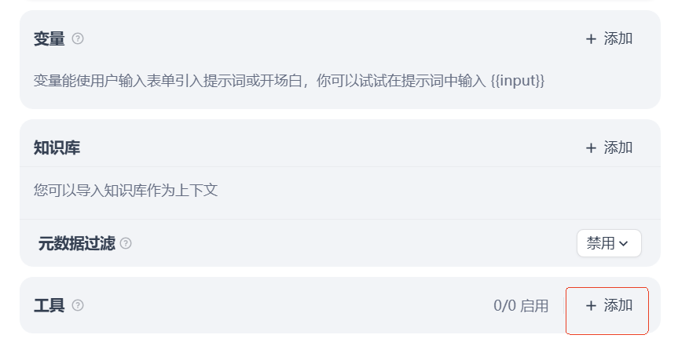

点击添加后，再点击“在 Marketplace 中查找更多”会进入到插件市场。可以看到有很多插件，例如 Google 搜索、绘画等等。

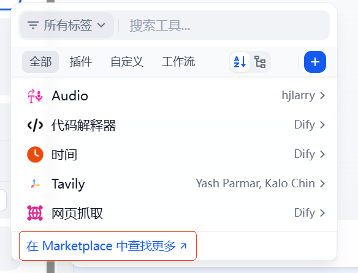

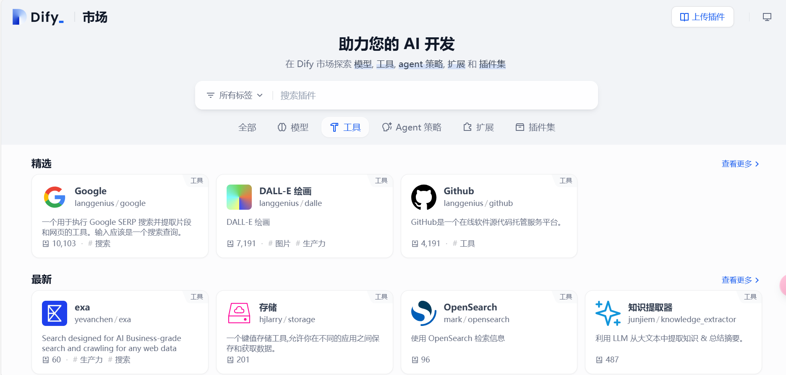

我今天就以 Tavily 这款互联网搜索工具为例，为你演示一下效果。我们点进 Tavily 页面后，点击下载按钮，将插件文件下载到本地。

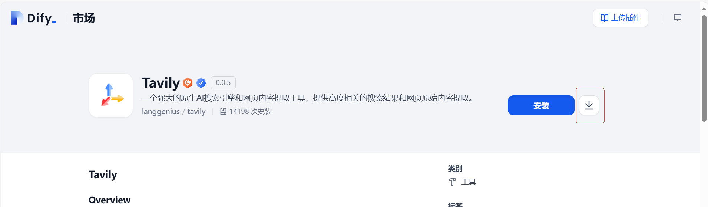

下载完成后，在点击控制台右上角的插件，会进入到插件管理的页面。点击安装插件，选择本地插件。

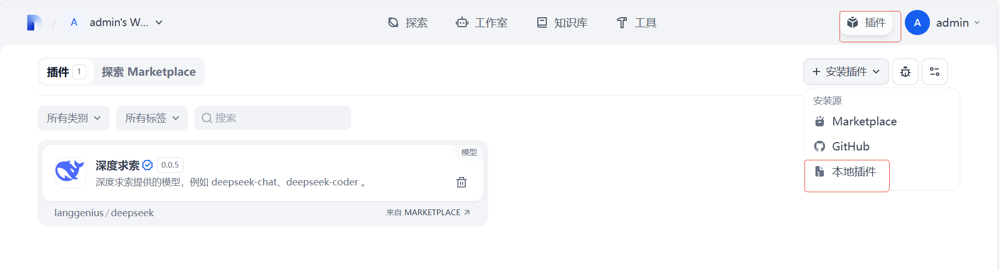

选中刚才下载的 Tavily 插件后，就会弹出如下页面。然后点击安装，稍后片刻。

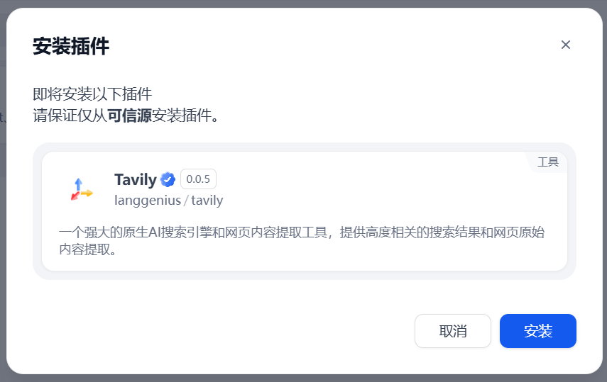

安装插件之后，再回到刚才 Agent 的工具添加页面，就能看到该 tavily 了。Tavily 包含两个工具，一个负责搜索，一个负责抓取页面内容。

刚添加上工具时，会显示未授权，这是因为 tavily 是付费使用的，因此需要一个 tavily 的 APIKey。大家可以根据提示，自行去 tavily 网站注册，新用户可以免费调用 1000 次 API。

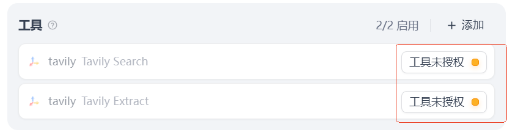

工具搞定后，我们就可以在右侧的调试界面进行对话测试效果了。比如我问：

```
2025年 NBA 常规赛什么时间结束？
```

可以看到 Agent 多次调用了工具后，给出了结果。

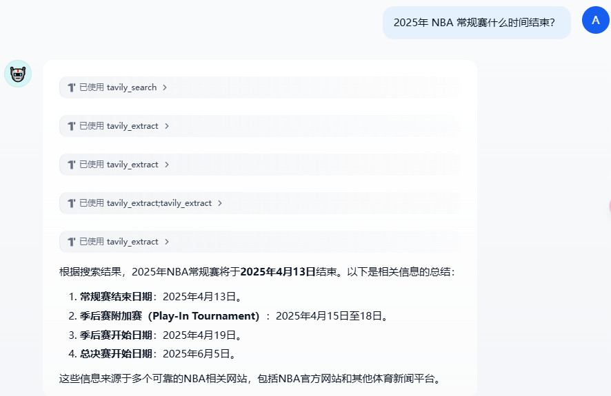

这样我们就完全零代码实现了一个 Agent。实际上，这里的 Agent 是使用的是模型 FunctionCalling 能力，而不是我们之前讲过的 ReAct。Dify 会看人下菜碟，如果我们配置的大模型支持 FC，则默认就会使用 FC 的能力，如果不支持，则会切换到 ReAct。

## 工作流

掌握了 Agent 功能如何使用之后，接下来我们学习工作流。所谓工作流就是我们人为地把一个复杂 AI 任务做拆分，拆分成一步步的小任务，这样每一步小任务的实现就会相对容易，不需要复杂的提示词或者超强的模型能力做支撑。

接下来，我们一起完成一个写周报的简单功能。借此体验一下如何实现工作流。

首先创建空白应用，选择工作流。

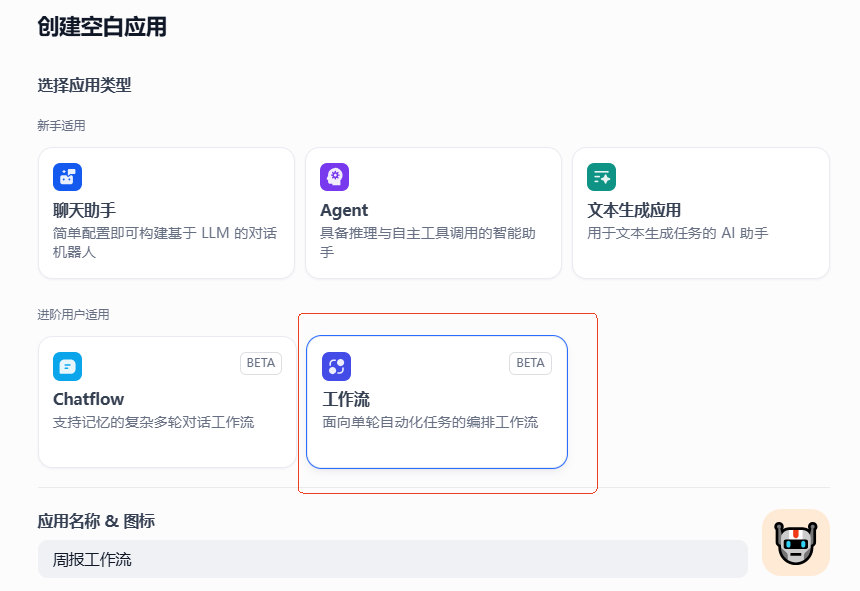

之后就会进入到一个画布的页面。

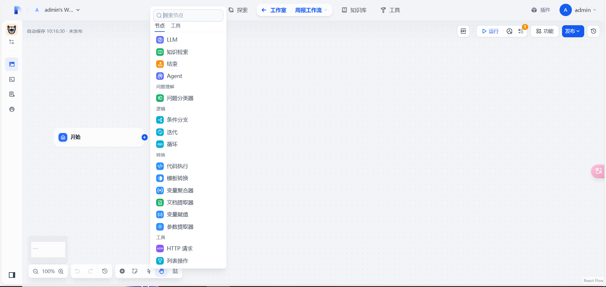

在这个页面默认会有一个开始节点，这是 Dify 的规定。Dify 规定工作必须由开始节点开始，由结束节点结束。我们把鼠标移动到开始节点上，会出现一个加号，点击加号，就可以添加节点。

节点涵盖了多种类型，有基本的 LLM、Agent、RAG 等，也有像是代码执行器，HTTP 请求等，我们会在后续的项目中用到其中一些节点。没有用到的节点，你也可以自行测试效果或者查阅文档了解其功能。

接下来，我们就添加一个 LLM 节点。

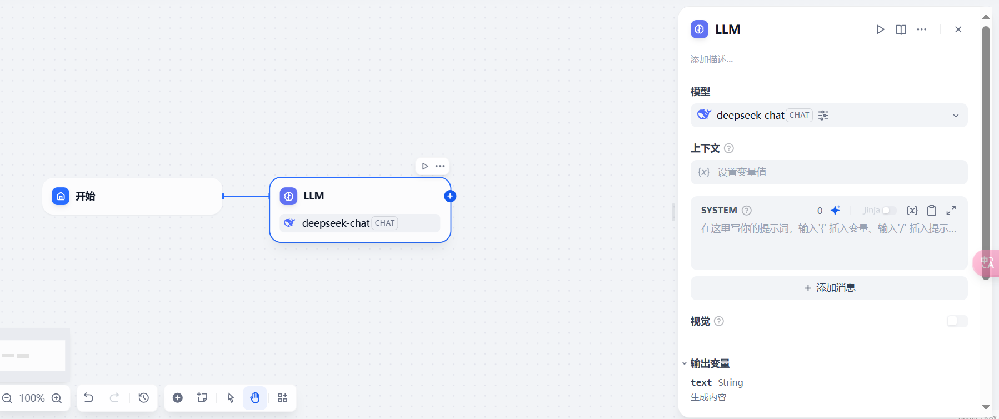

可以看到 LLM 节点自动与开始节点连接到一起了。此时在 LLM 节点可以设置模型、上下文、系统提示词等等。点击添加消息，也可以添加 User、Assistant 等角色的提示词，构成历史对话。在这里，我输入的提示词是：

- 你是一个周报助手，请根据用户输入的工作内容，生成一个完整的周报

之后，我们回到开始节点，点击如图所示红框中的加号。

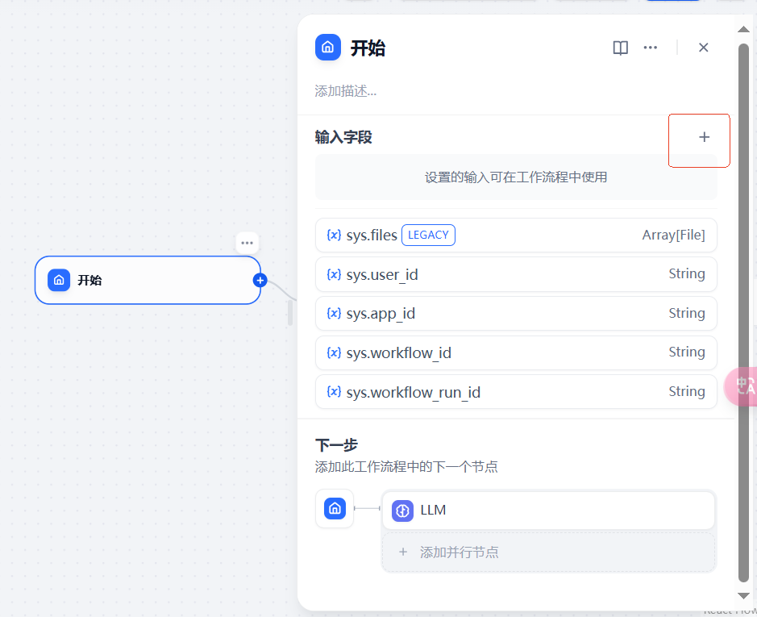

这时会进入到添加变量的页面。

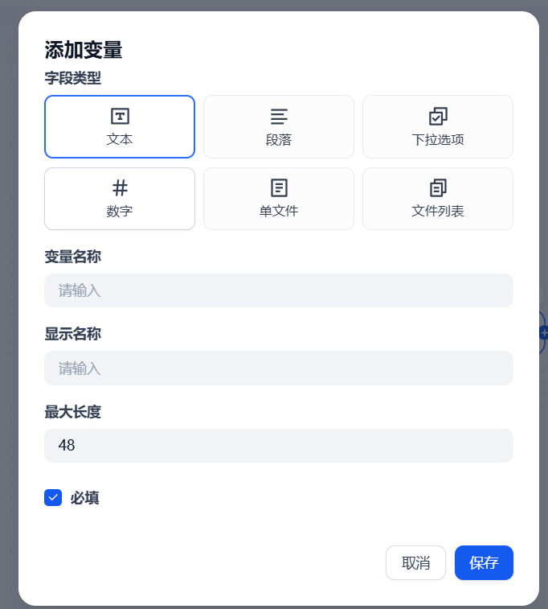

我们添加一个变量，名字叫 job_description，也就是工作内容。

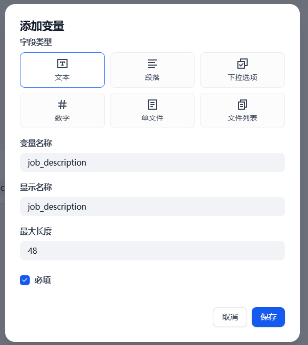

然后回到 LLM 节点，点击添加消息，就会提示输入 User 的 prompt，我们先输入工作内容：，然后输入 /，会自动弹出变量列表，选择 job_description 即可。

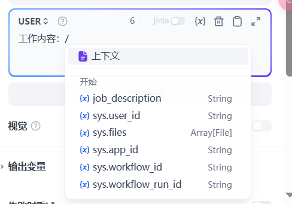

这样 LLM 节点就设置好了，直接点击下方的运行按钮就能测试这一步的效果。

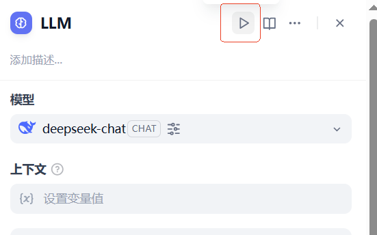

接着我们在 job_description 输入如下内容：

```
2025年3月24日~2025年3月30日：本周完成了 A 项目用户鉴权，模型仓库功能的编码与自测。支撑了xx客户
```

然后点击开始运行。

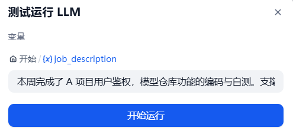

最后可以在输出处看到输出了周报。

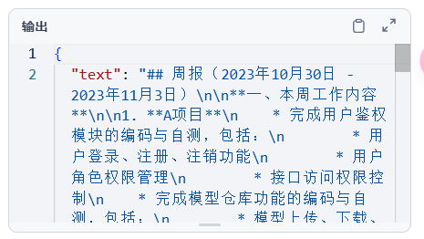

如果可以正常输出，就说明本节点的效果是没问题的。

现在我们添加第二个节点，也是一个 LLM 节点，让大模型帮我们把周报内容再润色一下。系统提示词为：

- 帮我将输入的周报内容进行润色，生成一个完整的周报

用户提示词输入周报：/，选择上一步的 text，也就是上一步的输出作为本步的输入。

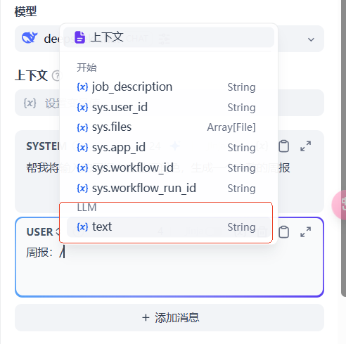

这样，这一步也搞定了。之后，我们可以点击 LLM2 节点的加号，添加一个结束节点，并设置输出变量为 LLM2 的输出 text，组成一个完整的工作流，点击右上角的运行来测试一下效果。

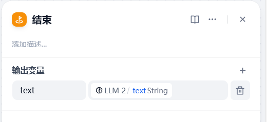

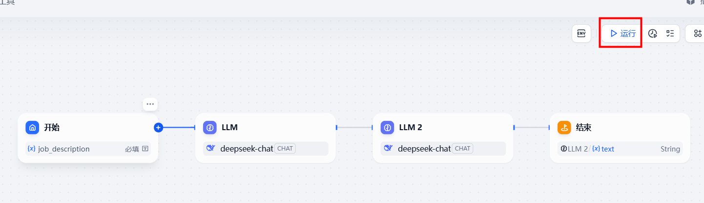

还是输入上面的 job_description 的提示词：

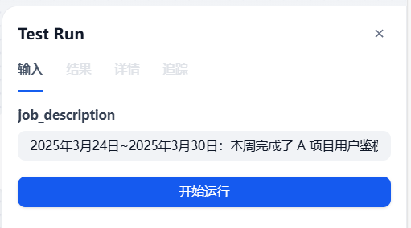

效果如下：

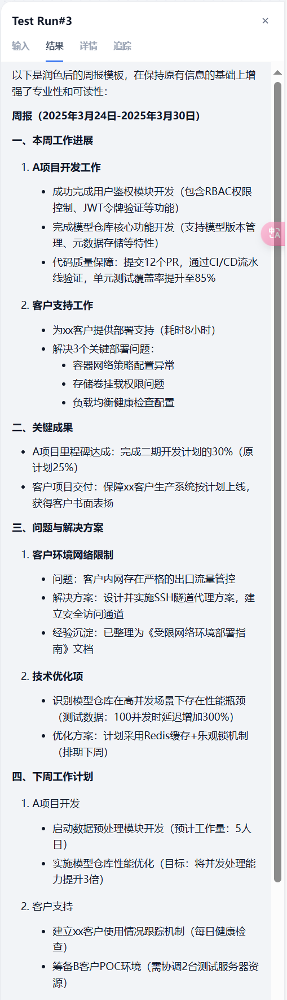

可以看到输出了完整的周报。至此，我们已经熟悉了工作流的基础用法，这里不必过于纠结周报生成的内容，而要重点理解工作流的流程控制以及输入、输出参数的设置。课后你也可以自己想一个喜欢的应用，做一下测试，这样学习效果会更好。

## 总结

这节课，我们以 Dify 平台为基础，掌握了零代码实现 Agent 和工作流的方法。

Agent 方面，我们搞了一个联网工具，这其实就是大模型如何实现联网搜索的最简单版本；而工作流我们实现了一个写周报的功能，通过第一个大模型生成周报，第二个大模型润色的方式，让周报内容更加完美。这样大大降低了我们传统使用一个大模型实现同款功能，写提示词的难度。

我记得大概一个月前，有一位岗位是产品经理的同学给我留言说，产品经理不懂写代码，能否让我的课程照顾一下。其实今天这节课就非常适合这位同学，你可以通过这节课的内容去做一些小应用，体会一下应用开发的快乐。

当然对于大多数程序员来说，我们需要两条腿走路，既要会用手写程序的方式来自己实现Agent 与工作流，同时也要学会使用 Dify 这种平台化的开发思想。因为我们很难知道公司未来是要求我们使用何种开发方式进行开发，两条腿走路，才能立于不败之地。

## 思考题

如果我想实现一个绘画工作流，先给大模型一个漫画的名称和漫画中一位人物的特征描述，让大模型分析出是谁，然后再画出来，该如何实现呢？

欢迎你在留言区展示你的思考过程，我们一起探讨。如果你觉得这节课的内容对你有帮助的话，也欢迎你分享给其他朋友，我们下节课再见！
