# 20 | 平台化开发：工具开发套路

你好，我是邢云阳。

上节课，我使用 Dify 为你演示了如何零代码创建一个 Agent 和工作流。强烈推荐你课后能够把环境搭起来，多多实操一下。因为这种框架类的东西，没什么技术含量，无非就是熟能生巧罢了。而且据我观察到的情况，现在好多我的同行公司开发 AI 应用包括问答助手、知识库等等都在使用 Dify，因此这个技术大家一定要会。

话不多说，我们回到这节课的主题——工具开发套路。

## 为什么要讲工具开发套路

在前置章节讲 Agent 时，我们其实已经了解了，Agent 是需要调用外部工具来解决问题的。那Agent 如何知道自己能调用哪些工具呢？

这就依赖于人类定义的工具描述，比如工具名称、工具功能描述、参数描述等等。工具描述写得好，会帮助大模型更好地区分不同工具的作用，从而选择正确的工具。之前留言里有个同学曾经提问，当工具特别多时，大模型如何区分功能。其实关键正是工具描述。

如果希望做成一个标准通用的工具描述，即任何 Agent，不论是 Dify Agent，还是用LangChain 等等手动实现的 Agent，都能直接对接我们的工具，那就需要在编写工具时形成一套标准规范，目前业界所使用的规范是 OpenAPI（Swagger）。

这就是这节课要讲工具开发套路的原因，你理解为工具开发标准也可以。

## Dify 自定义工具

我们以 Dify 的自定义工具的功能为例，看一下使用 OpenAPI 规范如何定义和接入工具。

### 自定义工具

在 Dify 控制台，点击右上角位置的工具，然后选择自定义 > 创建自定义工具。

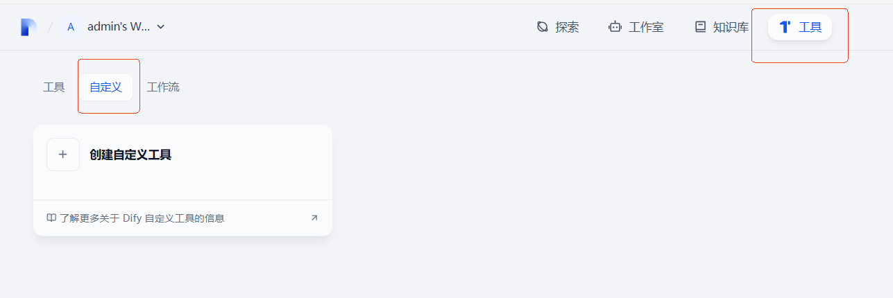

之后就可以看到创建工具的页面，如下所示。

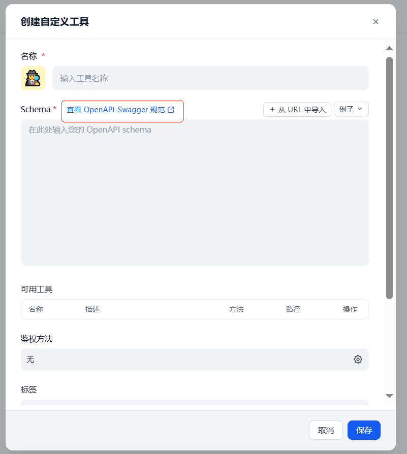

图中的 Schema 就是工具的描述，可以看到它使用的就是 OpenAPI-Swagger 规范。我们以高德地图提供的 API 为例，写一个简单粗暴的 OpenAPI 文档，贴在这里看看效果。文档内容如下：

```
openapi: 3.1.0
info:
 title: 高德地图
 description: 获取 POI 的相关信息
 version: v1.0.0
servers:
 - url: https://restapi.amap.com/v5/place
paths:
 /text:
   get:
     description: 根据POI名称，获得POI的经纬度坐标
     operationId: get_location_coordinate
     parameters:
       - name: keywords
         in: query
         description: POI名称，必须是中文
         required: true
         schema:
           type: string
       - name: region
         in: query
         description: POI所在的区域名，必须是中文
         required: false
         schema:
           type: string
     deprecated: false
 /around:
   get:
     description: 搜索给定坐标附近的POI
     operationId: search_nearby_pois
     parameters:
       - name: keywords
         in: query
         description: 目标POI的关键字
         required: true
         schema:
           type: string
       - name: location
         in: query
         description: 中心点的经度和纬度，用逗号分隔
         required: false
         schema:
           type: string
     deprecated: false
components:
schemas: {}
```

有 API 开发经验的同学，无论是前端还是后端，对这份文档的内容应该都不会感到陌生。这份文档其实就是定义了两条 API（分别是 https://restapi.amap.com/v5/place/text 和https://restapi.amap.com/v5/place/around，并且对这两条 API 的功能以及参数都按照规定的格式做了描述）。

我们将文档贴到 Dify 的 Schema 输入框里后，就会看到下方的可用工具处会自动输出两个工具的描述，并且还可以测试。

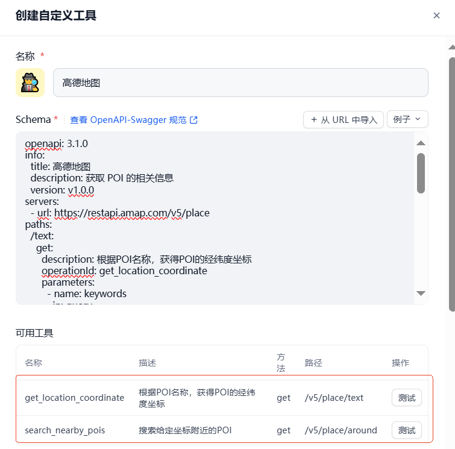

当然，由于我们使用的是高德地图 API，因此需要有高德地图为我们颁发的 API Key，才能使用。有了 API Key 后，还需要我们在可用工具下方的鉴权方法处，进行配置。

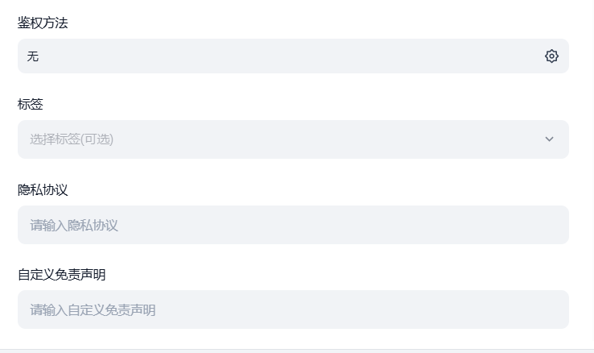

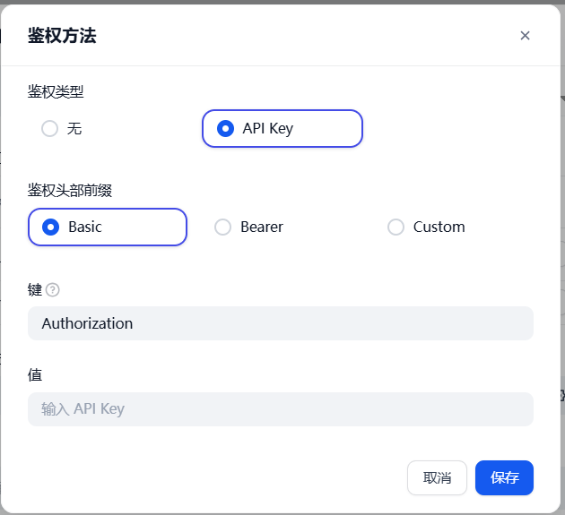

鉴权方法有好几种，你需要根据自己使用的 API 的提供者规定的方法来选择。这里简单讲一下，所谓鉴权方式，其实可以简单理解为 API Key 在 HTTP 请求中的存放位置。常用的有两种，第一种是以一个自定义 key 的形式拼接到 URL 中。

```
http://restapi.amap.com/v3/place/text?key=xxxxxxxxxxxxxxxxx
```

第二种是存放到请求头中。

```
GET /some-endpoint HTTP/1.1
Host: api.example.com
Authorization: Bearer YOUR_API_KEY
```

根据高德地图的文档说明，其 API Key 是放在 URL 中的，因此我的配置如下：

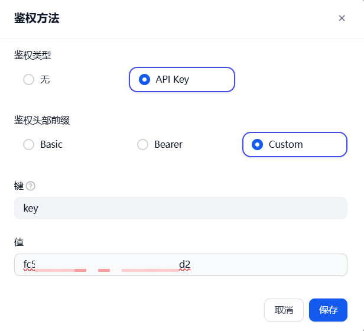

配置完成后，就可以对两个工具进行测试了。以 get_location_coordinate 为例，效果如下所示。

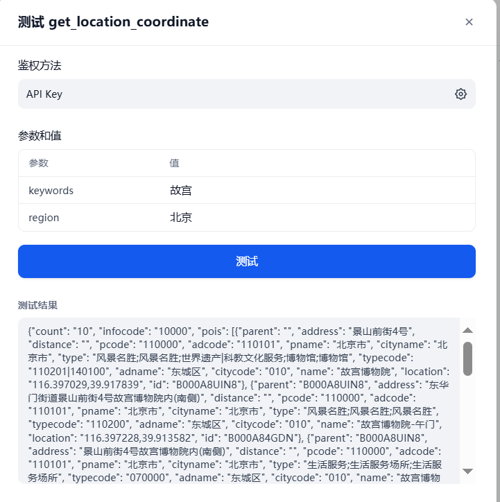

测试没问题后，我们点击保存，一个自定义工具就定义好了。

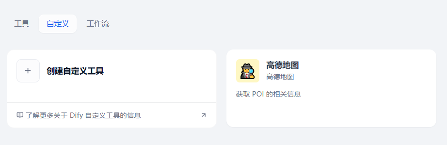

### 测试

接下来，我们可以创建一个 Agent 测试一下工具的调用。

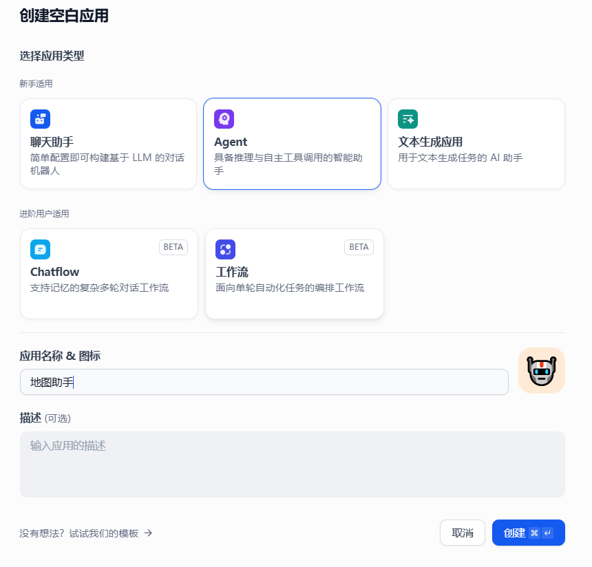

prompt 可以像后面这样描述，工具选自定义的高德地图工具。

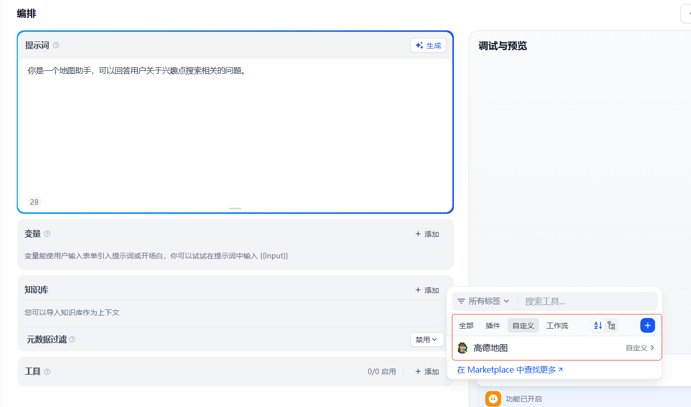

最后在调试页面提问：

- 北京鼓楼附近有没有烤鸭店？

可以看到 Agent 调用了这两个工具，并总结了答案，给了回复。

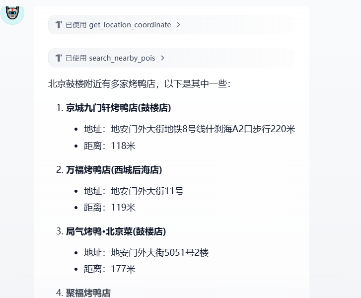

## 自己开发工具

之前讲的是调用现成的工具的例子。如果是我们自己开发一个工具，应该怎么做比较丝滑呢？

### 编码

首先，我们知道在 AI 开发中，首选的语言是 Python。但工具开发涉及到业务，大家可以自己视实际情况而定。

比如我要开发一个操控 k8s 的工具，那首选语言就是 Golang。不过如果 Python 能够搞定，尽量还是使用 Python，因为它简单。接下来，我就以获取服务器显卡信息的工具为例，为你展示一下用 python 开发有多简单。

由于这个工具需要发布成 API，因此我们需要使用 python 的 HTTP 框架来编写代码。常用的框架有 Djiango、FastAPI 等等。那么在 AI 开发中，我们必须选择 FastAPI 框架来写。这是因为 FastAPI 可以自动生成 OpenAPI 文档，所以它是专门用来做 AI 应用开发的 HTTP 框架。

我们进入写代码环节。这个功能就不用手写了，交给 AI 吧。我用 Cursor 工具为大家演示一下。Cursor 是一个代码编辑器，和 VSCode 的功能与用法一模一样，这里我就不讲怎么安装了，你可以自行下载安装体验。

我们在工程中，新建一个文件，比如叫 server.py。

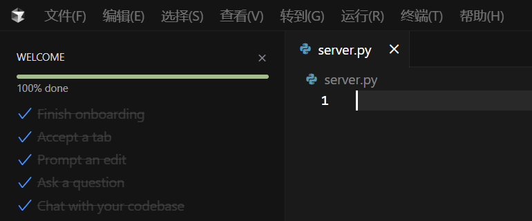

然后在键盘上按住 Ctrl + K，会出来下图这样的对话框。

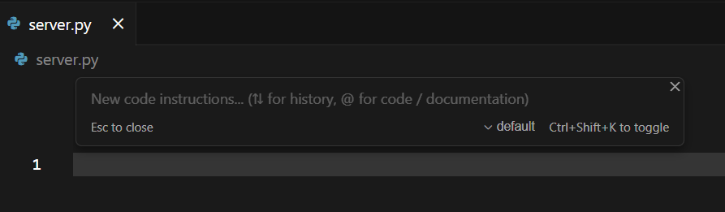

在这个框里，就可以描述需求了。比如我输入：

```
帮我用 FastAPI 开发一个HTTP Server，该 Server 包含一条路由，路由的功能是使用nvidia-smi命令
```

然后点击 Generate，让 Cursor 生成代码。

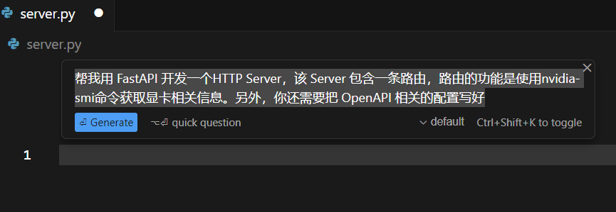

这时就开始生成代码了。

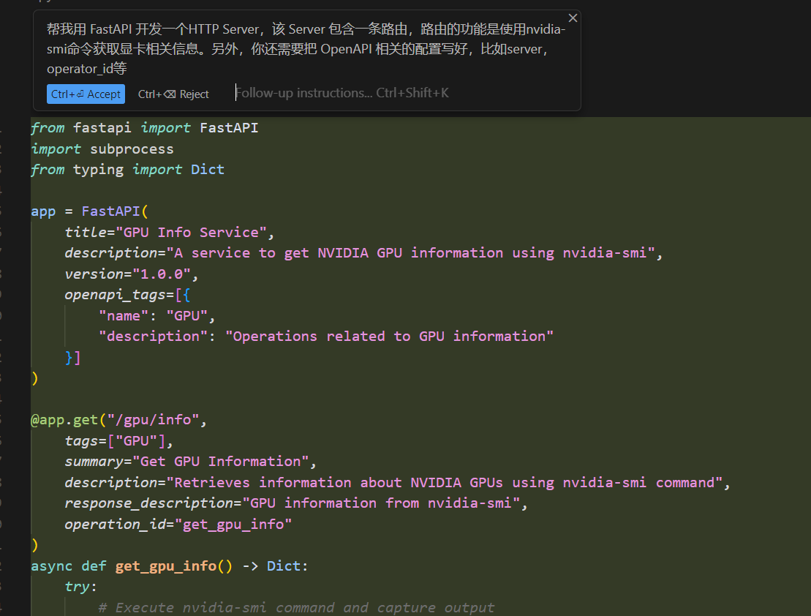

完成后点击蓝色按钮 Ctrl Accept，就可以让代码在文件中显示出来了。

```python
from fastapi import FastAPI
import subprocess
from typing import Dict
app = FastAPI(
   title="GPU Info Service",
   description="A service to get NVIDIA GPU information using nvidia-smi",
   version="1.0.0",
   openapi_tags=[{
       "name": "GPU",
       "description": "Operations related to GPU information"
   }]
)
@app.get("/gpu/info",
   tags=["GPU"],
   summary="Get GPU Information",
   description="Retrieves information about NVIDIA GPUs using nvidia-smi command
   response_description="GPU information from nvidia-smi",
   operation_id="get_gpu_info"
)
async def get_gpu_info() -> Dict:
   try:
       # Execute nvidia-smi command and capture output
       result = subprocess.run(['nvidia-smi'],
                             stdout=subprocess.PIPE,
                             stderr=subprocess.PIPE,
                             text=True)
       if result.returncode == 0:
           return {
               "status": "success",
               "data": result.stdout
           }
       else:
           return {
               "status": "error",
               "message": "Failed to execute nvidia-smi",
               "error": result.stderr
           }
   except Exception as e:
       return {
           "status": "error",
           "message": "Error occurred while getting GPU information",
           "error": str(e)
       }
if __name__ == "__main__":
   import uvicorn
   uvicorn.run(app, host="0.0.0.0", port=8000)
```

这段 AI 生成的代码，我们先不做改动，直接测试一下。我把程序放到了一台 GPU 服务器上。执行如下命令运行起来：

```
python server.py
```

测试一下 /gpu/info 这条路由的效果：

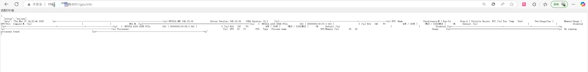

可以看到输出了 nvidia-smi 命令的执行结果。

接下来，我们在浏览器输入 < 公网 IP>:8000/openapi.json 试试效果。

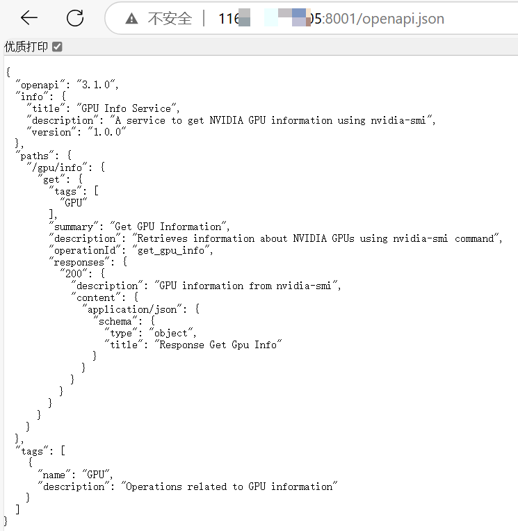

可以看到 OpenAPI 文档输出了。这条路由我们并没有做开发，而是由 FastAPI 自动配置生成的。配置的代码就是在上文代码中的第 5~ 21 行。当然，这个 OpenAPI 文档还少一个内容，就是 server（URL）的信息，否则客户端无法调用这个 API。

所以我们可以手动改一下代码，在第 12 行下面加上后面的代码。

```
servers=[
       {
           "url": "http://<你的公网IP>:8000",
       }
   ]
```

之后再重新访问一下 openapi.json 这条路由：

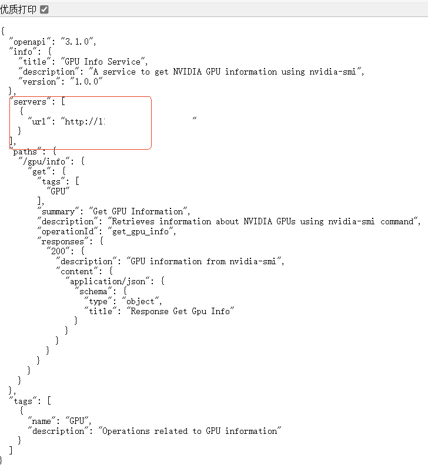

这时就可以看到有 server 相关的信息了。

FastAPI 不仅可以生成 OpenAPI 文档，还能生成 Swagger 文档，供前端参考调用。我们输入路由 /docs，就能看到我们熟悉的 Swagger 文档。

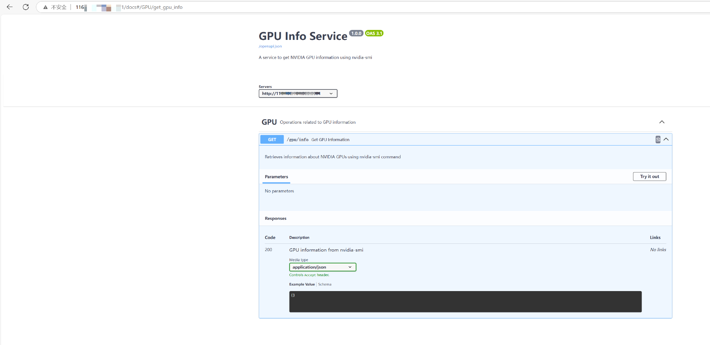

怎么样？有了 AI + python 的加持后，是不是觉得编码很简单呢？想想之前完成这些工作需要花多长时间，而我们现在花了多长时间，1 分钟不到。

### 集成到 Dify

我们现在把工具添加到 Dify 去试试效果。依然是先自定义工具。直接把 OpenAPI 文档贴进去就可以。得到如下效果：

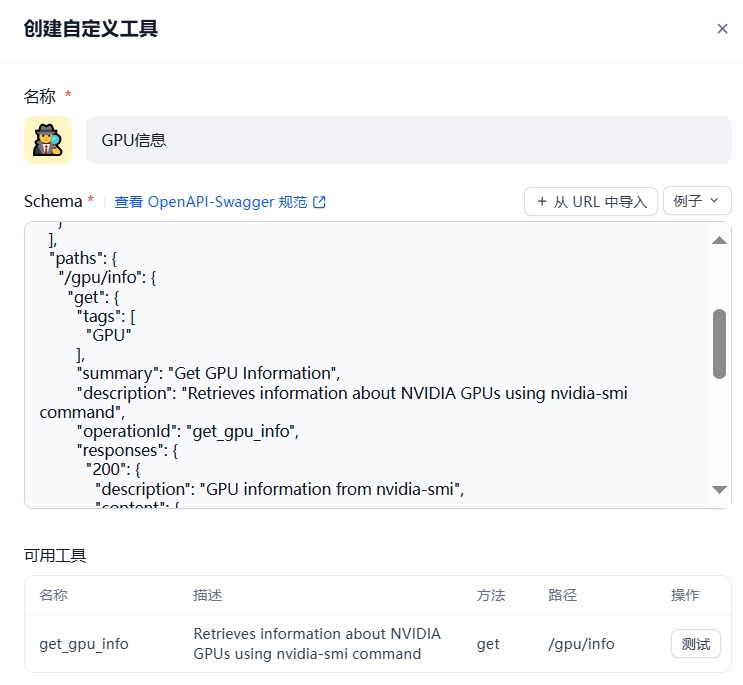

点击测试按钮测试一下路由通不通：

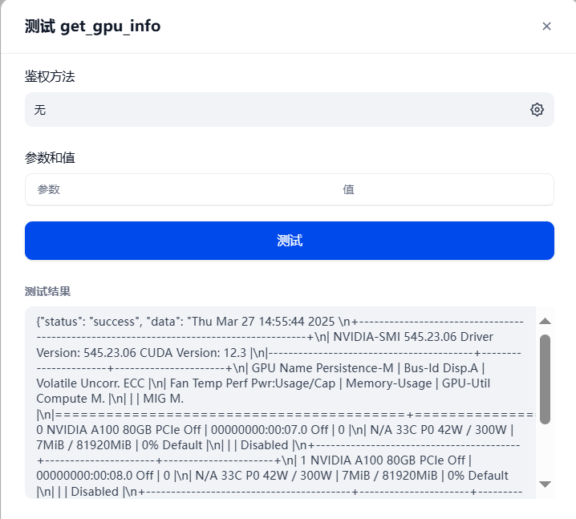

可以看到没啥问题，返回了一些肉眼看很费劲的内容。

现在我们用一个 Agent 来调用一下。

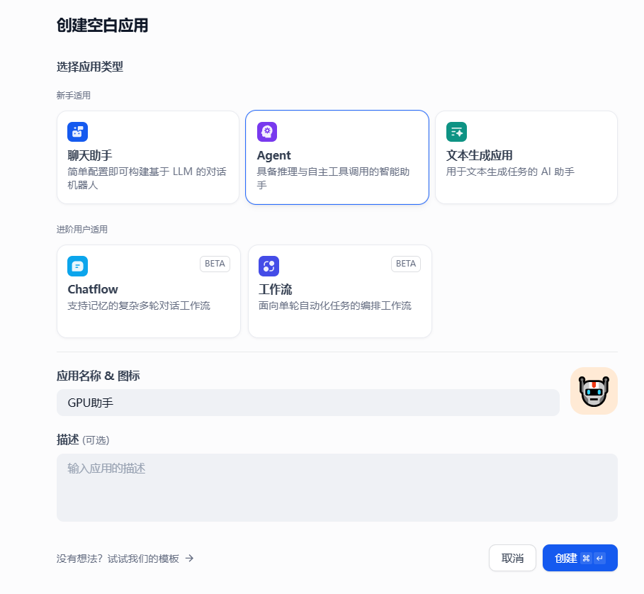

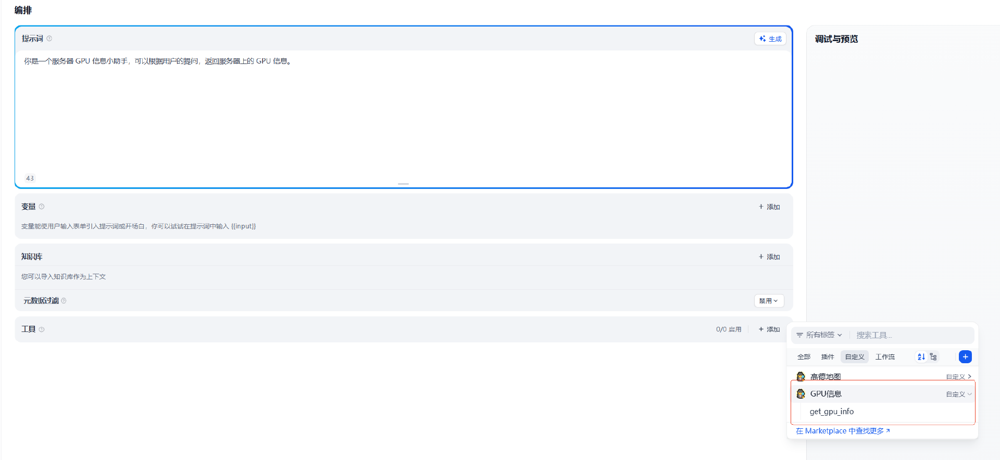

然后在调试页面调试一下，prompt 如下。

- 服务器上有几张卡，是什么型号的？

效果是后面这样。

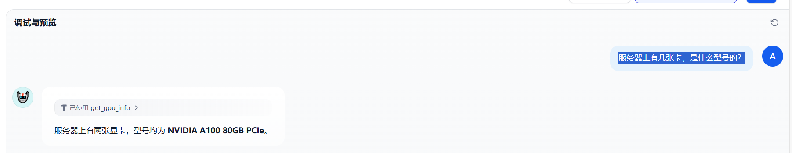

可以看到 Agent 调用工具后，从那坨信息中摘出了符合用户提问的信息，并进行了自然语言化的返回。这就是 AI 的魅力。

## 总结

这节课，我们一起学习平台化开发中为数不多的需要编码的环节，也就是工具开发。在工具开发中，因为业界已经将 OpenAPI 当作了撰写工具描述的标准，因此我们选择了 python 的FastAPI 框架来完成工具的编码，因为 FastAPI 可以自动为我们生成 OpenAPI 以及 Swagger文档，非常方便。

我们可以思考一下，为什么 OpenAPI 在互联网时代就是 API 的标准，而到了 AI 时代又能成为工具描述的标准呢？我理解其背后的逻辑是 API 在 AI 时代成为了一等公民。在互联网时代，微服务是一项重要技术，后端是散落在各处的服务（API），由一个网关统一做管理；而前端呢，则根据用户的操作去访问网关，调用相应的 API 与后端进行交互。

而到了 AI 时代，Agent 实际上就类似网关的角色，API 由 Agent 进行统一管理，而前端则变成了类似对话机器人的自然语言前端。用户通过聊天的方式，就通过 Agent 完成了后端 API的调用。因此在 AI 时代，后端还是后端，只是前端和网关发生了变化，所以 OpenAPI 依然坐稳其“上书房大臣”的位置，成为两朝元老也就不奇怪了。

这节课的代码我已经上传到了 Github，你可以下载参考。

## 思考题

根据自己的兴趣，使用 FastAPI 实现一个工具，接入到 Dify 中测试一下效果。

欢迎你在留言区展示你的效果，我们一起探讨。如果你觉得这节课的内容对你有帮助的话，也欢迎你分享给其他朋友，我们下节课再见！
