# 21 | 视觉模型：试卷题目分析解答

你好，我是邢云阳。

通过前面两节课，我们借助 Dify 熟悉了平台化开发的基础知识。

这节课，我们就进入项目实现环节。那在这一章呢，我为你准备的项目是“作业帮”。准备这个项目的初衷，是考虑了三点。

第一点是项目的通俗性，“作业帮”是干啥的，大家被广告洗脑了这么多年，对此一定不陌生，类似的还有“猿辅导”，选择这样的一个项目，很容易就能理解需求，并上手开发，不至于被一些所谓“隔行如隔山”的门槛拦在门外。

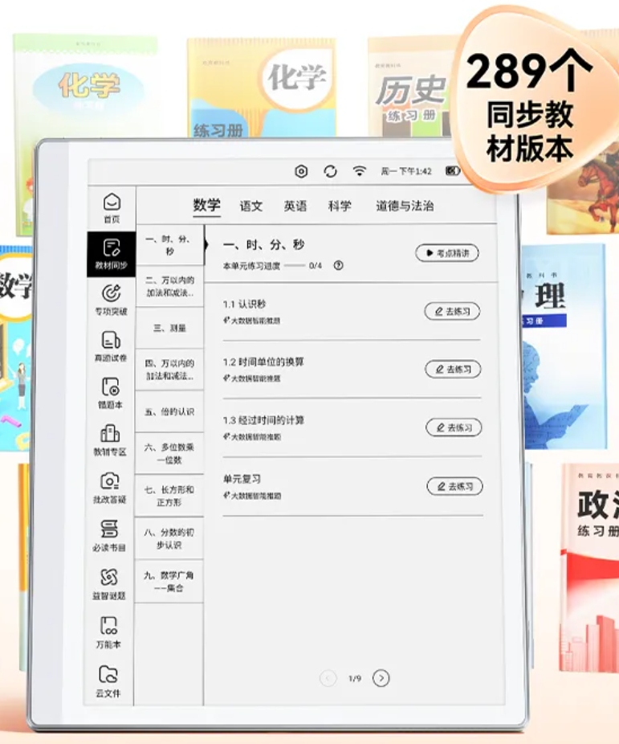

第二点是这两年各家的大模型都在“卷”数学题，通过解数学题的能力，来证明自己家的模型，推理能力强。因此我们可以用这个项目来体验一下这种推理能力。

第三点是多模态模型的发展，我们除了语言大模型的应用，对于视觉模型等多模态模型或者是OCR 技术等，也需要掌握，才能在开发项目时更加游刃有余。而“作业帮”的一个主要功能就是可以给试卷拍照，识别题目后进行解答。于是综合这三点，我设计了这个项目。

今天我们就先从视觉技术开始了解。

## OCR 识别

在视觉大模型没出来以前，比较传统的 OCR 技术是如何识别图片内容的呢？这项技术虽然我说了“传统”二字，但并不过时。如果你经常使用 RAG 的话，应该会接触过，比如对 PDF 文档的识别，就会用到 OCR 技术。接下来，我就为大家演示一下 OCR 的手法。

### 开通 OCR 服务

要使用 OCR 技术，我们需要先开通 OCR 服务，这里我选择的是腾讯云的 OCR，链接是：腾讯云 - 控制台。腾讯云的 OCR 首次使用是有一定量的免费额度的。

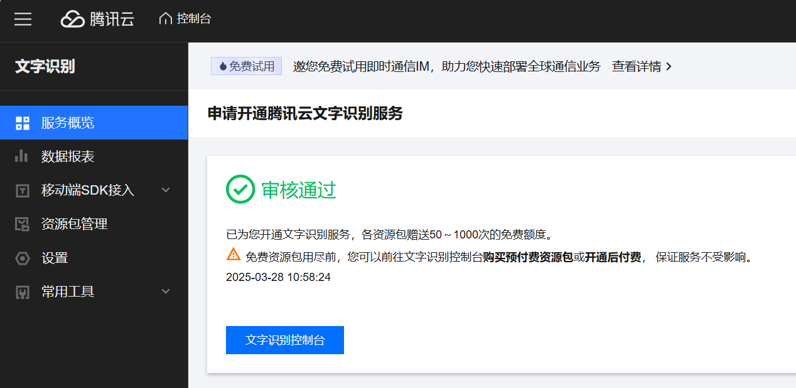

之后，你还需要点右上角的头像，点击访问管理去创建密钥。

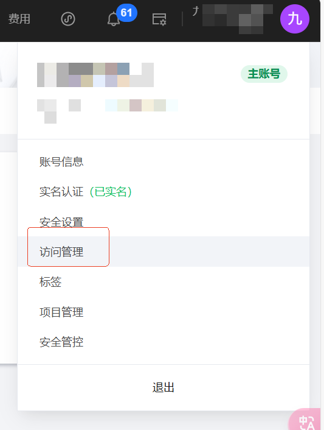

### 编码

服务开通后，就可以调用腾讯的 SDK 编写代码，调用 OCR 服务了。SDK 的文档在这：GitHub - TencentCloud/tencentcloud-sdk-python: Tencent Cloud API 3.0 SDK for Python。我们需要根据文档先把 SDK 装上。执行命令：

```
pip install --upgrade tencentcloud-sdk-python-ocr
```

之后就可以让 Cursor 帮我们生成代码了，prompt 是：

```
请使用tencentcloud-sdk-python-ocr 帮我完成图片识别成文字的代码
```

之后 Cursor 会生成如下代码：

```python
from tencentcloud.common import credential
from tencentcloud.common.profile.client_profile import ClientProfile
from tencentcloud.common.profile.http_profile import HttpProfile
from tencentcloud.ocr.v20181119 import ocr_client, models
def recognize_text(image_path):
   try:
       # 实例化认证对象
       cred = credential.Credential("SecretID", "SecretKey")
       # 实例化http选项
       httpProfile = HttpProfile()
       httpProfile.endpoint = "ocr.tencentcloudapi.com"
       # 实例化client选项
       clientProfile = ClientProfile()
       clientProfile.httpProfile = httpProfile
       # 实例化OCR client对象
       client = ocr_client.OcrClient(cred, "ap-guangzhou", clientProfile)
       # 读取图片文件并转为Base64
       with open(image_path, 'rb') as f:
           image = f.read()
       import base64
       image_base64 = base64.b64encode(image).decode()
       # 实例化请求对象
       req = models.GeneralBasicOCRRequest()
       req.ImageBase64 = image_base64
       # 发起OCR识别请求
       resp = client.GeneralBasicOCR(req)
       # 提取识别结果
       result = []
       for text_item in resp.TextDetections:
           result.append(text_item.DetectedText)
       return '\n'.join(result)
   except Exception as e:
       print(f"OCR识别发生错误: {str(e)}")
       return None
```

我们只需要把第 9 行的 SecretID 和 SecretKey 替换成我们自己的密钥即可。

这个代码的原理没必要深究，就是将本地图片编码成 Base64 格式后，塞给 OCR 的接口，仅此而已。接下来，我们可以写一个 main 函数测试一下：

```
if __name__ == "__main__":
   image_path = "试题1.png"
   result = recognize_text(image_path)
   print(result)
```

这里，我准备了一张中学数学题的图片，图片我也传到了 GitHub 上，我们让 OCR 去识别一下。

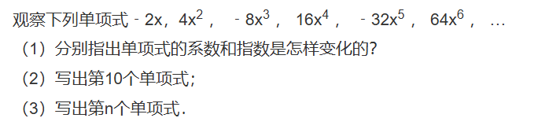

识别效果如下所示：

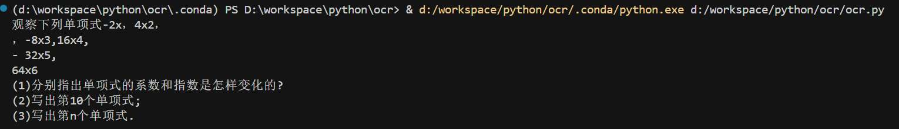

可以看到，识别的效果不错。

## 视觉模型

接下来，我们再来看 AI 时代的新方法，也就是视觉模型。

所谓视觉模型，就是能识别图片中的内容的模型。如果说之前的大语言模型是大脑的话，视觉模型就是比大脑又多了双眼睛。国内的视觉模型也有很多家提供，个人认为做的水平比较高的是火山引擎的豆包大模型。因为抖音、西瓜视频等平台和火山引擎同属一家母公司，他们在训练视觉模型方面天然就有优势。

### 注册火山引擎，开通豆包大模型权限

豆包大模型是火山引擎提供的。火山引擎和我们平时使 DeepSeek 等模型提供商时，直接获取一个 API Key 就能访问大模型不同，其是以云产品的形式提供的，因此注册还有点麻烦。那么接下来，我就以一个新用户的角度，为你演示一下如何注册火山引擎。

首先访问火山引擎官网注册账户。

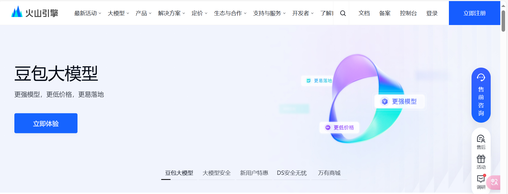

注册完成后，点击导航栏上方的大模型，选择视觉理解模型。

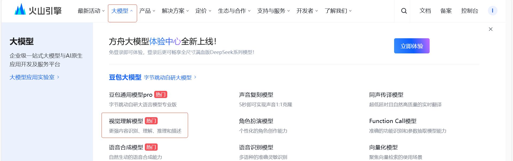

这时就会跳转到 Doubao-vision-pro-32k 模型，这就是我们要用到的视觉模型。那知道模型用哪款以后，我们就可以创建 API Key，在 Dify 中去调用它了。

点击右上角的头像，然后点击 API 访问密钥，会跳转到密钥管理的页面。

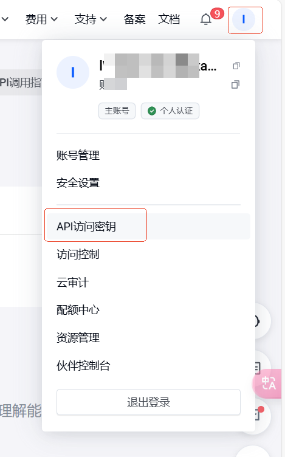

点击新建密钥进行创建即可。

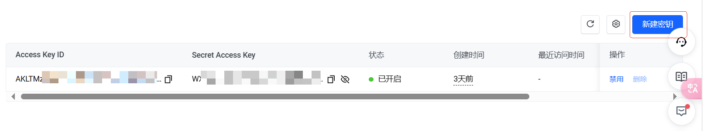

### 在 Dify 添加豆包大模型

完成密钥创建后，我们就可以在 Dify 中添加豆包大模型了。点击右上角头像，然后点击设置。

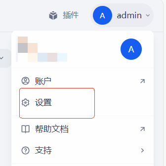

选择模型供应商，会有一个叫 Volcengine 的模型提供商，这就是火山引擎。

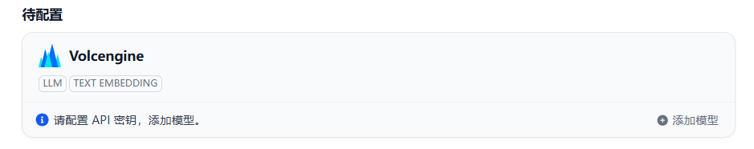

点击添加模型，选择 LLM，模型名称随便起，我就叫豆包大模型。然后把刚才在火山引擎官网创建的 Access Key ID 和 Secret Access Key 粘贴过来。

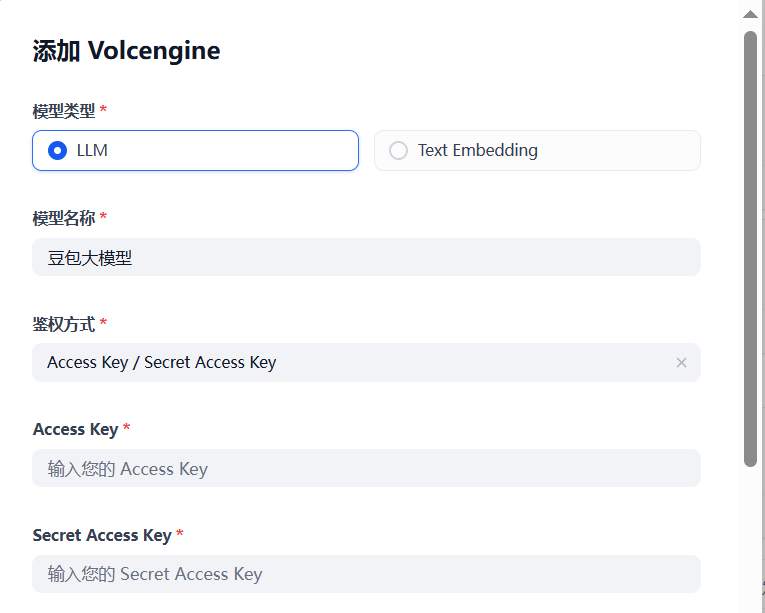

接下来是配置 Endpoint ID 以及基础模型。

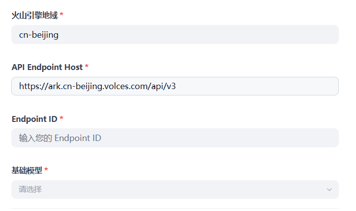

我们看火山引擎的文档，可以看到 Endpoint ID 就是推理接入点。

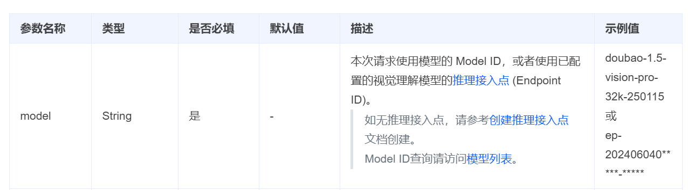

我们点击蓝色字体创建推理接入点，会进入到另一篇文档，其中有一部分叫前提条件，我们需要找到后点击蓝色字体的开通管理。

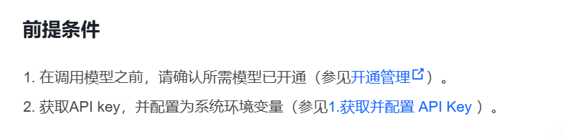

之后就会跳到控制台。

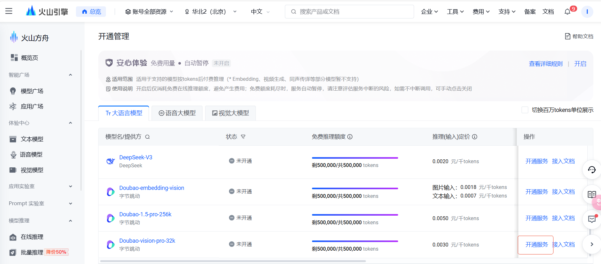

我们在大语言模型中找到 Doubao-vision-pro-32k，点击后面的开通服务，进行开通即可。

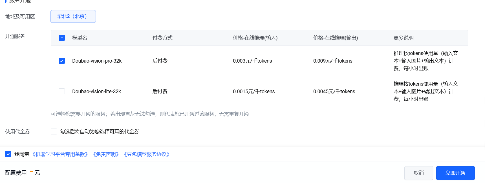

完成开通后，我们回到控制台，点击左侧侧边栏的在线推理。然后点击创建推理接入点。

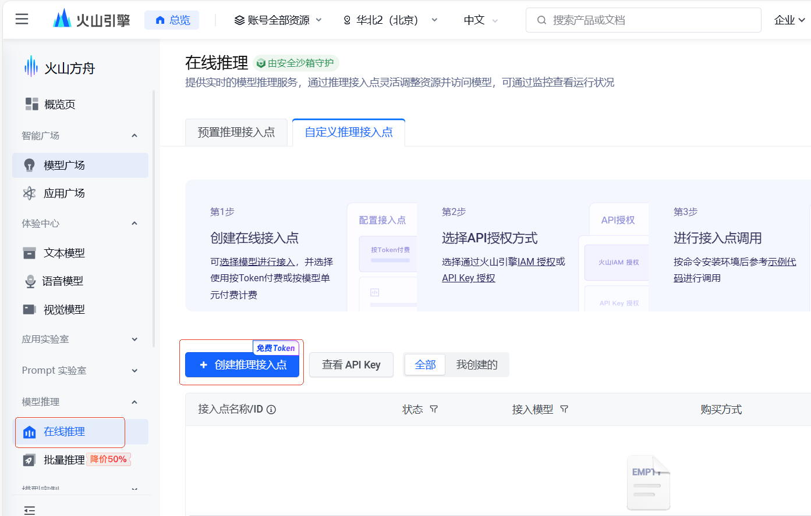

在弹出的页面中选择好 Doubao-vision-pro-32k 模型，点击确认接入。

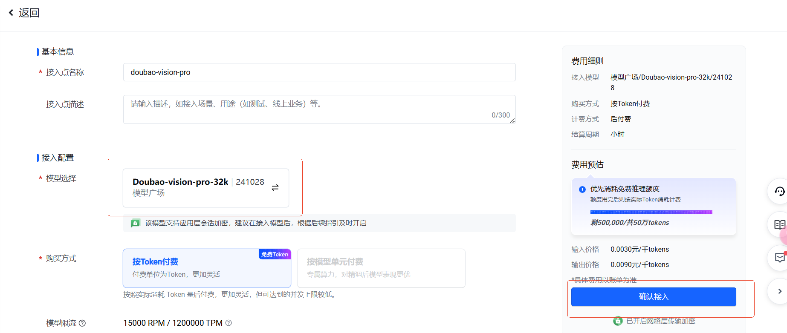

之后就会跳转到这个模型的在线推理页面。红框内的 ID 就是接入点 ID。

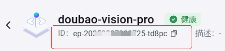

我们将其粘贴到 Dify 的 Endpoint ID 处，然后基础模型选择 Doubao-vision-pro-32k 即可。

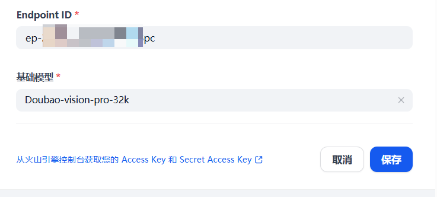

## 搭建“作业帮”工作流

模型添加好之后，我们就可以搭建“作业帮”项目的工作流了。

### 图片识别

我们在 Dify 选择创建空白应用，类型选工作流。

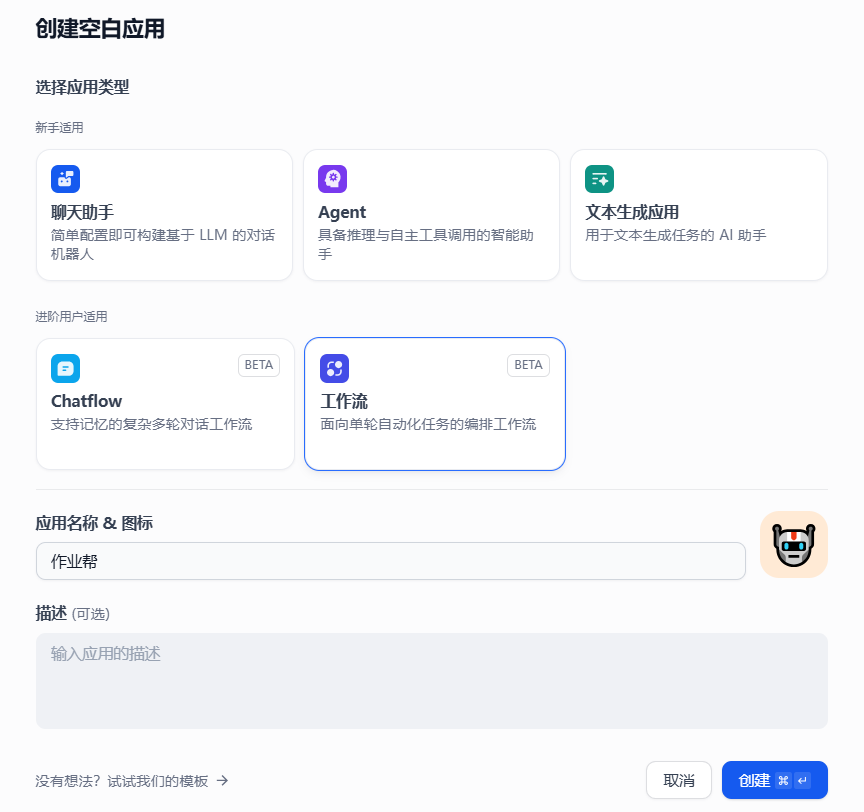

随后在开始节点，点击输入字段的加号。

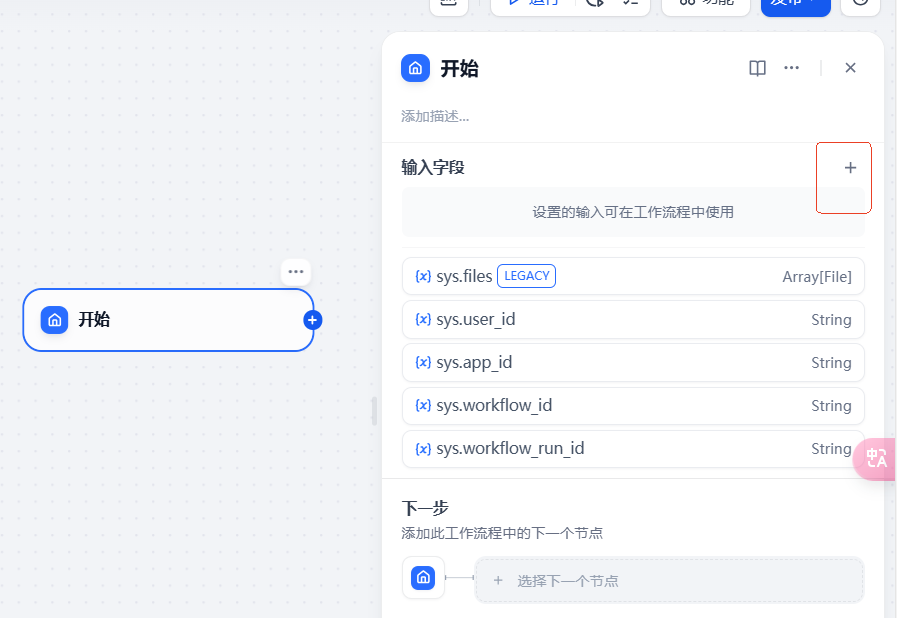

之后变量选择单文件，支持的文件类型选图片，上传文件类型选择本地上传。

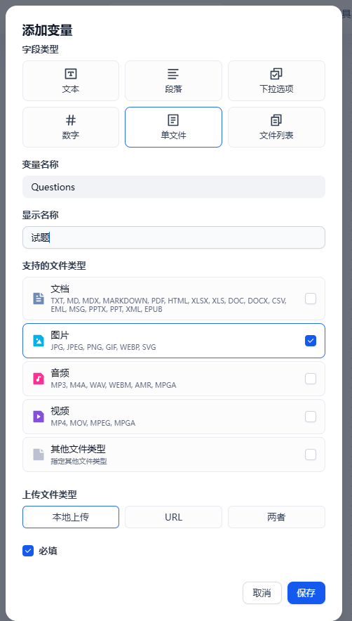

接下来，我们在开始节点后添加一个 LLM 节点。

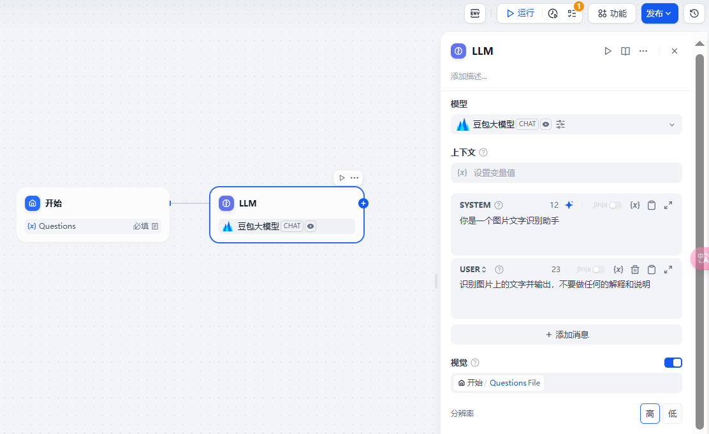

模型选择豆包大模型，然后编写 SYSTEM 和 User 提示词：

```
SYSTEM
```

- 你是一个图片文字识别助手

```
USER
```

- 识别图片上的文字并输出，不要做任何的解释和说明

最后将节点的视觉按钮的开关打开，变量选择开始节点定义的 Questions 变量。

然后我们就可以添加一个结束节点，测试图片识别了。

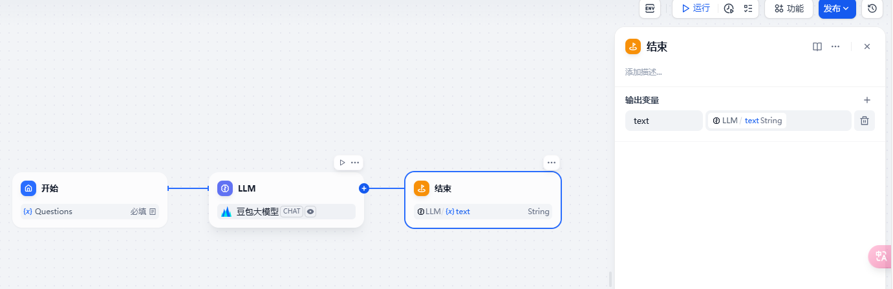

注意结束节点要设置 LLM 节点的输出 text。

我还是用那道数学题的图片，可以点击运行测试一下识别效果。


点击从本地上传，然后开始运行。

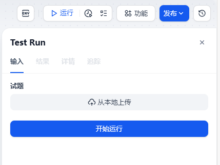

这时就发现运行到 LLM 节点时报错了。

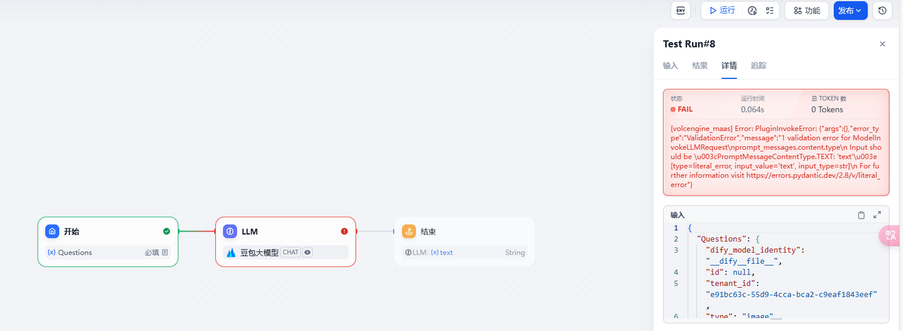

具体错误信息是：

```json
[volcengine_maas] Error: PluginInvokeError: {"args":{},"error_type":"ValidationEr
```

这是因为 Dify 调用的最新版本的火山引擎 SDK，在 prompt_messages.content.type 里不能填字符串类型的 text 了，而应该填 PromptMessageContentType.TEXT，因此报错。想要解决这个问题，我们就需要对 Dify 的火山引擎插件做降版本操作。

点击插件，选择火山方舟，将红框中的 0.0.9 切换为 0.0.7。

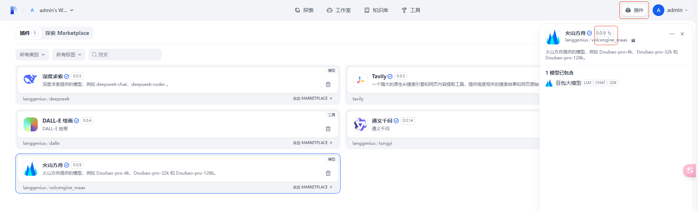

然后再回到工作流，重新运行一下，就会发现问题解决了。

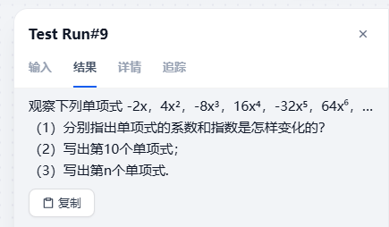

### 试题分析解答

图片识别测试通过后，我们就可以把提示词修改一下，让豆包大模型将图片内容解析出来后，直接进行分析解答了。

提示词如下：

```
SYSTEM
```

- 你是一个初中数学老师

```
USER
```

- 请识别出图片中的试题内容，并进行计算解答。输出格式为：题目：识别出的题目内容答案：题目的答案解析：对于题目每一问的解析

然后再次运行，会得到如下所示的回答结果。

```
题目：观察下列单项式 -2x，4x²， -8x³，16x⁴， -32x⁵，64x⁶，…
(1) 分别指出单项式的系数和指数是怎样变化的？
(2) 写出第10个单项式；
(3) 写出第n个单项式。
```

- 答案：

```
(1) 系数的绝对值依次是2，4，8，16，32，64…，后一项是前一项的2倍，且奇数项为负，偶数项为正；指数
(2) 第10个单项式为1024x¹⁰。
(3) 第n个单项式为(-2)ⁿxⁿ。
```

- 解析：

```
(1) 对于系数，第一项是-2，第二项是4 = (-2)×(-2)，第三项是-8 = 4×(-2)，以此类推，系数的绝对值
(2) 根据前面分析的规律，第10项的系数为(-2)¹⁰=1024，指数为10，所以第10个单项式为1024x¹⁰。
(3) 综合系数和指数的规律，可得第n个单项式为(-2)ⁿxⁿ。
```

看起来豆包大模型的数学能力还可以，解决一下中学的数学题问题不大。今天的测试图片我已经上传到了 Github，你可以下载后进行自测。

## 总结

今天这节课，我们一起学习了两种识别图片文字的方法，一种是使用视觉大模型，比如豆包AI；另一种则是使用 OCR 技术进行识别。在 RAG 中进行表格、PDF 等类型识别的场景里，这种技术非常常用。

之后，我们初步搭建了“作业帮”工作流，让豆包 AI 识别试题图片内容后，进行了计算解答，实际测试下来效果不错。但“作业帮”发展了这么多年，如果我们仅凭一个视觉模型就实现了其功能，那是完全不可能的。因为 AI 答题肯定会有答错的时候。

而“作业帮”能保持很高的正确率，离不开它的题库。因此在下一节课，我会用 RAG 技术模拟题库功能，提高我们这个项目的答题正确率。

## 思考题

为什么视觉模型出来后，OCR 技术没有被淘汰呢？你认为这两者分别适用于什么场景？

欢迎你在留言区展示你的思考结果，我们一起探讨。如果你觉得这节课的内容对你有帮助的话，也欢迎你分享给其他朋友，我们下节课再见！
