# 22 | RAG技术：如何利用RAG技术提升题目解答准确率？

你好，我是邢云阳。

在上节课的总结部分，我提到了“作业帮”发展了这么多年，它解答习题的准确率非常高，核心在于其背后有强大的题库作为支撑。

我们想单纯依靠一个视觉模型就想达到它的能力是不现实的。因此，这节课我会带你利用RAG 技术，也搭建一个简单的题库，来模拟一下这个过程。这节课用到的文档和图片可以在我的 Github 上取到，地址是：Geek02/class22 at main · xingyunyang01/Geek02

## RAG 原理

在上一章节我们浓缩简历时，其实曾经使用 LangChain + Qdrant 向量数据库实现过一个简单的 RAG，我们也简单探讨过 RAG 的原理，不知道你是否还有印象。

最近呢，我在微博上看到了这样一副画得很漂亮的图（图片来自 join.DailyDoseofDS.com），想借助这张图再带你梳理一下 RAG 原理。

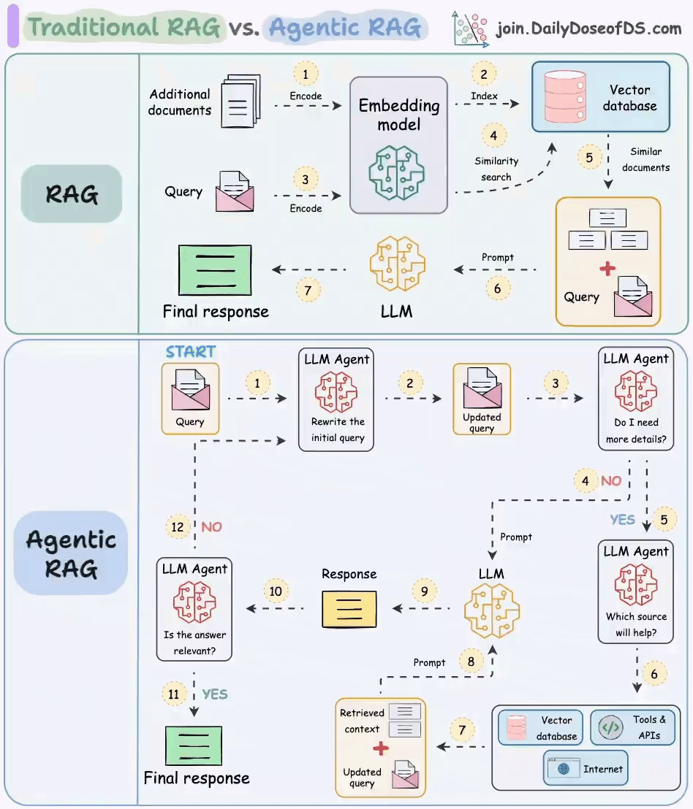

### 传统 RAG

这张图分为两个部分，上半部分讲的是传统的 RAG。RAG 分为前置的数据导入工作和后续的用户检索提问两个环节。

图中的 1 和 2 两个步骤就是前置数据导入步骤。过程很简单。第一步是将数据，比如文档、图片等内容通过向量大模型（Embedding Model）转成向量，第二步是将向量存入到向量数据库中。不过我觉得这里其实少了一步，应该加一个第 0 步，将原始数据进行切片。

图中 3～7 标号点环节就是提问检索环节。首先将用户的提问，比如“颈椎病如何治疗”这样的文本转成向量，然后去向量数据库中做相似性搜索。如果搜索到结果比较相似的，就将内容取出来，组成新的 prompt。比如：

- 用户原始提问：颈椎病如何治疗参考答案：去按摩诊所找个师傅捏一捏

然后把这个新的 prompt 再发送给大模型，由大模型给出最终的答案。

这样做的目的，主要是为大模型举办了一场开卷考试，临时扩展了大模型的知识面，防止大模型不懂装懂，胡乱回答。

### Agentic RAG

理想很丰满，现实很骨感。在实际应用落地时，会发现有时候传统的 RAG 效果并不是那么好，通常会存在这样几个问题。

1. 用户的 query 在向量数据库里搜索不到，或者搜出来的结果不准。

2. 用户的提问不一定需要去向量数据库中搜索，此时的搜索只会浪费 token 资源。比如用户要求生成一段计算加法的 python 代码，这其实直接交给大模型就可以完成。

3. 既然是开卷考试了，那大模型非得翻书本吗（向量数据库搜索）？我去网上搜一下（联网搜索）行不行？我去问问别人（调用工具）行不行？

4. 如何确定最后得到的答案是准确的呢？

针对上面这几个问题，就可以在关键环节上引入 Agent 来解决。我们来看一下图中展示的做法。

首先第一个 Agent 将用户的问题做了改写，这个环节通常会将用户的提问从多个角度拆分成多条，也就是说把一个问题换多个角度进行提问。比如用户输入了一个颈椎病如何治疗，经过改写后可能会产生如下几条 query：

- 颈椎病的治疗方案？什么是颈椎病？颈椎病如何防治？什么样的人容易得颈椎病？

这样就会大大的增加向量匹配命中的概率。

接下来，第二个 Agent 会去判断用户提问的意图，如果认为不需要借助外力，大模型就能搞定，则直接将 query 发送给大模型；如果认为需要借助外力，则发送给下一个 Agent。这个过程，可以使用提示词工程完成。

比如我们的知识库、工具等都是医疗相关的，那么提示词可以像后面这样写：

```
你是一个用户提问内容理解和分类助手。当用户的提问涉及到医疗，看病等相关的内容时，你就输出 yes，如果
```

这样就可以完成意图的分类。

当上一个 Agent 认为用户的提问需要借助外力了，那么任务就交到了第三个 Agent 手里。它负责进一步分析用户的提问需要联网搜索解决，还是查知识库，或者是调用工具。这一步同样可以使用提示词工程搞定。

最后一个 Agent 就是当大模型给出回复后，需要做一下校验，判断答案是否能解决用户提问。比如用户提问是，颈椎病如何治疗，但大模型的回复是，今天天气不错，适合出去晒晒太阳。这样 Agent 就认为没有解决问题，就会重新循环整个过程，再问一遍。

通过这样一个复杂的机制，能大幅提高回答问题的准确率，当然缺点也很明显，那就是耗费token，而且速度很慢，毕竟参与的大模型太多了。

当然除了这两种 RAG 外，还有图 RAG，也就是知识图谱。这个我们在以后的章节再说。

## 用 RAG 实现题库

以上就是对 RAG 技术的复习和查缺补漏。接下来，我们进入到实操阶段。

上一章我们手工实现过 RAG 了，这次我们再尝试一个新方法，使用一款成品。通常开源的RAG 方案，大家听过比较多的是 RAGFlow，但我个人不喜欢这款产品，因为其将文本转向量的过程真是太慢了。因此今天，我就使用另一款半开源的产品，那就是飞致云旗下的MaxKB。所谓半开源就是可以学习使用，但不能用于商业。

### 部署

这款产品部署非常简单，可以直接 docker 拉起，也可以使用离线安装包进行部署。我采用的方式是在 linux 服务器上用 docker 拉起。命令为：

```bash
docker run -d --name=maxkb --restart=always -p 8080:8080 -v ~/.maxkb:/var/lib/pos
```

大家根据自己实际的情况修改主机端口的映射。拉起后，可以看到这样一个容器。

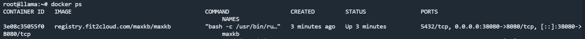

然后用浏览器访问 < 你的公网 IP>:8080 就可以打开登录页面了。

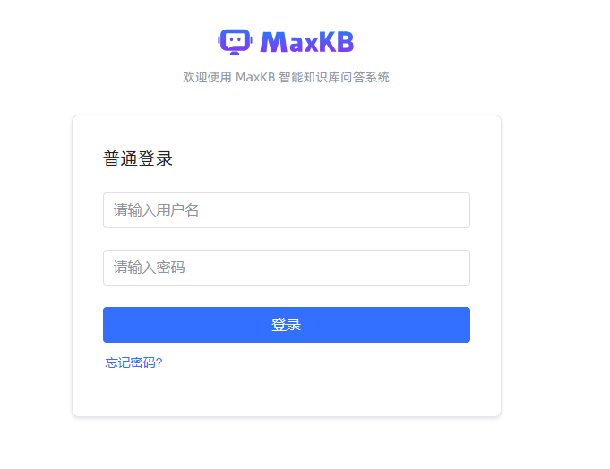

默认的用户名密码为：

```
# 用户名: admin
# 密码: MaxKB@123..
```

进入后可以看到其页面也很简约，没那么多花里胡哨的功能。

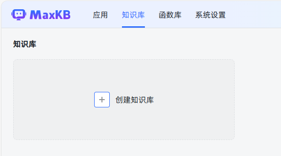

能看到这个页面，说明部署成功了。

我们先把模型都设置好，点击系统设置 - 模型设置，就可以添加模型了。

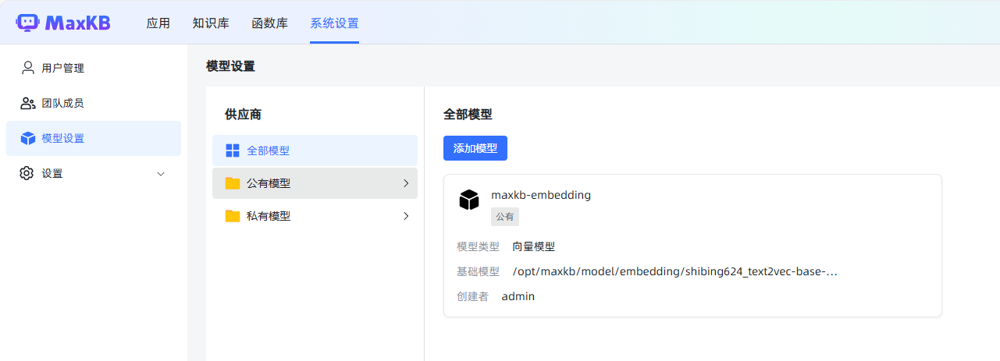

这里的向量模型，我用了阿里云百炼的 text-embedding-v1。

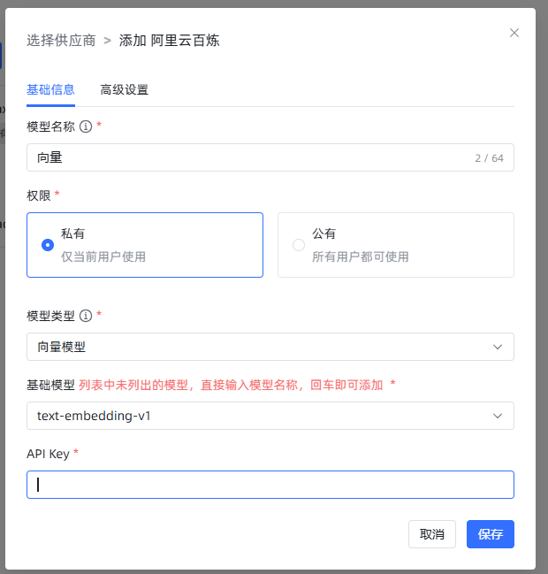

大语言模型，我使用 deepseek-reasoner，也就是 DeepSeek-R1。

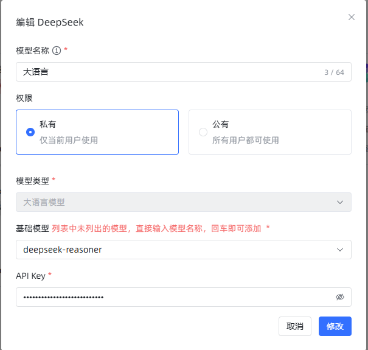

### 数据清洗

接下来就是将文档导入到知识库了，我准备的是一份中学数学题试卷。不过在导入之前，我们需要对文档的格式、内容排版等做手工调整，这样才能增加向量搜索时的命中率，这个步骤称之为数据清洗。

为什么要这样做呢？我们在上学时肯定买过很多课外辅导书、试卷之类的。通常试卷类的排版是先列出所有的题目，然后答案和解析是单独在附录或者另一册中的，就像这样：

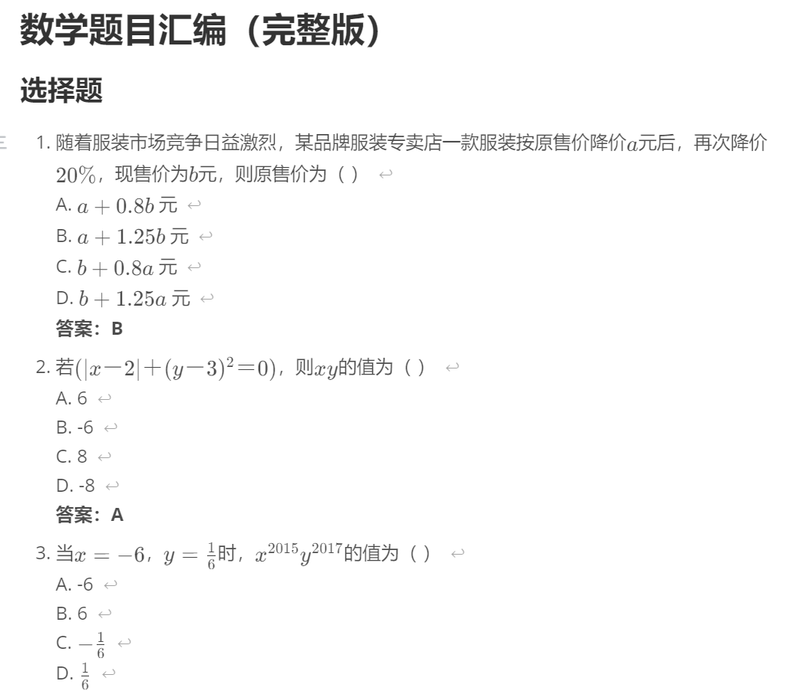

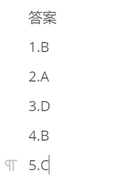

这样是为了方便学生先进行自测，然后再去对答案。但是如果我们做成知识库，这样的排版行不行呢？

肯定是不行的。因为我们的目的是匹配到相似的题目后，能直接拿到该题目的答案和解析。如果题目和答案分开，就起不到这种效果了。因此，如果我们拿到这样的一份试卷，就需要先重新排版，把题目和答案整合到一块去。

此外，数据的格式推荐使用 MarkDown，原因有两点，一是 MarkDown 可以显示数学公式，二是做文档切分时，如果选择按标题等级区分，会比较容易。

这项工作，我们不要自己手动去做，而是要充分利用 DeepSeek-R1 的能力。比如我刚开始是把所有习题都截图交给了 DeepSeek-R1，然后这样对他说：

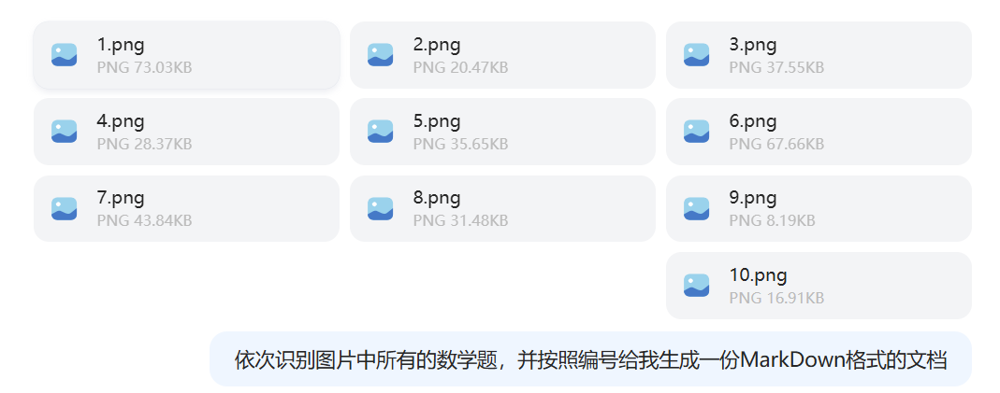

它给的回复是：

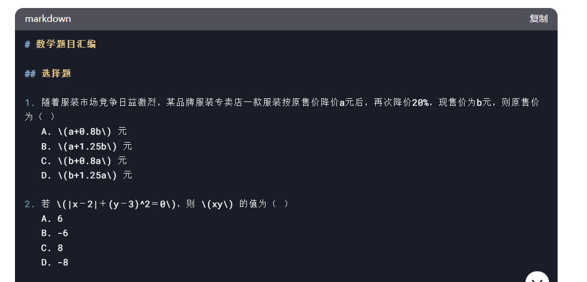

接下来，我又给了它答案：

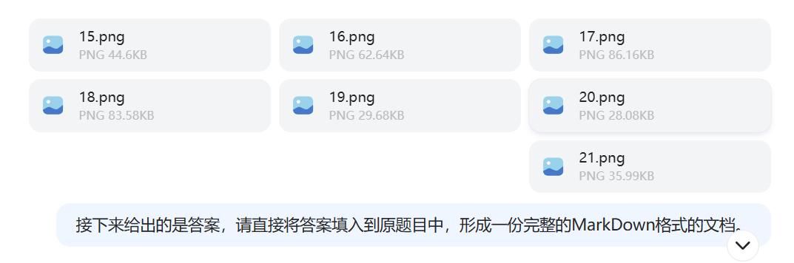

DeepSeek 的回复如下。

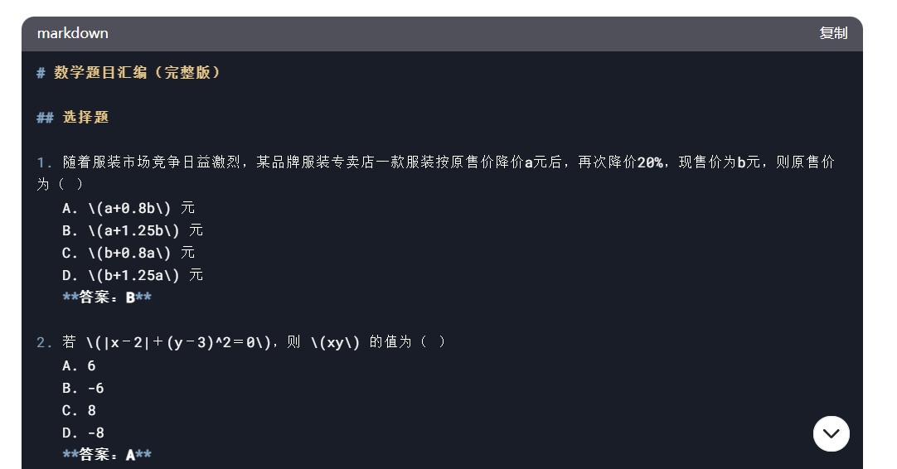

最后还需要让 DeepSeek 将字符串格式的公式转成 Inline Math 的格式：

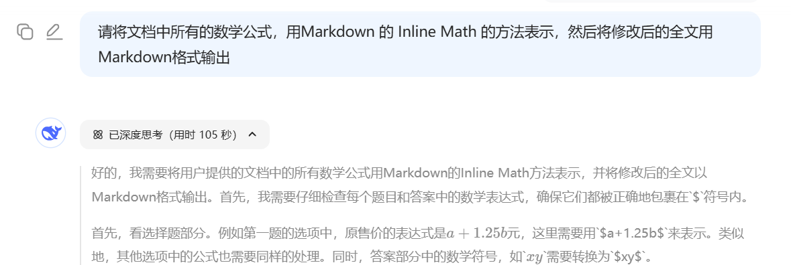

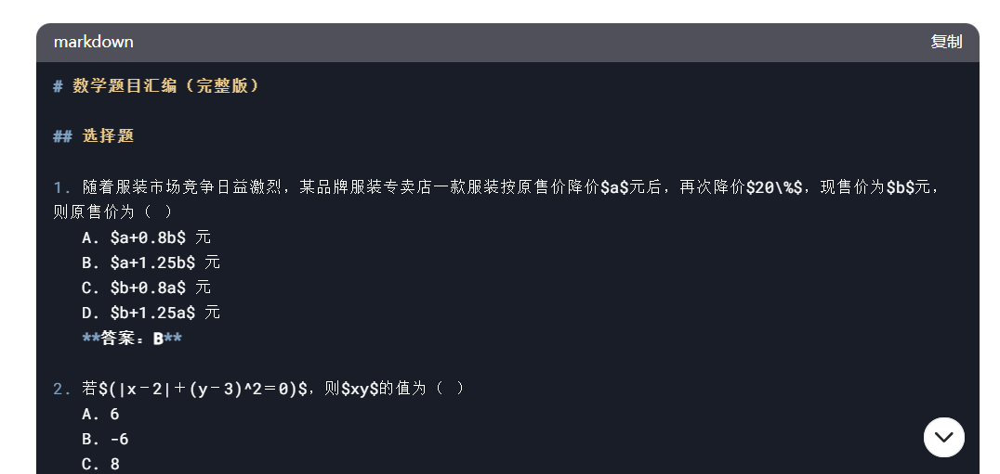

整个过程不需要我们动手复制粘贴，交给 DeepSeek 几十秒就能搞定。

### 文档入库

数据清洗完毕后，我们就可以建立知识库，并导入文档了。点击创建知识库，填入名称、描述、向量模型等信息，之后点击创建。

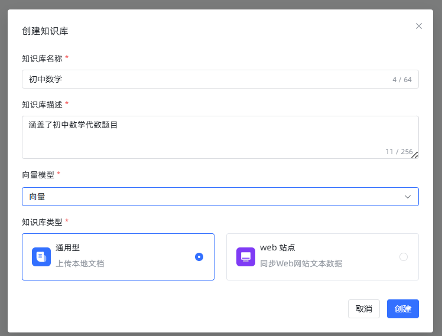

然后选择上传文档（上传 DeepSeek 帮我们整理过格式的版本）。

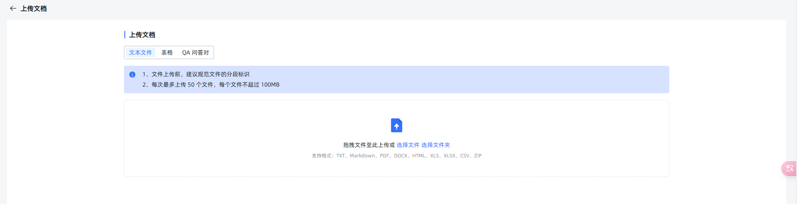

文档上传后，会自动进行分段，并显示出预览。

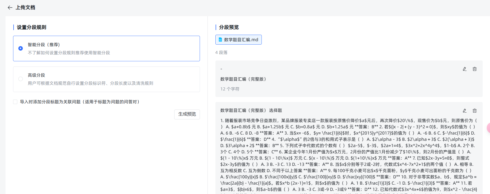

我们可以看到，其实分得并不理想。我们期待的效果是每一道题分一段，这样会匹配的非常准确，但现实是多道选择题挤到了一段里。这时我们就可以点击高级分段，看看能不能自己调整一下分段规则，达成想要的效果。

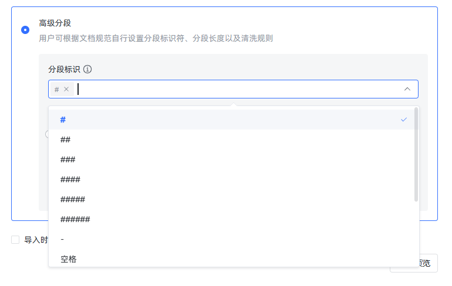

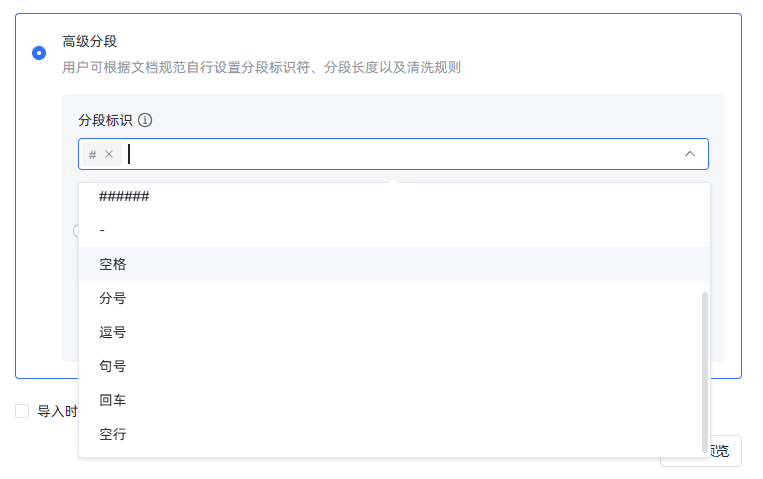

可以看到，分段标识是按 MarkDown 的一级、二级、三级等标题，以及常见的标点符号进行分段的。因此，我们就需要根据规则对文件格式进行调整了。我选择的方法是，在题与题之间加一行空行，就像这样：

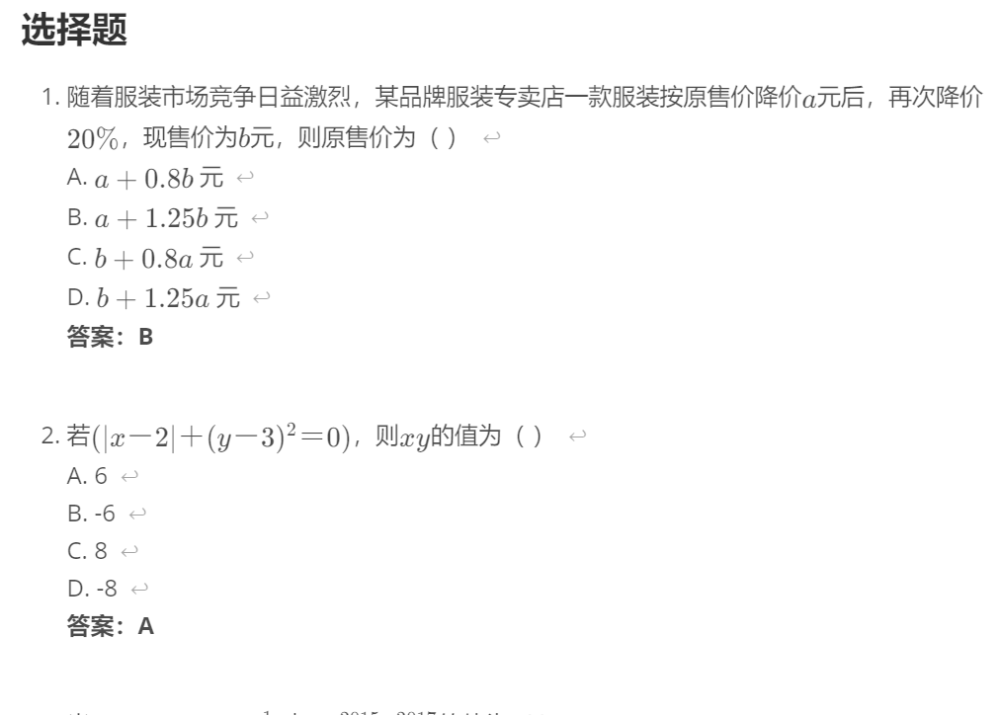

然后我们再次导入，选择高级分段，分段表示选择“#”“##”。空行表示按 MardDown 的一级、二级标题和空行分段，把分段长度调整成 800，防止 35 题之后的那些计算题由于太长而被拆分了。再次生成预览，可以看到这次效果达标了。

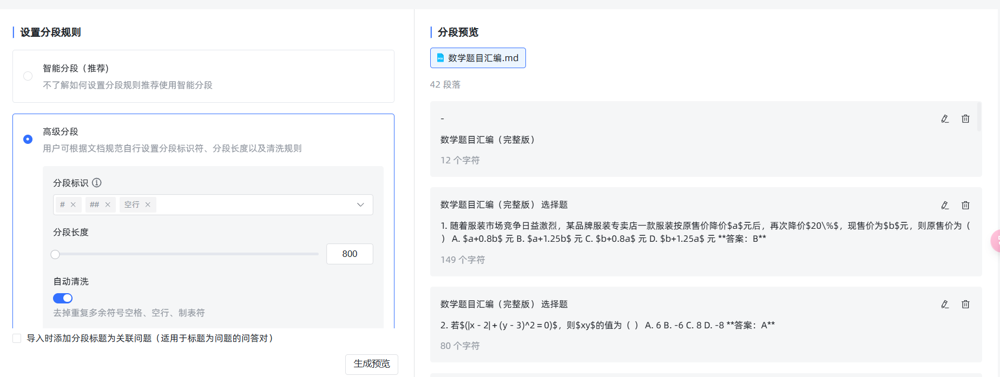

这时候点击开始导入，系统就会自动对这些分段进行向量化和存入向量数据库了。

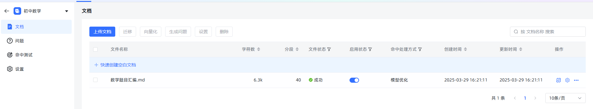

### 命中测试

文档向量化后，我们可以通过左侧的命中测试，调节不同的参数，来测试文档搜索的效果。


点击命中测试的参数设置后，可以看到有三种检索模式。分别是向量检索，全文检索以及混合检索。这里我为你简单做一下解释。

向量搜索就不说了，就是将 query 向量化后做匹配。

全文搜索是用的传统的 ElasticSearch 数据库，也就是说文档切片后一边会向量化进入到向量数据库，而另一边则存入 ElasticSearch，供全文检索使用。这个检索过程类似百度搜索，就是返回的包含关键词最多的文档片段。

混合检索则是既进行向量搜索，又进行全文搜索，之后对两边搜索到的结果，用算法做一个重新排名，最终得到一个相似片段的排名。

在实际应用场景中，大家需要根据自己的数据量以及业务等具体因素，在做了命中测试后，再确定用什么方式，一般推荐使用向量搜索或者混合搜索。

除此之外，还有一个参数是“相似度高于”，默认是 0.6。这其实就是之前我们使用过的相似度阈值，两个向量越相似，分值就越高。设置相似度阈值，是为了过滤掉我们认为相似度不高的检索结果。

接下来，我们把一个题目稍微换换说法，做一下命中测试，比较一下几种检索方式返回的效果。

- 原题目：

```
某企业今年1月份产值为(x)万元，2月份的产值比1月份减少了10%，则2月份的产值是
```

- 修改后的题目：

```
某企业今年10月份产值为\(x\)万元，12月份的产值比1月份增长了10%，则12月份的产值是
```

向量检索：

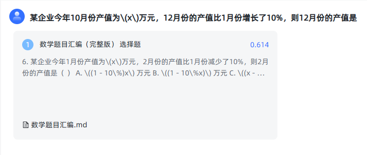

全文检索：


混合检索：

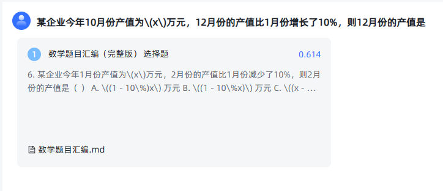

由于全文检索没检索到，因此向量检索和混合检索的得分是一致的。

### 创建知识库助手应用

想要把 MaxKB 的知识库问答助手功能用起来，需要创建应用。

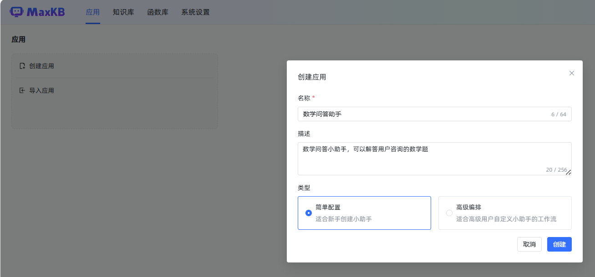

点击创建后，就会进入到设置和调试页面。我们可以设置问答所使用的大语言模型以及管理知识库。此外还需要设置引用知识库后的系统提示词。

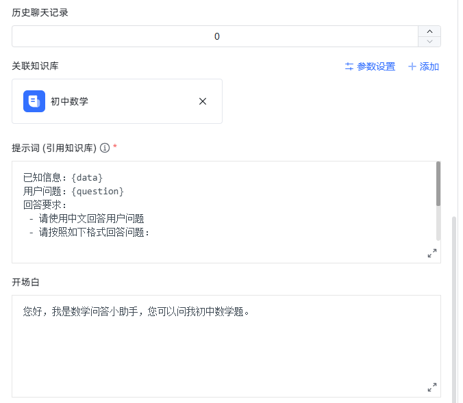

我的提示词为：

```
已知信息：{data}
用户问题：{question}
```

- 回答要求：

```
- 请使用中文回答用户问题
- 请按照如下格式回答问题：
  题目：{question}
  例题：{data}
  答案：用户提问的题目的答案
  解析：用户提问的题目的解题思路
```

关联知识库后，还可以继续点击参数设置，设置检索方法等。

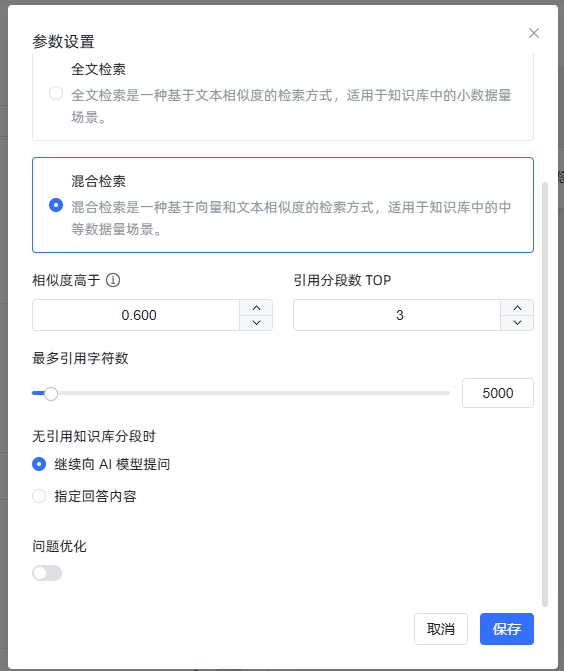

都设置好后，可以在右侧进行调试。比如还是问刚才命中测试的问题。

```
某企业今年10月份产值为\(x\)万元，12月份的产值比1月份增长了10%，则12月份的产值是（）
A. ((1 + 10%)x) 万元
B. ((1 + 10%x)) 万元
C. ((x + 10%)) 万元
D. ((1-10%)x) 万元
```

可以得到如下效果：

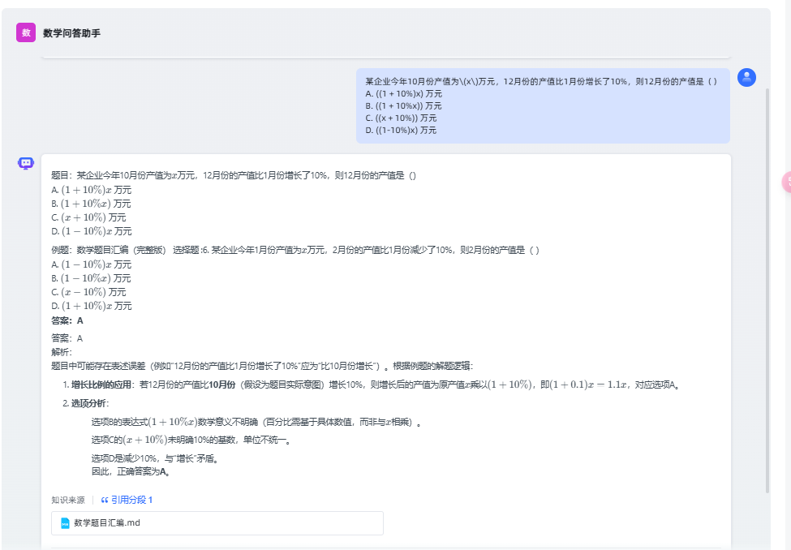

可以看到是引用了一个分段的，这就说明 RAG 过程成功了。这里同时还说明了大模型具备举一反三的能力，通过一个例题，解答了新的题目。

如果觉得效果满意，就可以点击右上角的保存并发布了。发布后的应用支持多种访问方式，比如直接生成一个对话网页、嵌入第三方网页、API 访问等等。我们要用到的是 API 访问，下节课再继续进行讲解。

## 总结

这节课的内容还是蛮多的，有理论也有实操，其中还有我自己使用知识库时的配置经验。开篇我们讲解了传统 RAG 和 Agentic RAG 的特点，相信大家在看了 Agentic RAG 后，更能感受到 Agent 的重要性，可以说 Agent 已经成为了 AI 原生应用开发的范式，因此需要你重点掌握。

在实操部分，我们用到了 MaxKB 这样一款非常敏捷的知识库产品，演示了从数据清洗到问答入库，再到知识匹配的全过程。

在这个过程中，有两个要点需要你格外留意。

第一，文档入库不是随便整一个文档，随便切片一下丢进知识库就能有效果的，这个过程是需要根据业务场景做设计的，我们应该提前规划好文档怎么清洗怎么切，能满足业务需要，之后就是尽力向目标靠拢了。

第二，当我们找到一款知识库，试用之后发现效果不好时，不妨先问问自己，我们真的理解了这款知识库的设计思路了吗？换句话说，我们真的会用吗？我的感觉是，学会根据不同业务场景配置知识库，比学会开发知识库还重要。

比如文档拆分的时候，智能排序的效果不好，就可以试着探索一下高级排序模式，或者尝试针对这款知识库的设计逻辑，根据自己问题的场景来灵活调整自己的文档格式。

好的，以上是我个人在应用开发过程中的一点感受，仅供参考。也期待你可以畅所欲言，在评论区聊聊自己使用 RAG 做业务的感受。

## 思考题

题库中有一道题是：

```
已知 (2x-3y+5=8)，则整式 (2x-3y) 的值为
```

如果我们改成：

```
已知 (4a-6b+10=28)，则整式 (2a-3b) 的值为
```

你觉得在阈值设为 0.6 的情况下，能匹配到吗？为什么呢？

欢迎你在留言区展示你的思考结果，我们一起探讨。如果你觉得这节课的内容对你有帮助的话，也欢迎你分享给其他朋友，我们下节课再见！
