# 23-校验机制：如何通过校验提升题目解答准确率？

你好，我是邢云阳。

上节课，我们借助 MaxKB 产品，用传统 RAG 技术做了题库，并发布了一个数学问答助手。

它的效果就是，当我们问到题库中类似的题目时，由于题库的题目是有题干、也有答案的，因此相当于给了大模型一个例题，大模型可以根据例题来解决新的问题，从而提升问题解答的准确率。

理论上说，题库里的题目越多、越丰富，大模型可参考的例子越多、越详细，那么解决新问题的能力就越强。这其实也反映了业务数据的重要性。个人尝试创业做产品的话，如果没有数据，就如同失去了根基，技术做出花来也是空中楼阁。

回到课程的主题，上节课，我们留了个尾巴，即通过 MaxKB 发布了问答助手后，我们怎么能在第 20 节课里基于 Dify 构建的“作业帮”工作流中调用它呢？这节课，我们就先来实现一下。

## 使用 API 访问 MaxKB

我们知道 MaxKB 应用发布后，会有多种访问方式，其中有一种是通过 API 访问。

### 查阅 Swagger 文档

我们点击进入到一个已发布的应用后，就可以在概览的应用信息处看到 API 的访问地址和文档地址。

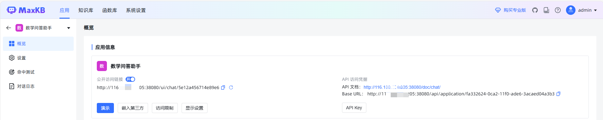

我们首先点击 API Key，创建一个密钥，用于对 API 的访问。

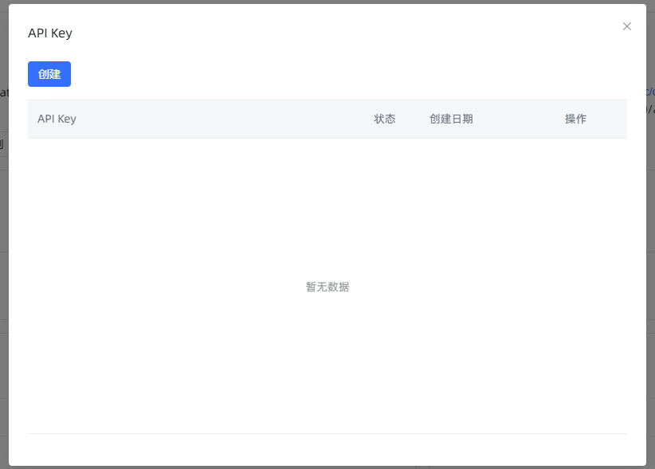

之后就可以点击 API 文档后的链接，访问到该应用的 Swagger 文档。

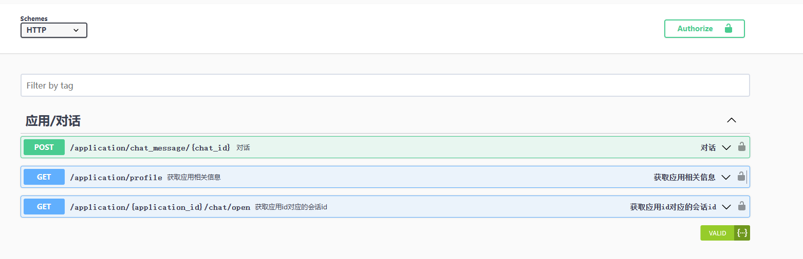

文档内容还是很简单的，一共就三条 API，API 的官方使用说明在这：通过 API KEY 进行对话 - MaxKB 文档。简单总结就是这三条是有调用顺序的，先调第二条，拿到应用 id，再调第三条拿到会话 id，最后就可以通过第一条进行对话了。所以，为了演示起来简单些，我们就提前搞定会话 id，最后在 Dify 中，只调用第一条就可以了。

会话 id 要通过前两条的调用来获取，我们直接在 Swagger 文档中调用即可。调用前先点一下API 后面的那个开着的小锁，设置一下 API Key。

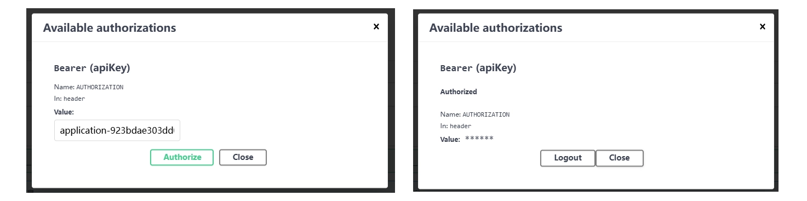

设置完成后，小锁就变成了关闭的状态。这时就可以点击第二条路由的 Try it out，来进行调用了。

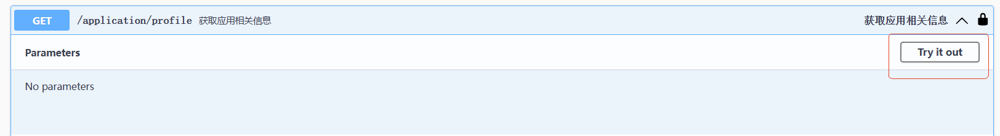

此时会看到 API 返回的结果。

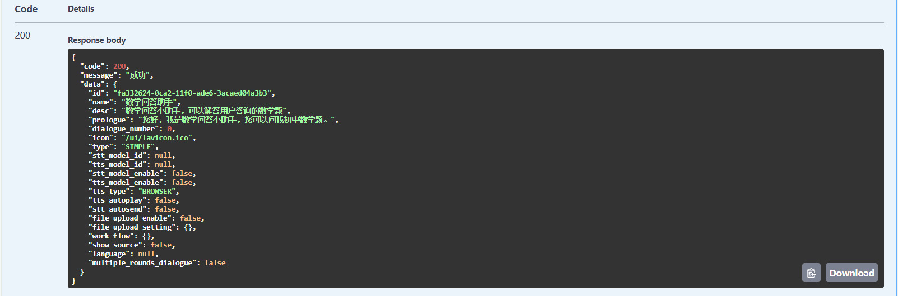

我们需要其中的 id 的值。接着，点击第三条 API 的 Try it out，将 id 填到 application id 那里，然后点击 Execute 并执行。

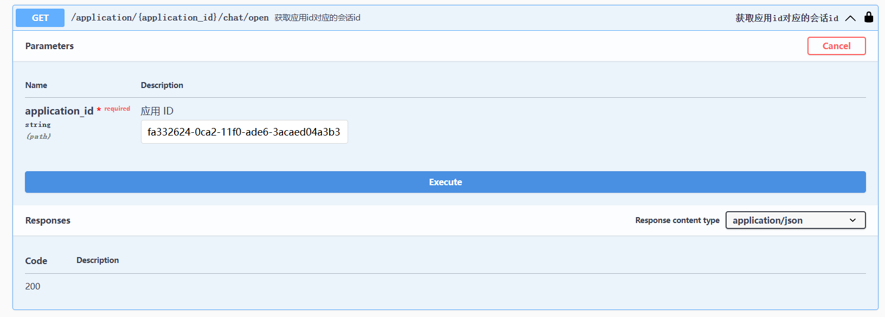

这样就得到了对话 id。

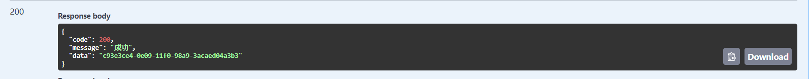

我们顺便将对话 API 也测试了，这样能摸清楚它的返回值的格式。

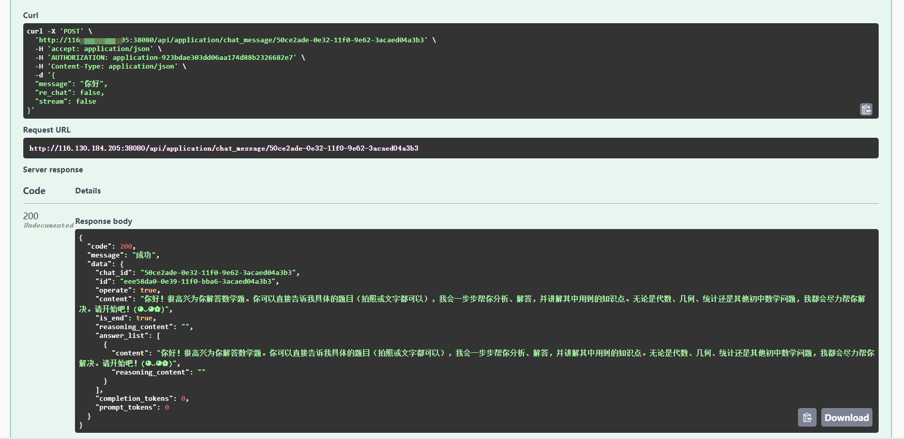

可以看到，其返回值是参考 OpenAI 的对话格式来的，我们真正需要的是它 content 字段对应的值。

### 将对话 API 添加到工作流

测试完毕，就可以着手准备从 Dify 中调用了。在第 19 节课，我们讲过工具开发套路，可以将该 API 以 OpenAPI 的方式做成工具，进而可以把工具当作一个节点在工作流中调用。

但今天这节课，我想换个思路搞，也是为你多演示几个 Dify 的节点功能。我采取的方法是使用 HTTP 请求节点获取到对话 API 的 Response 后，再使用代码解释器，从 Response Body中将 content 的值取出来。

接下来，我们开始编辑 Dify 节点。首先将 LLM 节点再改回到图片识别的 prompt。

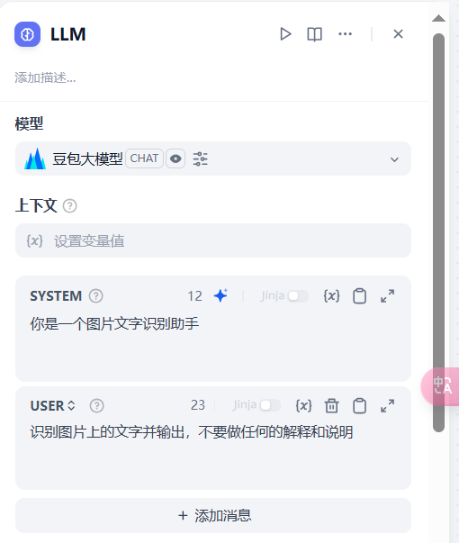

然后添加 HTTP 请求模块。

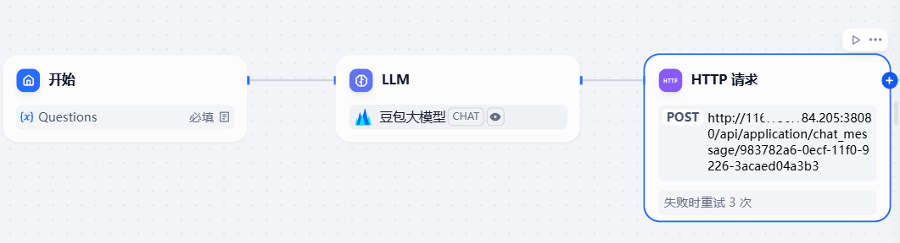

我们在该模块中配置 Swagger 文档中的第一条 API，也就是对话 API 的信息。

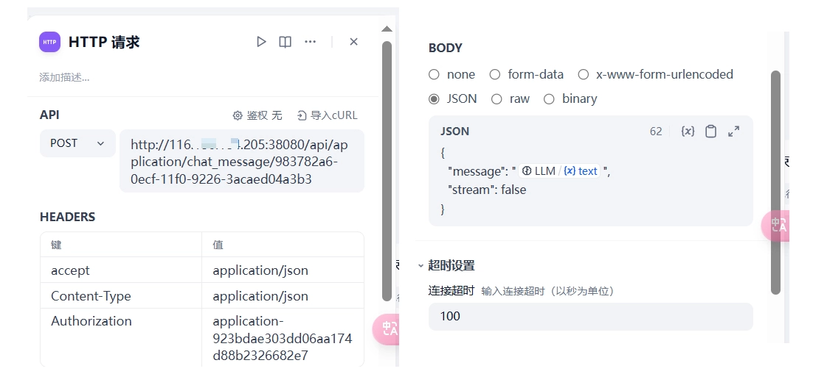

在 Body 中，我们设置为 JSON 格式，然后将 LLM 的输出 text 作为 message 的入参。

接下来，就可以在该模块之后添加代码解释器模块了。

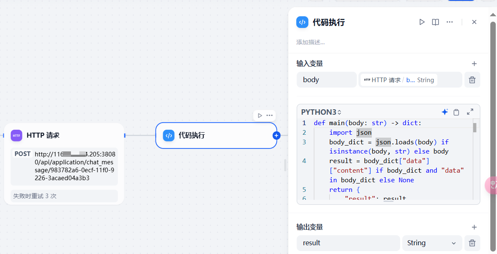

代码解释器的主要功能是解析 HTTP 请求模块的输出 body，从中将 content 的值拿出来。因此我编写的代码如下：

```python
def main(body: str) -> dict:
   import json
   body_dict = json.loads(body) if isinstance(body, str) else body
   result = body_dict["data"]["content"] if body_dict and "data" in body_dict el
   return {
       "result": result,
   }
```

要注意的是格式问题，在代码解释器中，必须有一个函数叫 main，而且该函数的返回值必须是 字典，否则 Dify 执行时会报错。

这一步完成后，加一个结束节点，将代码解释器的 result 输出即可。

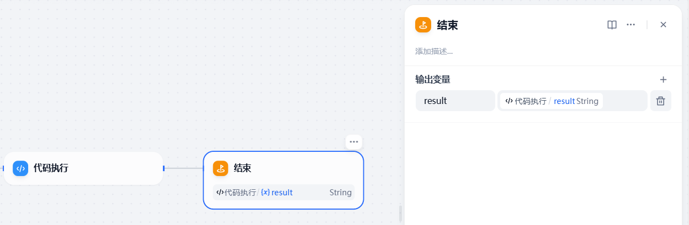

### 测试

这样，整条流水线就测试完成了，接下来，我们用下图的例题测试一下效果。

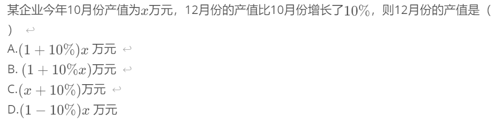

依然是点击右上角的运行，将图片上传，然后点击开始运行：

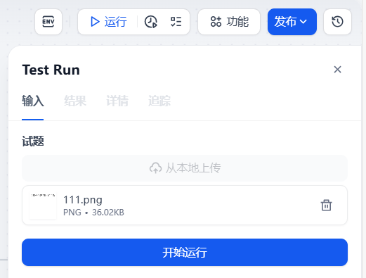

一段时间后，可以看到输出结果为：

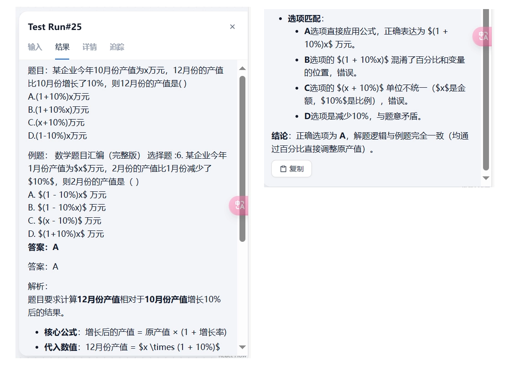

结果完全符合预期，这也就说明工作流没什么问题。

## 校验题目解答的结果

### 添加校验模型

花了差不多半节课的时间，解决了上节课遗留的小尾巴后。我们就从业务的角度再来更深一步思考一下。

在上学时，学生完成的作业是需要老师进行批阅，也就是校验答案的；到了工作后，我们写的代码，同样也会有比我们水平高的程序员去做 Review，这叫做检查机制，是保证准确率的最后一关。

所以在“作业帮”工作流中，虽然 DeepSeek-R1 已经参考了例题，给出了新题目的计算结果，但我们仍需让另外一个水平比较高的模型校验一下。

前一段时间，通义千问新出了一个模型叫 QwQ:32B，号称可以与 DeepSeek-R1 相媲美。那我们就选它作为校验模型。

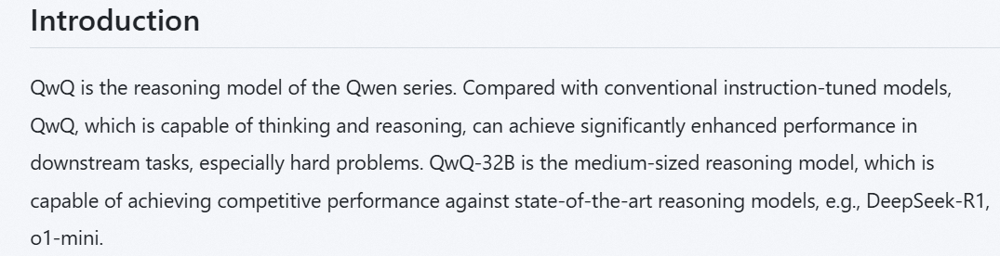

首先，还是要在模型供应商那里添加模型，这次要添加的供应商是通义千问，其对接的是百炼平台，其中就有 QwQ:32B。


### 添加校验，条件分支节点

模型添加完成后，就回到工作流中，我们将结束节点删除，然后在代码执行节点后，新加一个LLM 节点。

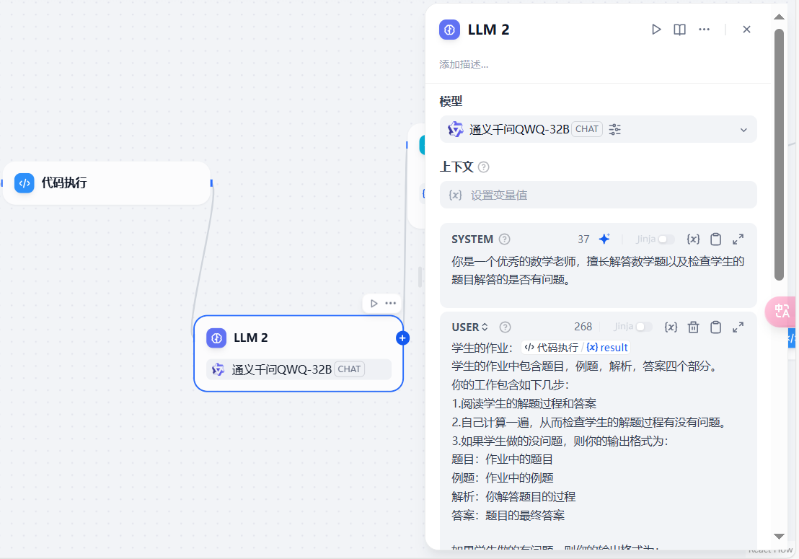

模型设置为 QwQ-32B，prompt 为：

```
SYSTEM
```

- 你是一个优秀的数学老师，擅长解答数学题以及检查学生的题目解答是否有问题

```
USER
学生的作业：/result
```

- 学生的作业中包含题目，例题，解析，答案四个部分。你的工作包含如下几步：

```
1.阅读学生的解题过程和答案
2.自己计算一遍，从而检查学生的解题过程有没有问题。
3.如果学生做的没问题，则你的输出格式为：
```

- 题目：作业中的题目例题：作业中的例题解析：你解答题目的过程答案：题目的最终答案

- 如果学生做的有问题，则你的输出格式为：回答错误

```
---------------------
```

- 题目：作业中的题目例题：作业中的例题解析：你解答题目的过程答案：题目的最终答案

请注意这里我特别设置了，当上一个大模型做的有问题时，要返回“回答错误”。因为这样，我们就可以添加条件分支节点。条件分支节点就是我们写代码中常用的 If Else，其可以执行的判断如下图所示：

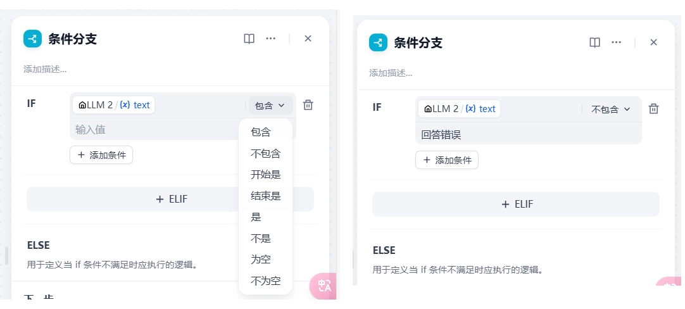

这里，我们的 IF 条件选择不包含，不包含什么呢？ LLM2 的输出结果不包含回答错误这四个字。我们程序员一看就明白，这其实就是一个字符串匹配，非常简单。

我这样做的目的是，当 LLM2 认为前面的节点算对了的时候，就直接将内容输出，结束就可以了。但如果算错了，就可以将 LLM2 结果返回的同时，将结果再通过飞书或者其他方式通知给人类，让人类判断一下是否要人工看看答案算对了没。当然这一步不通知也无所谓，毕竟我们还是要相信第二个模型的纠错能力。

所以最后我的工作流是这样编排的：

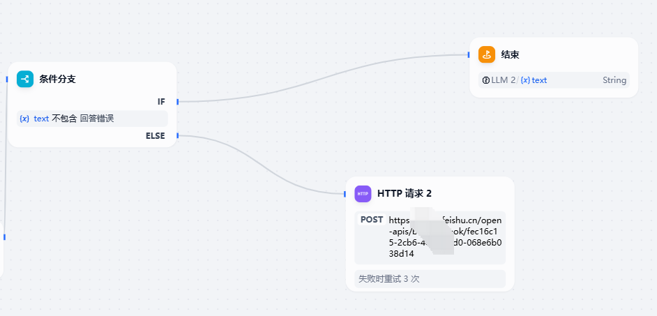

当出现回答错误时，通过 HTTP 请求的方式向飞书发一条消息。

我们来测试一下回答正确的效果：

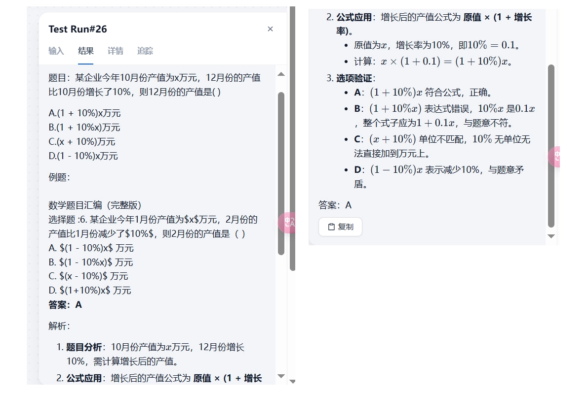

可以看到给出的结果没有包含回答错误，说明 QWQ 的校验环节顺利通过。

### 向飞书发送消息

那回答错误时，是如何向飞书发送消息的呢？其实也很简单，官方教程在这自定义机器人使用指南 - 开发指南 - 开发文档 - 飞书开放平台，问一下 DS 也能搞定。

首先在飞书上建一个群，然后选择群机器人，选择自定义机器人，进行添加。

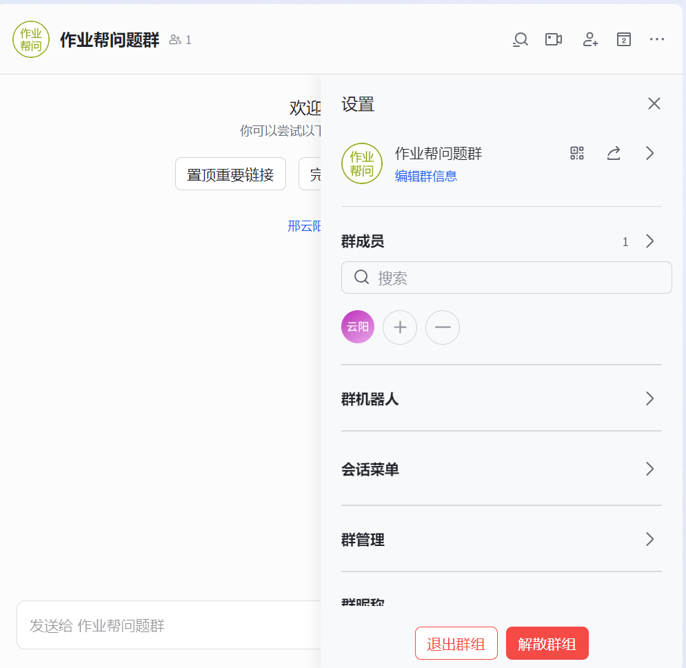

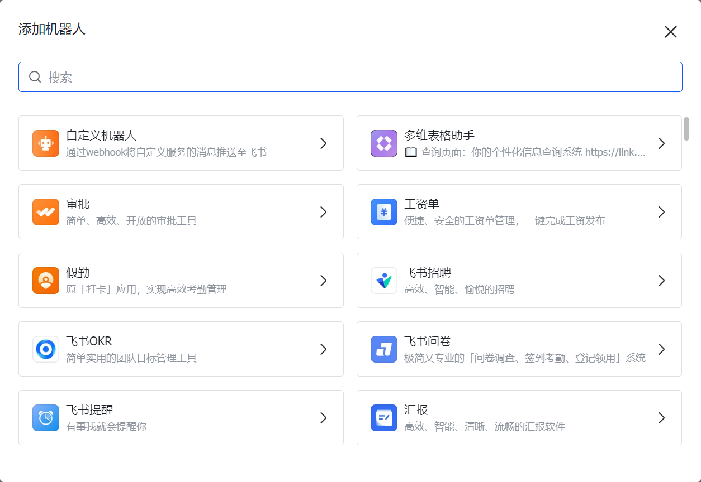

添加完成后，点击后面红框里的图标。

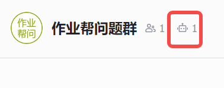

这时会在右侧弹出如下界面：


点开后，就能看到一个 WebHook 地址：

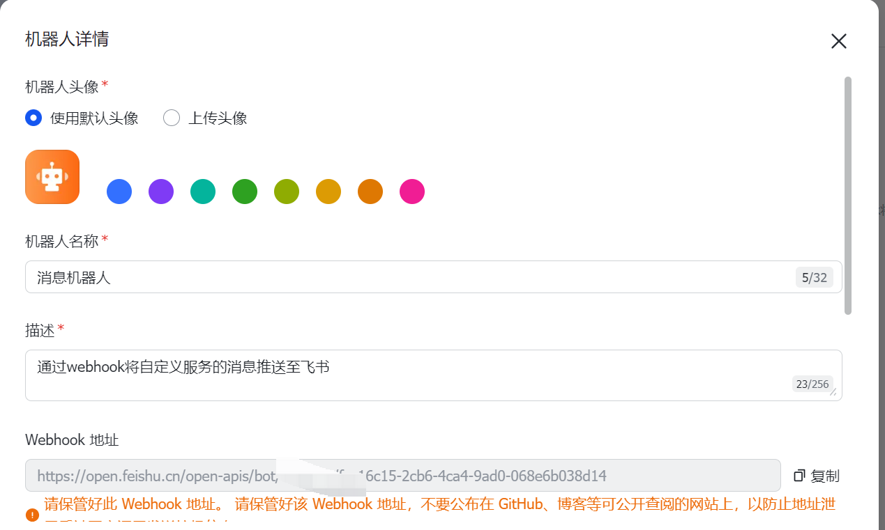

我们只需要按官方要求的格式组一个 JSON Body，发给这个地址，该机器人就会在群里发送一条消息。所以，我的 Dify 工作流的 HTTP 请求节点是这样配置的：

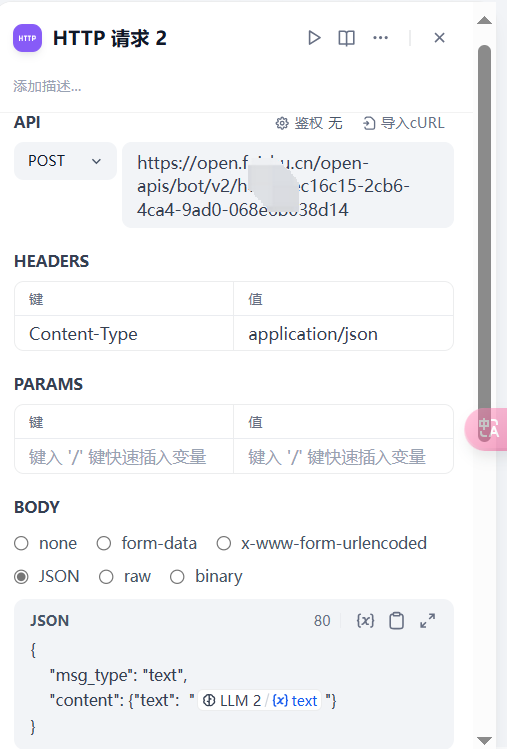

配置好后，可以点击小三角运行测试一下：

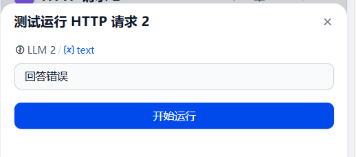

然后就可以看到群里机器人发了消息：

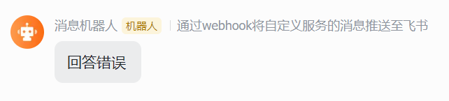

这样，人类就可以方收到哪个题 DeepSeek 模型回答错误了，这是由 QWQ 模型纠正的，然后再来决定是否进行干预，是不是很方便呢？到此，我们“作业帮”工作流的全部功能就做完了。

## 总结

有没有发现这一章里，我们几乎没怎么写代码，但却完成了一个相对较复杂的应用，该应用有多个大模型参与，还有 RAG、飞书机器人等等。这完全得益于 Dify 对 Agent 和工作流的低代码封装，省去了原本我们需要通过 LangChain 等框架或者借助 SDK 手撸才能实现的功能。使我们可以将更多的精力放在业务开发的本身。

在这节课开始时，我为你讲解了如何通过 API 的方式访问 MaxKB 的对话应用。对于 Dify 来说，通过支持 API 的方式访问应用。比如作业帮应用，就完全可以自己再写一个前后端，前端用来用户进行图片的上传、对话的发送，后端则是调用 API 访问工作流。

从业务角度再进一步思考，前端可以增加“我要纠错“按钮，比如用户认为作业帮返回的答案是错误的，就可以点击我要纠错，此时再向飞书发送消息通知工作人员去检查，我认为比我们文中讲的 QWQ 纠错后，就触发飞书通知要更加合理。

在 AI 时代，竞争的核心不再是单纯的技术或工具的比拼，更是思维的比拼。我们要改变自己原有的思维方式，尝试多多利用 AI 的潜力，让工具分担一些基础的工作，这样才能有更多精力投入到业务创新中。

## 思考题

有兴趣的同学可以用 Cursor，调用 Python 的 Gradio 或者 Streamlit 框架，生成一个简易前端，来和工作流对接一下。

欢迎你在留言区展示你的实践结果，我们一起探讨。如果你觉得这节课的内容对你有帮助的话，也欢迎你分享给其他朋友，我们下节课再见！
