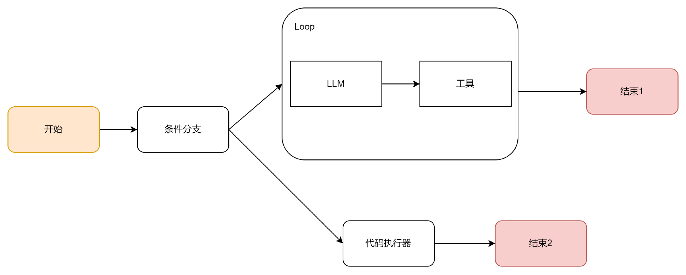
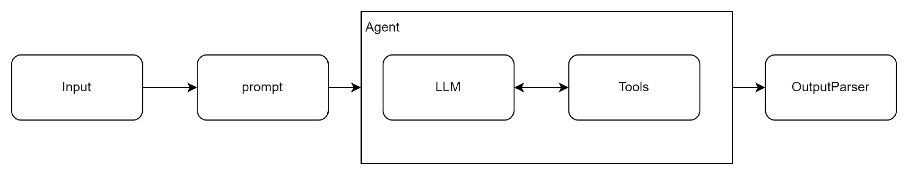
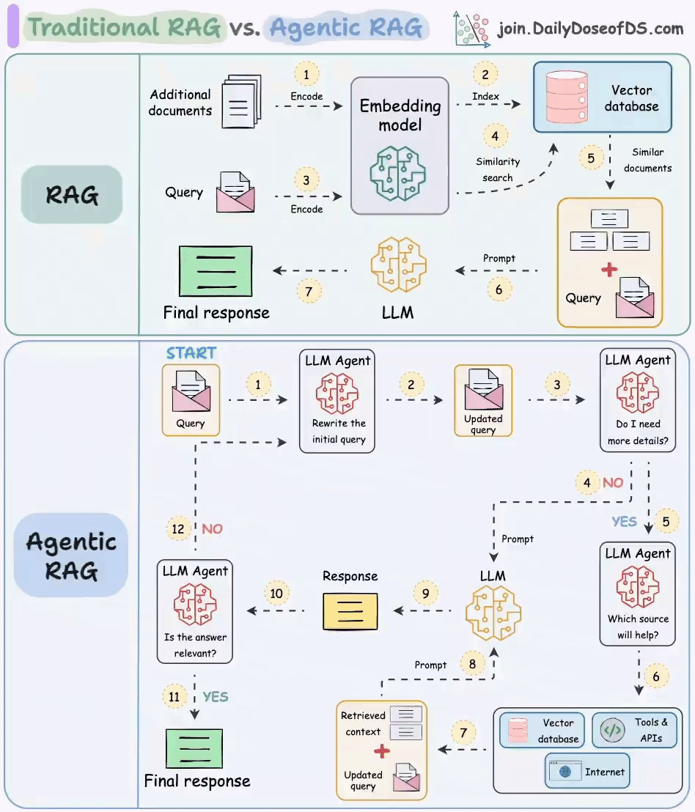
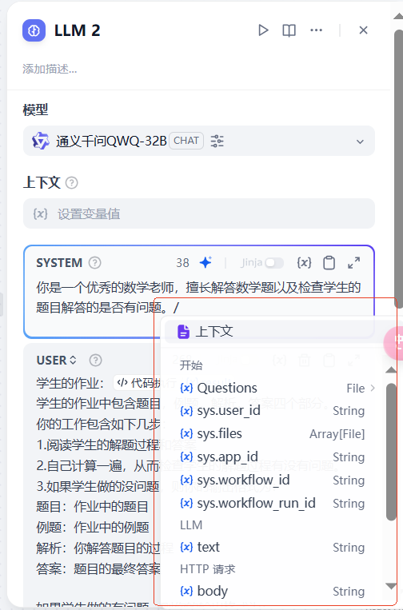
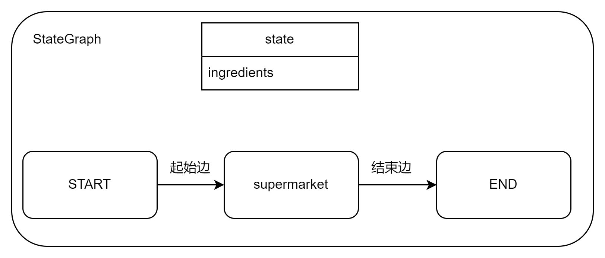
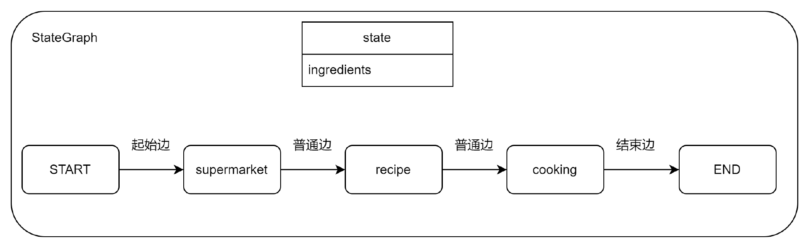
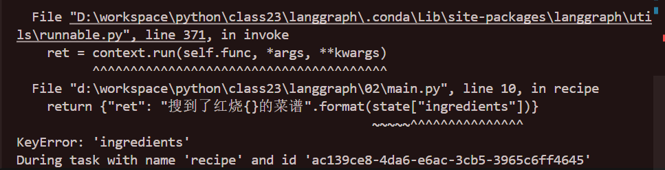

# 24 | 热门AI开发脚手架：一节课快速入门LangGraph

你好，我是邢云阳。

在上一个章节，我们一起学习了基于 Dify 的平台化开发方法。借助 Dify 平台的工作流功能，我们仅以少量代码，就完成了 AI 版“作业帮”这个项目，并借此学习了视觉模型的使用，还体会了 DeepSeek-R1 与 QwQ 两款模型的数学能力。

但作为一名专业的 AI 应用开发工程师，我们不应止步于低代码平台的应用。要真正实现技术突破，必须掌握原生代码开发能力——既能通过编程复现平台功能，又能突破可视化工具的限制，实现更复杂的智能系统架构。这种代码级的掌控力，才是我们应对多样化 AI 开发挑战的核心能力。

## LangGraph 背景

在编写 Dify 工作流的过程中，我们会感受到，所谓的工作流其实是一条链，该链上包含很多个节点，上一个节点的输出就是下一个节点的输入。此外，在这个链上是允许做条件分支以及局部循环的，比如后面示意图里的情况。



但是如果我们不想依赖平台，而是要自己开发一个带有工作流的 AI 应用，这时最好的方法就是借助框架来完成，比如前两年比较火的 LangChain，可以做出一条后面这样的链。



所以这个框架为什么叫 LangChain 也很好理解了，核心就是提供了 Chain（链）的功能。需要注意的是这条链在方向上来说是单向的，不能够向回流或者循环。

不过随着 AI 逐渐深入到业务，在落地一些应用的时候，大家就发现使用这种单向的链，有些应用搞不定，比如之前讲过的 AgenticRAG，也有人叫 GraphRAG。因为这样的应用不仅要有分支的功能，还要具备循环的功能。这时就需要用图结构来表示业务了。



- 图片来源：https://join.dailydoseofds.com

在此背景下，去年 LangChain 开发了一个扩展库，取名叫 LangGraph。这个库功能很强大，因为能够实现图的方式，解决 AgenticRAG 那是小菜一碟。而且最近调用 LangChain 较新版本 Agent 功能的同学可能会看到一条这样的警告：

```
LangChainDeprecationWarning: LangChain agents will continue to be supported, but
```

翻译成白话就是 LangChain 就快不更新 Agent 的功能了，如果想体验后续的 Agent 新功能，请去使用 LangGraph。

所以话说到这个份上，不管是从业务还是从技术上，作为从事 AI 应用开发的程序员都有必要去学习一下 LangGraph 了。

那 LangGraph 应该怎么学，是否要对着文档，一个功能一个功能学呢？我的答案是没必要，也没这个时间。因为这类框架更新速度非常快，代码架构变更也是家常便饭，可能上个月的功能到了下个月换了写法了。因此我们只需要先理解其核心写法，快速上手用起来，后续具体使用过程中如果遇到什么问题，再去查文档就可以了。

## LangGraph 编程学习

好，接下来，我们就开始进入到代码的学习中。

### 环境安装

首先从环境安装开始，其实非常非常简单，一条命令行就可以搞定。

```
pip install langgraph
```

### 节点、起始边、结束边

环境准备好后，我们以烹饪流程为例，通过代码分解来学习 LangGraph 的基础编程逻辑。日常生活中制作菜肴通常包含三个关键环节：准备原料、学习方法和实施烹饪。

假设现在需要烹饪羊排，完整的流程应该是：

1. 食材采购：前往超市选购新鲜羊排

2. 方法查询：通过抖音检索菜谱教程

3. 烹饪实施：按照教程完成料理过程

接下来，先用 LangGraph 模拟食材采购。代码如下：

```python
from langgraph.graph import StateGraph, START,END
def supermarket(state):
   return {"ret": "{}买到了".format(state["ingredients"])}
if __name__ == "__main__":
   sg = StateGraph(dict)
   # 定义第一个节点
   sg.add_node("supermarket", supermarket)
   # 定义起始边
   sg.add_edge(START, "supermarket")
   # 定义结束边
   sg.add_edge("supermarket", END)
   graph = sg.compile()
   ret = graph.invoke({"ingredients": "羊排"})
   print(ret)
```

在代码的第 7 行，首先使用 StateGraph 方法定义了一个 Graph，可以理解为类似 Dify 创建了一个工作流。StateGraph 的入参是 dict，dict 我们知道是 python 中的字典数据类型。这里为什么要传数据类型呢？

我们看一下 StateGraph 源码。

```python
class StateGraph(
   state_schema: Type[Any] | None = None,
   config_schema: Type[Any] | None = None,
   *,
   input: Type[Any] | None = None,
   output: Type[Any] | None = None
)
```

可以看到 StateGraph 的第一个参数是 state_schema，其类型是 Type，也就是说要传入一个数据类型。state 是一个中央状态存储器，可以用来存储节点间流转时需要的各个变量的值，这个我们在 Dify 中也使用过，就像下图，输入 / 就能选择之前各个节点的变量。



因为变量通常有多个，因此在这里我就暂时传入了 dict 字典数据类型。

那有了图以后，就可以定义一个工作节点表示去超市买羊排的任务了，这就好比在 Dify 工作流中定义一个节点。于是我在第 10 行定义了超市节点，并在第 3 行写了一个 supermarket 节点任务方法表示了去超市买到了羊排。

而在 supermarket 方法中就用到了 state，使用 state[“ingredients”] 获取了食材参数的值，也就是羊排。节点方法的输出也有要求，必须是 dict ，因此第 4 行用了字典方式输出。

不过工作节点不能孤零零的存在啊，所以得有开始和结束。于是就在 13 和 15 行，分别用两条边将 START（开始节点）和 supermarket 节点，以及 supermarket 节点和 END（结束节点）连接在了一起。这两条边分别叫起始边和结束边。

这样我们就构成了一个简单的 Graph，用一张图表示其架构就是这样：



最后在第 17 行，执行 compile 方法，就相当于编译一下，形成刚才这张图。18 行的 invoke就是赋值并开始运行 Graph。运行结果如下：

```
{'ret': '羊排买到了'}
```

### 普通边、多节点

有了上面的基础后，我们将去抖音搜菜谱和进行烹饪的节点都加入进来，就会形成这样的一张图。



可以看到任务节点之间的边叫做普通边。代码我们这样写：

```python
from langgraph.graph import StateGraph, START,END
def supermarket(state):
   print("supermarket")
   return {"ret": "{}买到了".format(state["ingredients"])}
def recipe(state):
   print("recipe")
   return {"ret": "搜到了菜谱"}
def cooking(state):
   print("cooking")
   return {"ret": "做了一道菜"}
if __name__ == "__main__":
   sg = StateGraph(dict)
   # 定义节点
   sg.add_node("supermarket", supermarket)
   sg.add_node("recipe", recipe)
   sg.add_node("cooking", cooking)
   # 定义起始边
   sg.add_edge(START, "supermarket")
   # 定义普通边
   sg.add_edge("supermarket", "recipe")
   sg.add_edge("recipe", "cooking")
   # 定义结束边
   sg.add_edge("cooking", END)
   graph = sg.compile()
   ret = graph.invoke({"ingredients": "羊排"})
   print(ret)
```

在 20 和 21 行增加了两个节点，并对应增加了 recipe 和 cooking 两个方法，而且在每一个方法开头都加入一个打印，方便让我们知道节点执行过了。之后就是 24 ~ 31 行的“连连看”的代码，非常的简单易懂。

让我们运行一下看看效果。

```
supermarket
recipe
cooking
{'ret': '做了一道菜'}
```

可以看到，每一个节点都顺序执行了，并且输出了最后一个节点的返回值。

现在，我们对 recipe 和 cooking 两个方法稍微改动一下，尝试把“羊排”加入进去，看看是什么效果：

```python
def recipe(state):
   print("recipe")
   return {"ret": "搜到了红烧{}的菜谱".format(state["ingredients"])}
def cooking(state):
   print("cooking")
   return {"ret": "做了一道红烧{}".format(state["ingredients"])}
```

结果发现这里报错了：



截图信息说明“羊排”只传入进了第一个节点，但把“羊排”从第一个节点传到第二个节点时就没传过去。这是什么原因呢？我们继续来看。

### 状态在节点间流转

为了找到思路，我们回想一下在 Dify 中，节点之间是靠什么连接的？

没错，靠的是输入输出参数。也就是说上一个节点的输出是下一个节点的输入。那在LangGraph 中看起来也是这样的，让我们打印一下：

```python
def recipe(state):
   print("recipe")
   print(state)
   return {"ret": "搜到了菜谱"}
def cooking(state):
   print("cooking")
   return {"ret": "做了一道菜"}
```

再次修改 recipe 和 cooking 两个方法，并在 recipe 中打印一下当前的 state 里面是什么内容，运行代码后的结果如下：

```
supermarket
recipe
{'ret': '羊排买到了'}
cooking
{'ret': '做了一道菜'}
```

注意看第三行，state 的内容是上一节点，也就是 supermarket 节点的输出。这就印证了我们的想法。

因此如果想让“羊排”在节点间流转，应该在每一步都保存一下。但是基于目前的机制还有一个问题，那就是第一个节点的输出，同样也只能在第二个节点中拿到，在第三个节点中就拿不到了。

如果我想把每一步的输出也都保存下来，那代码应该这么写：

```python
class State(TypedDict):
   ingredients: str
   ret: list
def supermarket(state):
   print("supermarket")
   return {
       "ingredients": state["ingredients"],
       "ret": ["{}买到了".format(state["ingredients"])]
   }
def recipe(state):
   print("recipe")
   last_ret = state["ret"]
   return {
       "ingredients": state["ingredients"],
       "ret": last_ret + ["搜到了红烧{}的菜谱".format(state["ingredients"])]
   }
def cooking(state):
   print("cooking")
   last_ret = state["ret"]
   return {
       "ingredients": state["ingredients"],
       "ret": last_ret + ["做了一道红烧{}".format(state["ingredients"])]
   }
```

一共有两处改动。第一，State 我不直接用 dict 类型了，而是写一个 State 类，里面存放两个变量，一个是每一步都需要的 ingredients 变量，也就是“羊排”。另一个修改则是每一步的返回值 ret，由于需要存多个 ret，因此需要把它定义成列表。

然后就是对三个节点函数的返回值的改造，将“羊排”存下来，将 ret 进行累加操作。最后的运行结果为：

```
supermarket
recipe
cooking
{'ingredients': '羊排', 'ret': ['羊排买到了', '搜到了红烧羊排的菜谱', '做了一道红烧羊排']
```

这样就成功实现了参数状态的保存和在节点间的流转。

## 总结

这节课，我们从回顾 Dify 工作流以及 Agentic RAG 开始，一起分析讨论了 LangGraph 出现的背景。之后我们学习了 LangGraph 的核心概念，并通过代码实战熟悉了使用它的基础操作。

在学习过程中，我们再次用到了类比学习的方法，类比之前学过的 Dify 来学习 LangGraph。通过类比，我们可以快速理解一个新事物，而且能锻炼举一反三的能力，最终实现一通百通。代码已经上传到了 GitHub，你可以下载后测试理解原理。

回到 LangGraph 本身，其实它的作用就是实现灵活的流程控制。只要能够熟练掌握流程控制核心的节点、边、状态流转等概念，我们就算是已经入门了 LangGraph。

这节课只是先让你有个大概印象，这一章后面的课程里，我还会用一个代码编程助手的例子，带大家继续学习和使用 LangGraph，让你巩固知识，能够逐步熟练使用这项技术，我们下节课再见。

## 思考题

LangGraph 与 Dify 的工作流相比，哪个功能更加强大呢？

欢迎你在留言区展示你的思考结果，我们一起探讨。如果你觉得这节课的内容对你有帮助的话，也欢迎你分享给其他朋友，我们下节课再见！
