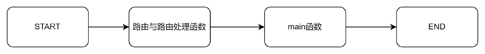
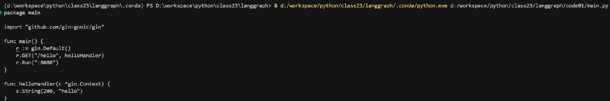
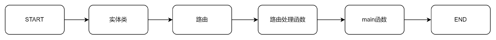
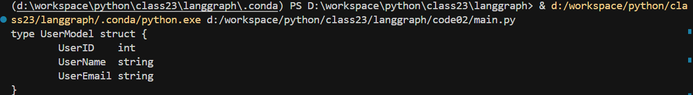
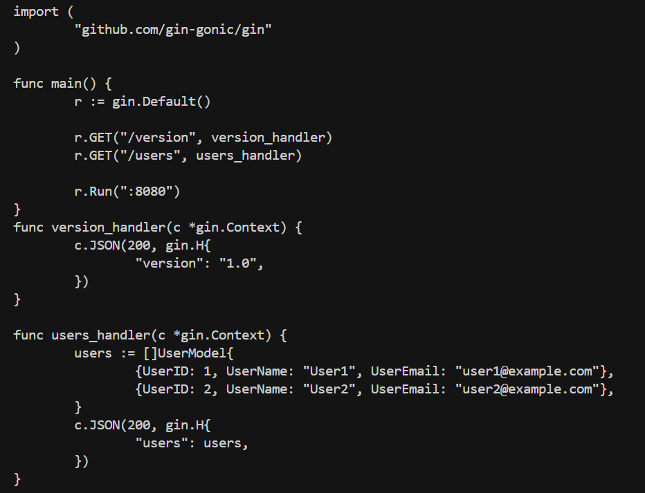

# 25 | 使用LangGraph定制编写Web后端项目

你好，我是邢云阳。

在上节课，我们用之前讲过的 Agentic RAG 的例子，了解了 LangGraph 出现的必要性。之后通过类比 Dify 工作流的学习方式，快速入门了 LangGraph 的节点、边、State 等最核心的概念以及代码的编写方法。如果对于上节课的代码感觉很难理解的同学，建议可以多去实操一下Dify 工作流，然后按我们的思路做类比学习，就好理解了。

为了让你对 LangGraph 的使用理解得更加透彻，掌握得更加熟练，这一章我精心设计了一个智能编程助手的项目。

我们知道如果想要让 AI 帮我们生成代码，一般有几种做法。

第一种是直接在 DeepSeek 等问答网页前端输入提示词生成代码，这种最简单，属于体验级的代码生成；第二种则是使用 Cursor 等代码生成工具；第三种则是利用 LangGraph +Prompt 去完成代码的生成，使用这种方法的好处在于我们可以自己定制代码的结构，输出会比较稳定。

## 使用 LangGraph 生成最简单 Web 后端代码

由于 Python 自身比较简单灵活，因此用 AI 生成 Python 相对来说也不是什么困难的事情。因此这节课，我们就以生成 Golang 语言的 Web 后端代码为例，使用 LangGraph + Prompt 进行实现。

### 最简单 Golang Web 后端代码示例

先来看一下一个最简单的 Golang Web 后端代码的示例。通过前面章节的学习，我们知道在Python 中，可以使用 FastAPI 来完成后 Web 后端的代码编写。那在 Golang 语言中呢，同样也有框架辅助我们写代码，这就是 gin。下面展示一个用 gin 编写的最简单的后端：

```go
package main
import (
       "github.com/gin-gonic/gin"
)
func main() {
       r := gin.Default()
       r.GET("/hello", helloHandler)
       r.Run(":8080")
}
func helloHandler(c *gin.Context) {
       c.String(200, "hello")
}
```

在这个代码中，包含一条路由，也就是第 9 行的 /hello，该路由支持的 HTTP Method 是GET。我们知道每条路由都会对应一个路由处理函数 handler，因此代码中编写了helloHandler 方法用于执行路由被访问后的业务逻辑，也就是第 13 ~ 15 行，业务逻辑非常简单，直接返回 “hello” 这个字符串。

那理解了代码内容后，代码的结构也就比较清晰了。其主要分成了三块，第一块是 main 函数，第二块是路由，第三块是路由处理函数。此时，如果我们想用 LangGraph 按照上述结构稳定地生成代码，则可以设计为如下的流程：



也就是先要生成路由与路由处理函数，之后再生成 main 函数。接下来，我们就用这个思路来实现代码。

### LLM 模块

首先是 LLM 模块。我们知道不管是使不使用 LangGraph 框架，gin 代码的生成最终还是要由大模型来完成的。因此我们需要先初始化好大模型客户端，供后续调用。这里我是借助的LangChain 封装的 OpenAI 客户端，然后将其配置成了 DeepSeek 的客户端。代码如下：

```python
import os
from langchain_openai import ChatOpenAI
def DeepSeek():
   return ChatOpenAI(
       model= "deepseek-chat",
       api_key= os.environ.get("deepseek"),
       base_url="https://api.deepseek.com",
   )
```

我使用的大模型是 DeepSeek 官方的 chat 模型，也就是 V3。大家在运行这段代码前，需要执行 pip install langchain_openai 来安装一下 Langchain 相关依赖。

### State, 路由与路由处理函数

LLM 模块准备好后，我们开始业务代码的编写。首先是中央状态存储器 State 的数据结构的建立。在这段代码中，结构是非常简单的，只有 main、路由和路由处理函数三块。其中 main 函数只有一个，因此可以用一个 string 表示，而路由与路由处理函数未来可能写多个，因此可以用一个 list 表示。最终 State 的代码为：

```python
class State(TypedDict):
   main: str
   routes: list[str]
   handlers: list[str]
```

有了 State 后，我们来实现路由与路由处理函数处理节点。先上代码。

```python
systemMessage = """
你是一个golang开发者, 擅长使用gin框架, 你将编写基于gin框架的web后端程序
你只需直接输出代码, 不要做任何解释和说明，不要将代码放到 ```go ``` 中
"""
def split_route_handler(message:str)->List[str]:
   codes = message.split('###')
   if len(codes) != 2:
       raise Exception("Invalid message format")
   return codes
def route_node(state):
   prompt = """
生成gin的路由代码和handler处理函数，它们之间使用字符串'###'隔开
route_hello:
   GET /hello
handler_hello:
   输出字符串"hello"
"""
   message=llm.invoke([SystemMessage(content=systemMessage),HumanMessage(content
   codes = split_route_handler(message.content)
   state["routes"]+=[codes[0]]
   state["handlers"]+=[codes[1]]
   return state
```

代码的第 14 行，我定义了 route_node 方法，用于执行生成代码的任务。该方法的实现主要在于 Prompt 的编写。为了演示简单，我暂时将路由与路由出来函数放在一个节点任务中生成，然后用 ### 隔开。用 ### 隔开的目的是方便将生成的代码拆分出来后，放置到 State 的routes 和 handlers 列表中。

之后就是第 21 行的请求大模型的代码了，这里使用的是 LangChain 框架的写法。请求大模型时包含了两个 Pompt，一个是系统 Prompt，主要是为大模型设置了人设与限定。另一个便是User Prompt，也就是上文的生成代码的 Prompt。

完成大模型的请求后，大模型会将返回的答案放置到 content 字段中，之后就可以调用拆分函数，也就是第 6 行的 split_route_handler 进行拆分了。拆分代码很简单，就是调用了 python内置的字符串的 split 方法。我们预期的代码输出为：

```go
r.GET("/hello", helloHandler)
###
func helloHandler(c *gin.Context) {
       c.String(200, "hello")
}
```

### main 函数节点

路由代码生成完毕后，接下来就是生成 main 函数了。套路与上面一模一样，区别主要是提示词的变化。还是先上代码：

```python
def main_node(state):
   prompt = """
1.创建gin对象
2.拥有路由代码
{routes}
handler代码已经生成，无需再进行处理
3.启动端口为8080
   """
   prompt=prompt.format(routes=state["routes"][-1])
   message=llm.invoke([SystemMessage(content=systemMessage),HumanMessage(content
   state["main"]+=message.content
   return state
```

由于我们预期生成的 main 函数的代码为：

```go
func main() {
       r := gin.Default()
       r.GET("/hello", helloHandler)
       r.Run(":8080")
}
```

因此提示词的第一条创建 gin 对象对应的就是 r := gin.Default()，而提示词的第二条拥有路由代码，并将 {routes} 代码贴上，是为了让大模型生成统一格式的 main 函数。

什么叫统一格式呢？比如路由代码是 r.GET，此时大模型看到路由代码用的是 r，而不是 abc后，在生成 r := gin.Default() 代码时，就不会写成 abc := gin.Default()，而是会统一变量名称。这也是写提示词的一个技巧。

为了防止大模型自作聪明地根据路由将 handler 再生成一遍，还要加上一句 “handler 代码已经生成，无需再进行处理”。最后是启动端口为 8080，对应代码 r.Run(“:8080”)。

其他代码的套路与路由节点一模一样，我就不再重复了。

### 组成 Graph

最后是将节点组成 Graph，然后运行的代码。代码如下：

```
if __name__ == "__main__":
   sg = StateGraph(State)
   sg.add_node("route_node", route_node)
   sg.add_node("main_node", main_node)
   sg.add_edge(START, "route_node")
   sg.add_edge("route_node", "main_node")
   sg.add_edge("main_node", END)
   graph = sg.compile()
   code = graph.invoke({"main":"", "routes":[], "handlers":[]})
   print(code["main"])
   for handler in code["handlers"]:
       print(handler)
```

看过上节课代码的同学，再看这段代码就会感觉很简单了，需要留意的只有两点。

第一是第 12 行为 Graph 的运行赋初始值。上节课的代码中，我们赋的值是“羊排”，但这节课，由于是让大模型从零生成代码，因此初值是空的。

第二是第 14 行到 16 行，将生成的代码打印出来。这里你可以思考一下，为什么没打印code[“routes”] 的代码？

原因很简单，因为 routes 的代码已经在 main 函数中了。

最后的执行效果是后面这样，与预期一模一样。



## 生成 Web 后端代码进阶

接下来，我们继续进阶。不管是用什么语言，熟悉这种 Web 后端代码的同学都知道，在代码中，我们一般会定义一些 models，也就是实体类，用于表示像是数据库表对象等等的结构。

所以在接下来的代码，我就增加对于实体类的创建，并且分成两个节点任务，分别生成路由和路由处理函数。此时 Graph 就变成了这样：



### 实体类节点

思路梳理清楚了，下面我们来写代码。首先是实体类节点，代码如下：

```python
models_prompt = """
#模型
1.用户模型，包含字段：UserID(int), UserName(string), UserEmail(string)
生成上述模型对于的 struct。struct名称示例：UserModel
"""
def models_node(state):
  message=llm.invoke([SystemMessage(content=systemMessage),HumanMessage(content=
   state["models"]+=[message.content]
   return state
```

和之前一样，主要还是 Prompt 的编写，这个比较简单，主要是写明白需要什么字段，每个字段的类型是什么就可以。

### 路由节点

接下来看路由节点的代码：

```python
route_prompt = """
#任务
生成gin的路由代码
#路由
1.Get /version 获取应用的版本
2.Get /users 获取用户列表
#规则
字符串分三段，第一段：Method，第二段：请求 PATH，第三段：代码注释
#示例
r.Get("/version", version_handler) // 用于获取应用的版本的路由，handler函数名示例：vers
"""
def route_node(state):
   message=llm.invoke([SystemMessage(content=systemMessage),HumanMessage(content
   state["routes"]+=[message.content]
   return state
```

这一版本的路由函数，我换了两条路由，一条是获取应用版本的，另一条则是获取用户列表的。请注意生成的代码每一段都是什么意思，我都写得很清楚，还给出了示例。这样有助于大模型理解代码应该怎么写，给出稳定的代码输出。

### 路由处理函数节点

再来看一下路由处理函数的代码：

```python
handler_prompt = """
#任务
生成gin的路由所对应的handler处理函数代码
#规则
你只需要生成提供的路由代码对应的 handler 函数，不需要生成额外代码
handler函数是和路由代码一一对应的，handler函数的名称在路由代码的注释中已经给出
如果handler函数需要用到模型，则在模型代码中选择
#路由代码
{routes}
#模型代码
{models}
#路由处理函数功能
1.输出应用的版本为1.0
2.输出用户列表
"""
def handler_node(state):
   prompt=handler_prompt.format(routes=state["routes"], models=state["models"])
   message=llm.invoke([SystemMessage(content=systemMessage),HumanMessage(content
   state["handlers"]+=[message.content]
   return state
```

路由处理函数需要根据定义的路由来写，因此需要将上一节点生成的路由代码传入到 Prompt中。此外，路由处理函数中往往会用到实体类，比如去数据库中读取数据存入到实体对象，然后返回给前端。因此实体类节点生成的实体类也需要传入。

其他的就是功能描述了，描述清楚想让函数处理什么业务。这几点处理清楚后，其他就没什么难度了。

### 组成 Graph

节点任务函数写完后，就可以组成 Graph 了。代码如下：

```
if __name__ == "__main__":
   sg = StateGraph(State)
   sg.add_node("models_node", models_node)
   sg.add_node("route_node", route_node)
   sg.add_node("handler_node", handler_node)
   sg.add_node("main_node", main_node)
   sg.add_edge(START, "models_node")
   sg.add_edge("models_node", "route_node")
   sg.add_edge("route_node", "handler_node")
   sg.add_edge("handler_node", "main_node")
   sg.add_edge("main_node", END)
   graph = sg.compile()
   code = graph.invoke({"main":"", "routes":[], "handlers":[], "models":[]})
   print(code["models"][0])
   print(code["main"])
   for handler in code["handlers"]:
       print(handler)
```

套路和之前是一样的，不再重复。接下来直接进行测试即可。

首先生成了实体类。



之后生成了后端代码。



符合我们的要求。

## 总结

这节课，我们使用 LangGraph + Prompt 的手法完成了 Golang 的 Web 后端代码的生成。Golang Web 后端代码，本身非常简单，无论你是否有 Golang 开发经验，都无需特别关注代码的实现细节，只需要理解代码的结构即可。

这是因为理解了代码的结构，我们才能更好的理解 LangGraph 在这个项目中的作用。那LangGraph 起到了什么作用呢？其实就是工作流的作用。我们将代码的每一个结构都定义成一个节点，每一个节点利用 Prompt 工程单独生成代码，并且节点间还能进行数据的流转，使得像是路由处理函数这样的需要依赖其他结构代码的节点，方便它们拿到其他节点的数据，来生成本节点的代码。

有了结构拆分和流程控制后，大模型就可以按照我们的思路稳定的输出代码。这节课代码已经上传到了 GitHub，你可以课后下载下来，自己动手测试一下，加深理解。

## 思考题

通常我们在写代码前，会先进行实体类的设计，形成数据文档。如何对我们的代码进行改造，利用已经写好的数据文档生成实体类代码呢？

欢迎你在留言区展示你的思考结果，我们一起探讨。如果你觉得这节课的内容对你有帮助的话，也欢迎你分享给其他朋友，我们下节课再见！
