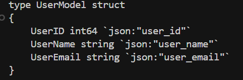
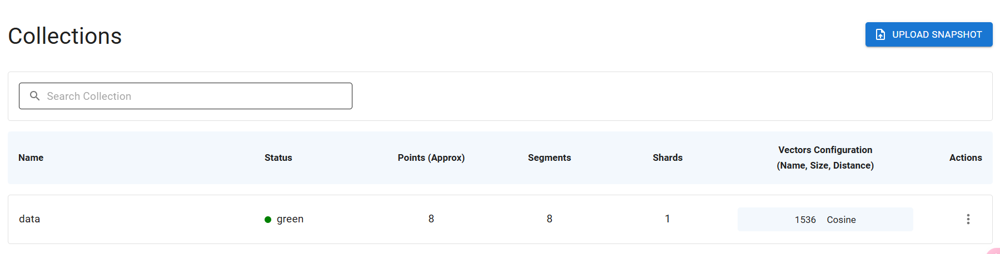
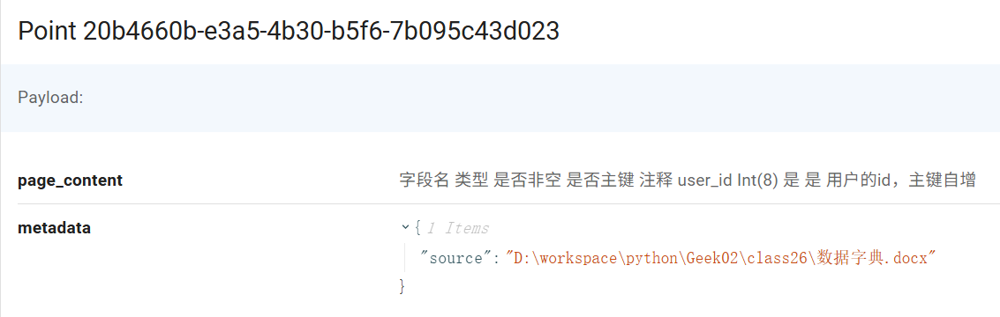
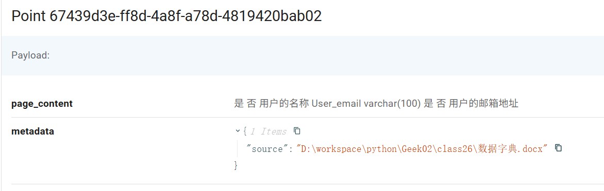
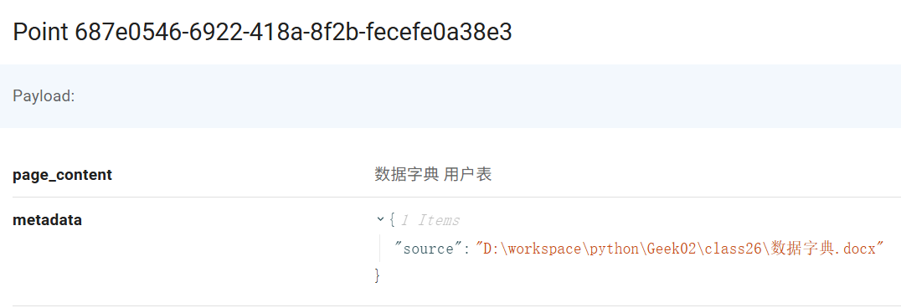
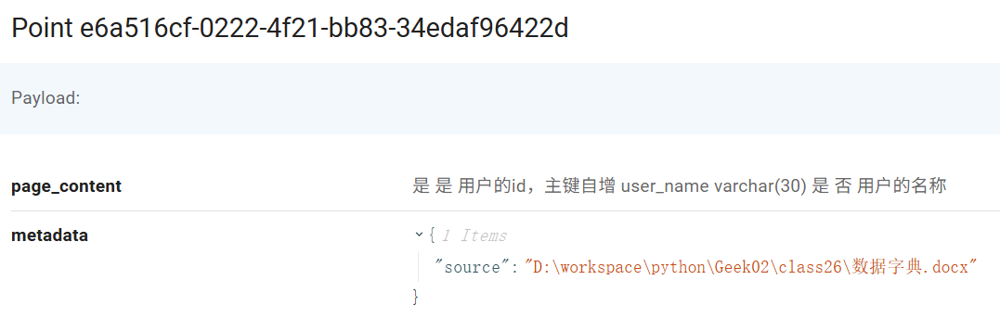
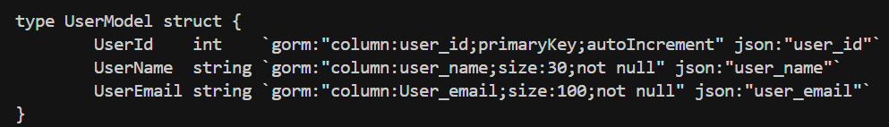

# 26 | 如何根据数据表文档生成实体？

你好，我是邢云阳。

上节课，我们使用 LangGraph 完成了一个简单 Golang Web 后端程序的自动生成。相比于单纯用 prompt 生成代码，在加入了 LangGraph 后，我们可以让 LangGraph 分解代码结构，针对每一个结构单独做生成代码，且结构间的代码还可以流转。重点是，你需要理解LangGraph 在其中发挥的重要用途。

这节课，我们将会学习如何在 LangGraph 中使用 Agent，以及如何利用 RAG 写代码。

## 用 prompt 生成实体类代码的问题

首先回顾一下上节课的代码，我们在最后加入了实体类模块，并书写了一段 prompt，让大模型可以自动生成实体类代码。prompt 如下：

```
#模型
1.用户模型，包含字段：UserID(int), UserName(string), UserEmail(string)
生成上述模型对于的 struct。struct名称示例：UserModel
```

这样生成实体类代码呢，在实体类比较少或者每个实体类的字段特别少的情况下，没什么问题。但是内容如果比较多，有几十几百个实体类，则提示词就会变得特别特别长。

此外，通常在后端代码开始编写前，我们需要先进行实体类的设计，形成实体类文件models.go 以及数据字典文档，这样当某个路由需要用到哪个实体类时，直接调用就好了。

基于这个问题，我们将分成两个部分解决。第一部分我们会将 models.go 写入到 Agent tool当中，由大模型根据需求去调用。第二部分则解决如果我们已经有了数据字典文档，如何生成实体类代码的问题。

## 实体类 Agent tool

我们先来看看如何将实体类代码做成 Agent tool。Agent tool 我们并不陌生，在前置章节的Function Calling，Agent 以及“求职助手”章节的 MCP Server 中，我们都写过 Agent tool。说白了，就是业务执行函数。因此，在这里我先附上代码，然后再讲解我的设计。代码如下：

```python
from langchain_core.tools import tool
@tool
def modelsTool(model_name: str):
   """该工具可用于生成实体类代码"""
   model_name = model_name.lower()
   if "user" or "用户" in model_name:
       return """
type UserModel struct
{
   UserID int64 `json:"user_id"`
   UserName string `json:"user_name"`
   UserEmail string `json:"user_email"`
}
"""
   return ""
```

首先从技术上讲，这段代码使用的是 LangChain 封装的 tools 工具。类似 MCP Server 的工具写法，在工具函数上方有一个 @tool 装饰器，表示这是一个工具函数。此外第 5 行的注释就是工具描述，用来告诉大模型工具的作用。那从业务角度讲，工具的逻辑非常简单，就是根据用户传入的实体类关键字，返回合适的实体类代码。

有了实体类工具呢，之前的用来生成模型实体类代码的 prompt，就不用写得这么麻烦了，而是直接一句话搞定就可以，比如：

```
#模型
生成User相关模型
```

那工具如何调用呢？今天我们来看看 LangChain 封装的 Function Calling 的方法。首先我们需要准备好工具列表，然后绑定到大模型，代码如下：

```
tools = [modelsTool]
llm = DeepSeek().bind_tools(tools)
```

接下来就是在实体类节点任务函数中，调用大模型，由大模型自主选择工具，返回实体类代码了。代码如下：

```python
tools_names = {tool.name: tool for tool in tools}
def models_node(state):
   message=llm.invoke([SystemMessage(content=systemMessage),HumanMessage(content
   for tool_call in message.tool_calls:
       tool_name = tool_call["name"]
       get_tool = tools_names[tool_name]
       result = get_tool.invoke(tool_call["args"])
       state["models"].append(result)
   return state
```

根据前置章节实现 Function Calling 的经验，我们知道如果大模型选择了工具，则 content 为空，其会额外用一个结构返回选择的工具的名称以及参数。我经过打印 message 的内容呢，看到了其是在 tool_calls 中放置了工具名称和参数，因此才有了第 5 到 8 行的代码。

首先是获取了大模型告诉我们的工具名称，然后在 tools_names 将工具函数取出来。tools_names 的写法对于 python 新手来说有点抽象，这其实是一个字典推导式。其中的tool.name 是 key，tool for tool in tools 是 value。这行代码等价于：

```
tools_names = {}
for tool in tools:
   tools_names[tool.name] = tool
```

也就是遍历了一下 tool 工具列表，然后组成了工具名称: 工具函数实体的字典，因此我们才可以在第 7 行代码中传入 tool 的名称，取出工具函数实体。有了工具函数实体后，第 8 行就是运行工具函数了，最后将工具函数的执行结果存入到 State 中即可。

效果如下。



## 利用数据字典生成实体

接下来，我们继续进阶，讨论一下如果有了数据字典后，该怎么做。

在前面的 Agent tool 中，我是将实体类的代码直接写死放到了工具函数中。其实这样做也不是特别合适，因为如果实体类特别的多，则这个函数就会很长。所以最好的做法是，我们提前设计好数据字典文档，之后由大模型根据数据字典文档来生成实体类 struct。这节课，我设计的数据字典的内容如下。

表格～

一般会将用户表和商品表写成一个 Word 文档，便于在团队内传阅。之后我想实现的效果是，当我对大模型说“创建用户实体模型”时，大模型会读取文档中的用户表的内容，然后生成代码。如何能实现这个效果呢？可能有部分同学想到了答案，那就是 RAG。

接下来，我们写代码实现一下 RAG 的代码，我们还是基于 LangChain + Qdrant 向量数据库来写。Qdrant 如何安装以及代码如何编写，在第 16 节课已经讲过了。不过我之前也说了，RAG 除了做知识库之外，还能用于写代码，只是后一种用法容易被忽略。

代码首先还是将 Word 文档转向量，塞入向量数据库。写法如下：

```python
def QdrantVecStoreFromDocs(docs:List[Document]):
   eb=TongyiEmbedding()
   return QdrantVectorStore.from_documents(docs,eb,url="http://<你的qdrant地址>:63
def load_doc():
   #nltk.download('punkt_tab')
   #nltk.download('averaged_perceptron_tagger')
   word=UnstructuredWordDocumentLoader('D:\\workspace\\python\\Geek02\\class26\\
   docs=word.load()
   splitter = RecursiveCharacterTextSplitter(chunk_size=50,
                                             chunk_overlap=20)
   s_docs=splitter.split_documents(docs)
   QdrantVecStoreFromDocs(s_docs)
```

依然是将 Word 文档读取后，按照 50 字符分块，20 字符重复的方式来切分文档。之后调用QdrantVecStoreFromDocs 方法，将分块后的文本转成向量，塞入到向量数据库。如果这一步成功后，就可以在 Qdrant 上看到 Collections 了。



之后就是对 Agent tool 的改造。前面的 Agent tool 是根据用户传入的关键字匹配相应的实体类代码段，现在要改成根据用户传入的关键字，从向量数据库中匹配到相应的数据字典，然后让大模型根据数据字典的内容生成实体类代码。因此代码要这么写：

```python
def QdrantVecStore(collection_name:str):
   eb=TongyiEmbedding()
   return  QdrantVectorStore.\
       from_existing_collection(embedding=eb,
        url="http://<你的Qdrant地址>:6333",
         collection_name=collection_name)
def clearstr(s):
   filter_chars = ['\n', '\r', '\t', '\u3000','  ']
   for char in filter_chars:
       s=s.replace(char,'')
   return s
def format_docs(docs):
   return "\n\n".join(clearstr(doc.page_content) for doc in docs)
def qdrant_search(query:str):
   vec_store=QdrantVecStore(collection_name="data")
   prompt="""
SYSTEM
你是一个 go 语言编程专家，擅长根据问题生成模型实体类代码。
使用上下文来创建实体struct。你只需输出golang代码，无需任何解释和说明。不要将代码放到 ```go ``
```

- 上下文：

```json
{context}
模型名称例子：UserModel
HUMAN
模型或数据表信息：{question}
"""
   retriver=vec_store.as_retriever(search_kwargs={"k":5})
   llm=DeepSeek()
   prompt=ChatPromptTemplate.from_template(prompt)
   chain = {"context": retriver | format_docs,
            "question": RunnablePassthrough()} | prompt | llm | StrOutputParser(
   ret=chain.invoke(query)
   return ret
@tool
def modelsTool(model_name: str):
   """该工具可用于生成实体类代码"""
   return qdrant_search(model_name)
```

重点看 qdrant_search 方法的代码思路。第 18 行，相当于拿到了之前创建的 QdrantCollection 的句柄。紧接着 19 行开始，就定义了一个用于根据用户传入的关键字和从 Qrant中搜到的数据字典创建 struct 的 prompt。其中 {question} 就是用户传入的关键字，比如“用户”“User”等等，而上下文 {context} 则是匹配到的数据字典。

接下来的第 33 行，非常关键。这一行是执行从向量数据库匹配数据字典的过程。在这一过程中，我输入了一个 k:5 的参数，这个意思是取前 5 条高于相似度阈值的结果。为什么是 5 条呢？这是因为在我们的数据字典中，每一个表都有 3 个字段，这三个字段很容易就会被拆分成多个（大于 3 个）文档片段，例如用户表就被拆分成了如下的 4 段：









因此至少取 5 条，才能保证将所有相关的字段召回。如果我们的表的字段特别多，则该值也需要相应的进行增大。

此外为了保证匹配准确率，我们写文档时，也要对每一个字段的属性功能都描述清楚。

当片段被召回后，prompt 也就组好了，此时就会交给 prompt，让其生成代码。这就是代码第33 ~ 39 行做的事情。

这个方法写好后，实际上也就完成了工具函数的业务逻辑。因此在工具函数 modelsTool 中，除了工具描述外，只有一行代码，就是调用了一下 qdrant_search 方法。

最终，代码生成的效果如下。



可以看到 DeepSeek 的代码写得非常好，甚至连 gorm 的注解都给我生成了。gorm 是 go 语言中用于操作数据库的一个库，在使用时是需要像上面的代码一样，在实体类后面加 gorm 相关注解的。DeepSeek 能做到这一步，主要是因为我的数据字典是写的数据库表风格的，比如有 varchar、主键等等关键字。

到此，根据数据字典生成实体类代码的部分我们就搞定了。

## 总结

这节课我们重点学习了如何 LangGraph 中使用 Agent，以及如何利用 RAG 写代码。课程的信息量还是非常大的，我自己在准备这部分代码时，也是一边看文档一遍调试，写了好几个小时，才完成。你可以课后在我的 Github 上，将代码下载下来，运行一下，体会一下这其中的思路。

模型代码看似简单，就是一个 struct，但是却对模型的能力要求比较高。实际上，在去年 10月份左右，在我们的团队的一个后端项目的重构中，我就做过类似的测试。

当时还没有 DeepSeek，我换了好几个模型，效果都不是特别理想，只能生成注解不全或错误的半成品代码，还需要手工再去修改，比较麻烦。但 DeepSeek 出现之后，问题都迎刃而解了，输出的代码不仅正确还很稳定，每一次基本都一样。

因此，有时大模型的能力决定了 AI 应用的下限。这节课的代码已经上传到了 GitHub，你可下载后自测加深理解。

## 思考题

为什么我只在模型实体类代码的生成中使用了 Agent tool 呢？其他节点需要吗？

欢迎你在留言区展示你的思考结果，我们一起来讨论。如果你觉得这节课的内容对你有帮助的话，也欢迎你分享给其他朋友，我们下节课再见！
