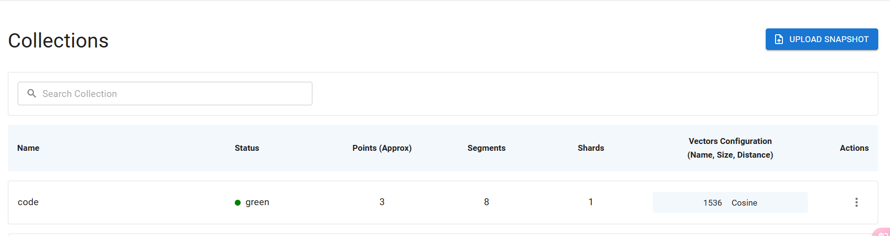
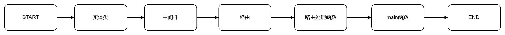
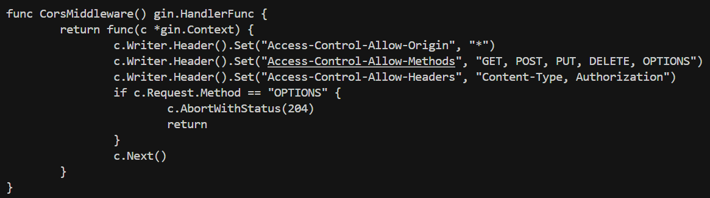
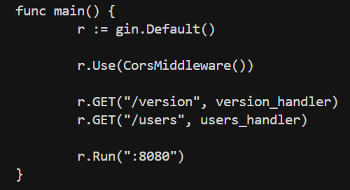

# 27 | 如何根据代码库代码生成新的代码？

你好，我是邢云阳。

上节课，我们针对如何生成 Models 代码，做了两个阶段的设计和改造。

第一阶段，我们考虑到直接在提示词中编写待生成的 Models 以及字段描述是不合适的。因为字段太多会导致提示词很长，所以我们引入了 Agent tool，然后根据提示词，由大模型判断是否需要生成模型代码。如果需要则调用 Agent tool，按提示词中的“用户”“User”等关键字 pipe代码。

而第二阶段呢，我们考虑到第一阶段的做法也有问题，那就是如果将提前写好的 modelsstruct 都放到工具函数里，则工具函数也很长，此外能否精准匹配到也是个问题。因此我们索性就使用了 RAG 技术，将数据字典文档存入到向量数据库，然后由大模型根据用户提示词的关键词来检索，之后生成 struct。

最终测试结果也是非常理想的。由于我们的文档写的是数据表风格的，而且字段描述得很清楚，因此生成的代码，甚至连 gorm 注解都写好了，完全是“买一赠一”的惊喜。

Ok，那有了上节课的基础，这节课，我们再来思考另一件有意思的事，那就是历史代码的复用与借鉴。

## 历史代码复用思路

在日常开发中，尤其是维护公司项目时，我们经常会扮演 “CV 工程师”的角色——从旧项目中复制所需代码，稍作修改后粘贴到新项目中。这种重复性工作能否通过 AI 来完成呢？答案是肯定的。以 Golang Web 后端添加中间件函数为例，我来讲解具体的实现思路。

实际上这个场景与根据数据字典生成模型实体类代码的思路（我们上一节课曾经讲到）非常相似，同样是使用 RAG（检索增强生成）技术。具体实现分为三个步骤。

1. 首先需要将中间件代码文件中的各个函数拆分开来，存入向量数据库。

2. 当收到需求时（比如“生成一个跨域中间件函数”），系统会通过向量相似度匹配找到最相关的历史代码。

3. 最后将这些代码示例交给大模型，由其生成符合要求的新代码。

这种方法不仅能保持代码风格的一致性，还能显著提升开发效率。

## 代码实现

接下来我们就进行代码实现。

### 文件切分入库

首先先看一下，我准备的老代码，也就是老的中间件文件 middleware.go。

```go
// 中间件：记录请求日志
func LoggerMiddleware() gin.HandlerFunc {
   return func(c *gin.Context) {
       start := time.Now()
       path := c.Request.URL.Path
       method := c.Request.Method
       c.Next()
       latency := time.Since(start)
       statusCode := c.Writer.Status()
       fmt.Printf("[%s] %s %d %v\n", method, path, statusCode, latency)
   }
}
// 中间件：跨域请求处理
func CorsMiddleware() gin.HandlerFunc {
   return func(c *gin.Context) {
       c.Writer.Header().Set("Access-Control-Allow-Origin", "*")
       c.Writer.Header().Set("Access-Control-Allow-Methods", "GET, POST, PUT, DE
       c.Writer.Header().Set("Access-Control-Allow-Headers", "Content-Type, Auth
       if c.Request.Method == "OPTIONS" {
           c.AbortWithStatus(204)
           return
       }
       c.Next()
   }
}
// 中间件：请求超时控制
func TimeoutMiddleware(timeout time.Duration) gin.HandlerFunc {
   return func(c *gin.Context) {
       ctx, cancel := context.WithTimeout(c.Request.Context(), timeout)
       defer cancel()
       c.Request = c.Request.WithContext(ctx)
       done := make(chan bool, 1)
       go func() {
           c.Next()
           done <- true
       }()
       select {
       case <-done:
           return
       case <-ctx.Done():
           c.AbortWithStatusJSON(http.StatusRequestTimeout, gin.H{
               "error": "Request timeout",
           })
       }
   }
}
```

在这份代码中，有三个中间件函数，函数的代码具体是如何实现的并不重要。重要的是，我们要在每个函数前都加上注释，这对于后续做向量相似度匹配时是否能匹配到，起着至关重要的作用。

接下来，就是将该文件进行切分入向量数据库了。我依然是使用 LangChain + Qdrant 来完成。代码如下：

```python
import os
from langchain_community.document_loaders import TextLoader
from langchain_text_splitters import CharacterTextSplitter
from llm import QdrantVecStoreFromDocs
def load_code(ext:str,dir_path:str):
   if not os.path.exists(dir_path):
       print(f"文件夹{dir_path}不存在")
       return
   files=[]
   for file in os.listdir(dir_path):
       if file.endswith(ext):
           print(f"加载文件{file}")
           files.append(os.path.join(dir_path,file))
   all_docs=[]
   code_text_splitter = CharacterTextSplitter(separator="\n",chunk_size=500,chun
   for file in files:
       loader=TextLoader(file, encoding='utf-8').load()
       docs=code_text_splitter.split_documents(loader)
       for doc in docs:
           doc.metadata["source"]=file
           all_docs.append(doc)
   QdrantVecStoreFromDocs(all_docs,"code")
if __name__ == '__main__':
   load_code(".go","D:\\workspace\\python\\class23\\langgraph\\code05\\middlewar
```

这节课由于是代码文件的入库而不是 word 文档入库，因此文档导入器和拆分器我也换了一个，换成了 TextLoader 以及 CharacterTextSplitter。

代码的逻辑整体非常简单，首先 load_code 方法有两个入参，一个是文件的后缀名，比如“.go”“.java”等等。另一个参数是存放中间件老代码的文件夹的路径。我要这两个参数干什么用呢？答案是需要在文件夹中进行遍历，将所有指定后缀名的文件都找出来并加载。这就是代码第 7 ~ 18 行做的事情。

文件全部加载完毕后，就可以使用 CharacterTextSplitter 设置文件切分策略了。这里我设置的切片大小是 500，复用切片大小是 100。你可以根据自己的实际代码长度来设置，这个值不是固定的。

之后的第 21 ~ 26 行就是做实际的文件拆分动作了。然后第 28 行代码，将拆分后的文件片段进行了向量化和入库的操作。入库后的效果如下所示。



你可以通过 GitHub 拿到我的代码，之后要先运行这个代码，再测试后面的代码。

### 工具实现

文档入库后，我们继续看后面的代码。根据上一节课的经验，这里我们要设计一个 Agenttool，让大模型去调用。由于都是使用的 RAG 技术，因此这个 tool 的代码与 modelsTool 的代码几乎一模一样，主要区别就在生成代码的提示词以及工具描述上。生成代码的提示词如下：

```
SYSTEM
你是一个 go 语言编程专家，擅长根据问题以及代码库的代码进行代码生成。
使用上下文来生成代码。你只需输出golang代码，无需任何解释和说明。不要将代码放到 ```go ``` 中。
```

- 上下文：

```
{context}
HUMAN
问题：{question}
```

其实就是将上一节课的提示词中的文档改为了代码。工具描述就更简单了：

- 该工具可用于生成中间件函数，参数需传入具体的生成代码的需求，例如：跨域中间件

除此之外，其他部分与上节课一模一样。

### LangGraph 增加中间件节点

工具准备好后，最后一步就是在 LangGraph 中增加节点，等待被调用了。增加中间件节点后，预期的 Graph 将变成后面这个样子。



接下来，我们用代码进行实现。

首先要在中央状态存储器 State 中加上中间件的状态，用于保存中间件的代码。State 的代码如下：

```python
class State(TypedDict):
   main: str
   models: list[str]
   routes: list[str]
   handlers: list[str]
   middleware: list[str]
```

由于中间件函数可能不止一个，因此这里也是使用的 list 数据类型。

然后就是中间件节点的代码了：

```
middleware_prompt = """
#中间件
```

- 创建用于跨域的中间件函数

```python
"""
def middleware_node(state):
   message=llm.invoke([SystemMessage(content=systemMessage),HumanMessage(content
   for tool_call in message.tool_calls:
       tool_name = tool_call["name"]
       get_tool = tools_names[tool_name]
       result = get_tool.invoke(tool_call["args"])
       state["middleware"].append(result)
   return state
```

与模型实体类节点的代码是一样，原理依然是 Function Calling，只是换了一下提示词。

那在这一步生成的中间件函数是在哪被调用呢？按照 gin 的语法，中间件是在路由创建前被调用的，代码如下：

```go
func main() {
       r := gin.Default()
       r.Use(CorsMiddleware())
       r.GET("/version", version_handler)
       r.GET("/users", users_handler)
       r.Run(":8080")
}
```

第 4 行的 r.Use 就是注册了中间件函数。

因此我们需要在 main 函数节点中改一下提示词，让其生成这行代码。提示词如下：

```
1.创建gin对象
2.中间件的代码为{middleware}，请提取其函数名称，并使用r.Use注册这些中间件
3.拥有路由代码
{routes}
handler代码已经生成，无需再进行处理
4.启动端口为8080
```

关键在于第 2 行，要使用 r.Use 注册中间件函数。

main 节点写完后，就使用 sg.add_node 来添加中间件节点，接着用 sg.add_edge 来连线就可以了。最后我们启动一下 Langraph，并将生成的代码打印出来。

```
graph = sg.compile()
code = graph.invoke({"main":"", "routes":[], "handlers":[], "models":[], "middlew
print(code["models"][0])
print(code["middleware"][0])
print(code["main"])
for handler in code["handlers"]:
   print(handler)
```

我们重点看生成的中间件函数以及 main 函数是否注册了中间件。





可以看到，中间件函数与我们的老代码一模一样，没有任何改动。说明 RAG 搜索等环节都非常的成功。而 main 函数中也生成了 r.Use 代码，说明我们的提示词也是成功的。

好了，历史代码复用环节就先演示到这里。你可以下载我的代码，自己运行后体会一下这个过程。

## 总结

今天，我们完成了一件很有意思的事情，那就是让 AI 替代我们成为了 “CV 工程师”。使用的套路呢，依然是 RAG 的套路，只不过这一次文档从 word 换成了代码文件。所以，其实我们是在干一件什么事情呢？没错，正是举一反三。

RAG 技术我们从简历助手的项目就开始探讨，在常规的印象里，我们一般都是利用 RAG 做知识库，用于做问答时的知识增强。但学完了这一章后，你会发现，RAG 技术不仅能做问答，还能用来写代码。在代码套路几乎差不多的情况下，能做的事情却不一样。一旦掌握，你就能用 RAG 技术完成更多任务，这便是套路学习的重要性。这节课的代码已上传到 GitHub，希望你课后下载后自测一下，加深理解。

## 思考题

如果我想根据老代码的跨域中间件生成一个不一样的新的跨域中间件，比如增加跨域规则，或者修改中间件的函数名称等等，应该怎么做呢？

欢迎你在留言区展示你的思考结果，我们一起来讨论。如果你觉得这节课的内容对你有帮助的话，也欢迎你分享给其他朋友，我们下节课再见！
