# 28 | 思路拓展：如何使用GraphRAG分析代码结构？

你好，我是邢云阳。

在前面的课程中，我们使用 LangGraph 构建了一个用于生成 Golang Web 后端程序的助手。

为了让它能够稳定地按照我们的要求，生成后端程序中所包含的实体类、路由、中间件等等结构的代码，我们将每一个结构用一个 LangGraph 节点来表示，然后通过分别写提示词以及状态流转的方式分别构建出了每一个结构的代码。最后将代码整合输出后，就达成了目标。

估计你在实现这些代码时也能感受到，节点间是有联系的。比如路由处理函数与实体类代码：

```go
type UserModel struct {
   UserID int
   UserName string
   UserEmail string
}
func usersInfo() []UserModel{
   users :=[]UserModel{
       {UserID: 1, UserName: "User1", UserEmail: "user1@example.com"},
       {UserID: 2, UserName: "User2", UserEmail: "user2@example.com"},
   }
   return users
}
func getUsersHandler(c *gin.context){
   users := getUserInfo()
   c.JSON(200,gin.H{
       "users": users,
   })
}
```

我们用肉眼分析代码，可以知道 getUsersHandler 这个方法通过 usersInfo 方法使用了UserModel 实体类，因此它们俩之间是有联系的。

那假设现在，我按照上节课的方法将上述代码放到了 RAG 中。之后我向大模型提出，要新加一个用于创建用户的 handler 处理函数。大模型能否通过 RAG 搜索后，完成代码的生成呢？

很遗憾，答案是否定的。因为用传统的 RAG 搜索，只能检测两个文本之间的相似性，而无法检测到与文本相关联的一些内容。

这也就意味着，通过 RAG 搜索，可能可以匹配到 getUsersHandler 这个函数的实现，但却无法通过 getUsersHandler 获取到实体类 UserModel 的字段信息，因此创建用户这一操作也就无法完成编码。

那怎么解决呢？一个常见的解决思路是使用 GraphRAG ，也就是我们经常说的“知识图谱”来解决这个问题。

## 从 RAG 到 GraphRAG

我们知道传统的 RAG 是基于文本向量相似性来搜索的，这种方式相对比较生硬，它只会按部就班按照设置的阈值规则，匹配符合规则的文本，而不会考虑额外搜索与之有联系的其他文本片段。

就比如说之前我看过一个电视剧叫《楼外楼》，里面有一个片段很有意思。有一个军官拿着逮捕令去抓捕鲁迅，但鲁迅看到逮捕令后却非常淡定，说你们要抓捕的是鲁迅，和我周树人有什么关系？就这样，没文化的军官被忽悠过去了，鲁迅得以安然脱身。

我们先不论这个桥段是否是虚构的，但这个段子这就很形象地阐释了什么叫做不考虑实体间的关系。军官知道周树人和鲁迅，但不知道这是一个人，这是因为他的脑子中没有构建出结构化的知识图谱，换句话说，就是没把知识点串起来。

这其实是传统 RAG 在做跨文本块的相似性搜索时，最常出现的问题，要么因为相似度没超过阈值导致部分文本搜不到，进而导致信息缺失；要么就是文本搜到了，但是需要自己去手工建立联系。

基于这些痛点，GraphRAG 就诞生了。

## GraphRAG 的实现逻辑

GraphRAG 的核心是知识图谱 + 图搜索。

### 构建知识图谱

Graph RAG 的第一步，就是从非结构化文本中提取信息，构建一个知识图谱。这个过程可以通过 LLM 来完成。

例如，有如下两个文本：

- 周树人发表了中国现代第一部白话小说《狂人日记》《狂人日记》的作者署名是鲁迅

此时构建知识图谱的话，则会变成后面这样的结构化数据：

- （周树人，发表，狂人日记）（狂人日记，作者，鲁迅）

这样实体关系就一目了然了，这也为后续的图检索打下了良好的基础。

### 图检索

在检索阶段，GraphRAG 不再依赖向量相似度，而是通过图谱遍历来获取完整信息。比如还是上文中的例子，现在用户问“周树人和鲁迅是一个人吗？”，GraphRAG 就能顺着图谱的路径，快速推导出周树人和鲁迅是一个人，也就是后面这样。

```
周树人->狂人日记->鲁迅
```

GraphRAG 把结构化的图谱信息喂给大模型，相当于把一堆散乱的拼图拼好后，再交给它。这样，模型在处理多跳推理或因果关系时就轻松得多，结果自然更准确、更连贯。

## 实战 GraphRAG

接下来，我们就实际使用 GraphRAG 体验一下其效果。我们会通过一个 Golang Web 后端项目尝试构建一下代码结构关系的知识图谱，之后去做一下查询测试。这个 Golang web 项目代码，我上传到了 GitHub 上，你可以课后自行下载测试。

我们首先简单看一下目录结构：

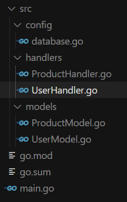

经过前几课的学习，你应该对于 Go 的 Web 项目的结构有所了解了。这次的目录结构与之前差不多，还是分为 main 函数，实体类 models，路由处理函数 handlers，另外还新加了一个用于处理数据库增删改查的 config 文件夹。

### 提取代码描述

像是代码这种文本，其结构特点是由一个个的函数组成。因此对于这样的文本去构建知识图谱，是非常困难的。因为我们不管怎么切割文本，也都很难保证函数的完整性。除非将函数截成一张张的图片，然后利用视觉模型进行识别，然后再入库等，这就很麻烦了。

因此我们最好是先做一下预处理，用 LLM 将每一个代码文件的描述提取出来，基于描述文本再去构建知识图谱就会简单得多。

这里我是使用的 Cursor 对文件进行的描述，具体方法是，我们在 Cursor 中打开该项目，然后点击打开一个文件后，按住 Ctrl + L，就会召唤出对话模式。此时我们贴入提示词即可，提示词如下：

- 请按照以下格式对该文件进行内容描述：

```
#文件名（含路径）：
#文件注释：
#package:
#引用包：
#struct定义：
##struct名称：字段（含类型）：用途：
#函数列表：
##函数注释：函数入参：函数返回值：函数功能：
```

- 以上内容如果代码中有就填，没有就不填

效果为：

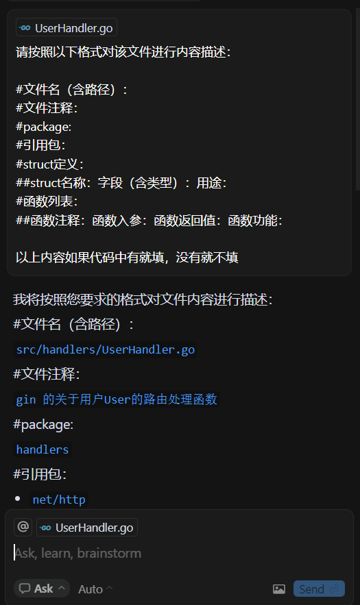

这样依次将所有文件的描述全部提取出来，放入到一个 txt 文件中，留着待会使用 GraphRAG构建知识图谱使用。

### 构建知识图谱

GraphRAG 开源的有很多，不想使用开源的，也可以自己使用 LangChain +Neo4j 图数据库进行构建，难度与之前用 LangChain + Qdrant 构建传统 RAG 差不太多。

那今天我们就使用一款微软开源的，其名字就叫做 GraphRAG 。这款 GraphRAG 非常具有代表性，正如项目文档中第一句话介绍的那样“它旨在利用 LLM 的强大功能从非结构化文本中提取有意义的结构化数据”。而且它的操作还非常简单，用 python 装好命令行工具后，两三条命令就能构建出知识图谱，并且可以做查询测试。

接下来，我们就进入实操环节。目前我写这篇文章时，GraphRAG 的最新版本是 2.1.0，因此我就以这个版本为例，为大家做演示。如果你想要和我一样的效果，建议和我使用一样的版本，否则在配置细节上可能会有区别。

首先，我们用 pip 安装一下 GraphRAG 的 SDK 包，其中就包含了一个命令行工具graphrag。

```
pip install graphrag==2.1.0
```

安装完成后，在当前目录下新建一个文件夹，名字随便起，我起的名字叫 graphrag。这就是GraphRAG 的工作目录。目录建好后，执行以下命令进行 GraphRAG 的初始化。

```
graphrag init --root ./graphrag/
```

如果一切顺利，当我们查看 graphrag 文件夹中的内容时，就会看到出现了下图所示的内容。


我们需要重点关注的是 settings.yaml，这是用来做系统配置的，比如用到的 LLM、embedding 模型等等的设置。我们执行如下命令：

```
vi graphrag/settings.yaml
```

打开配置文件，可以看到如下图所示的内容。

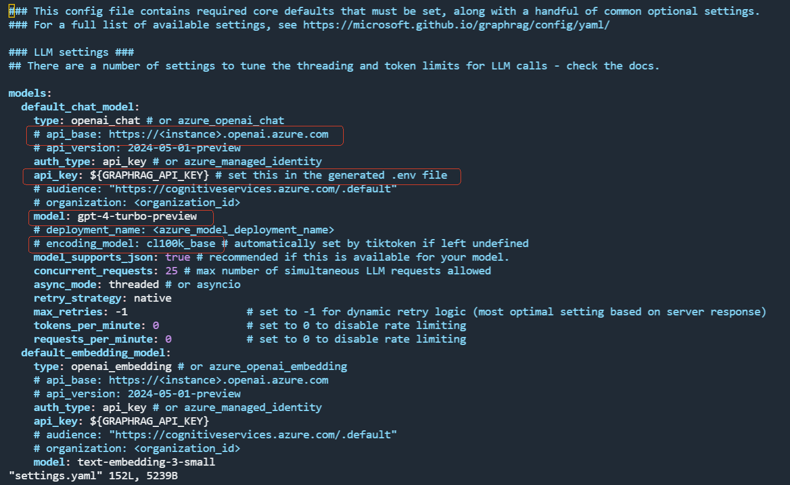

我们需要将 models 里的 default_chat_model 以及 default_embedding_model 的信息从OpenAI 改成我们自己国内的，比如 DeepSeek。当然如果你的服务器能访问 openai，那直接使用 OpenAI 也行。

其中 api_base、api_key 和 model 需要我们修改一下。这里 chat model 我用的是 deepseek-chat，embedding 用的是通义千问的 text-embedding-v1。更改后的配置如下图所示：

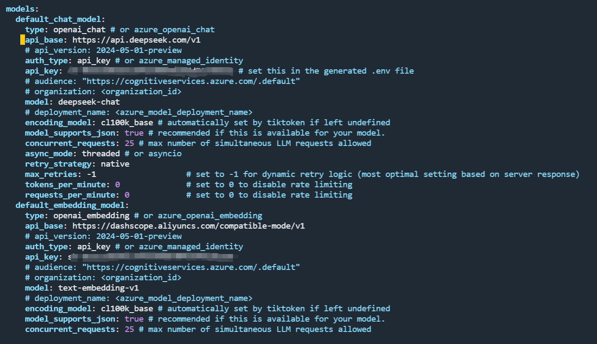

另外，我们还需要将原本注释掉的 encoding_model 这个选项放开，否则一会启动时会报后面的错误。

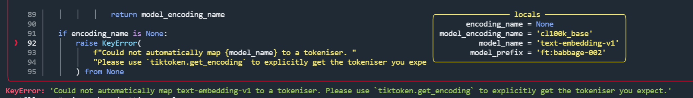

此外配置文件还有一个地方需要你留意一下。

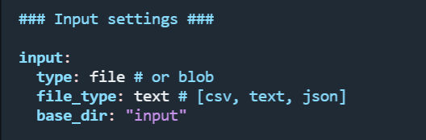

input 这里是用来设置原始文本的，意思是我们要在 graphrag 目录下创建一个 input 目录，然后将原始文本放在该目录下，文本的类型是 text。那这里呢，我就把提取代码描述小节的文本写到了一个 txt 文件中，放在了该目录下。

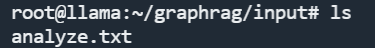

一切准备就绪后，就可以构建知识图谱了。同样是一条命令搞定：

```
graphrag index --root ./graphrag/
```

执行效果如下所示。

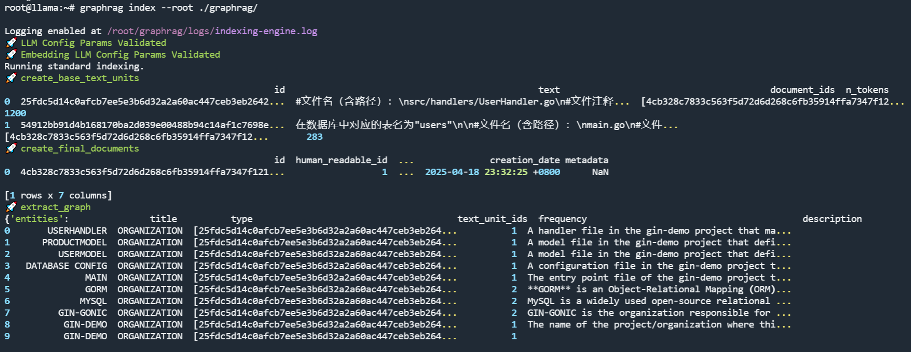

这个过程根据文件内容的多少需要一定的时间。耐心等待完成后，我们就可以进行查询了。

### 查询测试

我们先用如下命令查一下 “UserModel 相关的代码有哪些 ”。

```
graphrag query --root ./graphrag/ --method local --query "UserModel相关的代码有哪些
```

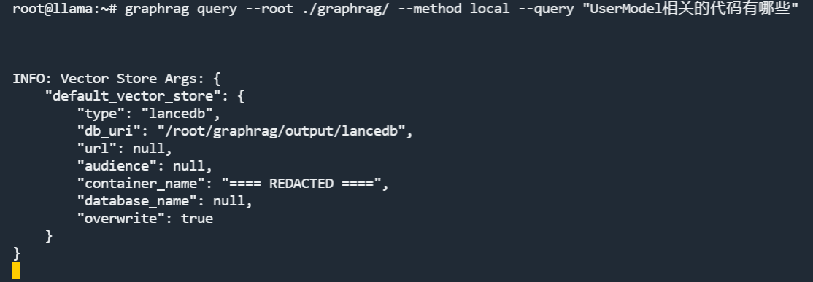

效果如下。

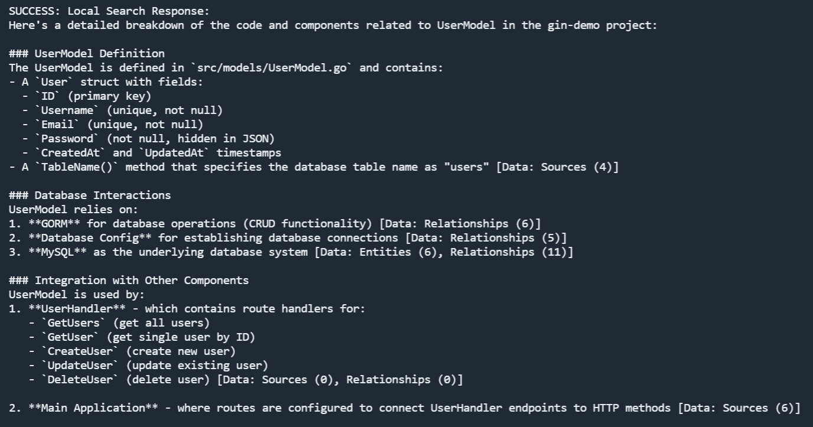

可以看到其将所有的相关代码描述都列出来了，而且还做了总结。

我们再来测试一下，某函数调用了什么实体类模型。比如该函数：

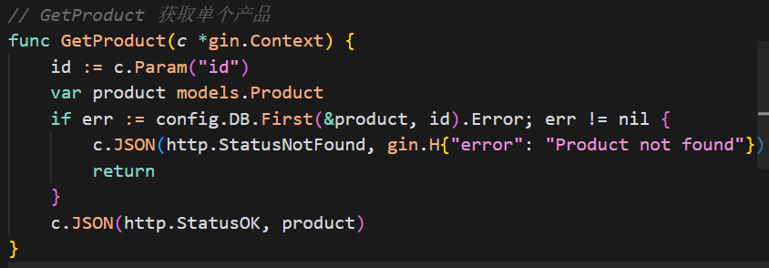

命令为：

```
graphrag query --root ./graphrag/ --method local --query "获取单个产品用到了哪个模型
```

效果如下。

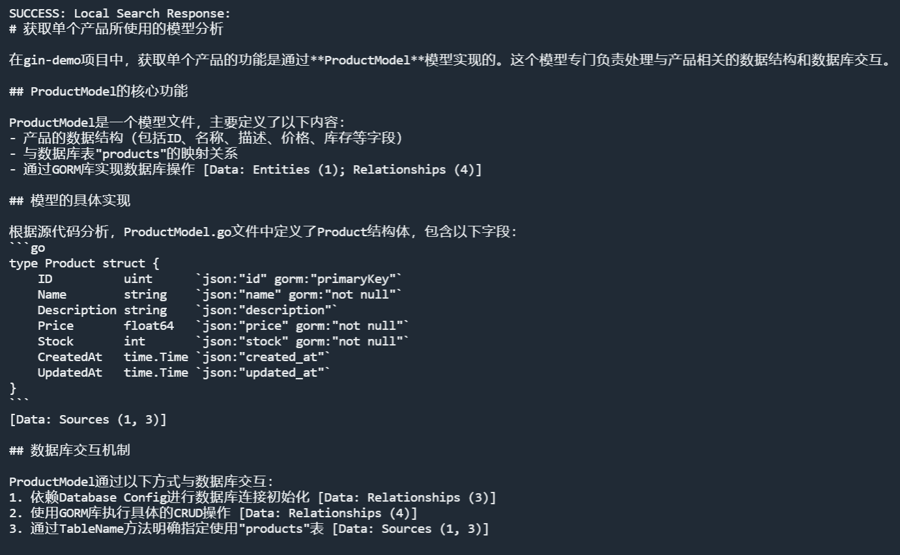

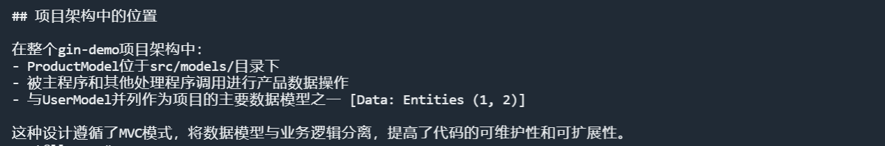

可以看到其列出了 Product 实体类的结构，而且还做了代码分析等，效果是非常好的，这是LLM + 传统 RAG 达不到的效果。

## 总结

今天这节课，我们做了一个思路拓展，也就是如何用 GraphRAG 来表示一个项目中各文件或者各函数实体等之间的联系。传统 RAG 只能做相似度的匹配，而不能够考虑实体间的关系。就好比用“孙悟空”在传统 RAG 中匹配不出 “齐天大圣”，但如果用 GraphRAG 构建了知识图谱就能搜到。

当这项技术用于构建代码逻辑关系时，就要考虑代码这种文本的特殊性了。它不像普通文本一样，可以将单独的词汇和短语拆出来，它是由整段的函数和整段的结构体等构成。

因此如果我们直接把代码喂给 GraphRAG，在做基础文本切分时可能就将函数拆散了，最终导致效果不好。所以我采取的方案是先将代码抽取出描述文本，比如文件名、函数列表、参数描述等等，之后再基于描述文本构建知识图谱。最终达成了我们预期的效果。

## 思考题

以上做法呢，仅仅是我个人的一点思路，因此这节课的定位更多是思路的拓展。你如果有其他好的实践落地方案，也可以在评论区留言，我们一起讨论。

如果你觉得这节课的内容对你有帮助的话，也欢迎你分享给其他朋友，我们下节课再见！
