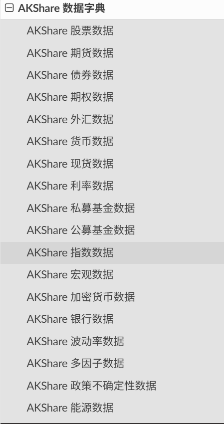
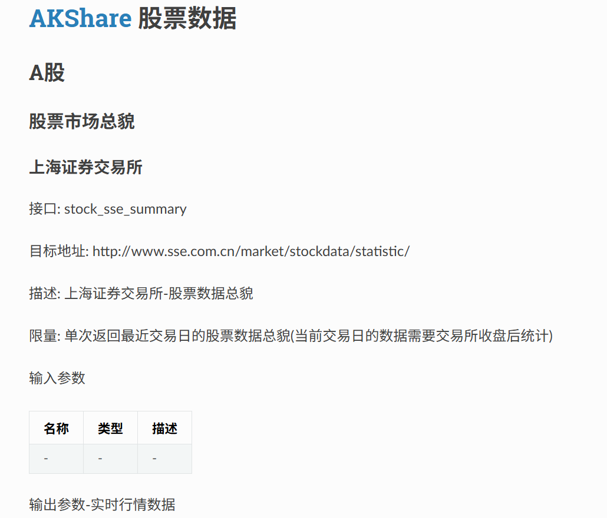
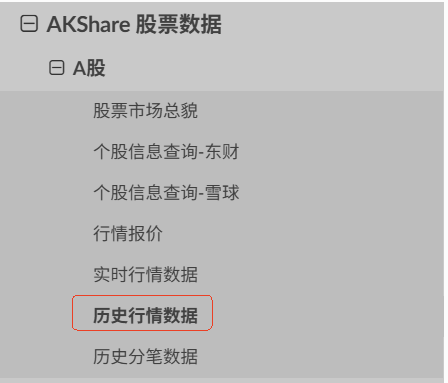
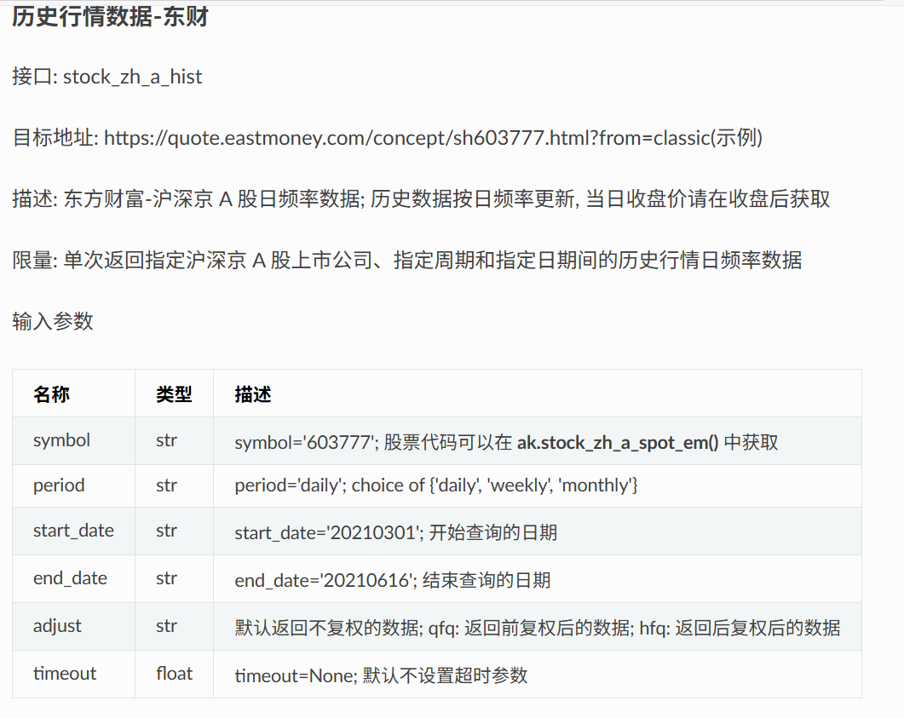
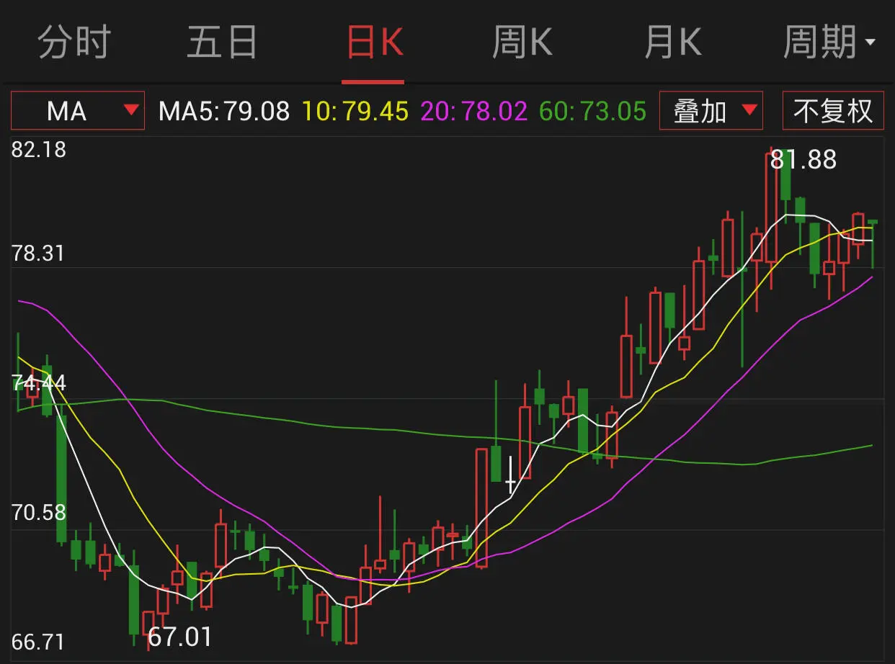
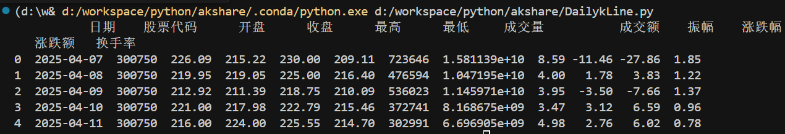
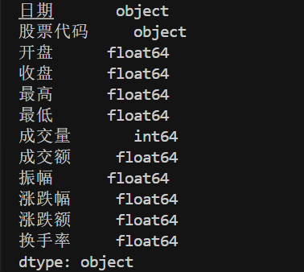
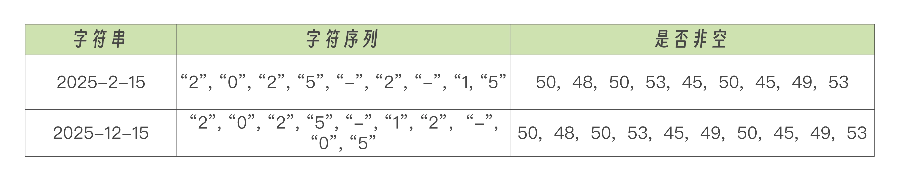
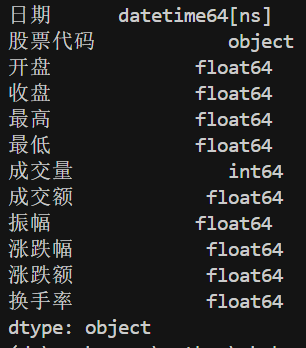
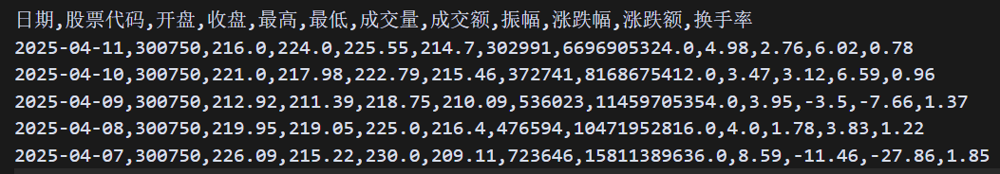

# 29 | 如何抓取金融市场数据？

你好，我是邢云阳。首先给假期还在学习的你点个赞。

历经两个月左右的时间，今天我们终于进入到最后一章的学习了。

这一章，我们将会关注 AI 与股票金融方面结合的一些探索性应用。思路呢，是来自于近两年一些知名平台都会推出一些医疗，金融等行业性的 AI 应用比赛。比如智谱 AI 与清华大学联合创办的清竞平台，在去年年底时就举办了一个金融行业大模型挑战赛。

赛题的主要要求呢，就是要做一个股票问答助手。然后赛题方会给出初中高三种不同难度的问题，看问答助手能否回答准确。初级的比如就是股票代码、涨跌幅的问答；中级的则涉及到数据分析，比如近半年涨停次数超过 10 次的股票有多少家；高级的就比较综合，涉及到财务分析等等。整体对选手的业务和技术的要求都比较高，所以这也是我之前多次强调的要懂业务。

那对我来说呢，刚好对理财也比较感兴趣，所以对于股票知识也是略知一二。因此这一章就想综合的应用一下前面所学的技术，借这个主题做一下探索性的开发，让你边学股票知识，边学习 AI 开发。不过这里我也要特别提醒一下，投资有风险，入市需谨慎！

## AKShare 快速入门

既然做股票问答，就少不了股票数据。因此今天这一讲，我们就先来解决一下股票数据的抓取问题。

对于股票数据，比如 A 股市场的股票的名称、代码、某日收盘价、涨跌幅等等，抓取的途径主要有两个，第一是付费购买证券公司的接口服务。这种方式的好处是数据比较全面，而且实时性也好，但是价格比较昂贵。第二呢，对于不想付费的平民分析师来说，有一个金融数据抓取神器，就可以做很好的平替，它就是 AKShare。

我们点击链接后，就可以打开 AKShare 的官方文档。其中 AkShare 的安装指导里，详细讲解了该工具如何安装。其实非常简单，用 pip 安装就可以搞定：

```
pip install akshare --upgrade
```

安装完成后，再看数据字典文档，可以看到 AKShare 支持多种类型的金融数据的抓取。



我们点击 AKShare 股票数据，就可以看到如下图所示的股票数据的抓取接口。这个接口是为使用纯 HTTP 请求方式的用户提供的，但由于我们使用的是 python 语言，因此可以直接调用python 包中封装好的方法。



对于股票数据，AKShare 也是提供了 A 股、B 股、新股、次新股、美股、港股等等非常多的市场的股票数据。接下来，我们以抓取某股票的日线数据为例，来为演示一下 AKShare 工具的使用。

### 日线数据抓取

首先，讲一下什么是日线数据。日线数据就是反映某只股票某一个交易日的价格变动和交易数据的。比如开盘价、收盘价、最高价等等。在 AKShare 中，日线数据可以通过历史行情数据来抓取。

如下图所示，点击文档的 A 股 -> 历史行情数据。



此时，可以看到抓取历史行情数据的接口。



该数据呢，抓取的是指定周期指定股票的日线、周线、月线数据。这其中有一个参数，需要非常懂业务，才知道是什么意思，那就是倒数第二个的 adjust。该参数是用来设置返回的数据是否进行复权操作的。

那什么叫复权呢？我们知道一般为了呈现股票在一段时间内的波动情况，都会用如下图所示的K 线图去衡量股价的走势。



这个日 K 图中的红柱子、绿柱子，反映的是每个交易日的股价信息，基本是非常连贯，没有大的缺口的。但如果某一天该公司做了拆股的操作，假设一股拆成了两股，则股价就会变成原来的一半。这可以理解为原来一块蛋糕卖 100 元，我现在将其切成两块，每块就变成了 50元。此时对应到日 K 图上，就会出现非常大的缺口，导致图线出现不连贯，影响看走势的效果。

此时呢，我就有两种修复 K 线的手段。一种叫前复权，也就是说以当前股价为基准，将历史股价都等比例进行缩小。比如昨天拆股前的价格是 100，就改成 50，前天的价格是 80，就改成 40，这样就不会出现大的断层缺口，会让 K 线恢复到之前的平滑状态，比较有利于我们查看短期的历史走势。

另外还有一种手段叫后复权，就是把现在的价格等比例增大。比如拆股后，当前收盘价跌到了43，那就把 43 改成 86。这样能够更好地查看在我以某价格买入后，卖出股票的累计收益等等。

总之，这都是为了让图线变得更容易查看的手段而已。

在清楚了理论之后，我们就以抓取宁德时代这只股票 2025 年 4 月 7 日到 11 日的日线数据为例，为大家演示一下代码。

### 代码演示

代码非常简单，首先，我们要知道宁德时代的股票代码，这个随便在哪都可以查到，是300750。之后按照文档的说明就可以写代码了，代码如下：

```python
import akshare as ak
df = ak.stock_zh_a_hist(symbol="300750",
                                       period="daily",
                                       start_date="20250407",
                                       end_date='20250411',
                                       adjust="qfq")
print(df)
```

这里我的 adjust 使用的是 qwq，表示前复权。调用 stock_zh_a_hist 方法后得到的 df 是一个pandas 中的 dataframe。pandas 是一个 python 的数据分析包，专门用于高效处理结构化数据（如表格、时间序列等），一般在数据科学、机器学习和数据分析领域会经常用到。而dataframe 则是 pandas 中的一个数据结构，是一个二维表格，类似 excel。

这样最终 df 的打印效果为：



我们在得到这些数据后，一般会将其保存下来，方便后续使用。那 df 提供了一个保存成 csv表格的功能，我们调用起来也很方便，代码如下：

```
df.to_csv('300750.csv', index=False)
```

index 就是每一行数据前 0、1、2、3、4、5 的序号，类似主键。我们把 index 设置成False，意思就是不需要序号。

当执行这行代码后，就会在当前目录生成一个叫 300750.csv 的文件，负责将前面的 df 打印写入到该文件中。

### 数据排序

最后，我们来看一下数据排序问题。

如果对于股票有了解的同学，可能听过一个常用指标 MA，也就是均线，常用的比如 MA5、MA10 等，也就是 5 日均线、10 日均线。以 5 日均线为例，其含义是以某一交易日为基准，往前取 5 日的收盘价，算出一个平均值来，这样就会算出非常多的 5 日平均收盘价，将这些平均值连成线，就形成了 5 日 均线。如果要计算这个指标，就要对数据按日期进行倒排。

那对于 dataframe 来说，排序也非常简单，简单几行代码就可以搞定：

```
df.set_index('日期', inplace=True)
df.sort_index(ascending=False, inplace=True)
df.to_csv('300750.csv')
```

第一行调用了 set_index 方法表示将日期设置为主键。第二行的 sort_index 方法，则是排序，参数 ascending 为 False 表示倒排序，inplace = True 表示直接在原始数据上做修改，而不是先把原始数据做备份，然后在新的备份数据上修改。最后第三行的保存到 csv 的代码与之前相比少了一个 index=False，这是因为我们主键是日期，而不是序号了。

这几行代码运行后，可能会有问题，也可能没有。这是为什么呢？要解释这个问题，我们需要先来打印一下上文股票数据中日期的类型，代码如下：

```
print(df.dtypes)
```

打印结果为：



可以看到日期是 object 类型的。对于 object 类型的数据，其排序是按照字符串的字典序进行的。什么叫字典序呢？我举一个例子。



按字典序的规则，它比较的是字符串中字符的 ASCII 值，从左到右逐个比较，直到找到不同的字符为止。如果两个字符串的前几个字符都相同，就比较下一个字符。最终结果是基于这些字符的 ASCII 值的大小顺序，而不是实际日期的自然顺序。比如表格里的例子，第六个字符开始不同，49 小于 50，所以“2025-12-15”会排到“2025-2-15”之前。

为了解决这个问题，我们需要先将其转成专门用于处理时间的 datetime 类型，才可以确保日期按照实际的时间顺序正确排序。代码如下：

```
df['日期'] = pd.to_datetime(df['日期'])
print(df.dtypes)
```

此时的打印结果为：



可以看到类型已经变成 datetime64[ns] 了。此时再进行排序的结果为：



所以我们将类型改为 datetime，就能确保排序结果万无一失。

## 总结

这一章我们将会开启 AI 金融项目的探索之旅。

在近两年，许多知名公司或平台都举办了金融大模型竞赛，让 AI 完成难度不同的数据分析处理任务。

在金融量化开发领域，数据是进行量化分析的基石。所以我们自然要先解决数据抓取的问题，对于初学者来说，AKShare 提供的数据抓取方案就不错。

同时呢，由于本章的探索开发是深度绑定业务的，因此我们自然也需要了解一些股票知识，比如在这节课就涉及了复权与均线的知识。这也将会是后续几节课的常规模式，需要你边了解一些基础股票知识，边熟悉 AI 金融项目开发的重要环节，实现业务与技术的通吃。

今天的代码我已经上传到了 GitHub，地址是：Geek02/class29 at main ·xingyunyang01/Geek02，你可以下载后进行测试学习，加深理解。

## 思考题

如果我要抓取十只股票近两年的数据，应该怎么做呢？

欢迎你在留言区展示你的思考结果，我们一起来讨论。如果你觉得这节课的内容对你有帮助的话，也欢迎你分享给其他朋友，我们下节课再见！
