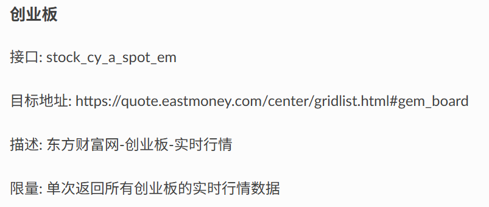
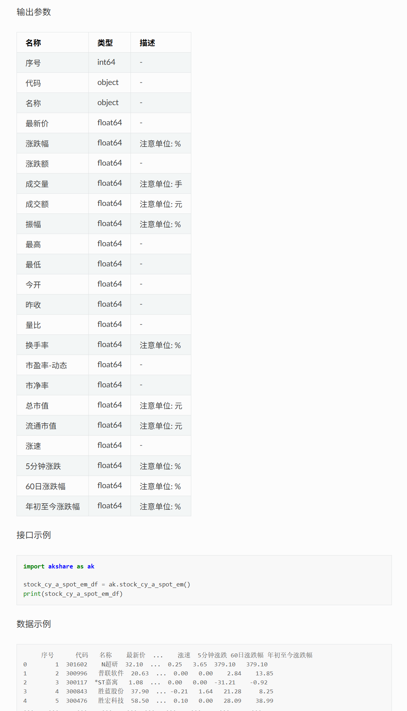
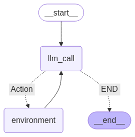
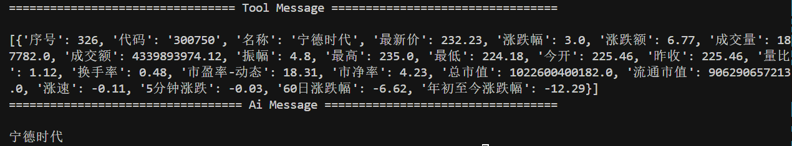
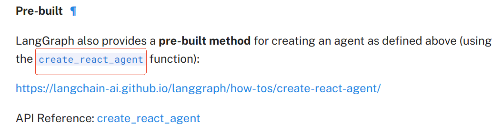
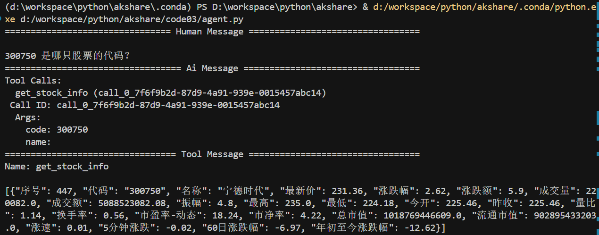
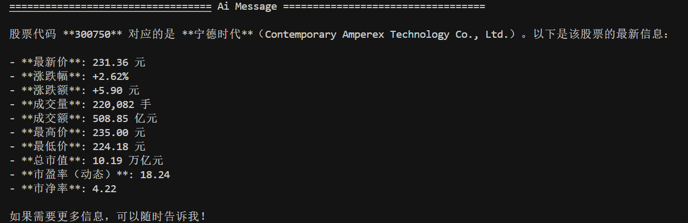
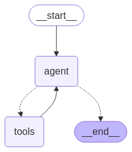

# 30 | 如何用自然语言查询股票名称与代码？

你好，我是邢云阳。

沿着上节课的学习，今天我们来做一个小小的实战。实战内容呢，就是我之前介绍清竞的金融大模型大赛时，提到的初级问题——股票信息的查询操作，比如股票代码等等。

接下来，我们就结合 LangGraph Agent 进行实现。

## 股票信息查询工具

由于今天的需求是查询股票代码，上节课讲的历史行情接口就不适合了，那个接口一次只能抓取一只股票的某段时间的数据，和我们的需求不符。所以我们要使用的是实时行情抓取接口，文档链接在这：AKShare 股票数据 — AKShare 1.16.79 文档该接口是在东方财富网上抓取各个市场的所有股票的实时数据。比如沪 A、深 A、创业板等等。我们就以创业板的数据为例进行演示。



从文档中，可以看到抓取创业板实时数据的接口为 stock_cy_a_spot_em，输出参数和示例如下。



所以，我们在代码中直接调用该接口，就可以得到一个包含了上述信息的 dataframe。

那有了这些数据后，工具如何设计呢？其实非常简单，只需要传入股票代码或者股票名称，然后从 dataframe 中筛选相应的股票的信息就可以了。代码如下：

```python
from langchain_core.tools import tool
from llm import DeepSeek
import akshare as ak
@tool
def get_stock_info(code: str, name: str) -> str:
   """可以根据传入的股票代码或股票名称获取股票信息
   Args:
       code: 股票代码
       name: 股票名称
   """
   code_isempty = (code == "" or len(code) <= 2)
   name_isempty = (name == "" or len(name) <= 2)
   if code_isempty and name_isempty:
       return []
   df = ak.stock_cy_a_spot_em() # 获取创业板股票列表
   ret = None
   if code_isempty and not name_isempty:
       ret = df[df['名称'].str.contains(name)]
   elif not code_isempty and name_isempty:
       ret = df[df['代码'].str.contains(code)]
   else:
       ret = df[df['代码'].str.contains(code) & df['名称'].str.contains(name)]
   return ret.to_dict(orient='records')
```

关于 tool 的语法在上一章讲过，现在复习一下。首先我们要引入 langchain_core.tools 这个包，这是因为 LangGraph 是在 LangChain 的基础上设计的，因此 LangChain 的很多功能，在 LangGraph 都是直接复用的。

接下来，如何将一个普通方法变成工具方法呢？只需要两步就能搞定。第一步，是增加 @tool这个装饰器。第二步，在方法的开头用 “”" “”" 写入工具描述，这段工具描述会作为 prompt 发给大模型，从而让大模型知道有哪些工具可以调用。

其他的代码就非常简单了，就是利用了 dataframe 进行了股票代码或者名称的筛选，之后将筛选出的记录转成字典后返回。

## Agent 的实现

接下来，我们来搞定具体实现环节。

### Function Calling

现在很多地方会把 Function Calling 也算做 Agent 的一种实现模式。比如 Dify、LangGraph 都是这种思路，而且还会默认优先使用 Function Calling 的模式，因此我们上一章讲的也是Function Calling 的模式。现在我们做一个复习与补充，用 Function Calling 实现股票信息查询。

要实现 Function Calling 首先需要将工具绑定到大模型，代码如下：

```
tools = [get_stock_info]
tools_by_name = {tool.name: tool for tool in tools}
llm = DeepSeek()
llm_with_tools = llm.bind_tools(tools)
```

第一行代码是生成一个 tools 列表。第二行代码是根据工具名称 tool.name 在工具列表 tools中得到 tool 对象，这个会在后面工具调用时使用到。第三第四行代码，就是为大模型绑定工具了，这里的大模型，我使用的是 deepseek-chat，也就是 V3。

工具绑定完成后，接下来就是让大模型选择工具以及人类执行工具这两个步骤了，所以我们就将这两步分别做成一个 LangGraph 节点。代码如下：

```python
from langgraph.graph import MessagesState
from langchain_core.messages import SystemMessage, HumanMessage, ToolMessage
from typing_extensions import Literal
from tools import tools_by_name, llm_with_tools
def llm_call(state: MessagesState):
   """LLM decides whether to call a tool or not"""
   # 创建消息列表
   messages = [
       SystemMessage(
           content="你是一个股票助手，如果用户询问股票代码或股票名称，请直接给出代码或名称，
       )
   ] + state["messages"]
   # 调用 LLM
   response = llm_with_tools.invoke(messages)
   return {
       "messages": [response]
   }
def tool_node(state: dict):
   """Performs the tool call"""
   result = []
   for tool_call in state["messages"][-1].tool_calls:
       tool = tools_by_name[tool_call["name"]]
       observation = tool.invoke(tool_call["args"])
       # 将观察结果转换为字符串格式
       if isinstance(observation, list):
           # 如果是列表，将其转换为字符串表示
           observation = str(observation)
       result.append(ToolMessage(content=observation, tool_call_id=tool_call["id
   return {"messages": result}
# Add nodes
agent_builder.add_node("llm_call", llm_call)
agent_builder.add_node("environment", tool_node)
```

这里的 llm_call 就是大模型选择工具的节点，tool_node 则是执行工具的节点。在 llm_call 中我用的中央状态存储器 state 不是我自己写的，而是用的 LangGraph 官方提供了MessagesState，其实现就是一个 messages 字典，源码如下：

```python
class MessagesState(TypedDict):
   messages: Annotated[list[AnyMessage], add_messages]
```

用户最开始输入的消息会作为 HumanMessage 存储在里面，所以上面 llm_call 中的创建消息列表的代码，才会这么写。之后的 response 就是大模型返回的选择了什么工具的信息。

此时，按照上一章的写法，我们应该将 response 追加到 state[“messages”] 里面，但这里我用了简化写法，直接返回了 “messages”: [response]，这样写等同于追加到 state，LangGraph会自动帮我们合并。

tool_node 就是工具的执行，代码在之前讲过，就不再重复了。最后的 return 也是与tool_node 一样的逻辑。

以上就是两个节点的设计思路，接下来就是连接节点构成图。在上一章，我们只讲了起始边、普通边与条件边，接下来，我们讲一下条件边。

条件边可以理解为 Dify 里面的条件分支，也就是 if else。之前我们讲 Function Calling 和Agent 时，多次讲过，我们需要一个死循环实现与大模型的多轮对话，从而可以让大模型多次调用工具，在得到最终答案后，才会退出循环，所以此时需要用到条件边来判断何时退出循环。

那既然条件边需要做条件分支判断，那就肯定也需要有一个条件节点，来处理这些逻辑。代码如下：

```python
def should_continue(state: MessagesState) -> Literal["environment", "END"]:
   """Decide if we should continue the loop or stop based upon whether the LLM m
   messages = state["messages"]
   last_message = messages[-1]
   # If the LLM makes a tool call, then perform an action
   if last_message.tool_calls:
       return "Action"
   # Otherwise, we stop (reply to the user)
   return "END"
agent_builder.add_conditional_edges(
   "llm_call",
   should_continue,
   {
       # Name returned by should_continue : Name of next node to visit
       "Action": "environment",
       "END": END,
   },
)
```

这里的条件判断非常简单，就是读取最后一条 message，如果有 tool_calls，就返回“Action”，如果没有就返回 “END”。“Action” 对应的是 “environment”，也就是执行工具的节点。“END” 对应的 END，也就是结束节点。

那循环是怎么运转起来的呢？我们看一下完整的节点连连看的代码：

```
# Build workflow
agent_builder = StateGraph(MessagesState)
# Add nodes
agent_builder.add_node("llm_call", llm_call)
agent_builder.add_node("environment", tool_node)
# Add edges to connect nodes
agent_builder.add_edge(START, "llm_call")
agent_builder.add_conditional_edges(
   "llm_call",
   should_continue,
   {
       # Name returned by should_continue : Name of next node to visit
       "Action": "environment",
       "END": END,
   },
)
agent_builder.add_edge("environment", "llm_call")
# Compile the agent
agent = agent_builder.compile()
```

可以看到原本 “environment” 应该用结束边与 END 相连，但这里是用普通边重新与“llm_call”相连的，这样就实现了循环，相当于 A -> B，B -> A。如果你对于这个图的逻辑还不是很清楚，我们还可以调用画图工具，把图结构画出来。代码如下：

```
from IPython.display import Image, display
# Show the agent
display(Image(agent.get_graph(xray=True).draw_mermaid_png()))
# 保存流程图到文件
graph_png = agent.get_graph(xray=True).draw_mermaid_png()
with open("agent_graph.png", "wb") as f:
   f.write(graph_png)
```

画图需要引入一下 IPython.display 这个包，如果我们是用的 Jupyter Notebook 写的代码，则直接用第 4 行的代码就能在运行时看到效果。但如果是普通的 VScode 运行代码，则必须把图保存成文件，才能看到效果，也就是代码的 7 ~9 行。

运行后生成的图片是后面这样。



最后我们来测试一下程序的效果，测试代码为：

```
# Invoke
messages = [HumanMessage(content="300750 是哪只股票的代码？")]
messages = agent.invoke({"messages": messages})
for m in messages["messages"]:
   m.pretty_print()
```

效果如下。



### Pre-built Agent

除了手工实现 Function Calling 外，LangGraph 还帮我们把前面的逻辑进行了封装，提供了一种叫 Pre-built 的方式，文档在这：Workflows and Agents。



Pre-built 的意思是预构建，也就是说，我把处理逻辑都预先封装成包了，不需要你再构建Graph 了，你只需要调用就好，所以代码也就非常简单了。

但它这里有一个描述，我个人认为是有误导的，也就是红框中的 create_react_agent。最开始，我没看源码前，以为它是用的 ReAct prompt 的方式构建的 Agent。但后来看了看代码才知道，它的实现逻辑还是 Function Calling，也提醒你留意一下。

接下来，我们通过编码测试看一下其效果。首先我们把 Function Calling 小节的 tools 代码拿过来，删除掉以下代码：

```
tools_by_name = {tool.name: tool for tool in tools}
llm = DeepSeek()
llm_with_tools = llm.bind_tools(tools)
```

因为这里不需要我们手工绑定工具。之后的 Graph 代码超级简单，代码如下：

```python
from langgraph.prebuilt import create_react_agent
from langchain_core.messages import HumanMessage
from llm import DeepSeek
from tools import tools
llm = DeepSeek()
pre_built_agent = create_react_agent(llm, tools=tools)
# 保存代理工作流程图到文件
graph_png = pre_built_agent.get_graph(xray=True).draw_mermaid_png()
with open("agent_graph.png", "wb") as f:
   f.write(graph_png)
# Invoke
messages = [HumanMessage(content="300750 是哪只股票的代码？")]
messages = pre_built_agent.invoke({"messages": messages})
for m in messages["messages"]:
   m.pretty_print()
```

可以看到只需要引入 prebuilt 包，调一下 create_react_agent 方法就可以搞定，完全不需要自己写 Graph 代码。最后的运行效果为：





看到了吧，还是 Function Calling 的过程。

再来看看生成的 Graph 图：



这张图更加清晰地表达了用一个 Agent 模块封装 Function Calling 代码的逻辑。

## 总结

这节课，我们结合股票的业务背景，再次对如何应用 LangGraph 实现 Agent 做了梳理。你会发现业务本身不难，有了数据之后，交给 AI 都好办。

这次的 Agent 实现中有两条最核心的逻辑，一个就是让 Graph 实现循环，另一个就是通过条件边和条件节点退出循环。另外，我们还学到了通过自动生成 Graph 图片的方式，这可以直观验证我们的 Graph 逻辑是否正确。课后你可以自己动手试试看，这样印象更深刻。

结合我的经验看，LangGraph 的功能真的非常强大，也非常好用，值得你花一些时间学习实践一下，也期待在留言区看到你的使用体验。这节课的代码已经上传到 GitHub，地址是：Geek02/class30 at main · xingyunyang01/Geek02，你可以下载代码后进行测试，加深理解。

请大家思考一下，为什么在这节课的案例中，我要使用 deepseek chat V3 呢？使用 R1 行不行？

欢迎你在留言区展示你的思考结果，我们一起来讨论。如果你觉得这节课的内容对你有帮助的话，也欢迎你分享给其他朋友，我们下节课再见！
