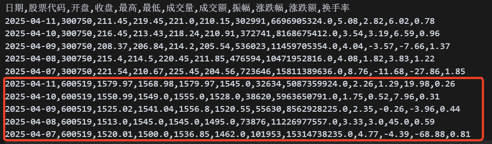
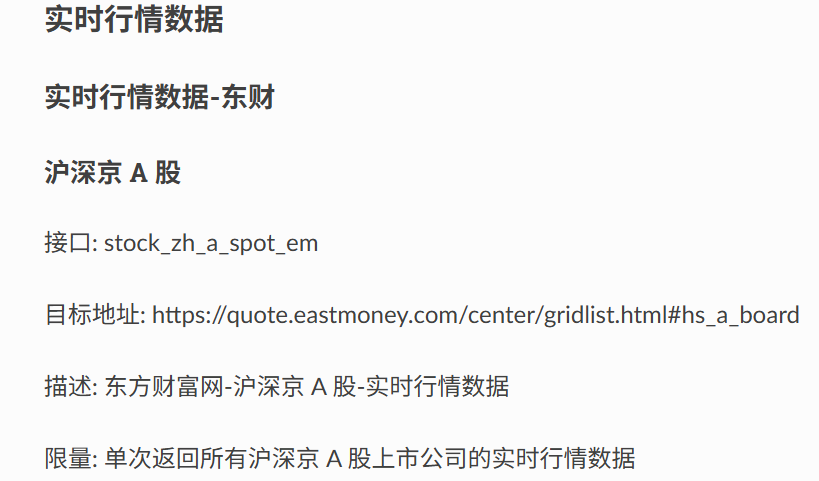
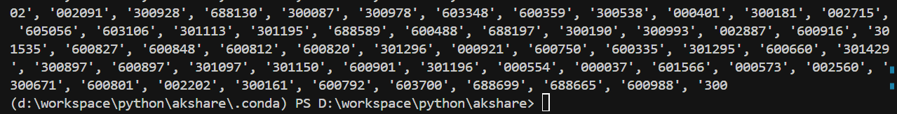
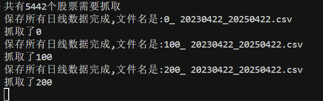
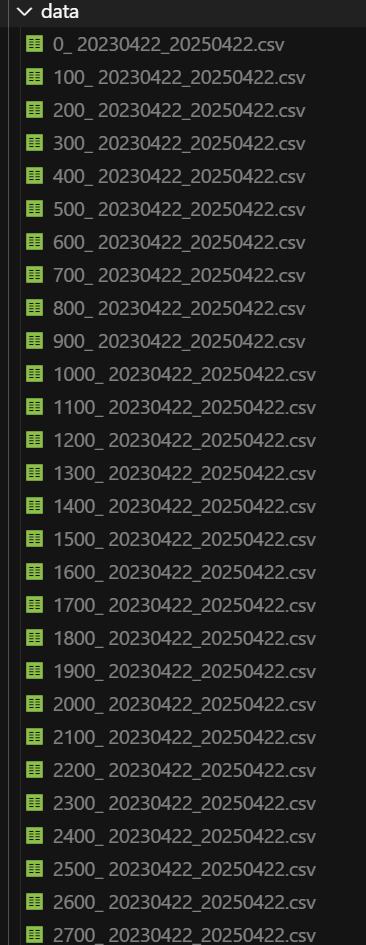

# 31 | 如何抓取全部沪深A股的日K数据？

你好，我是邢云阳。

在前两节课，我们熟悉了 AKShare，并且再次借助 LangGraph，实现了查询股票的 Agent 。此外，我们也间接地学习了如何使用 Pandas 这个库，这对于丰富大家的技能，还有以后的求职都是有好处的。

我们的课程已经进入到了收关阶段了，后面的几节课，我们会把重点放在数据分析与量化策略相关的内容。这部分不管是在实际的金融分析中，还是在一些金融类比赛里，都是属于高级的技巧，比较考验分析师的水平。所以我们可以尝试将这些技巧与 Agent 进行结合，看看会擦出什么样的火花。

## 并发抓取日 K 数据

数据分析比较好理解，但量化这个词可能不太接地气，很多人会不知道是什么意思。量化简单来说就是把人类进行金融交易，比如股票买卖的经验写成程序，然后辅助人类进行决策。

如果一个策略写得非常好，而且人类完全按照量化策略进行操作，就能帮助克服追涨杀跌的人性。那常见的量化策略呢，包括成交量放量、连续涨停事件等等，这些都需要依赖大量的数据，需要先抓取一定周期的数据才能做分析。

接下来我们就先来学习一下，如何将全部沪深 A 股大约 5000 多只股票的近两年的日 K 数据全部抓取下来。

首先先用代码回顾一下第 29 节课抓取历史行情数据的手法，代码如下：

```python
from typing import List
import akshare as ak
import pandas as pd
def save_data(codes:List[str], start_date:str, end_date:str):
    all_data= pd.DataFrame()
    for code in codes:
        df=load_data(code,start_date,end_date)
        all_data=pd.concat([all_data, df],axis=0)
    filename="{}_{}.csv".format(start_date,end_date)
    all_data.to_csv("D:\\workspace\\python\\akshare\\code04\\data\\{}".format(fi
    print("保存所有日线数据完成,文件名是:{}".format(filename))
def load_data(symbol, start_date, end_date):
   df = ak.stock_zh_a_hist(
       symbol=symbol,
       period="daily",
       start_date=start_date,
       end_date=end_date,
       adjust="qfq"
   )
   df['日期'] = pd.to_datetime(df['日期'])
   df.set_index('日期', inplace=True)
   df.sort_index(ascending=False, inplace=True)
   return df
if __name__ == "__main__":
   save_data(["300750", "600519"], "20250407", "20250411")
```

在这段代码中，load_data 方法就是用 AKShare 抓取历史行情数据并进行倒序排序的代码，这与第 29 节课所讲的方法一模一样。

关键在于 save_data 方法，也就是将抓取到的数据写入到 csv 文件。这里传入的就不是一个股票代码了，而是一个股票代码列表。之后通过变量股票代码的方式，多次调用 load_data 方法，并将抓取到的数据使用 Pandas DataFrame 的 concat 方法做追加拼接，最终将包含全部数据的 DataFrame 写入到 csv 文件中。

效果如下：



注意看，我画红框的部分是 600519 这只股票的数据，而红框之上的数据是 300750 这只股票的数据。两只股票的数据全都采用了倒序排序，符合我们的预期。

但是这样就可以了吗？我们思考一下，现在的代码是一个单进程顺序抓取顺序写的。那整个市场有 5000 多只股票，如果要抓取两年的数据，这个过程将肯定会非常非常的慢。这时怎么办呢？我们需要用到的方法就是并发抓取，在 Python 中呢，我们可以用 asyncio 来实现多协程。

协程与线程有什么区别，你可以去问问 DeepSeek，总结得可能比我好。简单来说，协程是在一个线程内开出的多个任务，其开销极低，比线程要低得多。

接下来，我把前面的抓取代码改造一下，改成并发的，然后再为你继续讲解。代码如下：

```python
import asyncio
from typing import List
import akshare as ak
import pandas as pd
async def save_data(codes:List[str], start_date:str, end_date:str):
    all_data= pd.DataFrame()
    tasklist=[]
    for code in codes:
        task=asyncio.create_task(load_data(code,start_date,end_date))
        tasklist.append(task)
    ret=await asyncio.gather(*tasklist)
    for r in ret:
        all_data=pd.concat([all_data, r],axis=0)
    filename="{}_{}".format(start_date,end_date)
    all_data.to_csv("D:\\workspace\\python\\akshare\\code04\\data\\{}".format(fi
    print("保存所有日线数据完成,文件名是:{}".format(filename))
async def load_data(symbol, start_date, end_date):
   # 由于 akshare 的 API 是同步的，我们需要在线程池中运行它
   loop = asyncio.get_event_loop()
   df = await loop.run_in_executor(None, lambda: ak.stock_zh_a_hist(
       symbol=symbol,
       period="daily",
       start_date=start_date,
       end_date=end_date,
       adjust="qfq"
   ))
   df['日期'] = pd.to_datetime(df['日期'])
   df.set_index('日期', inplace=True)
   df.sort_index(ascending=False, inplace=True)
   return df
if __name__ == "__main__":
   asyncio.run(save_data(["300750", "600519"], "20250407", "20250411"))
```

可以看到，最显著的变化是在每个方面前都加了 async 关键字，这就代表把方法变成了协程方法。

接下来注意看 load_data 方法中，关于调用 stock_zh_a_hist 的代码的变更。由于该接口的本质是通过 HTTP 请求去访问东方财富网抓取数据，所以该接口是一个同步接口，也就是说程序需要等待接口返回数据后，才能继续向下运行代码。这样就会阻塞协程函数的运行，因此需要将其改造成异步的。

具体怎么改造呢？可以看到前面这段代码首先获取了一个 loop。这个 loop 叫事件循环，事件循环是异步编程的核心，负责调度和执行异步任务。接下来，用了 loop 中的 run_in_executor方法，将需要转成异步的代码放入到线程池中运行，这样协程就可以继续执行其他任务。

再来看一下 save_data 方法。核心改造点是用 create_task 函数为每一个根据股票代码load_data 的调用都创建了任务，然后把任务放到了任务列表中去统一执行。这样就实现了并发执行 load_data 的效果。最后返回的 ret 包含了每一个任务的执行结果，因此是通过遍历ret，去执行 concat 操作。

代码改造后，执行效果是一模一样的，但是时间缩短了。

## 抓取全部沪深 A 股日 K 数据

那有了前面的基础之后呢，我们就可以讲解如何抓取全部 A 股数据了。

这个操作分成三个步骤。第一步是获取全部的股票代码。这个操作比较简单，利用上节课的获取实时行情数据的接口就可以搞定，代码如下：

```python
def get_all_codes():
   df=ak.stock_zh_a_spot_em()
   codes=df['代码']
   bool_list=df['代码'].str.startswith(('60','30','00','68'))
   return codes[bool_list].to_list()
```

调用 stock_zh_a_spot_em 接口会获取到所有沪深京 A 股数据。



但京 A 股，也就是在北交所上市的股票不是我们想要的，因此就需要在代码中进行过滤，我们只取 “60”“30”“00”“68” 开头的股票代码。执行这段代码后的部分打印效果为：



有了全部股票代码后，就可以按照之前讲的并发抓取的方式抓取数据了。但是如果挨个遍历股票代码，然后创建任务也比较耗时。所以我是将这 5000 多只股票进行分组，每组 100 个股票，当然这里改成每组 500，每组 1000 都可以。之后每组股票调用一次前面的并发抓取代码，借此加快速度。实现代码如下：

```python
def save_all_data():
   codes=get_all_codes()
   print("共有{}个股票需要抓取".format(len(codes)))
   n=100
   for i in range(0, len(codes), n):
       subset = codes[i:i + n]
       if len(subset) > 0:
           asyncio.run(save_data(subset,'20230422','20250422',
                                 prefix=f"{i}_"))
           print("抓取了{}".format(i))
```

效果如下。



可以看到在 data 目录下生成了一堆数据文件：



最后，我们将这些文件合并成一个大文件即可。代码如下：

```python
def load_df(file:str)->pd.DataFrame:
    df=pd.read_csv("D:\\workspace\\python\\akshare\\code05\\data\\{}".format(fil
    if df.empty:
        raise Exception("文件不存在")
    df['日期'] = pd.to_datetime(df['日期'])
    df['股票代码']=df['股票代码'].astype(str)
    return df
def concat_csv(file_name:str):
   folder_path = 'D:\\workspace\\python\\akshare\\code05\\data'
   # 列出文件夹中的所有文件和目录
   files = os.listdir(folder_path)
   # 定义一个正则表达式，匹配以数字开头的文件名
   pattern = re.compile(r'^\d+_.+\.csv$')
   # 遍历文件，筛选出符合条件的文件名
   filtered_files = [file for file in files if pattern.match(file)]
   ret=pd.DataFrame()
   # 打印结果
   for file in filtered_files:
       df=load_df(file)
       ret=pd.concat([ret,df])
   ret.to_csv("D:\\workspace\\python\\akshare\\code05\\data\\{}".format(file_nam
   print("合并完成,文件名是{}".format(file_name))
```

代码中是定义了一个正则表达式，从指定目录下匹配出以数字开头的 csv 文件，这样是防止指定目录下有其他文件乱入，导致合并出错。遍历出所有文件后，就读取文件到 DataFrame，然后利用 concat 进行合并。最终就会在指定目录下生成一个合并后的大文件。

## 增量抓取

那完成了近两年的股票数据的抓取后呢，我们最后看看这节课的最后一个知识点——如何实现增量抓取。所谓增量抓取，实际上是包含抓取与增量合并两个步骤。

比如我现在已经有了 2023 年 4 月 22 日到 2025 年 4 月 22 日的数据了，但我觉得数据不够多，时间不够长，因此想要一份 2022 年 4 月 22 日到 2025 年 4 月 22 日 的数据。此时怎么办呢？我们可以采用增量抓取的方式。

先抓取一下 2022 年 4 月 22 日 到 2023 年 4 月 22 日的数据，然后将这份数据与之前的 2023年 4 月 22 日到 2025 年 4 月 22 日的数据合并起来，形成一份 2022 年 4 月 22 日到 2025 年4 月 22 日的数据。

这里我们会发现 2023 年 4 月 22 日那天的数据，在两份数据文件中都包含了，因此就需要去重。这也是增量抓取后的合并与上文中的普通合并的区别。实现代码如下：

```python
def join_csv(file1:str, file2:str):
   cols=['股票代码','日期','收盘']
   df1=load_df(file1).loc[:, cols]
   df2=load_df(file2).loc[:, cols]
   df=pd.concat([df1, df2], axis=0)
   df.sort_values(['股票代码', '日期'], ascending=False, inplace=True)
   df.drop_duplicates(subset=['股票代码', '日期'], keep='first', inplace=True)
   df.reset_index(drop=True, inplace=True)
   print(df)
```

代码中的第 7 行就是去重的过程，利用了 DataFrame 自身的功能。

至此，抓取股票数据的全部手法我们就讲完了，希望你课后自己实践一下。

## 总结

这节课，我们学习了如何并发抓取全部沪深 A 股日线数据的方法，还了解了增量抓取新增股票或者新增日期数据的方法。考虑到后续我们还会涉及简单的数据分析和量化策略，所以这些股票数据也能为后面内容作支撑。这节课的代码已经上传到了 GitHub，地址是：Geek02/class31 at main · xingyunyang01/Geek02。

代码其实不难，主要就是 Python 的 asyncio 包以及 Pandas 的 DataFrame 的用法。这些代码在没有 AI 前，可以说是挺难理解的，尤其是协程的语法，搞不好就容易用错，导致代码出问题。但现在有了 AI 后，就可以利用 DeepSeek 或者 Cursor 来实现，顺便也跟它们学习一下这些代码的实现思路。这对于之前不熟悉 Python 的同学来说，也是福音。

如果你在 asyncio 包使用方面还有什么问题，可以问一下 DeepSeek，或者留言区里留个言，我们一起讨论一下。

## 思考题

如果沪深 A 股有新股上市了，我想补充抓取这些股票的数据，应该怎么实现呢？

欢迎你在留言区展示你的思考结果，我们一起来讨论。如果你觉得这节课的内容对你有帮助的话，也欢迎你分享给其他朋友，我们下节课再见！
