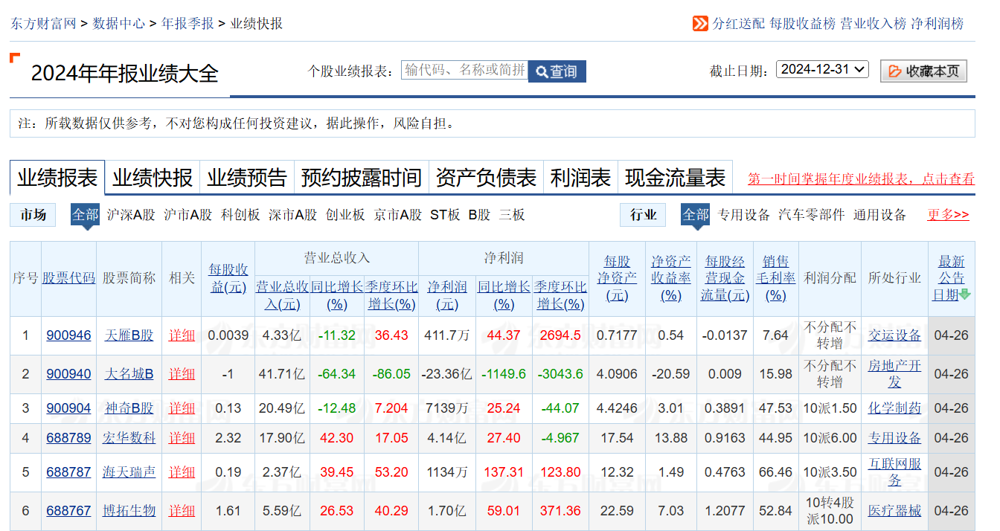
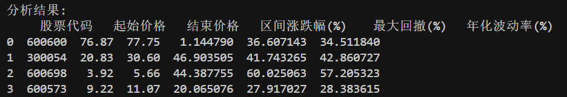
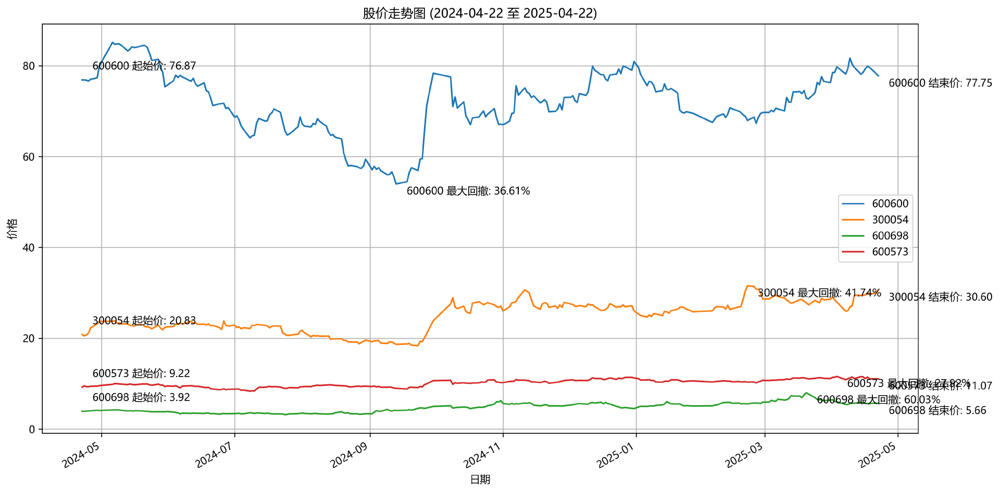
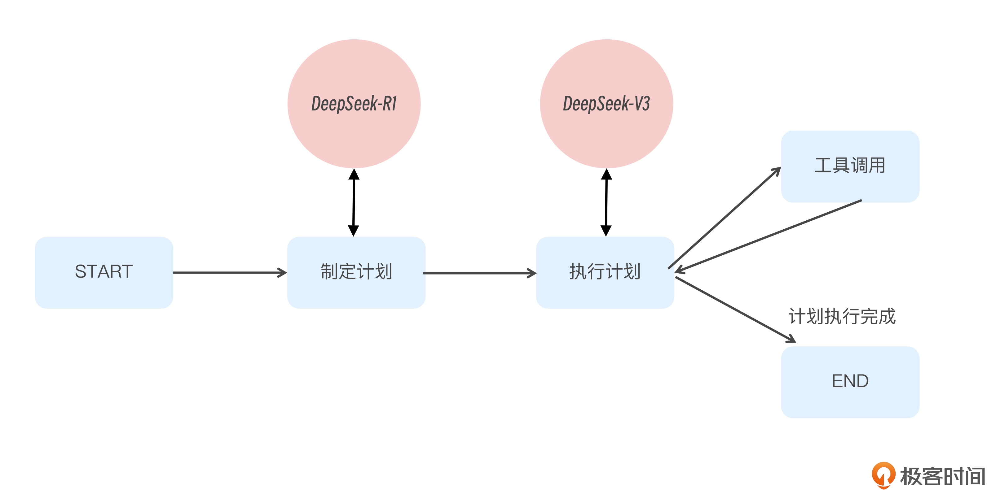
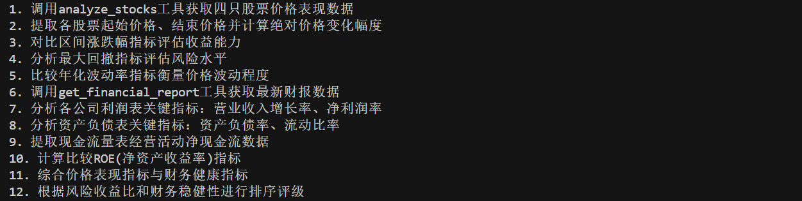
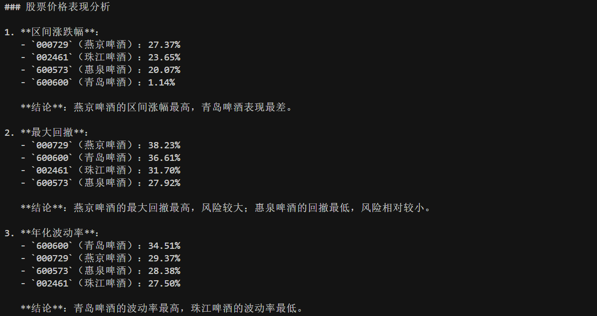
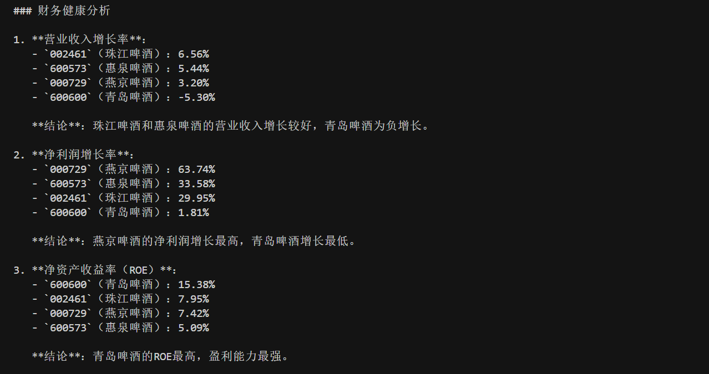
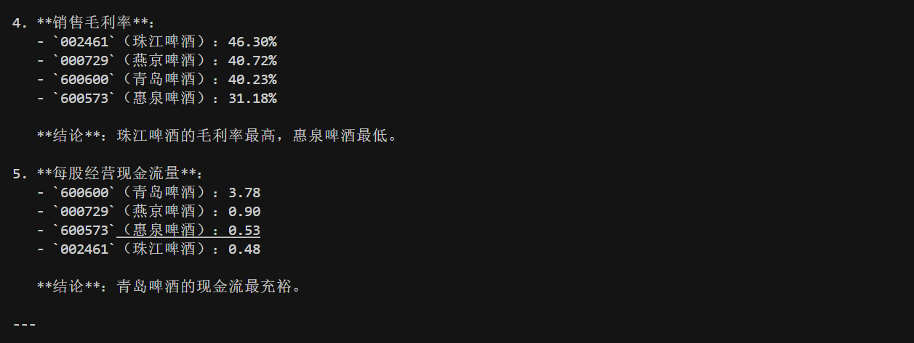
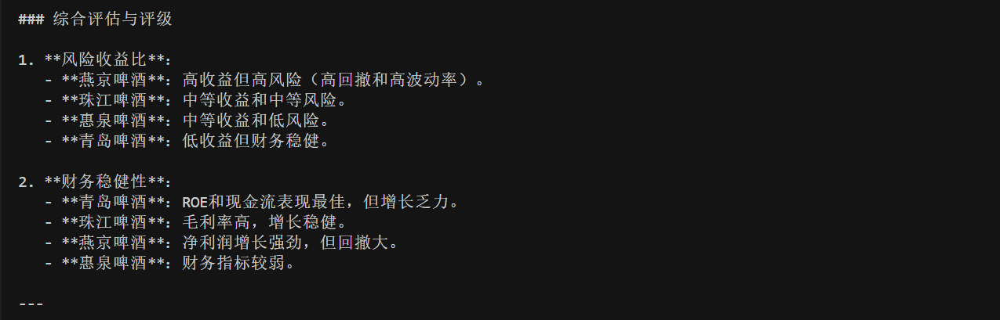
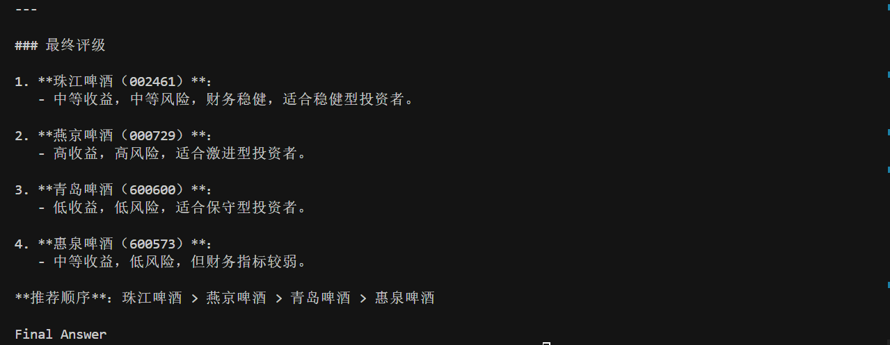

# 32 | 计划模式：如何让Agent有计划地进行股票数据分析？

你好，我是邢云阳。

2025 年 4 月 19 日字节跳动发布的扣子空间，不知道你有没有关注和试用过。这个产品对标了前一阵比较火爆的 AI Agent 工具 Manus，本质是一款具备深度思考以及各类工具调用的通用 Agent。

秉承着我们的课程一贯追逐前沿技术的风格，我在已经准备好的课程内容基础上，特意为你进行了升级，从扣子空间中选取了部分技术点，来为你讲解如何用自然语言来做股票数据分析。

## 数据准备

做股票的数据分析，比如某某股票好不好？最基础的就是要看两个内容，一是指标，另一个是财报。

指标有很多，比如以年为单位，可以看波动率、最大回撤、涨跌幅等等，从而判断一只股票的收益率、稳定性等等。而财报呢，一般包括年报与季报两个不同时间周期的数据。通过财报，我们可以直观看到股票所对应公司的收入、利润等等，从而判断该公司的表现如何。

这些内容的基础都是数据，因此我们需要预先准备好。其实在上一节课，我们就已经完成了数据准备，相信现在大家手里面已经都有一份完整的沪深 A 股过去两年的日 K 数据了，刚刚说的指标就是基于这些数据套用公式计算出来的。

而财报数据的准备呢，之前我们没讲过，不过也非常简单。首先还是打开 AKShare 的文档，在年报季报栏目中有一个业绩报表，文档链接在这：AKShare 股票数据 — AKShare1.16.81 文档，它抓取的是东财上公布的数据。

该接口只有一个参数，那就是 date，表示某某时间以后发布的数据。date 的格式是YYYYMMDD 的格式。YYYY 就是自然年，比如 2025、2024。但 MMDD 不能随便填，其只能填四个日期中的一个，分别是 0331、0630、0930 以及 1231，这四个时间点分别对应了一季度报、年中报、三季度报和年报的数据。

原理懂了后，我们直接用以下四行代码进行抓取，并把它保存到 CSV 文件中即可。代码如下：

```python
import akshare as ak
import pandas as pd
df = ak.stock_yjbb_em(date="20241231")
df.to_csv('financial_report.csv')
```

这里我抓取的是 2024 年年报的数据。你也可以点击链接，去东方财富网看到相关的数据。



这样，我们的股票日 K 数据与财报数据就准备好了。

## 工具准备

有了数据后，按照我们之前做 Agent 应用的思路，接下来就是要准备工具了。经过这么多节课的反复演练，想必你也很熟悉了。这里需要准备指标与财报两个工具。

### 指标工具

指标，主要是根据日 K 数据进行计算。本次我们就选取 2024 年 4 月 22 日 ~ 2025 年 4 月 22日 近一年的数据，来计算年化波动率、最大回撤、区间涨跌幅三个指标。

首先需要根据选中的日期与股票代码，从 CSV 中筛选数据并读取到 DataFrame 中，方便我们后续的操作。代码如下：

```
stock_data = df[df['股票代码'].astype(str).str.zfill(6) == stock_code].copy()
# 筛选日期范围
stock_data = stock_data[(stock_data['日期'] >= start_date) & (stock_data['日期'] <
```

接下来就可以计算指标了。

首先来看年化波动率。年化波动率是衡量股票价格在一年内波动幅度的统计指标，反映了其风险水平。

在计算时，先根据选取某只股票一段时间内的每日收盘价，计算出每日收益率，然后用每日收益率去求标准差，得到日波动率。最后乘以时间因子，转换成年波动率即可。对于时间因子，一般取 252，也就是假设一年有 252 个交易日（一年约 365 天，去掉周末、节假日，约 252天）。

看到这，大家是不是感觉很复杂呢？但其实如果用代码表示就会很简单，这完全得益于Pandas 这个库对于这些常见公式工具的封装。而且这部分代码可以用 AI 生成，代码如下：

```
# 计算日收益率
stock_data['日收益率'] = stock_data['收盘'].pct_change()
# 计算年化波动率 (假设一年252个交易日)
volatility = stock_data['日收益率'].std() * np.sqrt(252) * 100
```

两行代码搞定，接下来计算区间涨跌幅。区间涨跌幅就很好理解了，就是用（区间最后一个交易日的收盘价 - 最开始的交易日的收盘价）/ 最开始的交易日的收盘价。代码如下：

```
start_price = stock_data.iloc[0]['收盘']
end_price = stock_data.iloc[-1]['收盘']
total_return = (end_price - start_price) / start_price * 100
```

最后计算一下最大回撤。最大回撤也很好理解，就是找到这个区间内每日收盘价的最高点与最低点，计算出它们之间的差额，然后用这个差额除以最高点收盘价，即可得到最大回撤。举个例子，假设某股票连续 6 天的收盘价为 100、105、95、90、110、85（单位都是人民币）。下面逐日计算峰值和回撤：

第 1 天（100 元）：峰值为 100 元，无回撤；

第 2 天（105 元）：新峰值 105 元，无回撤；

第 3 天（95 元）：回撤率 = (105-95)/105 ≈ 9.52%；

第 4 天（90 元）：回撤率 = (105-90)/105 ≈ 14.29%；

第 5 天（110 元）：新峰值 110 元，无回撤；

第 6 天（85 元）：回撤率 = (110-85)/110 ≈ 22.73%。

所有回撤率中最大值为 22.73%

原理清楚后，我们再来看代码就一目了然了。

```
stock_data['max_price'] = stock_data['收盘'].cummax()
stock_data['min_price'] = stock_data['收盘'].cummin()
stock_data['drawdown'] = (stock_data['max_price'] - stock_data['min_price']) / st
max_drawdown = stock_data['drawdown'].max()
```

代码由于有 max、min 等求最大最小的函数，因此可以将上面的步骤进行简化。这些代码同样可以由 AI 生成，不需要我们动手。

除了指标计算以外，我还编写了绘制股价走势图的代码，这样如果我们想写一份报告，可以做到图文并茂。绘图是使用 python 的 matplotlib 库实现的。代码如下：

```python
import matplotlib.pyplot as plt
import matplotlib as mpl
# 设置中文字体
plt.rcParams['font.sans-serif'] = ['Microsoft YaHei', 'SimHei', 'Arial Unicode MS
plt.rcParams['axes.unicode_minus'] = False
mpl.rcParams['font.family'] = 'sans-serif'
# 创建图表
plt.figure(figsize=(15, 8))
# 绘制股价走势图
plt.plot(stock_data['日期'], stock_data['收盘'], label=f'{stock_code}')
# 添加关键价格标注
plt.annotate(f'{stock_code} 起始价: {start_price:.2f}',
           xy=(stock_data['日期'].iloc[0], start_price),
           xytext=(10, 10), textcoords='offset points')
plt.annotate(f'{stock_code} 结束价: {end_price:.2f}',
           xy=(stock_data['日期'].iloc[-1], end_price),
           xytext=(10, -10), textcoords='offset points')
# 标注最大回撤点
max_drawdown_idx = stock_data['drawdown'].idxmax()
if max_drawdown_idx is not None and max_drawdown_idx in stock_data.index:
   plt.annotate(f'{stock_code} 最大回撤: {max_drawdown:.2f}%',
               xy=(stock_data.loc[max_drawdown_idx, '日期'], stock_data.loc[max_d
               xytext=(10, -10), textcoords='offset points')
# 完善图表
plt.title(f'股价走势图 ({start_date.strftime("%Y-%m-%d")} 至 {end_date.strftime("%Y
plt.xlabel('日期')
plt.ylabel('价格')
plt.grid(True)
plt.legend()
# 调整x轴日期显示
plt.gcf().autofmt_xdate()
# 保存图表
plt.savefig(os.path.join(output_dir, 'stocks_price_chart.png'), dpi=300, bbox_inc
plt.close()
```

代码全部由 AI 生成，我随便选取了 600600、300054、600698、600573 四只股票，运行了上述的指标计算与绘图代码，效果如下：





在目前的这个年代，对于这类 AI 写的比我们还好的工具代码，无需深究原理，会用就可以。

### 财报工具

接下来进行财报工具的编写。这个工具就非常简单了，不涉及到计算，完全是根据股票代码，在 CSV 文件中查找数据。代码如下：

```
# 读取CSV文件
df = pd.read_csv(os.path.join(data_dir, 'financial_report.csv'))
print("从本地文件读取数据成功")
# 确保股票代码列是字符串类型
df['股票代码'] = df['股票代码'].astype(str).str.zfill(6)
# 创建结果字典
result = {}
# 为每个股票代码获取数据
for code in stock_codes:
   # 确保股票代码格式一致（6位数字）
   code = str(code).zfill(6)
   # 筛选该股票的数据
   stock_data = df[df['股票代码'] == code]
   if not stock_data.empty:
       # 将数据转换为字典格式，包含列名
       result[code] = {
           'data': stock_data.to_dict('records')
       }
   else:
       result[code] = {
           'data': []
       }
return result
except Exception as e:
print(f"读取数据时出错: {str(e)}")
return None
```

## 新的 Agent 设计模式——计划模式

工具准备好后，就开始进入到今天这节课的重点，那就是 Agent 的另一种设计模式——计划模式的学习，这也是整个课程拔高的部分。计划模式并不抽象，如果你能熟练掌握 FunctionCalling 以及 ReAct Agent 的原理，理解这个模式就很容易了。

### 什么是计划模式

我们首先回忆一下 ReAct 模式的特点，用一句话总结就是“摸着石头过河”。大模型拿到问题后，会思考一步，调用一次工具。然后根据工具执行结果，再进行下一步思考，这样反复执行，最终完成任务。这种模式简单易用，对于一般的复杂度的推理来说足够用了，最多就是中途出错时，通过反思自我纠错，多走点弯路而已。

不过在日常生活中，作为领导，一般都希望下属做工作时，都能够有计划地推进，从而提高效率与可靠度，也方便领导提前检查员工的计划是否合理，避免做无用功。我曾经反复说过，做AI，就是要把大模型当人对待，大模型就是我们的下属，我们的员工。因此我们是否也可以要求大模型先列出计划，然后再看计划执行呢？当然是可以的，这就是所谓的计划模式。

### 设计与代码实践

了解了计划模式是什么后，我们用一张图来设计一下计划模式该如何实现。如下图所示：



整张图实际上分成了两个部分，第一部分是制定计划，第二部分是执行计划。

制定计划部分，实际上非常简单，就是提示词工程。我们通过设计提示词，让大模型根据用户问题，设计出相应的计划。之后可以通过 State 传递给后面的节点。

执行计划部分，我们也不陌生，看图就知道与前面反复练习过的 Function Calling 的过程非常相似。

只不过 Function Calling 是每一步都在调用工具，如果有哪一步不调用工具了，则说明得到最终答案了，此时就可以退出循环转到 END 了。而在计划模式中，大模型列出的计划并不一定是每一步都需要调用工具的，因此就不能以是否调用工具作为退出循环的判断条件，而是要以是否执行到了计划的最后一步作为判断依据。

如何判断是否执行到了计划的最后一步呢？当然只能是大模型自己来判断。因此我们依然要借助提示词工程，比如仿照 ReAct，加入一个 Final Answer，便于我们拿到大模型的回复后去做判断。

以上就是计划模式的设计过程，完成设计后，我们就可以着手写代码了。首先来看计划阶段的提示词：

- 你是一个金融分析师，擅长使用工具对股票，上市公司财报等进行分析。请为用户提出的问题创建分析方案步骤

- 可调用工具列表：

```
get_financial_report:
   根据股票代码列表获取财报数据
   Parameters:
   -----------
   stock_codes : list
       股票代码列表
   Returns:
   --------
   dict
       包含每个股票代码对应的财报数据的字典
analyze_stocks:
  根据股票代码列表获取股票的起始价格，结束价格，区间涨跌幅，最大回撤，年化波动率
   Parameters:
   -----------
   stock_codes : list
       股票代码列表
   Returns:
   --------
   DataFrame
       包含每个股票代码对应的起始价格，结束价格，区间涨跌幅，最大回撤，年化波动率
```

- 要求：

```
1.用中文列出清晰步骤
2.每个步骤标记序号
3.明确说明需要分析和执行的内容
4.只需输出计划内容，不要做任何额外的解释和说明
5.设计的方案步骤要紧紧贴合我的工具所能返回的内容，不要超出工具返回的内容
```

在提示词中，有两点需要注意。

第一是要将工具描述放入到提示词中，这是因为我们不希望大模型天马行空的去列计划，而是要结合实际情况，因地制宜。

第二点是在最后的要求中，再一次强调了设计步骤要紧紧贴合工具所能返回的内容，这是因为DeepSeek-R1 作为一款思维能力超强的思考型模型，总会有很多自己的想法。如果我们不加以明确约束，可能会出现列出的计划需要某指标但，我们的工具提供不了的情况，这就会导致后续的计划执行步骤出现问题。

当我们把这段提示词以及用户问题发送给大模型后，大模型便会给出一个计划。此时我们需要将该计划通过 State 传递给后续的节点。因此 State 我是这样设计的：

```python
class State(MessagesState):
   plan: str
```

MessagesState 在第 30 节课已经学习过了，它负责维护的是一个大模型的对话消息列表。而这里我们自定义的 State 类是继承了 MessagesState，同时又在 MessagesState 的基础上增加了 plan 字段，用于存储计划。

实现了 plan 的传递后，执行计划的节点的提示词以及代码也就很简单了，代码结构与 30 节课的 llm_call 节点没有任何区别。

```python
def llm_call(state):
   """LLM decides whether to call a tool or not"""
   messages = [
       SystemMessage(
           content=f"""
```

- 你是一个思路清晰，有条理的金融分析师，必须严格按照以下金融分析计划执行：

- 当前金融分析计划：

```
{state["plan"]}
如果你认为计划已经执行到最后一步了，请在内容的末尾加上\nFinal Answer字样
```

- 示例：

```
分析报告xxxxxxxx
Final Answer
           """
       )
   ] + state["messages"]
   # 调用 LLM
   response = llm_with_tools.invoke(messages)
   # 将响应添加到消息列表中
   state["messages"].append(response)
   return state
```

这部分代码的重点在系统提示词，我们让大模型按照计划一步步执行，并在执行到最后一步时，在结尾加上 Final Answer，便于我们进行判断。

再往下写代码， llm_call 节点后是什么呢？当然是 tool_node 了。tool_node 的代码就是根据大模型返回的 ToolMessage 进行工具的调用，这部分代码与第 30 节课一模一样，我就不再重复了。

最后讲一下条件分支节点，如何判断退出循环。在第 30 节课，我们的判断逻辑是根据大模型的返回中是否包含 tool_calls，代码为：

```python
def should_continue(state: MessagesState) -> Literal["environment", "END"]:
   """Decide if we should continue the loop or stop based upon whether the LLM m
   messages = state["messages"]
   last_message = messages[-1]
   # If the LLM makes a tool call, then perform an action
   if last_message.tool_calls:
       return "Action"
   # Otherwise, we stop (reply to the user)
   return "END"
```

今天的代码呢，按照设计，我们要改成判断 Final Answer 是否存在，因此代码可以这样修改为：

```python
def should_continue(state) -> Literal["environment", "END"]:
   """Decide if we should continue the loop or stop based upon whether the LLM m
   messages = state["messages"]
   last_message = messages[-1]
   # If the LLM makes a tool call, then perform an action
   if "Final Answer" in last_message.content:
       return "END"
   # Otherwise, we stop (reply to the user)
   return "Action"
```

至此，计划模式的全部要点就讲完了，你可以课后下载我的代码，这样方便你查看代码细节并进行测试，加深理解。

### 测试效果

最后，我们来测试一下效果。我选取了啤酒板块的四只股票进行测试，分别是 600600 青岛啤酒，002461 珠江啤酒，000729 燕京啤酒以及 600573 惠泉啤酒。需要注意的是，在这里我不是给大家推荐股票，今天大模型的测试效果也不能作为最终的买卖决策，我们仅仅是学习与测试。

接下来，我们就构建提示并开始测试，提示词如下：

```
对比一下 '600600', '002461', '000729', '600573' 这四只股票的股价表现和财务情况，哪家更值得
```

运行后，输出的 plan 为：



执行 plan 的最终结果为：











注意看最后一张图的末尾的 Final Answer，这就是我们转到 END 的依据，我们拿到最终答案后，只需要用正则或者字符串操作，将其切掉就不会影响正文内容了。

这节课的代码我已经上传到了 GitHub，地址是：Geek02/class32 at main ·xingyunyang01/Geek02，你可以下载后进行测试，加深理解。

## 总结 & 思考题

这节课我们在扣子空间这款对标 Manvs 的通用 Agent 产品的背景下，将课程进行了升级，为你讲解了如何利用计划模式 Agent，来完成股票的数据分析。实际上还有三个地方可以完善，你可以作为课后思考题去研究一下方案。

第一，大模型制定好计划后，通常需要加入一个人类交互模块，由人类审核计划后，告知大模型确认执行，或者计划需要怎么修改等，再确定是执行计划还是修改计划。

第二，我们之前抓取的全部沪深 A 股数据是只有股票代码，没有股票名称的，因此这节课的提示词，我是直接输入的股票代码。你可以思考一下，如何能实现输入股票名称呢？

第三，大模型返回了一份非常详尽的报告，并且我们之前在指标工具中也生成了股价走势图，如何再写一个工具，将这两份数据结合起来，生成一份 MarkDown 格式的数据分析报告呢？

大家可以思考一下并在留言区展示你的思考结果，我们一起来讨论。如果你觉得这节课的内容对你有帮助的话，也欢迎你分享给其他朋友，我们下节课再见！
