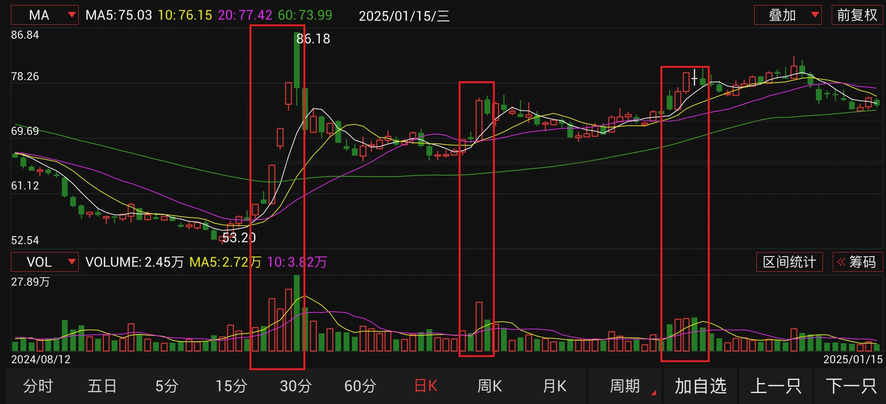
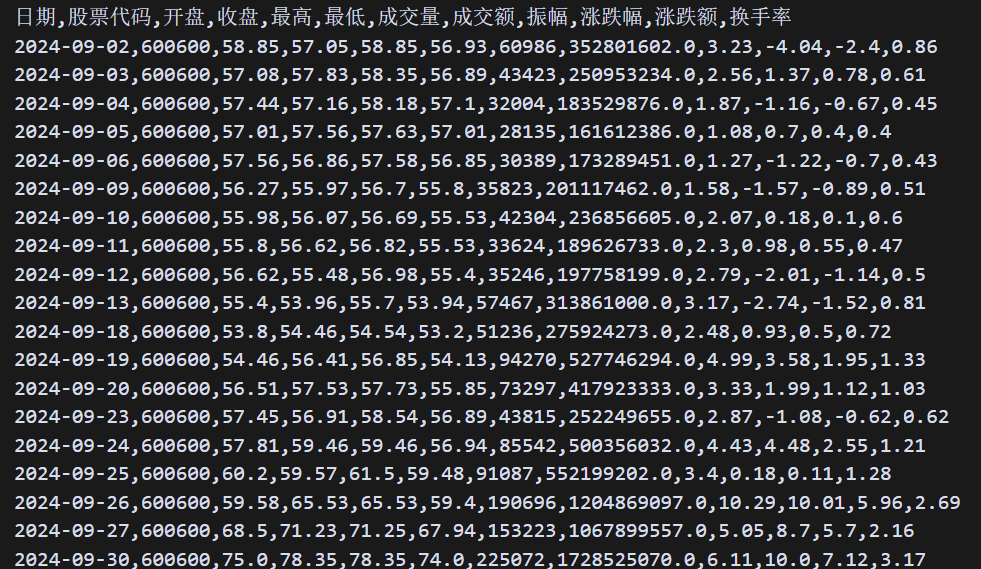
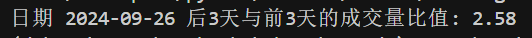
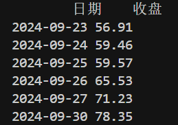
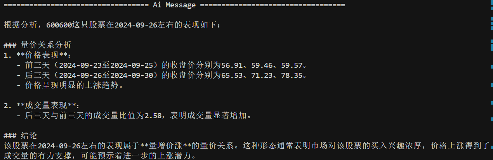

# 33-简易量化策略之量能策略

你好，我是邢云阳。

在金融投资领域，人们始终致力于探索如何借助计算机的力量，帮助我们做出更理性、更精准的投资决策。于是，量化投资应运而生，思路就是通过编写程序代码，将资深投资者的丰富经验和操作思路转化为自动执行的交易系统。

这就好像给交易经验装上了“智能开关”，这种方法最大的优势，就是能帮助投资者避免受情绪影响——当市场大涨时不会盲目跟风买入，行情下跌时也不会恐慌性抛售，这种克服人性弱点的特性，正是金融专家们重点研究量化策略的关键原因。

既然量化策略如此重要，这节课，我就为你介绍几种非常简单的量化策略，让你对这个知识有一个直观的感受。

## 量能策略

在量化领域，有一种基础策略叫做量能策略。它是一种基于成交量的分析策略。量能策略的核心逻辑是通过成交量的变化判断市场情绪、资金流向和价格趋势的可持续性，简单来讲就是分析量价关系。

按照量能增缩以及价格涨跌做排列组合，可以得到以下四种量价关系。

- 量增价涨：价格上涨伴随成交量放大，视为趋势健康的信号（多头力量强劲）。

- 量缩价涨：价格上涨但成交量萎缩，可能预示上涨动力不足（警惕回调）。

- 量增价跌：价格下跌伴随成交量放大，可能反映抛压加剧（空头主导）。

- 量缩价跌：价格下跌但成交量减少，可能表明市场观望情绪浓厚。

我们下面要讲解的判断成交量是否放大的方法，就属于以上四种关系中的量增关系。我以“青岛啤酒”股票的一张 K 线图为例，为你展示一下什么是量增价涨。



K 线图一般分为两个部分。第一部分是图片上半部这条用红绿柱子组成的折线图，这便是我们之前抓取过的日 K 数据。这条折线图的 X 轴是时间，Y 轴是价格，通过这条折线图可以看出价格的走势。图片的下半部的红绿柱子代表的是量能数据，也就是每一天的成交量，同样 X轴代表时间，Y 轴则代表成交量，这样便可以看出成交量的趋势。

我在图中，用三个红框圈出了三个时间周期。可以看到在这三个周期内，股价都有所上涨，并且下方的成交量相比上涨前，都有明显的增加，这便是量增价涨。

## 量化分析 Agent

前面的判断是人工用肉眼观测出的结果，如何让 DeepSeek 也能观测出呢？最简单的方法是将这几个交易日的股票信息（成交量，收盘价）一股脑发给 DeepSeek ，由 DeepSeek 做判断。但这其中会涉及到一些计算，比如成交量的比值，完全让 DeepSeek 计算可能会出现幻觉。

因此最好是做一个量化分析智能体，由智能体调用成交量计算工具以及股价信息工具，再进行判断。

### 计算成交量放大或缩小工具

首先，我们需要使用 AKShare 抓取青岛啤酒 2024-09-01 ~ 2024-09-30 这一个月的历史行情数据。这在第 29 节课进行过相关技术的讲解，这里我就不重复。抓取到的数据如下：



你可能一眼看上去觉得缺少数据，比如 2024-09-01 的数据，不过这不是因为技术上没抓到，而是因为这几日是节假日、周末，因此没有数据。

一般计算成交量是否放大，是需要有一个日期作为锚定时间点，之后计算该时间点前后几天的成交量比值。至于具体计算前后几天的，这个则需要根据经验判断，因为有时超短线可能放量三天就结束了，有时可能会持续五天等等，因此该值不是固定的。

我们接下来用 Pandas 程序实现一下计算环节，程序如下：

```bash
import pandas as pd
import os
def load_df(file_name):
   # 读取数据
   data_path = os.path.join('D:\\workspace\\python\\akshare\\code07', file_name)
   df = pd.read_csv(data_path)
   # 将日期列转换为datetime类型
   df['日期'] = pd.to_datetime(df['日期'])
   return df
def calc_vol_ratio_around_date(df, target_date, days_before=3, days_after=3):
   """
   计算指定日期前后的成交量比值
   :param df: DataFrame，包含股票数据
   :param target_date: str，目标日期，格式：'YYYY-MM-DD'
   :param days_before: int，目标日期前的天数
   :param days_after: int，目标日期后的天数
   :return: float，成交量比值
   """
   # 将目标日期转换为datetime
   target_date = pd.to_datetime(target_date)
   # 获取目标日期在数据中的位置
   date_mask = df['日期'] == target_date
   if not date_mask.any():
       print(f"未找到日期 {target_date}")
       return None
   # 获取目标日期的索引
   target_idx = df[date_mask].index[0]
   # 获取前后的数据
   before_data = df.iloc[target_idx-days_before:target_idx]['成交量']
   after_data = df.iloc[target_idx:target_idx+days_after]['成交量']
   # 计算比值
   if len(before_data) == days_before and len(after_data) == days_after:
       return after_data.mean() / before_data.mean()
   else:
       print("数据不足，无法计算比值")
       return None
@tool
def vol_info(target_date:str):
   """
   计算指定日期后3天（含指定日期）与前3天的成交量比值
   param target_date: str，指定日期，格式：'YYYY-MM-DD'
   return: float，成交量比值
   """
   df = load_df('600600.csv')
   ratio = calc_vol_ratio_around_date(df, target_date)
   return ratio
```

load_df 方法用于从指定的 CSV 文件中将数据读取到 DataFrame 中，并将 DataFrame 中日期一列改为 datetime 格式。

calc_vol_ratio_around_date 方法用于实现上述的量化规则。该方法会传入 DataFrame、目标日期、目标时间点前后各取几天等四个参数。

方法的第 22 ~31 行是根据目标日期获取其所在行的索引，也就是序号。比如 2024-10-11 所在的行就是第 0 行。

第 34 ~ 35 行使用 DataFrame 的索引器 iloc 读取成交量数据。[target_idx-days_before:target_idx] 的意思是从目标日期取前 X 天的数据，一直取到目标日期前一天的数据。为什么是前一天呢？这是因为 iloc 规定 [ ] 区间是左闭右开的。

最后的第 39 行代码负责计算出前后两个时间段的成交量的算术平均值，然后进行除法操作，算出成交量比值。

vol_info 是具体的 agent tool，被 @tool 装饰。第 46 ~ 50 行是工具描述，这些知识点在之前的章节中全部讲过，就不过多重复了。

为了我们测试起来方便，可以先将 @tool 注释掉，然后写一个 main 函数进行测试。代码如下：

```
if __name__ == '__main__':
   # 可以在这里修改目标日期
   ratio =vol_info('2024-09-26')
   print(f"日期 2024-09-26 后3天与前3天的成交量比值: {ratio:.2f}")
```

以 2024-09-26 为目标日期，运行这段代码的效果为：



根据结果可以看到 9 月 26、27、30 这三天的成交量是 25、24、23 这三天成交量的 2.58倍，说明是放大的。

### 获取股价信息

有了成交量后，还需要配合股价信息，才能进行量能分析。获取估计信息的工具实现非常简单，直接根据指定日期从 CSV 文件中读取出前三天与后三天的收盘价即可。代码如下：

```bash
@tool
def stock_price(target_date:str):
   """
   获取股票指定日期前三天与后三天（包含指定日期）的收盘价
   param target_date: str，指定日期
   return: float，最新价格
   """
   df = load_df('600600.csv')
   # 将目标日期转换为datetime
   target_date = pd.to_datetime(target_date)
   # 获取目标日期在数据中的位置
   date_mask = df['日期'] == target_date
   if not date_mask.any():
       return f"未找到日期 {target_date}"
   # 获取目标日期的索引
   target_idx = df[date_mask].index[0]
   # 获取前后的数据并合并
   combined_data = pd.concat([
       df.iloc[target_idx-3:target_idx][['日期', '收盘']],
       df.iloc[target_idx:target_idx+3][['日期', '收盘']]
   ])
   # 格式化日期为字符串
   combined_data['日期'] = combined_data['日期'].dt.strftime('%Y-%m-%d')
   # 返回结果
return combined data.to string(index=False)
```

代码的第 8 ~ 19 行与上一个工具的实现一模一样，都是从 CSV 中读取数据到 DataFrame，之后获取指定日期的索引。

代码第 22 ~ 25 行是获取指定日期前后三天的收盘价，并将这两组数据合并成一组。

该方法的打印效果为：



### 构建 Agent

Agent 的构建依然是使用 LangGraph，此处我们可以使用第 30 课讲过的 Pre-built Agent 进行构建。代码如下：

```python
from langgraph.prebuilt import create_react_agent
from langchain_core.messages import SystemMessage, HumanMessage
from llm import DeepSeek
from stock_price import stock_price
from strategies import vol_info
llm = DeepSeek()
pre_built_agent = create_react_agent(llm, tools=[stock_price, vol_info])
# 保存代理工作流程图到文件
graph_png = pre_built_agent.get_graph(xray=True).draw_mermaid_png()
with open("agent_graph.png", "wb") as f:
   f.write(graph_png)
# Invoke
prompt = """
```

- 你是一位金融分析师，擅长使用工具对股票进行量能分析。

```
工具1：stock_price
   获取股票指定日期前三天与后三天（包含指定日期）的收盘价
工具2：vol_info
   计算指定日期后3天（含指定日期）与前3天的成交量比值
```

- 要求：需要分析出股票属于以下量价关系（量增价涨，量缩价涨，量增价跌，量缩价跌）中的哪一种，并给出分析结论

```
"""
messages = [SystemMessage(content=prompt), HumanMessage(content="600600 这只股票在
messages = pre_built_agent.invoke({"messages": messages})
for m in messages["messages"]:
   m.pretty_print()
```

可以看到代码过程与之前讲过的一模一样，属于套路化的代码，重点是提示词如何去写。

为了演示 DeepSeek 的量化分析能力，我在 SystemMessage 系统提示词中给出了明确的要求。让其用工具进行量能分析，同时还要求其明确告诉我们分析的股票表现属于量价关系的哪一种，这是为了与我们的课程内容相呼应。

有了系统提示词做明确的铺垫后，HumanMessage 也就是 User 角色的提示词就直接问股票表现就可以了。

最后的运行效果为：



可以看到 DeepSeek 的分析与我们之前的分析是一致的。

## 总结

这节课演示了一个非常简单的量化策略——量能策略，为你揭开了金融市场量化分析的神秘面纱。

有没有发现，关于 Agent 的代码，无论是工具如何定义，还是 Agent 如何构建都是之前讲过的内容，没有任何的新知识。但是利用相同的代码搭配不同的业务与提示词，就能实现不同的Agent，进而解锁 DeepSeek 的更多能力。比如上一章是代码生成 Agent，这章则是金融分析Agent。这便是我在这门课刚开课之时，就给一位同学回复留言说的“懂业务”的重要性。

这是我的一点心得体会，希望与你共勉。这节课的代码已经上传到了 GitHub，链接是：Geek02/class33 at main · xingyunyang01/Geek02，你可以下载后进行测试，加深理解。

## 思考题

你可在课后找一只放量大跌的股票，抓取其数据，测试一下 DeepSeek 是否能够分析出来。

欢迎你在留言区展示你的思考结果，我们一起来讨论。如果你觉得这节课的内容对你有帮助的话，也欢迎你分享给其他朋友，我们下节课再见！
