# 加餐1 | Agent的前辈：FunctionCalling

你好，我是邢云阳。

今天是一期特别加餐。课程上线后，我看到了很多同学的留言，有些同学可能之前没接触过AI 编程，提出直接开始学习 Agent 有些吃力。

因此我决定加餐这节课，把 Chat Completion 以及 Function Calling 的内容给大家串一下。如果已经看过我的《AI 重塑云原生应用实战》课程第一讲或者说已经对这块知识很了解的同学，可以忽略今天的内容。

好，让我们开始吧。

自 2023 年 3 月 ChatGPT 在中国爆火以来，大模型已经悄然改变了许多人的提问方式，尤其是在互联网圈子里。从以前的“有问题，Google 一下”，到现在的“先问问大模型”，这种转变反映了技术对日常生活的深远影响，比如图中这位女士就将 ChatGPT 使用的淋漓尽致。

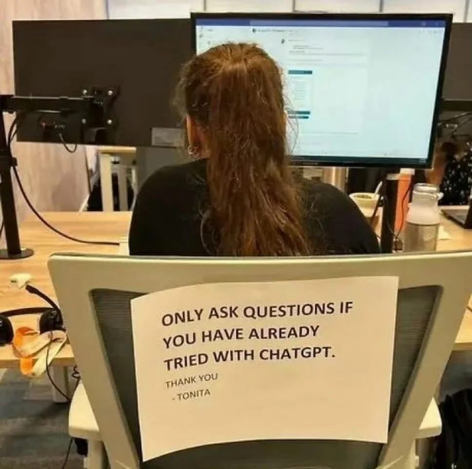

但是在使用过程中，我们会发现，有时大模型并不是万能的，它会一本正经的给出错误答案，业界把这种现象称之为“幻觉”。比如我通过 ChatGPT 问 ChatGPT-4o 一个它肯定不会的问题。

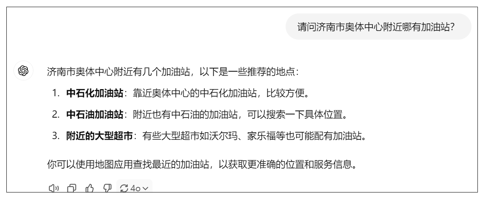

我们会发现，大模型给出了看似正确实则“废话”的答案。

再比如，我问一道小学一二年级的数学题：

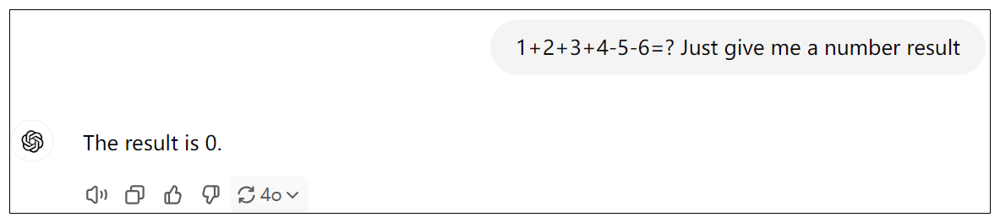

我们很容易知道 1+2+3+4-5-6=-1，但大模型给我们的答案是 0。

“幻觉”出现的原因其实很简单。我们知道作为人类来说，即使是才高八斗，学富五车，也不可能什么都懂，于是就有这样一种人，为了面子，在遇到不会的问题时，也要强行给出一个模模糊糊的答案，我们称之为不懂装懂。

同样，作为大模型，训练数据是有限的，特别是对于一些垂直领域以及实时性的问题，例如附近哪有加油站？今天的茅台股票多少钱一股？大模型是无法给出正确的回答的。那大模型为什么也处理不了小学数学题呢？这是因为大模型的训练方法是通过学习语言的结构和模式，使得其能够生成与人类语言相似的文本，而不是针对数学问题这种精确逻辑做的训练，因此它的数学能力很弱。

我们应如何解决这类问题呢？OpenAI 公司为了能让大模型与外界进行交互，发明了 FunctionCalling 机制，即可以在向大模型提问时，给大模型提供一些工具（函数），由大模型根据需要，自行选择合适的工具，从而解决问题。这一机制的出现，迅速得到了业界的响应，几乎所有的商业模型都在短时间内支持了这一机制。DeepSeek 作为新晋网红，当然也不能落后。

因此接下来，我将使用 python 语言，利用 DeepSeek 模型，为你演示一下 Function Calling功能，我们就以查询股票收盘价为例，让大模型通过工具来进行查询。

## 代码实战前置工作

### 环境准备

运行环境：Windows/Linux

Python 版本：3.11

LLM：DeepSeek-R1/qwen-max

SDK：openai 1.63.2

关于 DeepSeek 模型的使用，最好的肯定是使用官方版。但由于最近官方算力紧张，导致服务器不太稳定，因此我们只能退而求其次使用云厂商自己部署的版本。我会分别讲一下官方版和阿里云版的如何开通，大家学到这节课时，可根据实际情况自由选择。

所以为了照顾大家的学习效果。我在下文讲解 Function Calling 时，会告诉大家 deepseek-chat 如何调用，但是实际演示效果时，就用通义千问大模型 qwen-max 给大家做演示。原理都是一样的，如果后面官方可以充值了，大家可以再去用 deepseek-chat 做体验。

### 官方版开通

官方版本可以点击链接进入。进入后的界面如下：

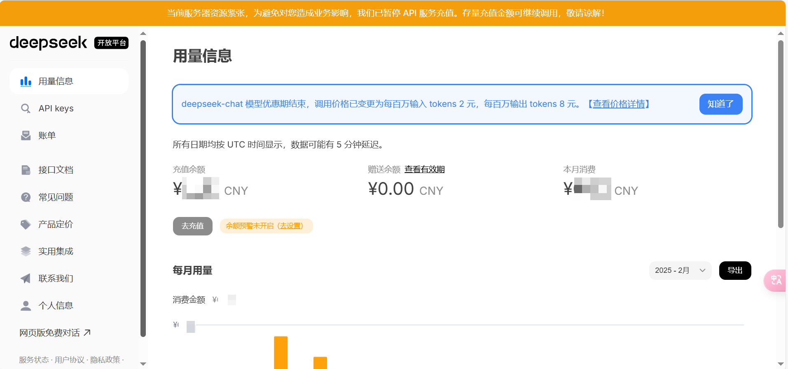

新用户需要用手机号注册一下，一般会送有一定有效期的 15 元左右的试用额度。我们通过代码与大模型对话的本质是调用厂商提供的 API，因此厂商为了验证身份，会校验 API Key。因此我们需要点击左侧侧边栏的 API Key，进入到创建 API Key 的页面。

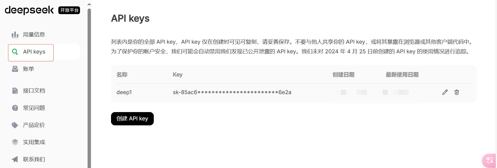

点击创建即可。

之后点击左侧的接口文档，可以查看详细的接口使用说明。

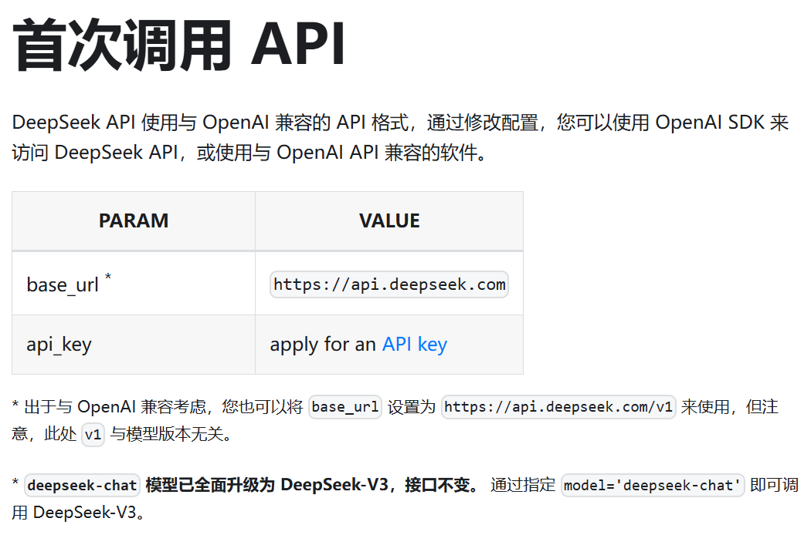

比如我截图的这一部分，就是使用 DeepSeek 模型的关键。大家今后不论使用什么模型，都要学会看它的 API 文档。

### 阿里云版开通

阿里云版是通过了其产品大模型服务平台百炼的模型市场功能提供了 DeepSeek 的各模型的服务。

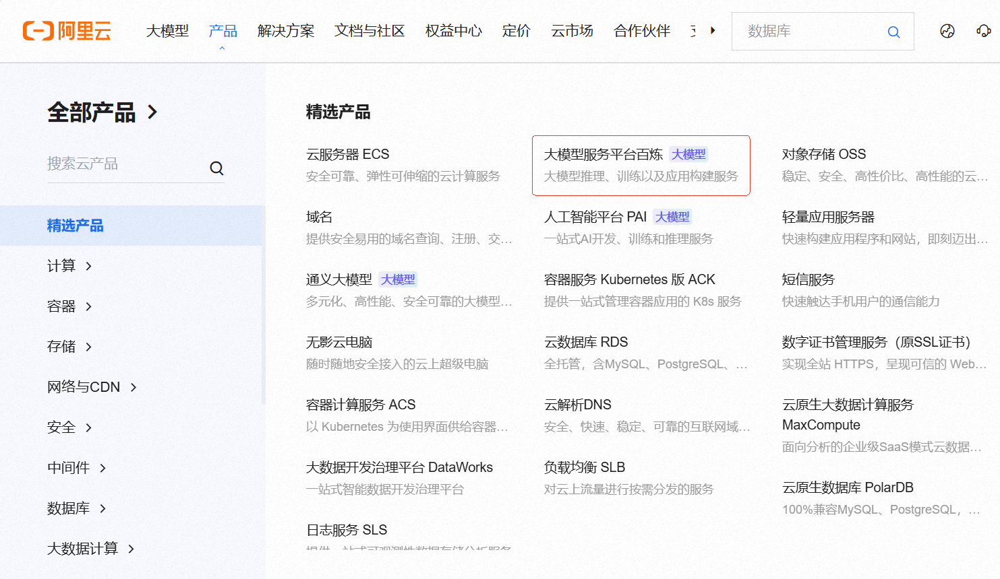

进入百炼后，在模型广场筛选 DeepSeek，可以看到 DeepSeek 全家桶。

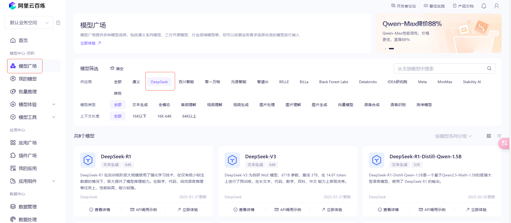

新用户需要点击右上角的小人，选择 API-KEY，创建一下 API Key。

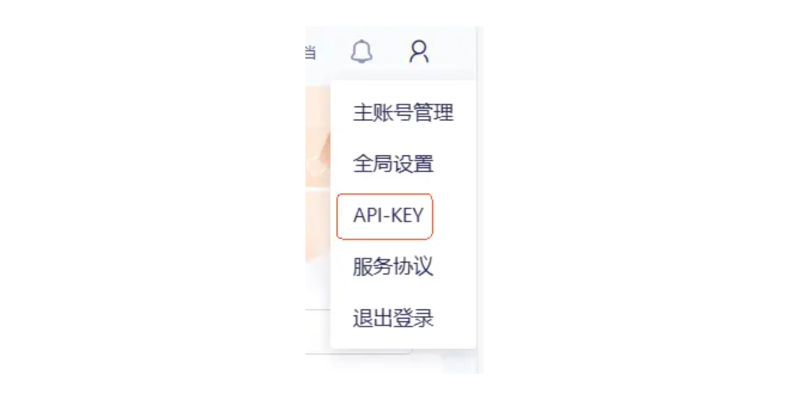

阿里部署的 DeepSeek 模型的 API 使用文档，可以在模型的查看详情和 API 调用示例看到。

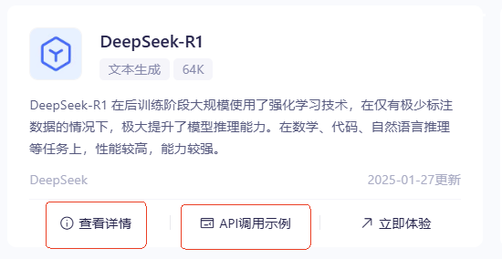

## 代码实战演示

接下来我会使用阿里云百炼提供的 DeepSeek-R1 模型为大家演示 Chat Completions，然后用通义千问大模型 qwen-max 来为大家演示 Function Calling。

### 模型环境变量配置

当我们获取了 api_key 之后，为了保密和调用方便，可以将其配置到环境变量。

以 Windows 系统为例，我的电脑 -> 右键属性 -> 高级系统设置 -> 环境变量，在系统变量中点击新建。

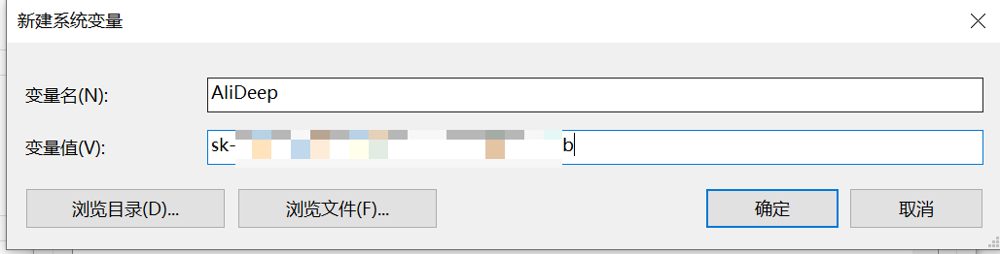

输入变量名和 api_key 的值即可。

接下来我们开始写初始化用于访问大模型的客户端的代码。

首先将 OpenAI SDK 下载下来。

```
pip install openai
```

为什么是 OpenAI 的 SDK 呢？这是因为 OpenAI 是行业标杆，是龙头，因此后续几乎所有的模型厂商的 API 都是兼容 OpenAI 数据格式的。

下载完成，开始初始化一个 OpenAI 客户端，需要填充 api_key 和 base_url 两项，用于客户端与大模型服务器的连接。api_key 之前我们说过，用于验证身份。base_url 则是代表了提供模型服务的厂商的服务地址。如果 base_url 不设置，由于使用了 OpenAI SDK，就会默认请求 OpenAI 的服务。这里我使用的阿里云百炼，因此 base_url 是百炼服务器的地址。

```
client = OpenAI(
   api_key=os.getenv("AliDeep"),
   base_url="https://dashscope.aliyuncs.com/compatible-mode/v1"
)
```

为了不泄露 api_key，我们通常使用 os 包从环境变量中获取 api_key。

如果是使用 DeepSeek 官方的模型呢？只需修改 api_key 和 base_url 即可。代码如下：

```
client = OpenAI(
   api_key=os.getenv("DeepSeek"),
   base_url="https://api.deepseek.com/v1"
)
```

### Chat Completions

在演示工具选择之前，首先需要把和大模型对话的基础代码写好。这就要用到 ChatCompletions。Chat Completions 是 OpenAI SDK 提供的对话补全的方法，我们使用它可以完成和大模型的对话。

在与大模型的对话过程中，会有三种基础角色，用来让大模型清楚某句话是谁说的。

- system：系统角色，可以理解为全局变量或前置条件，设置上这个角色之后，就会规定大模型的聊天范围，业界通常称之为“人设”。

- user：人类角色，代表这句话是人类说的。在包括 LangChain 在内的很多框架和场景下，user 角色也会被写成 human。

- assistant：AI 角色，代表这句话是大模型给我们的返回。在包括 LangChain 在内的很多框架和场景下，assistant 角色也会被写成 AI。

我举一个例子，演示一下使用以上三种角色完成一次 Chat Completions。

```
system: 你是一个足球领域的专家，请尽可能地帮我回答与足球相关的问题。
user: C罗是哪个国家的足球运动员？
assistant: 葡萄牙
```

如果想要实现多轮对话效果，则需要每一次都带着历史对话提问，例如：

```
system: 你是一个足球领域的专家，请尽可能地帮我回答与足球相关的问题。
user: C罗是哪个国家的足球运动员？
assistant: 葡萄牙
user: 内马尔呢？
```

虽然最后一次人类的提问“内马尔呢”是一个模糊提问，但由于存在历史对话，因此大模型可以理解用户的提问的意思是“内马尔是哪个国家的足球运动员？”

理解了三种角色后，我们开始写代码。

```
completion = client.chat.completions.create(
   model="deepseek-r1",
   messages=[
       {'role': 'system', 'content': '你是一个足球领域的专家，请尽可能地帮我回答与足球相
       {'role': 'user', 'content': 'C罗是哪个国家的足球运动员？'},
       {'role': 'assistant', 'content': 'C罗是葡萄牙足球运动员。'},
       {'role': 'user', 'content': '内马尔呢？'},
   ]
)
```

在这个函数中，首先我通过之前初始化好的客户端调用了 chat.completions.create 方法。该方式是完成一次与大模型的对话，大模型的回复给保存在 completion 中。在 create 方法中，我通过 model 选择了 deepseek-r1 大模型，之后用了一个 messages list，填写了系统提示词，历史对话以及最新的提问。

我们知道 deepseek-r1 是带深度思考的，因此可以用如下方法，从 completions 中，将思考过程和最终回复都打印出来看一下。

```
# 通过reasoning_content字段打印思考过程
print("思考过程：")
print(completion.choices[0].message.reasoning_content)
# 通过content字段打印最终答案
print("最终答案：")
print(completion.choices[0].message.content)
```

输出：

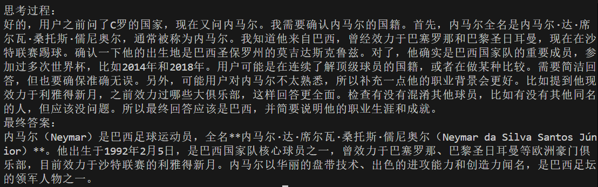

在上面的例子中，大模型成功的根据对话历史，理解了“内马尔呢？”表达的真正含义。

### Function Calling

接下来学习 Function Calling 。由于 Function Calling 功能是 OpenAI 公司发明的，因此我们定义工具需要遵循 OpenAI SDK 的规范。规范如下：

```json
{
   "type": "function",
   "function": {
       "name": "",
       "description": "",
       "parameters": {},
   }
}
```

规范还是很简单的，包含了工具类型 Type 和工具定义 Function 两个部分，其中工具类型是写死的 “function”。工具定义包含名称 Name、描述 Description 以及参数 Parameters 三个部分。

接下来我来定义一个股票收盘价查询的工具描述，给你做一下演示。

```javascript
tools = [
   {
       "type": "function",
       "function": {
           "name": "get_closing_price",
           "description": "使用该工具获取指定股票的收盘价",
           "parameters": {
               "type": "object",
               "properties": {
                   "name": {
                       "type": "string",
                       "description": "股票名称",
                   }
               },
               "required": ["name"]
           },
       }
   },
]
```

在我的工具定义的 Description 部分，清晰的描述了工具的作用。在 Parameters 部分，我使用了标准的 json schema 方式编写了参数名称、类型等，这样也有助于大模型准确理解。

在定义好工具后，我们需要在向大模型提问时，带上工具，因此 Chat Completions 增加了两个参数，一个是 tools，用于接收 tools 列表；另一个参数是 tool_choice，用于设置让大模型使用工具还是不使用工具，一般设置为 “auto”，意思是让大模型自己根据实际情况选择是否调用工具。修改后的 chat 函数代码如下：

```python
def send_messages(messages):
   response = client.chat.completions.create(
       model="qwen-max", #如果使用的是 DS 官方服务，则换成 deepseek-chat
       messages=messages,
       tools=tools,
       tool_choice="auto"
   )
   return response
```

有了这些基础，我们就可以向大模型提问，看看大模型是否会选择我们的工具了。比如我们问“青岛啤酒的收盘价是多少”

```
if __name__ == "__main__":
   messages = [{"role": "user", "content": "青岛啤酒的收盘价是多少？"}]
   response = send_messages(messages)
   print("回复：")
   print(response.choices[0].message.content)
   print("工具选择：")
   print(response.choices[0].message.tool_calls)
```

输出：

```
回复:
```

- 工具选择：

```javascript
[ChatCompletionMessageToolCall(id='call_ce3e14eb2c4b44f1914693', function=Functio
```

可以看到大模型选择了工具 get_closing_price，并在用户 query 中提取了“青岛啤酒”作为参数。另外，只要大模型选择了工具，则其回复就会是空字符串。

测试到这里，我们可以初步理解所谓大模型“调用”工具的机制。其实就是将工具用文字描述清楚，并和问题一起发送给大模型，由大模型判断选择哪个工具能解决问题。因此其实 FunctionCalling 这个表述我个人感觉并不准确，或许叫 Function Selecting 会更加没有歧义。

所以我们可以得出两个结论：

1. 工具的定义也是 prompt，也就是要消耗 token 的。

2. 大模型只能选择使用工具！而不能调用工具！真正调用工具的仍然是人类！

那既然调用工具的是人类，那我们就需要写一个工具函数。代码如下：

```python
def get_closing_price(name):
   if name == "青岛啤酒":
       return "67.92"
   elif name == "贵州茅台":
       return "1488.21"
   else:
       return "未搜到该股票"
```

最后我们看一下，人类如何调用工具，并将结果反馈给大模型，从而辅助大模型完成任务。

代码如下：

```javascript
if response.choices[0].message.tool_calls != None:
       tool_call = response.choices[0].message.tool_calls[0]
       if tool_call.function.name == "get_closing_price":
           arguments_dict = json.loads(tool_call.function.arguments)
           price = get_closing_price(arguments_dict['name'])
           messages.append(response.choices[0].message)
           messages.append({
               "role": "tool",
               "content": price,
               "tool_call_id": tool_call.id
           })
   print("messages: ",messages)
   response = send_messages(messages)
   print("回复：")
   print(response.choices[0].message.content)
```

首先判断大模型是否选择了工具，如果是，就匹配一下大模型用的什么工具，然后取出大模型提炼好的参数，喂给真正的工具函数，得到答案。

此时重点来了，也就是第 8～14 行代码。我们需要先把第一轮对话，大模型的反馈，也就是assistant 对话，加入到历史对话记录 messages 中。然后再追加一个角色为 tool 的对话。tool对话包含了工具函数返回的结果和第一轮大模型选择 tool 时反馈的 id。

此时的历史对话记录 messages 就包含了三条对话，分别是：

```json
{"role": "user", "content": "青岛啤酒的收盘价是多少？"}
{"role": "assistant", ...... }
{"role": "tool", ...... }
```

最后在第 18 行将以上对话重新发给大模型，大模型就能根据人类调用工具的反馈，给出最终回复。

最终回复如下：

- 回复：

```
青岛啤酒的收盘价是67.92。
```

## 总结

这节课我在开篇用了两个小例子为你展示了大模型不是万能的，大模型也有自身的弱点以及无法解决的问题，让你体验了一下什么是业界常说的“幻觉”。

OpenAI 公司为了解决这些问题，想到了让大模型与外界环境交互的破解之法，因此提出了Function Calling 机制，并在 SDK 中进行了支持，在迅速成为了行业标杆做法后，其他公司包括国内公司的大模型，也对该机制进行了兼容，因此我们可以使用 OpenAI SDK 配合DeepSeek 或者阿里云的通义千问大模型体验该机制。

最后我用一个获取股票收盘价的小例子，为你展示了 Function Calling 的代码应如何写，并介绍了其前置基础 Chat Completion。这节课的代码已公开在 GitHub 上，链接为：https://github.com/xingyunyang01/Geek02

## 思考题

对于不具备 Function Calling 能力的大模型，我们应该使用什么方法，让大模型可以实现类似的机制呢？

欢迎你在留言区展示你的思考过程，我们一起探讨。如果你觉得这节课的内容对你有帮助的话，也欢迎你分享给其他朋友，我们下节课再见！
