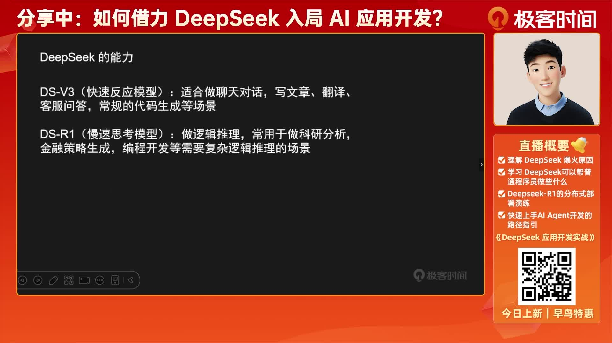

# 加餐2 | 直播回放：如何借力DeepSeek入局AI应用开发

开课直播回放内容，带你快速了解如何借力 DeepSeek 入局 AI 应用开发。

## Part 1 DeepSeek 为什么火？

00:00～6:25

DeepSeek 的能力

- DS-V3（快速反应模型）：适合做聊天对话，写文章、翻译、客服问答，常规的代码生成等场景

- DS-R1（慢速思考模型）：做逻辑推理，常用于做科研分析，金融策略生成，编程开发等需要复杂逻辑推理的场景

蒸馏含义与蒸馏使用场景

## Part 2 学习了 DeepSeek 以后能帮我们做什么？

6:26～12:15

- 提升个人竞争力，凸显价值

- 使用 AI 改造现有业务

- 个人创业

## Part 3 实战演示 分布式部署 DS-R1:70B

12:19～23:44 47:41～52:10

- 架构图解析

- VLLM + Ray 分布式部署实操演示

## Part 4 实战演示 零框架实现员工绩效管理 Agent

23:48~47:40

- 带领 AI 开发新手初步熟悉 Agent

- 案例需求

- 实战演示

## 直播答疑

52:11～1:07:01

更多精彩内容，可以订阅这门课程跟进，持续学习。

作者补充说明：由于 R1 自带思维链，与 Agent 产生了冲突，所以 Agent 不能使用 r1 等慢速思考模型，而是要使用 V3 等老老实实执行命令，没有自己想法的模型；R1 适合做的是单项的任务。比如用 r1 做一个生成财报的工具，然后让 V3 做 Agent 去调用该工具

https://github.com/xingyunyang01/Geek02/tree/main/achievement-agent

该链接为作者在直播中演示的员工绩效管理系统 Agent，这份代码演示了老师补充说明，并且换了一套 REACT 模板，如果有兴趣你可以下载测试一下。
